koken&genieten
€3,99

## VOOR ELKE DAG

# Uit mama's

# 52x

# keuken

## doordeweekse

## inspiratie

• Appel-walnotenkoek
• Gehaktballen met jus
• Gehakt-strogano

# Ode aan de

# gehaktbal

Klassieker in een
nieuw jasje

# Picknick

atthe ark
Kleine gerechten
om mee te nemen

# Taart voor

# Moederdag

Van mij, voor jou
MEI
2022
€3,99
Superlekkere schnitzels - maar dan vega!
BP

# Desnellewegdoorhetblad

Voorgerechten
& bijgerechten
Salades, soepen en
broodjes: lekker als lichte
maaltijd of om je etentje
mee te beginnen.
Gehaktballetjes met
champignonroomsaus 29
Courgette-schnitzels
met kwarkdip 13
Gevulde knolselderijschnitzels 14
Wortel-mangosoep
met feta 17
Aardbeien-amuses 19
Tofu-schnitzel met pindakorst
en noedelsalade 13
Hoofdgerechten
Ga je voor snel & makkelijk,
een dagje zonder vlees
of vis of pak je uit met een
weekendproject?
venkelzaad en tomatenjus 7
Ricottaburgers met gesmoorde
boerenkool 10
Paddenstoelenschnitzel met mierikswortel-aardappelpuree 14
met erwtjes 17
Rollade met kruidnagel en
Frisse perziksorbet 22 Rabarberkruimeltaart 38 Appel-walnotenplaatkoek 59
Vlierbloesem-limoensiroop 35 Geglaceerde appeltaart 59
jeneverbes 27
Sesam-yoghurtdip 39 Koude radijssoep 45 Gehaktballen met gerookte paprika,
Pasta met paprika en spiegelei
29
Teriyaki-kip met bimi 30
Dubbelgebakken
tosti ham-kaas 32
Orecchiette carbonara
Sierlijke filotaart
met snijbiet 48
Romige stoof
met voorjaarsgroenten 50
Gehaktballen uit de oven
met hutspot 55
55
Entrecote met gebakken uitjes
Zonder
vlees of vis
Snel klaar
(max. 30 min.)
Uitleg van symbolen bij de recepten
Lentegroentesoep 30
Frisse aardappelsalade
met radijsjes 37
ALLE RECEPTEN OP EEN RIJ
Pizzastrudel met spinazie en
zongedroogde tomaten 38
Romige witte-
Groentemuffins met feta 35
bonenpuree 39
Kokoscurry met ananas 47
Pasta met bifteki-balletjes in
Griekse saus 7
Burgers met appel en
romige zuurkool 8
Torta di polpette –
gehaktballetjestaart 9
Broodje gehaktballetjes met pruimensaus 10
Knapperige visfilet met koolrabi-aardappelsalade 18
Spinazie-quiche 18
Ovenschotel met casselerrib,
Kalkoenrolletjes met romige
sperziebonen 20
Aspic met kruidige
groentefond 26
brood en spitskool 19
Gehakt-stroganoff 32
Erwtensoep met worst 56
Gemarineerde karbonades 37
Fusilli met worst en
ei uit de oven 56
Zoet&nagerechten
Zoet is altijd goed!
Lekker als tussendoortje,
bij de koffie of als
afsluiting van je diner.
Limoensoesjes 21
Rijstdessert met bosvruchten
22
Rodelinzenbolognese 46
Appelstrudel met lemoncurd
en hazelnoten 60
Appel-browniecarrés 61
Appeltaart met amandelkorst
62
Kleurrijke Moederdagkrans 65

# inhoud

Voorwoord
Mama,s

# keuken

Mijn moeder is geen ster in de keuken – dat
roept ze zelf het hardst. Er is dan ook geen
gerecht dat mama het allerlekkerste kan
maken. Geen appeltaart die me terugbrengt
naar mijn kindertijd en geen groentesoep waar
ik warme gevoelens aan overhoud. Wat mama
kookte was altijd lekker, goed genoeg, maar
niet uitzonderlijk. Ik kan wel jaloers worden
op families die er een notitieboekje met familierecepten op nahouden. Die op feestdagen
een tafel vol met ‘hun’ gerechten hebben staan.
Precies zoals oma het ook maakte. In deze
editie hebben we recepten gebundeld die je
doen denken aan ‘mama’s keuken’. Van appeltaart (p. 58) tot groentestoof (p. 50) en gehaktballen (p. 6). Want mijn moeder mag dan
misschien geen topchef zijn, ze is wél degene
die me leerde koken. Door haar weet ik dat je
altijd een beschuitje moet verkruimelen door
de gehaktballen en dat van een beetje suiker
je gekookte worteltjes nog lekkerder worden.
Dingen die jij misschien gek vindt, maar ik heel
normaal, omdat mama het ook doet. Dat is
voor mij nostalgie. Dat maakt mama’s keuken
nog altijd unieker dan iedere andere keuken.
Laat je inspireren door onze recepten maar
voel je te allen tijde vrij om er een draai aan te
geven. Mama’s draai.
Yvonne Doorten
**6** Moeders gehaktballen
Een echte klassieker, in een nieuw jasje,
maar nog steeds uit moeders keukenhart.
**12** Vega schnitzels!
Deze vegetarische schnitzels zijn stuk voor
stuk heerlijk knapperig en misschien zelfs
nog lekkerder dan de doorsnee variant.
**16** De hele week genieten
Dat is in ieder geval één zorg minder: wat
jij komende week gaat eten, is bij dezen
bekend.
**24** Geurige kruidnagel
Leer meer over deze heerlijke smaakmaker
en ga aan de slag met onze favoriete kruidnagel-gerechten.
**28** Simpel en snel genieten
Het is al druk genoeg met werk, kinderen
en hobby’s. Hier is dé oplossing voor iedereen die geen tijd heeft om uitgebreid te
koken, maar toch lekker wil eten.
**34** Naar buiten!
In het bos, in het park, in de tuin of op je
dakterras. Waar je ook bent, op mooie
dagen geniet je samen met je familie of
vrienden van de zonnestralen én deze
heerlijke picknick-recepten.
**44** Zonder pakjes en zakjes
Ze is terug, dé koningin van het koken zonder pakjes en zakjes. Dit keer gaat Karin
helemaal op de vega tour en gooit ze allerlei klassiekers in een plantaardig jasje.
**50** Een pan vol
voorjaarsgroenten
Een rondje door de moestuin en je hebt
bijna alle ingrediënten al bij elkaar.
**53** Colofon
Wie werkten er mee aan deze uitgave en
waar stel jij je vragen? Kijk in het colofon.
Elke maand de
koken & genieten als eerste
in de brievenbus? Kijk op
of blader naar
www.kokengenieten.nl/abo
p. 42.
**54** Terug naar de kindertijd
Wie is er niet groot geworden met hutspot,
gehaktballen en erwtensoep. Laat je met
deze heerlijke klassiekers uit moeders
keuken terugvoeren naar je kindertijd.
**58** Mama’s appelgebak
Niemand bakt zo goed appeltaart als je
eigen moeder. Met deze heerlijke recepten
kom je wel aardig in de buurt.
**64** Moederdagtaart
Niets zo leuk als je moeder verrassen met
een zelfgebakken taart. Met deze vrolijke
krans versierd met fruit en bloemen maak
je je moeder gegarandeerd blij!
**66** Index & volgend
Alle recepten van deze uitgave op een rij én
een vooruitblik op volgende maand.
WIN HET

## BOEK

## ZONDER PAKJES EN

## ZAKJES VEGA

(t.w.v. €25,99)
(t.w.v. €25,99) 33

## ABONNEMENT

INHOUD

# Rabarber

In het voorjaar wordt rabarber in de buitenlucht
gekweekt en daarom is het een echte lentegroente!
Zodra de bladeren van de rabarber zich ontvouwen, begint de oogst. Hoe langer daarmee

## Alleskunner

wordt gewacht, hoe houtiger de stengels wor-
Courge e

## Alleskunner

den. Omdat rabarber gedurende het seizoen
steeds meer oxaalzuur ontwikkelt, wordt de
oogst na 21 juni stopgezet. Geniet er dus deze
korte tijd van en maak er rabarberkruimeltaart
Courgette is eigenlijk geen seizoensgroente,
(p. 38) mee. Heb je nog wat rabarber over? Maak
want hij is jaarrond verkrijgbaar in Nederland.
voor bij de taart wat extra compote. Lekker!
Toch wordt hij vooral in de zomermaanden veel

## Bitterzoet

gegeten omdat deze vruchtgroente in de volle
zon in de buitenlucht als een malle groeit. Met
courgette kun je echt alle kanten op. Je
kunt hem bakken, grillen en stoven
maar ook heel goed rauw eten.
Maak er hele dunne slierten van
en meng ze met een lekkere
frisse vinaigrette. Een nieuw

# op de markt

favoriet recept met courgette
is de courgette-schnitzel van
p. 13. Zo zie je courgette weer
op een hele andere, nieuwe
manier.
Profiteer van de
seizoensproducten
van de maand

# vers

# Vlierbloesem

# mei

## Lekker grillen

# Vlierbloesem

Heb je ze al zien staan in de berm, de bloeiende witte struiken van
zon in de buitenlucht als een malle groeit. Met
courgette kun je echt alle kanten op. Je
de vlier? Van deze heerlijk geurende bloemen geniet je maar kort
in het voorjaar. Pluk de vlierbloesems op een zonnig moment,
dan zijn ze het zwaarst van het stuifmeel. Spoel de vlierbloesem
niet af, want dan verlies je namelijk alle smaak. Schud de vlierbloesemschermen in plaats daarvan uit om alle insecten eruit te
krijgen. Laat de vlierbloesem trekken in water om er limonade

# Prei

van te maken of zet er thee mee. Je kunt de vlierbloesem ook
gebruiken in pannenkoekenbeslag of koekjesdeeg. De geurige
Prei is jaarrond verkrijgbaar en ook jaarrond een veel geziene groente
witte bloempjes geven je baksels net dat beetje extra!
Courge e
op ons bord. Maar hoe kies je nou de beste prei en hoe zorg je dat je nooit
uitgekeken raakt op prei? Zorg ten eerste dat je altijd een stevige prei te
pakken hebt. Als hij zacht aanvoelt kun je hem beter later liggen in het
schap. Spoel prei voor het koken ook altijd goed af want er zit vaak veel

## Mooi in bloei

zand tussen de bladeren. De meeste mensen snijden prei in ringen en bakken hem dan mee in een pastasaus of wok, maar je kunt hem ook in grote
stukken bereiden. Lekker in de grillpan of op de barbecue grillen tot hij
van die mooie bruine grillstrepen krijgt. Serveer de prei met een mosterddressing en wat geschaafde pecorino.

# Moeders

# gehaktballen

Een echte klassieker, in een nieuw jasje, maar
nog steeds uit moeders keukenhart.

# Coverrecept

## Gehaktballen met gerookte

## paprika, venkelzaad en

## tomatenjus

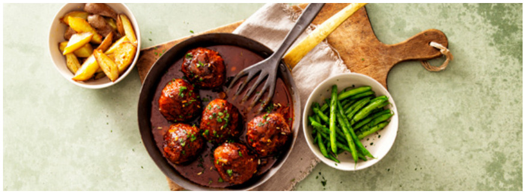

**Ingrediënten voor:** 6 stuks
**Bereidingstijd:** ca. 55 min.
Wachttijd: 20 min.
**1** sjalotje
**150 g** oud brood (evt. 100 g
paneermeel)
**500 g** half-om-halfgehakt
**1** ei
zout en peper
**1 tl** venkelzaadjes
**1 tl** gerookte-paprikapoeder
nootmuskaat
**2 el** boter
**2** teentjes knoflook
**2 tl** tomatenpuree
**1 tl** bloem
**300 ml** vleesfond
platte peterselie om te garneren
1 VOOR DE GEHAKTBALLEN Snipper het sjalotje
fijn. Snijd de korsten eraf en vermaal het brood
in een keukenmachine tot fijne kruimels. Kneed
het gehakt, het broodkruim, de sjalot, het ei, een
flinke snuf zout en peper, de venkelzaadjes, het
gerookte-paprikapoeder en een snufje nootmuskaat door elkaar. Vorm 6 gelijke ballen van het
mengsel en rol ze mooi rond. Leg de gehaktballen
op een bord en zet ca. 20 minuten in de koelkast.
2 Verhit de boter in een ruime braadpan met dikke
bodem tot hij net bruin begint te worden. Braad er
de gehaktballen op matig vuur rondom goudbruin
in. Zet het vuur lager en braad de gehaktballen
15-20 minuten rondom verder tot ze gaar zijn.
Neem de ballen uit de pan en houd apart.
3 VOOR DE JUS Hak de knoflook fijn en fruit hem
kort in het hete braadvet. Voeg de tomatenpuree
toe en bak hem 1 minuut mee. Roer de bloem
erdoorheen en bak alles nog ca. 1 minuut. Blus af
met de vleesfond en roer glad. Breng rustig aan
de kook en laat ca. 5 minuten doorkoken tot een
mooie gebonden jus. Leg de ballen in de jus en
verwarm het geheel nog ca. 10 minuten op matig
vuur. Keer de ballen regelmatig zodat ze mooi
bedekt zijn met jus. Strooi er voor het serveren
wat gehakte peterselie overheen.
**Per stuk:** ca. 324 kcal
**22 g** eiwit | 20 g vet | 14 g koolhydraten

## Pasta met bifteki-balletjes

## in Griekse saus

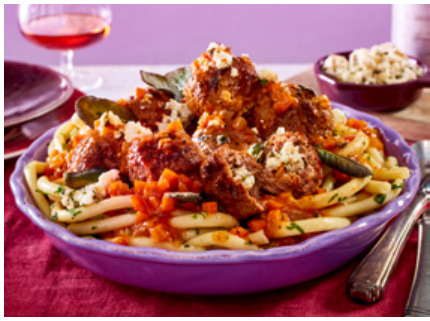

**Ingrediënten voor:** 4 personen
**Bereidingstijd:** ca. 50 min.
1
sneetje oud brood
**250 g** feta
**2 el** olijfolie
zout en peper
**2 el** oregano
**3** uien
**500 g** half-om-halfgehakt
**1 tl** tomatenpuree
paprikapoeder
**2-3 el** olie
**2** wortels
**2** teentjes knoflook
suiker
**1 el** bloem
**100** ml
Metaxa (Griekse distillaat)
**600 ml** groentebouillon
**300 g** spaghettoni
**6 takjes** peterselie
**3-4 el** slagroom
**1-2 el** boter
nootmuskaat
evt. gefrituurde salieblaadjes
1 Week het brood in koud water. Verbrokkel de
feta. Meng de feta met de olijfolie, ½ tl peper
en de oregano. Pel en snipper de uien. Knijp het
brood uit. Kneed het gehakt, het brood, ⅓ van de
ui, de tomatenpuree, 1 tl zout, ½ tl peper en 1 tl
paprikapoeder door elkaar. Maak van het gehakt-
SEIZOEN
mengsel ca. 16 balletjes en vul ze met de helft van
het fetamengsel.
2 Verhit de olie in een grote pan. Bak er de gehaktballetjes op middelhoog vuur in ca. 8 minuten rondom bruin in. Schrap de wortels, was ze
en snijd ze in blokjes. Pel de knoflook en hak hem
fijn. Neem de gehaktballetjes uit de pan.
3 VOOR DE SAUS Bak de overige ui, de knoflook
en de wortel ca. 5 minuten in het hete bakvet.
Bestrooi met zout, peper en 1 tl suiker. Bestrooi
met de bloem en bak kort. Blus af met de Metaxa
en de bouillon en breng aan de kook. Voeg de
gehaktballetjes toe en kook ca. 15 minuten op
laag vuur.
4 Kook de spaghettoni volgens de aanwijzingen
op de verpakking in water met wat zout. Was de
peterselie en hak de blaadjes fijn. Roer de slagroom door de saus en breng hem op smaak met
zout en peper.
5 Giet de spaghettoni af. Verhit de boter in een
pan. Voeg de spaghettoni en de peterselie toe
en wentel door elkaar. Breng op smaak met
nootmuskaat. Serveer alles samen en bestrooi
met de overige feta. Garneer eventueel met de
salieblaadjes.
**Per portie:** ca. 860 kcal
**42 g** eiwit | 44 g vet | 67 g koolhydraten

## Burgers met appel

## en romige zuurkool

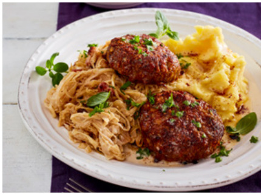

**Ingrediënten voor:** 4 personen
**Bereidingstijd:** ca. 1 uur en 15 min.
**2** uien
**75 g** gerookt spek
**1 el** olie
**800 g** zuurkool
**250 ml** groentebouillon
**150 ml** slagroom
**1** laurierblaadje
**4** jeneverbessen
**2** kruidnagels
zout en peper
1 grote appel (bijv. goudreinet)
**500 g** half-om-halfgehakt
**1 el** gehaktkruiden
**1** ei
**3 el** paneermeel
**1 tl** mosterd
**1 el** tomatenpuree
**1 tl** gedroogde oregano
**1 tl** paprikapoeder
**6 el** boter
**800 g** aardappels
**150 ml** melk
nootmuskaat
evt. peterselie en oregano om
te garneren
bakpapier
1 VOOR DE ZUURKOOL Pel en snipper de uien.
Snijd het spek in blokjes. Verhit de olie in een pan.
Bak er het spek knapperig in. Voeg de helft van de
ui toe en fruit hem glazig. Voeg de zuurkool toe
en fruit ca. 10 minuten verder. Schenk de bouillon en de slagroom erbij en breng aan de kook.
Voeg het laurierblaadje, de jeneverbessen, de
kruidnagels, zout en peper toe en kook afgedekt
ca. 15 minuten op laag vuur. Breng op smaak met
zout en peper.
2 VOOR DE BURGERS Was de appel, snijd hem in
vieren, verwijder het klokhuis en rasp de appel
grof. Verwarm de oven voor (elektrisch: 200°C
/ hetelucht: 180°C). Kneed het gehakt, de gehaktkruiden, het ei, de overige ui, de appel, het
paneermeel, de tomatenpuree, de oregano, het
paprikapoeder, 1 tl zout en ½ tl peper door elkaar.
Draai van het gehaktmengsel ca. 8 ballen en druk
ze op een met bakpapier beklede bakplaat plat tot
burgers. Verhit 2 el boter en bestrijk de burgers
ermee. Bak ca. 30 minuten in de oven.
3 VOOR DE AARDAPPELS Schil de aardappels,
4 Smelt 2 el boter in een klein pannetje tot hij
was ze en snijd ze grof. Kook ze in water met een
begint te bruisen. Serveer alles samen. Druppel
snufje zout in ca. 20 minuten gaar. Giet de aardde boter over de aardappels. Garneer eventueel
met peterselie en oregano.
appels af. Voeg 2 el boter en de melk toe en stamp
grof. Breng op smaak met zout en nootmuskaat.
**Per portie:** ca. 790 kcal
**35 g** eiwit | 47 g vet | 52 g koolhydraten

## Torta di polpette gehaktballetjestaart

**Ingrediënten voor:** ca. 12 stukken
**Bereidingstijd:** ca. 1 uur en 45 min.
Wachttijd: ca. 1 uur
**200 g** bloem (+ bestuiven)
zout en peper
**5** eieren
**100 g** koude boter (+ invetten)
**2** uien
**2** teentjes knoflook
**400 g** rundergehakt
**3 el** paneermeel
**175 ml** + 2 el slagroom
paprikapoeder
**1** rode paprika
**200 g** bladspinazie
**4 el** olie
**30 g** geraspte parmezaan
**50 g** geraspte belegen kaas
**20 g** gebakken uitjes
bakpapier
1 VOOR HET DEEG Meng de bloem met ½ tl zout.
Voeg 1 ei, de boter in stukken en 1 el koud water
toe en kneed alles glad. Rol het deeg op een stuk
bakpapier rond (ca. 32 cm Ø) uit. Bekleed een
ingevette en met bloem bestoven hartvormige
springvorm (ca. 25x26 cm) met het deeg en druk
de rand ca. 3,5 cm omhoog. Prik gaatjes in de
bodem. Zet de vorm met het deeg ca. 45 minuten
in de koelkast. Verwarm de oven voor (elektrisch:
200°C / hetelucht: 180°C). Bak het deeg onder in
de oven ca. 20 minuten voor.
2 VOOR DE BALLETJES Pel en snipper de uien
en de knoflook. Kneed de helft van de ui en de
knoflook, het gehakt, 1 ei, 2 el paneermeel, 2 el
slagroom, ½ tl paprikapoeder, zout en peper door
elkaar. Kneed van het mengsel ca. 15 gehaktballetjes.
3 VOOR DE VULLING Snijd de paprika in vieren,
verwijder de zaadlijsten, was de paprika en snijd
hem in blokjes. Was de spinazie. Verhit 2 el olie
in een pan. Fruit er de overige ui en de knoflook
in. Voeg de paprika en de spinazie toe en bak ca.
5 minuten tot het vocht verdampt is. Breng op
smaak met zout en peper.
4 Verhit 2 el olie in een pan. Bak er de gehaktballetjes in ca. 5 minuten rondom bruin in. VOOR DE
SAUS Roer 175 ml slagroom, 3 eieren, de parmezaan, de belegen kaas, zout en peper door elkaar.
5 Bestrooi de voorgebakken taartbodem met de
gebakken uitjes en 1 el paneermeel. Verdeel de
groenten en de gehaktballetjes erop. Schenk de
saus eroverheen. Bak de taart op gelijke temperatuur 35-40 minuten onder in de oven. Laat ca. 15
minuten afkoelen en snijd de taart in punten.
SEIZOEN
**Per stuk:** ca. 480 kcal
**20 g** eiwit | 34 g vet | 21 g koolhydraten

## Broodje gehaktballetjes

## met pruimensaus

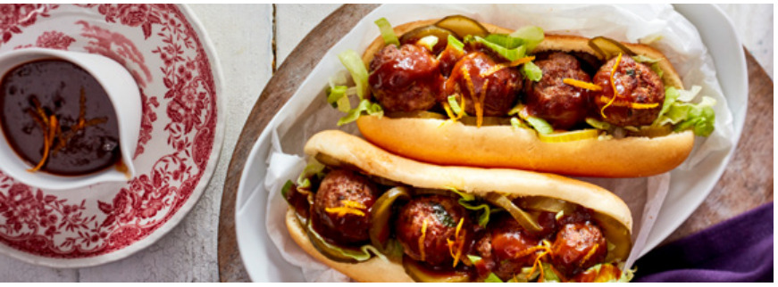

**Ingrediënten voor:** 4 stuks
**Bereidingstijd:** ca. 35 min.
**5-6 takjes** peterselie
**1** bio-sinaasappel
**400 g** rundergehakt
zout en peper
**1 el** boter
**50 g** pruimenjam
**50 g** tomatenketchup
**1-2 tl** worcestersaus
**4** hotdog-broodjes (puntjes)
**½** kleine ijsbergsla
**125 g** augurken in plakjes (pot)
1 VOOR DE GEHAKTBALLETJES Was de peterselie
en hak de blaadjes fijn. Was de sinaasappel met
heet water en rasp de schil er fijn af. Pers de
sinaasappel uit. Kneed het gehakt, de peterselie,
de sinaasappelschil, ½ tl zout en ½ tl peper door
elkaar. Draai er met vochtige handen 16-20 gehaktballetjes van.
2 Verhit de boter in een pan. Bak er de gehaktballetjes in 6-8 minuten rondom goudbruin en gaar
in. Neem ze uit de pan. Verwarm de oven voor
(elektrisch: 150°C / hetelucht: 130°C).
3 VOOR DE SAUS Roer de pruimenjam, de ketchup, de worcestersaus en het sinaasappelsap
door het hete bakvet. Breng aan de kook en kook
1-2 minuten in. Breng de saus op smaak met zout
en peper.
4 Verwarm de broodjes in de oven. Was de ijsbergsla en snijd hem in fijne reepjes. Snijd de
broodjes open. Beleg ze met de augurk, de ijsbergsla en de gehaktballetjes. Verdeel een beetje
pruimensaus eroverheen. Garneer met de peterselie. Serveer de overige saus erbij.
**Per stuk:** ca. 420 kcal
**24 g** eiwit | 24 g vet | 23 g koolhydraten

## Ricottaburgers

## met gesmoorde boerenkool

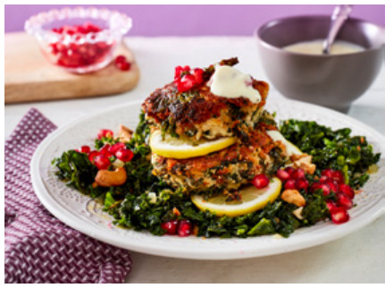

**Ingrediënten voor:** ca. 4 personen
**Bereidingstijd:** ca. 1 uur en 15 min.
**1 kg** boerenkool (panklaar)
**2** uien
**1-2 el** olie
zout en peper
**300 ml** groentebouillon
**50 g** cashewnoten
**800** g
witte bonen (blik)
**250 g** ricotta
geraspte schil en sap van ½ biocitroen
**60 g** paneermeel
**250 ml** volle yoghurt
**2 tl** mosterd
suiker
**1-2 el** boter
**1** granaatappel
evt. citroenschijfjes om te
garneren
1 Snijd de boerenkool eventueel kleiner. Pel en
snipper de uien. Verhit de olie in een grote pan.
Fruit er de ui glazig in. Voeg de boerenkool toe
en fruit ca. 5 minuten mee. Breng op smaak met
zout en peper. Schenk de bouillon erbij en breng
aan de kook. Smoor de boerenkool afgedekt ca.
25 minuten.
2 Rooster de cashewnoten in een droge pan.
Neem ze uit de pan en hak ze grof. Giet de bonen
af en spoel kort. Prak de bonen met een vork grof.
3 Neem ca. 125 g van de boerenkool en knijp
hem uit. Kneed de ricotta, de citroenschil, het
citroensap, het paneermeel en de bonen erdoorheen. Breng op smaak met zout en peper. Laat het
mengsel ca. 15 minuten trekken.
4 Roer de yoghurt en de mosterd door elkaar.
Breng de dip op smaak met zout, peper en ½ tl
suiker. Maak van het ricottamengsel ca. 8 burgers. Verhit de boter in een grote pan. Bak er de
burgers 3-4 minuten per zijde in.
5 Halveer de granaatappel. Klop de pitjes eruit.
Serveer de burgers eventueel met citroenschijfjes
en de overige boerenkool. Bestrooi met de pitjes
en de cashewnoten. Serveer met de mosterddip.
**Per portie:** ca. 560 kcal
**29 g** eiwit | 24 g vet | 52 g koolhydraten
SEIZOEN

# Vega-schnitzels

Deze vegetarische schnitzels zijn stuk voor stuk heerlijk knapperig en
misschien zelfs nog lekkerder dan de doorsnee variant.

## Tofu-schnitzel

## met pindakorst en noedelsalade

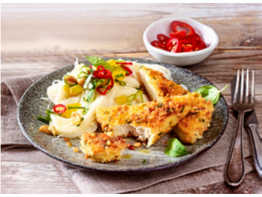

**Ingrediënten voor:** 4 personen
**Bereidingstijd:** ca. 40 min.
**150 g** fijne rijstnoedels
zout en peper
**1** rode peper
**100 g** gezouten, geroosterde pinda´s
**4 takjes** Thais basilicum
**1** bio-limoen
**2** lente-uitjes
**1** gele paprika
**2 el** + 4 tl honing
**4 el** olie
**400 g** tofu
**75 g** panko (Japans paneermeel)
**2** eieren
**2 el** bloem
**2 el** boter
vershoudfolie
1 VOOR DE SALADE Bereid de noedels volgens de
aanwijzingen op de verpakking in water met een
snufje zout en spoel kort met koud water. Halveer
de peper in de lengte, verwijder de zaadlijsten,
was de peper en snijd hem in ringen. Hak 25 g
pinda’s grof. Was het basilicum en hak de blaadjes
grof. Was de limoen met heet water en rasp de
schil er fijn af. Pers de limoen uit. Was de lente-uitjes en snijd ze in ringen. Snijd de paprika in
vieren, verwijder de zaadlijsten, was de paprika
en snijd hem in kleine blokjes.
2 Roer 4 tl honing, de peper, de helft van het
limoensap, de helft van de limoenschil, de helft
van het basilicum en 1 snufje zout door elkaar.
Klop de olie erdoorheen. Meng de noedels, de
gehakte pinda’s, de lente-ui en de paprika met de
dressing. Dek de salade af en houd apart.
3 VOOR DE SCHNITZELS Snijd de tofu in dunne
plakken. Roer zout, peper, 2 el honing, het overige
limoensap en de overige limoenschil door elkaar.
Bedruppel de tofu ermee. Hak 75 g pinda’s fijn.
Meng de pinda’s, het overige basilicum en de
panko. Kluts de eieren. Wentel de tofu eerst door
de bloem, dan door het ei en tot slot door het
pankomengsel. Verhit de boter in een pan. Bak
er de schnitzels aan beide zijden goudbruin in.
Serveer met de salade.
**Per portie:** ca. 750 kcal
**29 g** eiwit | 40 g vet | 64 g koolhydraten

## Courgette-schnitzels

## met kwarkdip

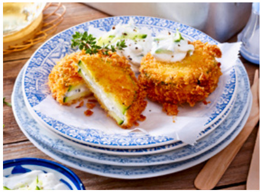

**Ingrediënten voor:** 4 personen
**Bereidingstijd:** ca. 1 uur
**½** komkommer
**1** teentje knoflook
**500 g** magere kwark
**4 el** slagroom
zout en peper
**1 el** olijfolie
**5-6 takjes** tijm
**3** eieren
**200 g** feta
**1** grote courgette
**75 g** bloem
**100 g** panko (Japans paneermeel)
**1 l** zonnebloemolie
1 VOOR DE DIP Was de komkommer en rasp hem
grof. Pel de knoflook en hak hem fijn. Roer de
kwark, de komkommer, de knoflook en 2 el slagroom door elkaar. Breng op smaak met zout en
peper. Bedruppel met de olijfolie.
SEIZOEN
2 VOOR DE FETACRÈME Was de tijm en neem de
blaadjes van de takjes. Splits 1 ei. Verbrokkel de
feta. Roer de feta, het eiwit, 2 el slagroom en de
tijm door elkaar. Bestrooi met zout en peper.
3 Was de courgette en snijd hem in ca. 36 plakjes
van ½ cm dik. Bestrijk de helft van de plakjes
courgette met de fetacrème en leg er telkens een
tweede plakje courgette bovenop.
4 Kluts 2 eieren, de eidooier, zout en peper.
Wentel de courgetteplakjes eerst door de bloem,
dan door het ei en tot slot door de panko. Verhit
de olie in een pan. Bak er de courgetteplakjes in
porties in ca. 2 minuten rondom goudbruin in.
Neem ze uit de olie en laat uitlekken op keukenpapier. Serveer met de dip.
**Per portie:** ca. 590 kcal
**36 g** eiwit | 33 g vet | 33 g koolhydraten

## Paddenstoelenschnitzel met

## mierikswortel-aardappelpuree

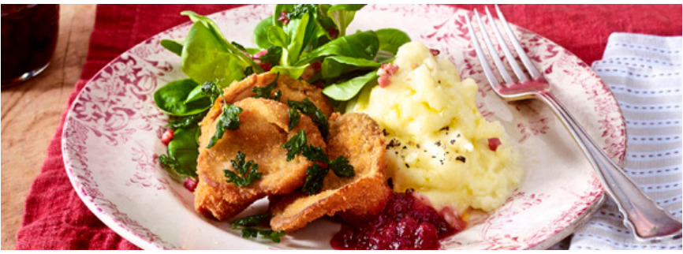

**Ingrediënten voor:** 4 personen
**Bereidingstijd:** ca. 50 min.
**200 g** veldsla
**3 el** balsamico
zout en peper
suiker
**3 el** olijfolie
**6 takjes** peterselie
**75 g** gerookt spek (of 3 el gebakken
uitjes)
**1 kg** aardappels
**2** eieren
**300 g** oesterzwammen
**4 el** bloem
**100 g** paneermeel
**1 kg** frituurvet
**200 ml** melk
**1 el** boter
**2-3 el** mierikswortel (pot)
**4 el** cranberry´s (pot)
keukenpapier
1 VOOR DE SALADE Was de veldsla. Klop de balsamico, zout, peper en ½ tl suiker door elkaar. Klop
de olie erdoorheen.
2 Was de peterselie en neem de blaadjes van de
takjes. Snijd het spek in blokjes. VOOR DE PUREE
Schil de aardappels, was ze en kook ze in water
met een snufje zout in ca. 20 minuten gaar.
3 VOOR DE PADDENSTOELEN Kluts de eieren
met wat zout en peper. Maak de oesterzwammen
schoon. Wentel ze eerst door de bloem, dan door
het ei en tot slot door het paneermeel. Verhit het
frituurvet tot 170°C. Frituur er de oesterzwammen in porties goudbruin in. Laat uitlekken op
keukenpapier en houd warm. Frituur de peterselie ca. 5 seconden in het hete frituurvet, neem
eruit en laat uitlekken op keukenpapier.
4 Bak het spek knapperig. Giet de aardappels af.
Voeg de melk en de boter toe en stamp fijn. Roer
de mierikswortel erdoorheen. Breng de puree op
smaak met zout en peper. Meng de veldsla met de
dressing. Serveer alles samen.
**Per portie:** ca. 610 kcal
**19 g** eiwit | 28 g vet | 67 g koolhydraten

## Gevulde knolselderijschnitzels

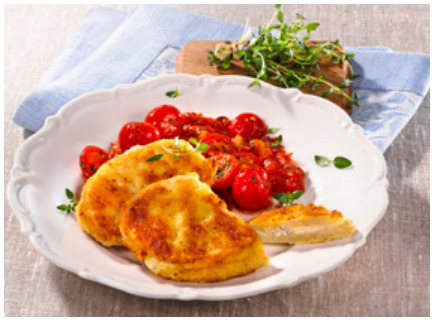

**Ingrediënten voor:** 4 personen
**Bereidingstijd:** ca. 45 min.
**1** knolselderij (ca. 850 g)
zout en peper
**1** ui
**1 bosje** tijm
**250 g** cherrytomaten
**5 el** olie
**1 el** tomatenpuree
**250 ml** groentebouillon
**125 g** mozzarella
**125 g** gorgonzola
**2** eieren
**3 el** bloem
**6 el** paneermeel
**400 g** tomatenblokjes (blik)
1 VOOR DE SCHNITZELS Schil de knolselderij, was
hem en snijd hem in 16 plakken van ½ cm dik.
Kook de plakken in 6-8 minuten in water met een
snufje zout beetgaar. Giet af.
2 VOOR DE TOMATENRAGOUT Pel en snipper
de ui. Was de tijm en hak de blaadjes fijn. Was
de cherrytomaten en halveer ze. Verhit 1 el olie
in een pan. Fruit er de ui glazig in. Voeg de tomatenpuree en de tijm toe en bak kort. Voeg de
cherrytomaten en de bouillon toe, breng aan de
kook en breng op smaak met zout en peper. Kook
de tomatenragout afgedekt ca. 10 minuten op
laag vuur.
3 Snijd de mozzarella in 8 plakken. Snijd de
gorgonzola in 8 plakken. Beleg 8 plakken knolselderij met beide kazen. Leg de overige plakken
knolselderij erop en druk een beetje aan. Kluts
de eieren en bestrooi met zout en peper. Wentel
de knolselderijpakketjes eerst door de bloem,
dan door het ei en tot slot door het paneermeel.
Verhit 4 el olie in porties in een grote pan. Bak er
de schnitzels in porties 2-3 minuten per zijde in.
Houd de schnitzels die klaar zijn warm.
4 Voeg de tomatenblokjes toe aan de tomatenragout en kook ca. 4 minuten verder op laag vuur.
Breng op smaak met zout en peper. Serveer alles
samen.
**Per portie:** ca. 480 kcal
**21 g** eiwit | 30 g vet | 27 g koolhydraten
SEIZOEN

# De hele

# week

# genieten

Dat is in ieder geval één zorg minder: wat jij
komende week gaat eten, is bij deze bekend.

# Maandag

## Orecchiette carbonara

## met erwtjes

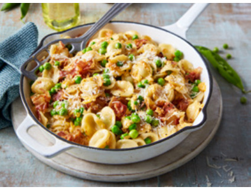

**Ingrediënten voor:** 4 personen
**Bereidingstijd:** ca. 40 min.
**400 g** orecchiette
zout en peper
**150 g** erwten (diepvries)
**1** ui
125 g pancetta (Italiaans buikspek,
evt. bacon)
**100 g** parmezaan (stuk)
**6** eieren
**2 el** olie
1 Kook de pasta volgens de aanwijzingen op de
verpakking in water met een snufje zout. Kook de
bevroren erwten de laatste 3 minuten mee.
2 Pel en snipper de ui. Snijd de pancetta in stukjes. Rasp de parmezaan fijn. Kluts de eieren, 75 g
parmezaan, zout en peper door elkaar.
3 Verhit de olie in een grote pan en bak er de
pancetta knapperig in. Voeg de ui toe en bak kort
mee. Giet de pasta met de erwten af. Vang hierbij
wat kookvocht op en houd apart. Voeg de pasta
met de erwten toe aan de pancetta en neem de
pan van het vuur.
4 Schenk het eimengsel en een scheut kookvocht erbij en meng alles goed door elkaar tot
een romig geheel. Breng op smaak met peper en
bestrooi met de overige parmezaan.
**Per portie:** ca. 700 kcal
**32 g** eiwit | 28 g vet | 80 g koolhydraten

# Dinsdag

## Wortel-mangosoep

## met feta

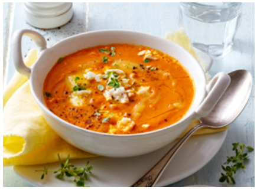

**Ingrediënten voor:** 4 personen
**Bereidingstijd:** ca. 30 min.
**700 g** wortels
**2** uien
**3 el** olijfolie
**600 ml** groentebouillon
**400 g** tomaten (blik)
zout en peper
**1** rijpe mango
**2 takjes** tijm
**150 g** feta
grof gemalen peper
1 Schrap de wortels, was ze en snijd ze in
plakjes. Pel en snipper de uien. Verhit 2 el olie
in een pan. Fruit er de wortel en de ui ca. 3
minuten in. Voeg de bouillon en de tomaten
toe en breng aan de kook. Breng op smaak
VOOR IEDERE DAG
met zout en peper en kook ca. 15 minuten op
laag vuur.
2 Schil de mango, snijd het vruchtvlees
van de pit en daarna in kleine blokjes. Was
de tijm en neem de blaadjes van de takjes.
Verbrokkel de feta grof.
3 Pureer de soep fijn. Voeg de mango toe en
kook ca. 2 minuten verder. Breng de soep
nogmaals op smaak en verdeel in kommen.
Bestrooi met de feta, de tijm en peper.
Druppel 1 el olijfolie eroverheen.
**Per portie:** ca. 390 kcal
**4 g** eiwit | 19 g vet | 21 g koolhydraten

## Knapperige visfilet met koolrabi-aardappelsalade

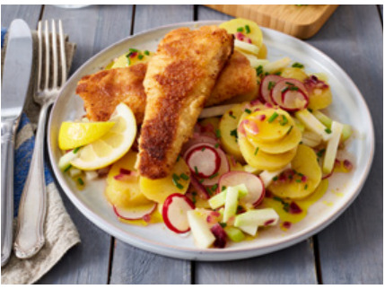

**Ingrediënten voor:** 4 personen
**Bereidingstijd:** ca. 1 uur en 15 min.
Wachttijd: ca. 45 min.
**800 g** vastkokende
aardappels
**1** ui (bijv. rode)
**125 ml** groentebouillon
**5 el** appelazijn
zout en peper
**1 tl** suiker
**5 el** olie
**1** koolrabi
**1 bosje** radijsjes
**½ bosje** bieslook
**600 g** kabeljauwfilets
(diepvries, ontdooid)
**2** eieren
**3 el** bloem
**100 g** paneermeel
**3-5 el** boter
1 Was de aardappels en kook ze in ca. 20 minuten gaar. Laat een beetje afkoelen.
2 Pel en snipper de ui. Breng de ui, de bouillon, de azijn, zout, peper en de
suiker kort aan de kook. Pel de aardappels en snijd ze in plakken. Schenk het
uienmengsel eroverheen. Voeg de olie toe en meng goed.
3 Schil de koolrabi, was hem en snijd hem in reepjes. Maak de radijsjes
schoon en snijd ze in dunne plakjes. Was de bieslook en hak hem fijn. Spatel
de koolrabi, de radijs en de bieslook door het aardappelmengsel en laat ca.
30 minuten marineren.
4 Bestrooi de visfilets met zout en peper. Kluts de eieren in een diep bord.
Wentel de visfilets eerst in de bloem, dan in het ei en tot slot in het paneermeel.
5 Verhit de boter in een grote koekenpan. Bak er de visfilets, in porties, in ca.
8 minuten goudbruin en gaar in en houd ze warm. Breng de salade op smaak
met zout en peper en serveer met de visfilet.
**Per portie:** ca. 670 kcal
**32 g** eiwit | 32 g vet | 59 g koolhydraten
8
Woensdag Donderdag

## Spinazie-quiche

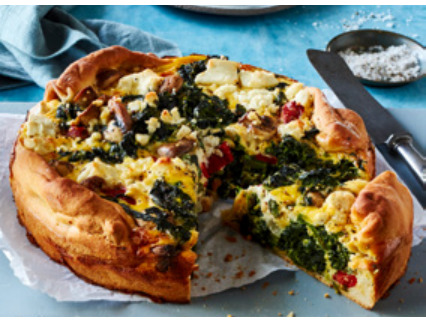

**Ingrediënten voor:** ca. 12 stukken
**Bereidingstijd:** ca. 1 uur en 15 min.
**400 g** spinazie
ca. 200 g
geroosterde paprika (pot)
**150 g** champignons
**2** uien
**1** teentje knoflook
**2 el** olie
zout en peper
nootmuskaat
boter (voor de vorm)
bloem (voor de vorm)
plakjes hartige-taartdeeg (diepvries, ontdooid)
**4** eieren
**150 ml** melk
**200 g** feta
1 Was de spinazie. Laat de paprika uitlekken en snijd hem in stukjes. Maak
de champignons schoon en halveer ze. Pel en snipper de uien en de knoflook.
2 Verhit de olie in een ruime pan. Fruit er de ui en de knoflook in. Voeg de
champignons toe en bak ca. 2 minuten. Voeg de spinazie toe en laat afgedekt
slinken. Neem het deksel van de pan en fruit tot al het vocht verdampt is.
Voeg de paprika toe en breng op smaak met zout en peper.
3 Verwarm de oven voor (elektrisch: 180°C / hetelucht: 160°C). Bekleed een
ingevette en met bloem bestoven springvorm (26 cm Ø) met het deeg. Druk
de randen aan. Verdeel het groentemengsel erin. Kluts de eieren, de melk
en een snufje zout. Schenk het over het groentemengsel. Verbrokkel de feta
eroverheen. Bak ca. 45 minuten in de oven.
**Per stuk:** ca. 220 kcal
**8 g** eiwit | 11 g vet | 21 g koolhydraten

# Vrijdag

## Ovenschotel met casselerrib, brood en spitskool

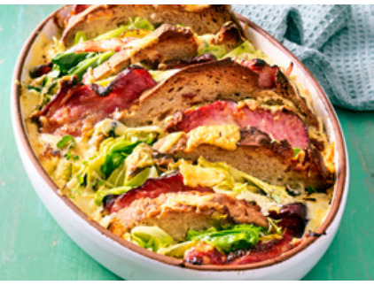

**Ingrediënten voor:** 4 personen
**Bereidingstijd:** ca. 1 uur en 15 min.
**½** spitskool (ca. 500 g)
**2** uien
**2 el** olie
zout en peper
600 g casselerrib (gerookt,
aan één stuk)
½ desembrood (ca.
**350** g)
**1-2** teentjes knoflook
**300 ml** melk
**100 ml** slagroom
**4** eieren
paprikapoeder
gemalen karwijzaad
**100 g** gruyère (stuk)
1 Was de spitskool en snijd hem in dunne parten. Pel de uien en snijd ze in
ringen. Verhit de olie in een grote pan. Fruit er de ui en de spitskool afgedekt
ca. 5 minuten in. Breng op smaak met zout en peper.
2 Snijd het vlees in plakken van ca. 2 cm dik. Snijd het brood in plakken
van ca. 2 cm dik. Verdeel het brood, de spitskool en het vlees rechtop in een
ovenschaal (ca. 28x18 cm).
3 Verwarm de oven voor (elektrisch: 180°C / hetelucht: 160°C). Pel de knoflook en hak hem fijn. Kluts de melk, de slagroom, de eieren en de knoflook
door elkaar. Roer wat zout, peper, paprikapoeder en karwijzaad erdoorheen.
Verdeel het eimengsel in de ovenschaal. Rasp de kaas grof en bestrooi alles
ermee. Bak ca. 50 minuten in de oven goudbruin.
**Per portie:** ca. 780 kcal
**61 g** eiwit | 34 g vet | 52 g koolhydraten
VOOR IEDERE DAG

## TIP

Snijd de overige spitskool in dunne reepjes
en maak er een salade van. Lekker met
stukjes gerookte kip en yoghurtdressing.

## Aardbeien-amuses

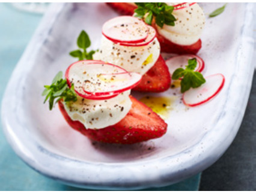

**Ingrediënten voor:** 6 personen
**Bereidingstijd:** ca. 15 min.
Roer 200 g verse roomkaas, geraspte schil en sap van ½ bio-citroen, zout en peper door elkaar.
Vul een spuitzak met de room, was 3 radijsjes en schaaf ze in dunne plakjes. Was 6 aardbeien en
halveer ze. Was 2-3 takjes oregano en haal de blaadjes van de takjes. Spuit de room op de aardbeien. Beleg met de radijs en de oreganoblaadjes. Bestrooi met grof gemalen peper.

# Zaterdag

## Kalkoenrolletjes

## met romige sperziebonen

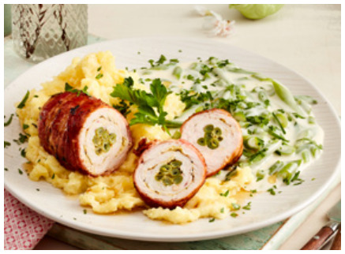

**Ingrediënten voor:** 4 personen
**Bereidingstijd:** ca. 50 min.
**750 g** sperziebonen
zout en peper
**1 kg** aardappels
4 kalkoenschnitzels (à ca. 140 g)
**4 tl** grove mosterd
**4** plakken ontbijtspek
**2 el** olie
**4 el** boter
**2 el** bloem
**450 ml** groentebouillon
**5 el** slagroom
**200 ml** melk
nootmuskaat
**4 takjes** peterselie
vershoudfolie
1 Maak de sperziebonen schoon en kook ze in
water met een snufje zout in ca. 10 minuten gaar.
Giet af. Schil de aardappels, was ze en kook ze in
water met een snufje zout in ca. 25 minuten gaar.
2 Klop de schnitzels tussen 2 laagjes vershoudfolie plat. Bestrooi met zout en peper en bestrijk
ze met de mosterd. Leg op elke schnitzel 6
sperziebonen, rol de schnitzels strak op en wikkel
elk rolletje in een plak spek.
3 Verwarm de oven voor (elektrisch: 160°C /
hetelucht: 140°C). Verhit de olie in een ovenvaste
pan. Bak er de rolletjes in ca. 6 minuten rondom
goudbruin in en bak ze daarna ca. 15 minuten
verder in de oven.
4 Snijd de overige sperziebonen in stukken.
Verhit 2 el boter in een pan. Bak er de bloem kort
in. Schenk de bouillon en de slagroom er al roerend bij, breng aan de kook en kook ca. 5 minuten
op laag vuur. Breng de saus op smaak met zout en
peper. Verhit de sperziebonen erin.
5 Verwarm de melk. Giet de aardappels af. Voeg
de warme melk en 2 el boter toe en stamp fijn.
Breng op smaak met zout en nootmuskaat. Was
de peterselie en hak de blaadjes fijn. Serveer alles
samen en bestrooi met de peterselie.
**Per portie:** ca. 680 kcal
**45 g** eiwit | 32 g vet | 49 g koolhydraten
VOOR IEDERE DAG

# 3x

# Zoet

Ook op doordeweekse dagen sluit je
de maaltijd feestelijk af met een toetje.

## Limoensoesjes

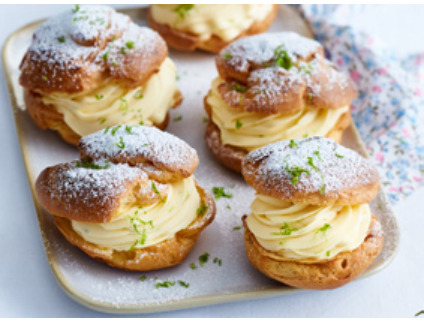

**Ingrediënten voor:** 6 stuks
**Bereidingstijd:** ca. 1 uur
**250 g** mascarpone
**50 g** poedersuiker (+ bestuiven)
**200 g** vanillepudding
geraspte schil van 1 bio-limoen
**125 ml** melk
**80 g** boter
**1 el** suiker
zout
**125 g** bloem
**4** eieren
spuitzak met ronde spuitmond (ca.
**13** mm Ø)
bakpapier
spuitzak met gekartelde spuitmond
1 VOOR DE ROOM Klop de mascarpone met de
poedersuiker romig. Klop de pudding en de limoenschil erdoorheen. Zet de room afgedekt in
de koelkast.
2 VOOR HET BESLAG Breng de melk, 125 ml
water, de boter, de suiker en 2 snufjes zout aan
de kook. Voeg de bloem in één keer toe. Roer met
een houten lepel door elkaar tot het deeg als een
bol van de bodem loskomt en de bodem van de
pan met een wit waas bedekt is. Neem de pan van
het vuur. Doe het deeg in een kom. Klop één voor
één de eieren erdoorheen.
3 Verwarm de oven voor (elektrisch: 200°C /
hetelucht: 180°C). Vul de spuitzak met ronde
spuitmond met het beslag. Spuit 6 toefjes op een
met bakpapier beklede bakplaat. Bak ca. 25 minuten in de oven. Knip de soesjes horizontaal door
en laat afkoelen.
4 Vul de spuitzak met gekartelde spuitmond
met de room. Vul de soesjes ermee. Bestuif met
poedersuiker.
**Per stuk:** ca. 280 kcal
**5 g** eiwit | 20 g vet | 19 g koolhydraten
VOOR IEDERE DAG

## Rijstdessert met bosvruchten

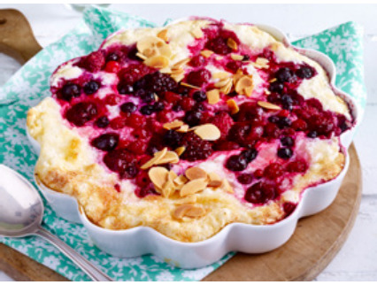

**Ingrediënten voor:** 4 personen
**Bereidingstijd:** ca. 1 uur en 15 min.
**600 ml** melk
zout
**150 g** dessertrijst
**7 el** suiker
**8 g** vanillesuiker
**2** eieren
**150 g** bosvruchten (diepvries)
**2 el** amandelschaafsel
boter (voor de vorm)
1 Breng de melk met 1 snufje zout aan de kook. Voeg de rijst, 2 el suiker en
de vanillesuiker toe. Kook afgedekt ca. 25 minuten onder af en toe roeren op
laag vuur. Neem de pan van het vuur. Laat de rijst ca. 15 minuten wellen.
2 Verwarm de oven voor (elektrisch: 180°C / hetelucht: 160°C). Splits de
eieren. Klop de eiwitten stijf en klop beetje bij beetje 2 el suiker erdoorheen.
Roer 2 el rijst door de eidooiers. Klop het mengsel door de overige rijst.
Spatel het eiwitschuim in 2 porties door de rijst. Verdeel de rijst in een ingevette ovenschaal (ca. 24 cm Ø). Verdeel de bevroren vruchten eroverheen en
bestrooi met 3 el suiker. Bak ca. 30 minuten in de oven. Bestrooi 5 minuten
voor het einde van de baktijd met het amandelschaafsel.
**Per portie:** ca. 430 kcal
**13 g** eiwit | 12 g vet | 69 g koolhydraten

## Frisse perziksorbet

**Ingrediënten voor:** 6 personen
**Bereidingstijd:** ca. 20 min.
Wachttijd: ca. 5 uur en 30 min.
**1,6 kg** perziken (blik)
**200 g** suiker
evt. verse munt om te versieren
1 Laat de perziken uitlekken. Vang hierbij het sap op. Breng de suiker met
**200 ml** sap aan de kook. Kook op laag vuur tot de suiker opgelost is. Laat de
siroop afkoelen.
2 Pureer de perziken met de siroop. Verdeel het mengsel in een lage bewaardoos en vries het minimaal 5 uur in. Roer het elke 30-60 minuten met een
vork kort door.
3 Maak van het sorbetijs bollen en serveer eventueel met een blaadje munt.
**Per portie:** ca. 300 kcal
**1 g** eiwit | 0 g vet | 72 g koolhydraten
Lekker eten valt of staat met de ingrediënten die je
gebruikt en het keukengerei dat je tot je beschikking
hebt. Daarom presenteren wij elke maand leuke,
verrassende, handige en/of smakelijke producten.

# TAART TO GO

Wat mag er niet ontbreken tijdens een lekkere picknick in het
park? Een heerlijke zelfgebakken taart natuurlijk, als je het ons
vraagt! Maak bijvoorbeeld een lekkere appeltaart (vanaf p. 58),
want die lust iedereen. Met deze springvorm met een handig
draagdeksel neem je je taart makkelijk overal mee naartoe.
Prijs: €16,49. Verkrijgbaar via blokker.nl
FlowerPOWER
Wil je voor een speciale gelegenheid een feestelijke taart maken, zoals
de Moederdagkrans van p. 64? Er bestaat wat ons betreft geen mooiere
versiering dan eetbare bloemen. Je kunt een mix van prachtig gekleurde
bloemen bij je thuis laten bezorgen en tot 2 dagen in de koelkast bewaren.
Omdat het een natuurproduct is, krijg je iedere keer een andere, unieke mix.
Dus bestel snel en laat je verrassen!
Prijs: €7,99 per doos. Verkrijgbaar via groentebroer.nl

# PERFECT

# GEDRAAID

Wil je perfect gedraaide gehaktballetjes,
bijvoorbeeld voor de torta di polpette oftewel
Italiaanse gehaktballetjestaart (p. 9)? Met
deze Paderno gehaktballentang maak je
eenvoudig mooie ronde gehaktballetjes met
een diameter van 3 cm. De tang is vaatwasseren hittebestendig, waardoor je hem na ieder
gebruik weer hygiënisch schoon kunt maken.
Prijs: €4,50.
Verkrijgbaar via cookinglife.nl

# PERFECT

vraagt! Maak bijvoorbeeld een lekkere appeltaart (vanaf p. 58),
want die lust iedereen. Met deze springvorm met een handig
draagdeksel neem je je taart makkelijk overal mee naartoe.
Prijs: €16,49. Verkrijgbaar via blokker.nl
FlowerPOWER
Wil je voor een speciale gelegenheid een feestelijke taart maken, zoals
de Moederdagkrans van p. 64? Er bestaat wat ons betreft geen mooiere
versiering dan eetbare bloemen. Je kunt een mix van prachtig gekleurde
bloemen bij je thuis laten bezorgen en tot 2 dagen in de koelkast bewaren.
Omdat het een natuurproduct is, krijg je iedere keer een andere, unieke mix.

# Geurige

# kruidnagel

Kruidnagels zijn de onrijpe
bloem-knopjes van de boom,
ze zijn ongeveer 2,5 cm lang en
hebben een dikke steel.
Wist je dat kruidnagels van goede
kwaliteit loodrecht op het water drijven?
Kruidnagels van mindere kwaliteit gaan
horizontaal drijven of zelfs zinken.
Tip! Prik de steeltjes van kruidnagel in
een hele ui en voeg die in het geheel toe
wanneer je kruidnagel wil gebruiken in
een stoofpot. In een stoofpot raak je de
kleine kruidnagels anders gemakkelijk
kwijt, terwijl je hem graag uit je gerecht
wilt halen zodra hij zijn smaak heeft
afgegeven.
Meer weetjes over kruidnagel? Kijk op:
www.verstegen.nl/echtinelkgerecht
Direct van de oorsprong
De kruidnagel zoals we die kennen komt
van de altijd groene kruidnagelboom, een
boom die wel 100 jaar oud kan worden.
Deze boom heeft een piramidevorm en
kan een hoogte bereiken van maar liefst
twaalf meter! Peter: “Verstegen teelt haar
kruidnagel in Sri Lanka en de Comoren,
hier zijn de beste condities voor deze
specerij. Na zes jaar draagt de boom zowel
mannelijke als vrouwelijke bloemen.
Als de bloemknoppen helrood zijn, worden ze geoogst. Timing is hierbij belangrijk, precies op het juiste moment worden
de rijpe bessen geselecteerd. Vervolgens
worden ze in de zon gedroogd totdat de
nagelen hun typische bruine kleur hebben
en klaar voor gebruik zijn.”
Even voorstellen
“Ik ben Peter Dumont, picolier bij Verstegen.
Een picolier is iemand die gespecialiseerd is in
het werken met kruiden en specerijen. Dat betekent dat ik alles weet over de herkomst van kruiden en specerijen, over de geur en smaak en hoe
ze te gebruiken zijn. Ook vertel ik graag in welke
gerechten ze lekker zijn en in welke combinatie
ze het beste gebruikt kunnen worden.”
Herkenbare kwaliteit
Maar hoe herken je de kwaliteit van kruidnagel? Het antwoord is simpel, legt Peter
uit: “De kwaliteit van de kruidnagel wordt
bepaald door de hoeveelheid etherische
olie in de kruidnagel. Hoe hoger het gehalte olie, des te beter de kwaliteit. Dit zie
je vooral terug in de kop en de kleur van
de steel. De kop moet gesloten zijn, dus
niet opengebarsten, dan zitten er nog veel
etherische oliën in. En de kleur van de steel
moet iets donkerder zijn dan de kop, maar
niet te donker, anders is de kruidnagel
uitgedroogd. Wat ook een goede methode
is: wrijf de kop tussen je vingers, als je
handen vettig worden, dan weet je dat de
kruidnagel veel olie bevat.”
KOKEN & GENIETEN ♥ VERSTEGEN
De échte smaak van kruidnagel
Smaken beschrijven is een uitdaging,
maar als picolier kan Peter dat als geen
ander: “De smaak van kruidnagel is karakteristiek warm, kruidig en scherp, met
een beetje een verdovende sensatie in de
mond achteraf. Ook de geur is heel vol en
aromatisch.” Kruidnagel mag daarom tijdens donkere, koude dagen natuurlijk niet
ontbreken in warme wijn (glühwein). Door
de scherpe, warme en aromatische smaak,
kan kruidnagel uitstekend gebruikt worden in stoofgerechten, soepen, sauzen
en zoete gerechten. Peter: “Eigenlijk een
echte alleskunner dus.” Door de uitgesproken smaak en geur weet kruidnagel zich
goed te verbinden aan herinneringen. Zo
brengt kruidnagel altijd een beetje nostalgie met zich mee.

## Aspic met kruidige groentefond

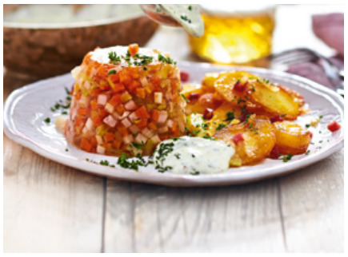

**Ingrediënten voor:** 6 personen
**Bereidingstijd:** ca. 2 uur en 30 min.
Wachttijd: ca. 12 uur
**1** prei
**2** wortels
**¼** knolselderij
**2** kruidnagels
**1 tl** jeneverbessen
**2 tl** peperkorrels
**200 g** koteletten zonder bot
zout en peper
**5 el** appelazijn
**6 blaadjes** gelatine (10 g)
**100 ml** melk
**3 tl** grove mosterd
**200 g** zure room
**100 ml** olie
**2-3 tl** honing
**3 tl** citroensap
**4 takjes** dille
**1 bosje** peterselie
1 EEN DAG VAN TEVOREN Maak de prei schoon en
snijd hem in stukken. Schrap de wortels, was ze
en snijd ze in stukken. Schil de knolselderij, was
hem en snijd hem in stukken. Bewaar de schillen.
Breng de helft van de groenten, de schillen, de
kruidnagels, de jeneverbessen en de peperkorrels
met ca. 1,5 l water in een pan aan de kook en kook
afgedekt ca. 1 uur op laag vuur. Snijd intussen de
overige gesneden groenten in kleine blokjes en
houd apart. Snijd de koteletten in kleine blokjes.
2 Zeef de groentefond in een pan en breng aan de
kook. Kook de groenteblokjes en het vlees ca. 5 minuten op laag vuur in de fond. Breng op smaak met
zout, peper en de appelazijn. Bekleed een zeef met
een schone theedoek en zeef de fond ermee.
3 Week de gelatine in koud water. Verdeel het
groentemengsel over 6 glazen (à ca. 220 ml
inhoud). Meet ca. 650 ml groentefond af en
verwarm het in een pan. Knijp de gelatine uit en
los hem op in de warme groentefond. Verdeel de
fond over de glazen. Zorg dat het groentemengsel
volledig bedekt is door de fond. Zet de glazen
1 nacht in de koelkast. Verwerk de overige groentefond in een ander recept (bijv. in sauzen en
soepen).
4 DE VOLGENDE DAG VOOR DE SAUS Neem ca.
30 minuten van tevoren de melk, de grove mosterd en de zure room uit de koelkast. Pureer de
olie, 50 ml melk en de mosterd romig. Roer de
overige melk, de zure room, de honing en het
citroensap erdoorheen. Breng op smaak met zout
en peper. Was de dille en hak de blaadjes fijn. Was
de peterselie en hak hem fijn. Roer de dille en de
peterselie door de saus.
5 Neem de aspics uit de glazen en stort ze op
borden. Serveer met de dillesaus. Lekker met
gebakken aardappels.
**Per portie:** ca. 570 kcal
**19 g** eiwit | 37 g vet | 37 g koolhydraten
BELANGRIJK: Alle ingrediënten voor de saus
moeten op kamertemperatuur zijn, zodat er een
gladde massa ontstaat.

## Rollade met kruidnagel en

## jeneverbes

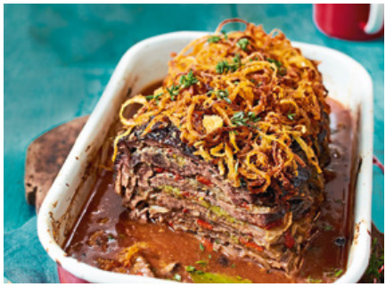

Hoeveelheid: 6 personen
**Bereidingstijd:** ca. 4 uur
**8** uien
**200 g** augurken
**200 g** geroosterde paprika’s (pot)
**8** dunne runderschnitzels
**4 tl** mosterd
**7** plakken ontbijtspek
**2** wortels
**4 takjes** tijm
**4** kruidnagels
**1 el** pimentkorrels
**1 el** jeneverbessen
**2** laurierblaadjes
**200 ml** donker bier
**1 el** tomatenpuree
**2-3 el** bloem
**2 tl** paprikapoeder
**1-2** boter
**1-2 el** maizena
keukengaren
1 Verwarm de oven voor (elektrisch: 160°C /
hetelucht: 140°C). Pel de uien. Snijd 2 uien in
parten en snijd de rest in ringen. Houd de helft
van de ringen apart. Snijd de augurken fijn. Snijd
de geroosterde paprika’s fijn.
2 Leg 4 stukken keukengaren van 1 m lang 5 cm
van elkaar op een snijplank. Leg 1 runderschnitzel
in het midden. Bestrijk met een laagje mosterd en
bestrooi met zout en peper. Verdeel er wat augurk
en geroosterde paprika over. Leg er een plakje
spek op. Leg er wat uienringen op. Leg er een
tweede runderschnitzel op. Verwerk de overige
ingrediënten op gelijke wijze en sluit af met een
lapje vlees. Bind vast met het keukengaren.
3 Schrap de wortels, was ze en snijd ze grof. Was
de tijm. Verdeel de wortel, de uienparten, de tijm,
de kruidnagels, de pimentkorrels, de jeneverbessen en de laurierblaadjes in een braadslee. Leg de
rollade erbovenop.
4 Bak ca. 1 uur en 15 minuten in de oven. Roer
het bier en de tomatenpuree door elkaar en blus
het vlees ermee af. Verhoog de oventemperatuur
(elektrisch: 180°C / hetelucht: 160°C). Dek af met
aluminiumfolie en bak ca. 1 uur en 30 minuten.
5 Meng de overige uienringen, de bloem en het
paprikapoeder. Verhit de boter in een pan. Bak er
de uienringen krokant in.
6 Neem het vlees uit de oven. Verwijder het keukengaren. Zeef het braadvocht in een pan. Leg het
vlees terug in de braadslee. Verdeel de gebakken
ui eromheen en bak ca. 20 minuten verder in de
oven.
7 Breng het braadvocht in de pan aan de kook.
Roer de maizena met 3 el water glad. Bind het
braadvocht ermee. Breng de saus op smaak met
zout, peper en suiker. Serveer alles samen. Lekker
met aardappelpuree.
**Per portie:** ca. 470 kcal
**52 g** eiwit | 21 g vet | 14 g koolhydraten
**52 g** eiwit | 21 g vet | 14 g koolhydraten
KOKEN & GENIETEN ♥ VERSTEGEN
KOKEN & GENIETEN ♥ VERSTEGEN

# Simpel

# en snel

# genieten

Het is al druk genoeg met werk, kinderen
en hobby’s. Hier is de oplossing voor
iedereen die geen tijd heeft om uitgebreid
te koken, maar toch lekker wil eten.

## Pasta met paprika en spiegelei

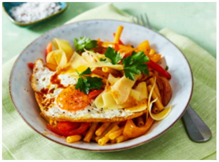

**Ingrediënten voor:** 4 personen
**Bereidingstijd:** ca. 30 min.
zout en peper
**2** uien
**2** rode paprika’s
**2** gele paprika’s
**3 el** olie
**300 ml** groentebouillon
nootmuskaat
paprikapoeder
**400 g** pasta (bijv. linguini)
**4** eieren
**4 el** crème fraîche
**100 g** emmentaler (stuk)
evt. peterselie om te garneren
1 Breng ruim water met een snufje zout aan de
kook. Pel de uien en snijd ze in ringen. Snijd de
paprika’s in vieren, verwijder de zaadlijsten, was
de paprika’s en snijd ze in reepjes. Verhit 2 el olie
in een pan. Fruit er de paprika en de ui ca. 2 minuten in. Blus af met de bouillon en breng aan de
kook. Breng op smaak met zout, peper, nootmuskaat en paprikapoeder. Kook ca. 10 minuten op
laag vuur.
2 Kook de pasta in het gezouten water volgens de
aanwijzingen op de verpakking. Verhit 1 el olie in
een pan. Bak er van de eieren 4 spiegeleieren in.
Bestrooi met zout, peper en paprikapoeder. Giet
de pasta af. Vang hierbij ca. 100 ml kookvocht op.
Meng de pasta, de crème fraîche, het kookvocht
en het paprikamengsel.
3 Schaaf de kaas. Serveer alles samen. Garneer
eventueel met peterselie.
**Per portie:** ca. 680 kcal
**27 g** eiwit | 26 g vet | 88 g koolhydraten

## Gehaktballetjes met

## champignonroomsaus

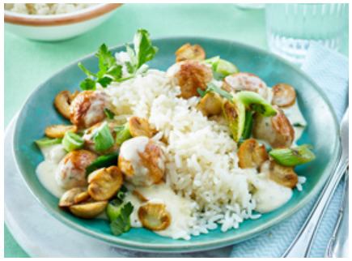

**Ingrediënten voor:** ca. 4 personen
**Bereidingstijd:** ca. 25 min.
**200 g** rijst
zout en peper
**300 g** champignons
**4** lente-uitjes
**4 takjes** peterselie
**2 el** olie
4
braadworsten naar keuze (ca.
**400** g)
**1 el** bloem
**300 ml** groentebouillon
**100 ml** slagroom
1 Kook de rijst volgens de aanwijzingen op de
verpakking in water met een snufje zout. Maak
de champignons schoon en halveer ze eventueel naar grootte of snijd ze in plakjes. Maak de
lente-uitjes schoon en snijd ze schuin in ringen.
Was de peterselie en hak de blaadjes grof.
DE SNELLE KEUKEN
2 Verhit 1 el olie in een grote pan. Knijp het worstvlees in kleine balletjes uit het worstvel direct
in de pan. Bak de balletjes ca. 3 minuten rondom
goudbruin en neem ze uit de pan.
3 Verhit 1 el olie in het bakvet. Bak er de champignons ca. 2 minuten op hoog vuur in. Voeg
de lente-ui toe en bak kort mee. Bestrooi met
zout en peper, bestuif met de bloem en bak kort
verder. Schenk de bouillon en de slagroom erbij
en breng al roerend aan de kook. Doe de gehaktballetjes terug in de pan en kook ca. 5 minuten op
laag vuur. Breng de saus op smaak met zout en
peper en roer de peterselie erdoorheen. Serveer
met de rijst.
**Per portie:** ca. 660 kcal
**19 g** eiwit | 44 g vet | 48 g koolhydraten

## Lentegroentesoep

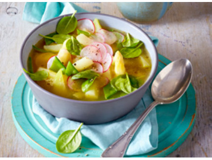

**Ingrediënten voor:** 4 personen
**Bereidingstijd:** ca. 25 min.
**2** uien
**500 g** witte asperges
**250 g** peultjes
**1** grote koolrabi (ca. 400 g)
**2 el** olijfolie
**1 l** groentebouillon
**1 bosje** radijsjes
**50 g** babyspinazie
zout en peper
geraspte schil en sap van ½ biocitroen
1 Pel en snipper de uien. Was de asperges, schil ze
en snijd de houtige uiteinden er ruim af. Snijd de
asperges in stukken van ca. 4 cm. Maak de peultjes schoon en halveer ze. Schil de koolrabi, was
hem en snijd hem in stukken.
**300** g
2 Verhit de olie in een grote pan. Fruit er de ui
glazig in. Schenk de bouillon erbij en breng aan de
kook. Voeg de asperges, de peultjes en de koolrabi
toe en kook afgedekt ca. 10 minuten op laag vuur.
3 Maak de radijsjes schoon en schaaf ze in dunne
plakken. Was de spinazie. Spatel de radijs en de
spinazie door de soep. Breng op smaak met zout,
peper, de citroenschil en het citroensap.
**Per portie:** ca. 220 kcal
**8 g** eiwit | 12 g vet | 17 g koolhydraten

## Teriyaki-kip met bimi

**Ingrediënten voor:** 4 personen
**Bereidingstijd:** ca. 30 min.
**20 g** gember (stuk)
**100 ml** sojasaus
**3 el** rijstazijn
**2 el** sesamolie
**2 el** honing
**1 tl** maizena
**4** grote wortels
bimi (of broccoli)
4
kipfilets (ca. 700 g)
**3 el** sesamzaad
**2** lente-uitje
1 Verwarm de oven voor (elektrisch: 230°C / hetelucht: 210°C). Schil de gember en rasp hem. Roer
de gember in een pannetje met de sojasaus, de
azijn, de olie, de honing, de maizena en 5 el water
door elkaar. Breng aan de kook en houd apart.
2 Schil de wortels, was ze, halveer ze in de lengte
en snijd ze in plakken. Was de bimi en halveer
eventueel.
3 Verdeel de wortel en de bimi over een bakplaat.
Meng de helft van de marinade erdoorheen. Leg
de kipfilets erop en bestrijk met de marinade. Bak
18-20 minuten in de oven.
4 Rooster het sesamzaad in een droge pan. Maak
de lente-uitjes schoon en snijd ze schuin in ringen. Verdeel de overige marinade over de groenten en bak ca. 5 minuten verder. Bestrooi met de
lente-ui en het sesamzaad.
**Per portie:** ca. 460 kcal
**44 g** eiwit | 20 g vet | 20 g koolhydraten
DE SNELLE KEUKEN

## Dubbelgebakken tosti ham-kaas

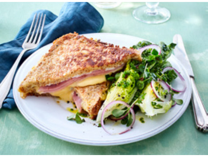

**Ingrediënten voor:** 4 personen
**Bereidingstijd:** ca. 20 min.
**8 sneetjes** casino wit of bruin
**4 el** verse roomkaas
**4** plakken gekookte ham
**4** plakken belegen kaas
**4** eieren
**200 ml** melk
zout en peper
**3 el** boter
**2** kropjes mini-romainesla
**1** ui (bijv. rode)
**1 el** mosterd
**3 el** wittewijnazijn
**6 el** olie
**½ bosje** bieslook
**1** bakje tuinkers
1 Bestrijk 4 sneetjes brood met de roomkaas. Beleg elk sneetje met 1 plak
ham en 1 plak kaas. Leg de overige sneetjes brood erop. Kluts de eieren met
de melk, zout en peper. Wentel de boterhammen door het melkmengsel.
Verhit de boter in een pan. Bak er de boterhammen ca. 4 minuten per zijde
in.
2 Maak de sla schoon en snijd hem in parten. Pel de ui en snijd hem in
ringen. Roer de mosterd, de azijn, zout en peper door elkaar. Klop de olie
erdoorheen. Was de bieslook en hak hem fijn. Knip de tuinkers uit het bakje.
Halveer de tosti’s diagonaal en serveer ze met de sla en de ui. Druppel de
vinaigrette over de sla. Bestrooi met de bieslook en de tuinkers.
**Per portie:** ca. 560 kcal
**23 g** eiwit | 39 g vet | 25 g koolhydraten

## Gehakt-stroganoff

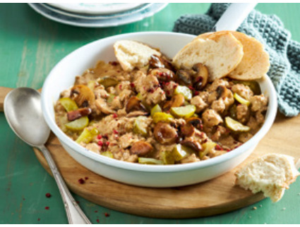

**Ingrediënten voor:** 4 personen
**Bereidingstijd:** ca. 25 min.
**250 g** champignons
**1** ui
**2 el** olie
**500 g** half-om-halfgehakt
zout en peper
paprikapoeder
**1 el** bloem
**150 ml** melk
**150 ml** groentebouillon
**3-4** augurken
**200 g** zure room
evt. roze-peperkorrels
**1** stokbrood
1 Maak de champignons schoon en halveer ze naar grootte of snijd ze in
dikke plakken. Pel en snipper de ui.
2 Verhit 1 el olie in een grote pan. Bak er de champignons ca. 5 minuten in
en neem ze uit de pan. Verhit 1 el olie in het bakvet. Bak er het gehakt in ca.
5 minuten rul in. Voeg de ui toe en bak ca. 2 minuten mee. Breng op smaak
met zout, peper en paprikapoeder. Bestuif met de bloem en bak kort verder.
Schenk de melk en de bouillon erbij, breng aan de kook en kook ca. 5 minuten op laag vuur.
3 Halveer de augurken in de lengte en snijd ze in plakjes. Spatel de augurk,
de champignons en de zure room door het gehakt en verwarm kort. Breng op
smaak met zout en evt. roze-peperkorrels. Serveer met het stokbrood.
**Per portie:** ca. 670 kcal
**35 g** eiwit | 39 g vet | 43 g koolhydraten
**92** 93
© Sanders puzzelboeken
**93** 17 82 50 65 11
**53** 54
**57** 58 59 60 61
**5** 66 67 68 69 70
**74** 75 76 77
**81** 82 83 84
**7** 88 89 90

## HORIZONTAAL

1 opname van dichtbij 7 Bijbelboek 12 dansfiguur 17 tegen 18 spleet 20 rit
22 onbeschoft 23 op welke plaats 24 steenafval 25 luchtvaartmaatschappij
27 zwaar metaal 29 vegetariër 31 grond bij een boerderij 32 kleingeestige
schoolmeester 33 zeer aangenaam 35 betonhaak 37 tuin 38 Nederlandse
Spoorwegen (afk.) 39 dom 40 gezin 42 metalen klankbekken 44 academische
titel (afk.) 45 nuttigen 46 grote wurgslang 47 dopingproduct (afk.)
49 schoorsteenzwart 51 tien (voorvoegsel) 52 meetkundige lijn 53 label
54 tuingerei 55 stuurs 57 nonsens 59 stel van bijeenhorende zaken 60 middelpunt
van een schietschijf 62 voegwoord 64 godsdienstig gebruik 66 ingelegde
stukjes steen 69 zwemvogel 70 moeder 71 ijzerhoudende grond 73 zacht
buisje 75 blaasinstrument 76 uitroep van schrik 77 rivier in Polen 78 een groter
aantal 80 houten doos 82 Engelse titel 83 eenheid van elektrische spanning
84 doorschijnend materiaal 85 inwendige opname van het lichaam 87 fijn weefsel
89 ambtskleed 90 levend wezen 91 stompzinnig 92 medicus 93 loos gebabbel.

## VERTICAAL

2 hoog schoeisel 3 onvoltooid 4 straat (afk.) 5 kippenproduct 6 vrucht
7 schrijfgerei 8 sint (afk.) 9 leuk 10 etage (afk.) 11 zandheuvel 12 zonder vocht
13 achtervoegsel 14 ervaren (afk.) 15 uitroep van verbazing 16 idool 19 loofboom
21 explosievenopruimingsdienst (afk.) 23 lang gekoesterd verlangen 24 fraai
voorwerp 25 toiletartikel 26 militair (afk.) 28 slinks 30 uit een bepaald werelddeel
32 fulltime-equivalent (afk.) 33 kiemblad 34 gegoten voorwerp 36 medische
specialisatie (afk.) 39 oogziekte 40 Oud-Romeins plein 41 leer van het heldendicht
43 springend gedans 45 Europese Centrale Bank 46 mannelijke geit 48 oktober
(afk.) 50 zak 56 rijtoer 58 bladzijde 61 honderd gram 63 viering van een heuglijk
feit 65 rijwiel 67 familielid 68 Europeaan 69 eet- en drinkpartij 70 maand
72 ontvangstbewijs 74 Europese ruimtevaartorganisatie 76 deel van het gezicht
77 winters voertuig 79 vlug 81 onderzoeksinstituut 83 roofdier 84 schreeuw
86 nikkel 88 tegenover (afk.) 89 motorraces in Assen 90 Denemarken.
VUL DE PUZZEL IN EN MAAK KANS
OP 1 VAN DE 3 EXEMPLAREN VAN

## VEGA ZÓNDER PAKJES EN ZAKJES

## T.W.V. 25,99 EURO

Pakjes en zakjes bieden voor veel mensen een uitkomst: het is snel,
makkelijk en het gerecht lukt eigenlijk altijd. Toch is het niet de
gezondste keuze. Karin Luiten laat al jaren zien dat zonder pakjes en
zakjes koken helemaal niet moeilijk is. In haar nieuwste boek Vega
zónder pakjes en zakjes gaat ze op de vegetarische tour en gaat ze aan
de slag met klassiekers als pasta bolognese en moussaka. Dit boek
is ideaal voor iedereen die wat gezonder en plantaardiger wil eten,
maar daarvoor niet wil inleveren op tijd en smaak.
1 2 3 4 5 6 7 8 9 10 11 12 13 14 15 16
**17** 18 19 20 21 22
**23** 24 25 26 27 28 29 30
Titel: Vega zónder
**31** 32 33 34 35 36 37
**38** 39 40 41 42 43 44
pakjes en zakjes
**45** 46 47 48 49 50
**51** 52 53 54
Auteur: Karin Luiten
**55** 56 57 58 59 60 61
**62** 63 64 65 66 67 68 69 70
Uitgeverij: Fontaine
**71** 72 73 74 75 76 77
**78** 79 80 81 82 83 84
Prijs: 25,99 euro
**85** 86 87 88 89 90
Het antwoord kun je vóór 24 mei 2022
Titel:
**91** 92 93
pakjes en zakjes
**7** 8 9 10 11 12 13 14 15 16
sturen naar: koken & genieten, o.v.v. oplossing puzzel
Auteur:
**8** 19 20 21 22
Uitgeverij:
**25** 26 27 28 29 30
Postbus 296, 6500 AG Nijmegen
Prijs:
**33** 34 35 36 37
**40** 41 42 43 44
Via internet: kokengenieten.nl/puzzel
**46** 47 48 49 50
Naar buiten
In het bos, in het park, in de tuin of op je dakterras.
Waar je ook bent, op mooie dagen geniet je samen
met je familie of vrienden van de zonnestralen én
deze heerlijke picknick-gerechten.

## Groentemuffins met feta

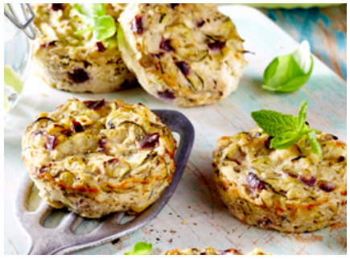

**Ingrediënten voor:** 12 stuks
**Bereidingstijd:** ca. 40 min.
**2** courgettes (ca. 400 g)
**2** grote rode uien (ca. 200 g)
**3 el** olijfolie (+ invetten)
zout en peper
**3 takjes** basilicum
**3 takjes** munt
**150 g** feta
**3** eieren
**200 g** kwark
muffinbakblik met 12 holtes
1 Was de courgettes en rasp ze grof. Pel en snipper
de uien. Verhit de olie in een pan. Bak er de ui ca.
5 minuten op hoog vuur in. Voeg de courgette toe
en bak 2-3 minuten mee. Doe alles in een kom.
Bestrooi met zout en peper en laat een beetje
afkoelen.
2 Was de kruiden, houd een paar blaadjes apart
voor de garnering en hak de overige blaadjes fijn.
Verbrokkel de feta. Kluts de eieren. Voeg de feta,
de kwark, de gehakte kruiden, het ei, zout en
peper toe aan de groenten. Roer alles door elkaar.
3 Verwarm de oven voor (elektrisch: 200°C /
hetelucht: 180°C). Vet het muffinbakblik in met
olie. Verdeel het courgettemengsel in het muffinbakblik. Bak 20-25 minuten in de oven. Neem
uit de oven, neem de muffins voorzichtig uit het
bakblik en serveer warm of koud. Garneer met de
overige kruiden.
**Per stuk:** ca. 100 kcal
**6 g** eiwit | 7 g vet | 2 g koolhydraten

## Vlierbloesem-limoensiroop

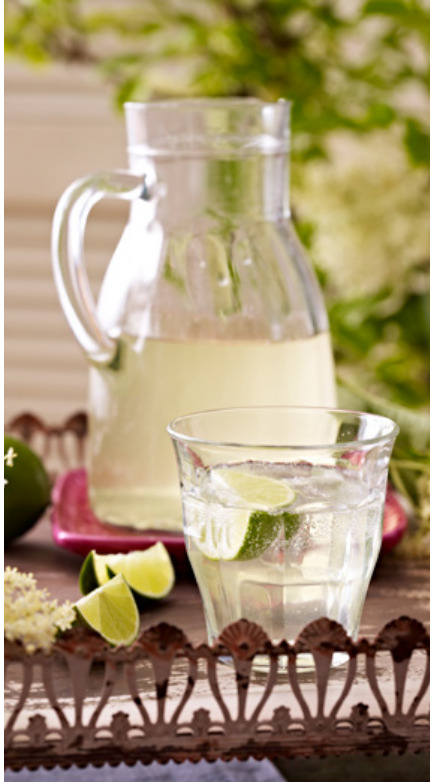

**Ingrediënten voor:** 1,5 l siroop
**Bereidingstijd:** ca. 15 min.
Wachttijd: 3-4 dagen
Was 2 bio-limoenen met heet water en snijd ze in blokjes. Schud
voorzichtig de bloesems van 20 vlierbloesemtakjes. Breng 1 kg
suiker met 1 l water aan de kook. Voeg de limoen en de bloesem
toe. Neem de pan van het vuur. Laat de siroop afkoelen. Zet
afgedekt op een donkere, koele plek en laat 3-4 dagen trekken.
Zeef de siroop door een zeef bekleed met een schone theedoek
in een fles. Sluit de fles goed af en zet in de koelkast. De siroop
is 6 maanden houdbaar in de koelkast. Verdun 1 deel siroop met
4 delen (koolzuurhoudend) water of prosecco.
BUFFET

## Gemarineerde karbonades

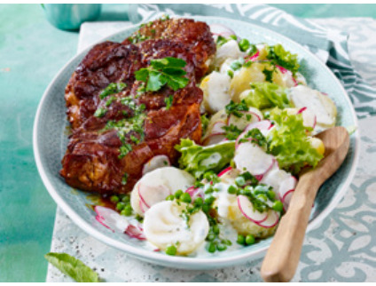

**Ingrediënten voor:** 6 personen
**Bereidingstijd:** ca. 2 uur
Wachttijd: ca. 12 uur
**2 el** paprikapoeder
**1 el** suiker
zout en peper
**6** schouderkarbonades
(ca. 1,2 kg)
**6** uien
**500 ml** appelsap
**100 ml** barbecuesaus (fles)
**1 tl** worcestersaus
**3 el** olie
**2 el** tomatenpuree
**250 ml** groentebouillon
vershoudfolie

## Frisse aardappelsalade

## met radijsjes

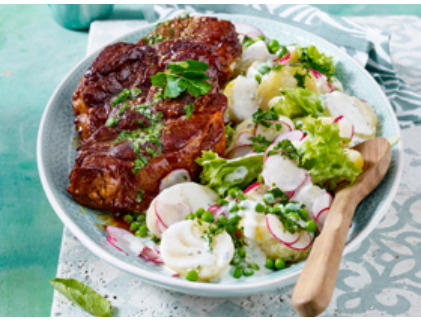

**Ingrediënten voor:** 6 personen
**Bereidingstijd:** ca. 1 uur en 30 min.
**1,2 kg** kleine aardappels
zout en peper
**300 g** erwten (diepvries)
**2** uien
**150 ml** witte balsamico
**375 ml** groentebouillon
**3 tl** kappertjes (pot)
**1 bosje** radijsjes
1 krop sla (bijv. lollo bionda)
**250 g** zure room
BUFFET
1 EEN DAG VAN TEVOREN Meng het paprikapoeder, de suiker, 1½ tl zout en 1½ tl peper. Wrijf de
karbonades ermee in. Pel de uien en snijd ze in ringen. Doe de uien met de karbonades in een kom.
Roer het appelsap, de barbecuessaus en de worcestersaus door elkaar en schenk het mengsel over de
karbonades. Dek af met folie en zet een nacht in de koelkast.
2 DE VOLGENDE DAG Verwarm de oven voor (elektrisch: 200°C / hetelucht: 180°C). Neem de karbonades
uit de marinade. Houd de marinade apart. Dep de karbonades droog. Verhit de olie in een ovenvaste
pan met deksel. Bak er de karbonades ca. 2 minuten per zijde op hoog vuur in. Neem uit de pan. Bak de
tomatenpuree in het hete bakvet. Voeg de karbonades weer toe. Voeg de marinade, de ui en de bouillon
toe en breng aan de kook. Zet afgedekt ca. 1 uur en 30 minuten in de oven.
3 Neem de karbonades uit de pan en houd warm. Zeef het braadvocht in een pannetje, breng aan de
kook en breng op smaak met zout en peper. Serveer de karbonades met de jus. Lekker met de aardappelsalade (zie recept hieronder) en met de peterselie-gremolata (zie kader).
**Per portie:** ca. 520 kcal
**42 g** eiwit | 29 g vet | 18 g koolhydraten

## Peterselie-gremolata

Was 2 bosjes peterselie, neem de blaadjes
van de takjes en hak de blaadjes fijn. Roer de
peterselie, geraspte schil en sap van 1 biocitroen en 6 el olijfolie door elkaar. Breng op
smaak met zout en peper.
1 Was de aardappels en kook ze in water met een snufje zout in ca. 20 minuten gaar. Kook de erwten de
laatste 3 minuten mee. Pel en snipper de uien. Breng de balsamico, de bouillon en de ui in een pan aan
de kook. Neem van het vuur en laat staan. Giet de aardappels en de erwten af en spoel kort. Pel de aardappels en snijd ze in plakken. Hak de kappertjes. Meng de aardappels, de kappertjes, de erwten en het
uienmengsel. Laat ca. 30 minuten marineren.
2 Maak de radijsjes schoon en schaaf of snijd ze in dunne plakken. Was de sla en snijd hem in stukken.
Spatel de zure room, de radijsjes en de sla door de salade. Breng op smaak met zout en peper.
**Per portie:** ca. 300 kcal
**10 g** eiwit | 6 g vet | 50 g koolhydraten

## Rabarberkruimeltaart

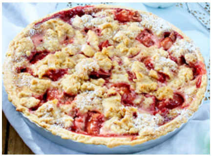

**Ingrediënten voor:** 2 taarten (à ca. 12 stukken)
**Bereidingstijd:** ca. 2 uur
Wachttijd: ca. 2 uur
**650 g** bloem (+ bestuiven)
**200 g** poedersuiker
(+ bestuiven)
zout
**325 g** boter (waarvan 75 g
zacht + invetten)
**8** eieren
**1 kg** rabarber
**280 g** rietsuiker
**600 ml** slagroom
vershoudfolie
1 VOOR HET DEEG Meng 500 g bloem, de poedersuiker en 1 snufje zout. Voeg
**250 g** koude boter in stukken en 2 eieren toe en kneed glad. Wikkel in folie en
leg ca. 30 minuten in de koelkast.
2 Maak de rabarber schoon, schil hem en snijd hem in stukken. Meng hem
met 60 g rietsuiker.
3 Halveer het deeg en rol elk stuk deeg op een met bloem bestoven werkblad
rond (ca. 30 cm Ø) uit. Vet 2 taartvormen (à ca. 26 cm Ø) in en bestuif ze
met bloem. Bekleed de taartvormen met het deeg. Prik gaatjes in het deeg.
Verdeel de rabarber over beide taartvormen.
4 VOOR DE SAUS Verwarm de oven voor (elektrisch: 180°C / hetelucht:
160°C). Kluts 6 eieren, 120 g rietsuiker en de slagroom. Verdeel het mengsel
over beide taartvormen. Bak de taarten na elkaar ca. 20 minuten in de oven.
5 VOOR HET KRUIMELDEEG Kneed 150 g bloem, 100 g rietsuiker en 75 g
zachte boter met de handen tot een kruimeldeeg. Verdeel het kruimeldeeg
over beide taarten. Bak op gelijke temperatuur ca. 20 minuten verder. Neem
de taarten uit de oven, laat afkoelen en bestuif met poedersuiker.
**Per stuk:** ca. 380 kcal
**6 g** eiwit | 21 g vet | 41 g koolhydraten

## Pizzastrudel met spinazie en zongedroogde

## tomaten

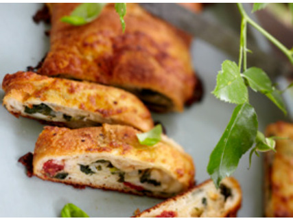

**Ingrediënten voor:** ca. 16 plakken
**Bereidingstijd:** ca. 45 min.
**1** ui
**1** teentje knoflook
**750 g** bladspinazie
**2 el** olijfolie
zout en peper
nootmuskaat
**6 takjes** basilicum
**250 g** mozzarella
ca. 280 g zongedroogde
tomaten in olie
**2 el** pijnboompitten
1
rol vers pizzadeeg
(koelvak)
1 Pel en snipper de ui en de knoflook. Maak de spinazie schoon. Verhit de olie
in een grote pan. Fruit er de ui en de knoflook glazig in. Voeg de spinazie toe
en laat hem afgedekt slinken. Breng op smaak met zout en nootmuskaat.
Doe de spinazie in een vergiet en laat goed uitlekken.
2 Was het basilicum en hak de blaadjes fijn. Snijd de mozzarella in kleine
stukjes. Laat de tomaten goed uitlekken. Rooster de pijnboompitten in
een droge pan goudbruin en neem ze uit de pan. Verwarm de oven voor
(elektrisch: 200°C / hetelucht: 180°C). Rol het pizzadeeg met het bakpapier
uit. Verdeel de spinazie, de tomaten en ¾ van de mozzarella over het deeg,
maar laat ca. 2 cm van de rand rondom vrij. Strooi de pijnboompitten en het
basilicum eroverheen. Rol het deeg met behulp van het bakpapier langs de
lange zijde op. Leg de rol met het bakpapier op een bakplaat. Bestrooi met de
overige mozzarella.
3 Bak de pizzarol ca. 25 minuten in de oven. Neem de rol uit de oven, laat
afkoelen en snijd hem in plakken.
Per plak: ca. 110 kcal
**5 g** eiwit | 4 g vet | 13 g koolhydraten

## Romige witte-bonenpuree

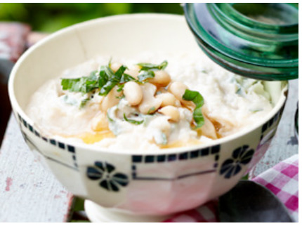

**Ingrediënten voor:** 6 personen
**Bereidingstijd:** ca. 15 min.
Giet 400 g witte bonen (blik) af, spoel kort
en laat uitlekken. Was 2 takjes munt, neem
de blaadjes van de takjes en hak de blaadjes
grof. Pel 1 teentje knoflook en hak hem
fijn. Pureer de bonen, de knoflook en 2 el
Griekse yoghurt fijn. Roer 3 el olijfolie, de
munt, 1 tl komijnpoeder en 2 el citroensap
erdoorheen. Breng op smaak met zout en
peper.
BUFFET

## Sesam-yoghurtdip

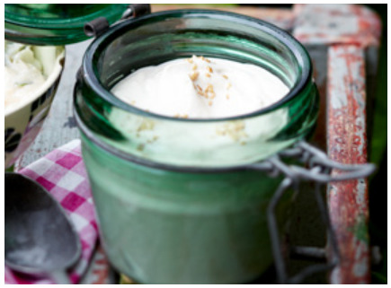

**Ingrediënten voor:** 6 personen
**Bereidingstijd:** ca. 10 min.
Rooster 2 tl sesamzaad in een droge pan
en neem het uit de pan. Roer 300 g Griekse
yoghurt en 100 g tahin (sesampasta) door
elkaar. Roer 2 el citroensap, zout en een
paar druppeltjes tabasco erdoorheen.
Bestrooi de dip met het sesamzaad.
Wil jij je nooit
meer afvragen:
'Wat eten we vandaag?’
ABONNEER JE NU VIA
Iedere dag inspiratie voor
een heerlijke maaltijd
Bomvol recepten met
seizoensgebonden
producten
Ontdek de lekkerste
zoete recepten
ONTVANG 12X

## KOKEN & GENIETEN

VOOR

# €35,-

# WWW.KOKENGENIETEN.NL/ABO

Deze actie is geldig t/m 24 mei 2022 of zo lang de voorraad strekt. Je abonneert tot wederopzegging en voor ten minste de actieperiode van 12 nummers. Na afloop van de
OF BEL NAAR +31 (0)24 20 27 829
actieperiode geldt de reguliere abonnementsprijs en is het abonnement per maand opzegbaar. Opzeggen is heel eenvoudig en kan via onze klantenservice.

# Wat

# Wat

Wa ete
ete
e n
ten
te we

# we

w vandaag?

# vandaag?

# v

ABONNEER JE NU VIA

# Zonder

# pakjes en zakjes

Ze is terug, dé koningin van het koken zonder pakjes en zakjes. Dit keer gaat Karin helemaal op de vega tour
en gooit ze allerlei klassiekers in een plantaardig jasje. Van bolognese tot soep: alle gerechten in haar boek
maak je zonder pakjes en zakjes. Dat is gezonder én veel lekkerder!
Titel: Vega zónder pakjes & zakjes
Auteur: Karin Luiten
Uitgever: Fontaine uitgevers
Aantal pagina’s: 248
Prijs: 25,99 euro

## Koude radijssoep

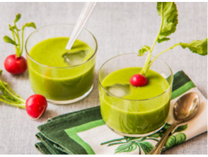

**Ingrediënten voor:** 4 personen
**Bereidingstijd:** ca. 30 min.
Wachttijd: ca. 2 uur
**1** grote ui
olijfolie (om in te bakken)
**1** grote prei
**250 g** kruimige aardappels
**4 takjes** tijm
zout en peper
**1** bos radijsjes
**1 l** groentebouillon
BOEK

## TIP

Goed pureren tot ook de steeltjes
helemaal vermalen zijn. Voor wie alleen
een staafmixer heeft: kook dan liever
niet te veel steeltjes mee, maar alleen
de blaadjes, anders blijft het te vezelig.
Of gebruik een ouderwetse roerzeef,
die tackelt alles probleemloos.
1 Snipper de ui en fruit zachtjes in wat olijfolie in een soeppan met dikke bodem. Snijd intussen de prei
(wit en groen) in ringen, voeg toe aan de pan.
2 Schil de aardappels, was ze en snijd ze in kleine blokjes. Die mogen ook in de pan en even meefruiten.
Voeg losgeriste tijm, zout en peper toe. Giet de (liefst hete) groentebouillon in de pan erbij en breng aan
de kook. Laat 10-15 minuten onder een deksel sudderen tot de aardappel (en daarmee ook de rest) gaar
is.
3 Was intussen het radijsblad en de steeltjes grondig (het kan zanderig zijn) en laat uitlekken. Roer dan
hand voor hand het radijsblad door de hete soep – het slinkt razendsnel – en laat nog even 2 minuten
sudderen. Pureer helemaal glad in de blender. Laat de soep afkoelen en vervolgens in de koelkast ijskoud worden. Proef op zout en peper.
4 Serveer de soep ijskoud, gegarneerd met wat (plakjes) radijs en eventueel een ijsblokje.

## Rodelinzenbolognese

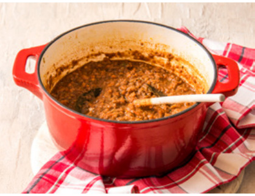

**Ingrediënten voor:** 4 personen
**Bereidingstijd:** ca. 2 uur
**1** winterwortel
**4** bleekselderijstengels
**1** grote ui
**2** knoflooktenen
olijfolie (om in te bakken)
**1** paddenstoelenbouillonblokje
**150 g** gedroogde rode linzen
**2** takken verse rozemarijn
**2** volle el tomatenpuree
**250 ml** rode wijn
**400 g** gepelde tomaten (blik)
**1 el** gedroogde oregano
**2** laurierblaadjes
**1 tl** suiker
zout en peper
**75 g** miso

## TIP

Rode linzen, die er trouwens oranje
uitzien, vallen normaal gesproken
tijdens het koken vanzelf uit elkaar. Maar
zuur (= tomaat) vertraagt de garing,
dus als je ze ongekookt erbij doet, kan
het soms heel lang duren voor ze zacht
worden. Vandaar dat ze alvast even een
zetje krijgen in een aparte pan.
1 Snipper wortel, bleekselderij, ui en knoflook fijn (of hak alles even in de keukenmachine). Verhit een
scheut olie in een grote braadpan en fruit de boel op vrij hoog vuur 10 minuten onder af en toe omscheppen.
2 Breng intussen 500 ml water aan de kook in een pan met het paddenstoelenbouillonblokje. Doe daar
de linzen in en laat op zacht vuur onder een deksel rustig sudderen. Hak alvast de rozemarijn fijn.
3 Bak de tomatenpuree 1 minuut mee met de groenten. Giet de wijn erbij en laat even uitbruisen.
4 Voeg bliktomaten, rozemarijn, oregano, laurier, suiker en peper toe plus de complete inhoud van de
linzenpan. Laat op een laag pitje onder een deksel anderhalf uur sudderen. Zet het laatste half uur de
deksel schuin op de pan indien de saus nog heel nat is.
5 Roer de miso even los met wat hete saus, meng dan door de pan. Proef op zout en peper. Serveer de
bolognese met pasta naar keuze, en voor de niet-vegans met geraspte parmezaan.

## Kokoscurry met ananas

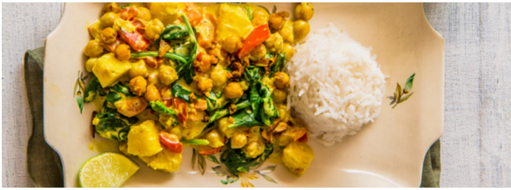

**Ingrediënten voor:** 4 personen
**Bereidingstijd:** 50 min.
**1** grote ui
**2** knoflooktenen
plantaardige olie (om in te
bakken)
**3** cm verse gember
**400 g** kikkererwten (blik)
**1 el** kerrie
een snufje chilivlokken
zout en peper
**1** rode paprika
**½** verse ananas (ca. 250 g, in
blokjes)
**400 g** kokosmelk (blik)
**300 g** rijst
**200 g** panklare spinazie
**1** limoen

## TIP

Altijd feestelijk is rijst in torentjes. Spoel
een kopje, glaasje of bakje om met
water, doe de rijst erin, duw goed aan
met een lepel, draai om en voilà. Of eet
de hele boel gewoon uit een kom, ook
lekker.
1 Snipper de ui en knoflook. Verhit een flinke
scheut olie in een wijde hapjespan en fruit ze
samen zachtjes. Rasp de gember erboven.
2 Spoel de kikkererwten af in een vergiet en laat
goed uitlekken. Doe in de pan, samen met de
kerrie, chilivlokken, zout en peper. Bak de kikkererwten al omscheppend op middelhoog vuur een
minuut of 8-10 tot ze goudbruin en licht krokant
zijn. De hele tijd roeren hoeft heus niet.
3 Intussen is er tijd zat om de paprika en ananas
in stukjes te snijden. Schep twee flinke lepels
kikkererwten uit de pan voor de garnering en
BOEK
houd apart. Doe de paprika en kokosmelk in de
pan, breng aan de kook en laat 30 minuten onder
een deksel op laag vuur pruttelen.
4 Kook intussen de rijst gaar in kokend water met
wat zout en houd warm onder een deksel. Roer
op het laatst de ananas door de saus en – hand
voor hand – de spinazie, totdat die slinkt. Breng
op smaak met rasp en sap van de limoen. Proef op
zout en peper.
5 Strooi de achtergehouden kikkererwten over de
saus. Serveer met de rijst.

## Sierlijke filotaart met snijbiet

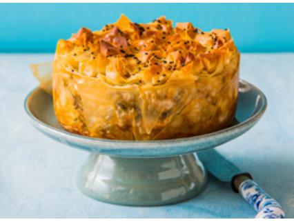

**Ingrediënten voor:** 4 personen
**Bereidingstijd:** ca. 1 uur en 5 min.
**1** pak filodeeg (diepvries, 10
vellen, 225-250 g)
**1** ui
**2** knoflooktenen
olijfolie (om in te bakken)
**300 g** snijbiet
**2** eieren
**200 g** hüttenkäse (cottage cheese)
**150 g** feta
**1** handvol dille
**1** citroen (alleen de schil)
zout en peper
**75 g** gesmolten boter
**1 tl** nigellazaadjes
bakpapier
1 Laat het filodeeg een half uurtje ontdooien in de
verpakking.
2 Snipper intussen de ui en hak de knoflook fijn.
Fruit samen heel zachtjes in wat olie in een grote
hapjespan of wok. Snijd intussen de stelen van de
snijbiet in kleine stukjes, hak de bladeren grof.
Doe eerst de stelen in de pan en bak 5-10 minuten
mee tot ze beetgaar zijn; dit controleer je door
even te proeven. Voeg dan de bladeren toe en laat
op hoog vuur al omscheppend in 2-3 minuten
slinken. Haal uit de pan en laat afkoelen.
3 Verwarm de oven voor (elektrisch: 200°C /
hetelucht: 180°C). Doe de eieren in een grote kom
samen met de cottage cheese, verbrokkelde feta
en fijngehakte dille. Rasp de citroenschil erboven.
Voeg een flinke snuf zout en peper toe en klop
alles goed door elkaar. Schep de afgekoelde snijbiet erdoor.

## TIP

Geen snijbiet? Vervang door 300 g
spinazie en een extra ui. Of maak de
taart met ontdooide diepvriesspinazie.
Wel altijd goed uit laten lekken, want
daar komt veel meer vocht uit dan bij
snijbiet.
4 Klem een vel bakpapier vast op de bodem
van een springvorm, liefst een vrij kleine, hoge
(Ø 16-18 cm), dan krijg je een mooi hoog taartje.
Vet bodem en randen in met gesmolten boter.
5 Bedek de vorm met wat kruislings op elkaar
gelegde vellen deeg (± ⅓ deel), kwast tussendoor
steeds in met boter. Zorg dat dat het deeg over de
rand hangt. Doe de groentevulling erin. Vouw het
overhangende deeg erover dicht. Maak de bovenkant helemaal dicht met weer wat stukken deeg
over elkaar (± ⅓). Blijf te pas en te onpas kwasten
met boter.
6 Scheur alle overgebleven restjes deeg in stukken en verfrommel die tot propjes. Bedek hiermee
de hele bovenkant. Kwast ook weer in met boter.
Bestrooi met nigellazaadjes. Bak de taart ca.
25 minuten onder in de oven, tot hij gaar, krokant
en goudkleurig is. Lekker met een tomatensalade.
THE WORLD’S ELECTRIC GRILL BRAND

## 42% MINDER VET

DOOR DE VERSTELBARE ACHTERVOET
*Gebaseerd op het grillen van burgers met 15% vet (113g)
Copper & Zwart
Fit Grill Medium
Fit Grill Medium
Koreaanse Kippendij
ook verkrijgbaar bij:
Jamaican Jerk Brioche French Toast American Doughnuts
Fit Grill Medium Copper 25811-56 & Zwart 25810-56 | www.georgeforeman.nl | @georgeforeman.benelux

# voorjaarsgroenten

Een rondje door de moestuin en je hebt bijna alle
ingrediënten al bij elkaar.

# Een pan vol

## Romige stoof met

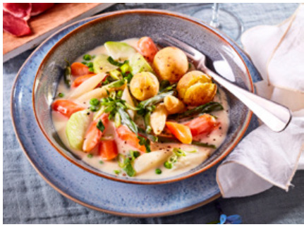

# voorjaarsgroenten

**Ingrediënten voor:** 4 personen
**Bereidingstijd:** ca. 1 uur en 15 min.
**750** g
kleine nieuwe aardappels
ca. 300 g bospeen
**2** kleine koolrabi’s
**300 g** witte asperges
**4** lente-uitjes
**250 g** sperziebonen
zout en peper
**200** g
doperwten (gedopt of
diepvries)
**30 g** boter
**40 g** bloem
**250 ml** melk
**100 ml** slagroom
nootmuskaat
½
bosje platte peterselie
**125** g
rauwe, gerookte ham (stuk)
1 Was de aardappels en kook ze in ca. 20 minuten
gaar. Schrap de wortels, was ze en snijd ze in
stukken. Schil de koolrabi’s, was ze en snijd ze in
stukken. Schil de asperges, snijd de houtige uiteinden eraf, was ze en snijd ze in stukken. Maak
Garneer de stoof met verse
kruiden. Munt, peterselie,
dille, of een mix daarvan.
de lente-uitjes schoon en snijd ze schuin in dunne
ringen. Maak de sperziebonen schoon en snijd ze
in stukken.
2 Breng 1 l water met een snufje zout aan de kook.
Gaar de bonen en de wortel 5-6 minuten. Voeg de
koolrabi, de asperges en de erwten toe en gaar ca.
5 minuten verder. Giet de groenten af, vang hierbij de bouillon op en meet ca. 800 ml af.
3 Verhit de boter in een grote pan. Bak er de
bloem al roerend kort in. Roer de melk erdoorheen. Voeg de bouillon en de slagroom toe. Breng
aan de kook en kook al roerend ca. 5 minuten op
laag vuur. Breng op smaak met zout, peper en
nootmuskaat.
4 Houd wat lente-ui apart voor de garnering en
voeg de overige lente-ui toe aan de pan. Breng
kort aan de kook. Was de peterselie en hak de
blaadjes grof. Roer wat peterselie door de stoof.
5 Giet de aardappels af en laat ze kort droogstomen. Bestrooi ze met een snufje zout. Verdeel
de aardappels over borden. Bestrooi ze met de
overige lente-ui en de peterselie. Snijd de ham in
blokjes en verdeel ze eroverheen. Schenk de stoof
eroverheen.
**Per portie:** ca. 500 kcal
**23 g** eiwit | 18 g vet | 591 g koolhydraten

## Variatietip

Snijd de ham in 4 plakken
van 4-5 mm dik. Wentel ze
in ca. 50 g bloem, daarna
in 2 geklutste eieren en tot
slot door ca. 100 g paneermeel. Bak ze in ca. 3 el
boter in ca. 2 minuten per
zijde goudbruin.
STAP VOOR STAP

## VAN DE KOK

**1** GELIJKE STUKKEN
Snijd de groenten in gelijke stukken.
Halveer de bonen en snijd de wortels en de
asperges schuin in dikke plakken. Halveer de
koolrabi’s eerst horizontaal en snijd ze daarna
in dunne parten. Zo wordt alles tegelijkertijd
gaar.
**2** VOORKOKEN
Kook de groenten eerst voor, zo worden ze
in de stoof sneller gaar.
**3** EEN ROMIGE SAUS
Wanneer je de bloem met de boter hebt
gebakken, voeg je al roerend de melk toe.
Zo voorkom je klontjes en krijg je een mooie,
romige saus. Gebruik een garde om alles
glad te kloppen.
**4** BINDEN
Laat de saus eerst goed doorkoken en
voeg dan pas de groenten toe. Door de
bloem goed door te laten koken smaakt
hij niet meer rauw en wordt de saus mooi
gebonden.
4tips

# 1

**2** 3

# 4

## Klantenservice

Wil je abonnee worden of heb je vragen
over je abonnement? Op onze website vind
je antwoord op de meeste vragen.

## www.kokengenieten.nl/contact

Telefoon
We zijn er maandag tot vrijdag
van 09.00 tot 17.00 uur om je
vragen te beantwoorden.
+31 (0)24-2027829
E-mail
Stel je vraag eenvoudig
per e-mail aan een
van onze service medewerkers.
klantenservice@kokengenieten.nl
Abonnementsinformatie
Koken & genieten kost € 3,99 per nummer. De abonnementsprijs is in Nederland € 40
en in België € 43 (12 nummers). Deze prijs geldt bij betaling per automatische incasso.
Voor betaling via een (digitale) factuur geldt een toeslag van € 2,50. Je kunt eenvoudig
een machtiging afgeven via www.fnl.nl/machtigen. Abonnementen worden automatisch
verlengd, tenzij anders vermeld. Het opzeggen van een abonnement kan eenvoudig
telefonisch via +31 (0)24-2027829 of per mail via klantenservice@kokengenieten.nl.
Copyright
Het auteursrecht op deze uitgave en de gedrukte uitgave en op de daarin verschenen artikelen wordt door de uitgever
voorbehouden. Het verlenen van toestemming tot publicatie in de gedrukte uitgave houdt in dat de auteur de uitgever,
met uitsluiting van ieder ander onherroepelijk machtigt de bij of krachtens de auteurswet door derden verschuldigde vergoedingen voor kopiëren te innen en dat de auteur alle rechten overdraagt aan de uitgever, tenzij anders bepaald. Niets
uit deze uitgave en de gedrukte uitgave mag worden overgenomen, vermenigvuldigd of gekopieerd zonder uitdrukkelijke
schriftelijke toestemming van de uitgever. De uitgever stelt zich niet aansprakelijk voor eventuele onjuistheden, welke in deze
uitgave of de gedrukte uitgave mochten voorkomen.
koken & genieten is een uitgave
van F&L Media B.V.
in licentie van Bauer Media
Brand Manager
Yvonne Doorten
Redactie
Sanne van den Heuvel, Willem van
Santen, Martina Silbrníková en
Marieke Slettenhaar
Webredactie
Bas Erkens en Marieke Slettenhaar
Met medewerking van
Karin Luiten
Vormgeving
Nick Groenewold, Susan Gerbrands-
Derksen, Tom Gerrits, Orlando Koper,
Mylène Nales en Ellen Willemsen
Sales
Marc Bokhove
+31 (0)24 2404643
mbokhove@fnl.nl
Marketing
Anouk Tolboom
+31 24 240 45 95
atolboom@fnl.nl
Drukkerij
Habo DaCosta bv, Vianen
Vragen aan de redactie
Heb jij opmerkingen, suggesties
of vragen aan de redactie?
lezersvragen@kokengenieten.nl
Nieuwsredactie / Pers
kooknieuws@fnl.nl
of het onderstaande adres o.v.v.
F&L Media, redactie koken & genieten
Bezoekadres F&L Media
Jonkerbosplein 52, 6534 AB Nijmegen
ISSN
ISSN 1875-8517
F&L
MEDIA

# Terug naar de

# kindertijd

Wie is er niet groot geworden met hutspot,
gehaktballen en erwtensoep? Laat je met
deze heerlijke klassiekers uit moeders keuken
terugvoeren naar je kindertijd.

## Gehaktballen

## uit de oven met hutspot

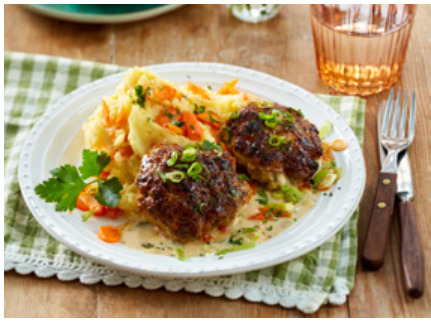

**Ingrediënten voor:** 4 personen
**Bereidingstijd:** ca. 45 min.
**800 g** kruimige aardappels
zout en peper
**2** lente-uitjes
**1** ui
**2** teentjes knoflook
**500 g** half-om-halfgehakt
**1** ei
**50 g** paneermeel
**2 tl** honingmosterd
**1 el** olie
**1½ tl** bloem
**350 ml** groentebouillon
**100 ml** slagroom
**4** wortels
**2 el** boter
**180 ml** melk
**6 takjes** peterselie
1 VOORDEHUTSPOT Schil de aardappels, was ze
en kook ze in water met een snufje zout in ca. 20
minuten gaar.
2VOORDEGEHAKTBALLENMaak de lente-uitjes
schoon en snijd ze in dunne ringen. Pel en snipper
de ui en de knoflook. Kneed het gehakt, de ui, de
knoflook, het ei, het paneermeel, de mosterd, zout
en peper door elkaar. Maak van het mengsel 8
gehaktballen. Verwarm de oven voor (elektrisch:
180°C / hetelucht: 160°C). Verhit de olie in een
ovenbestendige braadpan. Bak er de gehaktballen
rondom ca. 3 minuten op hoog vuur in en neem ze
uit de pan. Fruit de lente-ui in het bakvet. Bestuif
met de bloem en bak kort. Roer de bouillon en de
slagroom erdoorheen. Voeg de gehaktballen weer
toe. Bak ca. 15 minuten in de oven.
3 Schrap de wortels, was ze en snijd ze in stukken.
Verhit 1 el boter in een pan. Fruit er de wortel in.
Bestrooi met zout en peper. Smoor afgedekt ca. 7
minuten op laag vuur.
4 Giet de aardappels af. Voeg de melk en 1 el boter
toe. Stamp de aardappel grof. Voeg ca. ⅔ van de
wortel toe. Breng op smaak met zout en peper.
5 Was de peterselie en hak de blaadjes grof.
Serveer alles samen en bestrooi met de peterselie.
**Per portie:** ca. 740 kcal
**34 g** eiwit | 41 g vet | 56 g koolhydraten

## Entrecote met gebakken uitjes

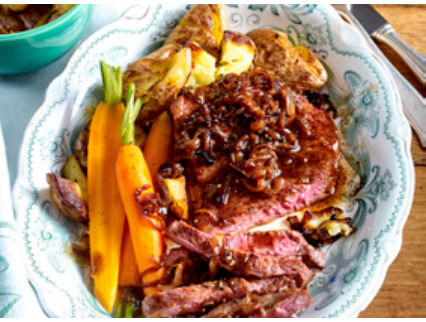

**Ingrediënten voor:** 4 personen
**Bereidingstijd:** ca. 45 min.
**800 g** kleine vastkokende aardappels
zout en peper
**1** bos bospeen
**6** uien
**4** entrecotes (à ca. 250 g)
**5 el** boter
**1 el** bloem
**400 ml** runderfond
**1 tl** mosterd
**1 el** suiker
1 VOOR DE AARDAPPELS Was de aardappels
grondig en kook ze in water met een snuf zout in
ca. 20 minuten gaar.
2 VOOR DE WORTELS Schrap de wortels en laat
hierbij ca. 1 cm van het groen zitten. Was de wortels en halveer ze naar grootte in de lengte. Kook
de wortels in water met een snufje zout in ca. 6
minuten gaar. Spoel kort en laat uitlekken.
3 VOOR HET VLEES Pel de uien en snijd of schaaf
ze in dunne ringen. Snijd de vetrand van de
SEIZOEN
entrecotes meerdere malen in en bestrooi het
vlees aan beide zijden met zout en peer. Verhit 1 el
boter in een grote pan. Bak er de entrecotes aan
beide zijden 4-5 minuten in, neem uit de pan en
houd warm.
4 Verhit 2 el boter in het hete bakvet. Wentel de
ui door de bloem. Bak de ui rondom goudbruin in
het hete vet. Bestrooi met zout en peper. Blus met
de fond af, breng aan de kook en roer de mosterd
erdoorheen. Kook ca. 10 minuten op laag vuur.
5 Giet de aardappels af en stamp heel grof. Verhit
1 el boter in een pan. Bak er de aardappels in.
Bestrooi met zout en bak rondom ca. 8 minuten.
6 Karamelliseer de suiker in een pan. Voeg de
wortel en 1 el boter toe, bestrooi met zout en
peper en bak rondom 2-3 minuten. Serveer alles
samen.
**Per portie:** ca. 580 kcal
**59 g** eiwit | 16 g vet | 39 g koolhydraten

## Erwtensoep met worst

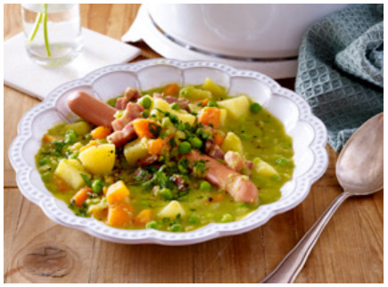

**Ingrediënten voor:** 4 personen
**Bereidingstijd:** ca. 2 uur en 15 min.
**100 g** gerookt spek
**500 g** aardappels
**4** grote wortels
**1** ui
ca. 200 g knolselderij
**1 el** olie
**200 g** spliterwten
**1** laurierblaadje
**150 g** erwten (diepvries)
zout en peper
**1-2 tl** gedroogde oregano
**1-2 el** appelazijn
**4** grote knakworsten
**2-3 takjes** peterselie
1 Snijd het spek in blokjes. Schil de aardappels,
was ze en snijd ze in blokjes. Schrap de wortels,
was ze en snijd ze in blokjes. Pel en snipper de ui.
Schil de knolselderij, was hem en snijd hem in
blokjes.
2 Verhit de olie in een grote pan. Bak er het spek
knapperig in. Voeg de aardappel, de wortel, de ui
en de knolselderij toe en bak ca. 1 minuut. Voeg
de spliterwten en het laurierblaadje toe en bak
ca. 1 minuut. Schenk 1,5 l water erbij, breng aan
de kook en kook afgedekt ca. 1 uur en 30 minuten
op laag vuur.
3 Voeg ca. 10 minuten voor het einde van de gaartijd de bevroren erwten toe aan de soep. Maak de
soep eventueel dunner met wat water. Maak de
soep eventueel wat smeuïger door hem te pureren met de staafmixer. Breng op smaak met zout,
peper, de oregano en de azijn.
4 Verhit de worsten ca. 5 minuten in de soep. Was
de peterselie en hak de blaadjes fijn. Serveer alles
samen en bestrooi met de peterselie.
**Per portie:** ca. 600 kcal
**31 g** eiwit | 26 g vet | 51 g koolhydraten

## Fusilli met worst en ei

## uit de oven

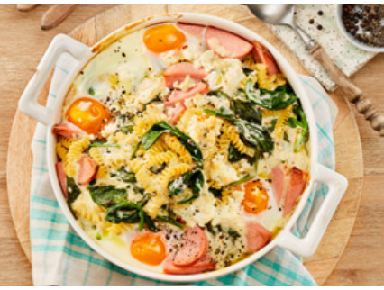

**Ingrediënten voor:** 4 personen
**Bereidingstijd:** ca. 45 min.
**250 g** fusilli
zout en peper
**200 g** jonge bladspinazie
**1** ui
**2** teentjes knoflook
**2 el** boter
**30 g** bloem
**300 ml** melk
**300 ml** groentebouillon
nootmuskaat
**200 g** feta
**200 g** rookworst
**4** eieren
1 Kook de fusilli volgens de aanwijzingen op de
verpakking in water met een snufje zout beetgaar. Was de spinazie en laat hem uitlekken.
2 Pel en snipper de ui en de knoflook. Verhit de
boter in een pan. Fruit er de ui en de knoflook
glazig in. Bestrooi met de bloem en bak kort.
Schenk de melk en de bouillon er al roerend bij
en breng aan de kook. Laat ca. 5 minuten zachtjes
doorkoken. Breng de saus op smaak met zout,
peper en nootmuskaat. Verbrokkel de feta. Roer
de spinazie en de helft van de feta door de saus en
laat de spinazie slinken.
3 Verwarm de oven voor (elektrisch: 200°C /
hetelucht: 180°C). Snijd de worst in plakken. Giet
de fusilli af en meng hem met de saus. Verdeel de
worst en de fusilli in een ovenschaal. Maak met
een lepel 4 kleine kuiltjes in het fusillimengsel.
Verdeel de eieren erin. Bestrooi met de overige
feta. Bak ca. 20 minuten in de oven.
**Per portie:** ca. 730 kcal
**35 g** eiwit | 41 g vet | 53 g koolhydraten
SEIZOEN

# Mama

# ,

# appelgebak

# s

Niemand bakt zo goed appeltaart als je eigen
moeder. Met deze heerlijke recepten kom je wel
aardig in de buurt.

## Appel-walnotenplaatkoek

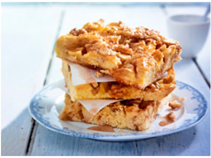

**Ingrediënten voor:** ca. 24 stukken
**Bereidingstijd:** ca. 1 uur en 15 min.
Wachttijd: ca. 2 uur
**450 g** suiker
**3 tl** kaneelpoeder
**275 g** zachte boter (+ invetten)
**150 g** walnoten
**1 kg** appels (bijv. elstar)
**8 g** vanillesuiker
zout
**5** eieren
**450 g** bloem (+ bestuiven)
**15 g** bakpoeder
**100 ml** melk
1 VOOR DE SIROOP Breng 250 ml water, 250 g
suiker en het kaneelpoeder aan de kook. Kook
zonder deksel ca. 20 minuten in. Roer 25 g boter
erdoorheen. Laat de siroop ca. 20 minuten afkoelen en roer hierbij meerdere malen om.
2 Hak de walnoten grof. Schil de appels, was ze,
snijd ze in vieren, verwijder het klokhuis en snijd
de appels in blokjes.
3 Klop 250 g boter, 200 g suiker, de vanillesuiker en 1 snufje zout romig. Klop een voor een
de eieren erdoorheen. Meng de bloem met het
bakpoeder en klop hem afgewisseld met de melk
door het botermengsel.
4 Verwarm de oven voor (elektrisch: 180°C / hetelucht: 160°C). Verdeel het beslag in een ingevette
en met bloem bestoven bakplaat (ca. 32x39 cm)
en strijk glad. Druppel ca. ⅓ van de siroop eroverheen en trek met een vork door het beslag. Strijk
het beslag weer glad. Verdeel de appel erop en
druk een beetje aan. Bestrooi met de walnoten
en druppel ⅓ van de siroop eroverheen. Bak
25-30 minuten in de oven.
5 Neem uit de oven en laat afkoelen. Serveer
de overige siroop bij het gebak en druppel naar
smaak eroverheen.
**Per stuk:** ca. 320 kcal
**5 g** eiwit | 15 g vet | 39 g koolhydraten

## Geglaceerde appeltaart

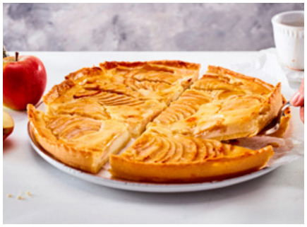

**Ingrediënten voor:** ca. 12 stukken
**Bereidingstijd:** ca. 1 uur en 15 min.
Wachttijd: ca. 2 uur
**250** g
bloem (+ bestuiven)
**220 g** suiker
zout
**125** g
koude boter (+ invetten)
**1** ei
**150 g** crème fraîche
**250 g** kwark
**40 g** maizena
**2 el** citroensap
4
appels (bijv. elstar)
**100 g** abrikozenjam
1 VOOR DE BODEM Doe de bloem, 120 g suiker,
**2 snufjes** zout en de boter in stukken in een kom
en kneed met de vingers tot een kruimeldeeg.
Voeg het ei toe en kneed glad. Maak van het deeg
een bal en leg hem afgedekt ca. 1 uur in de koelkast.
2 VOOR DE VULLING Klop de crème fraîche, de
kwark, de maizena, 100 g suiker en het citroensap glad.
GEBAK
3 Rol het deeg op een met bloem bestoven werkblad rond (ca. 32 cm Ø) uit. Vet een taartvorm
met uitneembare bodem (28 cm Ø) in en bestuif
hem met bloem. Bekleed de vorm met het deeg en
druk de rand aan. Verdeel de kwarkvulling erin.
4 Verwarm de oven voor (elektrisch: 180°C /
hetelucht: 160°C). Schil de appels, halveer ze en
verwijder het klokhuis. Snijd de helften in dunne
partjes en leg ze waaiervormig op de kwarkvulling. Bak ca. 40 minuten in de oven.
5 VOOR HET GLAZUUR Breng de jam met 4 el
water in een pannetje aan de kook. Neem de taart
uit de oven en bestrijk hem met de jam. Laat
afkoelen.
**Per stuk:** ca. 280 kcal
**4 g** eiwit | 13 g vet | 34 g koolhydraten

## Appelstrudel

## met lemoncurd en hazelnoten

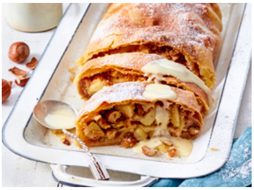

**Ingrediënten voor:** ca. 16 plakken
**Bereidingstijd:** ca. 1 uur en 30 min.
Wachttijd: ca. 2 uur
**250** g
bloem (+ bestuiven)
zout
**1** ei
**2** el
olie (+ invetten)
**100 g** hazelnoten
**125 g** boter
**100 g** paneermeel
**100 g** suiker
**1 tl** kaneelpoeder
**1** kg
appels (bijv. goudreinet)
**2 el** lemoncurd (potje)
**1 el** poedersuiker
bakpapier
1 Kneed de bloem, 1 snufje zout, het ei, de olie en
**100 ml** lauwwarm water door elkaar. Kneed met
de handen ca. 5 minuten door en kneed tot een
bal. Bestrijk met olie. Laat afgedekt ca. 30 minuten rusten.
2 Hak de hazelnoten grof en rooster ze in een
droge pan. Neem ze uit de pan. Smelt 50 g boter in
een pan en rooster er het paneermeel goudbruin
in. Roer de suiker en het kaneelpoeder erdoorheen. Schil de appels, verwijder het klokhuis en
snijd de appels in parten. Meng de appel met de
lemoncurd en de hazelnoten.
3 Rol het deeg op een met bloem bestoven theedoek heel dun (je kunt door het deeg kijken) uit
tot een rechthoek (47x50 cm). Trek het verder uit
elkaar over de rug van je handen. Snijd de dikke
deegranden eraf.
4 Verwarm de oven voor (elektrisch: 180°C / hetelucht: 160°C). Smelt 75 g boter. Bestrijk het deeg
met een dun laagje boer. Strooi het paneermeel
eroverheen. Verdeel het appelmengsel op 1 helft
van het deeg en laat hierbij 1,5 cm van de rand
vrij. Vouw de zijkanten om de vulling heen. Rol
het deeg langs de lange zijde met behulp van de
theedoek op. Leg de rol met de naad naar beneden
op een met bakpapier beklede bakplaat. Bestrijk
de rol met de boter. Bak ca. 35 minuten in de oven.
Bestrijk de strudel direct met de rest van de boter.
Laat afkoelen. Bestuif met de poedersuiker.
Per plak: ca. 360 kcal
**5 g** eiwit | 17 g vet | 46 g koolhydraten

## Appel-browniecarrés

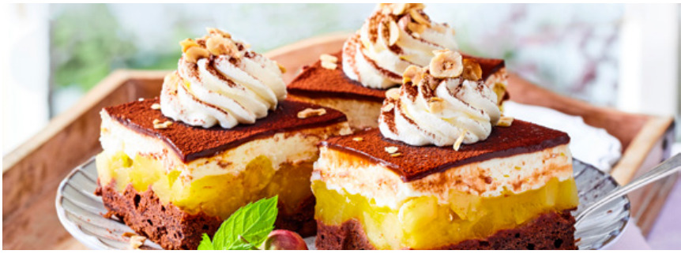

**Ingrediënten voor:** ca. 30 stuks
**Bereidingstijd:** ca. 1 uur en 30 min.
Wachttijd: ca. 3 uur
**2,2 kg** appels (bijv. elstar)
**750 ml** sinaasappelsap
**250 g** suiker
**70 g** custardpoeder
**400 g** pure chocolade
**200 g** boter (+ invetten)
**24 g** vanillesuiker
**5** eieren
**350 g** bloem
**15 g** bakpoeder
**50 g** hazelnootmeel
**30 g** + 2 el cacaopoeder
**800 g** crème fraîche
**900 ml** slagroom
**45 g** slagroomversteviger (bijv. Klop-
Fix van Dr. Oetker)
**100 g** melkchocolade
**1 el** kokosvet
hazelnootschaafsel om te
versieren
spuitzak met gekartelde
spuitmond
1 VOOR DE COMPOTE Schil de appels, snijd ze in
vieren, verwijder het klokhuis en snijd de appels
in blokjes. Breng de appel, 650 ml sinaasappelsap
en 75 g suiker aan de kook. Kook ca. 4 minuten
op laag vuur. Roer het custardpoeder met 100 ml
koud sinaasappelsap glad. Roer het custardpoedermengsel door het appelmengsel en kook
al roerend 1 minuut op laag vuur. Laat een beetje
afkoelen.
2 VOOR DE BODEM Verwarm de oven voor (elektrisch: 180°C / hetelucht: 160°C). Smelt 200 g
pure chocolade. Hak 100 g pure chocolade grof.
Klop de boter, 175 g suiker en 8 g vanillesuiker
romig. Klop een voor een de eieren erdoorheen.
Klop de gesmolten chocolade erdoorheen. Meng
de bloem, het bakpoeder, het hazelnootmeel en
**30 g** cacaopoeder door elkaar. Klop het bloemmengsel door het eimengsel. Klop 200 g crème
fraîche en de gehakte chocolade erdoorheen.
Verdeel het beslag over een ingevette bakplaat
(ca. 32x39 cm) en strijk glad. Verdeel het appelmengsel erop. Bak 30-35 minuten in de oven. Laat
afkoelen.
GEBAK
3 VOOR DE ROOM Klop 600 g crème fraîche en
**500 ml** slagroom in een grote kom op de laagste
stand kort door elkaar. Klop op de hoogste stand
stijf en klop 16 g vanillesuiker en de slagroomversteviger erdoorheen.
4 Verdeel de room over de taart. Halveer de taart
en zet hem ca. 1 uur in de koelkast. Hak 100 g
pure chocolade en de melkchocolade grof. Smelt
de chocolade met 200 ml slagroom en het kokosvet. Laat ca. 15 minuten afkoelen. Bestrijk de
taarten voorzichtig met de chocoladesaus. Zet ca.
1 uur en 30 minuten in de koelkast.
5 Bestuif de taarten met 1 el cacaopoeder. Klop
200 ml slagroom stijf en vul de spuitzak ermee.
Snijd de taart in stukken en versier elk stuk met
een toef slagroom, het overige cacaopoeder en
hazelnootschaafsel.
**Per stuk:** ca. 480 kcal
**6 g** eiwit | 30 g vet | 44 g koolhydraten

## Appeltaart met amandelkorst

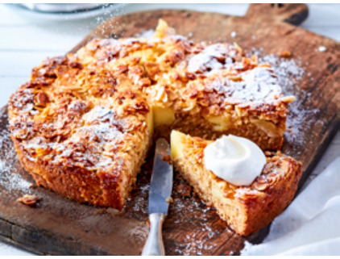

**Ingrediënten voor:** ca. 16 stukken
**Bereidingstijd:** ca. 1 uur en 15 min.
Wachttijd: ca. 2 uur
**6** appels (bijv. elstar)
**5 el** citroensap
**300 g** boter (+ invetten)
zout
**200 g** rietsuiker
**16 g** vanillesuiker
**3** eieren
**300 g** bloem (+ bestuiven)
**100 g** amandelmeel
**15 g** bakpoeder
**8 el** melk
**100 ml** slagroom
**100 g** amandelschaafsel
**1 el** poedersuiker
1 Schil de appels, was ze, snijd ze in vieren en verwijder het klokhuis. Snijd de appels aan de bolle kant
meerdere malen in. Druppel het citroensap eroverheen.
2 VOOR DE BODEM Klop 200 g boter, 1 snufje zout, 150 g suiker en 8 g vanillesuiker romig. Klop de
eieren er één voor één doorheen. Meng de bloem, het amandelmeel en het bakpoeder. Klop het bloemmengsel afwisselend met de melk door het botermengsel.
3 Verwarm de oven voor (elektrisch: 180°C / hetelucht: 160°C). Verdeel het beslag in een ingevette en
met bloem bestoven springvorm (30 cm Ø) en strijk glad. Dep de appels droog en leg ze in het beslag.
Druk een beetje aan. Bak ca. 12 minuten in de oven.
4 VOOR DE KORST Verhit 100 g boter, de slagroom, 50 g suiker, 8 g vanillesuiker en het amandelschaafsel tot de boter gesmolten is. Neem de taart uit de oven en verdeel het botermengsel erover. Bak
35-40 minuten verder. Laat in de vorm afkoelen. Bestuif met poedersuiker. Lekker met crème fraîche.
**Per stuk:** ca. 420 kcal
**7 g** eiwit | 26 g vet | 39 g koolhydraten
mei
Koop nu tickets met

## €5,- korting

Scan de code.
PRONKSTUK
Moederdagtaart
Niets zo leuk als je moeder verrassen met een zelfgebakken
taart. Met deze vrolijke krans versierd met fruit en bloemen
maak je je moeder gegarandeerd blij!

## Kleurrijke Moederdagkrans

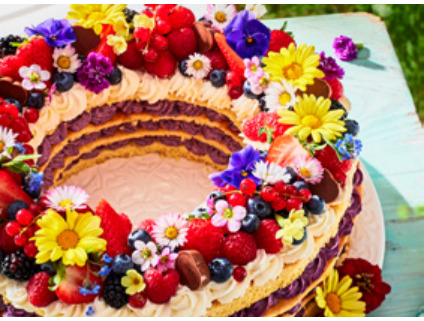

**Ingrediënten voor:** ca. 18 stukken
**Bereidingstijd:** ca. 2 uur en 15 min.
Wachttijd: ca. 3 uur en 30 min.
**12** eieren
**32 g** vanillesuiker
**370 g** suiker
**300 g** bloem
**16 g** bakpoeder
**10** gelatineblaadjes
**500 g** bramen (diepvries, ontdooid)
**1** vanillestokje
**250 g** mascarpone
**700 ml** slagroom
**8 g** slagroomversteviger (bijv. Klop-
Fix van Dr. Oetker)
**600–700 g** bosvruchten (bijv. blauwe
bessen, frambozen en
aardbeien)
10 chocoladebonbons (het liefst in
hartvorm)
eetbare bloemen om te
versieren
bakpapier
spuitzak met spuitmond (ca. 12
mm Ø)
1 VOOR HET BISCUIT Verwarm de oven voor (elektrisch: 180°C / hetelucht: 160°C). Splits 6 eieren. Klop
de eidooiers met 8 g vanillesuiker en 125 g suiker romig. Meng 150 g bloem met 8 g bakpoeder. Klop het
bloemmengsel door het eidooiermengsel. Klop de eiwitten stijf en spatel ze in 2-3 porties erdoorheen.
Leg een verstelbare taartring (32 cm Ø) op een met bakpapier beklede bakplaat. Schenk het beslag erin
en strijk glad. Bak 20-25 minuten in de oven. Neem uit de oven en verwijder de ring. Bak op dezelfde
wijze nog een taartbodem.
2 Steek met behulp van de taartring een grote cirkel uit de taartbodems (ca. 30 cm Ø). Snijd er met behulp van een bord kleinere cirkels (16 cm Ø) uit, zodat er twee kransen ontstaan. Serveer de afgesneden
cake bij de koffie of verwerk hem in een ander recept, bijv. in een trifle-dessert. Halveer de biscuitringen
horizontaal. Leg een onderste biscuitring op een taartplateau.
3 VOOR DE CRÈME Week de gelatine in koud water. Was de bramen, laat ze goed uitlekken en pureer ze.
Splijt het vanillestokje en schraap er het merg uit. Klop de mascarpone, 120 g suiker, de bramenpuree en
het vanillemerg door elkaar. Knijp de gelatine uit en los hem op. Klop 2 el van de mascarponecrème door
de gelatine. Klop het gelatinemengsel door de overige mascarponecrème. Klop 300 ml slagroom stijf
en spatel hem door de crème. Zet de crème ca. 15 minuten in de koelkast tot hij begint te geleren. Vul de
spuitzak met de crème. Spuit van ca. ⅓ van de crème toefjes op het onderste biscuit. Leg een tweede biscuit erop en spuit van ⅓ van de crème toefjes erop. Leg het derde biscuit erop en spuit de overige crème
er in toefjes op. Leg het laatste biscuit erbovenop. Zet de taart minstens 3 uur in de koelkast.
4 Klop 400 ml slagroom met 16 g vanillesuiker en de slagroomversteviger stijf. Doe de slagroom in een
spuitzak. Versier de taart met de slagroom, de bosvruchten, de bonbons en de eetbare bloemen.
**Per stuk:** ca. 430 kcal
**10 g** eiwit | 23 g vet | 45 g koolhydraten
Voor- en bijgerechten

# receptenindex

# juni

## IN HET

Aardbeien-amuses 19
Courgette-schnitzels met kwarkdip 13
Frisse aardappelsalade met radijsjes 37

## NUMMER

Gevulde knolselderijschnitzels 14
Groentemuffins met feta 35
Koude radijssoep 45
Lentegroentesoep 30
Pizzastrudel met spinazie en
zongedroogde tomaten 38
Romige witte-bonenpuree 39
Tofu-schnitzel met pindakorst en
noedelsalade 13
Sesam-yoghurtdip 39
Wortel-mangosoep met feta 17
Torta di polpette – gehaktballetjestaart 9
Hoofdgerechten
Zoet en desserts
Appel-browniecarrés 61
Aspic met kruidige groentefond 26
Appelstrudel met lemoncurd en hazelnoten 60
Appeltaart met amandelkorst 62
Appel-walnotenplaatkoek 59

## ZOMERKONINKJES IN DE

Frisse perziksorbet 22
Geglaceerde appeltaart 59
Broodje gehaktballetjes met pruimensaus 10

## SPOTLIGHTS

Burgers met appel en romige zuurkool 8
Het lekkerste gebak met
Dubbelgebakken tosti ham-kaas 32
Entrecote met gebakken uitjes 55
aardbeien in de hoofdrol
Erwtensoep met worst 56
Fusilli met worst en ei uit de oven 56
Gehaktballen met gerookte paprika,
Kleurrijke Moederdagkrans 65
Limoensoesjes 21
Rabarberkruimeltaart 38
Rijstdessert met bosvruchten 22
venkelzaad en tomatenjus 7
Vlierbloesem-limoensiroop 35
Gehaktballen uit de oven met hutspot 55
Gehaktballetjes met champignonroomsaus 29
Gehakt-stroganoff 32
Gemarineerde karbonades 37
Kalkoenrolletjes met romige sperziebonen 20
Knapperige visfilet
met koolrabi-aardappelsalade 18
Kokoscurry met ananas 47

## VERS VAN DE MARKT:

Orecchiette carbonara met erwtjes 17

## NIEUWE AARDAPPELS

= Zonder vlees en vis
Ovenschotel met casselerrib,
Dit maak je met de eerste
= Snel klaar (max. 30 min.)
brood en spitskool 19
Paddenstoelenschnitzel met
piepers van het land
mierikswortel-aardappelpuree 14
Pasta met bifteki-balletjes in Griekse saus 7
Het volgende nummer verschijnt op 24 mei 2021
Pasta met paprika en spiegelei 29
Ricottaburgers met gesmoorde boerenkool 10
Mis geen nummer meer!
Rodelinzenbolognese 46
Rollade met kruidnagel en jeneverbes 27
Neem nu een abonnement en krijg voortaan elke uitgave van koken & genieten
Romige stoof met voorjaarsgroenten 50
Sierlijke filotaart met snijbiet 48
automatisch in je brievenbus. Ga naar www.kokengenieten.nl/abo of
Spinazie-quiche 18
Teriyaki-kip met bimi 30
bel gratis naar +31 (0)24-2027829.
koken&genieten
VOOR ELKE DAG

## ON THE ROAD

Van sandwiches voor
onderweg tot makkelijke
campingrecepten

# De beste producten

# uit de Méditerranée

## momentogusto.nl

Bestel makkelijk en
snel online de beste
producten uit het
mediterraans gebied.
eniet van n

# momento gusto

# ardenista
