koken&genieten
€3,99

## VOOR ELKE DAG

# Een zalig

# 45x

# najaar

## doordeweekse

• Varkenshaas met appel

## inspiratie

• Schwarzwälder-tiramisu
• Groenten-linzencurry

# Het

# paddenstoel

# gevoel

Van oesterzwammen
tot cantharellen

# De smaak van wild

Geniet van ree, hert & konijn

# In de

# chocoladehemel

Desserts om van te dromen

## Kraak ‘m: 4x koken met noten

NOVEMBER
2022
€3,99
BP

# Desnellewegdoorhetblad

Voorgerechten
& bijgerechten
Salades, soepen en
broodjes: lekker als lichte
maaltijd of om je etentje
mee te beginnen.
Mini-flammkuchen met rode ui, paddenstoelen
en gremolata 12
Appel-selderijsoep met spek
Kikkererwten-pompoensoep
24
28
Hoofdgerechten
Ga je voor snel & makkelijk,
een dagje zonder vlees
of vis of pak je uit met een
weekendproject?
Reerug met spinazie
Konijnrollade met
whiskey-roomsaus 8
Broodje pulled hert
met appel en coleslaw 8
Pasta carbonara met
bospaddenstoelen 11
Zuurkool met worst
16
Pasta met spruitjes en kip
16
Zelfgemaakte lekkerbek
met groenten 18
Braadstuk met spätzle
en veldsla 24
Wildzwijnmedaillons met koolraapstamppot,
gebakken uien en spek 32
Zoet&nagerechten
Zoet is altijd goed!
Lekker als tussendoortje,
bij de koffie of als
afsluiting van je diner.
Varkenshaasje met
Zoet en desserts
parmaham, appel en salie 57
Kabeljauw met pistachekorst
38
Alcoholvrije hot toddy
17
Kaasknoedels met spitskool
43
Rijstdessert met perzik uit de oven
7
19
Zalmfilet met romige
mosterd-dilletopping 47
Overnight oats met
gekaramelliseerde banaan 37
Lotusparfait
52
Chocolade-perentaart
59
Chocolade-cupcakes
met cappuccinotopping 60
Zonder
vlees of vis
Snel klaar
(max. 30 min.)
Uitleg van symbolen bij de recepten
Zoete-aardappelsalade voor
Hazelnotenbroccoliovenschaaltjes 37
onderweg 30
Aardappelsalade met
knapperig gebakken ham 38
Aardappels in spek
ALLE RECEPTEN OP EEN RIJ
44
Cantharellen-pompoenlasagne
11
Snelle courgettepizza met
granaatappelpitjes 27
Kip in spek met friet
en broccoli 27
Broccoli-pompoenroerbak met biefstukreepjes
15
Groenten-linzencurry
Pasta met romige
spek-kaassaus 28
Aziatisch gehaktpannetje met spiegelei
15
30
Gepofte zoete aardappel met roomkaasvulling
en spek-boontjesdressing 49
Gebakken kweepeer met
marsepein-walnotenvulling19
Schwarzwälder-tiramisu-trifle
Filipijnse Adobo
52
Gepofte aardappel
met kip-chiliroomsaus 54
20
Chocolade mug cake
Kip caesar quesadilla
55
Spinazieknoedels met
20
paddenstoelenragout 12
Sinaasappelcustardtaartjes
25
Chocolade-cakerol
met roomvulling 60
Tiramisu-taart
62

# inhoud

Voorwoord

# Herfstbuien

Hoewel je de herfst misschien associeert
met regen, valt statistisch gezien in de
maand augustus de meeste regen, niet in
november. Dat neemt niet weg dat het ook
in het najaar goed tekeer kan gaan. Laat
je niet uit het veld slaan door een paar
dikke buien. Ik probeer er altijd het beste
van te maken. Als ik naar huis loop in de
stromende regen, dan denk ik alvast aan
het thuiskomen. Hoe ik opwarm onder de
hete douche, mijn joggingpak aantrek, de
waterkoker aanzet voor een warm kopje
thee en op mijn pantoffels achter het
fornuis een heerlijk verwarmend gerecht
maak. Deze editie staat er vol mee. Maak
bijvoorbeeld de groenten-linzencurry van
p. 15 of de pasta met spruitjes en kip op p.
16. Wat ook in de herfst thuishoort, is de
smaak van wild. Wij gingen aan de slag met
ree, hert en konijn vanaf p. 6. Als klap op
de vuurpijl eindigen we dit nummer met
het lekkerste chocoladegebak (p. 58). Dat
zijn gerechten waarvan wij zeker weten: die
helpen iedereen de zwaarste herfstbui door.
Yvonne Doorten
**6** De smaak van wild
Het lekkerste vlees komt uit het bos.
Geniet van de uitgesproken smaak van
ree, hert en konijn in deze bijzondere
gerechten.
10 Herfsttijd,
paddenstoelentijd
Ze zijn er in alle soorten en maten en
de een is nog lekkerder dan de ander.
Nu is het perfecte moment om met
paddenstoelen aan de slag te gaan.
**14** De hele week genieten
Dat is in ieder geval één zorg minder: wat
jij komende week gaat eten, is bij dezen
bekend.
**22** Het is weekend!
Pak dit weekend eens lekker uit met een
heerlijk driegangenmenu. Lekker voor met
z’n tweetjes, maar ook uitermate geschikt
voor het hele gezin!
**26** Simpel en snel genieten
Het is al druk genoeg met werk, kinderen
en hobby’s. Hier is de oplossing voor
iedereen die geen tijd heeft om uitgebreid
te koken, maar toch lekker wil eten.
**32** Uit het bos, op je bord
Heb je zin in een bijzonder stukje vlees met
een heerlijke wildsmaak? Maak dan eens
deze wildzwijnmedaillons!
**36** Gezond met noten
Weinig dingen zijn zo gezond als een
handje noten. Eet ze niet alleen zo uit
het vuistje maar verwerk ze ook in deze
heerlijke gerechten!
**42** De keuken van Zuid-Tirol
Een culinair reisje maken vanuit je eigen
keuken? Met deze gerechten op tafel is het
even alsof je tussen de prachtige bergen
van Zuid-Tirol staat.
Elke maand de
koken & genieten als eerste
in de brievenbus? Kijk op
of blader naar
www.kokengenieten.nl/abo
p. 40.
Zin in een culinair landentripje? Zonder ko ers,
**46** Lekker romig
douane of reistijd bieden we je twaalf heerlijke
borrelbestemmingen met goed gevulde
MonChou ken je vast wel? Maar weet je
borrelplanken. Kies voor Frankijk en Spanje of
zoek je het verder buiten de deur in Suriname of
ook wat je er allemaal mee kunt? We laten
Korea? Met onze 36 lekkere recepten kun je alle
kanten op. Welke borrelplank kies jij deze week?
je twee heerlijke recepten zien.
**50** Boek Keuken van Sou
Good food based on your mood; van dit
kookboek van Soumia Aattaoui wordt
iedereen instant blij!
**56** Appeltje, uitje
De smaken van herfst? Gebakken appel, ui
en salieblaadjes. Dit smakelijke trio is een
perfecte basis voor de heerlijke sappige
varkenshaas uit de oven.
**58** In de chocoladehemel
Niets zo verleidelijk als gebak met
chocolade. Met welke van deze heerlijke
desserts waan jij je in de chocoladehemel?
**66** Index & volgend
Alle recepten van deze uitgave op een rij én
een vooruitblik op volgende maand.
WIN HET BOEK

## BORRELEN VAN DE

PLANK (t.w.v. €9,99)

## ABONNEMENT

Borrelen van de plank
in12he rlijkelanden
Argentinië • Frankrijk • Italië • Marokko • Korea • Mexico • Suriname
Spanje • Thailand • Turkije • Scandinavië • Nederland
in12he rlijkelanden
B&D_001000_Cover_ok.indd 1

## 21

B&D_001000_Cover_ok.indd 1 31-08-2021 11:47
31-08-2021 11:47

# No waste

Op zoek naar een goede herfstgroente om je
weerstand te boosten? Ga voor rode biet! Rode
bieten zitten vol belangrijke vitamines en mineralen die je dit natte seizoen doorhelpen. Zoek
op de markt naar rode biet met blad en gebruik
de bladeren bijvoorbeeld rauw in een salade of
verwerk ze tot een pesto. Je kunt de bladeren
ook koken net als spinazie. Ze zitten boordevol
magnesium en calcium! Wij eten rode bieten het
liefst gepoft uit de oven. Verpak ze stuk voor stuk
in aluminiumfolie en rooster ze ca. 1 uur (a ankelijk van de grootte van de bieten) in de oven op
200°C. Lekker met wat geitenkaas of feta!

# Wintergroente

Hij lijkt een beetje op de wortel, maar hij heeft weinig kleur. De
pastinaak is niet een ontzettend populaire groente en dat is jammer!

## Kappertjes

De smaak is namelijk heel verrassend; een beetje zoetig en anijsachtig.
Kappertjes zijn de nog dichte bloemknopjes
Hij combineert goed met andere zoete smaken zoals peer in een romige

# Smaakbommetjes

Kappertjes zijn de nog dichte bloemknopjes

# Smaakbommetjes

van de kappertjesplant. Als de knopjes

# Smaakbommetjes

van de kappertjesplant. Als de knopjes
Kappertjes zijn de nog dichte bloemknopjes
aan de plant tot bloei komen worden
het mooie wit-paarse bloemen.
Kappertjes worden vaak gegeten
in salades of in pastagerechten.
Kappertjes zijn erg zout van

# op de markt

smaak en als je ze doorbijt
vindt er een smaakexplosie
plaats in je mond. Je kunt
kappertjes zo uit het potje
eten, maar je kunt ze ook
Profiteer van de
seizoensproducten
frituren in een laagje olie,
daar worden ze nog lekkerder
van de maand

# vers

van! Ben je gek op de smaak van

# november

kappertjes? Probeer dan ook eens
kapperappeltjes, die zitten aan een
steeltje en zijn een stuk groter!

# Even laten trekken

Laurier is een kruid dat a omstig is van de
laurierplant. De plant groeit vooral veel in
landen als Turkije en Griekenland, maar ook
INHOUD
in sommige Nederlandse tuinen vind je hem.

## Pastinaak

Op zoek naar een goede herfstgroente om je
weerstand te boosten? Ga voor rode biet! Rode
bieten zitten vol belangrijke vitamines en mineralen die je dit natte seizoen doorhelpen. Zoek
op de markt naar rode biet met blad en gebruik
de bladeren bijvoorbeeld rauw in een salade of
verwerk ze tot een pesto. Je kunt de bladeren
ook koken net als spinazie. Ze zitten boordevol
magnesium en calcium! Wij eten rode bieten het
liefst gepoft uit de oven. Verpak ze stuk voor stuk
in aluminiumfolie en rooster ze ca. 1 uur (a ankelijk van de grootte van de bieten) in de oven op
herfstsoep. Je kunt pastinaak ook goed roosteren in de oven met
C. Lekker met wat geitenkaas of feta!

## Rode biet

bijvoorbeeld biet en wortels, dan wordt hij lekker zoet. Of verwerk hem

## Rode biet

# Wintergroente

in een lekkere romige gratin met slagroom en kaas. Als er één seizoen
Hij lijkt een beetje op de wortel, maar hij heeft weinig kleur. De

# Wintergroente

is waarin je de pastinaak een kans moet geven, dan is het de herfst wel!
Hij lijkt een beetje op de wortel, maar hij heeft weinig kleur. De

## Rode biet

# Wintergroente

## Laurier

pastinaak is niet een ontzettend populaire groente en dat is jammer!
De smaak is namelijk heel verrassend; een beetje zoetig en anijsachtig.
Hij combineert goed met andere zoete smaken zoals peer in een romige

## Laurier

# november

# november

## Pastinaak

# Even laten trekken

De gedroogde bladeren kun je gebruiken in
Laurier is een kruid dat a omstig is van de
laurierplant. De plant groeit vooral veel in
stoofschotels, marinades, sauzen of soepen.
landen als Turkije en Griekenland, maar ook
in sommige Nederlandse tuinen vind je hem.
De smaak is erg aromatisch en een beetje

## Laurier

# november

bitter. Naarmate de blaadjes langer trekken,

# november

## Laurier

komt er een kruidige theesmaak naar voren.
Dat is overigens niet zo gek, want van laurier
kun je prima thee trekken! Lekker voor bij
een van de gebakjes met chocolade op p. 58.

# De smaak

# van wild

Het lekkerste vlees komt uit het bos. Geniet
van de uitgesproken smaak van ree, hert en
konijn in deze bijzondere gerechten.

## Reerug met spinazie

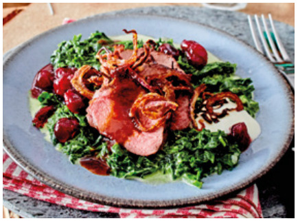

**Ingrediënten voor:** 4 personen
**Bereidingstijd:** ca. 50 min.
**4 takjes** tijm
**15** jeneverbessen
**4 tl** honing
geraspte schil en sap
van 1 bio-limoen
**800 g** reerug (zonder bot)
zout en peper
**4 el** olie
**2** uien
**1 el** tomatenpuree
**150 ml** rode wijn
**150 ml** wildfond (pot)
**600 g** bladspinazie
**100 g** + 1 el koude boter
**200 ml** slagroom
nootmuskaat
**100 ml** cranberrysap
**200 g** cranberry’s (diepvries)
**4 tl** crème fraîche
1 VOOR DE REERUG Verwarm de oven voor (elektrisch: 100°C / hetelucht: 80°C). Was de tijm.
Druk 5 jeneverbessen plat. Vermaal de overige
jeneverbessen fijn en roer ze met de honing, de
limoenschil en het limoensap door elkaar.
2 Bestrooi de reerug met zout en peper. Verhit
**2 el** olie in een pan en braad hierin de reerug op
hoog vuur rondom aan. Neem uit de pan. Houd de
pan met het bakvet apart. Wrijf de reerug in met
het honingmengsel. Leg op een bakplaat en bak
ca. 20 minuten in de oven.
3 Pel en snipper 1 ui. Pel de overige ui en snijd
hem in ringen. VOOR DE SAUS Bak de gesnipperde ui in het bakvet van de reerug. Voeg de tijm
en de geplette jeneverbessen toe en bak kort.
Voeg de tomatenpuree toe en bak nog 1 minuut.
Schenk de wijn en de fond erbij, breng aan de
kook en kook ca. 5 minuten op laag vuur in.
SEIZOEN
4 VOOR DE BIJGERECHTEN Was de spinazie, laat
hem uitlekken en snijd hem in reepjes. Verhit
**1 el** boter in een grote pan. Voeg de spinazie toe
en laat hem slinken. Schenk de slagroom erbij en
kook ca. 3 minuten op laag vuur. Breng op smaak
met zout, peper en nootmuskaat. Breng het cranberrysap met de cranberry’s in een andere pan
aan de kook en kook ca. 5 minuten op laag vuur.
Verhit 2 el olie in een koekenpan en bak er de
uienringen krokant in.
5 Zeef de saus en breng hem opnieuw aan de
kook. Neem van het vuur. Klop 100 g koude boter
in stukken erdoorheen. Breng op smaak met zout,
peper en nootmuskaat. Snijd de reerug in plakken. Serveer alles samen met de crème fraîche.
**Per portie:** ca. 850 kcal
**48 g** eiwit | 60 g vet | 22 g koolhydraten

## Konijnrollade

## met whiskey-roomsaus

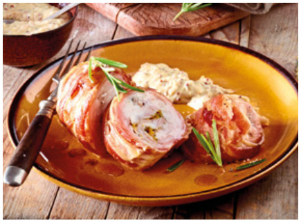

**Ingrediënten voor:** 4 personen
**Bereidingstijd:** ca. 1 uur
**1** kleine bio-sinaasappel
**1** teentje knoflook
**4 takjes** rozemarijn
**50 g** + 1 el zachte boter (+ invetten)
4 konijnenbouten (à ca. 350 g,
uitgebeend)
zout en peper
**16** plakken ontbijtspek
**2** sjalotjes
suiker
**100 ml** whiskey
**100 g** crème fraîche
**2 tl** grove mosterd
1 VOOR DE KRUIDENBOTER Was de sinaasappel
met heet water en rasp de schil er fijn af. Pers de
sinaasappel uit. Pel de knoflook en hak hem fijn.
Was de rozemarijn en hak de naaldjes fijn. Roer
50 g zachte boter, de knoflook, de rozemarijn,
de sinaasappelschil en 2 tl sinaasappelsap door
elkaar.
2 VOOR DE ROLLADES Verwarm de oven voor
(elektrisch: 200°C / hetelucht: 180°C).
Leg het vlees met de huidzijde naar beneden op je
werkblad. Bestrooi het vlees met zout en peper.
Bestrijk het vlees met de kruidenboter en rol het
langs de korte zijde stevig op. Leg 4 plakken spek
overlappend in een rechthoek. Leg de rollade
erop en wikkel het spek eromheen. Maak op
dezelfde manier nog 3 rollades. Leg de rollades in
een ingevette ovenschaal en bak ca. 30 minuten
in de oven.
3 VOOR DE SAUS Pel en snipper de sjalotjes.
Verhit 1 el boter in een pan en bak er de sjalotjes
goudbruin in. Voeg 1 tl suiker toe en karamelliseer. Schenk de whiskey erbij en kook
ca. 2 minuten in. Roer de crème fraîche, de mosterd en het overige sinaasappelsap erdoorheen
en verwarm. Breng op smaak met zout en peper.
4 Snijd de rollades in plakken. Serveer met de
saus. Lekker met gebakken aardappels en salade.
**Per portie:** ca. 800 kcal
**65 g** eiwit | 55 g vet | 7 g koolhydraten

## Broodje pulled hert

## met appel en coleslaw

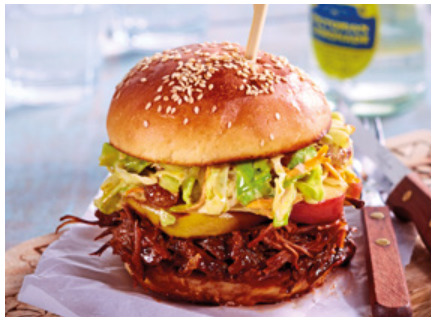

**Ingrediënten voor:** 6 stuks
**Bereidingstijd:** ca. 7 uur Wachttijd: ca. 12 uur
**1** kg
hertenbout (zonder bot)
**1 tl** gerookte-paprikapoeder
**½ tl** cayennepeper
koek -en speculaaskruiden
zout en peper
**3 el** olie
**450 g** witte kool
**1** wortel
**1** ui 	(bijv. rode)
**100 g** rozijnen
**100 g** crème fraîche
**100 ml** yoghurtmayonaise
**2-3 el** appelazijn
suiker
**60 g** veldsla
**1** appel
**150 ml** barbecuesaus
**6** hamburgerbroodjes
1 EEN DAG VAN TEVOREN Neem het vlees uit de
koelkast. Meng het paprikapoeder met de cayennepeper, 1 mespuntje koek- en speculaaskruiden,
**½ tl** zout en ½ tl peper. Wrijf het vlees er rondom
mee in en leg het in een braadslee. Druppel 2 el olie
eroverheen en zet 1 nacht in de koelkast.
2 DE VOLGENDE DAG Verwarm de oven voor (elektrisch: 120°C / hetelucht: 100°C). Schenk 150 ml
water in de braadslee en braad het vlees 3 uur en
30 minuten - 4 uur in de oven. Druppel tijdens het
braden het braadvocht over het vlees.
3 VOOR DE SALADE Maak de kool schoon, snijd
hem in 8 parten en schaaf hem in reepjes van de
stronk. Kneed ½ tl zout erdoorheen. Schrap de
wortel en rasp hem grof. Pel de ui en rasp hem
grof. Meng de kool met de wortel, de ui, de rozijnen, de crème fraîche, de yoghurtmayonaise, de
azijn, zout, peper en ½ tl suiker. Zet afgedekt in de
koelkast en laat minimaal 2 uur trekken.
4 Was de sla. Was de appel, boor het klokhuis eruit
en snijd de appel in ringen. Verhit 1 el olie in een
pan en fruit er de appel in. Trek het vlees met 2 vorken uit elkaar. Verwarm de barbecuesaus en meng
het vlees erdoorheen. Rooster de broodjes en vul ze
met het vlees, de appel, de coleslaw en de veldsla.
**Per stuk:** ca. 640 kcal
**41 g** eiwit | 23 g vet | 60 g koolhydraten
SEIZOEN

# Herfsttijd,

# paddenstoelentijd

Ze zijn er in alle soorten en maten en de een is nog
lekkerder dan de ander. Nu is het perfecte moment
om met paddenstoelen aan de slag te gaan.

## Pasta carbonara

## met bospaddenstoelen

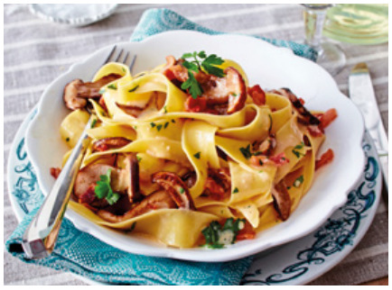

**Ingrediënten voor:** 4 personen
**Bereidingstijd:** ca. 30 min.
**400 g** pappardelle
zout en peper
**400 g** bospaddenstoelenmelange
**2 el** + 1 tl olie
**75 g** spekreepjes
**2 takjes** peterselie
**3** eieren
**75 ml** slagroom
1 Kook de pasta volgens de aanwijzingen op de
verpakking in water met een snufje zout. Maak
de paddenstoelen schoon en snijd ze in plakken.
Verhit 1 tl olie in een pan. Bak er de spekreepjes
knapperig in en neem ze uit de pan.
2 Verhit 2 el olie in dezelfde pan. Bak er de
paddenstoelen op hoog vuur goudbruin in. Breng
op smaak met zout en peper. Was de peterselie
en hak de blaadjes grof. Kluts de eieren met de
slagroom in een grote kom. Bestrooi met zout en
peper.
3 Giet de pasta af en vang hierbij 4-5 el kookvocht
op. Meng de pasta, het kookvocht, de peterselie,
de paddenstoelen en het spek door het eimengsel
zodat er een romig geheel ontstaat. Serveer
direct.
**Per portie:** ca. 660 kcal
**25 g** eiwit | 26 g vet | 76 g koolhydraten

## Cantharellen-pompoenlasagne

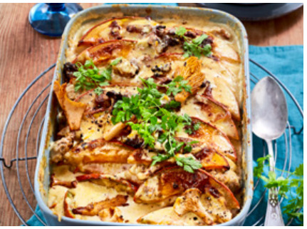

**Ingrediënten voor:** 4-6 personen
**Bereidingstijd:** ca. 1 uur en 15 min.
ca. 1,2 kg hokkaidopompoen
**300 g** cantharellen
**2** uien
**1** teentje knoflook
**2 el** olie
**400 g** half-om-halfgehakt
**4 takjes** tijm
zout en peper
**2 el** boter
**2 el** bloem
**500 ml** melk
**300 g** roomkaas
geraspte schil van 1 bio-citroen
nootmuskaat
**100 g** geraspte edammer
evt. kervel om te garneren
1 Was de pompoen, halveer hem, verwijder de
zaadlijsten en snijd de pompoen in dunne parten.
Maak de cantharellen schoon. Pel en snipper de
uien en de knoflook. Verhit de olie in een pan
en fruit er de ui en de knoflook ca. 2 minuten in.
FAVORIET VAN DE MAAND
Voeg het gehakt toe en bak in 7-10 minuten rul.
Voeg de cantharellen toe en bak ca. 4 minuten
verder. Was de tijm en neem de blaadjes van de
takjes. Voeg de tijm toe. Breng op smaak met zout
en peper.
2 VOOR DE SAUS Verhit 2 el boter. Bestuif met de
bloem en bak kort. Schenk de melk er al roerend
bij, breng aan de kook en kook ca. 5 minuten op
laag vuur. Roer de roomkaas en de citroenschil
erdoorheen. Breng op smaak met zout, peper en
nootmuskaat.
3 Verwarm de oven voor (elektrisch: 200°C /
hetelucht: 180°C). Verdeel de pompoen, het
gehaktmengsel en de saus in laagjes in een ovenschaal (28x20 cm). Bestrooi met de kaas. Bak ca.
30 minuten in de oven. Garneer eventueel met
kervel.
**Per portie:** ca. 570 kcal
**29 g** eiwit | 41 g vet | 17 g koolhydraten

## Spinazieknoedels

## met paddenstoelenragout

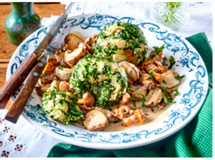

**Ingrediënten voor:** 4 personen
**Bereidingstijd:** ca. 1 uur
**5 sneetjes** oud brood (ca. 250 g)
**200 ml** melk
zout en peper
**200 g** cantharellen
**200 g** kastanjechampignons
**1** ui
ca. 250 g bladspinazie
**1 el** olie
nootmuskaat
**2** eieren
**3 el** boter
**1 tl** bloem
**200 ml** slagroom
**200 ml** groentebouillon
**2 takjes** peterselie
1 Snijd het brood in blokjes. Breng de melk aan de
kook en schenk hem over het brood. Bestrooi met
zout en peper en laat ca. 45 minuten wellen.
2 Maak de cantharellen schoon. Maak de champignons schoon en halveer ze. Pel en snipper de
ui. Was de spinazie.
3 Verhit de olie in een pan. Fruit er de helft van
de ui 2-3 minuten in. Voeg de spinazie toe en laat
slinken. Gaar 2-3 minuten en bestrooi met zout,
**120** g
peper en nootmuskaat. Zeef de spinazie, laat
goed uitlekken, knijp uit en hak hem fijn.
4 Kneed de eieren en de spinazie door het brood.
Maak er met de handen ca. 8 ballen van. Breng
ruim water met een snufje zout in een pan aan de
kook. Kook er de ballen op laag vuur in ca. 15 minuten gaar in.
5 Verhit 1 el boter in een pan. Bak er de cantharellen ca. 8 minuten in. Voeg de overige ui toe en bak
ca. 3 minuten verder. Breng op smaak met zout
en peper en neem uit de pan. Verhit 2 el boter in
dezelfde pan. Bak er de champignons ca. 5 minuten in. Bestuif met de bloem en bak kort. Roer de
slagroom en de bouillon er beetje bij beetje doorheen. Breng aan de kook en kook ca. 5 minuten op
laag vuur. Voeg de cantharellen toe, breng aan de
kook en breng op smaak met zout en peper.
6 Neem de knoedels uit het water en laat uitlekken. Was de peterselie en hak de blaadjes fijn.
Roer de peterselie door de ragout. Serveer alles
samen.
**Per portie:** ca. 530 kcal
**17 g** eiwit | 31 g vet | 42 g koolhydraten

## Mini-flammkuchen met rode ui,

## paddenstoelen en gremolata

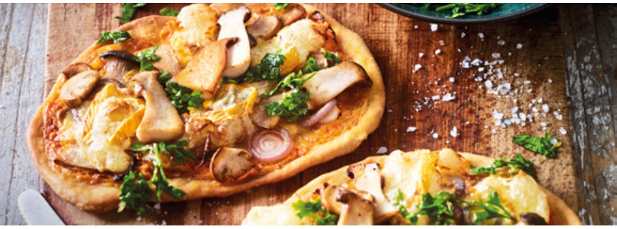

**Ingrediënten voor:** 4 personen
**Bereidingstijd:** ca. 30 min.
**200** g
bloem (+ bestuiven)
**5 el** olijfolie
zoutenpeper.
**6 takjes** peterselie
**4 takjes** oregano
**1** teentje knoflook
geraspte schil en sap van ½ biocitroen
**150 g** champignons
**150 g** kleine oesterzwammen
3
uien (bijv. rode)
zachte roodschimmelkaas (bijv.
Saint Albray)
**4 el** crème fraîche
**1 el** harissa (Arabische kruidenpasta)
vershoudfolie
bakpapier
1 VOOR HET DEEG Kneed de bloem, 2 el olie, ½ tl
zout en 100 ml water glad. Wikkel het deeg in vershoudfolie en leg het ca. 3 uur in de koelkast.
2 VOOR DE GREMOLATA Was de peterselie en de
oregano en hak de blaadjes fijn. Pel de knoflook en
hak hem fijn. Meng de kruiden met de knoflook,
de citroenschil en het citroensap. Breng op smaak
metzoutenpeper.
3 VOOR HET BELEG Maak de paddenstoelen
schoon en snijd ze in plakjes. Pel de uien en snijd ze
in ringen. Verhit 1 el olie in een pan en fruit er de ui
ca. 2 minuten in. Neem de ui uit de pan. Verhit 2 el
olie in het bakvet. Bak er de paddenstoelen goudbruin in. Snijd de kaas in plakken.
4 VOOR DE HARISSAROOM Roer de crème fraîche
en de harissa door elkaar. Breng op smaak met
zout en peper
5 Verwarm de oven voor (elektrisch: 200°C / hetelucht: 180°C). Verdeel het deeg in 4 gelijke stukken.
Rol elk stuk op een met bloem bestoven werkblad
ovaal (ca. 15 cm lang) uit en leg ze op 2 met bakpapier beklede bakplaten. Bestrijk de plakken
deeg met de harissaroom en beleg ze met de ui,
de paddenstoelen en de kaas. Bak ca. 15 minuten
goudbruin in de oven. Verdeel de gremolata erover.
**Per stuk:** ca. 460 kcal
**14 g** eiwit | 26 g vet | 40 g koolhydraten
FAVORIET VAN DE MAAND
Dat is in ieder geval één zorg minder: wat jij
komende week gaat eten, is bij dezen bekend.

# De hele

# week

# genieten

# Maandag

## Broccoli-pompoenroerbak

## met biefstukreepjes

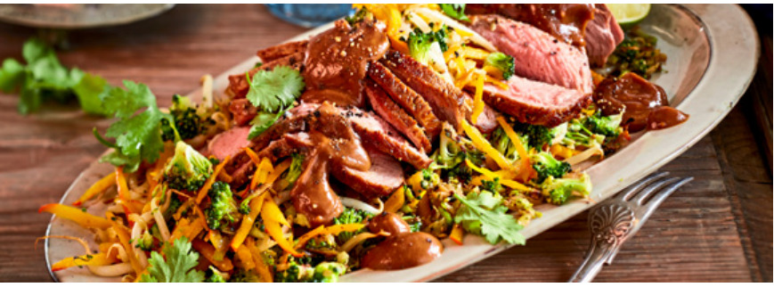

**Ingrediënten voor:** 4 personen
**Bereidingstijd:** ca. 40 min.
**500 g** broccoli
**1** ui
**300 g** hokkaidopompoen
ca. 20 g gember (stuk)
**2** teentjes knoflook
**150 g** taugé
**5 el** sojasaus
sap van 1 limoen
**1 el** pindakaas
**4** biefstukken (à ca. 150 g)
zout en peper
**3 el** olie
150 g edamame (jonge sojabonen,
diepvries)
chilivlokken
**5 takjes** koriander
aluminiumfolie
1 Was de broccoli en rasp hem grof. Pel de ui en
rasp hem grof. Maak de pompoen schoon, verwijder de zaadlijsten en rasp hem grof. Schil de gember en hak hem fijn. Pel de knoflook en hak hem
fijn. Was de taugé. Roer de sojasaus, het limoensap
en de pindakaas glad.
2 Bestrooi de biefstukken met zout en peper.
Verhit 1 el olie in een pan op hoog vuur. Bak er de
biefstukken 2-3 minuten per zijde in. Neem ze uit
de pan en wikkel ze in aluminiumfolie. Blus het
bakvet af met het sojasausmengsel, breng kort aan
de kook en houd apart.
3 Verhit 2 el olie in een wok. Roerbak er de gember,
de knoflook en de geraspte groenten in porties ca.
3 minuten in. Doe alle gebakken groenten terug in
de wok. Voeg de bevroren edamame en de taugé
toe en roerbak ca. 3 minuten verder. Breng op
smaak met zout, peper en chilivlokken.
4 Was de koriander en neem de blaadjes van de
takjes. Spatel de koriander door de groenten. Snijd
de biefstukken in reepjes. Serveer alles samen.
**Per portie:** ca. 460 kcal
**46 g** eiwit | 20 g vet | 21 g koolhydraten

# Dinsdag

## Groenten-linzencurry

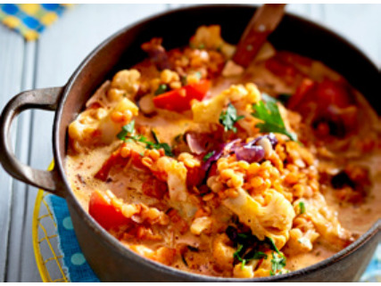

**Ingrediënten voor:** 4 personen
**Bereidingstijd:** ca. 30 min.
**1** bloemkool
**1** rode paprika
**2** uien
**2 el** kokosolie
**1-2 tl** rode currypasta
**200 g** rode linzen
**400 ml** kokosmelk (blik)
**400 ml** groentebouillon
**½ bosje** peterselie
zout en peper
1 Maak de bloemkool schoon en snijd hem in
roosjes van de stronk. Snijd de roosjes eventueel naar grootte kleiner. Snijd de paprika
in vieren, verwijder de zaadlijsten, was de
paprika en snijd hem in blokjes. Pel de uien
en hak ze grof.
VOOR IEDERE DAG
2 Verhit de olie in een grote pan. Fruit er de
ui en de currypasta ca. 3 minuten in. Voeg de
bloemkool, de paprika en de linzen toe. Bak al
roerend 2-3 minuten. Blus af met de kokosmelk en de bouillon en breng aan de kook.
Kook afgedekt ca. 12 minuten op laag vuur.
3 Was de peterselie en hak de blaadjes fijn.
Breng de curry op smaak met zout en peper.
Bestrooi met de peterselie. Lekker met naan
of stokbrood.
**Per portie:** ca. 470 kcal
**18 g** eiwit | 27 g vet | 35 g koolhydraten

# Woensdag

## Zuurkool met worst

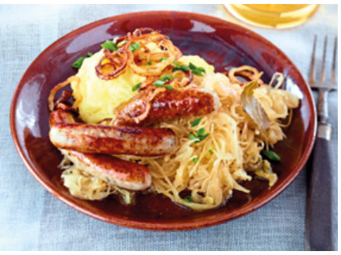

**Ingrediënten voor:** 4 personen
**Bereidingstijd:** ca. 1 uur
**3** uien
**1 kg** aardappels
zout en peper
**4 el** olie
**800 g** zuurkool
**375 ml** bouillon
**5-6** jeneverbessen
**1** laurierblaadje
**½ bosje** bieslook
**200 ml** melk
**4 el** boter
nootmuskaat
**12** kleine braadworstjes
**1 el** bloem
1 Pel de uien. Snipper 1 ui en snijd de overige uien
in ringen. VOOR DE PUREE Schil de aardappels,
was ze en kook ze in water met een snufje zout in
ca. 20 minuten gaar.
2 VOOR DE ZUURKOOL Verhit 2 el olie in een pan.
Fruit er de gesnipperde ui glazig in. Voeg de zuurkool toe en bak op hoog vuur. Schenk de bouillon
erbij. Breng op smaak met zout en peper. Voeg de
jeneverbessen en het laurierblaadje toe. Breng
aan de kook en kook afgedekt ca. 20 minuten op
laag vuur.
3 Was de bieslook en hak hem fijn. Giet de aardappels af. Verhit de melk en de boter, schenk het
bij de aardappels en stamp fijn. Breng de puree op
smaak met zout en nootmuskaat. Houd warm.
4 VOOR DE WORSTJES Verhit 2 el olie in een pan.
Bak er de worstjes rondom goudbruin en gaar in
en neem ze uit de pan. Wentel de uienringen in de
bloem en klop het teveel aan bloem eraf. Verhit
**2 el** boter in het bakvet. Bak er de uienringen
goudbruin in. Serveer alles samen en bestrooi
met de bieslook.
**Per portie:** ca. 600 kcal
**18 g** eiwit | 39 g vet | 39 g koolhydraten

# Donderdag

## Pasta met spruitjes en kip

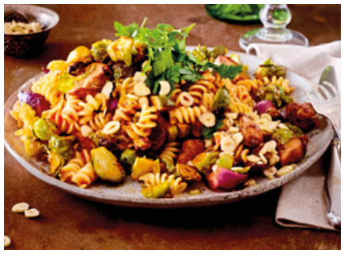

**Ingrediënten voor:** 4 personen
**Bereidingstijd:** ca. 1 uur
**500 g** spruitjes
**3 el** olie
sap van 2 limoenen
**3 el** vloeibare honing
zout en peper
**1 tl** paprikapoeder
**400** g
pasta (bijv. spirelli)
**400 g** kipfilet
3
uien (bijv. rode)
**2 el** olie
**2 el** hazelnootschaafsel
evt. peterselie om te garneren
1 VOOR DE SPRUITJES Verwarm de oven voor
(elektrisch: 180°C / hetelucht: 160°C). Was de
spruitjes en verdeel ze over een bakplaat. Roer
de olie, het limoensap en de honing door elkaar.
Breng op smaak met zout, peper en paprikapoeder. Meng de marinade met de spruitjes.
Rooster 30-40 minuten in de oven.
2 Kook de pasta volgens de aanwijzingen op de
verpakking in water met een snufje zout gaar.
3 VOOR DE KIPFILET Pel de uien en snijd ze in
partjes. Snijd de kipfilet in blokjes. Verhit 2 el olie
in een pan. Bak er de kipfilet rondom ca. 6 minuten in. Bak de ui ca. 2 minuten mee. Breng op
smaak met zout en peper.
4 Giet de pasta af. Voeg de pasta en de spruitjes
toe aan de kipfilet en meng door elkaar. Bestrooi
met het hazelnootschaafsel. Garneer eventueel
met peterselie.
**Per portie:** ca. 700 kcal
**41 g** eiwit | 19 g vet | 86 g koolhydraten
VOOR IEDERE DAG

## Alcoholvrije hot toddy

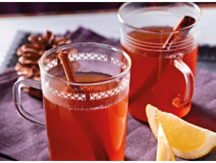

**Ingrediënten voor:** 2 glazen (à ca. 250 ml)
**Bereidingstijd:** ca. 10 min.
Doe in elk glas 1 el honing, 1 tl citroensap, 1 klein kaneelstokje, 1 snufje gemalen kruidnagel en 1 snufje gemalen
nootmuskaat. Schenk in elk glas 200 ml hete, zwarte thee en
roer door. Serveer naar smaak met een partje citroen.
VOOR IEDERE DAG

# Vrijdag

## Zelfgemaakte lekkerbek

## met groenten

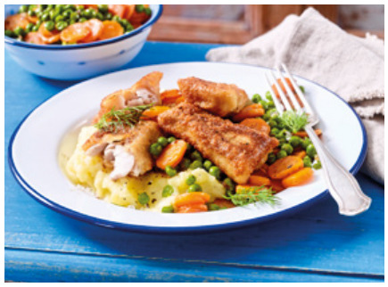

**Ingrediënten voor:** 4 personen
**Bereidingstijd:** ca. 45 min.
**1 kg** aardappels
zout en peper
**500 g** wortel
**300 g** doperwten (diepvries)
**2** eieren
**4** kabeljauwfilets (ca. 750 g)
**4 el** bloem
**100 g** paneermeel
**60 g** + 4 el boter
**200 ml** melk
evt. dille om te garneren
1 Schil de aardappels, was ze en snijd ze in stukken. Kook de aardappels in water met een snuf zout in
ca. 20 minuten gaar. Schrap de wortels, was ze, snijd ze in plakjes. Kook ze ca. 8 minuten in water met
een snufje zout gaar. Voeg de bevroren doperwten na ca. 3 minuten kooktijd toe aan de wortel. Giet de
groenten af en spoel kort.
2 VOOR DE LEKKERBEKJES Kluts de eieren in een diep bord. Bestrooi de visfilets met zout en peper.
Wentel de vis eerst door de bloem, dan door het ei en tot slot door het paneermeel. Verhit 60 g boter in
een koekenpan met antiaanbaklaag. Bak er de vis, in porties, in 3-4 minuten per zijde goudbruin en gaar
in. Houd warm.
3 VOOR DE PUREE Verwarm de melk. Giet de aardappels af en stamp ze met de warme melk en 2 el
boter fijn. Houd warm.
4 Verhit 2 el boter in een pan. Wentel er de wortel en de doperwten in. Breng op smaak met zout en
peper. Serveer alles samen. Garneer eventueel met dille.
**Per portie:** ca. 610 kcal
**50 g** eiwit | 14 g vet | 68 g koolhydraten
VOOR IEDERE DAG

# 4x

# Zoet

Ook op doordeweekse dagen sluit je
de maaltijd feestelijk af met een toetje.

## Rijstdessert met perzik uit de oven

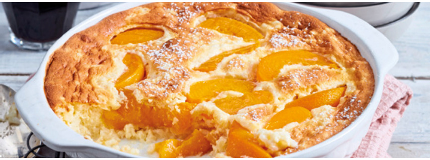

**Ingrediënten voor:** 4 personen
**Bereidingstijd:** ca. 1 uur en 15 min.
**600 ml** melk
zout
**150 g** dessertrijst
**800 g** perziken (blik)
**2** eieren
**100 g** suiker
**50 g** zachte boter (+
invetten)
poedersuiker om te
bestuiven
1 Breng de melk met een snufje zout in een pan aan de kook. Roer de rijst
erdoorheen, breng kort aan de kook en kook afgedekt ca. 25 minuten op laag
vuur. Neem van het vuur en laat ca. 15 minuten wellen.
2 Giet de perziken af en snijd ze in partjes. Splits de eieren. Klop de eiwitten
met een snufje zout stijf. Klop beetje bij beetje 50 g suiker erdoorheen. Klop
de boter, de eidooiers en 50 g suiker romig. Roer het eidooiermengsel door
de rijst. Spatel het eiwitschuim erdoorheen. Spatel ca. ⅔ van de perziken
erdoorheen.
3 Verwarm de oven voor (elektrisch: 180°C / hetelucht: 160°C). Verdeel de
rijst in een ingevette ovenschaal (ca. 20 cm Ø) en strijk glad. Beleg met de
overige perziken. Bak 20-30 minuten in de oven. Bestuif met poedersuiker.
**Per portie:** ca. 560 kcal
**12 g** eiwit | 19 g vet | 81 g koolhydraten

## Gebakkenkweepeermetmarsepein-walnotenvulling

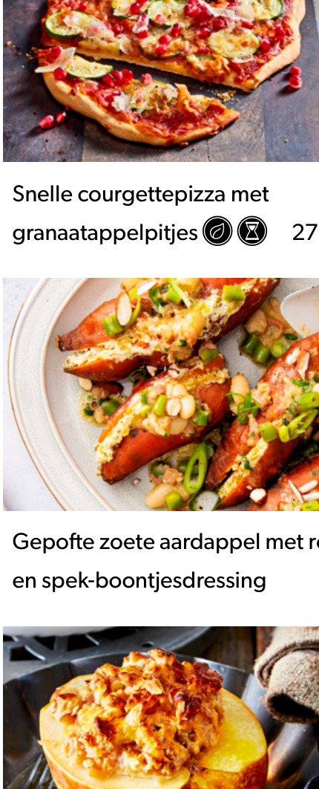

**Ingrediënten voor:** 6 personen
**Bereidingstijd:** ca. 45 min.
**3** kweeperen
**1** bio-citroen
**250 ml** appelsap
**3 el** suiker
**200 g** marsepein
**1** ei
**25 g** poedersuiker
**2 el** bloem
**75 g** walnoten
**50 g** amarettini
**1 tl** slagroom
1 Was de kweeperen met heet water en wrijf ze droog. Halveer ze en verwijder
het klokhuis. Was de citroen met heet water en rasp de schil er dun af. Pers de
citroen uit. Breng het appelsap, de suiker, het citroensap en de citroenschil in
een ruime pan aan de kook. Stoof er de kweepeer ca. 8 minuten in. Roer regelmatigom.
2 Rasp de marsepein grof. Splits het ei. Klop het eiwit, de marsepein, de
poedersuiker en de bloem door elkaar. Hak de noten grof. Hak de amarettini
grof. Spatel de amarettini met 50 g noten door de marsepein.
3 Verwarm de oven voor (elektrisch: 200°C / hetelucht: 180°C). Leg de kweepeer in een ovenschaal en verdeel de marsepein eroverheen. Bestrooi met
de overige noten en druk een beetje aan. Kluts de eidooier met de slagroom
en bestrijk de vulling ermee. Schenk het kookvocht in de ovenschaal. Bak ca.
20minutenindeoven.
**Per portie:** ca. 420 kcal
**8 g** eiwit | 20 g vet | 49 g koolhydraten
VOOR IEDERE DAG

## Schwarzwälder-tiramisu-trifle

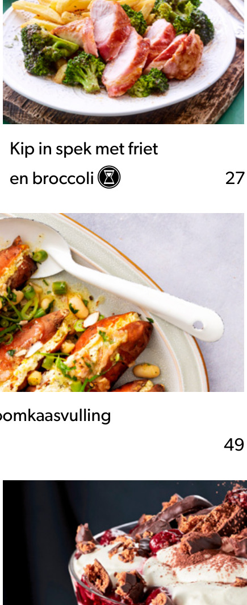

**Ingrediënten voor:** 6-8 personen
**Bereidingstijd:** ca. 30 min.
Wachttijd: ca. 1 uur
**680 ml** kersen (pot)
**2 el** maizena
**1 el** kersenlikeur
**500 ml** vanilleyoghurt
**500 g** magere kwark
**16 g** vanillesuiker
**300 ml** slagroom
**250 g** koekjes in chocolade (bijv. Lotus melkchocolade)
**2 el** koude koffie
cacaopoeder om te bestuiven
1 Laat de kersen uitlekken en vang hierbij het sap op. Roer 3 el sap met de
maizena glad. Breng het overige sap aan de kook. Roer het maizenamengsel
erdoorheen, breng aan de kook en kook ca. 1 minuut. Roer de likeur erdoorheen. Roer de kersen erdoorheen. Laat de compote afkoelen.
2 Roer de yoghurt, de kwark en de vanillesuiker glad. Klop de slagroom stijf
en spatel hem erdoorheen.
3 Breek de koekjes in stukken. Verdeel de helft van de koekjes in een grote
glazen schaal. Druppel de koffie eroverheen. Verdeel de helft van de room
en de helft van de compote eroverheen. Verdeel de overige room en de overige compote eroverheen. Verdeel de overige koekjes eromheen. Zet tot het
serveren in de koelkast. Bestuif met het cacaopoeder.
**Per portie:** ca. 380 kcal
**14 g** eiwit | 17 g vet | 41 g koolhydraten

## Chocolade mug cake

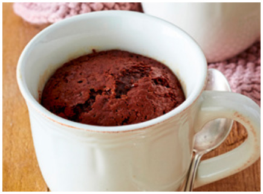

**Ingrediënten voor:** 2 personen
**Bereidingstijd:** ca. 35 min.
LAUWWARM HET
LEKKERST
Serveer de cakejes
lauwwarm met de
slagroom en eventueel
een bolletje vanille-ijs.
**1** ei
**3 el** suiker
zout
**3 el** bloem (+bestuiven)
**1 tl** bakpoeder
**1 el** cacaopoeder
kaneelpoeder
vanillemerg (evt. extract)
kardemompoeder
**1** el
olie (+ invetten)
**2 el** melk
**100 ml** slagroom
1 Verwarm de oven voor (elektrisch: 180°C / hetelucht: 160°C). Klop het ei, de
suiker en 1 snufje zout romig. Meng de bloem met het bakpoeder, het cacaopoeder, 1 snufje kaneelpoeder, 1 mespuntje vanille en 1 snufje kardemompoeder. Klop eerst het bloemmengsel en daarna de olie en de melk door het
eimengsel.
2 Verdeel het beslag over 2 ingevette en met bloem bestoven ovenvaste
kopjes (à ca. 150 ml) en zet ze ca. 25 minuten in de oven. Laat afkoelen. Klop
de slagroom stijf. Serveer de mug cakes met de slagroom.
**Per portie:** ca. 390 kcal
**7 g** eiwit | 26 g vet | 29 g koolhydraten
**87** 88 89 90
**92** 93
© Sanders puzzelboeken
**53** 73 91 70 25 11 36 65

## HORIZONTAAL

11 kraakhelder 7 een van de Verenigde Staten 12 richting in de kunst 17 plant
18 onderkledingstuk 20 inwendige opname van het lichaam 22 lichte overjas
23 koppel 24 onbuigzaam 25 oceaan 27 roofvis 29 houtsoort 31 lichaam 32 voedsel
33 vogelnaam 35 krachtige ontkenning 37 steuntouw 38 administratieve troepen
(afk.) 39 zonder fouten 40 met scherp zicht op korte afstand 42 het binnenste van
iets 44 westerlengte (afk.) 45 aanwijzend voornaamwoord 46 tegenvaller 47 rivier
in Schotland 49 nuttigen 51 amusementsprogramma op radio of tv 52 langslaper
53 plaats in West-Vlaanderen 54 groep spelers 55 kraai 57 vulmiddel 59 met
gebruik van (afk.) 60 westerse verdragsorganisatie (afk.) 62 huns inziens (afk.)
64 halfvloeibaar afscheidingsproduct 66 leidende medewerker 69 rivier in Spanje
70 Deuteronomium (afk.) 71 ingenieur (afk.) 73 in de atmosfeer voorkomend
gas 75 plaats in Gelderland 76 toegang 77 Chinese deegwaar 78 werkloon
80 verdikte huid 82 dier met kieuwen 83 krachtig 84 maal 85 Engelse lengtemaat
87 religieuze onderdompeling 89 onvriendelijk 90 interval 91 open pronkkastje
92 schijnbare tegenstrijdigheid 93 vrouwelijk beroep.

## VERTICAAL

2 vloerkleed 3 niet voltooid 4 heerlijk 5 versus (afk.) 6 geologisch tijdperk 7 figuur
(afk.) 8 elpee 9 druk 10 dominee (afk.) 11 uitroep van droefheid 12 rijksdaalder
(volkstaal) 13 buiten dienst (afk.) 14 een weinig 15 vlek op iemands eer 16 zegt
een kat 19 oog aan een touw 21 ingeschakeld 23 oorlogsvaartuig 24 manier van
sporten 25 zie ommezijde (afk.) 26 roem 28 box voor suggesties 30 lengtemaat
32 plaats in Noord-Brabant 33 geneesheer van een vorst 34 inheemse ziekte
36 artikel (afk.) 39 vegetatie 40 gebakje 41 goede eigenschap 43 zonder
verpakkingsgewicht 45 waagstuk 46 teleurgesteld 48 ervaren (afk.) 50 nieuw (in
samenstellingen) 56 uitgebreid lager onderwijs 58 werelddeel 61 arrondissement
(afk.) 63 toegangsweg voor voertuigen 65 afgemat 67 arbeidstijdverkorting (afk.)
68 onverpakt 69 aanvankelijk 70 voorgeschreven voedingswijze 72 vergiffenis
74 nieuwe lerarenopleiding (afk.) 76 onvruchtbaar door droogte 77 aardbewoner
79 hartfilmpje 81 hoogste punt 83 hondenras 84 Japanse kleurkarper 86 helium
(afk.) 88 papa 89 noordoost (afk.) 90 niet parkeren.
VUL DE PUZZEL IN EN MAAK KANS
OP 1 VAN DE 5 EXEMPLAREN VAN

## BORRELEN VAN DE PLANK

## T.W.V. 9,99 EURO

Zin in een culinair landentripje? Zonder koffers, douane of reistijd
Zin in een culinair landentripje? Zonder ko ers,
nemen we je mee naar twaalf heerlijke borrelbestemmingen met
douane of reistijd bieden we je twaalf heerlijke
borrelbestemmingen met goed gevulde
goed gevulde borrelplanken. Bovendien neem je zonder enige moeite
borrelplanken. Kies voor Frankijk en Spanje of
zoek je het verder buiten de deur in Suriname of
je vrienden, familie of buren mee. Het kookboek heeft eenvoudig te
Korea? Met onze 36 lekkere recepten kun je alle
kanten op. Welke borrelplank kies jij deze week?
bereiden recepten en gouden tips om je borrelavond onvergetelijk

## Borrelen van de plank

in12he rlijkelanden
te maken. Kies voor Frankrijk of Spanje, of zoek het verder buiten
de deur in Suriname of Korea. Met de 36 lekkere recepten kun je alle
kanten op. Welke borrelplank kies jij?
1 2 3 4 5 6 7 8 9 10 11 12 13 14 15 16
**17** 18 19 20 21 22
**23** 24 25 26 27 28 29 30
van de plank
**31** 32 33 34 35 36 37
**38** 39 40 41 42 43 44
**45** 46 47 48 49 50
Argentinië • Frankrijk • Italië • Marokko • Korea • Mexico • Suriname
**51** 52 53 54
**55** 56 57 58 59 60 61
Spanje • Thailand • Turkije • Scandinavië • Nederland
**62** 63 64 65 66 67 68 69 70
in12he rlijkelanden
**71** 72 73 74 75 76 77
B&D_001000_Cover_ok.indd 1
**78** 79 80 81 82 83 84
Titel: Borrelen
B&D_001000_Cover_ok.indd 1 31-08-2021 11:47
**85** 86 87 88 89 90
31-08-2021 11:47
**91** 92 93
van de plank
**6** 7 8 9 10 11 12 13 14 15 16
Uitgeverij:
**18** 19 20 21 22
Uitgeverij:
F&L Media
**24** 25 26 27 28 29 30
Prijs:
**33** 34 35 36 37
F&L Media
**40** 41 42 43 44
**46** 47 48 49 50
Prijs: 9,99 euro
**52** 53 54
De oplossing kun je vóór 15 november 2022
Titel:
**57** 58 59 60 61
**65** 66 67 68 69 70
sturen naar: koken & genieten, o.v.v. oplossing puzzel
**74** 75 76 77
**80** 81 82 83 84
Postbus 296, 6500 AG Nijmegen
Of op onze website: kokengenieten.nl/puzzel

# Het is

# weekend!

Pak dit weekend eens lekker uit met een heerlijk
driegangenmenu. Lekker voor met z’n tweetjes,
maar ook uitermate geschikt voor het hele gezin!
Voorgerecht

# Appel-selderijsoep

met spek
Hoofdgerecht

# Braadstuk

met spätzle en veldsla
Nagerecht

# Sinaasappelcustardtaartjes

MENU
WEEKENDMENU
Voorgerecht

## Appel-selderijsoep met spek

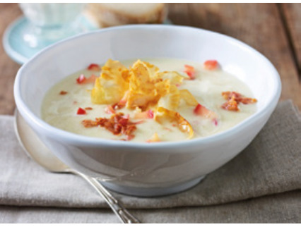

**Ingrediënten voor:** 6 personen
**Bereidingstijd:** ca. 40 min.
**1** ui
**600 g** knolselderij
**2** aardappels
**2** rode appels
**75 g** gerookt spek (stuk)
**2 el** olie
**1,2 l** groentebouillon
**150 ml** + 6 tl slagroom
**2 el** mierikswortelpasta (pot)
zout en peper
suiker
1 Pel en snipper de ui. Schil de knolselderij en
halveer hem. Schaaf ca. 75 g knolselderij in dunne
plakjes af. Snijd de overige knolselderij in blokjes.
Schil de aardappels, was ze en snijd ze in blokjes.
Schil de appels, verwijder het klokhuis en snijd de
appels in blokjes.
2 Snijd het spek in kleine blokjes en rooster ze
in een droge pan knapperig. Neem het spek uit
de pan. Verhit de olie in het bakvet. Bak er de
knolselderijplakjes knapperig in en neem ze uit
de pan.
3 Houd 2 el appelblokjes apart. Bak de knolselderijblokjes, de overige appelblokjes en de aardappel in het hete bakvet op hoog vuur. Schenk de
bouillon erbij en breng aan de kook. Kook afgedekt ca. 20 minuten op laag vuur.
4 Pureer de soep. Roer 150 ml slagroom en de
mierikswortel erdoorheen. Gaar de overige
appelblokjes ca. 3 minuten mee. Breng op smaak
met zout, peper en suiker. Serveer de soep met
de overige slagroom, de knolselderijchips en de
spekblokjes. Lekker met desembrood.
**Per portie:** ca. 210 kcal
**5 g** eiwit | 15 g vet | 15 g koolhydraten
Hoofdgerecht

## Braadstuk met spätzle en veldsla

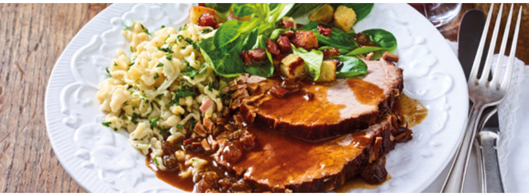

**Ingrediënten voor:** 6 personen
**Bereidingstijd:** ca. 3 uur en 45 min.
Wachttijd: 2-3 dagen
**2** uien
**1** grote prei
**2** wortels
**¼** knolselderij
**1 tl** peperkorrels
**5** jeneverbessen
**400 ml** droge rode wijn
**250 ml** + 2 el wittewijnazijn
**2** kruidnagels
**2** laurierblaadjes
**4** pimentkorrels
**1,5 kg** runderbraadstuk
zout en peper
**7 el** olie
**2 el** tomatenpuree
**750 ml** groentebouillon
**300 g** bloem
**4** eieren
nootmuskaat
**6 el** bruisend mineraalwater
**1 bosje** peterselie
**4** plakken Schwarzwälder ham
**2 sneetjes** witbrood
**50 g** rozijnen
**2-3 tl** maizena
**1 el** boter
**80 g** veldsla
**1** grote diepvrieszak
1 2-3 DAGEN VAN TEVOREN VOOR HET BRAAD-
STUK Pel de uien en hak ze grof. Maak de prei
schoon en snijd hem in stukken. Schrap de
wortels, was ze en snijd ze in stukken. Schil de
knolselderij, was hem en snijd hem in stukken.
Vermaal de peperkorrels en de jeneverbessen
grof. Breng de wijn en 250 ml azijn aan de kook.
Roer de kruidnagels, de laurierblaadjes, de
pimentkorrels, de peperkorrels en de jeneverbessen erdoorheen en kook ca. 2 minuten op laag
vuur. Voeg de ui, de prei, de wortel en de knolselderij toe. Laat afkoelen.
LEKKER ZUUR
In een klassieke marinade is een zuurtje
een ‘must’. Door het zuur wordt het vlees
lekker zacht en daardoor extra lekker. Kies
voor een azijn van hoge kwaliteit.
2 Doe het vlees samen met de marinade en de
groenten in een grote diepvrieszak en sluit hem
af. Leg de zak 2-3 dagen in de koelkast. Draai af
en toe om.
3 NA 2-3 DAGEN Verwarm de oven voor (elektrisch: 160°C / hetelucht: 140°C). Dep het vlees
droog en bestrooi het rondom met zout. Zeef de
marinade en vang het vocht op. Verhit 2 el olie
in een ovenbestendige braadpan met deksel.
Braad hierin het vlees rondom aan en neem het
uit de pan. Bak de groenten met de specerijen in
het hete bakvet op hoog vuur. Roer de tomatenpuree erdoorheen en bak nog 1 minuut. Blus af
met 500 ml van het opgevangen vocht. Schenk
de bouillon erbij, breng aan de kook en voeg het
vlees weer toe. Zet afgedekt ca. 3 uur in de oven.
4 VOOR DE SPÄTZLE Roer de bloem met de
eieren, 1 snuf zout, 1 snuf nootmuskaat en het
mineraalwater door elkaar tot er belletjes in het
deeg ontstaan. Laat het deeg ca. 1 uur rusten.
5 Breng een pan met ruim gezouten water aan de
kook. Rasp met behulp van een grove rasp kleine
stukjes deeg in het kokende water en kook tot de
spätzle komen bovendrijven. Haal de spätzle met
een schuimspaan uit het water, spoel met koud
water en laat uitlekken. Herhaal portiegewijs tot
het deeg op is.
6 Was de peterselie en hak de blaadjes fijn. Snijd
de ham in blokjes. Snijd het witbrood in blokjes.
Verhit 1 el olie in een pan. Bak er de ham en het
brood knapperig in. Neem uit de pan. Roer 2 el
azijn, zout, peper en 4 el olie door elkaar.
7 Laat het braadstuk rusten. Zeef de fond. Breng
**500 ml** fond en de rozijnen aan de kook. Roer de
maizena met 2 el koud water glad. Roer dit door
de fond en kook 1 minuut. Breng op smaak met
zout en peper. Verhit de boter. Wentel de spätzle en de peterselie erin. Was de sla. Meng met
de vinaigrette. Bestrooi met het hammengsel.
Serveer alles samen.
**Per portie:** ca. 760 kcal
**68 g** eiwit | 29 g vet | 52 g koolhydraten
Nagerecht

## Sinaasappelcustardtaartjes

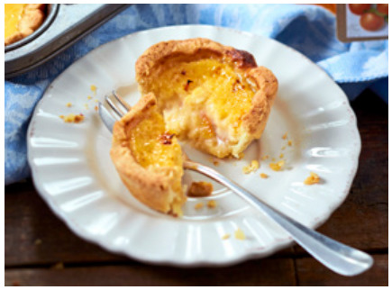

**Ingrediënten voor:** 12 stuks
**Bereidingstijd:** ca. 45 min.
Wachttijd: ca. 1 uur
**300 g** bloem (+ bestuiven)
**4 el** suiker
zout
**5** eidooiers
**150 g** boter (+ invetten)
**200 ml** melk
**4-5 el** sinaasappelmarmelade (pot)
vershoudfolie
muffinbakblik met 12 holtes
1 VOOR HET DEEG Meng de bloem met 2 el suiker
en 1 snufje zout. Voeg 1 eidooier, 75 ml koud water
en de boter in stukken toe. Kneed glad. Wikkel
het deeg in vershoudfolie en leg ca. 1 uur in de
koelkast.
2 Verwarm de oven voor (elektrisch: 200°C / hetelucht: 180°C). Vet de holtes van het muffinbakblik
in met boter en bestuif met bloem. Rol het deeg
op een met bloem bestoven werkblad 2-3 mm
dik uit. Steek er 12 rondjes (à ca. 12 cm Ø) uit en
bekleed de holtes van het muffinbakblik ermee.
Bak 8-10 minuten in de oven.
3 VOOR DE CUSTARD Breng de melk aan de kook
en neem van het vuur. Klop 4 eidooiers en 2 el
suiker romig. Schenk de hete melk er beetje
bij beetje, in een dunne straal bij en klop hem
erdoorheen. Roer de marmelade erdoorheen.
Verdeel de custard over de taartbodems en bak
ca. 15 minuten verder. Laat afkoelen.
**Per stuk:** ca. 260 kcal
**5 g** eiwit | 14 g vet | 27 g koolhydraten

# Tijdsplanning

**2-3** DAGEN VAN TEVOREN
Hoofdgerecht: Marineer het vlees en leg het
in de koelkast.
3 UUR EN 30 MINUTEN VAN TEVOREN
Hoofdgerecht: Braad het vlees.
Nagerecht: Bak de taartjes.
2 UUR EN 30 MINUTEN VAN TEVOREN
Voorgerecht: Kook de soep en laat hem
afkoelen.
**1** UUR VAN TEVOREN
Hoofdgerecht: Maak de spätzle. Maak de
vinaigrette. Bak de ham en het witbrood.
WEEKENDMENU
KORT VAN TEVOREN
Voorgerecht: Verwarm de soep.
NA HET VOORGERECHT
Hoofdgerecht: Bind de saus en verwarm de
spätzle.

# Simpel

# en snel

iedereen die geen tijd heeft om uitgebreid
te koken, maar toch lekker wil eten.

# genieten

Het is al druk genoeg met werk, kinderen
en hobby’s. Hier is de oplossing voor

## Snelle courgettepizza

## met granaatappelpitjes

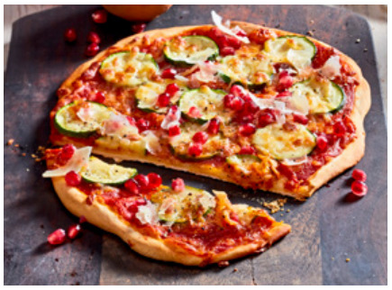

**Ingrediënten voor:** 2 personen
**Bereidingstijd:** ca. 30 min.
**1** courgette
**1** rol pizzadeeg (koelvak)
**4-6 el** tomatensaus (pot)
**75 g** geraspte mozzarella
**½** granaatappel
**30 g** parmezaan (stuk)
1 Verwarm de oven voor (elektrisch: 230°C / hetelucht: 210°C). Was de courgette en snijd hem in
dunne plakken. Rol het pizzadeeg samen met het
bakpapier uit op een bakplaat. Bestrijk het deeg
met de tomatensaus en beleg met de courgette.
Bestrooi met de mozzarella. Bak 12-15 minuten
in de oven.
2 Klop de pitjes uit de granaatappel. Schaaf de
parmezaan. Bestrooi de pizza met de granaatappelpitjes en de parmezaan.
**Per portie:** ca. 600 kcal
**23 g** eiwit | 20 g vet | 79 g koolhydraten
PITJES ERUIT
Snijd de granaatappel in vieren en neem
de pitjes er met een lepel uit. Verwijder
de witte schil zorgvuldig want die smaakt
bitter.

## Kip in spek met friet en broccoli

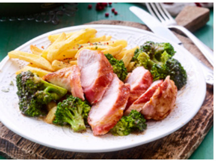

**Ingrediënten voor:** 4 personen
**Bereidingstijd:** ca. 25 min.
**500 g** broccoli
zout en peper
**500 g** ovenfriet (diepvries)
**4** kipfilets (à ca. 175 g)
**8** plakken spek
**2 el** olie
**1 el** vloeibare honing
**2 el** boter
Provençaalse kruiden
chilivlokken
1 Verwarm de oven voor (elektrisch: 200°C /
hetelucht: 180°C). Was de broccoli en snijd hem in
roosjes van de stronk. Kook de broccoli in water
met een snufje zout in ca. 5 minuten beetgaar.
Giet af. Bak de friet volgens de aanwijzingen op
de verpakking in de oven.
DE SNELLE KEUKEN
2 Bestrooi de kipfilets met zout en peper en
wikkel elke kipfilet in 2 plakken spek. Verhit de
olie in een pan. Bak er de kipfilets 5-6 minuten
per zijde in, neem uit de pan en houd warm.
Karamelliseer de honing in het hete bakvet. Voeg
de boter toe. Wentel de broccoli erin. Breng op
smaak met zout en peper.
3 Meng 1 tl zout met 1 tl Provençaalse kruiden en
een snufje chilivlokken. Serveer alles samen en
bestrooi de friet met het kruidenmengsel.
**Per portie:** ca. 550 kcal
**51 g** eiwit | 25 g vet | 27 g koolhydraten

## Kikkererwten-pompoensoep

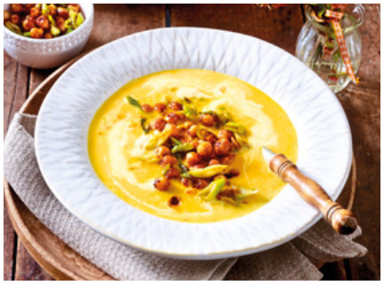

**Ingrediënten voor:** 4 personen
**Bereidingstijd:** ca. 30 min.
**400 ml** groentebouillon
**400 ml** kokosmelk (blik)
**500 g** flespompoen
**1-2** teentjes knoflook
**400 g** kikkererwten (blik)
**4** lente-uitjes
**1-2 el** olie
**4 el** suiker
zout en peper
paprikapoeder
1 Breng de bouillon met ca. ⅔ van de kokosmelk
in een grote pan aan de kook. Maak de pompoen
schoon, verwijder de zaadlijsten en snijd de
pompoen in blokjes. Pel de knoflook. Voeg de
pompoen en de knoflook toe aan de pan en kook
ca. 20 minuten op laag vuur.
2 Giet de kikkererwten af, spoel ze kort en laat
uitlekken. Was de lente-uitjes en snijd ze schuin
in ringen. Verhit de olie in een pan. Bak er de
kikkererwten rondom goudbruin in. Bestrooi met
de suiker en karamelliseer. Bestrooi met zout en
paprikapoeder. Spatel de lente-ui erdoorheen en
bak kort. Neem de pan van het vuur.
3 Pureer de soep fijn. Breng op smaak met zout en
peper. Neem 4 el soep uit de pan en verhit met de
overige kokosmelk kort in een andere pan. Pureer
met de staafmixer schuimig. Serveer de soep met
het kokosschuim en de kikkererwten. Lekker met
stokbrood.
**Per portie:** ca. 340 kcal
**6 g** eiwit | 18 g vet | 37 g koolhydraten

## Pasta met romige spek-kaassaus

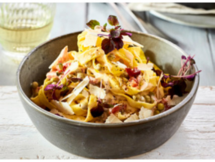

**Ingrediënten voor:** 4 personen
**Bereidingstijd:** ca. 20 min.
zout en peper
**75 g** parmezaan (stuk)
**150 g** gerookt spek (stuk)
**300 g** tagliatelle
**200 ml** slagroom
nootmuskaat
**300 g** doperwten (diepvries)
kiemen om te garneren
1 Breng ruim water met een snufje zout aan de
kook. Rasp de helft van de parmezaan fijn. Schaaf
de andere helft grof. Snijd het spek in blokjes en
bak in een droge pan knapperig. Kook de pasta
volgens de aanwijzingen op de verpakking in het
gezouten water. Blus het spek af met de slagroom, breng aan de kook en kook 2-3 minuten op
laag vuur. Voeg de geraspte parmezaan toe aan de
roomsaus en breng nogmaals aan de kook. Breng
de saus op smaak met zout, peper en nootmuskaat. Neem de pan van het vuur.
2 Kook de doperwten de laatste 2 minuten mee
met de pasta. Giet af. Meng de pasta en de doperwten met de saus. Maak de kiemen schoon en
bestrooi de pasta er samen met de geschaafde
parmezaan mee.
**Per portie:** ca. 580 kcal
**27 g** eiwit | 27 g vet | 55 g koolhydraten
LEKKER AROMATISCH & FRIS
Gebruik eens de Japanse
kiemen: shiso. De groene variant
smaakt een beetje naar munt en
de rode variant naar kaneel en
anijs.
DE SNELLE KEUKEN

## Aziatisch gehaktpannetje met spiegelei

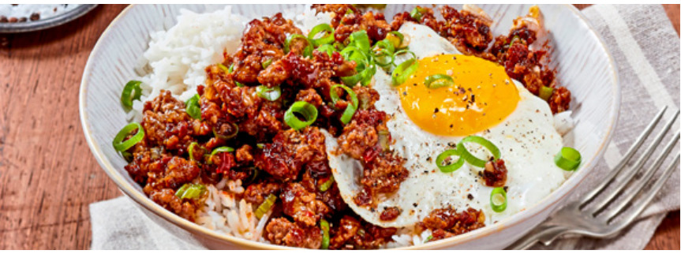

**Ingrediënten voor:** 4 personen
**Bereidingstijd:** ca. 25 min.
**200 g** basmatirijst
zout en peper
**4** lente-uitjes
**2 el** olie
**500 g** half-om-halfgehakt
cayennepeper
ca. 75 ml chilisaus (fles)
**2-3 el** sojasaus
**4** eieren
1 Kook de rijst volgens de aanwijzingen op de verpakking in water met wat
zout. Maak de lente-uitjes schoon. Snijd het groene en het witte deel apart in
ringen.
2 Verhit 1 el olie in een pan. Bak er het gehakt rul in. Breng op smaak met
zout en cayennepeper. Voeg de witte lente-uiringen toe en bak ca. 3 minuten
verder. Voeg de chilisaus, 3 el water en de sojasaus toe en verhit ca. 3 minuten verder op laag vuur.
3 Verhit 1 el olie in een koekenpan met antiaanbaklaag. Bak er van de eieren
4 spiegeleieren. Bestrooi met zout en peper.
4 Giet de rijst af. Serveer alles samen en bestrooi met de overige lente-ui.
**Per portie:** ca. 650 kcal
**44 g** eiwit | 32 g vet | 41 g koolhydraten

## Zoete-aardappelsalade voor onderweg

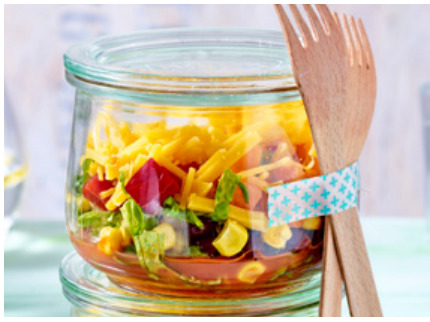

**Ingrediënten voor:** 4 personen
**Bereidingstijd:** ca. 30 min.
1 grote zoete aardappel (ca. 300 g)
zout en peper
**1** rode paprika
**1** kropje mini-romainesla
**400 g** kidneybonen (blik)
**180 g** mais (blik)
**75 g** cheddar (stuk)
**150 ml** tomatensap
**1 tl** wittewijnazijn
**1 tl** vloeibare honing
**2 el** olie
tabasco
1 Schil de zoete aardappel, was hem, snijd hem in blokjes en kook hem in
water met een snufje zout in ca. 10 minuten gaar. Snijd de paprika in vieren,
verwijder de zaadlijsten, was de paprika en snijd hem in blokjes. Was de sla
en snijd hem in reepjes. Giet de bonen en de mais af. Snijd de kaas in dunne
reepjes of rasp hem grof. Giet de zoete aardappel af en spoel hem kort.
2 Roer het tomatensap, de azijn, de honing en de olie door elkaar. Breng de
dressing op smaak met zout, peper en tabasco. Verdeel de dressing in 4 potten met deksel (à ca. 250 ml). Verdeel de ingrediënten erin en sluit af met de
kaas.
**Per portie:** ca. 330 kcal
**14 g** eiwit | 12 g vet | 40 g koolhydraten

# GOOD TO GO.

# scan voor

# reviews & prijs

# Multicooker

# Multicooker

Welk gerecht je ook wilt maken, met deze multicooker
van 6,5 liter heb je keuze uit 8 veelzijdige kookfuncties.
Maak de lekkerste maaltijden, die je zo in de pan op tafel
kunt zetten. Kies voor: Pasta, Rijst, Stomen, Slowcooken,

# 8x kookfuncties

Braden, Sous-vide, Koken, Warmhouden.
En na het eten... kan de pan zo de vaatwasser in!
Welk gerecht je ook wilt maken, met deze multicooker

# scan voor

# reviews & prijs

van 6,5 liter heb je keuze uit 8 veelzijdige kookfuncties.

# Multicooker

# 8x kookfuncties

Maak de lekkerste maaltijden, die je zo in de pan op tafel

# GOOD TO GO.

kunt zetten. Kies voor: Pasta, Rijst, Stomen, Slowcooken,
Braden, Sous-vide, Koken, Warmhouden.
En na het eten... kan de pan zo de vaatwasser in!

# scan voor

# reviews & prijs

Type: 28270-56 | www.russellhobbs.nl | @russellhobbs.benelux

# Uit het bos,

# op je bord

Heb je zin in een bijzonder stukje vlees
met een heerlijke wildsmaak? Maak dan
eens deze wildzwijnmedaillons!

## Wildzwijnmedaillons

## met koolraapstamppot,

## gebakken uien en spek

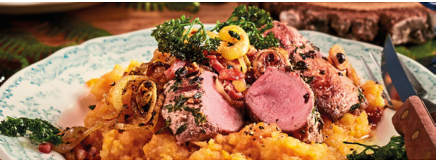

**Ingrediënten voor:** 6 personen
**Bereidingstijd:** ca. 1 uur en 30 min.
**1** koolraap
**750 g** aardappels (vastkokend)
**500 g** wortels
**7** uien
**7-8 el** olie
zout en peper
**800 ml** groentebouillon
**2** wildzwijnhazen (ca. 1,1 kg)
**1 tl** zwartepeperkorrels
**1 el** jeneverbessen
**½ bosje** tijm
**1 el** bloem
**100 g** gerookt spek (stuk)
**1 bosje** peterselie
**5 el** boter
1 Halveer de koolraap en schil hem met een
scherp mes van boven naar beneden. Was de
koolraap en snijd hem in blokjes. Schil de aardappels, was ze en snijd ze in blokjes. Schrap
de wortels, was ze en snijd ze in blokjes. Pel en
snipper 1 ui. Verhit 2-3 el olie in een pan. Fruit er
de ui glazig in. Voeg de koolraap, de wortel en de
aardappel toe en bak ca. 5 minuten mee. Bestrooi
met zout en peper. Schenk de bouillon erbij en
breng aan de kook. Kook afgedekt ca. 30 minuten
op laag vuur.
2 Snijd het vlees in 12 gelijke medaillons. Leg
het vlees op een diep bord. Vermaal de peperkorrels en de jeneverbessen. Was de tijm en hak
de blaadjes fijn. Meng de tijm met de gemalen
peperkorrels en jeneverbessen. Bestrooi het vlees
er rondom mee en wrijf goed in. Zet afgedekt in
de koelkast.
3 Pel 6 uien en snijd ze in ringen. Bestuif met de
bloem en meng goed. Snijd het spek in kleine
blokjes. Was de peterselie, dep hem goed droog
en neem de blaadjes van de takjes. Stamp het
aardappelmengsel. Breng op smaak met zout en
peper. Houd warm.
4 Bak het spek in een droge pan knapperig. Neem
het uit de pan. Verhit 2 el boter in het hete bakvet.
Bak er het vlees ca. 2 minuten per zijde rosé in.
Bestrooi met zout en peper. Leg het vlees op een
bord, dek af met een grote deksel en laat rusten.
5 Verhit 3 el boter in het bakvet. Bak er de uienringen rondom goudbruin in. Voeg het spek toe
en bak kort.
6 Verhit ca. 5 el olie in een kleine pan. Frituur
er de peterselie, in porties, 15-20 seconden in.
Neem de peterselie eruit en laat uitlekken op
keukenpapier. Serveer alles samen. Lekker met
cranberrysaus.
**Per portie:** ca. 580 kcal
**40 g** eiwit | 28 g vet | 39 g koolhydraten
STAP VOOR STAP

## VAN DE KOK

**1** MAKKELIJK SCHILLEN
Leg de koolraap op je werkblad en snijd de
schil er van boven naar beneden met een
scherp mes af.
**2** SMAAKVOLLE BOUILLON
Gebruik bouillon van een goede kwaliteit,
het liefst zelfgemaakt of uit een glazen pot.
**3** GEURIGE SPECERIJEN
Jeneverbes en zwarte peper passen perfect
bij de wildsmaak van het vlees, zonder te
overheersen. Vermaal de specerijen en wrijf
ze rondom in het vlees.
**4** LEKKER KNAPPERIG
Frituur de peterselie in de hete olie, zo
worden de blaadjes lekker knapperig. Dat
gaat wel heel snel, dus let op dat je de
peterselie niet verbrandt.
**5** EVEN RUSTEN
Laat het vlees onder een grote deksel kort
rusten. Zo kunnen de vleessappen zich weer
door het vlees verspreiden en wordt het
vlees nog malser.
5tips

# 1

# 2

# 4

# 3

## Klantenservice

Wil je abonnee worden of heb je vragen
over je abonnement? Op onze website vind
je antwoord op de meeste vragen.

## www.kokengenieten.nl/contact

Telefoon
We zijn er maandag tot vrijdag
van 09.00 tot 17.00 uur om je
vragen te beantwoorden.
+31 (0)24-2027829
E-mail
Stel je vraag eenvoudig
per e-mail aan een
van onze service medewerkers.
klantenservice@kokengenieten.nl
Wist je dat je tegenwoordig eenvoudig zelf je adres kan wijzigen?
Ga naar www.kokengenieten.nl/adreswijzigen om je nieuwe adres door te geven.
Het nieuwe adres wordt vervolgens automatisch in ons systeem gewijzigd.
Abonnementsinformatie
Koken & genieten kost € 3,99 per nummer. De abonnementsprijs is in Nederland € 40
en in België € 43 (12 nummers). Deze prijs geldt bij betaling per automatische incasso.
Voor betaling via een (digitale) factuur geldt een toeslag van € 2,50. Je kunt eenvoudig
een machtiging afgeven via www.fnl.nl/machtigen. Abonnementen worden automatisch
verlengd, tenzij anders vermeld. Het opzeggen van een abonnement kan eenvoudig
telefonisch via +31 (0)24-2027829 of per mail via klantenservice@kokengenieten.nl.
Copyright
Het auteursrecht op deze uitgave en de gedrukte uitgave en op de daarin verschenen artikelen wordt door de uitgever
voorbehouden. Het verlenen van toestemming tot publicatie in de gedrukte uitgave houdt in dat de auteur de uitgever,
met uitsluiting van ieder ander onherroepelijk machtigt de bij of krachtens de auteurswet door derden verschuldigde vergoedingen voor kopiëren te innen en dat de auteur alle rechten overdraagt aan de uitgever, tenzij anders bepaald. Niets
uit deze uitgave en de gedrukte uitgave mag worden overgenomen, vermenigvuldigd of gekopieerd zonder uitdrukkelijke
schriftelijke toestemming van de uitgever. De uitgever stelt zich niet aansprakelijk voor eventuele onjuistheden, welke in deze
uitgave of de gedrukte uitgave mochten voorkomen.
koken & genieten is een uitgave
van F&L Media B.V.
in licentie van Bauer Media
Brand Manager
Yvonne Doorten
Redactie
Sanne van den Heuvel, Willem van
Santen, Martina Silbrníková en
Marieke Slettenhaar
Webredactie
Bas Erkens en Marieke Slettenhaar
Met medewerking van
Soumia Aattaoui
Vormgeving
Nick Groenewold, Susan Gerbrands-
Derksen, Tom Gerrits, Orlando Koper,
Mylène Nales en Ellen Willemsen
Sales
Marc Bokhove
+31 (0)24 2404643
mbokhove@fnl.nl
Marketing
Anouk Tolboom
+31 24 240 45 95
atolboom@fnl.nl
Drukkerij
Habo DaCosta bv, Vianen
Vragen aan de redactie
Heb jij opmerkingen, suggesties
of vragen aan de redactie?
lezersvragen@kokengenieten.nl
Nieuwsredactie / Pers
kooknieuws@fnl.nl
of het onderstaande adres o.v.v.
F&L Media, redactie koken & genieten
Bezoekadres F&L Media
Jonkerbosplein 52, 6534 AB Nijmegen
ISSN
ISSN 1875-8517
F&L
MEDIA

# Gezond

# met noten

Weinig dingen zijn zo gezond als een handje
noten. Eet ze niet alleen zo uit het vuistje maar
verwerk ze ook in deze heerlijke gerechten!

## Overnight oats

## met gekaramelliseerde banaan

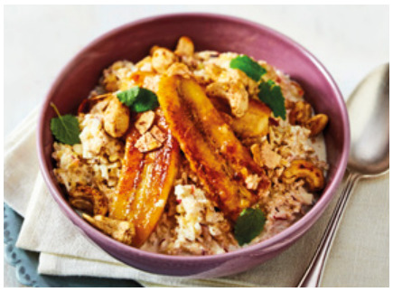

**Ingrediënten voor:** 4 personen
**Bereidingstijd:** ca. 25 min.
Wachttijd: ca. 12 uur
**200 g** havervlokken
**600 ml** melk
**40 g** amandelen
**2** appels (bijv. gala)
**150 ml** volle yoghurt
**6 el** ahornsiroop
**40 g** cashewnoten
**30 g** amandelschaafsel
**2** bananen
**1 tl** boter
kaneelpoeder om te bestuiven
evt. citroenmelisse om te
versieren
1 EEN DAG VAN TEVOREN Meng de havervlokken
met de melk. Zet een nacht afgedekt in de koelkast. DE VOLGENDE DAG Hak de amandelen grof
en rooster ze in een droge pan. Was de appels,
snijd ze in vieren, verwijder het klokhuis en rasp
de appels grof. Roer de appel, de yoghurt, de
amandelen en 4 el ahornsiroop door de havervlokken. Dek af en houd apart.
2 Rooster eerst de cashewnoten en daarna het
amandelschaafsel in een droge pan goudbruin.
Neem uit de pan en laat afkoelen.
3 Pel de bananen. Snijd ze eerst schuin en vervolgens in de lengte door. Verhit de boter in een
grote pan met antiaanbaklaag. Bak er de bananen
ca. 4 minuten rondom goudbruin in. Druppel 2 el
ahornsiroop eroverheen en karamelliseer. Neem
van het vuur.
4 Serveer alles samen en bestuif met kaneelpoeder. Versier eventueel met citroenmelisse.
**Per portie:** ca. 590 kcal
**20 g** eiwit | 25 g vet | 67 g koolhydraten

## Hazelnoten-broccoliovenschaaltjes

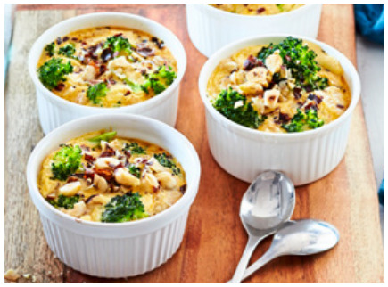

**Ingrediënten voor:** 6 personen
**Bereidingstijd:** ca. 45 min.
**1 kg** broccoli
zout en peper
**50 g** hazelnoten
**3** eieren
**200 ml** slagroom
**100 ml** melk
nootmuskaat
boter of olie om in te vetten
1 Maak de broccoli schoon en snijd hem in kleine
roosjes van de stronk. Kook de roosjes in 3-4 minuten in water met een snufje zout beetgaar. Giet
de broccoli af en spoel kort.
2 Hak de hazelnoten grof. Rooster ze in een droge
pan goudbruin. Neem ze uit de pan en laat afkoe-
DE GEZONDE KEUKEN
len. Kluts de eieren met de slagroom en de melk
door elkaar. Roer wat zout, peper en nootmuskaat erdoorheen. Meng ca. ⅔ van de hazelnoten
erdoorheen.
3 Verwarm de oven voor (elektrisch: 180°C /
hetelucht: 160°C). Verdeel de broccoli in 6 kleine
ovenschaaltjes (à ca. 8 cm Ø). Schenk de room
eroverheen. Bestrooi met de overige noten. Bak
25-30 minuten in de oven. Neem uit de oven en
serveer.
**Per portie:** ca. 230 kcal
**8 g** eiwit | 19 g vet | 4 g koolhydraten

## Kabeljauw met pistachekorst

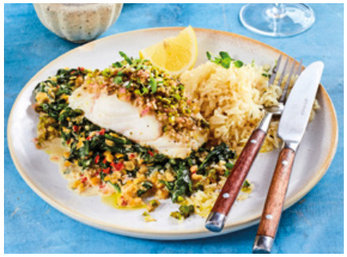

**Ingrediënten voor:** 4 personen
**Bereidingstijd:** ca. 35 min.
**4 el** olijfolie
4 kabeljauwfilets (à ca. 150 g)
zout en peper
**100** g
**2** sjalotjes
**1 el** kappertjes (pot)
**40 g** pistachenoten
ca. 30 g gember (stuk)
**1 el** honing
**1 el** witte balsamico
**400 g** spinazie
**1** teentje knoflook
**50 g** rode linzen
**200 ml** slagroom
**100 ml** groentebouillon
nootmuskaat
**1** rode peper
1 Verwarm de oven voor (elektrisch: 200°C /
hetelucht: 180°C). Bestrijk een ovenschaal met
1 el olie. Leg de visfilets in de ovenschaal en bestrooi met zout en peper. Pel en snipper 1 sjalotje.
Hak de kappertjes fijn. Hak de pistachenoten fijn.
Schil de gember en rasp hem fijn. Roer het sjalotje, de kappertjes, de pistachenoten, de gember, de
honing, de balsamico, 2 el olie, zout en peper door
elkaar. Verdeel het mengsel over de vis. Bak ca.
20 minuten in de oven.
2 Was de spinazie. Pel en snipper 1 sjalotje en de
knoflook. Verhit 1 el olie in een grote pan. Fruit
er het sjalotje en de knoflook in. Voeg de spinazie
toe en laat afgedekt slinken. Voeg de linzen, de
slagroom en de bouillon toe, breng aan de kook
en kook afgedekt ca. 10 minuten op laag vuur.
Breng op smaak met zout, peper en nootmuskaat.
Zet de oven uit. Laat de vis in de oven ca. 10 minuten nagaren. Halveer de peper in de lengte, verwijder de zaadlijsten, was de peper en hak hem
fijn. Voeg hem toe aan de linzen en de spinazie.
Serveer alles samen. Lekker met rijst.
**Per portie:** ca. 500 kcal
**36 g** eiwit | 31 g vet | 15 g koolhydraten

## Aardappelsalade

## met knapperig gebakken ham

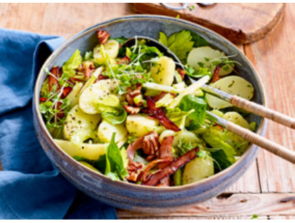

**Ingrediënten voor:** 4 personen
**Bereidingstijd:** ca. 50 min.
**1 kg** aardappels
zout en peper
ham (in plakken)
2
zure appels (bijv. granny smith)
**4** stengels bleekselderij
**40 g** pecannoten
**2** teentjes knoflook
**½ bosje** peterselie
**50 ml** appelazijn
**80 ml** walnootolie
**1 el** mosterd
**100 g** jonge spinazie
**1** bakje tuinkers
1 Schil de aardappels en kook ze in water met een
snufje zout in ca. 20 minuten gaar. Snijd de ham
in reepjes. Rooster de reepjes in een droge pan
krokant en neem uit de pan. Was de appels, snijd
ze in vieren, verwijder het klokhuis en snijd de
appels in dunne reepjes. Maak de bleekselderij
schoon en snijd hem in dunne plakjes. Houd het
selderijgroen apart. Hak de noten grof. Giet de
aardappels af, spoel kort en laat kort uitdampen.
2 VOOR DE DRESSING Pel de knoflook. Was de
peterselie en neem de blaadjes van de takjes.
Pureer de knoflook, de peterselie, de azijn, de olie
en de mosterd fijn. Breng op smaak met zout en
peper.
3 Pel de aardappels en halveer ze. Was de spinazie. Meng de aardappel, de spinazie, de bleekselderij, de ham, de appel en de dressing. Breng
de salade op smaak met zout en peper. Knip de
tuinkers uit het bakje. Bestrooi de salade met de
noten, de tuinkers en het bleekselderijgroen.
**Per portie:** ca. 490 kcal
**11 g** eiwit | 28 g vet | 45 g koolhydraten
DE GEZONDE KEUKEN

# CADEAU

## SCHEURKALENDER

## T.W.V.15,99

# JOUW CADEAU BIJ EEN

# JAARABONNEMENT:

# KOKEN & GENIETEN SCHEURKALENDER 2023

Iedere dag inspiratie voor
een heerlijke maaltijd
Bomvol recepten met
seizoensgebonden producten
Ontdek de lekkerste
zoete recepten
ONTVANG

## 12X KOKEN & GENIETEN

## + SCHEURKALENDER 2023

VOOR

# 40,-

ABONNEER JE NU VIA

# KOKENGENIETEN.NL/ABO

OF BEL NAAR +31(0)242027829
Deze actie is geldig t/m 15-11-2022 of zolang de voorraad strekt. Je abonneert tot wederopzegging en voor ten minste de
actieperiode van 12 nummers. Na afloop van de actieperiode geldt de reguliere abonnementsprijs en is het abonnement
per maand opzegbaar. Opzeggen is heel eenvoudig en kan via onze klantenservice.

# De keuken

# van Zuid-Tirol

Een culinair reisje maken vanuit je eigen keuken? Met deze gerechten op
tafel is het even alsof je tussen de prachtige bergen van Zuid-Tirol staat.

## Kaasknoedels met spitskool

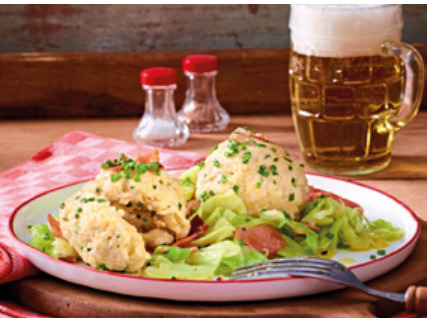

**Ingrediënten voor:** 6-8 personen
**Bereidingstijd:** ca. 50 min.
**1 kg** witbrood
zout en peper
**1** ui
**150 g** edammer
**150 g** gorgonzola
**1 bosje** peterselie
**1 el** boter
**250 ml** melk
**4** eieren
**3 el** bloem
**1** spitskool (ca. 1 kg)
**75 g** gerookt spek (stuk)
**2 el** olie
**1 bosje** bieslook
1 Snijd het brood in blokjes van ca. 1 cm en meng
met 1 tl zout en 1 tl peper. Pel en snipper de ui.
Snijd de kazen in blokjes. Was de peterselie en
hak de blaadjes fijn.
2 Verhit de boter in een pan. Fruit er de helft van
de ui in. Schenk de melk erbij. Schenk de melk
over het brood. Voeg de eieren, de kazen, de
peterselie en de bloem toe en kneed goed door.
3 Was de spitskool, snijd hem in vieren en snijd
hem in reepjes van de stronk. Snijd het spek in
dunne plakjes. Verhit de olie in een grote pan met
deksel. Bak er het spek knapperig in en neem
het uit de pan. Bak de overige ui in het bakvet.
Voeg de kool toe en roerbak ca. 8 minuten. Breng
op smaak met zout en peper. Schenk ca. 100 ml
water erbij, breng aan de kook en smoor afgedekt
ca. 5 minuten op laag vuur.
4 Maak van het deeg ballen ter grootte van gehaktballen en kook ze in water met een snufje
zout in ca. 10 minuten gaar. Was de bieslook en
hak fijn. Breng de spitskool op smaak met zout en
peper. Meng het spek erdoorheen. Neem de knoedels met een schuimspaan uit het water. Serveer
alles samen en bestrooi met de bieslook.
**Per portie:** ca. 570 kcal
**26 g** eiwit | 21 g vet | 66 g koolhydraten

## Aardappels in spek

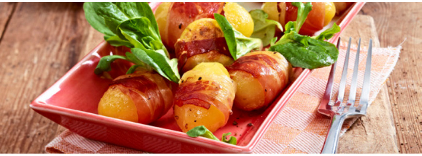

**Ingrediënten voor:** 4 personen
**Bereidingstijd:** ca. 45 min.
**16** kleine aardappels
zout en peper
**8** plakken ontbijtspek
**4 tl** pittige mosterd
**2-3 el** vloeibare honing
**4 el** olie
**100 g** veldsla
**4 el** frambozenazijn
CULINAIRE INSPIRATIE
1 Was de aardappels en kook ze in water met
een snufje zout in ca. 20 minuten gaar. Halveer
de plakken spek in de lengte, bestrijk ze met
mosterd en druppel de honing eroverheen. Giet
de aardappels af, spoel ze kort en pel ze. Wikkel
elke aardappel in een plakje spek. Verhit 2 el
olie in een grote pan. Bak er de aardappels in ca.
10 minuten rondom knapperig in. Bestrooi met
peper.
2 Was de veldsla en laat hem goed uitlekken.
Roer de azijn, zout en peper door elkaar. Klop 2 el
olie erdoorheen. Meng de sla met de vinaigrette.
Serveer alles samen.
**Per portie:** ca. 400 kcal
**11 g** eiwit | 12 g vet | 59 g koolhydraten
Lekker eten valt of staat met de ingrediënten die je
gebruikt en het keukengerei dat je tot je beschikking
hebt. Daarom presenteren wij elke maand leuke,
verrassende, handige en/of smakelijke producten.

# Paddenstoelen kweken

Kweek je eigen oesterzwammen met deze doe-het-zelf
paddenstoelenkweekkit. Je hoeft alleen wat water te geven en binnen
10 dagen kun je je eigen paddenstoelen plukken, bijvoorbeeld voor
op de flammkuchen van p. 12. De paddenstoelen groeien op een
voedingsbodem van koffiedik dat anders weggegooid zou worden.
Zo is deze kweekkit niet alleen heel leuk, maar ook hartstikke no waste.
Prijs: €13,95 euro. Verkrijgbaar via waarenhuis.com

# NOTENMOLEN

In de herfst is het eindelijk weer tijd om noten te rapen
en om ermee aan de slag te gaan in de keuken, daarom
hebben we in deze uitgave een paar leuke recepten
met noten voor je verzameld (p. 36). Met deze handige
notenmolen van Westmark vermaal je de noten makkelijk
tot het gewenste formaat – grof, fijngehakt of vermalen tot
meel. De antisliponderkant en duidelijke maataanduiding
maken de molen extra handig in gebruik.
Prijs: €17,99. Verkrijgbaar via cookinglife.nl

# liefde

# DOOSJE VOL

# liefde

Wil je jezelf of iemand anders trakteren
op een bijzonder chocoladecadeau?
Precies hiervoor hebben ze bij ChocStar
Doosje vol liefde ontworpen – een luxe
reep Belgische melkchocolade die rijkelijk
gevuld is met biologische gevriesdroogde
aardbeien, caramel drops en een vrolijke
gedroogde bloemenmix. Je kunt via
de website de verpakking eenvoudig
personaliseren naar eigen wens en
voorzien van een leuke boodschap.
Prijs: €16,95 (excl. verzendkosten).
Verkrijgbaar via chocstar.nl
4,99
Nu met gratis
verzending
Met deze extra dikke editie van koken & genieten
wordt het de lekkerste kerst ooit! Bestel hem nu
vóór 31 oktober met gratis verzending.
Met deze extra dikke editie van koken & genieten
wordt het de lekkerste kerst ooit! Bestel hem nu
wordt het de lekkerste kerst ooit! Bestel hem nu
Deze actie is geldig t/m 30 oktober 2022. Jouw exemplaar wordt rond 11 november thuisbezorgd.
vóór 31 oktober met gratis verzending.

# Lekker

# romig

De MonChoutaart ken je vast wel,
maar wist je dat je veel meer
kunt met MonChou? Verwerk
de roomkaas eens in warme
gerechten voor een heerlijk
romige smaak!

## Zalmfilet met romige mosterd-dilletopping

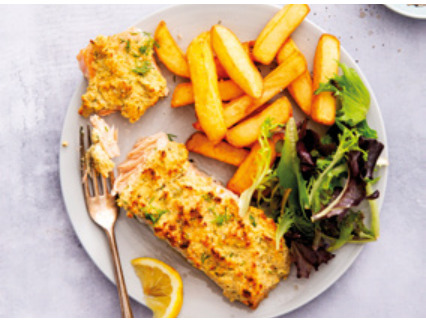

**Ingrediënten voor:** 4 personen
**Bereidingstijd:** ca. 25 min.
**1** sjalot, fijngesnipperd
**1 bosje** dille, fijngehakt
2tl dijonmosterd
1 citroen, ½ uitgeperst en ½ in
partjes
**50 g** broodkruim (+ bestrooien)
**200 g** MonChou Zacht & Luchtig
(in een kuipje)
zout en peper
**4** zalmfilets, à 200 g
olie (om in te vetten)
}KOKEN & GENIETEN
1 Verwarm de oven voor op de grillstand. Meng de sjalot, ¾ van de dille, de
mosterd, het citroensap en het broodkruim door de MonChou. Breng op smaak
met zout en peper. Leg de zalmfilets op een ingevet bakblik en bestrijk ze royaal
met het MonChou-mengsel. Strooi nog wat extra broodkruim eroverheen.
2 Gril de zalm in ca. 10 minuten in de oven tot de bovenkant mooi gegratineerd
is en de zalm gaar is. Zet eventueel de zalm wat lager in de oven als hij nog niet
helemaal gaar is en de bovenkant donker begint te kleuren. Bestrooi de zalm met
de overige dille en geef er de partjes citroen bij. Lekker met frietjes en salade.
**Per portie:** ca. 589 kcal
**45 g** eiwit | 41 g vet | 9 g koolhydraten
MONCHOU®

## Gepofte zoete aardappel

## met MonChouvulling en

## spek-boontjesdressing

**Ingrediënten voor:** 4 personen
**Bereidingstijd:** ca. 1 uur en 20 min.
**4** zoete aardappels (van gelijk
formaat)
3 bosuitjes, 2 fijngehakt en 1 in
ringetjes
**4 takjes** tijm, de blaadjes gerist en
fijngehakt
**100 g** MonChou Original
zout en peper
aluminiumfolie
Voor de dressing
**50 g** sperziebonen
**3 el** olijfolie
**1** sjalot, in ringen
**4 plakjes** ontbijtspek, in reepjes
**1 tl** mosterd
**1 el** appelazijn
zout en peper
**50 g** witte bonen uit blik, afgespoeld
en uitgelekt
gehakte amandelen (voor de
garnering)
1 Verwarm de oven voor (elektrisch: 180°C /
hetelucht: 160°C). Was de zoete aardappels en
halveer ze in de lengte. Meng de fijngehakte bosui
en de tijm door de MonChou. Breng op smaak
met zout en peper. Verdeel het mengsel over
4 aardappelhelften en druk de andere helften
erop. Wikkel iedere gevulde aardappel strak
in aluminiumfolie en leg de pakketjes op een
bakplaat. Pof de zoete aardappels in ca. 1 uur
gaar in de oven.
2 Blancheer intussen voor de dressing de
sperziebonen ca. 3 minuten in kokend water.
Giet af, spoel met koud water en laat goed
uitlekken. Verhit 1 el olijfolie in een pan en fruit
er de sjalot en het spek ca. 5 minuten in. Neem
van het vuur en laat ca. 10 minuten afkoelen.
Voeg de mosterd en de azijn toe en roer goed
door. Klop nu met een vork de overige olijfolie
erdoorheen. Breng op smaak met zout en peper.
Snijd de sperzieboontjes in kleine stukjes. Meng
de sperziebonen en de witte bonen door de
dressing.
3 Neem de zoete aardappels uit de oven en haal ze
voorzichtig uit het folie. Leg ze op een schaal en
schep er de boontjesdressing overheen. Maak af
met wat bosuiringetjes en gehakte amandelen.
**Per portie:** ca. 531 kcal
**10 g** eiwit | 27 g vet | 58 g koolhydraten
}KOKEN & GENIETEN
MONCHOU® ALS BLIJVERTJE
IN DE KOELKAST
Je kent MonChou natuurlijk van de
MonChoutaart, een oer-Hollandse
traditie. Want hoe Frans de naam
MonChou ook klinkt, MonChou is alleen
in Nederland te koop. Gebruik behalve
de stevige frisse MonChou Original ook
de smeerbare MonChou Zacht & luchtig
uit een kuipje. Houd ze standaard in je
koelkast, want je kunt er alle kanten mee
op. Van toetjes tot borrelhapjes en van
cheesecake tot pastasaus.
monchou.nl
MONCHOU®

# KEUKEN VAN SOU

Auteur: Soumia Aattaoui
Uitgever: Uitgeverij Vrijdag
Aantal pagina’s: 189
Prijs: 26,99 euro
Good food based on a good mood staat er groot op de voorkant van het boek van
Soumia Aattaoui. De blogster (keukenvansou.be) bundelde haar favoriete recepten
in een kookboek waar iedereen blij van wordt. We spraken haar en vroegen naar de
samenstelling van het boek, haar lievelingsrecepten en haar goede woordgrappen.
Tekst: Yvonne Doorten Fotogra e: Roos Mestdagh
Titel: Keuken van Sou
Zijn het allemaal nieuwe recepten
of ook klassiekers van je website?
“Het zijn allemaal nieuwe recepten, behalve de
‘baghrir’ en de ‘msemen’ uit het hoofdstuk ‘Made
in Morocco’. Dit zijn mama’s recepten die ik zelf al
jaren gebruik en dus ook al veel eerder heb gedeeld. Onvervangbaar en onmisbaar dus hebben
ze ook een plekje gekregen in mijn kookboek. Alle
andere recepten zijn nieuw.”
Er staan veel woordgrapjes in het boek,
leuk! Is dat iets wat bij jou past?
“Als je denkt aan een familiediner of een gezellige
avond dineren met vrienden, dan denk je gelijk aan
lekker lachen om alle verhalen aan tafel. Naast eten is
humor ook erg belangrijk in mijn leven. Er zijn genoeg
momenten om serieus te zijn, de momenten om te
lachen moeten we zelf creëren. Met mijn kookboek
heb ik de twee op een leuke manier gecombineerd:
yummy in my tummy & hihi from the belly!”
Soumia: “Ik ben een foodie
vanaf dat ik het me kan
herinneren. Ik droomde ervan
om op een dag mensen te
kunnen verrassen en inspireren
met mijn eigen recepten. Die
droom is nu uitgekomen met
mijn eigen kookboek!”
Ik had verwacht dat er vooral
Marokkaanse gerechten in zouden
staan, maar eigenlijk maak je een
hele wereldreis. Vanwaar die keuze?
“Het kookboek heeft geen traditionele inhoudsopgave: ontbijt, lunch, enzovoort, maar is ingedeeld op basis van hoe jouw mood op dat moment
is. Elk hoofdstuk staat in het teken van een
gevoel, bijvoorbeeld in het hoofdstuk ‘Made in
Morocco’ heb ik gerechten gekozen die nostalgie
oproepen, het hoofdstuk comfortfood roept weer
een gevoel van lekker onder de dekens te willen
zitten na een lange dag. De focus ligt dus niet op
een wereldreis maar wel op verschillende gevoelens uitgedrukt in gerechten.”
De zoete recepten zijn lekker
zondig! Hoort dat zo volgens jou?
“Als je zondigt, moet je het gelijk goed doen. Het
zijn recepten die jou een voldaan gevoel geven
na een sugar rush-moment. Ze zijn niet machtig
maar wel erg satisfying. Bij deze recepten moet je
je als een kind in een snoepwinkel voelen!”
Wat is je favoriete recept
uit het boek en waarom?
“Een moeilijke vraag omdat ze allemaal een favoriet zijn én dus ook kookboekwaardig. Als ik moet
kiezen op basis van mijn gevoel dan gaat mijn
keuze naar ‘sfenj’. Dit was het lievelingsrecept
van mijn inmiddels overleden vader (en grootste
fan). Als ik de geuren hiervan ruik tijdens het
bakken, dan komen er zoveel mooie herinneringen naar boven! Dus dit recept heeft wel een
speciaal plekje in mijn hart.”
BOEK

## Lotusparfait

**Ingrediënten voor:** 4 personen
**Bereidingstijd:** 40 min. + 3 uur wachttijd
**440 g** opklopbare slagroom (koud)
**100 g** mascarpone
(kamertemperatuur)
**90 ml** gecondenseerde melk
**25 g** poedersuiker
**2 zakjes** vanillesuiker (16 g)
**5** speculaasjes
**7 el** Lotus Biscoff
speculaaspasta
1 VOOR DE ROOM Doe 260 gram slagroom, de
gecondenseerde melk en 1 zakje vanillesuiker
in een ruime kom. Mix met een handmixer tot
het mengsel in volume is verdubbeld. Schep het
roommengsel in een spuitzak en zet in de koelkast.
2 VOOR DE TOPPINGS Doe de mascarpone,
180 gram opklopbare slagroom, de poedersuiker
en 1 zakje vanillesuiker in een ruime kom. Mix
met een handmixer tot het mengsel in volume
is verdubbeld. Schep het mascarponemengsel in
een spuitzak en zet in de koelkast.
3 VOOR DE SAMENSTELLING Smelt 3 eetlepels
Lotus Biscoff speculaaspasta en verdeel over de
drie glaasjes. Spuit een laag van het roommengsel
in elk glaasje. Zet de glaasjes 3 uur in de diepvriezer.
4 Haal de glaasjes uit de diepvriezer. Smelt 3
eetlepels Lotus Biscoff speculaaspasta en verdeel
over de glaasjes. Spuit een toef van het mascarponemengsel bovenop de speculaaspasta. Werk af
met wat extra gesmolten Lotus Biscoff speculaaspasta en verkruimel speculaasjes eroverheen.

## Filipijnse Adobo

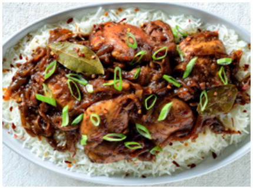

**Ingrediënten voor:** 4 personen
**Bereidingstijd:** ca. 1 uur + 1 uur wachttijd
**400 g** basmatirijst
Voor de kip
**350 g** kippendijen
**150 ml** appelazijn
**30 ml** gezouten sojasaus
**20 ml** rijstazijn
**4** teentjes knoflook
**1 tl** lichtbruine basterdsuiker
**1 tl** verse gember
**½ tl** zwarte peper
**½ tl** chilivlokken
zonnebloemolie
Voor de saus
**2** uien
**3** teentjes knoflook
**2** laurierblaadjes
**1** lente-ui
**1 el** zonnebloemolie
1 VOOR DE KIP Hak de knoflook en de gember
fijn. Doe de kippendijen in een ruime kom. Voeg
de sojasaus, de basterdsuiker, de appel- en rijstazijn, de knoflook, de gember en de zwarte peper/
chilivlokken toe. Meng goed. Bedek de kom met
huishoudfolie en laat minimaal 1 uur marineren.
2 Verhit een scheut zonnebloemolie in een
ruime pan op een middelhoog vuur. Bak de kip in
ca. 5 minuten aan beide kanten goudbruin. Gooi
het overschot van de marinade in de kom niet
weg, maar zet even aan de kant. Schep de kip op
een bord en zet even aan de kant.
3 VOOR DE SAUS Giet een scheut zonnebloemolie
in dezelfde pan waarin je de kip hebt gebakken.
Voeg de uien en de knoflook toe. Laat het geheel
5 à 6 minuten bakken op een middelhoog vuur tot
de ui glazig wordt.
4 Doe de kip in de pan. Voeg het overschot marinade en de laurierbladen toe. Laat het geheel
ca. 25 minuten koken totdat de kip gaar is. Schep
de kip op een bord. Laat de saus inkoken gedurende 10 à 12 minuten op een laag tot middelhoog
vuur, zodat hij indikt. Voeg de kip weer toe aan de
pan en laat 5 minuten mee opwarmen.
5 Kook de rijst volgens de instructies op de verpakking. Snijd de lente-ui fijn en strooi over de
kip. Serveer de kip Adobo met de rijst.
BOEK

## Gepofte aardappel

## met kip-chiliroomsaus

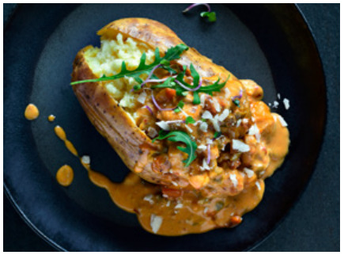

**Ingrediënten voor:** 4 personen
**Bereidingstijd:** ca. 1 uur en 10 min.
Voor de gepofte aardappelen
**4** grote aardappelen
**60 g** roomboter (kamertemperatuur)
**4 tl** geraspte mozzarella
**1 el** zonnebloemolie
snufje zout
Voor de kip-chiliroomsaus
**1** groene paprika
**500 g** kipfilet
**1** handvol rucola
**400 ml** frituur-/
**3** teentjes knoflook
zonnebloemolie
**2 el** maizena
**200 ml** kookroom
**2 el** zoete chilisaus
**60 ml** water
**1 el** sojasaus
**50 g** geraspte
**1 el** oestersaus
Parmezaanse
**1 tl** chilivlokken
kaas
**½ tl** zwarte peper
**2** eiwitten
**1 tl** zout
**1** ui
**1 tl** paprikapoeder
**1** wortel
1 VOOR DE GEPOFTE AARDAPPEL Verwarm de oven voor op
175 °C. Was de aardappelen, droog ze af en smeer ze in met
wat zonnebloemolie. Schil ze niet! Bekleed een bakplaat
met bakpapier. Plaats de aardappelen erop en zet 1 uur in de
voorverwarmde oven.
2 Haal de aardappelen uit de oven en controleer of ze gaar
zijn door er even in te prikken. Snijd in de lengte open tot
in het midden, zodat je ze nog kan vullen. Duw de zijkanten
naar binnen toe. Voeg een snufje zout, de boter en de geraspte
mozzarella toe aan elke aardappel. Meng voorzichtig met een
vork.
3 VOOR DE KIP-CHILIROOMSAUS Snijd de kipfilet en de wortel
in blokjes. Snijd de groene paprika in grove stukken. Snipper de
ui en hak de look grof. Doe de kipfilet, het zout, de eiwitten en
de maizena in een kom en meng onder elkaar.
4 Verwarm de frituur-/zonnebloemolie in een ruime, diepe
pan en frituur hierin de kippenblokjes gaar. Verhit een scheut
zonnebloemolie in een andere pan op een middelhoog vuur.
Voeg de knoflook en de ui toe. Bak ca. 2 minuten tot de ui
glazig is. Voeg de paprika en de wortel toe en bak in 3 minuten
beetgaar.
5 Giet de zoete chilisaus, de sojasaus, de oestersaus en het
water erbij en kook gedurende 3 minuten. Voeg de kookroom,
de kippenblokjes, het paprikapoeder en de chilivlokken/zwarte
peper toe en meng. Laat de saus 3 à 4 minuten opwarmen op
een middelhoog vuur.
6 Schep de saus in en over de gepofte aardappelen. Werk af met
rucola en geraspte Parmezaanse kaas.

## Kip caesar quesadilla

**Ingrediënten voor:** 3 personen
**Bereidingstijd:** ca. 45 min.
**6** kleine tortillawraps
**200 g** geraspte mozzarella
**100 g** ijsberg-/kropsla
**50 g** geraspte
Parmezaanse kaas
**1 sneetje** brood
Voor de kip
**450 g** kipfilet
**2** teentjes knoflook
**2 el** dijonmosterd
**1 el** zonnebloemolie
**1 el** gedroogde rozemarijn
sap van ½ citroen
zout
peper
Voor de caesardressing
**50 g** geraspte
Parmezaanse kaas
**2** ansjovisfilets
**4 el** mayonaise
**2 el** olijfolie
sap van ½ citroen
**1 tl** dijonmosterd
**1 tl** sojasaus
**1 tl** tomatenketchup
**1 el** natuurazijn
BOEK
1 VOOR DE KIP Snijd de kip in fijne blokjes. Hak de knoflook fijn. Doe de kippenblokjes in een ruime kom. Voeg alle ingrediënten voor de kip toe en meng
goed. Verhit een scheut olijfolie in een ruime pan met zonnebloemolie op een
middelhoog vuur. Bak de kip gaar. Schep op een bord en zet even aan de kant.
2 VOOR DE CAESARDRESSING Hak de ansjovis fijn. Doe alle ingrediënten
van de dressing in een kom en meng goed.
3 Toast het sneetje brood en snijd in blokjes. Leg een tortillawrap op je
werkblad en verdeel hierover 2 à 3 eetlepels geraspte mozzarella. Voeg een
blaadje ijsberg-/kropsla toe en schik daarop enkele kippenblokjes. Schep
1 eetlepel saus over de kip. Voeg de broodblokjes toe en werk af met 1 eetlepel geraspte mozzarella. Dek af met een tortillawrap en duw zacht aan.
4 Verhit een scheutje zonnebloemolie in een ruime pan op een laag vuur. Bak
de quesadilla in 2 à 3 minuten aan beide zijden goudbruin. Gebruik je grotere
tortillawraps? Draai ze dan het best om met een bord en kiep ze zo weer in
de pan.
5 Herhaal voor de overige quesadilla’s. Snijd de quesadilla’s in tweeën en
serveer met de saus. Werk af met de geraspte Parmezaanse kaas en geniet!
COVERRECEPT

# Coverrecept

# Appeltje, uitje

De smaken van herfst? Gebakken appel, ui en salieblaadjes.
Dit smakelijke trio is een perfecte basis voor de heerlijke
sappige varkenshaas uit de oven.

## Varkenshaasje

## met parmaham, appel en salie

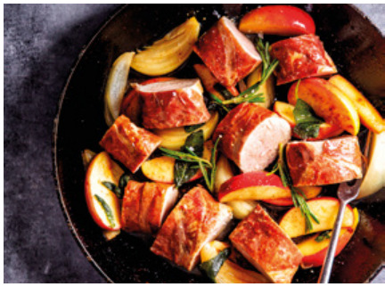

**Ingrediënten voor:** 3-4 personen
**Bereidingstijd:** ca. 40 min.
**2** varkenshaasjes (à ca. 250 g)
zout en peper
**2 tl** fijne mosterd
**4** plakken parmaham
**1 el** olie
**2 el** boter
**2** stevige appels
**1** ui
**4 takjes** salie
**100 ml** vleesfond (pot)
evt. prikkertjes
evt. kernthermometer
1 Verwarm de oven voor (elektrisch: 180°C /
hetelucht: 160°C). Bestrooi de varkenshaasjes
rondom met zout en peper, wrijf ze in met de
mosterd en omwikkel strak met de parmaham.
Steek evt. met een prikkertje de ham vast. Verhit
een ovenbestendige braadpan op middelhoog
vuur. Doe de olie en de boter in de pan en laat de
boter bruisen. Braad de varkenshaasjes rondom
in ca. 8 minuten goudbruin.
2 Snijd intussen de appels en de ui in parten en
pluk de salieblaadjes van de takjes. Neem het
vlees voorzichtig uit de pan. Voeg de salie, de ui
en de appel toe aan de pan en bak 2 minuten,
schud af en toe goed om. Blus af met de vleesfond
en breng aan de kook. Leg het vlees weer in de
pan en zet het geheel ca. 12 minuten in de oven
tot het vlees veerkrachtig aanvoelt. Controleer
evt. met een kernthermometer de temperatuur,
deze moet ca. 60°C zijn.
3 Neem uit de oven en laat het vlees ca. 5 minuten
rusten voor je het in plakken snijdt. Schep er de
saus met de appels en ui uit de pan overheen.
Lekker met aardappelpuree.
Per portie (4): ca. 304 kcal
**33 g** eiwit | 14 g vet | 11 g koolhydraten

# In de

# chocoladehemel

Niets zo verleidelijk als gebak met chocolade. Met welke van
deze heerlijke desserts waan jij je in de chocoladehemel?

## Chocolade-perentaart

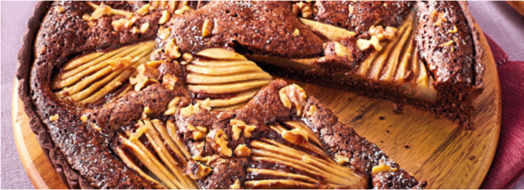

**Ingrediënten voor:** ca. 12 stukken
**Bereidingstijd:** ca. 1 uur
Wachttijd: ca. 1 uur en 30 min.
**4** eieren
**200 g** + 1 el bloem (+ bestuiven)
**35 g** cacaopoeder
zout
**75 g** + 1 el poedersuiker
**210 g** boter (waarvan 60 g op
kamertemperatuur, + invetten)
**100 g** pure chocolade
**75 g** melkchocolade
**100 ml** slagroom
**2 el** suiker
**1 tl** bakpoeder
**4** peren
**80 g** walnoten
1 VOOR HET DEEG Splits 2 eieren. Meng
**200 g** bloem met het cacaopoeder, 1 snufje zout
en 75 g poedersuiker in een kom. Voeg 2 eidooiers
en 150 g koude boter in stukken toe en kneed
glad. Rol het deeg op een met bloem bestoven
werkblad rond (ca. 32 cm Ø) uit. Vet een vlaaivorm met uitneembare bodem (ca. 28 cm Ø) in.
Bekleed de vorm met het deeg, snijd het overtollige deeg langs de randen af en zet de vorm
ca. 30 minuten in de koelkast.
2 VOOR DE CHOCOLADEVULLING Hak alle
chocolade grof en smelt hem met de slagroom
au bain-marie. Laat al roerend kort afkoelen.
3 Verwarm de oven voor (elektrisch: 180°C /
hetelucht: 160°C). Klop 60 g zachte boter met
**2 el** suiker romig. Klop na elkaar 2 eieren en
2 eiwitten erdoorheen. Meng 1 el bloem met het
GEBAK
bakpoeder en klop het er kort doorheen.
Klop de gesmolten chocolade erdoorheen.
4 Schil de peren en halveer ze in de lengte.
Verwijder het klokhuis. Snijd 7 helften in de lengte in dunne plakjes maar laat ze bij de steel aan
elkaar vastzitten, zodat er ‘waaiertjes’ ontstaan.
Snijd de overige peer in kleine blokjes.
5 Hak de walnoten grof. Roer de gesneden peer
door het chocolademengsel en verdeel dit over
de taartbodem. Verdeel de perenhelften erop en
druk een beetje aan. Bestrooi met de walnoten.
Bak 30-35 minuten in de oven. Neem uit de oven
en laat afkoelen. Neem de taart uit de vorm en
bestuif met 1 el poedersuiker.
**Per stuk:** ca. 440 kcal
**7 g** eiwit | 29 g vet | 35 g koolhydraten

## Chocolade-cupcakes

## met cappuccinotopping

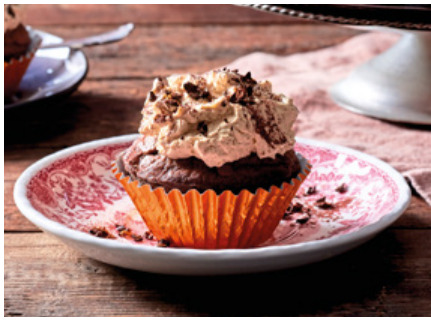

**Ingrediënten voor:** 12 stuks
**Bereidingstijd:** ca. 1 uur
Wachttijd: ca. 30 min.
**150 g** pure chocolade
**275 g** zachte boter
**3** eieren
**100 g** rietsuiker
**8 g** vanillesuiker
**50 g** cappuccinopoeder
**175 g** bloem
**1 tl** bakpoeder
**50 g** poedersuiker
**1 el** melk
**100 g** roomkaas
**1 el** koffiebonen
cacaopoeder (om te bestuiven)
**12-24** papieren cupcakevormpjes
muffinbakblik voor 12 stuks
1 Smelt de chocolade met 150 g boter. Klop de
eieren met de rietsuiker en de vanillesuiker
romig. Klop 30 g cappuccinopoeder erdoorheen.
Klop het lauwwarme chocolademengsel er beetje
bij beetje doorheen. Meng de bloem met het
bakpoeder en klop het er kort doorheen.
2 Verwarm de oven voor (elektrisch: 180°C /
hetelucht: 160°C). Leg de cupcakevormpjes in het
muffinbakblik. Verheel het beslag erin. Bak ca.
20 minuten in de oven. Neem de muffins uit de
oven en laat afkoelen.
3 VOOR DE TOPPING Klop 125 g zachte boter met
de poedersuiker romig. Klop de melk en 20 g
cappuccinopoeder erdoorheen. Roer de roomkaas
glad en spatel hem tot slot door het botermengsel. Schep de crème op de afgekoelde muffins.
Hak de koffiebonen en bestrooi de muffins ermee.
Bestuif met cacaopoeder.
**Per stuk:** ca. 420 kcal
**5 g** eiwit | 28 g vet | 3 g koolhydraten

## Chocolade-cakerol

## met roomvulling

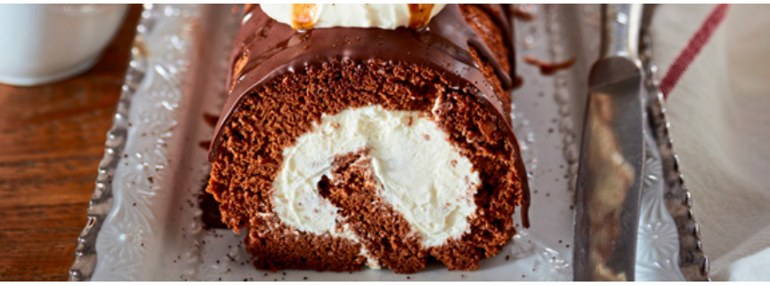

**Ingrediënten voor:** ca. 12 plakken
**Bereidingstijd:** ca. 1 uur en 30 min.
**50 g** amandelmeel
**275 g** pure chocolade
**4** el
brandy of cognac
kaneelpoeder
**6** eieren
**200 g** + 1 el suiker
**375 g** mascarpone
**8 g** vanillesuiker
bakpapier
1 VOOR HET BISCUIT Verwarm de oven voor
(elektrisch: 230°C / hetelucht: 210°C). Rooster
het amandelmeel in een droge pan goudbruin en
neem het uit de pan. Hak 175 g chocolade grof en
smelt hem au bain-marie. Roer 2 el brandewijn en
**1 snufje** kaneelpoeder erdoorheen. Splits de eieren. Klop de eiwitten stijf. Klop de eidooiers met
**100 g** suiker romig. Klop de gesmolten chocolade
erdoorheen. Klop het amandelmeel erdoorheen.
Spatel het eiwitschuim er in porties doorheen.
2 Spreid het beslag gelijkmatig uit over een met
bakpapier beklede bakplaat en bak ca. 8 minuten
in de oven. Bestrooi een schone theedoek met 1 el
suiker. Stort het biscuit erop. Trek het bakpapier
er voorzichtig af. Dek het biscuit af met een licht
vochtige theedoek en laat afkoelen.
3 VOOR DE KARAMELSAUS Smelt 100 g suiker en
karamelliseer. Roer 2 el brandewijn en 2 tl mascarpone erdoorheen. Laat de saus afkoelen.
4 VOOR DE VULLING Klop de overige mascarpone
romig. Klop de vanillesuiker erdoorheen. Houd
**4 el** room apart en bestrijk het afgekoelde biscuit
met de overige room. Rol het biscuit langs de
lange zijde met behulp van de theedoek op. Leg de
rol met de naad naar beneden op een schaal. Hak
100 g chocolade grof en smelt hem au bain-marie.
Laat de chocolade een beetje afkoelen en schenk
hem over de cakerol. Versier met de overige room
en de karamelsaus. Bestuif met kaneelpoeder.
Per plak: ca. 400 kcal
**7 g** eiwit | 26 g vet | 31 g koolhydraten
GEBAK

## Tiramisu-taart

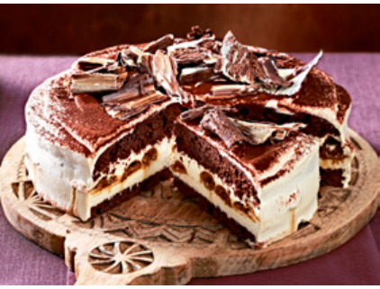

**Ingrediënten voor:** ca. 16 stukken
**Bereidingstijd:** ca. 1 uur en 30 min.
Wachttijd: ca. 3 uur en 30 min.
**100 g** witte chocolade
**200 g** pure chocolade
**4** eieren
**275 g** suiker
**16 g** vanillesuiker
zout
**150 g** bloem (+ bestuiven)
**25 g** cacaopoeder
**8 g** bakpoeder
**2 blaadjes** gelatine
**500 g** mascarpone
**75 ml** melk
**1 el** espressopoeder
**450 ml** slagroom
**100 g** amarettini
cacaopoeder
boter of olie (om in te vetten)
1 Hak de witte chocolade en 100 g pure chocolade
apart van elkaar grof en smelt ze in 2 aparte
kommen au bain-marie. Strijk de pure chocolade
dun uit over de onderkant van een bakplaat
en laat afkoelen. Verdeel de witte chocolade
eroverheen en strijk glad. Zet kort in de koelkast
tot de chocolade een beetje harder wordt.
Schraap met een (palet)mes rolletjes van de
chocolade.
2 Verwarm de oven voor (elektrisch: 180°C /
hetelucht: 160°C). Hak 100 g pure chocolade
grof en smelt hem au bain-marie. Laat ca.
5 minuten afkoelen. Splits de eieren. Klop de
eiwitten met 5 el water stijf en klop 125 g suiker,
8 g vanillesuiker en 1 snufje zout erdoorheen.
Klop de eidooiers er één voor één doorheen.
Klop de gesmolten chocolade er beetje bij beetje
doorheen. Meng de bloem met het cacaopoeder
en het bakpoeder en spatel het mengsel er
voorzichtig doorheen.
3 Schep het beslag in een ingevette en met bloem
bestoven springvorm (26 cm Ø) en strijk glad. Bak
ca. 20 minuten in de oven. Laat afkoelen.
4 Week de gelatine in koud water. Klop de
mascarpone met 150 g suiker. Breng de melk
aan de kook en los het espressopoeder erin op.
Laat een beetje afkoelen. Knijp de gelatine uit
en los hem in 3 el espressomelk op. Klop 250 ml
slagroom stijf. Roer 2 el mascarpone door de
gelatinemelk. Klop het gelatinemengsel door
de overige mascarpone. Spatel de slagroom
erdoorheen.
5 Zet 1 el espressomelk apart. Druppel de overige
espressomelk over de amarettini. Verwijder de
springvormring en snijd het biscuit horizontaal
door. Sluit om de onderste laag de springvorming.
Verdeel de helft van de room eroverheen. Verdeel
de amarettini eroverheen. Verdeel de overige
room eroverheen. Leg de bovenste biscuitlaag
erbovenop. Zet ca. 2 uur in de koelkast.
6 Klop 200 ml slagroom met 8 g vanillesuiker
en 1 el espressomelk stijf. Bestrijk de taart er
rondom mee. Zet ca. 15 minuten in de koelkast.
Bestuif met cacaopoeder en versier met de
chocoladerolletjes.
**Per stuk:** ca. 480 kcal
**7 g** eiwit | 31 g vet | 43 g koolhydraten
GEBAK

# Oostenrijk

## VERFIJND & CULINAIR

Oostenrijk staat onder meer bekend om de glooiende wijngebieden in
Niederösterreich en het vlakkere Burgerland. Ook de talrijke meren in Steiermark,
het groene hart van Oostenrijk, hebben met alle verse vis hun stempel gedrukt op
dit deel van de Oostenrijkse keuken. Maar welke pareltjes vind je er nog meer?
© Netzwerk Kulinarik / Robert Herbst (pov.at)
© Netzwerk Kulinarik / Martina Siebenhandl
Langs de oliemolenaar
Zonnebloemolie en olijfolie staan bij de meeste mensen wel in hun
keukenkastje. Maar Georg Gilli produceert in zijn oliemolen in deelstaat
Niederösterreich naast deze klassiekers ook hele andere oliën. Van
koudgeperste biologische pompoenpitolie en saffloerolie tot oliën
gemaakt van lijnzaad, dederzaad en hennep. “Lijnzaad is bijvoorbeeld
een echte smaakbom: het smaakt naar groene erwten of asperges en
heeft een nogal nootachtige smaak.” Hoe je hem gebruikt? “Lijnzaadolie
is mijn ontbijtolie. Hij staat altijd op tafel. Lekker met muesli en yoghurt
of in een smoothie.” Trots voegt hij toe: “Alle ingrediënten voor mijn
oliën komen van regionale boeren die niet meer dan dertig kilometer
verderop wonen. Zo stimuleer ik de lokale landbouw en kan ik een
product verkopen waar ik honderd procent achter sta.”
Je vindt aÖ Iss Dialekt in de deelstaat
Niederösterreich, neem alvast een kijkje op
iss-dialekt.at
Tussen de varkentjes
Bij het Neusiedler See in Burgenland, midden in het dorp Frauenkirchen,
staat de biologische boerderij en boerderijwinkel van Josef en Elena Göltl.
“Ik ben vooral verantwoordelijk voor de dieren”, legt Josef uit. Zijn vrouw
Elena maakt in de eigen keuken onder meer de ‘Crema di Lardo’, een
smeersel op basis van het witte lardo-rugspek van de mangalitza-varkens,
op smaak gebracht met verse knoflook en gedroogde tomaten van de eigen
boerderij. In de boerderijwinkel van de Göltls vind je allerlei specialiteiten,
zoals geperste worst, die al generaties lang volgens een traditioneel recept
door de familie zelf wordt gemaakt. Maar ook bloedworst, leverworst,
braadworst, ham, salami en diverse smeersels. Terwijl Josef de dikke vacht
van een wollig varken aait, legt hij uit: “Het is voor mij heel belangrijk om
mijn varkens op uitgestrekte weiden in de open lucht te laten lopen, en ze
natuurlijke voeding te geven en met liefde te behandelen.” De bioboer vertelt
je graag het verhaal achter zijn dieren en producten en je bent welkom voor
een proeverij in zijn boerderijwinkel.
Je vindt Bioboerderij Göltl in deelstaat Burgerland
en online op www.goejo.at
© Netzwerk Kulinarik / Robert Herbst (pov.at)
Internationaal Oostenrijks
Voor een bijzonder stukje fusion ben je op het
juiste adres bij de Kohlröserlhütte midden in het
natuurreservaat Ödensee in het Ausseerland Salzkammergut. Manfred Mayers reislust ligt aan de
basis van zijn fascinatie om internationale gerechten
met producten uit eigen streek na te maken. Zoals
‘Schotse’ gin, gemaakt van de kruiden die rond de
Ödensee groeien, maar ook Steiermarkse sushi:
“Behalve zalm gebruiken we hier forel uit Bad
Aussee voor, de rijst komt uit Oost-Oostenrijk en het
algenblad vervangen we door inheems slablad”, legt
Manfred uit. Ook zijn teriyaki heeft een Oostenrijks
tintje, want de daarin verwerkte forel komt uit de
streek. “We houden van experimenteren en daarom
hebben we in de Kohlröserlhütte iedere week andere
culinaire verrassingen.” Overigens staat er voor
lie ebbers van schnitzel en kaiserschmarren ook
het nodige op de kaart op deze prachtige locatie met
uitzicht op het meer.
Je vindt de Kohlröserlhütte in
deelstaat Steiermark en online
op genussamsee.com
© Gasthaus zur Dankbarkeit / Steve Haider
VAKANTIE IN OOSTENRIJK
Pannonische keuken?
Als je in Oostenrijk in de deelstaat Burgenland
op zoek gaat naar een lekker restaurant, kom je
zonder twijfel het woord ‘Pannonisch’ tegen als je
een menukaart bekijkt. Waar het woord vandaan
komt? In Burgenland vind je de westerse uitloper
van de zonnige ‘Pannonische laagvlakte’. Behalve
dat je hier in je vakantie dus lekker de zon kunt
opzoeken, heeft dit invloed op de lokale keuken. Zo
grazen er in dit gebied stepperunderen, mangalitzavarkens en ganzen en groeien paprika’s, tomaten en
chilipepers. De paprika’s vind je bijvoorbeeld terug
in de bekende 'Burgenländische Krautsuppe' en de
‘Pannonische Fischsuppe’, een gerecht met paprika
en snoekbaars of meerval uit de Neusiedler See. Het
bijzondere klimaat en de invloeden van de Slavische
en Hongaarse keukens zijn terug te vinden in de
Pannonische gerechten. Wil je echt Pannonisch eten?
Dan ben je aan het juiste adres bij chef-kok Josef
Roiss van Gasthaus zur Dankbarkeit.
Je vindt Gasthaus zur Dankbarkeit in
deelstaat Burgenland en online op
dankbarkeit.at
Meer ontdekken over culinair Oostenrijk?
Van handige tips tot leuke verhalen, kijk op austria.info/culinair
}KOKEN & GENIETEN
© Gasthaus zur Dankbarkeit / Steve Haider
© Genuss am See GmbH

# receptenindex

• HETPERFECTEKERSTMENU
Voor- en bijgerechten
• HETPERFECTEKERSTMENU
• HETPERFECTEKERSTMENU
Een heleboel inspiratie voor een
Aardappels in spek 43
Een heleboel inspiratie voor een
Aardappelsalade met
Een heleboel inspiratie voor een
receptenindex december
knapperig gebakken ham 38
Appel-selderijsoep met spek 24
Hazelnoten-broccoliovenschaaltjes 37
Kikkererwten-pompoensoep 28
Mini-flammkuchen met rode ui,
paddenstoelen en gremolata 12
Zoete-aardappelsalade voor onderweg 30
met granaatappelpitjes 27
Spinazieknoedels met
paddenstoelenragout 12
Varkenshaasje met parmaham, appel en salie 57
Wildzwijnmedaillons met koolraapstamppot,
gebakken uien en spek 32
Zalmfilet met romige
mosterd-dilletopping 47
Zelfgemaakte lekkerbek met groenten 18
Zuurkool met worst 16

## NUMMER

## Het

Hoofdgerechten
Zoet & desserts
Alcoholvrije hot toddy 17
Chocolade mug cake 20
Aziatisch gehaktpannetje met spiegelei 30
Braadstuk met spätzle en veldsla 24
Broccoli-pompoenroerbak met biefstukreepjes 15
Chocolade-cakerol met roomvulling 60
Broodje pulled hert met appel en coleslaw 8
Chocolade-cupcakes met cappuccinotopping 60
Chocolade-perentaart 59
Cantharellen-pompoenlasagne 11
Filipijnse Adobo 52
Gebakken kweepeer met
marsepein-walnotenvulling 19
Gepofte aardappel met kip-chiliroomsaus 54
Gepofte zoete aardappel met roomkaasvulling
Lotusparfait 52
en spek-boontjesdressing 49
Overnight oats met
gekaramelliseerde banaan 37
compleet kerstdiner
Rijstdessert met perzik uit de oven 19
Schwarzwälder-tiramisu-trifle 20
Sinaasappelcustardtaartjes 25
Tiramisu-taart 62
Groenten-linzencurry 15
• WINTERSE COCKTAILS
Kaasknoedels met spitskool 43
Van cranberry mule tot winterse
Kabeljauw met pistachekorst 38
sangria, met deze drankjes zet je
Kip caesar quesadilla 55
een feestelijke sfeer neer
Kip in spek met friet en broccoli 27
Konijnrollade met whiskey-roomsaus 8
• DE MOOISTE & LEKKERSTE
Pasta carbonara met bospaddenstoelen 11
KERSTKOEKJES
Pasta met romige spek-kaassaus 28
Leuk om samen te maken en
Pasta met spruitjes en kip 16
nog leuker om op te eten!
Reerug met spinazie 7

## IN HET

Snelle courgettepizza

## kerstnummer

## verschijnt op

## 15 november 2022

= Zonder vlees en vis
= Snel klaar (max. 30 min.)
De verschijningsdata in
België wijken af van de
verschijningsdata in
Nederland.
koken&genieten
VOOR ELKE DAG
Mis geen nummer meer!
Neem nu een abonnement en krijg voortaan elke uitgave
van koken & genieten automatisch in je brievenbus.
Ga naar www.kokengenieten.nl/abo of bel gratis naar +31 (0)24-2027829.
• HETPERFECTEKERSTMENU
Een heleboel inspiratie voor een

# ★

# ★ ★

# ★

# ★
