# 80x

de lekkerste
€ 4,99

# Kerst is...

# samen rond

# de eettafel

koken genieten
extra dik nummer

# gerechten

• Ingelegde zalmforel met gin
• Varkenshaas met sjalotjes
• Tiramisu-ijstaart

# Wereldse

# gerechten

# gerechten

# 80x

de lekkerste
Voor oud & nieuw

# Jouw

# kerstmenu

Mix & Match

# Prijswinnende

# taarten

Uit Heel Holland Bakt
december
2023
€4,99
Kerstfavorieten van Brenda Kookt
BP

# Desnellewegdoorhetblad

Voorgerechten
& bijgerechten
Salades, soepen en
broodjes: lekker als lichte
maaltijd of om je etentje
mee te beginnen.
Carpacciotorentjes 7 Geroerbakte spruitjes
met cranberry en spekjes 7
Tonijntartaar met avocado
en balsamico 8
Ingelegde zalmforel
met gin 34
Salade met geroosterde
aardpeer, peer en bacon 38
Aardpeerroomsoep
met kruidige groentesalsa 37
Hoofdgerechten
Ga je voor snel & makkelijk,
een dagje zonder vlees
of vis of pak je uit met een
weekendproject?
Varkenshaaspakketjes
met parmaham 9
Saltimbocca van tarbot
met saffraanrisotto 16
met boerenkool 52
Worstjes in bier
met savooiekool 53
Entrecote
met kruidige couscous 54
Tiramisu-ijstaart 10
panna-cotta 22
Aardpeer-courgettekoekjes met ei 38
Eend met honing
en speculaaskruiden 16
Spaghetti in kipdragonroomsaus 54
Felroze citroensorbet 21 Kerstige chocolade-
Tiramisu met mandarijn 22
White-Russiantaartjes
Amerikaanse cheesecake
met blauwebessensaus 65
Klassieke opera 71
White-Russiantaartjes 49 Kubus van jocondebiscuit 67 Chateautaart 69
Selderij-vanillesoep
met groentechips 13
Raclette 40
Winterse flammkuchen
Iberico-varkenshaas
wellington 19
Rodebieten-sinaasappelsalade
met rundergehaktballetjes 55
Paddenstoelenijs
met ahornsiroop 28
Zonder
vlees of vis
Snel klaar
(max. 30 min.)
Gember-basilicumcake 48
Uitleg van symbolen bij de recepten
Salade met gerookte
Garnalen
met frisse groenten 14
eendenborst en sherrygelei 14
Romige savooiekool
met spek & tagliatelle 15
Aardappels met mosterd-champignons 53
Roerei met avocado,
chorizo en spek 56
Russische salade 62
Reerolletjes
met crème-de-cassis-saus 20
Crostata van bladerdeeg met
paddenstoelen en ansjovis 27
Zoete aardappel
wellington 31
Snelle gebakken rijst
met garnalen 56
Raviolikoekjes
met marsepein 43
Pina-coladataart 45
Ossenhaas uit Australië 59
Strawberry-daiquiri-taart 45
Thaise noedels
met mango en garnalen 60
Hemelse frambozenlaagjestaart 75
Kerstbûche
Pisco-sourtaart 46
met paddenstoelen 76
Appelstrudelkrans
met kaneel 78
ALLE RECEPTEN OP EEN RIJ
Kruidige paddenstoeldumplings 25
Brickpaddenstoelen 27
Gevulde eieren
met zalm en kaviaar 63
Braziliaanse linzenempanada’s 65
Linzensalade met geitenkaas
en walnoten 32
Balsamicopaddenstoelen
Krans van vruchtenmuffins 80
met parmezaanpuree 32
Duitse middernachtssoep 61
Zoet&nagerechten
Zoet is altijd goed!
Lekker als tussendoortje,
bij de koffie of als
afsluiting van je diner.
Speculaas-cheesecake
met granaatappelgelei 79

# inhoud

Voorwoord

# Zelf

# (w)eten

Ik snap de ophef over pepernoten of kerstkransjes die veel te vroeg in de supermarkt
liggen nooit zo goed. Je hóeft het niet
te kopen. Normaliter lopen we toch ook
zonder te klagen langs de koekjes en de
snoepjes in de supermarkt, maar als het
pepernoten zijn dan maakt iedereen zich er
druk om. Maar misschien ben ik een geval
apart. Ik eet het liefst het hele jaar door
oliebollen bijvoorbeeld, maar dat kan dus
niet. Die kramen komen pas drie weken
voor kerst hun stalling uit. Daar hoor ik dan
overigens weer niemand over. Het punt wat
ik wil maken is: eet wat je wil eten en op
welk moment dan ook. Dus voor de eieren
met zalm en kaviaar (p. 34) hoeft het geen
oudjaarsavond te zijn en de eend met speculaaskruiden (p. 116) smaakt stiekem het
hele jaar door fantastisch. Wie weet wil jij
de komende weken alvast gaan proe oken
met typische kerstgerechten (p. 12). Mijn
zegen heb je!
Yvonne Doorten
**6** Brenda Kookt
Iedere maand kookt Brenda Hoff van
het culiblog Brenda Kookt de lekkerste
gerechten voor ons. Bekijk gauw haar
recepten van deze maand!
**12** Jouw kerstdiner
Gezelligheid, lekker eten en lang tafelen:
daarom kijken we het hele jaar uit naar
kerst. Serveer je gasten één van deze
kerstmenu’s en mix en match wat je lekker
vindt!
**24** Herfst & kerst
De herfst is hét seizoen van de
paddenstoel. In het boek Koken
met paddenstoelen zie je wat je met
paddenstoelen in de keuken kunt. Weleens
ijs van paddenstoelen gemaakt?
**30** Groentefeestje
Een goed stukje vlees is klassiek met
kerst, maar een vegetarisch kerstmenu
is minstens zo lekker. Ga voor een
traditionele wellington in een vegetarisch
jasje of maak een heerlijke linzensalade
met geitenkaas.
**34** Neusje van de zalm
Deze ingelegde zalmforel bewijst dat
geduld een schone zaak is, want wát is
hij lekker! Serveer hem met een heerlijk
mosterd-honing-dillesausje voor een echte
smaaksensatie.
**36** Peertje uit de aarde
Geen aardappel, maar aardpeer is deze
maand in het seizoen. Deze knolletjes
hebben een zachtzoete smaak die een
beetje doet denken aan artisjok. Probeer
ze eens uit in deze recepten.
**40** Raclettefeestje
Maak van racletten je nieuwe kersttraditie
en maak eens een van deze vier heerlijke
raclettegerechtjes, of maak ze gewoon
allemaal.
Elke maand de
koken & genieten als eerste
in de brievenbus? Kijk op
of blader naar
www.kokengenieten.nl/abo
p. 50.

# inhoud

**42** 3x kerstkoekjes
De leukste cadeautjes zijn eetbaar. Maak
het basisrecept voor koekjesdeeg en je
hebt binnen een handomdraai drie soorten
koekjes om uit te delen.
**44** Happy-hourtaarten
Deze taarten zijn stuk voor stuk gebaseerd
op je favoriete cocktails. Serveer de taart
met de bijpassende cocktail en het is
meteen een feestje.
**52** Simpel en snel genieten
Het is al druk genoeg met werk, kinderen
en hobby’s. Hier is de oplossing voor
iedereen die geen tijd heeft om uitgebreid
te koken, maar toch lekker wil eten.
**58** Happy New Year!
Over de hele wereld vieren ze nieuwjaar,
al is dat soms een paar uur eerder of later
dan wij dat doen. Vier het nieuwe jaar met
deze feestelijke internationale gerechten.
**66** Heel Holland Bakt
met kerst
Het beste van 10 jaar Heel Holland Bakt,
met daarin de lekkerste en mooiste
recepten van de afgelopen 10 jaar. Wat is
nou een beter moment om deze te bakken
dan met kerst?
**74** Feestelijke taarten
Bak deze kerst de allerlekkerste én
mooiste taarten. Ga jij als eerste voor
de zoete kerstbûche of de prachtige
kerstkrans van vruchtenmuffins?
**82** Index & volgend
Alle recepten van deze uitgave op een rij én
een vooruitblik op volgende maand.

## ABONNEMENT

INHOUD

# In het seizoen...

# aardpeer

## Wat is het?

Dit enigszins onooglijke knolletje staat bekend als de
aardpeer en is oorspronkelijk afkomstig uit Noord- en
Zuid-Amerika. Hoewel de knol tegenwoordig een beetje
in de vergetelheid is geraakt, was hij enkele eeuwen
geleden een van de populairste groentes in Europa.
Hoewel ze geen familie zijn, groeit de aardpeer net als
de aardappel onder de grond; boven de grond heeft
de plant gele bloemen die lijken op zonnebloemen. De
aardpeer zelf lijkt qua vorm een beetje op gember en kan
vers roze of wit zijn. Na blootstelling aan de buitenlucht
worden de knollen bruin.

## Wat kun je ermee?

Aardperen zijn heel veelzijdig en kunnen verwerkt
worden in allerlei gerechten. Zo kun je er soep van
maken (kijk maar eens op p. 37 voor een recept voor
aardpeerroomsoep), ze roosteren in de oven, ze koken
en bakken. Verse aardpeer kan ook rauw worden
gegeten en is lekker knapperig. Je hoeft aardperen voor
gebruik niet te schillen, maar maak de schil wel goed
schoon met een borsteltje.

## Hoe kan je het vervangen?

Als je niet van aardpeer houdt of hij niet verkrijgbaar
is, kun je ook pastinaak, aardappel of knolselderij
gebruiken. Houd er wel rekening mee dat het
eindresultaat en de bereidingstijd dan kunnen afwijken.

## Waar smaakt het naar?

Aardperen hebben een notige, lichtzoete smaak. De
smaak van aardpeer kan ook doen denken aan die van
artisjok of kastanje.

## Hoe moet ik het bewaren?

Aardperen zijn het lekkerst wanneer je ze direct uit de
grond opeet (wel eerst schoonmaken natuurlijk), maar
niet iedereen heeft een moestuin om aardperen in te
telen. Als je aardperen uit de winkel koopt, dan kun je
ze maximaal 7 dagen in een papieren zak in de koelkast
bewaren.

# Brenda’s

# kerstmenu

Iedere maand deelt Brenda Hoff van de website Brenda Kookt de
lekkerste recepten met ons. Altijd makkelijk én met ingrediënten uit
het seizoen. Deze kerst kook je een heerlijk driegangenmenu, met
tonijntartaar, varkenshaaspakketjes en uiteraard de prachtige tiramisuijstaart van de cover.
www.brendakookt.nl | @brendakookt op Instagram
Fotografie en receptuur: Brenda Kookt

## Carpacciotorentjes

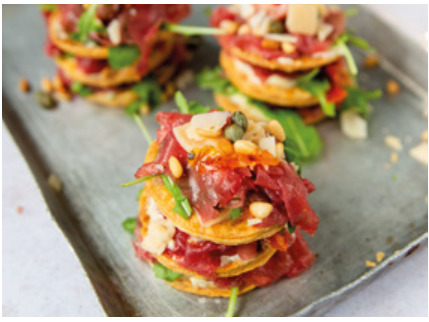

**Ingrediënten voor:** 4 personen
**Bereidingstijd:** ca. 50 min.
**1** rol bladerdeeg (ca. 230 g)
**2 el** pijnboompitjes
**60 g** spekreepjes
**4 el** truffelmayonaise
**2** porties carpacciovlees
klein handje rucola
Parmezaansekaassnippers
2 el zongedroogde tomaatjes,
in stukjes
**2 tl** kappertjes
bakpapier
steker van 4 cm Ø
1 Verwarm de oven voor (elektrisch: 200⁰C /
hetelucht: 180⁰C). Bekleed een bakplaat met
bakpapier. Steek met de steker 12 cirkels uit
het bladerdeeg. Prik met een vork gaatjes
in de cirkels. Leg ze op het bakpapier en
leg er een bakplaat bovenop, zodat het
bladerdeeg plat blijft tijdens het bakken. Bak
20-25 minuten in de oven en neem na ca.
15 minuten de bakplaat van het bladerdeeg
af. Laat de bladerdeegcirkels afkoelen.
2 Rooster de pijnboompitjes in een
koekenpan goudbruin en neem ze uit de
pan. Bak in dezelfde koekenpan de spekjes
goudbruin en krokant.
3 Beleg 4 bladerdeegcirkels met wat
truffelmayonaise, wat carpacciovlees, een
paar blaadjes rucola, wat kaassnippers, wat
gebakken spekjes, wat stukjes tomaat, wat
kappertjes en wat pijnboompitjes. Leg er
een bladerdeegcirkel bovenop en verdeel
hierover dezelfde ingrediënten. Herhaal deze
stap met de laatste bladerdeegcirkels en
ingrediënten. Serveer direct.
**Per portie:** ca. 724 kcal
**20 g** eiwit | 56 g vet | 33 g koolhydraten

## Geroerbakte spruitjes

## met cranberry en spekjes

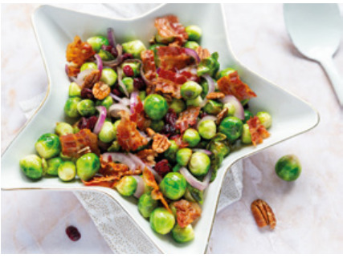

**Ingrediënten voor:** 4 personen
**Bereidingstijd:** ca. 25 min.
**500 g** spruitjes
**1** rode ui, in halve ringen
olijfolie, om in te bakken
**3 el** gedroogde cranberry’s
**2** handjes pecannoten
zout en peper
**6** plakken ontbijtspek
1 Snijd de onderkanten van de spruitjes en verwijder de losse blaadjes. Was de spruitjes en zet
ze met een bodem water op het vuur. Kook de
spruitjes in 5-10 minuten beetgaar.
BRENDA KOOKT
2 Fruit de ui in een koekenpan met wat olijfolie.
Voeg de gekookte spruitjes, de cranberry’s en de
pecannoten toe en bak even mee. Breng op smaak
met zout en peper.
3 Bak in een andere, droge koekenpan het spek
goudbruin. Snijd het spek in stukken en meng
door de spruitjes. Serveer de geroerbakte sprui�tjes als bijgerecht.
**Per portie:** ca. 279 kcal
**7 g** eiwit | 20 g vet | 15 g koolhydraten

## Tonijntartaar

## met avocado en balsamico

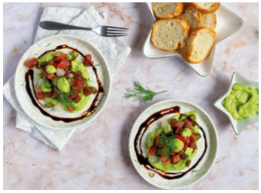

**Ingrediënten voor:** 4 personen
**Bereidingstijd:** ca. 20 min.
**1** ciabatta (afbak)
**2 el** olijfolie
zout en peper
**2** avocado’s
**1** limoen, uitgeperst
**¼ tl** wasabicrème
**300 g** verse tonijn, fijngesneden
**3 el** zilveruitjes, in stukjes
**8** mini-augurkjes, in stukjes
1
tomaat, zaadlijsten verwijderd
en vruchtvlees in blokjes
**4 takjes** dille, fijngesneden
balsamicocrème
bakpapier
1 Verwarm de oven voor (elektrisch: 200⁰C /
hetelucht: 180⁰C). Bekleed een bakplaat met
bakpapier. Snijd de ciabatta in dunne plakjes.
Besprenkel ze met de olie en bestrooi met zout
en peper. Rooster de ciabatta 6-8 minuten goudgeel en krokant in de oven. Laat de ciabattatoast
afkoelen tot kamertemperatuur.
2 Halveer de avocado’s, verwijder de pit en schep
het vruchtvlees eruit. Pureer met een staafmixer
¾ van de avocado samen met het limoensap en
de wasabicrème tot een egale massa. Breng op
smaak met zout en peper. Snijd de rest van de
avocado in kleine blokjes.
3 Houd van de zilveruitjes en de dille een klein
beetje apart voor de garnering. Meng in een kom
de tonijn met de zilveruitjes, de augurk, de tomatenblokjes en de dille en roer 1 el balsamicocrème
erdoorheen.
4 Schep 1 el van de avocadocrème op een bord en
smeer het een beetje uit met de achterkant van
een lepel. Schep het tartaarmengsel erbovenop.
5 Garneer de tartaar met blokjes avocado, een
zilveruitje, verse dille en eventueel extra avocadocrème. Serveer de ciabattatoast erbij.
**Per portie:** ca. 472 kcal
**26 g** eiwit | 23 g vet | 36 g koolhydraten

## Varkenshaaspakketjes

## met parmaham

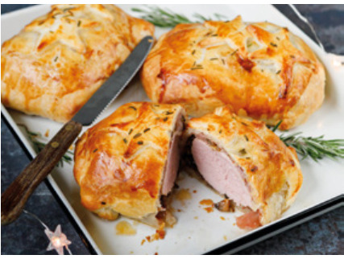

**Ingrediënten voor:** 4 personen
**Bereidingstijd:** ca. 45 min.
**2** varkenshaasjes (à 250 g)
zout en peper
boter, om in te bakken
**4** sjalotjes, gesnipperd
**200 g** champignons, fijngesneden
**1 takje** rozemarijn, naaldjes gerist
en fijngesneden + extra
**2 el** balsamicoazijn
**8** plakken parmaham
**8 plakjes** bladerdeeg, ontdooid
+ evt. extra
**1** ei, geklutst
evt. 2 satéprikkers
evt. steker in stervorm
bakpapier
evt. kernthermometer
1 Breng de varkenshaas op smaak met zout en
peper. Heeft het stuk vlees een dunne kant? Vouw
dit dan om en zet vast met een satéprikker, zodat
het vlees overal dezelfde dikte heeft.
2 Verwarm wat boter in een koekenpan en bak
hierin de varkenshaas rondom aan beide kanten
ca. 2 minuten. Neem het vlees uit de pan en laat
afkoelen. Neem de eventuele satéprikker eruit.
3 Doe nog wat boter in de pan en fruit de sjalotjes
erin. Voeg de champignons, de rozemarijn en
de balsamicoazijn toe en bak mee tot het vocht
verdampt is.
4 Leg de plakjes parmaham met 4 plakjes
naast elkaar op je werkblad. Verdeel hierover
de helft van het champignonmengsel en leg er
een varkenshaasje op. Rol de varkenshaas in
de parmaham. Herhaal met de rest van de ham,
het champignonmengsel en het varkenshaasje.
Snijd de rolletjes een keer door, zodat je 4 gelijke
stukken hebt.
5 Druk steeds 2 plakjes bladerdeeg met de
randjes tegen elkaar, zodat je 4 grotere plakken
bladerdeeg hebt. Leg de stukken varkenshaas in
parmaham op het bladerdeeg en verpak ze helemaal in het deeg.
6 Steek eventueel sterren uit het extra bladerdeeg en versier de varkenshaaspakketjes ermee.
Als je het gerecht van tevoren maakt kun je het
nu afgedekt met vershoudfolie maximaal 8 uur in
de koelkast bewaren. Wil je het langer bewaren?
Vries de pakketjes dan in (zie tip).
7 Verwarm de oven voor (elektrisch: 200⁰C / hetelucht: 180⁰C). Bestrijk de bladerdeegpakketjes
BRENDA KOOKT
Tip: Je kunt de

## varkenshaaspakketjes

ook van tevoren maken en
invriezen. Zo hoef je ze op de
dag van het kerstdiner alleen in de
oven af te bakken. Bak de pakketjes in dat geval in totaal
30-35 minuten.
met het ei en bestrooi met fijngesneden rozemarijn. Bekleed een bakplaat met bakpapier en leg
de pakketjes erop.
8 Bak de varkenshaaspakketjes 20-25 minuten in
de oven, of tot een kerntemperatuur van 60⁰C.
**Per portie:** ca. 897 kcal
**45 g** eiwit | 59 g vet | 44 g koolhydraten

## Tiramisu-ijstaart

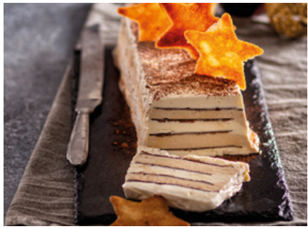

**Ingrediënten voor:** 10-12 personen
**Bereidingstijd:** ca. 1 uur + minimaal 6 uur en
**30** min. wachttijd
Voor de sterrenkoekjes
**40 g** boter, gesmolten
**40 g** poedersuiker
snufje zout
**45 g** bloem
**1** eiwit
bakpapier
Voor de ijstaart
**250 g** pure chocolade, fijngehakt
**250 ml** slagroom
**1 zakje** vanillesuiker (à 8 g)
**250 g** mascarpone
**200 g** gecondenseerde melk
**2 el** oploskoffie
koffiepoeder of cacaopoeder,
om te garneren
sterrenkoekjes
cakevorm (25 cm)
evt. 2 spuitzakken
vershoudfolie

## Cover

## recept

1 VOOR DE STERRENKOEKJES Smelt de boter in een kom; hij hoeft niet
helemaal gesmolten te zijn, als je hem maar makkelijk kan losroeren. Roer de
poedersuiker en het zout door de boter met een garde. Zeef de bloem erboven
en roer glad met een garde. Roer als laatste het eiwit erdoorheen tot een glad
beslag. Zet afgedekt ca. 30 minuten in de koelkast.
2 Verwarm de oven voor (elektrisch: 160°C / hetelucht: 140°C). Strijk met een
paletmes het beslag dun uit in een stervormige mal of maak eenvoudig cirkels
met de bolle kant van een lepel op een met bakpapier beklede bakplaat. Bak in
de oven in ca. 10 minuten goudbruin. Bak de koekjes vooral niet te donker, dan
smaken ze snel bitter. Laat de koekjes afkoelen terwijl je verdergaat met de
ijstaart.
3 VOOR DE IJSTAART Smelt 150 g chocolade au bain-marie of in de magnetron.
Roer de rest van de chocolade erdoorheen tot hij gesmolten is.
4 Leg een aantal vellen bakpapier op je werkblad en zet de cakevorm erop. Teken
de omtrek van de vorm 6 keer op het papier. Verdeel met een lepel een dun laagje
chocolade in elk sjabloon en strijk dun uit. Laat de chocolade uitharden.
5 Meng de slagroom met de vanillesuiker en klop stijf. Roer de mascarpone
los en meng met de gecondenseerde melk door de slagroom. Verdeel
het slagroommengsel in 2 kommen. Roer door een helft van het
slagroommengsel de oploskoffie. Doe het mengsel eventueel in
2 spuitzakken.
6 Bekleed de binnenkant van de cakevorm met vershoudfolie, zodat je
de ijstaart straks makkelijk uit de vorm kunt nemen. Verdeel ¼ van
het witte slagroommengsel over de bovenkant van de cakevorm.
Leg een plakje chocolade erbovenop. Verdeel hierover ¼ van het
koffie-slagroommengsel. Leg hier weer een plakje chocolade
op. Herhaal met de rest van de slagroommengsels en plakjes
chocolade.
7 Bedek de bovenkant van de cakevorm met vershoudfolie
en zet de ijstaart minimaal 6 uur, maar liever 12
uur, in de diepvries. Langer mag ook. Garneer met
koffiepoeder of cacaopoeder en je zelfgebakken
sterrenkoekjes (zie tip).
Per portie (10): ca. 464 kcal
**7 g** eiwit | 34 g vet | 31 g koolhydraten
BRENDA KOOKT
Tips:
Maak deze taart ook
eens in een stervorm.
Je kunt ook koekjes naar
keuze van de winkel
gebruiken.
SEIZOEN

# Jouw kerstdiner

Gezelligheid, lekker eten en lang tafelen: daarom
kijken we het hele jaar uit naar kerst. Met deze
voor-, hoofd-, bij- én nagerechten heb je volop
inspiratie voor je diner.

## Selderij-vanillesoep

## met groentechips

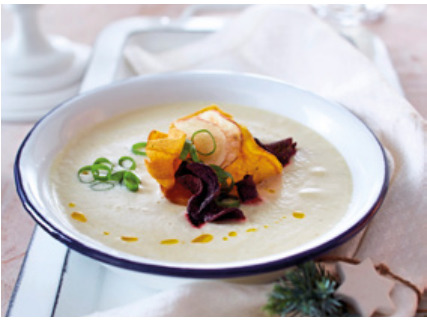

**Ingrediënten voor:** 4 personen
**Bereidingstijd:** ca. 30 min.
**2** lente-uitjes
**1 el** boter
½ vanillestokje, gehalveerd in de
lengte
**600 g** knolselderij, geschild en in
blokjes
**100 ml** droge witte wijn
**200 ml** appelsap
**200 ml** slagroom
zout en peper
nootmuskaat
**40 g** groentechips, kant-en-klaar
**2 tl** olijfolie
1 Was de lente-uitjes en snijd het witte en groene
deel apart in ringen. Verhit de boter in een
koekenpan en fruit de witte lente-uiringen, het
vanillestokje en de knolselderij ca. 5 minuten
erin. Schenk de witte wijn, het appelsap en
**300 ml** water erbij. Breng aan de kook en kook
afgedekt ca. 15 minuten op laag vuur.
2 Neem het vanillestokje eruit, schenk de
slagroom bij de soep en pureer de soep fijn.
Breng op smaak met zout, peper en nootmuskaat.
3 Serveer de soep met de groentechips en
bestrooi met de groene lente-uiringen.
Besprenkel met 2 tl olijfolie.
**Per portie:** ca. 355 kcal
**5 g** eiwit | 25 g vet | 18 g koolhydraten
Voorgerecht

## Salade met gerookte

## eendenborst en sherrygelei

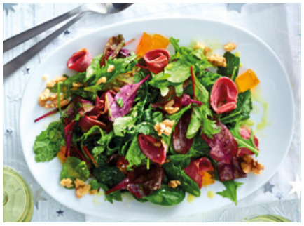

**Ingrediënten voor:** 6 personen
**Bereidingstijd:** ca. 30 min. + ca. 2 uur wachttijd
Week 2 blaadjes gelatine in water. Breng 150 ml sherry en 5 el appelgelei
(pot) in een pan aan de kook. Laat een beetje afkoelen. Knijp de gelatine uit
en los hem op in het sherrymengsel. verdeel de gelei in een kleine rechthoekige vorm en zet ca. 2 uur in de koelkast. Was 200 g gemengde sla. Hak 4 el
walnoten en rooster ze in een droge pan. Neem ze uit de pan. Was 4 takjes
peterselie en hak ze fijn. Roer de peterselie, 4 el sherryazijn, 2 tl mosterd
en 4 el olijfolie door elkaar. Breng op smaak met zout en peper. Meng de sla
met de vinaigrette. Doop de vorm met de gelei in heet water. Stort de gelei
en snijd hem in blokjes. Serveer de sla met 200 g gerookte eendenborst in
plakken en de sherrygelei. Bestrooi met de walnoten.

## Garnalen met frisse groenten

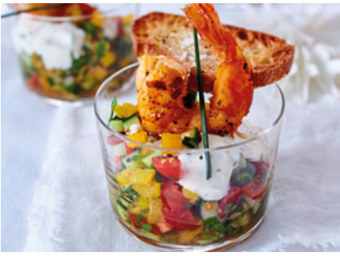

**Ingrediënten voor:** 8 personen
**Bereidingstijd:** ca. 30 min.
Was ½ bosje bieslook en snijd hem in rolletjes. Roer 150 ml volle yoghurt,
**1 el** mierikswortel (pot), 1 el mosterd, een snufje suiker, de bieslook en 2 tl
citroensap door elkaar. Breng op smaak met zout en peper. Was 1 snackkomkommer, halveer hem in de lengte, verwijder de zaadlijsten en snijd
hem in blokjes. Halveer 1 gele paprika, verwijder de zaadlijsten, was hem en
snijd hem in blokjes. Was 150 g cherrytomaten en snijd ze in blokjes. Was
**4 takjes** peterselie en hak ze fijn. Meng de peterselie, de groenteblokjes, 2 tl
citroensap, zout en peper. Bak 8 panklare garnalen (à ca. 40 g, zonder kop
en schaal) in 2 el hete olijfolie ca. 3 minuten. Breng op smaak met zout en
peper. Serveer alles samen. Lekker met stokbrood.

## Romige savooiekool met spek

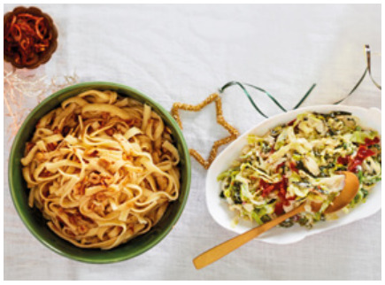

**Ingrediënten voor:** 6 personen
**Bereidingstijd:** ca. 45 min.
**1,2 kg** savooiekool
**1** prei
**6** dunne plakken spek
(ca. 80 g)
**3 el** boter
zout en peper
nootmuskaat
**1 tl** bloem
**200 ml** slagroom
1 Was de kool, snijd hem in vieren en snijd hem in dunne reepjes van de
stronk. Was de prei en snijd hem in dunne ringen. Snijd het spek in dunne
reepjes. Verhit de boter in een ruime pan. Bak er het spek knapperig in. Voeg
de kool en de prei toe en fruit ca. 10 minuten op laag vuur. Breng op smaak
met zout, peper en nootmuskaat.
2 Bestuif de kool met de bloem en bak kort. Blus af met de slagroom en 100
ml water, breng aan de kook en kook afgedekt ca. 20 minuten op laag vuur.
Breng de kool op smaak met zout en peper.
**Per portie:** ca. 260 kcal
**8 g** eiwit | 17 g vet | 16 g koolhydraten

## Tagliatelle met geroosterde noten

**Ingrediënten voor:** 6 personen
**Bereidingstijd:** ca. 25 min.
**50 g** hazelnootschaafsel
**4 el** boter
**750 g** verse tagliatelle
(koelvak)
zout
nootmuskaat
1 Rooster het hazelnootschaafsel in een droge pan goudbruin. Neem het uit
de pan. Verhit de boter in de pan. Bak er de tagliatelle al roerend ca. 5 minuten in.
2 Bestrooi met het hazelnootschaafsel een meng goed. Breng op smaak met
zout en nootmuskaat.
**Per portie:** ca. 460 kcal
**9 g** eiwit | 14 g vet | 72 g koolhydraten

## Kruidige gebakken uitjes

**Ingrediënten voor:** 6 personen
**Bereidingstijd:** ca. 15 min.
Pel 6 uien, snijd ze in ringen en bestuif ze
met 1 tl paprikapoeder. Verhit 2 el olie in een
pan. Bak er de ui knapperig in. Neem de ui uit
de pan en laat uitlekken.
Bijgerecht

## SEIZOEN

**Ingrediënten voor:** 4 personen
**Bereidingstijd:** ca. 50 min.
**800 g** tarbotfilet zonder huid (bij de
viswinkel)
zout en peper
rasp en sap van ½ bio-citroen
**4 takjes** salie
**8** plakken parmaham
**800 ml** groentebouillon
**2** sjalotjes
**3 el** boter
**250 g** risottorijst
een snufje saffraan
**100 ml** witte wijn
**500 g** sperziebonen
**300 g** cherrytomaten
**2 el** truffelboter
**2 el** olie
**50 g** geraspte parmezaan
keukenpapier
1 VOOR DE SALTIMBOCCA Snijd de tarbotfilet in
8 stukken en bestrooi met zout, peper, citroenrasp en citroensap. Was de salie en neem de
blaadjes van de takjes. Leg op elk stuk tarbotfilet
**2 blaadjes** salie en wikkel elk stuk in een plak
parmaham. Houd de overige salie apart.
2 VOOR DE RISOTTO Verhit de bouillon. Pel en
snipper de sjalotjes. Verhit 2 el boter in een ruime
Hoofdgerecht
pan. Fruit er de sjalotjes in. Voeg de rijst toe en
bak kort. Breng op smaak met peper. Roer de
saffraan erdoorheen. Schenk al roerend beetje bij
beetje de wijn en de bouillon erbij tot al het vocht
opgenomen is. Gaar in totaal 30-35 minuten.
3 VOOR DE GROENTEN Maak de sperziebonen
schoon en kook ze in water met een snufje zout in
ca. 8 minuten gaar. Was de cherrytomaten. Giet
de bonen af. Verhit de truffelboter in een pan.
Fruit er de bonen en de tomaten ca. 8 minuten in.
Breng op smaak met zout en peper.
4 Verhit de olie in een tweede pan. Bak er de
overige salie in ca. 1 minuut knapperig in. Laat de
salie op keukenpapier uitlekken. Bak de saltimbocca in de hete salieolie ca. 3 minuten per zijde.
Verhit 1 el boter al roerend in het bakvet. Wentel
de saltimbocca erin.
5 Roer de parmezaan door de risotto. Breng op
smaak met zout en peper. Verdeel de risotto over
borden. Verdeel de groenten met het bakvet eroverheen. Leg de saltimbocca erop. Garneer met
de knapperige salie.
**Per portie:** ca. 690 kcal
**63 g** eiwit | 23 g vet | 53 g koolhydraten

## Eend met honing en

## speculaaskruiden

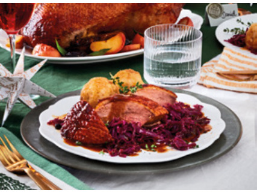

**Ingrediënten voor:** 8 personen
**Bereidingstijd:** ca. 4 uur en 30 min.
**3** zure appels (bijv. elstar)
**300 g** gedroogde pruimen
**1 tl** koek- en speculaaskruiden
**2** uien
**2** wortels
750 g eendenvlees (bijv. vleugeltjes,
niertjes, lever, etc., bestellen bij
de slager)
**2** eenden (à ca. 2,6 kg)
zout en peper
**3 el** honing
**2-3 tl** maizena
cocktailprikkers
keukengaren
1 Schil de appels, snijd ze in vieren, verwijder het
klokhuis en snijd ze appels grof. Meng de appel,
de pruimen en de speculaaskruiden. Was de uien
en de wortels (niet schillen!) en snijd ze grof.
Spoel het eendenvlees kort en dep het droog.
Bestrooi de eenden vanbinnen met zout en vul
ze met het appelmengsel. Prik de openingen vast
met de cocktailprikkers en bind vast met keukengaren. Bestrijk de eenden rondom met de honing
en bestrooi ze met zout.
2 Verwarm de oven voor (elektrisch: 160°C / hetelucht: 140°C). Leg de eenden op een ovenrooster,
schuif ze in de oven en schuif een diepe bakplaat
onder de eenden. Verdeel de ui, de wortel en het
eendenvlees erin. Bak ca. 3 uur en 30 minuten in
de oven. Schenk na ca. 1 uur baktijd 1,5 l water in
de bakplaat en bak verder.
3 Neem de eenden uit de oven en leg ze op een
bakplaat. Neem de diepe bakplaat uit de oven.
Zeef het braadvocht en schenk het in een pan.
Verhoog de temperatuur van de oven (elektrisch:
180°C / hetelucht: 160°C). Schuif de eenden terug
in de oven. Bak de eenden in ca. 45 min.knapperig.
4 Schep het vet van het braadvocht, breng aan de
kook en kook ca. 15 minuten op laag vuur. Roer
de maizena met 3 el water glad, roer het door het
braadvocht en kook ca. 3 minuten op laag vuur.
Breng de jus op smaak met zout en peper.
**Per portie:** ca. 740 kcal
**80 g** eiwit | 42 g vet | 4 g koolhydraten

## Saltimbocca van tarbot

## met saffraanrisotto

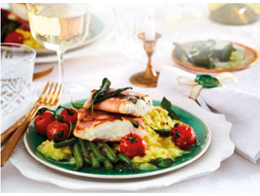

SEIZOEN

## Iberico-varkenshaas wellington

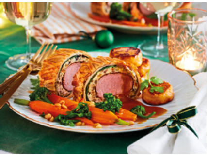

**Ingrediënten voor:** 6 personen
**Bereidingstijd:** ca. 2 uur en 30 min.
**300 g** champignons
**4 el** olie
**2** wortels
**3** uien
**350 g** kipfilet
**200 ml** + 3 el slagroom
**1-2 el** gevriesdroogde peterselie
zout en peper
**250** g
spinazie (bij voorkeur grote
bladeren)
**5** rechthoekige plakken
bladerdeeg (diepvries, à 75 g)
2
iberico-varkenshazen (à ca.
**400** g, bij de slager)
**1** teentje knoflook
1 peterseliewortel (of pastinaak)
**1 tl** tomatenpuree
**8 el** port
**1 l** groentebouillon
**1** eidooier
**2-3 tl** maizena
vlaairuitenroller (bij de
bakwinkel)
bakpapier
1 VOOR DE KIPVULLING Maak de champignons
schoon en snijd ze fijn. Verhit 2 el olie in een
pan. Bak er de champignons ca. 8 minuten in.
Schrap 1 wortel en snijd hem in kleine blokjes. Pel
en snipper 1 ui. Voeg de wortel en de ui toe aan
de champignons en bak ca. 5 minuten. Laat ca.
5 minuten afkoelen. Snijd de kipfilet in blokjes.
Vermaal de kipfilet en 200 ml slagroom in 2 porties fijn. Roer de champignons, de ui en de wortel
erdoorheen. Spatel de peterselie erdoorheen.
Bestrooi met zout en peper.
SEIZOEN
2 Was de spinazie. Blancheer de spinazie in porties ca. 10 seconden in water met een snufje zout.
Laat uitlekken op keukenpapier. Laat het bladerdeeg ontdooien.
3 VOOR HET VLEES Verhit 2 el olie in een pan. Bak
er de varkenshazen ca. 5 minuten op hoog vuur
rondom in. Bestrooi met zout en peper, neem uit
de pan en laat ca. 10 minuten afkoelen. Houd de
pan apart.
4 VOOR DE SAUS Schrap 1 wortel en de peterseliewortel, was ze en snijd ze grof. Pel en snipper
2 uien en de knoflook. Verhit het bakvet. Fruit
er de wortel, de peterseliewortel, de ui en de
knoflook ca. 5 minuten in. Roer de tomatenpuree
erdoorheen en bak kort. Blus af met de port en
breng aan de kook. Schenk de bouillon erbij,
breng aan de kook en kook ca. 20 minuten op laag
vuur tot de helft in.
5 Verwarm de oven voor (elektrisch: 200°C / hetelucht: 180°C). Leg telkens 2 plakken bladerdeeg
op elkaar en rol uit (ca. 20x30 cm). Beleg ze met
de spinazie en dep droog. Verdeel de kipvulling
eroverheen. Leg de varkenshaas in het midden en
rol hem in het deeg. Klap de uiteinden om en druk
ze een beetje aan. Rol de het overige deeg uit (ca.
16x25 cm) en rol de vlaairuitenroller eroverheen.
Halveer de deeglap. Klop de eidooier en 3 el slagroom glad. Bestrijk de wellingtons ermee. Leg het
roosterdeeg er voorzichtig op en bestrijk met het
overige eidooiermengsel. Leg ze op een met bakpapier beklede bakplaat en bak ca. 30 minuten in
de oven.
6 Zeef de saus en schenk hem in een pan. Roer
de maizena met 3 el water glad, roer het mengsel
door de saus en breng aan de kook. Kook ca. 3 minuten op laag vuur. Breng de saus op smaak met
zout en peper. Neem de wellingtons uit de oven en
laat ca. 5 minuten rusten.
**Per portie:** ca. 830 kcal
**52 g** eiwit | 43 g vet | 53 g koolhydraten

## Reerolletjes

## met crème-de-cassis-saus

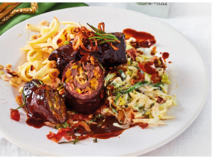

**Ingrediënten voor:** 6 personen
**Bereidingstijd:** ca. 2 uur en 30 min.
**2** augurken
**100 g** gedroogde abrikozen
**1,5** kg
reefilet (vraag de slager om
**12** dunne plakjes van 125 g per
stuk)
zout en peper
**12 tl** mosterd
12 dunne plakken spek (ca. 150 g)
**2 el** olie
**1 el** tomatenpuree
paprikapoeder
**100** ml
crème de cassis
(zwartebessenlikeur)
**1** laurierblaadje
**4** jeneverbessen
**3 tl** maizena
cocktailprikkers
1 VOOR DE ROLLETJES Snijd de augurken en de
abrikozen in kleine blokjes. Leg de reefiletlapjes
op een werkblad. Bestrooi ze met zout en peper.
Bestrijk ze met mosterd en leg de plakjes spek
erop. Verdeel de augurk en de abrikoos eroverheen. Klap de lange zijde een beetje over de vulling. Rol de filetlapjes langs de korte zijde op en
prik ze vast met de cocktailprikkers.
2 Verhit de olie in een braadpan. Bak de rolletjes
er ca. 10 minuten rondom in. Roer de tomatenpuree en 2 tl paprikapoeder erdoorheen en bak
kort. Blus af met de likeur en breng aan de kook.
Schenk ca. 1,2 l water erbij. Voeg het laurierblaadje en de jeneverbessen toe en kook afgedekt ca.
1 uur en 30 minuten op laag vuur.
3 VOOR DE SAUS Spatel de rolletjes uit de braadpan. Roer de maizena met 2 el water glad. Breng
de fond aan de kook, roer de maizena erdoorheen
kook ca. 3 minuten op laag vuur. Breng de saus op
smaak met zout en peper. Serveer de rolletjes met
de saus, de gebakken uitjes, de romige kool en de
tagliatelle (p. 15).
**Per portie:** ca. 400 kcal
**58 g** eiwit | 11 g vet | 14 g koolhydraten

## Felroze citroensorbet

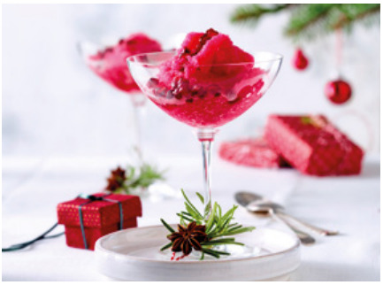

**Ingrediënten voor:** 6 personen
**Bereidingstijd:** ca. 45 min. + 12 uur wachttijd
**2** bio-citroenen
**750 ml** droge witte wijn
**150 ml** grenadinesiroop
**½** granaatappel
Nagerecht
1 Was een dag van tevoren de bio-citroenen met
heet water en rasp de schil er fijn af. Pers de
citroenen uit. Breng het citroensap, de wijn en de
grenadinesiroop in een pan aan de kook en kook
op laag vuur ca. 40 minuten.
2 Schenk het geheel in een vershouddoos met
deksel (ca. 1 l inhoud). Laat afkoelen, sluit af en
zet minimaal 4 uur (maar liever een hele nacht) in
de vriezer. Roer elk uur 1 keer door.
SEIZOEN
3 Neem de sorbet ca. 15 minuten voor het serveren uit de vriezer. Haal de pitjes uit de granaatappel. Garneer de sorbet met de pitjes. Serveer
direct.
**Per portie:** ca. 176 kcal
**0 g** eiwit | 0 g vet | 22 g koolhydraten

## Kerstige chocolade-panna-cotta

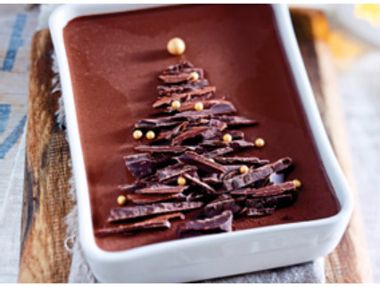

**Ingrediënten voor:** 4 personen
**Bereidingstijd:** ca. 30 min. + minimaal 4 uur wachttijd
Week 4 blaadjes gelatine in water. Hak 50 g pure chocolade. Breng de
chocolade met 400 ml slagroom, 100 ml melk, 8 g vanillesuiker, 2 kardemompeulen, 100 g suiker en 1 el cacaopoeder al roerend aan de kook. Neem
van het vuur en laat ca. 10 minuten trekken. Neem de kardemompeulen
eruit. Knijp de gelatine uit en los hem op in de warme room. Doe de room
in een vorm (ca. 600 ml inhoud). Laat afkoelen. Zet minimaal 4 uur in de
koelkast. Snijd 50 g pure chocolade met een scherp met in lange schilfers.
Versier de pannacotta met de lange snippers in de vorm van een dennenboom. Versier eventueel met gouden suikerparels.

## Tiramisu met mandarijn

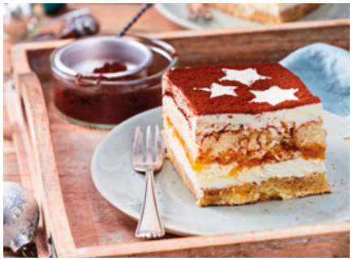

**Ingrediënten voor:** ca. 10 stukken
**Bereidingstijd:** ca. 1 uur en 15 min.
Laat 2 blikjes (à ca. 300 g) mandarijntjes uitlekken en vang het sap hierbij
op. Breng 150 ml sap met 1 tl koek- en speculaaskruiden aan de kook. Roer
**1 tl** maizena met 2 el water glad. Bind het sap ermee. Spatel de mandarijntjes
erdoorheen en laat afkoelen. Roer 100 ml koffie en 6 el amandellikeur door
elkaar. Roer 500 g mascarpone, 500 g volle kwark, 250 ml slagroom, 150 g
suiker en 16 g vanillesuiker glad. Bekleed een grote ovenschaal (ca. 25x35
cm) met 200 g lange vingers. Druppel de helft van het koffiemengsel eroverheen. Verdeel de helft van de room eroverheen. Verdeel de mandarijnencompote eroverheen. Verdeel 200 g lange vingers erop. Druppel het overige
koffiemengsel eroverheen. Bestrijk met de overige room. Leg eventueel en
sterrensjabloon erop en bestuif de tiramisu met 2 el cacaopoeder.

# THE SECRET INGREDIENT IS ALWAYS BUTTER.

## ONTDEK DE SMAAK VAN ECHTE GRASBOTER, GEMAAKT VAN IERSE WEIDEMELK.

## ONTDEK DE SMAAK VAN ECHTE GRASBOTER, GEMAAKT VAN IERSE WEIDEMELK.

## TE VINDEN IN HET KOELSCHAP VAN ALBERT HEIJN, JUMBO EN PLUS.

## TE VINDEN IN HET KOELSCHAP VAN ALBERT HEIJN, JUMBO EN PLUS.

## kerrygold.com/nl : kerrygold_nl

## kerrygold.com/nl : kerrygold_nl

Receptuur & fotografie: Andrea Gentl
KOOKBOEK: KOKEN MET PADDENSTOELEN

# Herfst & kerst

De herfst is hét seizoen van de paddenstoel. In het boek
Koken met paddenstoelen zie je wat je met paddenstoelen in
de keuken kunt doen. Weleens ijs van paddenstoelen gemaakt?

## Kruidige paddenstoeldumplings

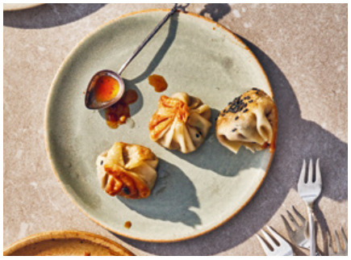

**Ingrediënten voor:** 60 stuks
**Bereidingstijd:** ca. 1 uur
**VOOR DE** PADDENSTOELENMISO
**15 g** gedroogde
paddenstoelen, welke
soort dan ook (zo
droog en breekbaar als
crackers)
**135 g** rode miso
**15 g** koriander, grof gehakt
geraspte schil en sap
van ½ citroen
**300 g** ronde dumplingvellen
zwart sesamzaad, voor
het dippen
**VOOR DE** DUMPLINGS
**2 el** sesamolie
**1** grote sjalot, fijngehakt
**450 g** gemengde verse
shiitakes en eikhaas*
5 cm verse gemberwortel,
geschild en geraspt
**2** teentjes knoflook, fijn
geraspt
**20 g** bosuitjes, grof gehakt
**3 el** donkere sojasaus
**2 el** vissaus
**1 el** ahornsiroop
**¼ tl** chili-knoflooksaus
**120 g** spinazie, brandnetel en
snijbiet, fijngehakt
**15 g** muntblaadjes, grof
gehakt
**VOOR DE** DIPSAUS
**3 el** tamari
**1 el** yuzusap
**1 el** rijstazijn
**1 el** kant-en-klare chiliknoflooksaus
geraspte schil en sap
van ½ bio-citroen
**1 tl** sesamolie
**1 tl** honing
**15 g** bosuitjes, fijngehakt
(optioneel)
VOOR HET BAKKEN EN SERVEREN
neutrale olie
fijngehakte daslook
of (Chinees) bieslook
of koriander
1 VOOR DE PADDENSTOELENMISO Maal de paddenstoelen in een blender of
keukenmachine tot een fijn poeder. Voeg de miso toe en maal verder tot alles
is gemengd en het mengsel glad is. Schep het in een glazen pot en zet die tot
gebruik in de koelkast. De miso is eindeloos houdbaar.
2 VOOR DE DUMPLINGS Verhit de sesamolie op halfhoog vuur in een grote
gietijzeren koeken- of braadpan tot hij gaat glinsteren.
Titel: Koken
met paddenstoelen
Auteur: Andrea Gentl
Prijs: 34,99
Uitgeverij: Terra
Bak de sjalot 3-5 minuten tot hij glazig is en aan de randjes bruin wordt.
Roer de paddenstoelen, gember, knoflook, bosuitjes, sojasaus, vissaus,
**½ el** paddenstoelenmiso, ahornsiroop en chili-knoflooksaus erdoor. Bak de
paddenstoelen 5-7 minuten tot ze zacht zijn; roer af en toe door.
3 Voeg de spinazieblaadjes toe en bak ze 2 minuten mee tot ze zijn geslonken.
Neem de pan van het vuur en laat afkoelen. Voeg de munt, koriander, de rasp en
het sap van de citroen toe, en schep door elkaar.
4 Pak een dumplingvelletje en schep in het midden een volle theelepel van de
vulling. Vouw twee zijkanten samen en plooi en knijp het deeg voorzichtig dicht
om de vulling in te sluiten. Bestrijk de onderkant met een beetje water en doop
die in het zwarte sesamzaad. Leg de dumpling op een bakplaat. Herhaal met de
rest van de vellen en vulling en maak een enkele laag op de bakplaat. Vries de
dumplings op de bakplaat in als je ze niet meteen gebruikt. Stop ze als ze eenmaal
zijn ingevroren in een diepvrieszak en leg ze maximaal zes maanden in de vriezer.
5 VOOR DE DIPSAUS Klop de tamari, het yuzusap, de azijn, chili-knoflooksaus,
schil en het sap van de citroen, de sesamolie en honing in een middelgrote kom
door elkaar. Roer er als je wilt de bosuitjes door.
6 VOOR HET BAKKEN EN SERVEREN Verwarm 1 eetlepel neutrale olie in een
grote gietijzeren of antiaanbakkoekenpan op halfhoog tot laag vuur tot hij gaat
glinsteren. Schik de dumplings in porties in een enkele laag in de pan en bak ze
tot de onderkant bruin wordt. Voeg 60 ml water toe – stap naar achteren tijdens
het schenken en houd een deksel in je andere hand. Het water gaat spetteren,
dus leg het deksel er zo snel mogelijk op.
7 Stoom de dumplings 4 minuten of tot het water is verdampt. Herhaal met
**1 eetlepel** olie en 60 ml water per portie. Garneer de dumplings met het gehakte
daslook en serveer met de dipsaus.
* Kun je geen eikhaas vinden? Vervang het dan door shiitake.

## Crostata van bladerdeeg

## met paddenstoelen en ansjovis

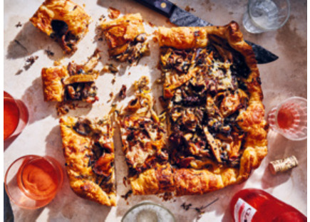

**Ingrediënten voor:** 8-10 personen
**Bereidingstijd:** ca. 1 uur en 10 min.
**60 g** gezouten boter
**1 tl** korianderzaad
**¼ tl** chilivlokken of 1
gedroogde rode
chilipeper, geplet
**1** middelgrote sjalot, in
dunne ringen
**6** witte ansjovisjes
**350 g** gemengde verse
paddenstoelen,
bijgesneden en in
stukjes gescheurd
**60 ml** droge witte wijn
**2 tl** ume su (Japanse
pruimenazijn)*
**50 g** gemengde verse
kruiden, zoals lavas,
oregano, bieslook
prei, in dunne ringen
en grondig gewassen
snuf Himalayazout
tl grof gemalen zwarte
1⁄8
peper
**400 g** roomboterbladerdeeg
(diepvries of koeling)
bloem, om het
bladerdeeg uit de
rollen
**100 g** gruyère, grof geraspt
schil van 1 citroen
**1** grote eidooier
zeezoutvlokken
1 Verwarm de oven tot 230 °C.
2 Verhit de boter in een grote koekenpan op halfhoog vuur tot hij gaat
schuimen en bruin begint te worden. Roer het korianderzaad en de chilivlokken erdoor. Voeg het sjalotje en de ansjovis toe en bak tot de ansjovis
gaat smelten en het sjalotje glazig wordt. Doe de paddenstoelen erbij en
bak ze 3-4 minuten tot ze zacht zijn. Voeg de wijn en azijn toe en verhit
tot ze zijn verdampt. Draai het vuur laag en doe de kruiden, prei, het
Himalayazout en de peper erbij. Neem de pan van het vuur en laat afkoelen.
3 Haal het bladerdeeg voorzichtig uit de verpakking. Mocht het nog te hard
zijn, laat het dan 10 minuten op kamertemperatuur rusten. Leg een stuk
bakpapier op een werkvlak en bestuif het met bloem. Leg losse velletjes
bladerdeeg tegen elkaar aan en druk de randen tegen elkaar. Rol het bladerdeeg een of twee keer voorzichtig uit om de naden goed te laten hechten en rol het dan uit tot een rechthoek van 30-35 cm. Leg het bladerdeeg
met het bakpapier op een grote bakplaat. Bestrooi het met de helft van de
gruyère en laat rondom een rand van 3 cm vrij. Schep het paddenstoelenmengsel erop. Strooi de geraspte citroenschil erover. Strooi de rest van de
kaas over de paddenstoelen, leg er een of twee takjes oregano op en vouw
om een rand te maken de zijkanten om.
4 Klop de eidooier in een kommetje los en bestrijk de randen van het deeg
ermee. Bestrooi het deeg met een beetje zeezoutvlokken. Bak de crostata
20-25 minuten tot de bovenkant goudbruin en krokant is. Strooi er tot slot
nog wat zeezoutvlokken over en serveer warm.
* Kun je geen ume se vinden? Gebruik dan een goede wijnazijn.
KOOKBOEK: KOKEN MET PADDENSTOELEN

## Brick-paddenstoelen

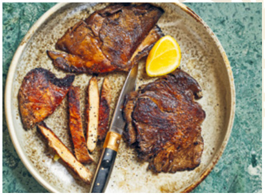

**Ingrediënten voor:** ca. 4 personen
**Bereidingstijd:** ca. 25 min.
**½ tl** Himalayazout
**½ tl** gekneusde zwarte
peper
**1** el
extra vergine olijfolie
**700 g** verse paddenstoelen
zoals oesterzwammen,
eikhaas,pruikzwammen
of portobello’s (een
groot stuk of meerdere
middelgrote stukken)
**2 tl** kappertjes, afgespoeld
als ze op zout zijn
ingelegd
1
citroen, in partjes voor
erbij
1 Meng het zout en de peper in een kommetje.
2 Verwarm de olijfolie in een grote gietijzeren koekenpan op halfhoog tot
laag vuur tot hij gaat glinsteren. Leg de paddenstoelen in de pan en bestrooi
ze met de helft van het zout-en-pepermengsel en de helft van de kappertjes.
Bedek ze met een stuk aluminiumfolie dat je tot een cirkel hebt gevouwen
die precies in de pan past. Zet een gietijzeren braadpan of een andere gietijzeren koekenpan van dezelfde afmetingen als de onderste pan op de folie.
Druk de bovenste pan met twee theedoeken of ovenwanten stevig aan om de
paddenstoelen te pletten; tijdens het bakken geven ze hun vocht af. Bak de
paddenstoelen 10-12 minuten terwijl je af en toe op de bovenste pan drukt,
tot er een mooie korst is ontstaan. Keer de paddenstoelen, bestrooi ze met
de rest van het zout-en-pepermengsel en de kappertjes, en bak de andere
kant op dezelfde wijze ook ongeveer 10 minuten, met een pan erop die je dan
af en toe aandrukt.
3 Neem de pannen van het vuur en serveer de paddenstoelen heet, met
citroenpartjes om erover te knijpen.

## Infused gin

## met shiitake en eikhaas

**Ingrediënten voor:** ca. 720 ml
**Bereidingstijd:** ca. 10 min.
+ minimaal 1 maand wachttijd
**720 ml** gin of mezcal
**35 g** gedroogde hele shiitakes
**18 g** gedroogde stukjes eikhaas
1 Schenk de gin of mezcal in een weckpot
van 2 liter met goed sluitend deksel. Voeg
de gedroogde paddenstoelen toe en roer ze
erdoor. Laat de gin of mezcal minstens een
maand en maximaal drie maanden op een
koele, donkere plek trekken op kamertemperatuur. De drank krijgt een amberkleur van de
paddenstoelen.
2 Schenk de alcohol en paddenstoelen door
een fijne zeef boven een schone glazen pot
van 1 liter. Knijp met schone handen zo veel
mogelijk vloeistof uit de paddenstoelen. (De
sponzige paddenstoelen hebben veel van de
drank geabsorbeerd.) Bewaar de drank op een
donkere plek op kamertemperatuur.

## Paddenstoelenijs

## met ahornsiroop

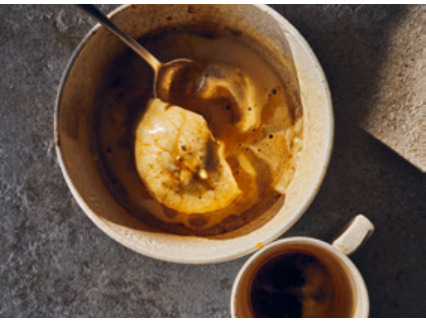

**Ingrediënten voor:** ca.8-10 personen
**Bereidingstijd:** ca. 1 uur en 15 minuten
+ minimaal 5 uur wachttijd
**5 g** gedroogde candy caps of
andere geurige gedroogde
paddenstoelen zoals
eekhoorntjesbrood
**1 liter** slagroom
**500 ml** volle melk
**250 ml** ahornsiroop
2 grote snuffen Keltisch zeezout
**8** grote eidooiers
VOOR HET PADDENSTOELENPOEDER
**20 g** gedroogde maitakes
**20 g** gedroogde shiitakes
**20 g** gedroogd eekhoorntjesbrood
1VOOR HET PADDENSTOELENPOEDER Doe de
paddenstoelen in een specerijenmolen, minikeukenmachine of vijzel en maal of stamp ze tot
een fijn poeder. Zeef het door een fijne zeef om
grotere stukjes te verwijderen en doe die terug in
de molen. Herhaal het fi jnmalen en zeven tot alles
een fijn poeder is. Doe het in een afgesloten pot en
bewaar in de koelkast of diepvries. Het is eindeloos
houdbaar.
2 Meng 10 g paddenstoelenpoeder, de gedroogde
paddenstoelen en slagroom in een steelpan met
zware bodem en breng het op halfh oog vuur
tegen de kook aan. Het mag echt niet aan de kook
komen. Neem de pan van het vuur, leg er een
deksel op en laat het 30 minuten trekken. Zeef de
room door een fijne zeef boven een kom (en gooi de
stukjespaddenstoelweg).
3 Meng de melk, 125 ml van de ahornsiroop en het
Keltische zout in een andere pan en breng het op
halfh oog vuur zachtjes tegen de kook aan. Neem
de pan van het vuur en zet opzij.
4 Klop de eidooiers met de resterende 125 ml
ahornsiroop 10-12 minuten in een kom tot ze als
eenlintvandegardelopen.
5 Spatel het warme melkmengsel geleidelijk door
het eidooiermengsel om de eidooiers te temperen.
Schenk het melk-eidooiermengsel terug in de
pan en verwarm het circa 5 minuten al roerend
zachtjes op halfh oog tot laag vuur tot het mengsel
de achterkant van een houten lepel gelijkmatig
bedekt. Laat de custard niet aan de kook komen!
6 Roer de getrokken room voorzichtig door de
custard tot het een glad mengsel is. Zet minstens
2 uur in de koelkast tot het volledig is afgekoeld.
7 Draai het mengsel in een ijsmachine tot ijs. Schep
het als je het niet meteen serveert in een luchtdichte bak. In de diepvries is het ijs een week houdbaar.
**33** 34 35 36
**39** 40 41 42 43 44
**46** 47 48 49 50
**52** 53
**55** 56 57 58 59 60
**63** 64 65 66 67
**70** 71 72 73 74 75
**83** 84 85 86
**88** 89 90
enul 9 tijdschriftenhandel 13 mijmering 18 snoepje 20 vleesvervanger 22 veldhoen
ebruik gegeven goed 27 veel wetend 28 telwoord 29 reeds 30 loofboom 32 woest
5 begrensd gebied 36 springend insect 37 in het begin 39 grondbezit 41 plaats in
slagplaats bij golf 43 teer 45 kleine kinderen 46 deugdzaam 48 kadaver 50 erbinnen
**78** 79 80 81

## HORIZONTAAL

1 kermisattractie 5 benul 9 tijdschriftenhandel 13 mijmering 18 snoepje
20 vleesvervanger 22 veldhoen 24 overmatig 26 in gebruik gegeven goed
27 veel wetend 28 telwoord 29 reeds 30 loofboom 32 woest 34 geen enkel
ding 35 begrensd gebied 36 springend insect 37 in het begin 39 grondbezit
41 plaats in Noord-Brabant 42 afslagplaats bij golf 43 teer 45 kleine kinderen
46 deugdzaam 48 kadaver 50 erbinnen 51 verrijdbare vuilnisbak 52 insect
53 bijkomend 54 stand 55 truc 57 onderdrukker 59 positie 61 padvindster
bak 52 insect 53 bijkomend 54 stand 55 truc 57 onderdrukker 59 positie 61 padvindster
flink gevorderd 66 gek 67 Spaanse kust 68 fatsoenlijk 69 afspraakje 71 type schaatsen
63 tropische vogel 64 flink gevorderd 66 gek 67 Spaanse kust 68 fatsoenlijk
75 duivenhok 76 daar 77 Engelsman 78 soort pompoen 79 snaarinstrument 81 kluitenend leider 84 extraatje 85 damestrui 87 houten gebouw 88 groen 89 Indiase tokkelluit
69 afspraakje 71 type schaatsen 73 gedorste halmen 75 duivenhok 76 daar
mwoord 3 richtingwijzer 4 iets waardeloos 5 vaandel 6 lengtemaat 7 maaltijd 8 papierg 10 Europese taal 11 politieke partij 12 textielsoort 13 laan 14 West-Europese rivier
77 Engelsman 78 soort pompoen 79 snaarinstrument 81 kluitenbreker
16 vrucht 17 nauw straatje 19 genoeg hebbend van 21 uiten van vreugde 23 blauwwit
ei 29 bondgenootschap 31 kappersbenodigdheid 33 naaldtekening 35 wiersoort 36 ver-
82 gezaghebbend leider 84 extraatje 85 damestrui 87 houten gebouw 88 groen
dierenrijk 42 vervoer op spoor 44 terug (Latijn) 46 natuurgebied 47 veerkracht 48 opvuln erfelijke stof 54 rechthoekig vak 56 tekening op de huid 58 legendarische Britse ko-
89 Indiase tokkelluit 90 soort rolschaats.
tje 62 woonplaats 64 meer dan genoeg 65 raadsel 67 studentenvereniging 70 pose 71 in
cht 74 sterrenbeeld 77 de handeling van bieden 80 zwarte kleverige stof 82 Japans

## VERTICAAL

evestiging 86 dwarsmast.
Kruiswoord
2 bezittelijk voornaamwoord 3 richtingwijzer 4 iets waardeloos 5 vaandel
etters uit de genummerde vakjes over naar de gelijkgenummerde vakjes van de oplossingsbalk.
© Sanders puzzelboeken
6 lengtemaat 7 maaltijd 8 papierformaat 9 type rijtuig 10 Europese taal 11 politieke
**47** 39 81 89 23 69 10 66 25 59
partij 12 textielsoort 13 laan 14 West-Europese rivier 15 gecastreerde stier 16 vrucht
17 nauw straatje 19 genoeg hebbend van 21 uiten van vreugde 23 blauwwit metaal
25 keukengerei 29 bondgenootschap 31 kappersbenodigdheid
33 naaldtekening 35 wiersoort 36 verbaasd 38 ambacht 40 dierenrijk 42 vervoer
op spoor 44 terug (Latijn) 46 natuurgebied 47 veerkracht 48 opvulmiddel
49 drager van erfelijke stof 54 rechthoekig vak 56 tekening op de huid
58 legendarische Britse koning 60 woordspelletje 62 woonplaats 64 meer
dan genoeg 65 raadsel 67 studentenvereniging 70 pose 71 in de buurt van
72 gerecht 74 sterrenbeeld 77 de handeling van bieden 80 zwarte kleverige stof
82 Japans bordspel 83 plus 85 bevestiging 86 dwarsmast.
VUL DE PUZZEL IN EN MAAK KANS
OP 1 VAN DE 5 EXEMPLAREN VAN

## HET GROTE BAKBOEK T.W.V. 9,99 EURO

Ze noemen jou ook wel de bakkoning(in) van de lage landen.
Bij jou geen kant-en-klare taart of koekjes te vinden. Ga met
Het Grote Bakboek aan de slag en vind meer dan 150 recepten
voor cakes, koekjes, plaattaarten, chocoladegebak, quiches,
verjaardagstraktaties, paasbrood en pronkstukken voor kerst.
Ook gaan we aan de slag met zomerfruit en laten we zien wat
je, naast appeltaart, allemaal nog meer met appel kunt maken.
Het Grote Bakboek is een echte mix van zoete en hartige bakrecepten, waardoor hij op iedere dag van de week van pas
komt.
1 2 3 4 5 6 7 8 9 10 11 12 13 14 15 16
**17** 18 19 20 21 22 23
Titel: Het Grote Bakboek
**24** 25 26 27 28 29
**30** 31 32 33 34 35 36
Auteur: koken & genieten
**37** 38 39 40 41 42 43 44
**45** 46 47 48 49 50
Uitgeverij: F&L Media
**51** 52 53
**54** 55 56 57 58 59 60
Prijs: 9,99 euro
**61** 62 63 64 65 66 67
© Sanders puzzelboeken
**68** 69 70 71 72 73 74 75
Het antwoord kun je vóór 27 december 2023
**76** 77 78 79 80 81
**82** 83 84 85 86
sturen naar: koken & genieten, o.v.v. oplossing puzzel
**87** 88 89 90
Postbus 296, 6500 AG Nijmegen
Of op onze website: kokengenieten.nl/puzzel
© Sanders puzzelboeken
R U P S B E S E F K I O S K D R O O M
S W IJ N B A L T O F O E P A T R IJ S E
T E L E E N G E L E E R D T I E N A L
E I K R U I G N I E T S Z O N E V L O
E E R S T E R F O S S T E E F R E L E
G R U T B R A A F T K R E N G E R I N
K L I K O V U U R V L I E G E X T R A
P O S E S T U N T I T I R A N R A N G
A K E L A A R A V E R N A R C O S T A
N E T D A T E N O R E N S T R O T I L
E R B R I T K A L E B A S H A R P E G
E G O E R O E B O N U S J U M P E R J
L O O D S O N R IJ P S I T A R S K A T E
feestdiner
**47** 39 81 89 23 69 10 66 25 59
**5** 6 7 8 9 10 11 12 13 14 15 16
**19** 20 21 22 23
**27** 28 29
DE GEZONDE KEUKEN

# Groentefeestje

Een goed stukje vlees is klassiek met kerst, maar een vegetarisch kerstmenu is
minstens zo lekker. Ga voor een traditionele wellington in een vegetarisch jasje
of maak een heerlijke linzensalade met geitenkaas.

## Zoete aardappel wellington

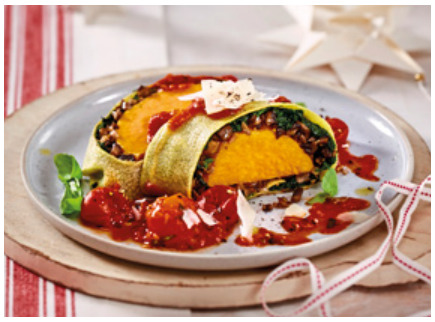

**Ingrediënten voor:** 6 personen
**Bereidingstijd:** ca. 1 uur en 30 min.
**750 g** spinazie
**4 el** olijfolie
zout en peper
nootmuskaat
3 zoete aardappels (à ca. 325 g;
ca. 13 cm lang)
**1 kg** champignons
**1** grote ui
**200 g** zonnebloempitten
**2** eieren
**6** verse lasagnebladen (à 42 g;
15x20 cm, koelvak)
**1** teentje knoflook
**850 g** cherrytomaten (blik)
gedroogde oregano
evt. kaas, om te bestrooien
vershoudfolie
1 Was de spinazie. Verhit 1 el olie in een pan. Laat de spinazie er
afgedekt in slinken. Breng op smaak met zout, peper en nootmuskaat. Was de zoete aardappels en kook ze ca. 35 minuten in
water met een snufje zout.
2 VOOR DE CHAMPIGNONS Maak de champignons schoon en
hak ze fijn. Pel en snipper de ui. Maal de zonnebloempitten fijn
in een keukenmachine. Verhit 2 el olie in een pan. Bak er de
champignons, de ui en de zonnebloempitten ca. 25 minuten al
roerend in tot een droge massa. Breng op smaak met zout en
peper en laat afkoelen. Roer de eieren erdoorheen.
3 Kook de lasagnebladen in ruim water met een snufje zout
in ca. 4 minuten beetgaar. Giet de zoete aardappels af, pel ze
en snijd ze in stukken van 12 cm lang. Halveer de aardappelplakken in de lengte. Neem de lasagnebladen uit het water en
spoel ze koud af. Leg 1 lasagneblad op een stuk vershoudfolie
(ca. 20x25 cm), zodat het folie ca. 5 cm aan de lange zijde van
het lasagneblad uitsteekt. Knijp ¹∕₆ deel van de spinazie uit,
verdeel het op de lasagnebladen en laat hierbij ca. 1 cm rondom
vrij. Verdeel ¹∕₆ deel van de champignons erop. Leg een aardappelhelft met de ronde zijde naar beneden erop.
4 Klap de lasagnebladen er vanaf de korte zijde omheen en
druk de naad aan. Wikkel het vershoudfolie er strak omheen en
wikkel het folie bij elkaar als een bonbon. Herhaal met de rest
van de wellingtons. Gaar de wellingtons in zacht kokend water
in ca. 12 minuten.
5 VOOR DE SAUS Pel de knoflook en hak hem fijn. Verhit 1 el
olie. Fruit de knoflook erin. Voeg de tomaten met het sap, 150 ml
water en ½ tl oregano toe, breng aan de kook en kook ca. 10 minuten op laag vuur. Breng op smaak met zout en peper. Spatel
de wellingtons uit het water en wikkel ze uit het folie. Serveer
de wellingtons met de saus. Bestrooi naar smaak met kaas.
**Per portie:** ca. 670 kcal
**23 g** eiwit | 27 g vet | 78 g koolhydraten

## Linzensalade

## met pompoen en walnoten

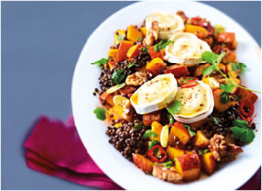

**Ingrediënten voor:** 4 personen
**Bereidingstijd:** ca. 50 min.
**250 g** droge belugalinzen
**1** hokkaidopompoen (ca. 1 kg)
**1** rode peper
**1** teentje knoflook
**4 takjes** koriander
**4 takjes** peterselie
**50 g** walnoten
**7 el** olie
zout en peper
**5-8 el** wittewijnazijn
suiker
**½ tl** kerriepoeder
**1 tl** paprikapoeder
**200 g** geitenkaas (rol)
1 Doe de linzen in een pan en voeg water toe tot
de linzen net onderstaan. Breng ze aan de kook
en kook ze ca. 25 minuten op laag vuur.
2 Snijd de pompoen in parten, verwijder de zaadlijsten, was de parten en snijd ze in blokjes van ca.
1½ cm. Halveer de peper in de lengte, verwijder
de zaadlijsten, was de peper en snijd hem klein.
Pel de knoflook en snijd hem in dunne plakjes.
Was de koriander en de peterselie en hak ze grof.
Hak de walnoten grof en rooster ze ca. 3 minuten
in een droge pan. Neem ze uit de pan.
3 Verhit 3 el olie in een pan. Bak er de pompoen
ca. 10 minuten in. Breng op smaak met zout en
peper. Giet de linzen af. Roer 3 el olie, de knoflook, de peper, de azijn, een snufje suiker, het
kerriepoeder en het paprikapoeder door de linzen. Meng de linzen, de pompoen en de walnoten.
Breng op smaak met zout en peper.
4 Snijd de geitenkaas in 8 plakken. Verhit 1 el olie
in een pan met antiaanbaklaag. Bak er de kaas ca.
1 minuut per zijde in. Serveer alles samen.
**Per portie:** ca. 720 kcal
**31 g** eiwit | 39 g vet | 56 g koolhydraten

## Balsamicopaddenstoelen

## met parmezaanpuree

**Ingrediënten voor:** 4 personen
**Bereidingstijd:** ca. 40 min.
**800 g** aardappels
zout en peper
**4** teentjes knoflook
**500 g** gemengde paddenstoelen
(bijv. koningsoesterzwammen,
cantharellen, champignons en
oesterzwammen)
**6 el** boter
**7 el** balsamico
**2 el** honing
**100 g** parmezaan (stuk)
**4 takjes** peterselie
**125 ml** melk
1 Schil de aardappels, was ze, snijd ze in grove
stukken en kook ze in water met een snufje zout
in ca. 20 minuten gaar.
2 Pel de knoflook en hak hem fijn. Maak de
paddenstoelen schoon en halveer ze naar grootte
of snijd ze in vieren.
3 Verhit 3 el boter in een grote pan. Bak er de
paddenstoelen ca. 8 minuten op hoog vuur in.
Voeg de knoflook toe en bak ca. 2 minuten mee.
Breng op smaak met zout en peper. Roer de balsamico en de honing erdoorheen, breng aan de kook
en kook ca. 4 minuten op laag vuur.
4 Rasp de helft van de parmezaan fijn. Was de
peterselie, hak hem grof en roer hem door de
paddenstoelen.
5 Giet de aardappels af. Voeg de melk, 3 el boter
en de geraspte parmezaan toe en stamp tot puree.
Breng op smaak met zout en peper. Serveer alles
samen en schaaf de overige parmezaan eroverheen.
**Per portie:** ca. 440 kcal
**18 g** eiwit | 20 g vet | 43 g koolhydraten
DE GEZONDE KEUKEN

# van de zalm

# Neusje

Deze ingelegde zalmforel bewijst dat geduld een schone
zaak is, want wát is hij lekker! Serveer hem met een heerlijk
mosterd-honing-dillesausje voor een echte smaaksensatie.

## Ingelegde zalmforel met gin

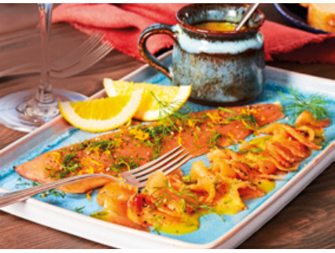

**Ingrediënten voor:** 6 personen
**Bereidingstijd:** ca. 20 min. + ca. 12 uur wachttijd
4
zalmforelfilets met huid (à ca.
**150** g, bij de viswinkel)
**½ tl** zwarte peperkorrels
**½ tl** korianderzaad
**50 g** zout
**40 g** suiker
**1 bosje** dille
geraspte schil van 1 biosinaasappel
**5-8 el** gin
verse dille en sinaasappelschil,
om te garneren
vershoudfolie

## Mosterd-honing-dillesaus

**Ingrediënten voor:** 6 personen
**Bereidingstijd:** ca. 5 min.
Was ½ bosje dille en hak het fijn. Roer
75 g mosterd, 2 el honing, 100 ml sinaasappelsap en peper naar smaak door elkaar.
Klop 4 el olie erdoorheen. Breng de saus op
smaak met zout. Roer de dille erdoorheen.
1 EEN DAG VAN TEVOREN Dep de zalmfilets droog
en leg ze met de huidzijde naar beneden naast
elkaar in een ovenschaal. Maal de peperkorrels
en het korianderzaad in een vijzel fijn. Meng
het zout en de suiker erdoorheen. Was de dille,
schud hem droog en hak hem fijn. Meng de dille,
de sinaasappelschil en de gin in een schaaltje en
verdeel het mengsel gelijkmatig over de zalm.
Bestrooi met het zoutmengsel. Dek de zalmfilets
af met vershoudfolie. Leg een snijplank erop en
verzwaar de snijplank met een boek, een tweede
kleinere ovenschaal of iets anders zwaars. Zet ca.
12 uur in de koelkast.
2 DE VOLGENDE DAG Spoel het zoutmengsel met
koud water van de zalmfilets en dep ze droog.
Snijd de zalmfilets met een lang, scherp mes
schuin in dunne plakken van de huid (zie afbeelding linksonder). Snijd elke plakje op gelijke wijze
van de huid. Garneer de zalm met de dille en de
sinaasappelschil. De zalm is in folie gewikkeld
3 dagen houdbaar in de koelkast.
**Per portie:** ca. 220 kcal
**23 g** eiwit | 13 g vet | 1 g koolhydraten
STAP VOOR STAP

# Peertje uit

# de aarde

Geen aardappel, maar aardpeer is deze maand in
het seizoen. Deze knolletjes hebben een zachtzoete
smaak die een beetje doet denken aan artisjok.
Probeer ze eens uit in deze recepten.

## Aardpeerroomsoep

## met kruidige groentesalsa

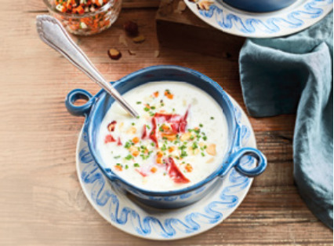

**Ingrediënten voor:** 4 personen
**Bereidingstijd:** ca. 40 min.
**500 g** aardpeer (bij de groentewinkel
of ecologische supermarkt)
**1** aardappel
**2** uien
**1** teentje knoflook
**3 el** olijfolie
**800 ml** groentebouillon
**1** laurierblaadje
**2 el** hazelnoten
**1** kleine wortel
**1** peterseliewortel
**1 bosje** bieslook
**1 el** appelazijn
zout en peper
**6 plakjes** rookvlees (ca. 50 g)
**150 g** crème fraîche
nootmuskaat
1 VOOR DE SOEP Schil de aardpeer en de aardappel, was ze en snijd ze in blokjes. Pel en snipper
de uien en de knoflook. Verhit 2 el olie in een pan.
Fruit er de ui, de knoflook, de aardpeer en de
aardappel in. Schenk de bouillon erbij en breng
aan de kook. Voeg het laurierblaadje toe. Kook
afgedekt ca. 10 minuten op laag vuur.
2 VOOR DE SALSA Rooster de hazelnoten in een
droge pan. Neem ze uit de pan en hak ze grof.
Schrap de wortel en de peterseliewortel, was ze
en snijd ze in blokjes. Was de bieslook en snijd
hem in rolletjes. Meng de wortel, de peterseliewortel, de bieslook, 1 el olie en de azijn. Breng op
smaak met zout en peper. Snijd het rookvlees fijn.
3 Neem het laurierblaadje uit de soep. Pureer
de soep fijn. Roer de crème fraîche erdoorheen.
Verwarm de soep. Breng hem op smaak met zout,
peper en nootmuskaat. Serveer de soep met de
salsa, de hazelnoten en het rookvlees.
**Per portie:** ca. 350 kcal
**8 g** eiwit | 22 g vet | 28 g koolhydraten
Schillen mag, maar hoeft
niet. Leg de aardpeer
ongeschild ca. 5 minuten in
een kom water en dan is al
het vuil weg.
FAVORIET VAN DE MAAND

## Salade met geroosterde aardpeer,

## peer en bacon

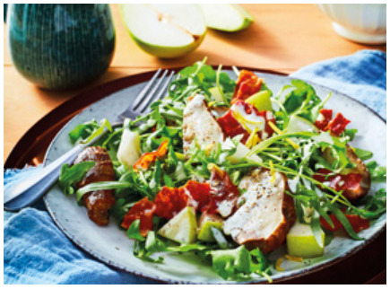

**Ingrediënten voor:** 4 personen
**Bereidingstijd:** ca. 1 uur
aardpeer (bij de groentewinkel
of ecologische supermarkt)
**3 el** olie
zeezout
peper
**6 plakjes** bacon
**3 takjes** dragon
**1** bio-citroen
**2 el** witte wijnazijn
**4 el** melk
**100 g** zachte geitenkaas
**200 g** rucola
**4** peren
Als rauwkost,
bijvoorbeeld grof geraspt
en aangemaakt met een
notenolie, is aardpeer ook
heerlijk.
1 Verwarm de oven voor (elektrisch: 200°C / hetelucht: 180°C). Maak de aardpeer met een borstel
onder de koude kraan goed schoon. Laat uitlekken en halveer de aardpeer. Meng de aardpeer, de
olie, zout en peper op een bakplaat. Rooster ca.
40 minuten in de oven.
2 Rooster de bacon in een droge pan knapperig.
Neem hem uit de pan en laat uitlekken. VOOR
DE DRESSING Was de dragon. Neem de blaadjes
van de takjes. Was de citroen, rasp de schil er fijn
af en pers de citroen uit. Pureer het citroensap,
de azijn, de melk, de geitenkaas, de helft van de
dragon, zout en peper fijn.
3 Was de rucola. Was de peren, snijd ze in vieren, verwijder het klokhuis en snijd ze peren in
parten. Verdeel de rucola, de overige dragon, de
peer, de citroenschil en de aardpeer op borden.
Druppel de dressing eroverheen. Verbrokkel de
bacon eroverheen. Lekker met stokbrood.
**Per portie:** ca. 500 kcal
**14 g** eiwit | 25 g vet | 52 g koolhydraten

## Aardpeer-courgettekoekjes

## met ei

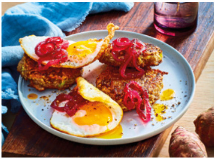

**Ingrediënten voor:** 4 personen
**Bereidingstijd:** ca. 1 uur
**4** uien (bijv. rode)
**2 el** boter
**2 el** rietsuiker
**4 el** wittewijnazijn
zout en peper
**800** g
**800 g** aardpeer (bij de groentewinkel
of ecologische supermarkt)
**1** courgette (à ca. 150 g)
**2** teentjes knoflook
kaneel
**12** eieren
**180 g** bloem (+ bestuiven)
**6 el** olie
1 VOOR DE UIENTOPPING Pel de uien en snijd ze
in ringen. Verhit de boter in een pan. Fruit er de ui
glazig in. Bestrooi met de suiker en karamelliseer.
Blus af met de azijn en 3 el water, breng aan de
kook en kook ca. 1 minuut op laag vuur. Neem de
pan van het vuur. Breng de ui op smaak met zout
en peper.
2 VOOR DE KOEKJES Schil de aardpeer, was ze en
rasp ze grof. Was de courgette en rasp hem. Pel
de knoflook en hak hem fijn. Roer de aardpeer,
de courgette, de knoflook, een snufje kaneel,
4 eieren en de bloem goed door elkaar. Breng op
smaak met zout en peper. Maak van het mengsel
ca. 12 balletjes en druk ze plat.
3 Verhit 4 el olie in een pan met antiaanbaklaag.
Bak er de koekjes in porties per zijde 3-4 minuten
goudbruin in. Verhit in een tweede pan 2 el olie.
Bak er 8 spiegeleieren in. Breng op smaak met
zout en peper. Serveer alles samen.
**Per portie:** ca. 740 kcal
**24 g** eiwit | 35 g vet | 77 g koolhydraten
FAVORIET VAN DE MAAND

# 4x

# lekker

# Raclettefeestje

Maak van racletten je nieuwe kersttraditie en maak eens een van deze vier
heerlijke raclettegerechtjes, of maak ze gewoon allemaal.

## Raclette met zalm en granaatappel

**Ingrediënten voor:** ca. 4 pannetjes
**Bereidingstijd:** ca. 20 min.
**250 g** zalmfilet zonder huid
**2 el** olijfolie
zout
**1 el** citroensap
**50 g** geroosterde en gezouten pinda’s
**150 g** blauwschimmelkaas
4 kleine takjes koriander (of peterselie)
**4 el** granaatappelpitjes
1 Snijd de zalm in blokjes van ca. 3 cm groot. Verhit de olie in een pan. Bak er
de zalm op hoog vuur ca. 1 minuut rondom in. Breng op smaak met zout en
het citroensap. Hak de pinda’s grof. Snijd de kaas in 8 plakken. Was de koriander en schud hem droog.
2 Verdeel de zalm en de pinda’s in pannetjes en verdeel de kaas eroverheen.
Gril ca. 5 minuten. Bestrooi met de granaatappelpitjes en garneer met de
koriander.
**Per portie:** ca. 400 kcal
**25 g** eiwit | 31 g vet | 2 g koolhydraten
FRIS
SMAAKBOMMETJE
De zoetzure, kruidige
smaak van de granaatappel
zorgt voor een frisse noot.

## Raclette met varkenshaas en mozzarella

**Ingrediënten voor:** 4 pannetjes
**Bereidingstijd:** ca. 30 min.
**2 el** olie
**300 g** varkenshaas
zout en peper
**100 g** champignons
**1** sjalotje
**125 g** mozzarella
**2 takjes** basilicum of oregano
1 Verhit 1 el olie in een pan. Bak er de varkenshaas ca. 10 minuten rondom
in. Breng op smaak met zout en peper. Neem uit de pan en laat rusten. Maak
de champignons schoon en snijd ze in plakken. Pel en snipper het sjalotje.
Verhit 1 el olie in het hete bakvet. Bak er de sjalot en de champignons 3-4 minuten op hoog vuur in. Breng op smaak met zout en peper. Neem uit de pan.
2 Snijd de mozzarella in plakken. Was het basilicum en neem de blaadjes van
de takjes. Snijd de varkenshaas in plakken. Verdeel de varkenshaas en het
champignonmengsel in de pannetjes. Verdeel de mozzarella eroverheen. Gril
ca. 5 minuten. Bestrooi met peper en garneer met het basilicum.
**Per portie:** ca. 210 kcal
**23 g** eiwit | 12 g vet | 1 g koolhydraten

## Raclette met eendenborst en rode peper

**Ingrediënten voor:** 4 pannetjes
**Bereidingstijd:** ca. 25 min.
**2 el** olie
**300 g** eendenborstfilet
zout en peper
**75 g** walnoten
**2 el** honing
**1** rode peper
**1 takje** rozemarijn
**125 g** cheddar
1 Verhit de olie in een pan. Bak er de eendenborstfilet ca. 8 minuten goud-
ORANJE
OF GEEL?
De kleur van de cheddar
heeft geen invloed op
de smaak. De leeftijd van
de kaas zorgt voor de
uitgesproken smaak.
bruin in. Bestrooi met zout en peper. Neem uit de pan. Rooster de walnoten
in een droge pan. Voeg de honing toe en karamelliseer al roerend. Was de
peper, verwijder eventueel de zaadlijsten en snijd de peper in ringen.
2 Was de rozemarijn en neem de naaldjes van de takjes. Snijd de eendenborstfilet en de kaas in plakken. Verdeel de eendenborstfilet, de gekarameliseerde walnoten en de peper in de pannetjes. Verdeel de kaas eroverheen.
Gril ca. 5 minuten. Bestrooi met de rozemarijn.
**Per portie:** ca. 410 kcal
**29 g** eiwit | 29 g vet | 5 g koolhydraten
**4** X LEKKER

## Raclette met vijgen en geitenkaas

**Ingrediënten voor:** 4 pannetjes
**Bereidingstijd:** ca. 20 min.
**75 g** pecannoten
**75 g** spekblokjes
**4** verse vijgen
**125 g** geitenkaas (rol)
**4 takjes** tijm
1 Rooster de pecannoten in een droge pan goudbruin. Neem ze uit de pan en
laat a oelen. Bak de spekblokjes in de hete pan knapperig. Was de vijgen,
dep ze droog en snijd ze in vieren. Snijd de geitenkaas in plakken. Was de
tijm en hak hem grof.
2 Verdeel de vijgen, de spekblokjes en de pecannoten in 4 gourmetpannetjes
en verdeel de geitenkaas eroverheen. Gril ca. 5 minuten. Garneer met de
tijm.
**Per portie:** ca. 320 kcal
**10 g** eiwit | 28 g vet | 4 g koolhydraten
KNAPPERIG
VAN VER WEG
Pecannoten behoren
tot dezelfde familie als
walnoten. De smaak is iets
milder en zoeter dan van
de walnoot.

# 3 x kerstkoekjes

De leukste cadeautjes zijn eetbaar. Maak het basisrecept
voor koekjesdeeg en je hebt binnen een
handomdraai drie soorten koekjes om uit te delen.

## Kaneelkoekjes

## Zachte

## vanillekoekjes

## Raviolikoekjes

## met marsepein

## Kaneelkoekjes

**Ingrediënten voor:** ca. 20 koekjes
**Bereidingstijd:** ca. 30 min.
**80 g** rietsuiker
**2 tl** kaneel
recept koekjesdeeg
1⁄3
bloem
bakpapier
1 Meng de rietsuiker en de kaneel in een kleine
kom. Rol het deeg op een met bloem bestoven
werkblad rechthoekig (ca. 20x40 cm) uit. Bestrijk
het deeg met koud water en bestrooi gelijkmatig
met de kaneelsuiker. Rol het deeg langs de lange
zijde op.
2 Verwarm de oven voor (elektrisch: 180°C /
hetelucht: 160°C). Snijd de deegrol in plakjes
van ca. 1 cm dik en leg de plakjes met een beetje
afstand van elkaar op een met bakpapier beklede
bakplaat. Bak in 10-12 minuten goudbruin. Laat
a oelen.
**Per stuk:** ca. 90 kcal
**1 g** eiwit | 4 g vet | 12 g koolhydraten

## Raviolikoekjes met marsepein

**Ingrediënten voor:** 21 stuks
**Bereidingstijd:** ca. 1 uur
recept koekjesdeeg
1⁄3
**1** ei
**1 el** melk
**50 g** gekonfijte fruitmix
**40 g** marsepein
bloem
bakpapier
1 Kneed het afgekoelde deeg kort door. Klop het ei
met de melk door elkaar. Hak de fruitmix en houd
**2 el** apart. Rasp de marsepein. Meng de marsepein
met de fruitmix.

## Zachte vanillekoekjes

**Ingrediënten voor:** ca. 20 koekjes
**Bereidingstijd:** ca. 30 min.
recept koekjesdeeg
1⁄3
**1 zakje** vanillesuiker
**2-3** druppels vanille-extract
bloem
uitsteekvormpjes (bijv.
hartjes, bloemen, sterren
en dennenbomen)
bakpapier
1 Kneed het gekoelde deeg kort door. Kneed
de vanillesuiker en het vanille-extract erdoorheen. Rol het deeg op een met bloem bestoven
werkblad 3-4 mm dik uit. Steek er verschillende
vormen uit.
2 Verwarm de oven voor (elektrisch: 180°C /
hetelucht: 160°C). Verdeel de koekjes op een met
bakpapier beklede bakplaat. Bak in 10-12 minuten goudbruin. Laat a oelen.
**Per stuk:** ca. 70 kcal
**1 g** eiwit | 4 g vet | 8 g koolhydraten
2 Verwarm de oven voor (elektrisch: 180°C /
hetelucht: 160°C). Rol het deeg rechthoekig
(ca. 18x21 cm) uit en halveer het (ca. 9x21 cm).
Bestrijk 1 deegplak met het eimengsel. Verdeel
ca. 21 hoopjes marsepein-fruitmix erop. Leg de
andere deegplak erop, druk aan en snijd in ca.
21 vierkantjes van ca. 3x3 cm. Bestrijk met het
overige ei. Verdeel de overige fruitmix eroverheen. Bak in 10-12 minuten goudbruin. Neem uit
de oven en laat a oelen.
**Per stuk:** ca. 90 kcal
**1 g** eiwit | 5 g vet | 10 g koolhydraten
LAST MINUTE

## Koekjesdeeg

**Ingrediënten voor:** ca. 60 koekjes
**Bereidingstijd:** ca. 15 minuten
+ ca. 30 minuten koeltijd
Kneed 450 g bloem, 300 g koude boter, een
snu e zout, 150 g poedersuiker en 1 ei in een
grote kom glad. Verdeel het deeg in 3 gelijke
stukken. Rol elk stuk deeg op een met bloem
bestoven werkblad uit tot een plat stuk.
Wikkel elk stuk in vershoudfolie en leg ca.
30 minuten in de koelkast.

# Happyhourtaarten

Deze taarten zijn stuk voor
stuk gebaseerd op je favoriete
cocktails. Serveer de taart met
de bijpassende cocktail en het
is meteen een feestje.

## Strawberry daiquiri

Verdeel wat aardbeiensuiker
(zie stap 3 van het recept voor
strawberry-daiquiri-taart) op een
bord. Doop de rand van het glas
eerst in water, daarna in de suiker
en laat drogen. Pureer 50 g ontdooide aardbeien (diepvries), 5 cl
witte rum, 2-3 el limoensap, 1 el
suikersiroop en 5 ijsblokjes met
de staafmixer. Vul het glas met de

## strawberry daiquiri.

## Strawberry-daiquiri-taart

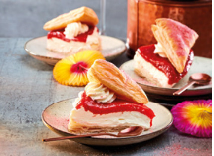

**Ingrediënten voor:** 8 stuks
**Bereidingstijd:** ca. 1 uur
+ ca. 2 uur en 30 min. wachttijd
**4** plakken bladerdeeg
(à 75 g, diepvries)
bloem
**300 g** aardbeien (diepvries)
**4 el** citroensap
**4 el** suiker
**16 g** vanillesuiker
**35 g** custardpoeder
**3 el** witte rum
**5** gevriesdroogde aardbeien
**350 ml** slagroom
bakpapier
1 VOOR DE BODEM Verwarm de oven voor (elektrisch: 200°C / hetelucht: 180°C). Laat de plakken
bladerdeeg naast elkaar ontdooien. Leg de plakken bladerdeeg 2 om 2 op elkaar en rol vierkant
(ca. 23 cm) uit. Snijd uit elke plak een cirkel (ca.
22,5 cm Ø). Snijd 1 cirkel in 8 taartpunten. Leg de
cirkel en de taartpunten op een met bakpapier
beklede bakplaat en prik er met een vork gaatjes
in. Bak ca. 12 minuten in de oven. Laat a oelen.
2 VOOR HET DAIQIURIMENGSEL Laat de
aardbeien ontdooien en pureer ze fijn. Breng de
aardbeienpuree, het citroensap, 3 el suiker en
**8 g** vanillesuiker aan de kook. Roer het custardpoeder met 4 el water glad. Roer het door het
aardbeienmengsel, breng aan de kook en kook
ca. 1 minuut op laag vuur. Roer de rum erdoorheen. Laat het mengsel a oelen en roer hierbij
meerdere keren door.
3 VOOR DE AARDBEIENSUIKER Vermaal de gevriesdroogde aardbeien met 1 el suiker.
4 Klop de slagroom met 8 g vanillesuiker stijf.
Doe 4 el slagroom in een spuitzak met spuitvormige spuitmond en leg in de koelkast. Bestrijk
de bladerdeegcirkel met de overige slagroom.
Verdeel het daiquirimengsel er voorzichtig op.
Zet de taart ca. 1 uur in de koelkast.
5 Spuit met de spuitzak 8 toe es slagroom op de
rand van de taart. Bestrooi de bladerdeegtaartpunten met de aardbeiensuiker en zet ze schuin
op de toe es.
**Per stuk:** ca. 340 kcal
**4 g** eiwit | 23 g vet | 26 g koolhydraten
HAPPY-HOURTAARTEN

## Pina colada

Schud 5 cl witte rum, 100 ml ananassap, 3-4 el gezoete kokosroom, 5 cl kokoslikeur, 2 el slagroom
en 2-3 ijsblokjes in een cocktailshaker. Schenk de
pina colada in een glas (ca. 350 ml) met 3-4 ijsblokjes. Garneer met ananas en een cocktailkers.

## Pina-coladataart

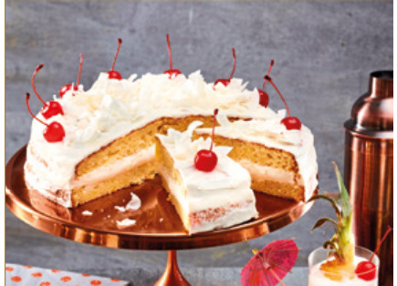

**Ingrediënten voor:** ca. 16 stukken
**Bereidingstijd:** ca. 1 uur
+ ca. 2 uur en 30 min. wachttijd
**4** schijfjes ananas (blik)
**1 el** maizena
**175 g** boter (+ invetten)
**150 g** suiker
zout
**4** eieren
**200 g** bloem (+ bestuiven)
**3 tl** bakpoeder
**6 el** witte rum
**4 blaadjes** gelatine
**150 ml** kokoslikeur
**200 ml** gezoete kokosroom
**200 ml** slagroom
**200 g** crème fraîche
**16** cocktailkersen
**30 g** kokoschips
1VOOR DE BODEM Verwarm de oven voor (elektrisch: 180°C / hetelucht: 160°C). Laat de ananas
uitlekken en snijd hem in kleine blokjes. Meng de
ananas met de maizena. Klop de boter, de suiker en
eensnu ezoutromig.Klop1voor1deeierenerdoorheen. Klop 50 g bloem erdoorheen. Meng 150 g
bloem en het bakpoeder en klop het met de rum
door het eimengsel. Spatel de ananas erdoorheen.
Verdeel het beslag in een ingevette en met bloem
bestoven springvorm (26 cm Ø) en strijk glad. Bak
ca.35minutenindeoven.Laata oelen.Halveer
de bodem horizontaal en sluit om de onderste laag
despringvormring.
2VOOR DE ROOM Week de gelatine in koud water.
Roer de kokoslikeur met de kokosroom glad. Knijp
de gelatine uit, los hem op laag vuur op en roer het
kokosmengsel erdoorheen. Zet 5 -10 minuten in de
koelkast tot het mengsel begint te geleren.
3 Klop de slagroom stijf. Klop de crème fraîche
romig. Spatel de crème fraîche en daarna de slagroom door het kokosmengsel. Verdeel ca. ¾ van de
room op de taartbodem. Dek af met de bovenste
bodemlaag. Zet ca. 2 uur in de koelkast. Laat de
overige room op kamertemperatuur staan.
4 Bestrijk de taart met de overige room. Versier
met de cocktailkersen en de kokoschips.
**Per stuk:** ca. 340 kcal
**4 g** eiwit | 23 g vet | 26 g koolhydraten

## Pisco-sourtaart

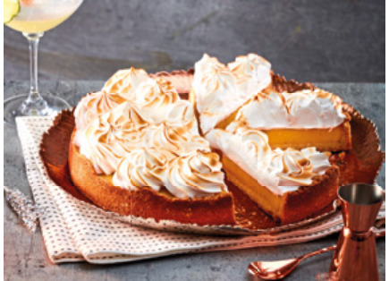

**Ingrediënten voor:** ca. 16 stukken
**Bereidingstijd:** ca. 1 uur en 15 min.
+ ca. 4 uur wachttijd
**200 g** bloem (+ bestuiven)
**575 g** suiker
**16 g** vanillesuiker
zout
**100 g** + 2 el koude boter (+ invetten)
**5** eieren
**2** eidooiers
**10** limoenen (waarvan 5 bio)
**100 g** maizena
50 ml pisco (Zuid-Amerikaanse sterkedrank,
of gebruik grappa)
bakpapier
blindbakbonen
spuitzak met stervormige spuitmond
1VOOR DE ZANDDEEGBODEM Kneed de bloem, 100 g suiker,
**8 g** vanillesuiker, een snu e zout, 100 g boter in stukken en
1 ei glad. Rol op een met bloem bestoven werkblad rond (ca.
28 cm Ø) uit, bekleed een ingevette springvorm (26 cm Ø)
ermee en druk de rand ca. 2 cm hoog aan. Prik met een vork
gaatjes in de bodem. Zet ca. 30 minuten in de koelkast.
2 Verwarm de oven voor (elektrisch: 180°C / hetelucht: 160°C).
Bekleed de taartbodem met bakpapier en leg de blindbakbonen
erin. Bak de bodem ca. 40 minuten onder in de oven. Neem
het bakpapier met de blindbakbonen eruit en bak nog ca.
10minuten.Laata oelen.
3VOOR DE ROOMWas de bio-limoenen met heet water en rasp
deschilerfijnaf.Persallelimoenenuit.Vulhetlimoensapmet
water aan tot 700 ml. Breng het limoenwater, de limoenschil,
**275 g** suiker, 8 g vanillesuiker en 2 el boter aan de kook. Roer de
maizena met 100 ml koud water glad. Roer het maizenamengsel
door het limoenmengsel, breng aan de kook en kook ca.
1 minuut al roerend op laag vuur. Roer de pisco erdoorheen.
4 Splits 4 eieren. Zet de eiwitten in de koelkast. Kluts 6 eidooiers
en klop ze beetje bij beetje door de limoenroom. Schenk de room
indetaartbodem.Laata oelenenzetca.2uurindekoelkast.
5VOORHETSCHUIMKlop4eiwittenmeteensnu ezoutstijf.
Klop beetje bij beetje 200 g suiker erdoorheen tot de suiker
is opgelost. Spuit het eiwitschuim met een spuitzak met
stervormigespuitmondintoe esopdetaart.Flambeermeteen
keukengasbrander of zet kort onder de grill van de oven.
**Per stuk:** ca. 350kcal
**5 g** eiwit | 11 g vet | 54 g koolhydraten

## Pisco sour

Blend het sap van 1 limoen, 6 cl pisco
(Zuid- Amerikaanse sterkedrank), 1 el poedersuiker
en 1 heel vers eiwit met de staafmixer ca. 1 minuut op
de hoogste stand. Schenk direct in een gekoeld glas en
druppel wat angostura bitters (kruidenbitter) erin.
HAPPY-HOURTAARTEN

## Basilicumgrapefruitmocktail

Vermaal de blaadjes van 2 takjes basilicum
en 2 el suikersiroop in een vijzel. Laat ca.
10 minuten trekken in een cocktailshaker.
Schenk 100 ml rode grapefruitsap en
2-3 ijsblokjes erbij en schud goed. Schenk
in een glas met 2-3 ijsblokjes en schenk
150 ml ginger beer erbij.

## Gember-basilicumcake

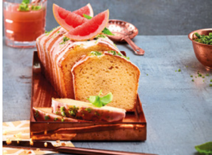

**Ingrediënten voor:** ca. 14 plakken
**Bereidingstijd:** ca. 1 uur en 15 min.
+ ca. 2 uur wachttijd
**4** eieren
**200 g** suiker
**8 g** vanillesuiker
zout
**150 ml** zonnebloemolie (+ invetten)
**150 ml** ginger beer (gemberlimonade)
**300 g** bloem
**3 tl** bakpoeder
paneermeel
**1** rode bio-grapefruit
**125 g** poedersuiker
**2-3 el** basilicumsuiker (zie kader)
evt. basilicum om te versieren
1 VOOR HET BESLAG Verwarm de oven voor (elektrisch: 180°C / hetelucht: 160°C). Kluts de eieren.
Klop de suiker, de vanillesuiker, een snu e zout,
de olie en het ginger beer kort door het ei. Meng
de bloem met het bakpoeder en roer het kort
door het eimengsel. Verdeel het beslag in een ingevette en met paneermeel bestrooide cakevorm
(ca. 25 cm lang, ca. 1,5 l inhoud) en strijk glad.
2 Bak de cake ca. 50 minuten in de oven. Snijd de
cake na 20-25 minuten met een mes in de lengte
in (zodat het koolzuur kan ontsnappen). Laat de
cake in de vorm ca. 20 minuten a oelen, stort
hem en laat hem volledig a oelen.
3 VOOR DE DECORATIE Was de grapefruit met
heet water. Pers 1 helft uit en snijd de andere helft
in parten. Roer de poedersuiker en 3-4 el sap tot
een glazuur. Schenk het glazuur over de cake,
laat drogen en bestrooi met de basilicumsuiker.
Versier met de grapefruit en eventueel basilicum.
Per plak: ca. 300 kcal
**5 g** eiwit | 11 g vet | 42 g koolhydraten

## Basilicumsuiker

**Ingrediënten voor:** 2-3 el
**Bereidingstijd:** ca. 10 min.
+ ca. 3 uur wachttijd
Verwarm de oven voor (elektrisch:
60⁰C / hetelucht: 40⁰C). Snijd 8-10 grote
basilicumblaadjes grof en vermaal ze
met 2 el suiker in een vijzel. Verdeel het
mengsel over een met bakpapier beklede
bakplaat en laat ca. 3 uur in de oven drogen.
Laat, als de oven te heet is, de ovendeur aan
het begin op een kiertje staan.

## White-Russiantaartjes

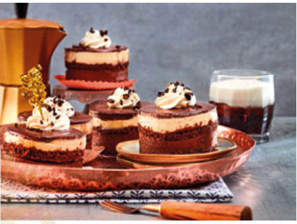

**Ingrediënten voor:** ca. 6 stukken
**Bereidingstijd:** ca. 1 uur en 30 min.
+ ca. 5 uur wachttijd
**3** eieren
zout
**80 g** suiker
**8 g** vanillesuiker
**50 g** bloem
**50 g** maizena
**1 tl** bakpoeder
**2 el** cacaopoeder
**1 blaadje** gelatine
**650 ml** slagroom
**100 g** witte chocolade
**4 tl** oploskoffie
**220 g** pure chocolade
**6-8** koffiebonen
bakpapier
1 VOOR HET BISCUIT Verwarm de oven voor
(elektrisch: 200°C / hetelucht: 180°C). Splits de
eieren. Klop de eiwitten, 2 el koud water en een
snu e zout stijf. Klop de suiker en de vanillesuiker er beetje bij beetje doorheen. Klop de eidooiers erdoorheen. Meng de bloem, de maizena,
het bakpoeder en het cacaopoeder en spatel het
door het eimengsel. Verdeel het beslag op een
met bakpapier beklede bakplaat en strijk glad.
Bak 8-10 minuten in de oven. Stort het biscuit op
bakpapier. Trek het meegebakken bakpapier eraf.
Laat het biscuit a oelen.
2 VOOR DE WITTECHOCOLADEROOM Week de
gelatine in koud water. Verwarm 200 ml slagroom. Knijp de gelatine uit en los hem in de slagroom op. Verdeel de witte chocolade in stukken
en smelt hem in de slagroom. Laat a oelen en zet
ca. 2 uur in de koelkast.
3 VOOR DE PURECHOCOLADEROOM Verwarm
**350 ml** slagroom met de oploskoffie. Breek de
pure chocolade in stukken en smelt hem erin.
Houd voor het glazuur ca. 200 ml purechocoladeslagroom apart (niet in de koelkast). Laat de
overige purechocoladeslagroom a oelen en zet
ca. 30 minuten in de koelkast.
4 Steek uit het biscuit 12 cirkels (8 cm Ø). Leg
6 dessertringen of ringen van meerdere keren
gevouwen aluminiumfolie (8 cm Ø, 5 cm hoog)
in een met bakpapier beklede braadslee. Leg in
HAPPY-HOURTAARTEN
elke ring een biscuitcirkel. Klop de purechocoladeslagroom in 1-2 minuten romig en vul er een
spuitzak mee. Spuit de room spiraalvormig op het
biscuit en strijk glad. Leg de overige biscuitcirkels
erop.
5 Klop de wittechocoladeroom in ca. 3 minuten
romig en vul een spuitzak ermee. Spuit de room
spiraalvormig op de biscuitrondjes. Strijk glad en
zet de taartjes ca. 1 uur in de koelkast.
6 VOOR HET GLAZUUR Verwarm de overige
chocoladeslagroom eventueel au bain-marie.
Bestrijk de taartjes ermee. Zet ca. 2 uur in de
koelkast.
7 Hak de koffiebonen fijn. Klop 100 ml slagroom
en vul een spuitzak met stervormige spuitmond
ermee. Zet de braadslee met de taartjes op een
hete theedoek en neem de ringen er voorzichtig
af. Spuit toe es slagroom op de taartjes en versier
met de koffiebonen.
**Per stuk:** ca. 760 kcal
**10 g** eiwit | 57 g vet | 46 g koolhydraten

## White Russian

Schenk 5 cl wodka, 4 cl koffielikeur en
2-3 ijsblokjes in een glas en roer goed door
elkaar. Schep voorzichtig 2-3 el lobbige
slagroom erop.
Scan en
ontdek onze
actie prijzen

# magazine

# magazine

# moment

# moment

# Bekijk onze actietarieven via:

# Pak jouw

# Pak jouw

# kokengenieten.nl/actie

# Simpel

# en snel

# genieten

Het is al druk genoeg met werk,
kinderen en hobby’s. Hier is de
oplossing voor iedereen die geen
tijd heeft om uitgebreid te koken,
maar toch lekker wil eten.

## Winterse flammkuchen

## met boerenkool

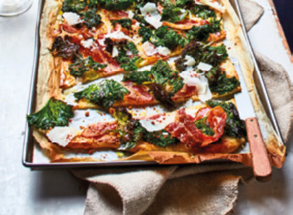

**Ingrediënten voor:** 6 stukken
**Bereidingstijd:** ca. 30 min.
**½** bio-citroen
**150 g** crème fraîche
ca. 1½ tl chilivlokken
zout
**260 g** flammkuchendeeg (koelvak)
**8** plakken bacon
**200 g** jonge boerenkool
**2 el** olijfolie
**30 g** parmezaan
1 Verwarm de oven voor (elektrisch: 220°C /
hetelucht: 200°C). Was de citroen met heet water,
wrijf hem droog en rasp de schil er fijn af. Roer de
crème fraîche, 1 tl chilivlokken en de citroenschil
door elkaar. Breng op smaak met zout en houd
apart.
2 Rol het deeg samen met het bakpapier uit op
een bakplaat. Klap de randen rondom ca. 1 cm
in. Bestrijk met de crème fraîche. Beleg met de
bacon. Bak onderin de oven ca. 10 minuten.
3 Maak de kool schoon en scheur de bladeren in
stukken. Blancheer ze in water met een snufje
zout ca. 2 minuten. Giet af, spoel kort en schud
droog. Meng de kool, de olie en een snufje zout.
Verdeel de kool op de flammkuchen en bak op
dezelfde temperatuur nog ca. 20 minuten.
4 Schaaf de kaas. Neem de flammkuchen uit de
oven. Bestrooi met de overige chilivlokken en de
kaas. Serveer direct.
**Per portie:** ca. 320 kcal
**9 g** eiwit | 19 g vet | 21 g koolhydraten
JONGE BLAADJES
Jonge boerenkool is zacht
en kun je goed gebruiken
voor flammkuchen of
smoothies.

## Aardappels met mosterd-champignonsaus

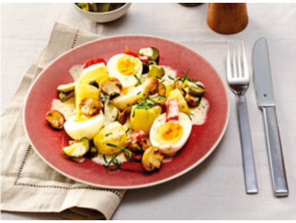

**Ingrediënten voor:** 4 personen
**Bereidingstijd:** ca. 30 min.
**750 g** aardappels
zout en peper
**300 g** champignons
**1** ui
**125 g** geroosterde paprika (pot)
**2** augurken
**8** eieren
**3 el** boter
**2-3 el** bloem
**200 ml** slagroom
**300 ml** groentebouillon
**1-2 takjes** peterselie
**1 el** kappertjes (pot)
**2-3 el** grove mosterd
1 Schil de aardappels, was ze, halveer ze en kook ze in water met een snufje
zout in ca. 20 minuten gaar. Maak de champignons schoon en halveer ze.
Pel en snipper de ui. Laat de paprika en de augurken uitlekken en snijd ze in
stukjes. Kook de eieren in ca. 9 minuten hard. Verhit de boter. Fruit er de ui en
de champignons in. Bestuif met de bloem en bak kort. Schenk de slagroom en
de bouillon erbij en breng aan de kook. Kook ca. 5 minuten op laag vuur.
2 Pel de eieren en halveer ze. Was de peterselie en hak hem fijn. Laat de kappertjes uitlekken. Roer de kappertjes, de mosterd, de paprika en de augurk
door de saus. Breng de saus op smaak met zout en peper. Serveer alles samen
en bestrooi met de peterselie.
**Per portie:** ca. 530 kcal
**20 g** eiwit | 33 g vet | 35 g koolhydraten
DE SNELLE KEUKEN

## Worstjes in bier met savooiekool

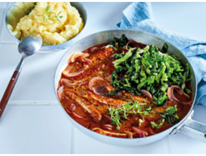

**Ingrediënten voor:** 4 personen
**Bereidingstijd:** ca. 30 min.
**1** savooiekool (ca. 1 kg)
**4 tl** suiker
zout en peper
**2 el** rode wijnazijn
**4 el** olijfolie
**300 g** rode uien
**12** worstjes (ca. 250 g)
**1 el** boter
**500 ml** witbier
GEEN RESTJES
Verwerk de overige kool
bijvoorbeeld in een frittata
of stamppot.
1 Was ¾ kool en snijd hem in dunne reepjes van de stronk (verwerk de overige kool in een ander recept). Kneed de kool in een kom met 1 tl suiker en ½
tl zout goed door elkaar. Meng de azijn en 2 el olie erdoorheen en laat ca. 15
minuten trekken.
2 Pel de uien en snijd ze in parten. Verhit 2 el olie in een pan. Bak er de
worstjes rondom ca. 5 minuten in. Neem ze uit de pan. Fruit de ui in het hete
bakvet. Roer 3 tl suiker, 1 tl zout, een snufje peper en de boter erdoorheen
en karamelliseer. Schenk het bier erbij en kook ca. 5 minuten op laag vuur.
Verhit de worstjes in de saus. Breng de kool op smaak met zout en peper.
Serveer alles samen. Lekker met desembrood.
**Per portie:** ca. 440 kcal
**12 g** eiwit | 35 g vet | 11 g koolhydraten

## Entrecote met kruidige couscous

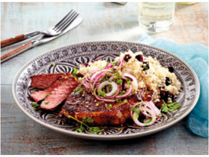

**Ingrediënten voor:** 4 personen
**Bereidingstijd:** ca. 20 min.
**4** entrecotes (à ca. 200 g)
**4 el** olie
zout en peper
**200 g** couscous
**75 g** gedroogde cranberry’s
**2** rode uien
**6 takjes** koriander
**3 el** rode wijnazijn
suiker
**2 el** olijfolie
gemalen komijnzaad
kaneel
aluminiumfolie
1 Snijd de vetrand van het vlees. Verhit in 2 pannen elk 2 el olie. Bak in elke pan
2 entrecotes 3-4 minuten per zijde op hoog vuur. Neem ze uit de pan, bestrooi ze
met zout en peper, wikkel ze in aluminiumfolie en laat ze ca. 8 minuten rusten.
2 Bereid de couscous volgens de aanwijzingen op de verpakking. Hak de cranberry’s grof. Pel de uien en snijd ze in ringen. Was de koriander en hak hem grof.
3 Roer de azijn, zout, peper en een snufj e suiker door elkaar. Klop de olie erdoorheen. Meng de ui en de koriander erdoorheen. Meng de cranberry’s door de couscous. Breng op smaak met het komijnzaad en de kaneel. Serveer alles samen.
**Per portie:** ca. 540 kcal
**49 g** eiwit | 15 g vet | 54 g koolhydraten

## Spaghetti in kip-dragonroomsaus

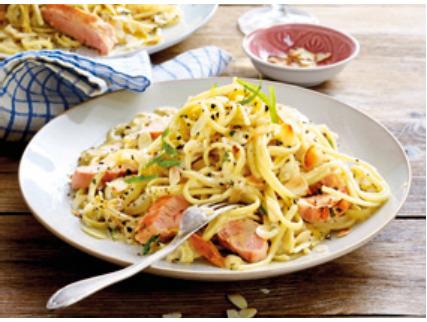

**Ingrediënten voor:** 4 personen
**Bereidingstijd:** ca. 25 min.
zout en peper
**450 g** kipfilet
**2 el** olie
**400 g** spaghetti
**3 el** amandelschaafsel
**2** uien
**2** teentjes knoflook
**½ bosje** dragon
**100 ml** droge witte wijn
**200 ml** slagroom
geraspte schil van 1 bio-citroen
1 Breng ruim water met een snufje zout aan de kook. Dep eventueel de kipfilet droog. Verhit de olie in een pan. Bak het vlees er ca. 6 minuten per zijde
in. Bestrooi met zout en peper. Kook de pasta volgens de aanwijzingen op de
verpakking. Rooster het amandelschaafsel in een droge pan. Neem het uit
de pan. Pel en snipper de uien. Pel de knoflook en snijd hem plakjes. Was de
dragon en snijd hem in reepjes.
2 Neem het vlees uit de pan. Fruit de ui en de knoflook in het hete bakvet.
Schenk de wijn en de slagroom erbij, breng aan de kook en kook ca. 5 minuten op laag vuur. Roer de dragon erdoorheen. Breng op smaak met zout,
peper en citroenrasp. Laat de pasta uitlekken. Snijd de kipfilet in plakken.
Serveer alles samen en bestrooi met het amandelschaafsel en peper.
**Per portie:** ca. 680 kcal
**30 g** eiwit | 48 g vet | 28 g koolhydraten

## Rodebieten-sinaasappelsalade

## met rundergehaktballetjes

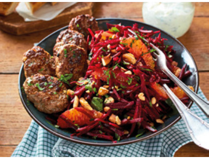

**Ingrediënten voor:** 4 personen
**Bereidingstijd:** ca. 30 min.
**800 g** rode bieten
**1 bosje** peterselie
**2** bio-sinaasappels
**2 el** witte balsamicoazijn
zout en peper
suiker
**2 el** olijfolie
**1** ui
**600 g** rundergehakt
**1** ei
**2 el** paneermeel
**2 tl** mosterd
**3 el** blanke amandelen
**2 el** boter
DE SNELLE KEUKEN
1 Schil de rode bieten en snijd of schaaf ze in reepjes. Was de peterselie en hak
hem fijn. Schil de sinaasappels zo dat ook het wit van de huid volledig verwijderd
is. Snijd de partjes uit het vlies. Knijp het vlies uit. Roer het sinaasappelsap, de
azijn, zout, peper en 1 tl suiker door elkaar. Klop de olie erdoorheen. Meng de
bieten, de sinaasappel, de peterselie en de dressing.
2 Pel de snipper de ui. Kneed de ui, het gehakt, het ei, het paneermeel, de
mosterd, zout en peper door elkaar. Maak van het gehakt ca. 16 balletjes. Hak
de amandelen grof en rooster ze in een droge pan. Neem ze uit de pan. Verhit de
boter in de pan. Bak er de gehaktballetjes rondom ca. 10 minuten in. Serveer alles
samen. Bestrooi met de amandelen. Lekker met geroosterd brood en zure room.
**Per portie:** ca. 600 kcal
**32 g** eiwit | 37 g vet | 30 g koolhydraten

## Roerei met avocado, chorizo en spek

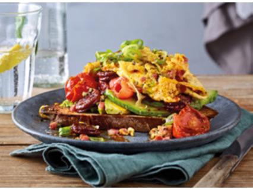

**Ingrediënten voor:** 4 personen
**Bereidingstijd:** ca. 30 min.
**300 g** cherrytomaten
**250 g** chorizo (pittige Spaanse worst)
**1 el** + 1 tl olie
suiker
zout en peper
**2** lente-uitjes
**8** eieren
**5 el** melk
**75 g** spekblokjes
**4 sneetjes** desembrood
**1** avocado
**1 tl** citroensap
1 Was de cherrytomaten. Snijd de chorizo in plakken. Verhit 1 el olie in een
pan. Bak er de chorizo knapperig in. Voeg de tomaten toe, bestrooi met 1 tl
suiker en bak tot de velletjes knappen. Bestrooi met zout en peper. Was de
lente-uitjes en snijd het groene en het witte deel apart in ringen. Kluts de
eieren, de melk, zout en peper door elkaar. Verhit 1 tl olie in een pan en bak
er de spekblokjes knapperig in. Bak de witte lente-uiringen kort mee. Schenk
het eimengsel erbij, laat een beetje stollen en spatel tot een roerei.
2 Rooster het brood. Halveer de avocado, schep de pit eruit en schep het
vruchtvlees uit de schil. Snijd de avocado in plakjes. Druppel het citroensap
eroverheen. Beleg het brood met de avocado, de tomaten, de chorizo en het
roerei. Bestrooi met de overige lente-ui.
**Per portie:** ca. 690 kcal
**37 g** eiwit | 40 g vet | 43 g koolhydraten

## Snelle gebakken rijst met garnalen

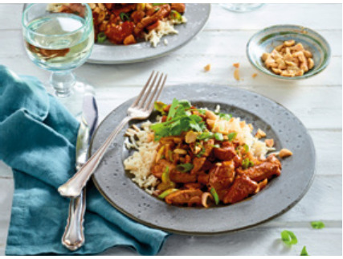

**Ingrediënten voor:** 4 personen
**Bereidingstijd:** ca. 25 min.
**300 g** basmatirijst
zout en peper
**150 g** erwten (diepvries)
**250 g** panklare garnalen (à ca. 20 g, zonder kop, met schaal)
**4** lente-uitjes
**2 el** olie
**1-2 tl** kerriepoeder
**6 el** sojasaus
1 Kook de rijst volgens de aanwijzingen op de verpakking in water met een
snufje zout. Voeg de erwten ca. 5 minuten voor het einde van de gaartijd toe
en gaar mee. Giet de rijst en de erwten eventueel af.
2 Pel de garnalen, verwijder het darmkanaal en laat het stukje schaal aan de
staart zitten. Was de lente-uitjes en snijd ze in ringen. Verhit de olie in een
pan. Bak er de garnalen ca. 1 minuut per zijde in. Voeg de lente-ui toe en bak
ca. 2 minuten mee.
3 Bestuif met het kerriepoeder en bak kort. Voeg de rijst met de erwten toe
en bak kort mee. Breng op smaak met de sojasaus, zout en peper.
**Per portie:** ca. 410 kcal
**21 g** eiwit | 7 g vet | 66 g koolhydraten
ZO GEFIKST
Gebruik een schaar om de
schaal op de rug van de
garnaal door te knippen.

# Happy New Year!

Over de hele wereld vieren ze nieuwjaar, al is dat soms een
paar uur eerder of later dan wij dat doen. Vier het nieuwe
jaar met deze feestelijke internationale gerechten.

## Ossenhaas uit Australië

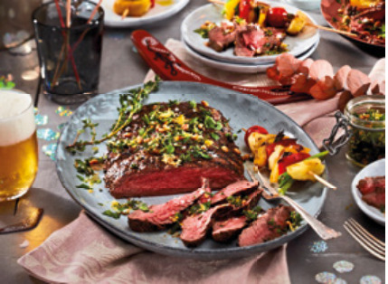

**Ingrediënten voor:** 10 personen
**Bereidingstijd:** ca. 45 min. + ca. 12 uur wachttijd
**2 el** zwarte peperkorrels
**1 el** pimentkorrels
**2** kaneelstokjes
**1 el** rietsuiker
**2** grote ossenhazen (à 800-
**850** g)
**40 g** pijnboompitten
**1 bosje** platte peterselie
**8-10 takjes** tijm
geraspte schil van 1½ biocitroen
olie, om in te vetten
zeezout
vershoudfolie
1 EEN DAG VAN TEVOREN VOOR DE RUB Vermaal
de peperkorrels, de pimentkorrels, de kaneelstokjes en de suiker in een grote vijzel. Wrijf
de ossenhazen aan beide zijden in met de rub.
Wikkel in folie en leg een nacht in de koelkast.
2 DE VOLGENDE DAG VOOR DE GREMOLATA
Rooster de pijnboompitten en laat a oelen. Was
de peterselie en de tijm en hak de blaadjes grof.
Meng de pijnboompitten, de peterselie, de tijm en
de citroenschil.
3 Verwarm de oven voor (elektrisch: 160°C /
hetelucht: 140°C). Snijd het vlees met de rug van
een mes grof in. Leg de ossenhazen in een grote,
ingevette grillpan en bak ze naast elkaar ca. 4 minuten per zijde. Leg het vlees op een bakplaat.
Bestrooi met zeezout en bak 12-14 minuten in de
oven. Neem het vlees uit de oven en laat ca. 7 minuten rusten. Bestrooi het vlees met de gremolata en snijd het in plakken. Serveer de overige
gremolata erbij.
**Per portie:** ca. 230 kcal
**31 g** eiwit | 7 g vet | 8 g koolhydraten

## Fruitige groentespiesen

Voor: ca. 20 stuks
**Bereidingstijd:** ca. 35 min.
Schil ½ ananas, halveer hem in de lengte en snijd de kern eruit. Snijd de ananas
in stukken. Snijd 3 paprika’s (rode en gele) in vieren en verwijder de zaadlijsten.
Was de paprika’s en snijd ze in grove stukken. Maak 4 lente-uitjes schoon en
snijd ze in grove stukken. Prik alles om-en-om met 200 g cherrytomaten op ca.
20 satéprikkers. Roer 1 tl kerriepoeder, een snu e zout, de geraspte schil van
½ bio-citroen, 4-5 el citroensap en 4 el olijfolie door elkaar. Bestrijk de spiesen
ermee en bak ze in een hete grillpan in porties 6-8 minuten rondom.
BUFFET

## Thaise noedels met

## mango en garnalen

**Ingrediënten voor:** 10 personen
**Bereidingstijd:** ca. 1 uur en 15 min.
10 garnalen (zonder kop, met schaal,
ca. 280 g, diepvries)
**50 g** gember (stuk)
**3-4** teentjes knoflook
**2** rode pepers
**3 el** sesamolie
**60 g** pindakaas
geraspte schil en sap van 1 biolimoen
**6-8 el** sojasaus
**2 el** ahornsiroop
**1** rode paprika
**1** gele paprika
**4** lente-uitjes
**4** wortels
zout en peper
**1** mango
**200 g** glasnoedels
**2-3 el** olie
**1 bosje** Thais basilicum
**1 bosje** koriander
**75-100 g** geroosterde en gezouten pinda’s
**10** cocktailprikkers
1 Laat de garnalen ontdooien en pel ze tot de
staart. Verwijder eventueel het darmkanaal.
Spoel de garnalen kort met koud water.
2 Schil de gember en hak hem fijn. Pel de knoflook
en hak hem fijn. Halveer de pepers, verwijder de
zaadlijsten, was de pepers en hak ze fijn.
3 VOOR DE SAUS Verhit de sesamolie in een pan.
Fruit de gember, ca. ⅔ van de knoflook en ca. ⅔
van de peper erin. Roer de pindakaas en 200 ml
water erdoorheen en roer tot een romige saus.
Voeg de limoenschil toe. Breng op smaak met ca.
2 el limoensap, 5-6 el sojasaus en 1 el ahornsiroop. Laat a oelen.
4 Snijd de paprika’s in vieren, verwijder de zaadlijsten, was de paprika’s en snijd ze in reepjes.
Maak de lente-uitjes schoon en snijd ze in ringen.
Schrap de wortels, was ze en snijd ze in reepjes.
Blancheer de groenten ca. 3 minuten in water met
een snu e zout. Schil de mango, snijd het vruchtvlees van de pit en snijd het in partjes.
5 Kook de noedels volgens de aanwijzingen op
de verpakking. Verhit de olie in een pan en bak
de garnalen ca. 5 minuten erin. Bak de overige
knoflook en de overige peper kort mee. Breng de
garnalen op smaak met zout en peper. Laat a oelen. Was de kruiden en hak de blaadjes fijn.
6 Giet de noedels af, spoel kort met koud water,
laat uitlekken en snijd ze in korte stukken.
Meng de noedels met de groenten, de mango, de
kruiden, de saus en de pinda’s. Breng op smaak
met 1-2 el sojasaus, het overige limoensap en de
ahornsiroop.
7 Prik de garnalen aan prikkers, verdeel de salade
en de garnalen in 10 kommetjes en garneer met
de kruiden.
**Per portie:** ca. 280 kcal
**10 g** eiwit | 13 g vet | 29 g koolhydraten

## Duitse middernachtssoep

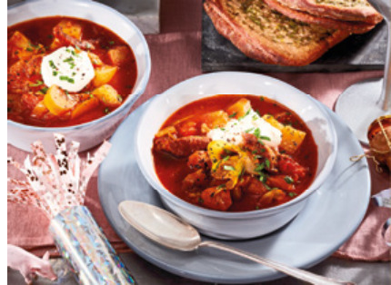

**Ingrediënten voor:** 10 personen
**Bereidingstijd:** ca. 1 uur en 30 min.
**2** grote uien
**3** preien
**500 g** wortels
**800 g** aardappels
**1,2 kg** varkensschnitzel
**3 el** olie
zout en peper
paprikapoeder
**1 tl** suiker
**2 tl** gedroogde oregano
**2 el** tomatenpuree
**800 g** tomaten (blik)
**1½** groentebouillonblokje
tabasco
evt. peterselie, ter garnering
1 Pel en snipper de uien. Was de preien en snijd ze
in ringen. Schrap de wortels, was ze en snijd ze in
plakjes. Schil de aardappels, was ze en snijd ze in
blokjes. Snijd het vlees in reepjes.
2 Verhit de olie in een grote pan. Bak het vlees
in porties op hoog vuur erin. Bestrooi met zout,
peper en paprikapoeder en neem uit de pan. Bak
de groenten en de aardappel in het bakvet. Breng
op smaak met zout, peper, paprikapoeder, de
suiker en de oregano. Bak de tomatenpuree kort
mee. Voeg het vlees, de tomaten, 750 ml water
en de bouillonblokjes toe. Breng aan de kook en
kook afgedekt ca. 40 minuten op laag vuur.
3 Breng de soep op smaak met zout, peper en tabasco. Bestrooi eventueel met peterselie. Lekker
met crème fraîche.
**Per portie:** ca. 320 kcal
**31 g** eiwit | 11 g vet | 21 g koolhydraten

## Kruidenbrood

Voor: ca. 18 sneetjes
**Bereidingstijd:** ca. 1 uur en 15 min. + wachttijd: ca. 1 uur en 30 min.
Bereid het deeg van mix voor boerenbrood (ca. 500 g, voor zuurdesem
en gistbrood) en laat rijzen. Was 1 bosje peterselie, 1 bosje dille en
**½ bosje** bieslook en hak de blaadjes fijn. Roer 125 g zachte boter, de
kruiden, de geraspte schil van 1 bio-citroen, zout en peper door elkaar.
Kneed het deeg op een met bloem bestoven werkblad rechthoekig (ca.
45x48 cm) uit, bestrijk het met de kruidenboter en snijd het in ca. 18
(ca. 8x15 cm) stukken. Druk alle stukken tegen elkaar aan en leg de
stapel in een ingevette en met bloem bestoven cakevorm (ca. 25 cm).
Laat afgedekt ca. 45 minuten rijzen. Verwarm de oven voor (elektrisch:
250°C / hetelucht: 230°C). Bestrijk het deeg met lauwwarm water. Bak ca.
10 minuten in de oven. Verlaag de temperatuur van de oven (elektrisch:
200°C / hetelucht: 180°C) en bak 25-30 minuten verder. Laat a oelen.
BUFFET

## Russische salade

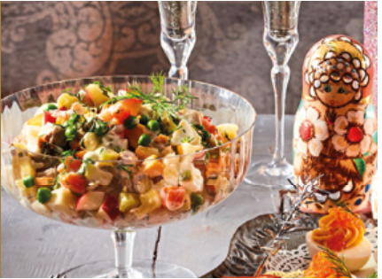

**Ingrediënten voor:** 10 personen
**Bereidingstijd:** ca. 1 uur en 45 min. + minimaal 1 uur wachttijd
**1** prei
**2** kleine wortels
**¼** knolselderij
**2** uien
**2** laurierblaadjes
**1 tl** peperkorrels
zout en peper
2 kippenborstfilets (met huid en bot, à ca. 500 g, bij de
poelier)
**1,2 kg** vastkokende aardappels
**4** eieren
**250 g** erwten (diepvries)
4 grote augurken (ca. 200 g) + 6-7 el augurkennat
**1 bosje** dille
**400 ml** yoghurtmayonaise
**6 el** melk
sap van 1 citroen
suiker
**2** zure appels
1 Maak de prei schoon en snijd hem in ringen. Schrap de wortels, was ze en
snijd ze in grove blokjes. Schil de knolselderij, was hem en snijd hem in grove
blokjes. Pel 1 ui en snijd hem in vieren. Doe alles in een pan en breng met
**1,5 l** water, de laurierblaadjes, de peperkorrels en 1 tl zout aan de kook. Kook
ca. 5 minuten op laag vuur. Leg de kippenborstfilets in de bouillon en kook
afgedekt ca. 30 minuten op laag vuur.
2 Was de aardappels en kook ze ca. 20 minuten. Kook de eieren in ca. 10 minuten hard, spoel kort met koud water en laat a oelen. Laat de erwten
ontdooien. Giet de aardappels af, pel ze, laat een beetje a oelen en snijd ze
in kleine blokjes.
3 Pel en snipper 1 ui. Snijd de augurken in kleine blokjes. Was de dille en hak
de naaldjes fijn. Roer de mayonaise, de melk, het augurkennat en het citroensap door elkaar. Roer de ui, de augurk en de dille erdoorheen. Breng de
dressing op smaak met zout, peper en een snu e suiker. Spatel de aardappels
en de erwten erdoorheen.
4 Neem de kippenborstfilets uit de bouillon (verwerk de bouillon in een
ander recept) en laat een beetje a oelen. Neem het vlees van de huid en het
bot. Was de appels, snijd ze in vieren en verwijder het klokhuis. Pel de eieren.
Snijd het vlees, de appel en de eieren in kleine blokjes en spatel ze door de
salade. Zet minimaal 1 uur in de koelkast. Breng op smaak met zout en peper.
**Per portie:** ca. 540 kcal
**25 g** eiwit | 36 g vet | 28 g koolhydraten
BUFFET

## Gevulde eieren met

## zalm en kaviaar

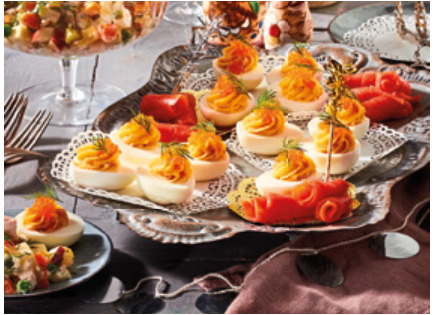

Voor: 10 personen
**Bereidingstijd:** ca. 30 min.
Halveer 250 g plakken gerookte zalm en rol
ze op. Pel 10 hardgekookte eieren en halveer
ze in de lengte. Schep de eidooiers eruit en
druk ze door een zeef. Roer 100 g yoghurtmayonaise en 1 tl mosterd erdoorheen. Breng
op smaak met zout en peper en doe in een
spuitzak. Spuit de eiroom in de halve eieren.
Garneer met 50 g forelkaviaar en dille.
Serveer samen met de zalmrolletjes.
**Per stuk:** ca. 200 kcal
**12 g** eiwit | 16 g vet | 1 g koolhydraten

## Tomatensalsa

Voor: 8 personen
**Bereidingstijd:** ca. 15 min.
Pel en snipper 2 uien en 3 teentjes knoflook.
Halveer 1 rode peper, verwijder de zaadlijsten, was de peper en snijd hem in ringen.
Verhit 3 el olie in een pan. Fruit er de ui en
de knoflook in. Bak 3 tl tomatenpuree en de
peper mee. Voeg 400 g tomatenblokjes toe.
Breng op smaak met zout, peper, paprikapoeder en een snu e suiker. Breng aan de kook
en kook ca. 10 minuten op laag vuur. Breng op
smaak met zout, peper en 1-2 el witte balsamicoazijn. Laat a oelen. Serveer eventueel
met tuinkers.

## Braziliaanse linzenempanada’s

**Ingrediënten voor:** 10 stuks
**Bereidingstijd:** ca. 1 uur en 15 min.
**75 g** groene linzen
**75 g** spinazie
**1** kleine ui
**1** teentje knoflook
**1 el** olie
450 g bladerdeeg (10 plakken,
diepvries)
**50 g** verse roomkaas
zout en peper
**1** ei
bloem
bakpapier
1 VOOR DE VULLING Kook de linzen in 225 ml
water in een kleine pan 35-40 minuten. Was de
spinazie. Pel en snipper de ui en de knoflook.
Verhit de olie in een klein pan. Fruit er de ui en de
knoflook in. Voeg de spinazie toe, laat slinken en
neem van het vuur. Laat de linzen uitlekken.
2 Leg de deegplakken naast elkaar en laat ontdooien. Meng de linzen, de spinazie en de roomkaas. Breng op smaak met zout en peper. Splits
het ei. Kluts het eiwit. Roer de eidooier met 1 el
water glad.
3 Verwarm de oven voor (elektrisch: 230°C /
hetelucht: 210°C). Steek grote cirkels (11 cm Ø)
uit de bladerdeegplakjes. Verdeel de vulling erop
en laat hierbij ca. 1 cm van de rand vrij. Bestrijk
de rand rondom met het eiwit en klap het deeg
dubbel. Druk de randen met de vingers en daarna
met een vork stevig aan.
4 Leg de empanada’s op een met bakpapier beklede bakplaat en bestrijk ze met de eidooier. Bak
12-15 minuten in de oven. Laat a oelen.
**Per portie:** ca. 280 kcal
**6 g** eiwit | 17 g vet | 24 g koolhydraten

## Amerikaanse cheesecake

## met blauwebessensaus

**Ingrediënten voor:** 10 stuks
**Bereidingstijd:** ca. 1 uur + ca. 1 uur en 30 min.
wachttijd
**500 g** blauwe bessen (diepvries)
**4 el** rietsuiker
**100 g** boter
**200 g** volkoren biscuitjes
**500 g** verse roomkaas
**150 g** suiker
**8 g** vanillesuiker
**3 el** maizena
**2** eieren
**80 ml** slagroom
**3 el** olie
**30 g** popcornmais
**1** grote diepvrieszak
1 Meng de bessen met 2 el rietsuiker in een pan
en laat ontdooien. VOOR DE BODEM Smelt de
boter en laat een beetje a oelen. Doe de biscuittjes in de diepvrieszak, sluit hem af en verbrokkel
de koekjes met een deegroller. Meng het koekkruim met de boter. Verdeel het mengsel over
de bodem van 10 ovenvaste vormpjes (à 200 ml
inhoud) en druk aan.
BUFFET
2 VOOR HET ROOMMENGSEL Verwarm de oven
voor (elektrisch: 160°C / hetelucht: 140°C). Roer
de roomkaas, de suiker, de vanillesuiker en 2 el
maizena glad. Klop de eieren en de slagroom
erdoorheen. Verdeel het mengsel over de vormpjes. Zet de vormpjes op een bakplaat en schuif
de bakplaat in de oven. Schenk kokend water (tot
ca. 2 cm hoog) op de bakplaat en bak de cakejes
ca. 40 minuten in de oven. Laat a oelen.
3 VOOR DE SAUS Voeg 2-3 el water toe aan de bessen en breng aan de kook. Roer 1 el maizena met
**2 el** water glad. Roer het door de bessen en kook
ca. 1 minuut op laag vuur. Laat a oelen.
4 VOOR DE POPCORN Verhit de olie in een grote
pan. Pop de mais er afgedekt op middelhoog vuur
in. Neem de pan van het vuur. Bestrooi de popcorn met 2 el rietsuiker, doe de deksel op de pan
en schud om. Laat in een ruime kom a oelen.
5 Serveer elke cheesecake met de saus en de
popcorn erbovenop. Serveer de overige saus en de
overige popcorn erbij.
**Per stuk:** ca. 500 kcal
**7 g** eiwit | 31 g vet | 45 g koolhydraten
Titel: Het beste van
**10** jaar Heel Holland Bakt

# Heel Holland Bakt

Prijs: 19,99
Aantal pagina’s: 144
Uitgeverij: Kosmos

# met kerst

Al 10 jaar lang zitten alle bakfanaten en taartliefhebbers elk najaar voor de tv te
watertanden bij de prachtige baksels van Heel Holland Bakt. Gelukkig voor al
deze fans kwam er dit jaar met een nieuw kookboek: Het beste van 10 jaar Heel
Holland Bakt, met daarin de lekkerste en mooiste recepten van de afgelopen
10 jaar. En wat is nou een beter moment om deze te bakken dan met kerst?
Tekst: Lotus van Overveldt
Kubus van
jocondebiscuit
Iedereen die graag bakt droomt er stiekem
van om mee te doen aan Heel Holland
Bakt (en dan natuurlijk te winnen en
zichzelf een jaar lang de beste thuisbakker van
Nederland te mogen noemen). Dat is niet zo
gek: in het programma passeren de mooiste en
lekkerste taarten, koekjes en cakes de revue en
daarbij is de sfeer in de tent, wanneer de kandidaten niet onder al te veel druk staan, vaak
ook nog eens heel gezellig. Die gemoedelijke
sfeer zorgt ervoor dat je echt meeleeft met de
kandidaten, of ze nu bezig zijn met de klassieke
signatuuropdracht, de bloedstollende technische opdracht of het indrukwekkende spektakelstuk. In Het beste van 10 jaar Heel Holland
Bakt blik je terug op al je favoriete baksels,
kandidaten, presentatoren en juryleden van de
afgelopen tien seizoenen.
KOOKBOEK: HET BESTE VAN 10 JAAR HEEL HOLLAND BAKT
zijn alleen de mooiste en lekkerste recepten in het
boek terechtgekomen. Wat dacht je bijvoorbeeld
van de oogverblindende bruidstaart waarmee
Rutger het allereerste seizoen won? Of de sierlijke
zwanensoezen van Janny uit seizoen 5? Ook de
chocoladetaart met frambozen die je elke keer in
de intro voorbij ziet komen, en waar je wellicht al
tien jaar benieuwd naar bent, is te vinden in het
boek. Vanzelfsprekend vonden we het ontzettend
moeilijk om te kiezen welke recepten we met je wilden delen, maar uiteindelijk zijn we voor de meest
kerstige opties gegaan. Dat werden de chateautaart
van Elizabeth, de kubus van jocondebiscuit van
Anouk en de klassieke operataart van Hans. We
kunnen ons voorstellen dat je vingers beginnen te
jeuken, dus: bakkers klaar? Bakken maar!

## Kubus van jocondebiscuit

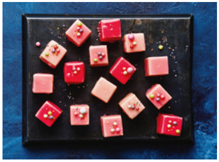

Anouk (winnaar seizoen 7): “Wat was dit een
geweldige opdracht om te doen! Deze versie is
wat toegankelijker dan de grote bonbons die ik
in de tent maakte. Wil je het presenteren als een

## kubus, vraag dan een handige Harry in je omgeving om zo’n leuke kubusstandaard te maken.”

**Ingrediënten voor:** 36 stuks
**Bereidingstijd:** ca. 2 uur en 20 min.
+ ca. 12 uur en 15 min. wachttijd
**VOOR DE** BOTERCRÈME
**250 g** boter, op
kamertemperatuur
**200-350 g** lemoncurd
spuitzak
klein paletmes
**VOOR DE** BANKETBAKKERSROOM
**½** vanillestokje
**40 g** fijne kristalsuiker
**250 g** volle melk
**2** eidooiers
**20 g** bloem
VOOR HET JOCONDEBISCUIT
**75 g** boter, op kamertemperatuur
**80 g** fijne kristalsuiker
**5** eieren
**170 g** amandelmeel
**40 g** bloem
**½ tl** amandelextract
**150 g** eiwit
poedersuiker
bakpapier
groot paletmes
bakring van 20x20 cm
en minimaal 5 cm hoog
VOOR HET SPIEGELGLAZUUR
**10** gelatineblaadjes
**300 g** fijne kristalsuiker
**300 g** glucose (bij de bakwinkel)
**150 g** water
**300 g** witte chocolade
**200 g** gecondenseerde melk
suikerthermometer
roze kleurstofpasta
Kerstige taarten
UitelkvandetienseizoenenvanHeelHollandBakt
Bereidingswijze op de
volgende pagina >>
sprinkles of crispy chocopearls
1 EEN DAG VAN TEVOREN VOOR DE BANKET
BAKKERSROOM Snijd het vanillestokje in de lengte
open en schraap het merg eruit. Voeg het merg, het
vanillestokjes en de helft van de kristalsuiker toe
aan de melk en breng op halfhoog vuur in een pan
tegen de kook aan. Klop de eidooiers en de rest van
de kristalsuiker met een garde door. Voeg de bloem
toe en roer door totdat de klontjes weg zijn. Giet een
scheutje van de warme vanillemelk al roerend bij de
eidooiers. Giet de eidooiers vervolgens al roerend
terug in de pan met warme vanillemelk. Laat op laag
vuur 2 minuten koken terwijl je blijft roeren. Het
koken is belangrijk om de bloem te laten garen en
door te roeren zorg je dat de banketbakkersroom
niet aankoekt op de bodem en gelijkmatig gaart.
2 Na 2 minuten dikt de banketbakkersroom in tot
yoghurtdikte en haal je de pan van het vuur. Schenk
de banketbakkersroom op een platte schaal en dek
af met plasticfolie die je direct op de banketbakkersroom legt om de vorming van een vel te voorkomen.
Laat eerst afkoelen op het aanrecht en zet vervolgens in de koelkast. Het vanillestokje haal je er pas
uit als je de banketbakkersroom gaat gebruiken,
zodat het extra lang smaak af kan geven.
3 Verwarm de oven voor (elektrisch: 180⁰C / hetelucht: 160⁰C). Bekleed een bakplaat met bakpapier.
VOOR HET JOCONDEBISCUIT Doe de boter, de helft
van de fijne kristalsuiker, de eieren en het amandelmeel in een kom en mix met een handmixer in
een paar minuten tot een homogeen beslag. Voeg de
bloem toe en mix door. Roer tot slot het amandelextract erdoor. Klop in een vetvrije kom van een staande tafelmixer het eiwit met de garde tot het eiwit
wit begint te worden. Voeg dan beetje bij beetje de
overige fijne kristalsuiker toe. Klop door totdat je
glanzende en stijve pieken eiwitschuim hebt. Meng
het eiwitschuim in drie delen door het amandelmengsel. Zorg dat het beslag luchtig blijft.
4 Strijk met een groot paletmes het beslag gelijkmatig uit over de met bakpapier beklede bakplaat.
Straks moeten er 3 vierkanten van 20x20 cm uit te
snijden zijn. Past dit niet op 1 bakplaat, strijk het
beslag dan uit over 2 bakplaten, maar houd wel
overal dezelfde dikte (5-7 mm) aan. Schuif de bakplaat in het midden van de oven en bak het beslag
in 10 minuten gaar. Het biscuit mag nog licht van
kleur zijn. Schuif meteen na het bakken het biscuit
met het bakpapier van de bakplaat en bestrooi het
biscuit licht met poedersuiker. Draai het samen met
het bakpapier om en trek rustig het bakpapier van
het biscuit af. Laat het biscuit afkoelen op een rooster en snijd er 3 vierkanten van 20x20 cm uit.
5Laatdebanketbakkersroomopkamertemperatuur komen. Mix in een staande tafelmixer met platte menghaak de boter wit en romig. Dit duurt 10-15
minuten. Voeg vervolgens in delen de banketbakkersroom toe en mix het geheel nog zeker 5 minuten
tot een luchtige botercrème. Schep de botercrème in
een spuitzak. Zet de bakring op een snijplank die in
de vriezer past. Leg bakpapier op de snijplank. Leg
de eerste plak jocondebiscuit in de ring en bestrijk
met lemoncurd. Verdeel vervolgens een laag botercrème over de lemoncurd en houd hiervoor dezelfde
dikte als het biscuit aan. Met een klein paletmes
kun je de lagen mooi gelijkmatig en strak verdelen.
Leg de tweede plak biscuit erop, bestrijk hem met
lemoncurd en verdeel opnieuw een laag botercrème
erover. Leg de laatste plak biscuit erop en bestrijk
de bovenkant dun met botercrème. Het totaal is
ongeveer 3 cm hoog. Ga je een kubusstandaard
gebruiken, maak ze dan niet hoger want er komt
nog spiegelglazuur over. Zet de ring minimaal 12 uur
indevriezer.
6 DE VOLGENDE DAG VOOR HET SPIEGELGLAZUUR
Week de gelatine minimaal 20 minuten in een
kom met koud water. Haal de ring uit de vriezer en
verwarm een koksmes onder de hete kraan. Droog
het mes af en snijd de randen van de ring los. Snijd
het geheel in blokjes van 3x3 cm. Je zult hiervoor
steeds het mes moeten verwarmen om makkelijk te
kunnen snijden. Je kunt op deze manier 36 blokjes
snijden. Zet de blokjes los van elkaar op de snijplank
en zet die terug in de vriezer. Gebruik je de kubusstandaard, dan heb je in totaal 25 blokjes nodig.
7 Verwarm in een steelpan de fijne kristalsuiker, de
glucose en het water tot een temperatuur van 103⁰C.
Doe de witte chocolade, de gecondenseerde melk
en de uitgeknepen geweekte gelatine in een kom
en giet de hete suikersiroop erover. Laat een paar
minuten staan en roer door met een spatel of met de
staafmixer. Probeer zo min mogelijk luchtbelletjes
in het spiegelglazuur te krijgen. Verdeel het glazuur
over 3 schaaltjes en geef het met kleurstofpasta in
elk schaaltje een andere tint roze. Laat het spiegelglazuur op het aanrecht afkoelen tot een temperatuur tussen de 32 en 35⁰C. Haal steeds 5 blokjes uit
de vriezer, zet ze op een rooster met een bakplaat eronder en overgiet de blokjes met het spiegelglazuur.
Laat uitdruppelen en pak de volgende 5 blokjes. Ga
zo door tot alle blokjes overgoten zijn. Decoreer met
sprinklesofchocopearls.
TIP
Als je de blokjes overgiet met het
spiegelglazuur is het belangrijk dat
de blokjes diep bevroren zijn en het
spiegelglazuur een temperatuur tussen de
32 en 35 °C heeft. Op deze manier hecht
het glazuur mooi en smelt de botercrème
niet weg. Wil je de kubusjes nog strakker,
bestrijk ze dan rondom met botercrème en
overgiet ze met het spiegelglazuur als ze
diep bevroren zijn. Een precies werkje, dus
neem er de tijd voor, dan lukt het zeker!
TIP
De blokjes zijn 2 dagen houdbaar in de
koelkast. Bewaar ze los van elkaar.

## Chateautaart

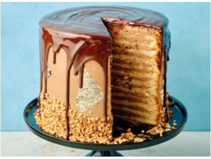

Elizabeth (winnaar seizoen 8): “Deze chateautaart
is een Arubaanse laagjestaart, met oorspronkelijk drie lagen. Omdat ik alles graag een eigen
draai geef, heeft deze versie maar liefst dertien
lagen. Een chateau heeft hoge torens, toch? Voor
die hoeveelheid lagen heb ik het recept voor het
biscuit drie keer gevolgd, en elke cake in meerdere
dunne lagen gesneden. Mocht je ook zo’n hoge
taart willen maken, vergeet dan niet de overige
ingrediënten te verveelvoudigen. Volg anders

## gewoon het recept.”

**Ingrediënten voor:** ca. 10 stukken
**Bereidingstijd:** ca. 2 uur en 10 min.
+ ca. 2 uur en 10 min. wachttijd
KOOKBOEK: HET BESTE VAN 10 JAAR HEEL HOLLAND BAKT
**VOOR DE** CAKE
**25 g** boter (+ invetten)
**125 g** amandelmeel
**25 g** aardappelzetmeel
**35 g** melk
**5** eieren
**120 g** kristalsuiker
**30 g** honing
**1 tl** vanille-extract
**1 mespunt** zout
**1 tl** limoensap
plasticfolie
**VOOR DE** CHOCOLADECRÈME
**380 g** slagroom
**6 g** cacaopoeder
**165 g** purechocoladepastilles
**3 g** boter
spuitzak
**VOOR DE** RUMSIROOP
**35 g** kristalsuiker
**30 g** donkere rum
**VOOR DE** GARNERING
**50 g** hazelnoten
**100 g** purechocoladepastilles
evt. eetbaar bladgoud
paletmes
Bereidingswijze op de
volgende pagina >>
1 Verwarm de oven voor (elektrisch: 175⁰C / hetelucht: 155⁰C). Vet 2 bakvormen van 15 cm Ø in met
boter. Meng VOOR DE CAKE in een kom het amandelmeel en het aardappelzetmeel met een garde.
2 Laat de melk en boter au bain-marie warm
worden. Splits de eieren. Doe 3 eidooiers in een
mengkom en voeg 20 g kristalsuiker, de honing,
het vanille-extract en zout erbij en klop met een
handmixer tot een luchtig beslag. Klop 5 eiwitten in een andere, brandschone kom met het
limoensap stijf. Voeg al kloppend, lepel voor lepel
**100 g** kristalsuiker toe. Klop tot glanzende, stijve
pieken.
3 Zeef het amandelmeel en aardappelzetmeel
boven het eidooierbeslag en spatel er goed door.
Roer het lauwe melk-botermengsel erdoor. Spatel
in delen het eiwit door het beslag en probeer zo
veel mogelijk lucht te behouden.
4 Verdeel het beslag gelijkmatig over de bakvormen (300 g beslag per vorm). Bak de cakes in het
midden van de oven in ca. 30 minuten goudbruin
en gaar. Verlaag de oventemperatuur naar 160⁰C
als de cakes in de oven staan.
5 Laat de cakes 10 minuten in de bakvormen
afkoelen, verwijder dan de vormen en laat ze
afkoelen op een rooster.
6 VOOR DE CHOCOLADECRÈME Meng 80 g slagroom met het cacaopoeder. Smelt de chocolade
met de boter au bain-marie, maar laat de chocolade niet te heet worden. Haal van het vuur en
voeg het room-cacaomengsel toe. Klop de 300 ml
slagroom lobbig en spatel dit zo luchtig mogelijk
door de gesmolten chocolade. Schep het in een
spuitzak en bewaar tot gebruik in de koelkast.
7 VOOR DE SIROOP Breng 50 ml water met 35 g
kristalsuiker aan de kook. Roer tot de suikerkristallen zijn opgelost en voeg de rum toe. Laat de
siroop afkoelen.
8 VOOR DE GARNERING Rooster de hazelnoten in
een koekenpan in ca. 4 minuten op middelhoog vuur
krokant. Laat ze afkoelen op een bord en hak ze fijn.
9 Bekleed een bakvorm met plasticfolie. Snijd
de cakes overlangs elk in twee gelijke lagen. Leg
een cakelaag in de bakvorm en bestrijk met wat
siroop. Breng met de spuitzak een laag chocoladecrème aan en bestrooi met fijngehakte hazelnoten. Dek af met een cakelaag, herhaal dit proces
en eindig met cake. Dek de cakelagen af met
plasticfolie en zet er een tweede bakvorm bovenop. Laat de taart twee uur in de koelkast afkoelen.
10 Bestrijk de taart rondom met de rest van de
crème en bestrooi de onderkant van de taart met
de rest van de hazelnoten. Smelt 100 g chocolade
en giet dit over de taart, verspreid dit met een
paletmes en laat over de randen heen glijden.
Decoreer de taart als je wil met eetbaar bladgoud.
TIP
Het aansnijden van hoge taarten is best
een uitdaging. Zet daarom een snijplank
tegen de zijkant van de taart, en snijd hem
dan van boven naar beneden aan. Vang
het afgesneden deel op met de snijplank
en snijd hem op de plank in kleinere
porties.

## Klassieke opera

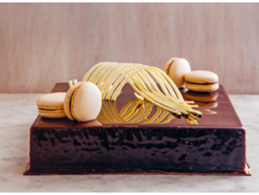

Hans (winnaar seizoen 5): “De klassieke Franse
operataart vind ik als chocoladeliefhebber nog
altijd het leukst om te maken. Strak geglaceerd
en afgewerkt met macarons en chocoladekrullen.
De sinaasappelbotercrème met zelfgemaakte

## pistachepraliné zorgt voor een ware smaakexplosie en viel bij Robèrt dan ook goed in de smaak.”

**Ingrediënten voor:** ca. 10 stukken
**Bereidingstijd:** ca. 2 uur en 40 min.
+ ca. 1 uur wachttijd
VOOR HET JOCONDEBISCUIT MET PISTACHE
**230 g** gepelde pistachenoten
**260 g** fijne kristalsuiker
**6** eiwitten
**6** eieren
**1 mespuntje** zout
**50 g** bloem
**100 g** boter, gesmolten
bakpapier
vierkante taartring van
22x22x5 cm
taartkarton van 22x22 cm
KOOKBOEK: HET BESTE VAN 10 JAAR HEEL HOLLAND BAKT
**VOOR DE** SINAASAPPELPISTACHECRÈME
**120 g** gepelde pistachenoten
**120 g** fijne kristalsuiker
**VOOR DE** SINAASAPPELBOTERCRÈME
**400 g** volle melk
**80 g** fijne kristalsuiker
**1** vanillestokje
rasp van 2 sinaasappels
**35 g** custardpoeder
**2** eidooiers
**240 g** boter, op kamertemperatuur
**80 g** witte basterdsuiker
plasticfolie
**VOOR DE** TREMPEERLIKEUR
**100 g** fijne kristalsuiker
**50 ml** sinaasappellikeur
(bijv. Cointreau of
Grand Marnier)
**VOOR DE** PURECHOCOLADEGANACHE
**250 ml** slagroom
**250 g** pure chocolade (callets
of grof gehakt)
**75 g** boter, op kamertemperatuur
**VOOR DE** CHOCOLADEDECORATIE
**250 g** witte chocolade (callets
of grof gehakt)
chocolademacarons,
ter decoratie
keukenthermometer
strook acetaatfolie
(ca. 8x30 cm)
gekarteld krabbertje (bij de
bakwinkel)
VOOR HET PURECHOCOLADEGLAZUUR
**5½ blaadjes** gelatine
**225 g** fijne kristalsuiker
**150 g** pure chocolade (callets
of grof gehakt)
**30 g** cacaopoeder
**65 ml** slagroom (minimaal 35% vet)
TIP
Heel veel verschillende componenten…
houd je hoofd er dus bij!
Bereidingswijze op de volgende pagina >>
1 Verwarm de oven voor (elektrisch: 220⁰C /
custardpoeder en de eidooiers in een kom tot
hetelucht: 200⁰C). VOOR HET JOCONDEBISCUIT
een glad papje. Giet een derde van de hete melk
al roerend bij het papje en roer goed door. Giet
Vermaal de pistachenoten met 130 g van de krisdit vervolgens terug bij de hete melk in de pan en
talsuiker in de keukenmachine. Klop de eiwitten
laat de gele room op laag vuur ongeveer 1 minuut
op in de vetvrije mengkom van een staande tadoorkoken onder continu roeren tot een dikke
felmixer. Voeg zodra de eiwitten schuimig zijn de
vla. Haal de gele room door een zeef om eventuele
overgebleven 130 g fijne kristalsuiker toe. Klop
klontjes en het vanillestokje te verwijderen. Stort
dit tot een stevig schuim. Klop de eieren los in een
de room in een diep bord of op een plaatje en dek
kom. Voeg de gemalen pistachenoten, het zout en
hem af met plasticfolie om velvorming te voorde bloem toe en roer het geheel goed door. Voeg
komen. Laat de room afkoelen in de koelkast.
ook de gesmolten boter toe. Spatel eerst een vierde
van het schuim door het beslag en dan de rest.
4 VOOR DE TREMPEERLIKEUR Breng 100 ml
Strijk het mengsel dun uit over 2 met bakpapier
water en de suiker in een steelpan aan de kook.
beklede bakplaten en bak de biscuitplakken 1 voor
Laat het mengsel ongeveer 2 minuten doorkoken.
1 ongeveer 8 minuten.
Haal de pan van het vuur en voeg de likeur toe.
2 Haal na het bakken de biscuitplak meteen van de
Laat de trempeerlikeur afkoelen.
bakplaat en keer hem om op een tweede vel bak-
5 VOOR DE SINAASAPPELBOTERCRÈME Klop de
papier. Verwijder het bakpapier van de achterkant
boter en de basterdsuiker ongeveer 5 minuten
van de biscuitplak. Steek met de taartring 2 plakluchtig in een staande tafelmixer. Voeg de afgekoelde gele room toe en laat de botercrème miken uit de biscuitplak. Maak met 2 halve plakken
een derde plak. Snijd de drie plakken nu nog verder
nimaal 20 minuten draaien. Doe dit op een lage
bij, zodat er aan weerszijden een speling van ongesnelheid, anders wordt de crème ‘vettig’.
veer 1 cm tussen de biscuitplakken en de taartring
ontstaat. De biscuitplakken mogen de taartring
6 VOOR DE SINAASAPPEL-PISTACHECRÈME
Kook de suiker met 30 ml water in een pan tot
dus niet raken, wanneer deze in het midden liggen.
Leg de biscuitplakken opzij. Verlaag de oventemperatuur (elektrisch: 160⁰C / hetelucht: 140⁰C). VOOR
een goudbruine karamel. Voeg de geroosterde
DE SINAASAPPEL-PISTACHECRÈME Verdeel de
pistachenoten toe en roer kort door. Stort het
mengsel op een vel bakpapier en laat de karamel
pistachenoten over een bakplaat en rooster ze 15
uitharden. Vermaal de pistachenougatine in
minuten in de oven.
de keukenmachine in ongeveer 8 minuten tot
3 VOOR DE SINAASAPPELBOTERCRÈME Breng
praliné. Neem de helft van de sinaasappelbotercrème en spatel de praliné er voorzichtig door.
**350 g** van de melk met 40 g van de fijne kristal
Schep de twee soorten botercrème in afzondersuiker in een pan aan de kook. Snijd het vanillelijke spuitzakken en leg ze weg (niet gekoeld).
stokje open en schraap het merg eruit. Voeg het
merg, het stokje en de helft van de sinaasappelrasp
7 VOOR DE PURECHOCOLADEGANACHE Breng de
toe aan de melk. Roer ondertussen de overgebleslagroom aan de kook en giet hem op de chocoven melk met de overgebleven kristalsuiker, het
lade. Voeg de boter in stukjes toe en roer tot een
gladde ganache.
8 VOOR DE CHOCOLADEDECORATIE Tempereer
de witte chocolade. Smelt daarvoor de chocolade
tot 45⁰C en koel twee derde op een marmeren
plaat terug naar 27⁰C. Giet de chocolade terug bij
een derde deel van de chocolade in de kom; de
uiteindelijke temperatuur moet 29⁰C zijn. Smeer
de getempereerde chocolade dun uit over de
strook acetaatfolie. Maak nu lijnen door met het
gekartelde krabbertje over de chocolade heen te
gaan. Laat de chocolade even stollen, maar niet
volledige uitharden. Breng de strook voorzichtig
in de vorm van een krul en ondersteun de krul
met 2 glazen terwijl deze verder uithardt. Leg
de krul ongeveer 15 minuten in de vriezer en
verwijder daarna het folie.
9 VOOR HET PURECHOCOLADEGLAZUUR Week
de gelatine 5 minuten in koud water. Kook de
kristalsuiker met 125 ml water in een pan tot
105⁰C. Schenk de suikersiroop bij de chocolade en
roer het geheel goed door. Zeef het cacaopoeder
en voeg dit toe. Voeg tot slot de slagroom en de
uitgeknepen gelatine toe. Maak het glazuur helemaal glad met een staafmixer en giet het glazuur
door een zeef, zodat eventuele luchtbelletjes
verdwijnen. Zet tot gebruik opzij. Het glazuur
moet ongeveer 30⁰C zijn om goed mee te kunnen
glaceren. Warm het glazuur eventueel een klein
beetje bij in de magnetron.
10 Zet de taartring op het taartkarton en bekleed
de randen met stroken acetaatfolie of bakpapier.
Leg een biscuitplak midden in de taartring.
Besprenkel het biscuit met trempeerlikeur en
breng er een laag sinaasappelbotercrème op
aan. Vul ook de ruimte tussen de biscuitplak en
de taartring op met de crème. Leg de twee halve
biscuitplakken erbovenop en besprenkel weer
met trempeerlikeur. Breng een laag sinaasappelpistachecrème op dezelfde wijze als de eerste
laag botercrème aan. Leg de laatste biscuitplak
erop en besprenkel deze ook. Smeer de taart
strak af met purechocoladeganache. Verwarm
voor een extra strak effect een glaceermes met
een crème-brûléebrander en ‘trek’ het mes vervolgens over de taartring. Laat de taart ongeveer
60 minuten opstijven in de vriezer.
11 Neem de taart uit de vriezer en verwijder de
taartring en het bakpapier. Zet de taart op een
rooster boven een bakplaat en overgiet hem met
glazuur. Verwijder het overtollige glazuur door
een keer met het paletmes over de taart te strijken. Decoreer de taart met de chocoladekrullen
en chocolademacarons.
Lekker eten valt of staat met de ingrediënten
die je gebruikt en het keukengerei dat je tot
je beschikking hebt. Daarom presenteren
wij elke maand leuke, verrassende, handige
en/of smakelijke producten.

# COCKTAILGLAZEN

Die cocktails voor bij de cocktailtaarten van p. 44 moeten
natuurlijk wel in mooie glazen gepresenteerd worden. Ga
bijvoorbeeld voor deze feestelijke exemplaren van Sissy Boy;
daarin komt je drankje echt goed tot z’n recht!
Prijs: €35,96 voor 4 stuks.
Verkrijgbaar via sissy-boy.com

# Wereld

# GERECHTEN

Karin Luiten is de koningin van het zonder-pakjes-en-zakjes-koken en dat
laat ze voor de 20e (!) keer zien in dit boek vol wereldgerechten. Van
Mexicaanse fajita’s met vis tot Zuid-Afrikaanse bobotie: met dit boek lukt
het gegarandeerd. Ook leuk om als kerstcadeautje te geven!
Prijs: €26,99. Verkrijgbaar via o.a. bol.com

# RACLETTEPANNETJE

Voor de racletterecepten van p. 40 is het wel handig om een
raclettepannetje te hebben. Deze van Boska is groot genoeg om voor
meerdere personen tegelijk kaas te smelten (of voor één persoon die
heel veel van kaas houdt).
Prijs: €19,99. Verkrijgbaar via o.a. boska.com

# Feestelijke taarten

Bak deze kerst de allerlekkerste én mooiste taarten. Ga jij als eerste voor de zoete
kerstbûche of de prachtige kerstkrans van vruchtenmuffins?

## Hemelse frambozen-laagjestaart

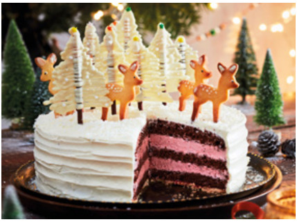

**Ingrediënten voor:** ca. 12 stukken
**Bereidingstijd:** ca. 1 uur en 30 min.
+ ca. 5 uur wachttijd
**230 g** bloem (+ bestuiven)
**100 g** koude boter (+ invetten)
**50 g** poedersuiker
**1** eidooier
**25 g** gevriesdroogde frambozen
**4** eieren
**230 g** suiker
**20 g** cacaopoeder
**30 g** maizena
**1 tl** bakpoeder
**5 blaadjes** gelatine
**500 g** mascarpone
**500 g** magere kwark
sap van 1 citroen
**5 el** frambozengelei
**250 ml** slagroom
**8 g** vanillesuiker
**75 g** witte chocolade
**8** LU Mikado chocoladekoekjes
witte en gekleurde suikerparels
**3 el** geraspte kokos
vershoudfolie
bakpapier
uitsteker in hertvorm
(à ca. 5 cm)
spuitzakje
Natuurlijke kleurstof
Maal gevriesdroogde frambozen fijn in een
keukenmachine of vijzel voor natuurlijke,
felroze kleurstof
1 VOOR DE TAARTBODEM Kneed 150 g bloem, de
boter in stukken, de poedersuiker en de eidooier
glad. Wikkel in vershoudfolie en leg ca. 1 uur in de
koelkast.
2 VOOR HET BISCUIT Verwarm de oven voor
(elektrisch: 180°C / hetelucht: 160°C). Vermaal
de frambozen in een keukenmachine of vijzel.
Houd 2 tl frambozenpoeder apart voor de room.
Kluts de eieren en 100 g suiker romig. Klop 80 g
bloem, het cacaopoeder, het frambozenpoeder,
de maizena en het bakpoeder door elkaar. Zeef
het boven het eimengsel en spatel voorzichtig
door elkaar. Verdeel in een ingevette springvorm
(24 cm Ø) en strijk glad. Bak ca. 25 minuten in de
oven. Laat afkoelen op een rooster.
3 Verhoog de temperatuur van de oven
(elektrisch: 200°C / hetelucht: 180°C). Rol ⅔
van het deeg op een licht met bloem bestoven
werkblad 2-3 mm dun uit. Snijd er een cirkel
(24 cm Ø) uit. Leg hem op een met bakpapier
beklede bakplaat. Rol het overige deeg uit. Steek
er hert-vormige koekjes uit en leg ze bij de cirkel
op de bakplaat. Bak 8-10 minuten in de oven.
4 VOOR DE ROZE ROOM Week 4 blaadjes
gelatine. Klop de helft van de mascarpone,
**350 g** kwark, 80 g suiker, het citroensap en 2 tl
Witte dennebomen
Doe gesmolten witte chocolade in een
spuitzak, en spuit van links naar rechts dichte
strepen over de koekjesboomstammen
GEBAK
frambozenpoeder door elkaar. Knijp de gelatine
uit en los hem op volgens de aanwijzingen
op de verpakking. Klop 3 el roze room, 2 el
frambozengelei en de gelatine door elkaar. Klop
het gelatinemengsel door de overige room. Klop
150 ml slagroom stijf en spatel hem door de room.
5 Bestrijk de taartbodem met 3 el frambozengelei. Sluit er een springvormring omheen. Snijd
het biscuit 2 maal horizontaal door. Leg 1 laag
biscuit op de gelei. Verdeel de helft van de room
erop. Leg de tweede laag biscuit erop. Bestrijk
met de overige room en leg de laatste laag biscuit
erop. Zet de taart ca. 3 uur in de koelkast.
6 VOOR DE WITTE ROOM Week 1 blaadje gelatine.
Klop de overige room, 150 g kwark, 50 g suiker
en de vanillesuiker door elkaar. Knijp de gelatine
uit, los hem op en klop 2 el room erdoorheen.
Klop het gelatinemengsel door de overige room.
Klop 100 ml slagroom stijf en spatel hem door
de room. Neem de taart uit de springvormring.
Bestrijk de taart rondom met de room. Maak met
een theelepeltje een patroon in de room rondom
de taart. Zet de taart ca. 2 uur in de koelkast.
7 VOOR DE DENNENBOMEN Smelt de chocolade
au bain-marie, doe hem in een spuitzakje en knip
een puntje eraf. Spuit op een stuk bakpapier
8 dennenboompjes van ca. 3 cm groot. Leg de
chocoladekoekjes er in het midden op. Spuit er
nogmaals 8 dennenboompjes op. Versier met
de suikerparels. Spuit met de overige chocolade
oogjes, oren en stippen op de hertjes. Laat goed
drogen. Versier de taart ermee.
**Per stuk:** ca. 560 kcal
**13 g** eiwit | 32 g vet | 50 g koolhydraten

## Kerstbûche met paddenstoelen

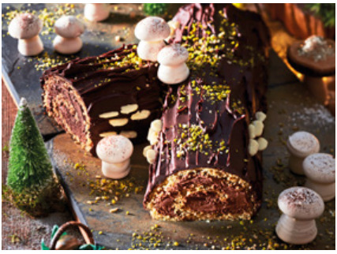

**Ingrediënten voor:** 30-40 plakken
**Bereidingstijd:** ca. 3 uur + minimaal 4 uur
en 30 min. wachttijd
**150 g** hazelnootmeel
**1,15 l** slagroom
geraspte schil van
**1** bio-sinaasappel
ca. ½ tl sinaasappelextract
**700 g** pure chocolade
**8** eieren
**250 g** suiker (+ bestrooien)
**8 g** vanillesuiker
zout
**110 g** bloem
**2 tl** bakpoeder
**50-60 g** witte chocolade
**20-25 g** amandelschaafsel
ca. 30 g pistachenoten
cacaopoeder, om te bestuiven
bakpapier
1 Rooster het hazelnootmeel in een pan. Neem
het uit de pan. VOOR DE VULLING Verwarm
**750 ml** slagroom, de sinaasappelschil en het
sinaasappelextract en neem van het vuur. Hak
**380 g** chocolade en smelt hem in de room. Doe in
een kom en zet 3-4 uur in de koelkast.
2 OM TE BESTRIJKEN Verhit 400 ml slagroom.
Hak 320 g chocolade en smelt hem in de room.
Laat de chocoladeroom afkoelen. Zet ca. 1 uur in
de koelkast. Splits 2 eieren. Zet de eiwitten in de
koelkast.
3 Verwarm de oven voor (elektrisch: 200°C /
hetelucht: 180°C). Splits 6 eieren. Klop de
eiwitten met 6 el water stijf. Klop 150 g suiker,
de vanillesuiker en een snufje zout erdoorheen.
Spatel 8 eidooiers er 1 voor 1 doorheen. Meng
de bloem met het bakpoeder, zeef het boven het
eimengsel en spatel het bloemmengsel met het
hazelnootmeel erdoorheen. Verdeel ca. ⅔ op
een met bakpapier beklede bakplaat. Bak ca.
10 minuten in de oven. Neem uit de oven. Stort
het op een licht vochtige, met suiker bestrooide
theedoek. Trek het bakpapier eraf. Rol met de
theedoek op en laat afkoelen.
4 Vouw van bakpapier een rand van ca. 3 cm
hoog. Leg de rand dwars in het midden van
een met bakpapier beklede bakplaat. Zet een
cakevorm tegen de rand voor stevigheid. Verdeel
het overige hazelnootbeslag aan de andere kant
van de rand (niet in de cakevorm) en bak en
bereid verder op gelijke wijze.
5 VOOR DE PADDENSTOELEN Verwarm de oven
voor (hetelucht: 100°C*). Klop de 2 gekoelde
eiwitten stijf en klop 100 g suiker erdoorheen.
Klop tot het mengsel glanst. Doe het eiwitschuim
in een spuitzak. Spuit er op een met bakpapier
beklede bakplaat paddenstoelensteeltjes en
paddenstoelenhoedjes van (zie kader). Bak ca.
1 uur in de oven. Zet de oven uit en open de deur
kort. Laat de paddenstoelen in de oven afkoelen.
6 Hak de witte chocolade en smelt hem au
bain-marie. Doop het amandelschaafsel erin
en laat het op een stuk bakpapier drogen en
afkoelen. Plak met de overige chocolade de
paddenstoelensteeltjes en -hoedjes aan elkaar.
7 Klop de sinaasappelroom voor de vulling in
ca. 3 minuten romig. Rol de biscuitrollen af en
bestrijk ze met de room. Laat hierbij 2-3 cm van
de rand vrij. Rol de biscuitrollen weer op. Zet ca.
30 minuten in de koelkast.
8 Bestrijk de rollen rondom met de room, zodat
er een boomschorspatroon ontstaat. Snijd
eventueel van de lange rol een dunne plak af
zodat de gladde kant netter is. Snijd van de korte
rol een dun plakje af om hem tegen de grote rol
te kunnen leggen. Steek het amandelschaafsel
in de rollen. Zet de boomstammen minimaal
30 minuten in de koelkast. Hak de pistachenoten.
Bestrooi de boomstammen met cacaopoeder en
de pistachenoten. Versier met de paddenstoelen.
Per plak (30): ca. 290 kcal
**5 g** eiwit | 20 g vet | 20 g koolhydraten
*Een elektrische oven is voor deze bereiding
niet geschikt.
Met de paddenstoelen en elfenbankjes is het
net een echte boomstam
PADDENSTOELEN
Spuit van de helft van het eiwitschuim
hoge toefjes voor de stelen en van de
andere helft platte toefjes voor de hoedjes
van de paddenstoelen.
GEBAK
Steek het amandelschaafsel
dicht tegen elkaar aan in de
marsepeinen balletjes zodat ze
gelijkmatig goudbruin worden.

## Appelstrudelkrans met kaneel

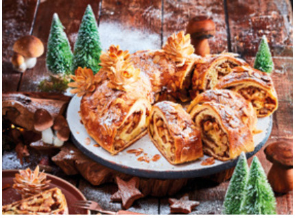

**Ingrediënten voor:** ca. 16 stukken
**Bereidingstijd:** ca. 1 uur en 45 min.
+ ca. 1 uur wachttijd
**21 g** verse gist (of 8 g droge gist)
**120 g** suiker
**160 g** zachte boter (+ invetten)
**150 ml** melk
**350 g** bloem (+ bestuiven)
**16 g** vanillesuiker
zout
**1** ei
**140 g** amandelschaafsel
**700 g** appels
**2 el** citroensap
**1 el** kaneel
**250 g** marsepein
**25 g** poedersuiker (+ bestuiven)
bakpapier
theedoek
1VOOR HET DEEG Roer de gist met 15 g suiker
vloeibaar. Smelt 40 g boter. Schenk de melk erbij.
Meng de bloem, 25 g suiker, 8 g vanillesuiker
en een snufj e zout door elkaar. Voeg het ei, het
gistmengsel en de melk toe en kneed ca. 3 minuten.
Zet het deeg afgedekt ca. 1 uur op een warme plek
omterijzen.
2 Vet een springvorm (26 cm Ø) met ronde inzet
in en bestrooi hem met ca. 70 g amandelschaafsel.
**VOOR DE** VULLING Schil de appels, snijd ze
in vieren, verwijder het klokhuis en snijd het
vruchtvlees in blokjes. Meng met het citroensap.
Roer 120 g zachte boter, 80 g suiker, 8 g
vanillesuiker en de kaneel door elkaar.
3 Kneed het deeg kort door en rol het op een met
bloem bestoven werkblad rechthoekig (ca. 32x65
g) uit. Leg de deegplak op een met bloem bestoven
theedoek. Bestrijk de deegplak met de kaneelboter
en laat hierbij ca. 3 cm van de lange zijden vrij.
Rasp 150 g marsepein over de kaneelboter. Verdeel
de appel eroverheen. Bestrijk de lege deegranden
met een beetje water. Rol de deegplak langs de
lange zijde met behulp van de theedoek op. Leg de
deegrol in een cirkel in de springvorm en druk de
uiteinden goed aan. Laat afgedekt ca. 30 minuten
rijzen.
4 Verwarm de oven voor (elektrisch: 180°C /
hetelucht: 160°C). Bak ca. 45 minuten in de oven.
Laat ca. 5 minuten in een uitgeschakelde oven
rusten. Neem uit de oven en laat ca. 30 minuten
afk oelen. Stort hem en laat verder afk oelen.
5 VOOR HET AMANDELVERSIERING Kneed 100 g
marsepein en 25 g poedersuiker door elkaar.
Kneed van het mengsel bolletjes. Prik het overige
amandelschaafsel in de bolletjes, zodat er kleine
dennenappelsontstaan.
6 Verwarm de oven voor (elektrisch: 180°C /
hetelucht: 160°C). Leg de dennenappels op een
met bakpapier beklede bakplaat en bak ze ca.
5 minuten goudbruin in de oven. Versier de krans
met poedersuiker en de dennenappels.
**Per stuk:** ca. 350 kcal
**6 g** eiwit | 16 g vet | 44 g koolhydraten

## Speculaas-cheesecake

## met granaatappelgelei

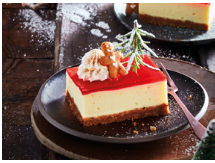

**Ingrediënten voor:** ca. 24 stukken
**Bereidingstijd:** ca. 1 uur en 30 min.
+ ca. 3 uur en 30 min. wachttijd
**400 g** boter (+ invetten)
**450 g** speculaas
**7** eieren
**1** eidooier
**200 g** + 2 el suiker
**16 g** vanillesuiker
**1 kg** magere kwark
**1 kg** roomkaas
**30 g** maizena
sap en schil van 1 bio-citroen
**65 g** honing
**130 g** bloem (+ bestuiven)
**1 tl** bakpoeder
zout
**1 tl** koek- en speculaaskruiden
**30 g** poedersuiker (+ bestuiven)
**1 tl** melk
**70 g** Dr. Oetker Taartina
evt. een paar druppels rode
levensmiddelenkleurstof
**350 ml** granaatappelsap
**200 ml** slagroom
**6-8 takjes** rozemarijn
kaneel, om te bestuiven
diepvrieszakje
vershoudfolie
uitsteker in poppetjesvorm
(ca. 3,5 cm)
bakpapier
spuitzak met stervormige
spuitmond
1 Smelt 225 g boter. Doe de speculaasjes in een
diepvrieszakje, sluit hem af en verbrokkel de
koekjes met een deegroller. Meng ze met de boter.
Verdeel over een diepe bakplaat en druk een beetje
aan. Zet ca. 30 minuten in de koelkast.
2 VOOR DE CHEESECAKE Verwarm de oven voor
(elektrisch: 180°C / hetelucht: 160°C). Splits
2 eieren. Klop de eiwitten stijf en zet ze in de
koelkast. Klop 150 g boter, 200 g suiker en de
vanillesuiker romig. Klop 5 eieren en 2 eidooiers er
1 voor 1 doorheen. Klop de kwark en de roomkaas
er in porties doorheen. Klop de maizena, het
citroensap en de citroenschil erdoorheen. Spatel
tot slot het eiwitschuim erdoorheen. Verdeel
het mengsel op de speculaasbodem en bak ca.
40 minuten in de oven. Zet de oven uit, zet de
ovendeur op een kier en laat de cheesecake ca. 1
uur in de oven afkoelen. Neem hem uit de oven en
laathemverderafkoelen.
3 VOOR DE SPECULAASPOPPETJES Verwarm
de honing met 25 g boter. Meng de bloem, het
bakpoeder, een snufje zout en de koek- en
speculaaskruiden. Voeg de honingboter en
1 eidooier toe. Kneed glad. Wikkel in folie en leg
ca. 1 uur in de koelkast. Verwarm de oven voor
(elektrisch: 180°C / hetelucht: 160°C). Rol het deeg
op een met bloem bestoven werkblad 2-3 mm
dun uit. Steek er ca. 80 poppetjes uit en leg ze
op een met bakpapier beklede bakplaat. Bak
ca. 5 minuten in de oven. Laat afkoelen. Roer de
poedersuiker met de melk glad. Doe het glazuur in
een diepvrieszakje, knip een hoekje eraf en versier
depoppetjesermee.
GEBAK
4 VOOR DE GELEI Bereid de Taartina, de kleurstof,
het granaatappelsap, 150 ml water en 2 el suiker
volgens de aanwijzingen op de verpakking van de
Taartina. Verdeel het mengsel over de taart. Zet ca.
1uurindekoelkast.
5 Klop de slagroom stijf en doe hem in de
spuitzak met stervormig spuitmond. Was de
rozemarijn, schud hem droog en verdeel hem in
ca. 24 kleine takjes. Bestuif ze met poedersuiker.
Snijd de taart in stukken. Spuit op elk stuk een
dennenboomtoefje van slagroom. Bestruif met
kaneel. Versier met de rozemarijntakjes en de
speculaaspoppetjes.
**Per stuk:** ca. 470 kcal
**12 g** eiwit | 33 g vet | 31 g koolhydraten

## Krans van vruchtenmuffins

**Ingrediënten voor:** 12 stuks
**Bereidingstijd:** ca. 1 uur en 30 min.
+ ca. 12 uur wachttijd
**120 g** gedroogde abrikozen
**120 g** gedroogde dadels
**120 g** rozijnen
**150 ml** bruine rum
**30 g** pijnboompitten
**120 g** zachte boter
**100 g** rietsuiker
**8 g** vanillesuiker
**1 el** koek- en speculaaskruiden
zout
**2** eieren
**120 g** bloem (+ bestuiven)
**3 tl** bakpoeder
**2-3 el** slagroom
**200 g** poedersuiker
**1 el** melk
**50-60 g** groene fondant
**25 g** rode fondant
**24-36** rode suikerparels
muffinbakblik met 12 holtes
**12** papieren muffinvormpjes
uitsteker in hulstblaadjesvorm
1 EEN DAG VAN TEVOREN Snijd de abrikozen
en de dadels in kleine blokjes. Meng ze met de
rozijnen en de rum. Zet een nacht in de koelkast.
2 DE VOLGENDE DAG Verwarm de oven voor
(elektrisch: 180°C / hetelucht: 160°C). Rooster
de pijnboompitten in een koekenpan en laat ze
afkoelen. Verdeel de muffinvormpjes over het
bakblik. Klop de boter, de suiker, de vanillesuiker,
de kruiden en een snufje zout romig. Spits 1 ei.
Zet het eiwit in de koelkast. Klop de eidooier
met 1 ei door het botermengsel. Meng de bloem
met het bakpoeder. Klop het bloemmengsel
met de slagroom kort door het botermengsel.
Spatel de vruchten met de rum en de
pijnboompitten erdoorheen. Verdeel het beslag
over de muffinformpjes in het bakblik. Bak 20-25
minuten in de oven. Neem de muffins uit de oven
en laat ca. 10 minuten afkoelen. Neem de muffins
uit de vorm en laat verder afkoelen.
3 Klop het eiwit, de poedersuiker en de melk stijf.
Bestrijk de muffins ermee en laat drogen. Rol het
groene fondant uit en steek er ca. 36 blaadjes
(2-3 cm lang) uit. Steek uit het rode fondant 5
repen en vorm ze tot een strik. Versier 11 muffins
met de blaadjes en de rode suikerparels. Versier
1 muffin met de rode strik. Leg ze in een krans.
**Per stuk:** ca. 400 kcal
**4 g** eiwit | 11 g vet | 59 g koolhydraten

## Klantenservice

Wil je abonnee worden of heb je vragen
over je abonnement? Op onze website vind
je antwoord op de meeste vragen.

## www.kokengenieten.nl/contact

Telefoon
We zijn er maandag tot vrijdag
van 09.00 tot 17.00uur om je
vragen te beantwoorden.
+31 (0)24-2027829
E-mail
Stel je vraag eenvoudig
per e-mail aan een
van onze servicemedewerkers.
klantenservice@kokengenieten.nl
Wist je dat je tegenwoordig eenvoudig
zelf je adres kan wijzigen?
Ga naar www.kokengenieten.nl/adreswijzigen om je nieuwe adres door te geven.
Het nieuwe adres wordt vervolgens automatisch in ons systeem gewijzigd.
Abonnementsinformatie
Koken & genieten kost € 3,99 per nummer. De abonnementsprijs is in Nederland € 45
en in België € 48 (12 nummers). Deze prijs geldt bij betaling per automatische incasso.
Voor betaling via een (digitale) factuur geldt een toeslag van €2,50. Je kunt eenvoudig
een machtiging afgeven via www.fnl.nl/machtigen. Abonnementen worden automatisch
verlengd, tenzij anders vermeld. Het opzeggen van een abonnement kan eenvoudig
telefonisch via +31 (0)24-2027829 of per mail via klantenservice@kokengenieten.nl.
Copyright
Het auteursrecht op deze uitgave en de gedrukte uitgave en op de daarin verschenen artikelen wordt door de uitgever
voorbehouden. Het verlenen van toestemming tot publicatie in de gedrukte uitgave houdt in dat de auteur de uitgever,
met uitsluiting van ieder ander onherroepelijk machtigt de bij of krachtens de auteurswet door derden verschuldigde vergoedingen voor kopiëren te innen en dat de auteur alle rechten overdraagt aan de uitgever, tenzij anders bepaald. Niets
uit deze uitgave en de gedrukte uitgave mag worden overgenomen, vermenigvuldigd of gekopieerd zonder uitdrukkelijke
schriftelijke toestemming van de uitgever. De uitgever stelt zich niet aansprakelijk voor eventuele onjuistheden, welke in deze
uitgave of de gedrukte uitgave mochten voorkomen.
koken & genieten is een uitgave
van F&L Media B.V.
in licentie van Bauer Media
Brand Manager
Yvonne Doorten
Redactie
Bas Erkens, Anne Mebelder, Lotus
van Overveldt, Willem van Santen en
MariekeSlettenhaar
Webredactie
Bas Erkens en Marieke Slettenhaar
Met medewerking van
Heel Holland Bakt, Andrea Gentl,
Brenda Kookt en Femke van Waveren
Vormgeving
Ferry Dorresteijn, Mylène Nales,
Lisanne Cobussen, Tom Gerrits,
Susan Gerbrands-Derksen en
Ellen Willemsen
Sales
Marc Bokhove
+31 (0)24 2404643
mbokhove@fnl.nl
Marketing
Anouk Tolboom
+31 24 240 45 95
atolboom@fnl.nl
Drukkerij
Senefelder Misset Doetinchem B.V.
Vragen aan de redactie
Heb jij opmerkingen, suggesties
of vragen aan de redactie?
lezersvragen@kokengenieten.nl
Nieuwsredactie / Pers
kooknieuws@fnl.nl
of het onderstaande adres o.v.v.
F&L Media, redactie koken & genieten
Bezoekadres F&L Media
Jonkerbosplein 52, 6534 AB Nijmegen
ISSN
ISSN 1875-8517
F&L
MEDIA
Voor- en bijgerechten

# receptenindex

# januari

## IN HET

Aardappels met mosterd-champignons 53
Aardpeer-courgettekoekjes met ei 38
Rodebieten-sinaasappelsalade
met rundergehaktballetjes 55
Saltimbocca van tarbot met saffraanrisotto 16
Aardpeerroomsoep met kruidige groentesalsa 37
Snelle gebakken rijst met garnalen 56
Spaghetti in kip-dragonroomsaus 54
Thaise noedels met mango en garnalen 60
Varkenshaaspakketjes met parmaham 9
Winterse flammkuchen met boerenkool 52
Worstjes in bier met savooiekool 53
Zoete aardappel wellington 31

## NUMMER

Braziliaanse linzenempanada’s 65
Brick-paddenstoelen 27
Carpacciotorentjes 7
Garnalen met frisse groenten 14
Geroerbakte spruitjes
met cranberry en spekjes 7
Gevulde eieren met zalm en kaviaar 63
Ingelegde zalmforel met gin 34
Zoet en desserts
Kruidige paddenstoeldumplings 25
Raclette 40
Amerikaanse cheesecake
met blauwebessensaus 65
Roerei met avocado, chorizo en spek 56
Appelstrudelkrans met kaneel 78
Romige savooiekool met spek 15
Russische salade 62
Salade met gerookte eendenborst
Chateautaart 69
Felroze citroensorbet 21

## KIPLEKKER

en sherrygelei 14
Maak met één kip,
Salade met geroosterde aardpeer,
Gember-basilicumcake 48
Hemelse frambozen-laagjestaart 75
Kerstbûche met paddenstoelen 76
Kerstige chocolade-panna-cotta 22
Klassieke opera 71
vijf heerlijke gerechten
Krans van vruchtenmuffins 80
peer en bacon 38
Selderij-vanillesoep met groentechips 13
Tagliatelle met geroosterde noten 15
Tonijntartaar met avocado en balsamico 8
Hoofdgerechten
Kubus van jocondebiscuit 67
Paddenstoelenijs met ahornsiroop 28
Balsamicopaddenstoelen
Pina-coladataart 45
Pisco-sourtaart 46
met parmezaanpuree 32
Crostata van bladerdeeg
Raviolikoekjes met marsepein 43
met paddenstoelen en ansjovis 27
Speculaas-cheesecake met granaatappelgelei 79
Strawberry-daiquiri-taart 45
Duitse middernachtssoep 61
Tiramisu met mandarijn 22
Tiramisu-ijstaart 10
White-Russiantaartjes 49
Eend met honing en speculaaskruiden 16

## UMAMIBOMMETJE

Entrecote met kruidige couscous 54
Alles over Japanse misopasta
Iberico-varkenshaas wellington 19
Linzensalade met geitenkaas en walnoten 32
= Zonder vlees en vis
Ossenhaas uit Australië 59
= Snel klaar (max. 30 min.)
Reerolletjes met crème-de-cassis-saus 20
Het volgende nummer verschijnt op 27 december 2023
De verschijningsdata in België wijken af van de verschijningsdata in Nederland.
Bestel vóór
**7** december met
gratis verzending!
Ga naar
kokengenieten.nl/
voorverkoop

# januari

Mis geen nummer meer!
Neem nu een abonnement en krijg voortaan elke uitgave van
koken & genieten automatisch in je brievenbus.
Ga naar www.kokengenieten.nl/abo of
bel gratis naar +31 (0)24-2027829.
koken&genieten
VOOR ELKE DAG

## APRÈS-SKI

Waan je even in een skihut in
de Alpen
2023

## Meer laden, minder denken

De nieuwe MaxiSpace vaatwasser van Whirlpool biedt 10% EXTRA RUIMTE*,
dankzij de hogere kuip. Plaats extra grote borden tot 32 cm in het onderste rek.
Het unieke SpaceClean derde rek biedt zelfs plaats aan kommen, mokken en
hoge glazen en is voorzien van geïntegreerde waterstralen.
Ontworpen voor jouw welzijn.
* Vergelijking tussen Whirlpool vaatwassers met standaard kuip en modellen van Whirlpool met een MaxiSpace kuip.
Met‘extra ruimte’bedoelen we de grotere totale laadruimte tussen de drie rekken.
