€ 3,99
koken&genieten
voor elke dag

# Het is herfst!

BP

# Het is herfst!

# 45x

Zalm met biet en sinaasappel
doordeweekse
Perzische koolrolletjes
inspiratie
Wildzwijnovenschotel
Koken voor jezelf
Recepten uit
het boek Solo
H l v l ba en

# van cake tot taart

Maak lekkere
gezonde soepen
met pastinaak, savooiekool en linzen
Brenda Kookt maakt heerlijke herfstgerechten
oktober
2024
€3,99

# Desnellewegdoorhetblad

Voorgerechten
& bijgerechten
Salades, soepen en
broodjes: lekker als lichte
maaltijd of om je etentje
mee te beginnen.
Tomatensoep 7 Koolraap-bietensoep
met pastinaak 21
Aardappelsoep
met krokante topping 28
Kip stroganoff met macaroni 8
Hoofdgerechten
Ga je voor snel & makkelijk,
een dagje zonder vlees
of vis of pak je uit met een
weekendproject?
Traybake van pompoen met spruitjes en worstjes 7 Andijvieschotel
met gehakt en spek 8
Wildzwijnovenschotel 18
Savooiekoolsoep
met gehaktballetjes 22
Thaise kokos-kippensoep 22 Linzensoep
met appel 24
Harissa-aubergine
caprese 45
Pasta met tomaatjes,
ansjovis en knoflookamandelcrispies 46
Geroosterde artisjokharten
met knoflookrijst 54
Zoet&nagerechten
Zoet is altijd goed!
Lekker als tussendoortje,
bij de koffie of als
afsluiting van je diner.
Appeltaartcinnamonrolls 10
Wortel-geitenkaasplaattaart 49
Herfstige borrelplank 33
Zalm uit de oven met bieten
en sinaasappel 27
Duitse wafels met ijs 58 Sinaasappelkwarktaart 58 Kruimelkoek met appel en pruim 61
Erwten-gortrisotto
met chorizo 50
Hazelnootkoekjes
met perencompote 39
Zonder
vlees of vis
Snel klaar
(max. 30 min.)
Saffraancake
Uitleg van symbolen bij de recepten
Kaasbezempjes 33
Uiensoep
met pannenkoek 34
Knapperig platbrood met druiven en crème fraîche 34
Snelle eenpansspaghetti
met champignons 27
Gebakken uien
met tex-mexvulling 50
Perentaart met marsepeinsaus 65
Kogelbiefstuk
met tomatenrijst 28
Herfstige groentesoep 51
Kipstoof met gepo e parelgort 13
Schnitzelschotel
met ham en pompoen 14
Sandwich
met prei en rookvlees 30
Perzische koolrolletjes 16
Kalkoen stroganoff
met wilde rijst 30
Boterkoek 45 Tropische havermout 49
Slagroomsoezen met lemoncurd 62
Pruimen-appeltaart 55
ALLE RECEPTEN OP EEN RIJ
Warme groentesalade
met krokante pitten 36
Paddenstoelen-bonennoedels met misoroom 17
Varkensgebraad
met mosterd 37
Varkensfiletpannetje
met aardappel 54
met amandel en frambozen 57
Sappige lamssteaks met bietencarpaccio 53

# inhoud

Voorwoord

# Griepseizoen

Als ik vroeger ziek was en onder een dekentje bij mama op de bank lag, at ik het liefst
beschuitjes met suiker de hele dag. Dat is
niet per se gezond misschien, maar wel
het enige wat ik destijds weg kon krijgen.
Als ik nu ziek ben, vind ik zo’n beschuitje
nog steeds heel lekker. Maar ik maak ook
graag een lekkere soep. Op p. 20 hebben we
de beste soepen voor het griepseizoen op
een rijtje gezet. Verder geloof ik er vooral
in dat je goed moet blijven drinken en je
moet eten wat je lekker vindt. Je lichaam
zal niet sneller herstellen van een driedaags
smoothie-dieet, wel van rust en veel slaap.
En ben je dan na een paar dagen weer opgeknapt? Dan kun je je immuunsysteem extra
boosten met de gerechten op p. 48. Even
aansterken met de geitenkaasplaattaart
van p. 49. Geniet verder ook vooral van het
regenachtige herfstseizoen, bijvoorbeeld
met de stoofgerechten van p. 12.
Yvonne Doorten
**6** Brenda Kookt
Iedere maand kookt Brenda Hoff van het
culiblog Brenda Kookt de lekkerste gerechten voor ons. Bekijk gauw haar recepten
van deze maand!
**12** Smoorverliefd
Door gerechten langzaam te smoren krijgen ze superveel smaak. Goed, het kost
even tijd, maar tijdens het wachten kun
jij met de voetjes omhoog lekker een goed
boek lezen.
**20** Gezondheid!
Verkouden? Met deze soepen ben je er snel
van af. Ze zitten namelijk vol supergezonde
ingrediënten en smaken daarnaast ook
nog eens heerlijk.
**26** Simpel en snel genieten
Het is al druk genoeg met werk, kinderen
en hobby’s. Hier is de oplossing voor iedereen die geen tijd heeft om uitgebreid te
koken, maar toch lekker wil eten.
**32** Oogstfeest
Veel producten komen in de zomer van het
land, maar ook in de herfst is er heel wat
lekkers te krijgen! Vier het seizoen met een
feestelijk herfstbuffet vol herfstige smaken, zoals peer, druiven en pastinaak.
**42** Kookboek: Solo
Emma de Thouars weet precies hoe je de
lekkerste recepten kan maken voor als je
het rijk een avondje alleen hebt.
**48** Immuunboost
Het wordt weer kouder, dus om de griep
buiten de deur te houden kun je maar beter
lekker gezond eten. Savooiekool, erwten,
wortel, bieten, ui en sinaasappel zijn echte
immuunboosters!
Elke maand de
koken & genieten als eerste
in de brievenbus? Kijk op
of blader naar
www.kokengenieten.nl/abo
p. 40.
**52** Gietijzer
Een gietijzeren koekenpan is eigenlijk
onmisbaar in je keuken. Zo’n pan is ontzettend duurzaam, gaat vaak generatieslang
mee en kan zowel op het fornuis als in de
oven. Wat wil je nog meer?
**56** Süße Grüße
Oftewel: zoete groeten! In Duitsland weten
ze wel hoe je lekkere taart, cake en andere
baksels maakt. Geniet van deze moderne
Duitse klassiekers.
**64** Toffe peren
De herfst is hét seizoen voor peren. In dit
recept gaat maar weinig suiker, omdat de
peren van zichzelf al zoet genoeg zijn.
**66** Index & volgend
Alle recepten van deze uitgave op een rij én
een vooruitblik op volgende maand.
WIN HET

## KOOKBOEK ‘SOLO’

(t.w.v. €27,99

## 19

## ABONNEMENT

INHOUD

# In het seizoen...

## Wat is het?

# druiven

Druiven zijn de vruchten van de wijnstok. De bessen zijn ovaal
of rond en komen in verschillende kleuren, zoals blauw, rood
en groen, al noemen we die laatste wit. De druiven die je in
de supermarkt koopt zijn meestal zogeheten tafeldruiven,
die met name geschikt zijn voor consumptie vanwege hun
zoete smaak. Daarnaast zijn er ook nog wijndruiven, waarvan,
je raadt het al, wijn wordt gemaakt. Van oorsprong hebben
druiven, net als veel ander fruit, pitjes, maar tegenwoordig
worden er ook veel soorten gekweekt zonder pitten. In
Nederland zijn er niet veel druiventelers meer, maar de
druiven van eigen bodem groeien altijd in kassen, omdat ze
een wat warmer klimaat nodig hebben.

## Wat kun je ermee?

Zo’n 90% van de druiven die wereldwijd worden geteeld
wordt gebruikt voor het maken van wijn. De overige 10%
wordt gebruikt voor directe consumptie; wijndruiven zijn
minder zoet en daardoor minder geschikt om zo op te
eten. Je kunt druiven gewoon zo eten als tussendoortje,
maar ze zijn ook lekker in een smoothie, salade of in allerlei
zoete baksels. Voeg ze ook eens toe aan een stoofpot met
lamsvlees, of maak er het platbrood met druiven en crème
fraîche (p. 34) mee!

## Hoe kan je het vervangen?

Niet zo dol op druiven? Je kunt ze ook vervangen door ander
fruit, zoals blauwe bessen of stukjes appel of peer. Ben je
op zoek naar een vrucht met dezelfde soort sappigheid als
druiven? Probeer dan granaatappelpitjes.

## Waar smaakt het naar?

Druiven hebben een zoete, milde tot zure smaak, afhankelijk
van de soort. Ze hebben een knapperig schilletje dat je ook
gewoon kunt opeten.

## Hoe moet ik het bewaren?

Bewaar druiven in de verpakking waarin je ze hebt gekocht.
Je kunt ze ook op een bord leggen. Op een koele plek blijven
ze dan een paar dagen goed, in de koelkast ongeveer een
week. Pluk de druiven niet van de tros, dan zullen ze sneller
rotten. In de diepvries blijven druiven in een goed afgesloten
diepvriesbak zo’n 8 tot 12 maanden lekker. Tip: druiven uit de
diepvries zijn heel geschikt om witte wijn snel mee te koelen.
Niet alleen ziet dat er leuk uit, je wijn wordt er ook nog eens
niet waterig door, zoals wel zo is met ijsklontjes.

# Heerlijke

# herfst

Iedere maand deelt Brenda Hoff van de website
Brenda Kookt de lekkerste recepten met ons.
Altijd makkelijk én met verse ingrediënten uit het
seizoen. Deze maand genieten we van heerlijke
herfstgerechten!
www.brendakookt.nl | @brendakookt op Instagram
Fotografie en receptuur: Brenda Kookt

## Traybake van pompoen

## met spruitjes en worstjes

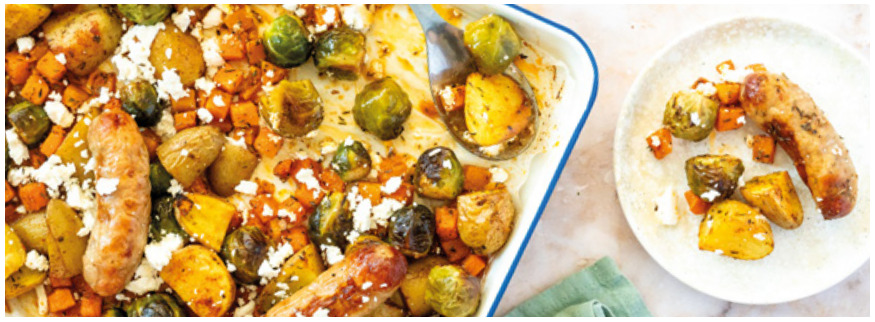

**Ingrediënten voor:** 4 personen
**Bereidingstijd:** ca. 40 min.
**500 g** pompoenblokjes
**400 g** spruitjes
**700 g** krielaardappelen, eventueel
gehalveerd
**4** worstjes
zout en peper
snuf paprikapoeder
olijfolie
**2 takjes** tijm
**30 g** feta, verkruimeld
bakpapier
1 Verwarm de oven voor (elektrisch: 200°C /
hetelucht: 180°C) en bekleed een bakplaat met
bakpapier.
2 Verdeel de pompoenblokjes, de spruitjes en de
krieltjes over de bakplaat. Leg de worstjes erbij.
Breng op smaak met zout en peper en paprikapoeder en besprenkel met olijfolie. Ris de blaadjes tijm en verdeel deze ook over de bakplaat.
3 Bak de traybake 20-25 minuten in de oven.
4 Verdeel de verkruimelde feta erover en serveer
direct.
**Per portie:** ca. 550 kcal
**25 g** eiwit | 28 g vet | 46 g koolhydraten

## Tomatensoep

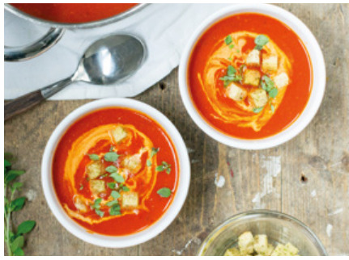

**Ingrediënten voor:** 6 personen
**Bereidingstijd:** ca. 30 min.
olijfolie, om in te bakken
**1** ui, gesnipperd
2
tenen knoflook, geperst
5
tomaten, in blokjes
1
winterwortel, in blokjes
**70 g** tomatenpuree (blikje)
**2** blokjes groentebouillon
**800 ml** water
crème fraîche en croutons, om
te serveren
BRENDA KOOKT
1 Verhit olijfolie in een pan. Fruit hierin de ui met
de knoflook. Voeg de tomaat en de wortel toe en
bak even mee. Voeg de tomatenpuree toe, roer
door en bak even mee. Doe de bouillonblokjes en
het water erbij, breng aan de kook en laat ca. 15
minuten doorkoken.
2 Pureer de soep glad met een staafmixer of in de
blender. Serveer met crème fraîche en croutons.
**Per portie:** ca. 165 kcal
**4 g** eiwit | 10 g vet | 15 g koolhydraten

## Andijvieschotel

## met gehakt en spek

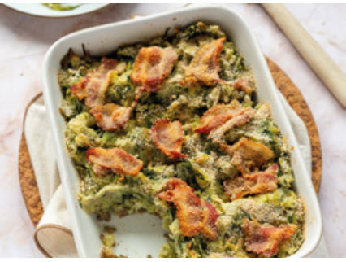

**Ingrediënten voor:** 4 personen
**Bereidingstijd:** ca. 55 min.
**800 g** aardappelen, geschild en in
stukken
**500 g** andijvie, gesneden
olijfolie, om in te bakken
**1** ui, gesnipperd
2
**1** teentje knoflook, geperst
**350 g** gehakt
zout en peper
**1 tl** mosterd
6 plakken ontbijtspek, in stukken
gesneden
**30 g** boter, in blokjes (of vloeibare
margarine)
paneermeel
1 Verwarm de oven voor (elektrisch: 180°C /
hetelucht: 160°C).
2 Kook de aardappelen gaar samen met de andijvie. Leg hiervoor de andijvie op de aardappelen.
3 Verwarm olijfolie in een pan. Fruit de ui met
de knoflook aan en bak het gehakt rul. Breng op
smaak met zout en peper.
4 Giet de aardappelen en andijvie af en vang
het kookvocht op. Stamp de aardappelen fijn en
breng op smaak met zout, peper en de mosterd.
Voeg 50 ml van het kookvocht toe en roer door
elkaar tot een mooie puree.
5 Vet een ovenschaal in. Verdeel hierover de het
gehaktmengsel. Bedek dit met de aardappelandijviestamppot. Beleg de ovenschotel met de
plakjes ontbijtspek en de blokjes boter. Bestrooi
de schotel met paneermeel.
6 Bak de ovenschotel ca. 30 minuten in de oven.
Serveer direct.
**Per portie:** ca. 594 kcal
**25 g** eiwit | 36 g vet | 41 g koolhydraten

## Kip stroganoff met macaroni

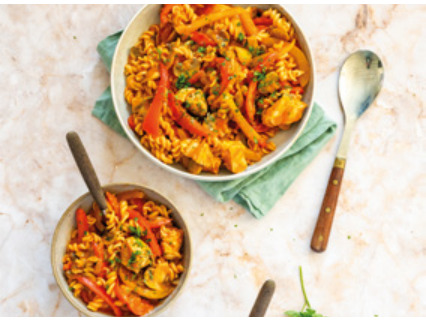

**Ingrediënten voor:** 4 personen
**Bereidingstijd:** ca. 35 min.
**1** ui, gesnipperd
teentjes knoflook, geperst
**3** el
olijfolie (+ extra)
**300** g
kipfilet, in blokjes
**250** g
champignons, in plakjes
2
rode paprika’s, in reepjes
1
groene paprika, in reepjes
**300 g** fusilli
**3 el** bloem
**2 tl** paprikapoeder
**1 tl** oregano
**500 ml** kippenbouillon
**140 g** tomatenpuree (blik)
**100 ml** kookroom
verse peterselie, ter garnering
zout en peper
1 Verhit olijfolie in een pan. Fruit de ui met 1 teentje knoflook erin aan. Doe de blokjes kip erbij en
bak deze rondom aan. Bestrooi met zout en peper.
Voeg de plakjes champignons en reepjes paprika
toe en bak dit even mee.
2 Kook de pasta gaar volgens de aanwijzingen op
de verpakking.
3 Verwarm in een sauspannetje 3 el olijfolie en
doe de bloem erbij. Laat dit ongeveer een minuutje meebakken. Voeg het andere teentje knoflook,
het paprikapoeder en de oregano toe. Roer even
door en verwarm kort mee. Voeg de kippenbouillon en de tomatenpuree toe en roer het mengsel
goed door, zodat er geen klontjes ontstaan.
4 Breng de stroganoffsaus aan de kook en laat op
zacht vuur pruttelen. Voeg de kookroom toe en
verwarm mee. Proef en breng de saus eventueel
op smaak met extra zout of peper.
5 Meng de saus door het kip-groentemengsel en
verwarm kort mee. Roer de pasta door de saus en
serveer.
**Per stuk:** ca. 615 kcal
**33 g** eiwit | 21 g vet | 73 g koolhydraten
BRENDA KOOKT

## Appeltaartcinnamonrolls

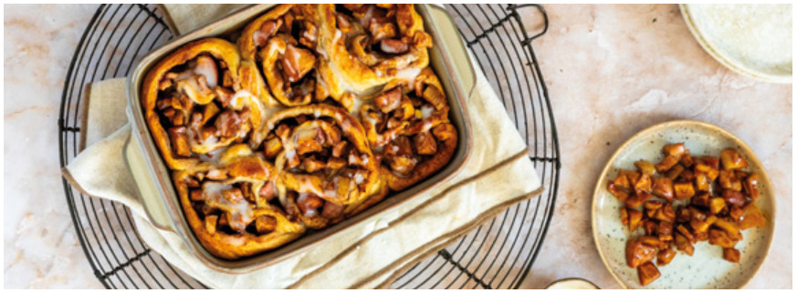

**Ingrediënten voor:** 6 personen
**Bereidingstijd:** ca. 1 uur
**50 g** boter
**2** appels, in fijne blokjes
gesneden
**2 tl** kaneel
**4 tl** kristalsuiker
**240 g** croissantdeeg (1 rol, blikje)
1 Smelt de boter in een steelpannetje op laag
vuur. Haal na ca. 15 minuten, als de boter goudbruin is, de pan van het vuur. Schenk de boter
door een zeefje zodat het bezinksel achterblijft.
Laat de boter een beetje afkoelen.
2 Bak de blokjes appel in een pan, met de helft
van de kaneel en de helft van de suiker.
3 Rol het deeg uit en bestrijk de deeglap met de
beurre noisette (gebruinde boter), maar houd
2 eetlepels apart.
4 Meng de overige suiker en kaneel in een kommetje, strooi dit over het deeg en druk het een
beetje aan. Verdeel de appeltjes erover.
5 Rol de deeglap vanaf de lange kant op tot een
dikke rol. Snijd de zijkantjes eraf en snijd de rol
in 6 gelijke stukken. Leg ze met de ronde spiraalkant naar boven in een ingevette ovenschaal; er
mag wat ruimte tussen de broodjes zitten.
6 Verwarm de oven voor (elektrisch: 200°C /
hetelucht: 180°C). Bestrijk de gerezen broodjes
met de overgebleven beurre noisette en bak in
ca. 20 minuten goudbruin en gaar. Warm zijn de
broodjes het lekkerst.
**Per portie:** ca. 232 kcal
**3 g** eiwit | 14 g vet | 23 g koolhydraten
TIP
Ook lekker om te serveren
met een glazuur van 50 gram
poedersuiker gemengd met
1 eetlepel melk.
BRENDA KOOKT

# Smoorverliefd

Door gerechten langzaam te smoren krijgen ze superveel smaak. Goed, het
kost even tijd, maar tijdens het wachten kun jij met de voetjes omhoog lekker
een goed boek lezen.

## Kipstoof met gepofte parelgort

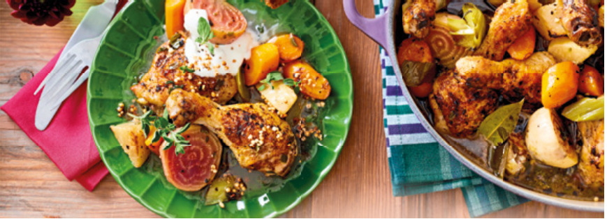

**Ingrediënten voor:** 6 personen
**Bereidingstijd:** ca. 1 uur en 45 min.
**6** grote kippenbouten (1,6-
**1,8** kg)
zout en peper
**3-4 el** mosterd
**1** prei
**2** wortels
**¼** knolselderij
**6** kleine chioggiabieten (bij
de groenteboer)
**3** teentjes knoflook
**6 takjes** oregano
**2-3 el** boter
**2** laurierblaadjes
**500 ml** kellerbier (bij
de slijter)
**500 ml** groentebouillon
**50 g** parelgort
**200 ml** water
**2 el** olie
zeezout
**6 el** crème fraîche
1 Dep de kippenbouten droog en halveer ze bij het gewricht.
Bestrooi met zout en peper en bestrijk rondom met de mosterd. Was de prei en snijd hem in ringen. Schrap de wortels
en snijd ze in hapklare stukjes. Schil de knolselderij en snijd
hem in hapklare stukjes. Schil de bieten en halveer ze. Pel en
snipper de knoflook. Was de oregano.
2 Verwarm de oven voor (elektrisch: 160⁰C / hetelucht:
140⁰C). Verhit de boter in een grote braadpan en bak de kip
er in ca. 10 minuten rondom goudbruin in. Neem uit de pan.
Bak de groenten in het hete bakvet en breng op smaak met
zout en peper. Bak de knoflook kort mee. Leg de kip op de
groenten. Schenk het bier en de bouillon erbij en breng aan
de kook. Voeg de laurierblaadjes en de helft van de oregano
toe. Leg het deksel op de pan en bak ca. 1 uur onder in de
oven.
3 Doe de gort en het water met wat zout in een pan, breng
aan de kook en laat ca. 5 minuten zachtjes koken. Giet af en
dep de gort heel goed droog. Verhit de olie in een koekenpan
op middelhoog vuur en rooster de gort er afgedekt 4-5 minuten in. Roer de gort door, breng op smaak met zeezout en
laag afgedekt nog 2-3 minuten knapperig worden. Neem uit
de pan.
4 Neem de blaadjes van de rest van de takjes oregano.
Serveer de kip en de groenten met het stoofvocht. Schep op
elke portie 1 el crème fraîche en bestrooi met de gepofte parelgort. Garneer met de oregano. Lekker met rustiek brood.
**Per portie:** ca. 740 kcal
**72 g** eiwit | 37 g vet | 22 g koolhydraten
SEIZOEN

## Schnitzelschotel met ham en pompoen

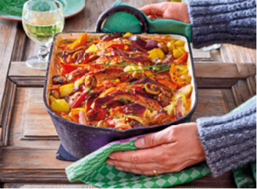

**Ingrediënten voor:** 8-10 personen
**Bereidingstijd:** ca. 4 uur + ca. 12 uur wachttijd
10 varkensschnitzels (à ca. 200 g)
**2-3** teentjes knoflook
**3-4 el** olie
**1½ el** paprikapoeder
**½ tl** chilivlokken
zout en peper
**10 plakjes** schwarzwalder ham (ca. 200 g)
**10 plakjes** gruyère (ca. 250 g)
**1** kleine pompoen (ca. 1 kg)
**1½ kg** aardappels
**800 g** champignons
**12** sjalotjes
**4 el** boter
**4 el** bloem
**250 ml** droge witte wijn
**250 ml** slagroom
**500 ml** groentebouillon
**½ bosje** bieslook
1 EEN DAG VAN TEVOREN Dep het vlees droog. Pel de teentjes knoflook en
hak ze fijn. Roer de knoflook, de olie, het paprikapoeder, de chilivlokken, 2
tl zout en 2 tl peper door elkaar. Bestrijk de schnitzels er rondom mee en zet
afgedekt een nacht in de koelkast.
2 DE VOLGENDE DAG Verwarm de oven voor (elektrisch: 180⁰C / hetelucht:
160⁰C). Leg de schnitzels afwisselend met de plakjes ham en de plakjes kaas
dakpansgewijs in het midden van een braadslee met deksel. Leg het deksel
op de braadslee en bak het geheel ca. 2 uur onder in de oven.
3 Snijd de pompoen in kwarten, verwijder de pitten, was de pompoen en
snijd hem in partjes. Halveer de partjes pompoen. Schil de aardappels en was
ze. Maak de champignons schoon. Pel 10 sjalotjes. Halveer de aardappels, de
champginons en de gepelde sjalotjes.
4 VOOR DE SAUS Pel en snipper 2 sjalotjes. Verhit de boter in een pan en
bak de sjalot glazig erin. Bestrooi met de bloem en bak mee. Roer de wijn, de
slagroom en de bouillon erdoorheen, breng aan de kook en laat ca. 5 minuten
zachtjes koken. Breng de saus op smaak met zout en peper.
5 Neem het vlees uit de oven. Verdeel de aardappel, de pompoen, de sjalotjes
en de champignons om het vlees. Verdeel de saus over het vlees en de groenten. Bak op dezelfde temperatuur nog ca. 1 uur en 30 minuten onder in de
oven.
6 Was de bieslook en hak hem fijn. Neem de schnitzelschotel uit de oven en
bestrooi met de bieslook.
**Per portie:** ca. 810 kcal
**64 g** eiwit | 39 g vet | 45 g koolhydraten
SEIZOEN

## Perzische koolrolletjes

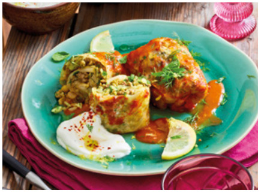

**Ingrediënten voor:** 4-6 personen
**Bereidingstijd:** ca. 2 uur en 30 min.
**80 g** gele spliterwten
zout en peper
**150 g** basmatirijst
**1** witte kool
**1 bosje** peterselie
**1 bosje** dille
**2 takjes** dragon
**3 takjes** munt
**1 bosje** lente-ui
**1** ui
**3 el** olie
**600 g** rundergehakt
**1 tl** kurkuma
**2 el** tomatenpuree
**400 g** tomatenblokjes (blik)
sap van 1 citroen
**1 snufje** kaneel
**1 tl** gemalen komijn
**1 el** honing
1 VOOR DE VULLING Breng de erwten met 1 tl zout en 400 ml
water aan de kook en laat ca. 25 minuten zachtjes koken. Doe
de rijst bij de erwten en laat ca. 15 minuten mee garen.
2 VOOR DE ROLLETJES Was de kool en snijd de stronk er
kegelvormig uit. Doe de kool in een ruime pan kokend water,
breng opnieuw aan de kook en neem de kool uit de pan.
Neem voorzichtig 12 grote bladeren van de kool. Snijd de
dikke nerf van elk blad in en druk hem plat. Meet 200 ml van
het koolwater af en houd apart. Gebruik de rest van de kool
voor een ander recept.
3 Was alle kruiden en hak ze fijn. Was de lente-uitjes en snijd
ze in dunne ringetjes. Pel en snipper de ui fijn. Verhit 2 el olie
in een koekenpan en bak het gehakt er rul in. Bak de ui en de
lente-ui kort mee. Roer de kurkuma erdoorheen. Doe de rijst,
de erwten en de kruiden bij het gehakt en meng alles goed met
elkaar. Breng op smaak met zout en peper. Verdeel de vulling
in de lengte over het midden van de koolbladeren. Klap de
zijkanten van de bladeren over de vulling en rol strak op.
4 VOOR DE SAUS Verwarm de oven voor (elektrisch: 200⁰C /
hetelucht: 180⁰C). Pureer het koolwater met de tomatenpuree, de tomatenblokjes, het citroensap, de kaneel, de komijn,
de honing en 1 el olie. Breng op smaak met zout en peper. Leg
de koolrolletjes dicht tegen elkaar in een grote ovenschaal
en schenk de tomatensaus eroverheen. Dek de ovenschaal
af en bak ca. 1 uur in de oven. Neem het deksel van de schaal
en bak nog ca. 15 minuten. Lekker met Griekse yoghurt
gemengd met bio-citroenschil en chilivlokken.
**Per portie:** ca. 500 kcal
**27 g** eiwit | 25 g vet | 38 g koolhydraten

## Paddenstoelen-bonennoedels met misoroom

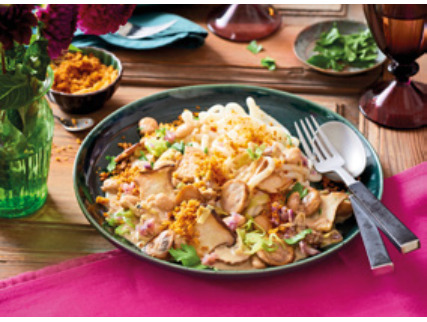

**Ingrediënten voor:** 4 personen
**Bereidingstijd:** ca. 45 min.
**4-5 el** boter
**30 g** panko (Japans
paneermeel)
gerooktepaprikapoeder
**2** rode uien
**2** preien
**600 g** paddenstoelen
(bijv. champignons, oesterzwam,
koningsoesterzwam en
eekhoorntjesbrood)
zout en peper
**400 g** limabonen (blik)
**400 ml** groentebouillon
**600 g** voorgegaarde udonnoedels
**4 takjes** peterselie
**1-2 el** witte misopasta (bij de
toko of grotere supermarkt)
**150 ml** slagroom
SEIZOEN
1 Verhit 1-2 el boter in een koekenpan en rooster de panko er goudbruin in.
Breng op smaak met paprikapoeder en neem uit de pan.
2 Pel en snipper de uien fijn. Was de preien en snijd ze in ringen. Maak de
paddenstoelen schoon en snijd ze naar grootte in tweeën of in vieren. Verhit
3 el boter in een braadpan op hoog vuur en bak de paddenstoelen er al roerend ca. 5 minuten in. Voeg de ui en de prei toe en bak ca. 3 minuten mee.
Breng op smaak met zout en peper. Spoel de bonen met koud water en voeg
toe aan de pan. Schenk de bouillon erbij, breng aan de kook en laat afgedekt
ca. 15 minuten zachtjes koken.
3 Bereid de noedels volgens de aanwijzingen op de verpakking. Was de peterselie en hak de blaadjes grof. Roer de miso en de slagroom door de paddenstoelen. Serveer alles samen en bestrooi met de panko en de peterselie.
**Per portie:** ca. 570 kcal
**13 g** eiwit | 25 g vet | 68 g koolhydraten

## Wildzwijnovenschotel

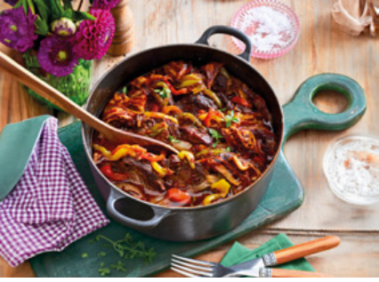

**Ingrediënten voor:** 6-8 personen
**Bereidingstijd:** ca. 4 uur en 30 min. + ca. 12 uur
wachttijd
**2** laurierblaadjes
**1 el** jeneverbessen
**1 el** zwarte peperkorrels
**3** pimentkorrels
**1 el** gedroogde tijm
**1,5 kg** wildzwijnprocureur (van de
slager)
**300 g** bacon
**3** grote aardappels
**1** rode chilipeper
**2** teentjes knoflook
**10 takjes** tijm
**600 g** paprika’s (bijv. rood en geel)
**2** uien
zout
**300 ml** barbecuesaus (fles)

# Coverrecept

1 EEN DAG VAN TEVOREN Maal de laurierblaadjes, de jeneverbessen, de peperkorrels, de pimentkorrels
en de gedroogde tijm fijn in een vijzel. Dep de procureur droog en snijd in plakken van ca. 1½ cm dik.
Wrijf alle plakken vlees aan beide zijden in met het specerijenmengsel. Laat een nacht afgedekt trekken.
2 DE VOLGENDE DAG Bekleed de bodem en de zijkanten van een ovenbestendige braadpan met de bacon
en laat hem daarbij over de rand hangen. Schil de aardappels, was ze en snijd ze in plakken. Bedek de
bodem van de pan dakpansgewijs met de plakjes aardappel. Verwijder de zaadlijsten van de chilipeper,
was de peper en hak hem fijn. Pel de teentjes knoflook en hak ze fijn. Was de verse tijm en hak hem fijn.
Meng de chilipeper met de knoflook en de tijm. Strooi de helft van het mengsel over de aardappels.
3 Verwarm de oven voor (elektrisch: 160⁰C / hetelucht: 140⁰C). Snijd de paprika’s in kwarten, verwijder
de zaadlijsten, was de paprika’s en snijd ze in reepjes. Pel de uien, halveer ze en snijd ze in halve ringen.
Bestrooi het vlees met zout. Zet de plakken vlees, de paprikareepjes en de uienringen afwisselend rechtop in de pan. Het kan daarbij helpen de pan schuin te houden, zodat het vlees niet omvalt. Bestrooi met
de rest van het knoflookmengsel en verdeel de barbecuesaus er gelijkmatig over. Leg de overhangende
bacon over het vlees. Leg het deksel op de pan en bak 3 uur tot 3 uur en 30 minuten in de oven. Serveer
alles samen.
**Per portie:** ca. 470 kcal
**50 g** eiwit | 13 g vet | 35 g koolhydraten
**20** 21 22
**26** 27 28 29 30
**34** 35 36 37
**40** 41 42 43 44
**47** 48 49
**90** 91
brandstof 19 gladakker 20 park in Wenen 22 perfect 23 kippenproduct 24 zacht
ureau 30 zangnoot 31 hoofddeksel 33 zoon van een oom of tante 35 diender 36 nivogel 40 snoepgoed 42 dwaas 43 plotseling optredend 45 glazen verpakkingsmidgeest 49 oplopende weg 50 ven 52 verslechteren 53 voedsel nuttigen 55 mat van
**53** 54
**57** 58 59 60
**62** 63 64 65 66 67
**71** 72 73 74
**77** 78 79 80 81
**84** 85 86 87 88

## HORIZONTAAL

2 verst 8 indien 10 zetel 17 brandstof 19 gladakker 20 park in Wenen 22 perfect
23 kippenproduct 24 zacht buisje 26 elpenbeen 28 bureau 30 zangnoot
31 hoofddeksel 33 zoon van een oom of tante 35 diender 36 niveau 37 fraaie
kleding 38 vogel 40 snoepgoed 42 dwaas 43 plotseling optredend 45 glazen
verpakkingsmiddel 47 soort verf 48 plaaggeest 49 oplopende weg 50 ven
52 verslechteren 53 voedsel nuttigen 55 mat van kleur 57 lof 58 bezwering
59 in enkele gevallen 61 stemming 62 pose 63 op hetzelfde ogenblik
59 in enkele gevallen 61 stemming 62 pose 63 op hetzelfde ogenblik 66 kunstwerk
1 schaatsen 72 volksverhaal 74 klein hert 75 slee 76 tropische vetplant 77 schuur
66 kunstwerk 68 de mensen 69 plaats 71 schaatsen 72 volksverhaal 74 klein
hert 75 slee 76 tropische vetplant 77 schuur 79 lopend gerucht 81 bijwoord
82 buisverlichting 83 onverwacht 85 stappen 87 vermogend man 89 het
oord 82 buisverlichting 83 onverwacht 85 stappen 87 vermogend man 89 het onbe-
1 col.
onbewoond zijn 90 gesloten 91 col.
een weinig 4 rivier in Duitsland 5 werkelijk 6 politieke partij 7 afslagplaats bij golf
maakgerei 10 voertuig 11 UniversiteitTwente (afk.) 12 elk 13 groente 14 deel van

## VERTICAAL

16 vorm van een schoen 18 hijswerktuig 21 overrijp 25 bond 27 in onbruik geraakt
stelijk eten 34 agressie 35 veld 36 hof van Eden 37 Europeaan 39 brede laan 41 ge-
1 gevogelte 2 bolgewas 3 een weinig 4 rivier in Duitsland 5 werkelijk
spijker met smalle kop 44 zalf 46 sluiskolk 48 kei 49 bezittelijk voornaamwoord
n 56 sprookjesfiguur 60 kelner 61 kledingmaat 62 strijdperk 63 heildronk 64 gebaar
6 politieke partij 7 afslagplaats bij golf 8 rivier in Italië 9 schoonmaakgerei
7 niet-deskundige 70 vroeg of laat 71 kloosterzuster 73 manier van lopen 76 wier
10 voertuig 11 Universiteit Twente (afk.) 12 elk 13 groente 14 deel van een boom
15 voegwoord16 vormvan een schoen18 hijswerktuig 21 overrijp25 bond27 in
onbruik geraakt 29 zwak 30 reisweg 32 feestelijk eten 34 agressie 35 veld 36 hof
van Eden 37 Europeaan 39 brede laan 41 gevolg van drankgebruik 42 spijker
met smalle kop 44 zalf 46 sluiskolk 48 kei 49 bezittelijk voornaamwoord 51 gave
54 in aantocht zijn 56 sprookjesfiguur 60 kelner 61 kledingmaat 62 strijdperk
63 heildronk 64 gebaar 65 deel van een woning 67 niet-deskundige 70 vroeg of
laat 71 kloosterzuster 73 manier van lopen 76 wier 77 energiezuinige verlichting
78 koeienmaag 80 jaartelling 82 meer dan wenselijk 84 plus 86 lidwoord
ting 78 koeienmaag 80 jaartelling 82 meer dan wenselijk 84 plus 86 lidwoord
Kruiswoord
88 koude lekkernij.
uit de genummerde vakjes over naar de gelijkgenummerde vakjes van de oplossingsbalk.
© Sanders puzzelboeken
**38** 70 15 41 91 51 58 65
© Sanders puzzelboeken
S U I T E R S T A L S K U I P S T O E L
VUL DE PUZZEL IN EN MAAK KANS
O L I E L E P E R D P R A T E R A F E
E I T U B E E I V O O R D E S K R E
OP 1 VAN DE 3 EXEMPLAREN VAN
P E T N E E F A G E N T P E I L D O S
K R A A I L E K K E R S N A R A C U U T

## SOLO T.W.V. 27,99 EURO

I F L E S L A K O S A R O P R I T
P O E L A C H T E R U I T G A A N E T E N
Emma de Thouars is gek op koken voor zichzelf, want waarom zou
F L E T S E E R D E E D S O M S A
S F E E R A I R T E G E L IJ K B E E L D
je je best doen om lekker te koken voor een ander, maar niet voor
M E N O O R D N O R E N S A G E R E E
A R A L O E L O O D S L M A R E E R
jezelf? In haar nieuwe boek Solo geeft ze naast heerlijke recepten
L T L I N E E N S T R E D E N R IJ K E
L E E G S T A N D T O E B E R G P A S N kookboek
voor één persoon ook tips voor boodschappen doen, hoe je restjes
**38** 70 15 41 91 51 58 65
**5** 6 7 8 9 10 11 12 13 14 15 16
opmaakt als je het rijk alleen hebt. Van harissa-aubergine caprese en
labneh met toppings tot de allerlekkerste boterkoek, die je helemaal
zelf mag opeten. Ideaal voor iedereen die alleen woont én voor wie
wel eens een avondje lekker voor zichzelf wil koken.
1 2 3 4 5 6 7 8 9 10 11 12 13 14 15 16
**17** 18 19 20 21 22
**23** 24 25 26 27 28 29 30
Titel:
**31** 32 33 34 35 36 37
**38** 39 40 41 42 43 44
**45** 46 47 48 49
**50** 51 52 53 54
Auteur:
**55** 56 57 58 59 60
**61** 62 63 64 65 66 67
Auteur: Emma de Thouars
**68** 69 70 71 72 73 74
**75** 76 77 78 79 80 81
Uitgeverij:
**82** 83 84 85 86 87 88
**89** 90 91
Uitgeverij: Nijgh & Van Ditmar
Prijs:
Prijs: 27,95 euro
Het antwoord kun je vóór 15 oktober 2024
sturen naar: koken & genieten, o.v.v. oplossing puzzel
Postbus 296, 6500 AG Nijmegen
Of op onze website: kokengenieten.nl/puzzel
Titel: Solo
DE GEZONDE KEUKEN

# Gezondheid!

Verkouden? Met deze soepen ben je er snel van af. Ze zitten namelijk
vol supergezonde ingrediënten en smaken daarnaast ook nog eens
heerlijk.

## Koolraap-bietensoep

## met pastinaak

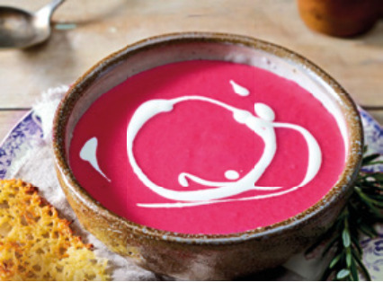

**Ingrediënten voor:** 4 personen
**Bereidingstijd:** ca. 1 uur
**1** pastinaak (ca. 200 g)
**½** kleine koolraap (ca. 400 g)
**2** wortels
**100 g** rode bieten
**1** grote aardappel
**1** ui
**1** teentje knoflook
**2 takjes** rozemarijn
**2 el** olijfolie
**1 l** groentebouillon
**100 g** parmezaan
**150 g** crème fraîche
zout en peper
nootmuskaat
bakpapier
1 VOOR DE SOEP Schil de pastinaak, de koolraap,
de wortels, de bieten en de aardappel en snijd ze
in grove stukken. Pel en snipper de ui en de knoflook fijn. Was de rozemarijn.
2 Verhit de olie in een grote pan en bak de ui en
de knoflook er glazig in. Voeg de groenten en de
aardappel toe bak al roerend ca. 10 minuten mee.
Schenk de bouillon erbij, breng aan de kook en
voeg de rozemarijn toe. Laat op middellaag vuur
ca. 20 minuten zachtjes koken.
3 VOOR DE PARMEZAANCHIPS Verwarm de oven
voor (elektrisch: 200⁰C / hetelucht: 180⁰C). Rasp
de parmezaan fijn en verdeel hem in lepels met
flink wat ruimte ertussen over een met bakpapier
beklede bakplaat. Bak 5-7 minuten in de oven.
Laat a oelen.
4 Neem de rozemarijn uit de soep. Pureer de soep
en roer 100 g crème fraîche erdoorheen. Breng de
soep op smaak met zout, peper en nootmuskaat.
Schep de soep in kommen. Roer de rest van de
crème fraîche glad en garneer de soep ermee.
Serveer de soep met de parmezaanchips.
**Per portie:** ca. 370 kcal
**13 g** eiwit | 23 g vet | 24 g koolhydraten

## Savooiekoolsoep

## met gehaktballetjes

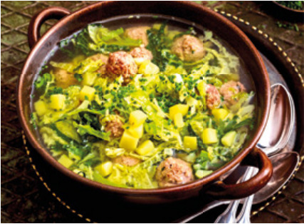

**Ingrediënten voor:** 4 personen
**Bereidingstijd:** ca. 45 min.
**½** savooiekool (ca. 750 g)
**400 g** aardappels
**1** grote ui
**400 g** rundergehakt
**1 tl** mosterd
**1** eidooier
**1 el** paneermeel
zout en peper
**2 el** olie
**½ tl** gemalen komijn
**1,2 l** groentebouillon
**½ bosje** bieslook
1 VOOR DE SOEP Was de kool, halveer hem en
snijd hem in dunne reepjes van de stronk. Schil
de aardappels, was ze en snijd ze in kleine blokjes. Pel en snipper de ui.
2 VOOR DE GEHAKTBALLETJES Kneed het gehakt, de helft van de ui, de mosterd, de eidooier,
het paneermeel, zout en peper door elkaar. Maak
kleine balletjes van het gehaktmengsel. Verhit de
olie in een pan op hoog vuur en bak de balletjes er
5-6 minuten rondom in aan. Neem uit de pan.
3 Bak de rest van de ui glazig in het hete bakvet.
Voeg de kool en de aardappel toe en bak ca. 5 minuten mee. Breng op smaak met zout en de komijn. Schenk de bouillon erbij, breng aan de kook
en laat afgedekt ca. 25 minuten zachtjes koken.
4 Doe de gehaktballetjes in de soep, breng aan de
kook en verhit 2-3 minuten mee. Was de bieslook
en hak hem fijn. Breng de soep op smaak met zout
en peper en bestrooi met de bieslook.
**Per portie:** ca. 410 kcal
**27 g** eiwit | 21 g vet | 24 g koolhydraten

## Thaise kokos-kippensoep

**Ingrediënten voor:** 4 personen
**Bereidingstijd:** ca. 45 min.
**2** uien
**2** teentjes knoflook
**2** cm gember
**2** rode chilipepers
**3-4** stengels citroengras
**2** wortels
**650 g** kipfilet
**400 ml** kokosmelk (blik)
**1 l** kippenbouillon
**300 g** champignons
**1** courgette (ca. 200 g)
**250 g** cherrytomaten
**½ bosje** koriander
**3-4 el** limoensap
zout
1 Pel en snipper de ui en de knoflook fijn. Schil de
gember en hak hem fijn. Halveer de chilipepers in
de lengte, verwijder de zaadlijsten, was de pepers
en hak ze heel fijn. Was het citroengras, snijd het
in de lengte in en verwijder de buitenste laag.
Druk de stengels een beetje plat. Schrap de wortels, was ze en snijd ze in plakjes. Dep de kipfilet
droog en snijd hem in stukken.
2 Breng de kokosmelk en de bouillon in een pan
aan de kook. Voeg de ui, de knoflook, de gember,
de chilipeper, het citroengras, de wortel en de
kip toe, breng aan de kook en laat ca. 15 minuten
zachtjes koken.
3 Maak de champignons schoon en snijd ze in
dunne plakjes. Was de courgette, halveer hem in
de lengte en snijd in plakjes. Was de cherrytomaten en halveer ze.
4 Voeg de champignons, de courgette en de tomaat toe aan de soep en laat op middelhoog vuur
ca. 5 minuten meekoken. Was de koriander en
hak hem fijn. Neem de soep van het vuur. Neem
het citroengras eruit. Breng de soep op smaak
met het limoensap en zout. Serveer in kommen
en bestrooi met de koriander.
**Per portie:** ca. 370 kcal
**30 g** eiwit | 25 g vet | 6 g koolhydraten
DE GEZONDE KEUKEN

## Linzensoep met appel

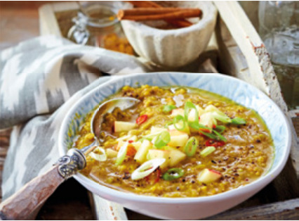

**Ingrediënten voor:** 4 personen
**Bereidingstijd:** ca. 30 min.
**2** uien
**3 el** olijfolie
**200 g** rode linzen
**1 tl** kerrie
**½ tl** gemalen komijn
**½ tl** kaneel
**1 l** groentebouillon
**1** appel
**2** lente-uitjes
**1** rode chilipeper
**3 el** citroensap
zout en peper
**1-2 el** wittewijnazijn
1 VOOR DE SOEP Pel en snipper de ui fijn. Verhit
**1 el** olie in een pan en bak de ui er in 2-3 minuten
glazig in. Voeg de linzen toe en bak ca. 1 minuut
mee. Bestrooi met de kerrie, de komijn en de
kaneel en bak kort mee. Schenk de bouillon erbij,
breng aan de kook en laat op middellaag vuur ca.
20 minuten zachtjes koken.
2 VOOR DE TOPPING Was de appel, snijd hem in
kwarten en verwijder het klokhuis. Snijd de appel
in kleine blokjes. Was de lente-uitjes en snijd ze
in ringetjes. Snijd de chilipeper in de lengte in,
verwijder de zaadlijsten, was de chilipeper en
snijd hem in ringetjes. Meng de appel, de lente-ui,
de chilipeper en het citroensap met elkaar.
3 Pureer de soep naar wens en breng op smaak
met zout, peper en de azijn. Serveer de soep,
bestrooi met peper en de appeltopping en besprenkel met 2 el olie.
**Per portie:** ca. 290 kcal
**14 g** eiwit | 9 g vet | 35 g koolhydraten
Lekker eten valt of staat met de ingrediënten die je
gebruikt en het keukengerei dat je tot je beschikking
hebt. Daarom presenteren wij elke maand leuke,
verrassende, handige en/of smakelijke producten.

# KNAPPERIGE

# TOSTI’S

Ja, een tosti-apparaat is
superhandig, maar zo lekker als
een tosti van het fornuis worden de
tosti’s nooit. Deze retrovariant van
Red Copper is dus onmisbaar in
de keuken van elke tostiliefhebber.
Beleg je boterhammen met kaas,
ham, brie of ander lekkers en je hebt
binnen een handomdraai (letterlijk)
de knapperigste tosti gemaakt. Dit
tosti-ijzer is geschikt voor elk type
kookplaat, dus ook inductie!
Prijs: €24,95. O.a.
verkrijgbaar via
kookgek.nl.

# SARDIENTJES

Vis in blik is helemaal hip én superveelzijdig. Verwerk deze
sardientjes van het Portugese merk Minerva bijvoorbeeld in
een salade, of met plakjes tomaat op toast. Behalve sardines
blikt Minerva ook makreel, tonijn, zalm en andere vissoorten in,
allemaal even lekker.
Prijs: €2,49 per blikje. O.a. verkrijgbaar via
portugeseproducten.nl of in de grotere supermarkt.
verrassende, handige en/of smakelijke producten.
EIEREN splitsen
Voor de saffraancake met amandel en frambozen van p. 57
moet je eieren splitsen. Dat kan natuurlijk op de ouderwetse
manier, maar het eiersplitsertje in de vorm van een vis van
Peleg Design werkt veel makkelijker. Voor jou nooit meer
kapotte dooiers in je eiwitten!
Prijs: €13,95. O.a. verkrijgbaar via zinaantafel.nl.

# Simpel

# en snel

# genieten

Het is al druk genoeg met werk, kinderen en
hobby’s. Hier is de oplossing voor iedereen die
geen tijd heeft om uitgebreid te koken, maar
toch lekker wil eten.

## Zalm uit de oven

## met bieten en sinaasappel

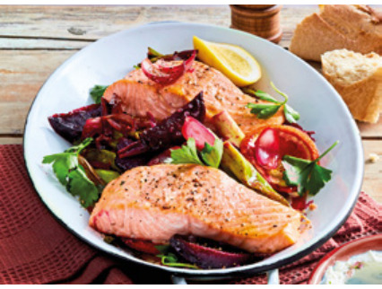

**Ingrediënten voor:** 4 personen
**Bereidingstijd:** ca. 30 min.
**400 g** gekookte rode bieten
(vacuümverpakking)
**1 bosje** lente-ui
**2** bio-sinaasappels
**4 el** ahornsiroop
**2 el** olie
zout en peper
**800 g** zalmfilet zonder huid
peterselie, om te garneren
1 Verwarm de oven voor (elektrisch: 180⁰C /
hetelucht: 160⁰C). Snijd de bieten in partjes. Was
de lente-uitjes en snijd ze in stukken van ca.
10 cm. Was de sinaasappels. Snijd 1 sinaasappel
in plakjes en pers de andere uit. Roer het sinaasappelsap, de ahornsiroop en de olie door elkaar.
Breng op smaak met zout en peper. Verdeel de
bieten, de lente-ui en de plakjes sinaasappel over
een bakplaat en besprenkel met de marinade.
Bak ca. 20 minuten in de oven.
2 Spoel de zalm met water en snijd hem in vier
stukken. Bestrooi met zout en peper. Leg de vis
ca. 8 minuten voor het einde van de baktijd op
de groenten en laat mee garen. Serveer alles op
een schaal en bestrooi met peterselie. Lekker met
stokbrood.
**Per portie:** ca. 590 kcal
**42 g** eiwit | 33 g vet | 27 g koolhydraten

## Snelle eenpansspaghetti

## met champignons

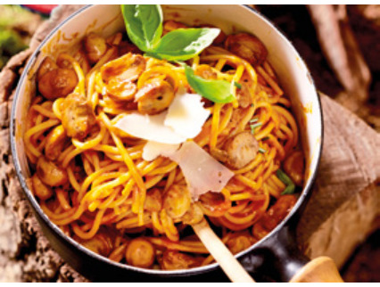

**Ingrediënten voor:** 4 personen
**Bereidingstijd:** ca. 30 min.
**500 g** champignons
**1** ui
**3** teentjes knoflook
**1-2 takjes** rozemarijn
**3 el** olie
zout en peper
paprikapoeder
**2 el** tomatenpuree
**900 ml** groentebouillon
**100 ml** slagroom
**350 g** spaghetti
evt. parmezaan en basilicum,
om te serveren
1 Maak de champignons schoon en snijd ze naar
grootte in tweeën of in vieren. Pel en snipper de
DE SNELLE KEUKEN
ui en de knoflook fijn. Was de rozemarijn en hak
hem fijn.
2 Verhit de olie in een brede pan op hoog vuur en
bak de champignons er al roerend in. Bak de ui en
de knoflook kort mee. Breng op smaak met zout,
peper en paprikapoeder. Bak de tomatenpuree
kort mee. Blus af met de bouillon en de slagroom.
Voeg de spaghetti toe, breng aan de kook en laat
afgedekt in ca. 15 minuten garen. Roer regelmatig
door. Breng op smaak met zout, peper en paprikapoeder. Bestrooi eventueel met parmezaan en
basilicum en serveer.
**Per portie:** ca. 500 kcal
**17 g** eiwit | 16 g vet | 68 g koolhydraten

## Aardappelsoep

## met krokante topping

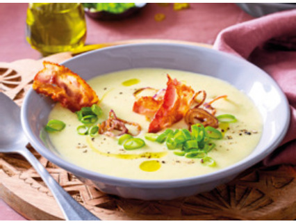

**Ingrediënten voor:** 4 personen
**Bereidingstijd:** ca. 25 min.
**600 g** grote aardappels
**1 bosje** lente-ui
**7 el** olie
**800 ml** groentebouillon
**4 plakjes** bacon
**1** rode ui
**1 tl** bloem
**100 ml** slagroom
zout en peper
nootmuskaat
1 VOOR DE SOEP Schil de aardappels, was ze en
snijd ze in blokjes. Was de lente-uitjes en snijd
het witte en groene deel los van elkaar in ringetjes. Bak de aardappel en het witte deel van de
lente-ui in 4 el hete olie. Schenk de bouillon erbij,
breng aan de kook en laat afgedekt ca. 20 minuten zachtjes koken.
2 VOOR DE TOPPING Bak de bacon krokant in een
koekenpan en laat uitlekken op keukenpapier. Pel
de ui en snijd hem in ringen. Meng de ui met de
bloem. Verhit 1 el olie in het bakvet van de bacon
en bak de ui er in ca. 2 minuten krokant in.
3 Pureer de soep. Schenk de slagroom erbij. Breng
op smaak met zout, peper en nootmuskaat. Schep
in kommen en verdeel de bacon, de uiringen, het
groene deel van de lente-ui en 2 el olie erover.
**Per portie:** ca. 430 kcal
**5 g** eiwit | 33 g vet | 26 g koolhydraten

## Kogelbiefstuk met tomatenrijst

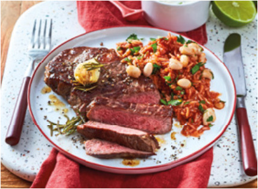

**Ingrediënten voor:** 4 personen
**Bereidingstijd:** ca. 30 min.
**400 g** tomatenpassata
**1** ui
**200 g** rijst
**3 el** olijfolie
**100** ml
droge rode wijn
zout en peper
**2** teentjes knoflook
**2 takjes** rozemarijn
4
kogelbiefstukken (à ca. 180 g)
**4 takjes** peterselie
**400** g
witte bonen (blik)
**225 g** crème fraîche
**1 el** limoensap
aluminiumfolie
1 VOOR DE RIJST Roer de passata en 350 ml water
door elkaar. Pel en snipper de ui fijn en bak hem
met de rijst in 1 el hete olie in een pan glazig. Blus
af met de wijn. Voeg ⅓ van het tomatenwater toe
en breng op smaak met zout. Breng zachtjes aan
de kook en laat de rijst in ca. 20 minuten garen.
Voeg daarbij de rest van het tomatenwater in
twee porties toe.
2 VOOR DE BIEFSTUK Plet de teentjes knoflook in
het schilletje. Was de rozemarijn. Dep het vlees
droog, bestrooi aan beide zijden met zout en
peper en bak het in 2 el hete olie in een koekenpan 3-4 minuten per zijde. Voeg de rozemarijn
en de knoflook ca. 2 minuten voor het einde van
de baktijd toe aan de pan en bak mee. Wikkel het
vlees in aluminiumfolie en laat rusten.
3 Was de peterselie en hak hem fijn. Spoel de
bonen met water en laat uitlekken. Doe de bonen
en de helft van de peterselie ca. 3 minuten voor
het einde van de gaartijd bij de rijst. Breng de rijst
op smaak met zout en peper.
4 VOOR DE DIP Roer de crème fraîche, de rest van
de peterselie, zout, peper en het limoensap glad.
Serveer alle samen.
**Per portie:** ca. 590 kcal
**48 g** eiwit | 30 g vet | 28 g koolhydraten
DE SNELLE KEUKEN

## Sandwich met prei en rookvlees

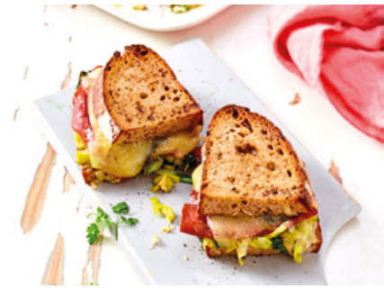

**Ingrediënten voor:** 4 personen
**Bereidingstijd:** ca. 25 min.
**2** preien
**1** ui
**7 el** boter
**8 sneetjes** zuurdesembrood (à ca. 80 g)
**1 el** slagroom
zout en peper
4 plakken kaas (ca. 100 g, bijv. Morbier)
**8 plakjes** runderrookvlees
1 Halveer de preien in de lengte, was ze en snijd ze fijn. Pel en snipper de ui
fijn. Verhit 4 el boter in een koekenpan en bak de prei en de ui er ca. 10 minuten in. Verwarm de oven voor (elektrisch: 200⁰C / hetelucht: 180⁰C). Bestrijk
het brood met 3 el boter.
2 Roer de slagroom door de prei en breng op smaak met zout en peper. Beleg
**4 sneetjes** brood met de prei met daarop de kaas en het rookvlees. Leg de
overige sneetjes brood er met de beboterde kant naar beneden op. Bak de
sandwiches ca. 10 minuten in de hete oven.
**Per portie:** ca. 650 kcal
**24 g** eiwit | 26 g vet | 75 g koolhydraten

## Kalkoen stroganoff met wilde rijst

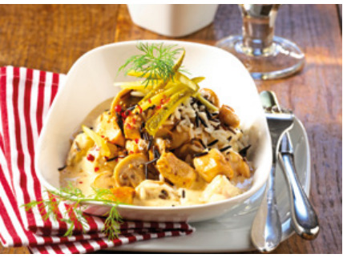

**Ingrediënten voor:** 4 personen
**Bereidingstijd:** ca. 30 min.
**300 g** wilde rijst
zout en peper
**400 g** kalkoenschnitzel
**500 g** champignons
**1** ui
**150 g** augurken
**2 el** olie
**250 ml** slagroom
**1 el** maizena
**1-2 el** grove mosterd
roze peperkorrels
evt. dille, om te
garneren
1 Kook de rijst volgens de aanwijzingen op de verpakking gaar in water met
wat zout. Dep het vlees droog en snijd het in blokjes. Maak de champignons
schoon en halveer ze. Pel en snipper de ui fijn. Snijd de augurken in reepjes.
2 Verhit de olie in een grote koekenpan en bak het vlees er ca. 5 minuten in.
Bestrooi met zout en peper en neem uit de pan. Bak de champignons en de
ui 5-7 minuten in het hete bakvet. Voeg het vlees weer toe en blus af met 250
ml water en de slagroom. Breng aan de kook en laat op hoog vuur ca. 2 minuten koken. Roer de maizena met wat water glad en roer het samen met de
mosterd door de saus. Breng opnieuw aan de kook en breng op smaak met
zout, peper en roze peperkorrels. Spatel de helft van de augurk erdoorheen.
Serveer de rijst, de saus en de rest van de augurk samen. Garneer eventueel
met dille.
**Per portie:** ca. 670 kcal
**38 g** eiwit | 28 g vet | 62 g koolhydraten

# Hobbykoks opgelet!

# Dé kookwedstrijd

# voor kookclubs

# is terug

Zondag
**20** oktober
Deelname is
GRATIS!
Heb jij zin in een ontzettend leuke middag vol eten, uitdaging én plezier? Op
20 oktober is voor de derde keer dé verkiezing voor de Beste Kookclub van
Nederland. Wat ga je op deze dag doen? Jullie maken een voor-, hoofd- en
nagerecht die wordt beoordeeld door een jury. Samen met jouw vrienden en
familie maak je kans op te gekke prijzen en ontvang je tips van de beste chefs!
Ga voor meer informatie en opgeven naar:
www.foodiesmagazine.nl/kookclub Scan
Mede mogelijk gemaakt door:
de QRcode
BUFFET

# Oogstfeest

Veel producten komen in de zomer van het land, maar ook
in de herfst is er heel wat lekkers te krijgen! Vier het seizoen
met een feestelijk herfstbuffet vol herfstige smaken, zoals
peer, druiven en pastinaak.

## Herfstige borrelplank

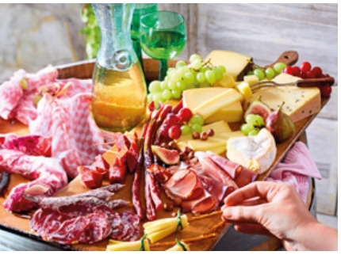

**Ingrediënten voor:** 8 personen
**Bereidingstijd:** ca. 10 min.
**600** g
droge worstjes (bijv. landjäger)
**500** g
zachte en harde kazen
**150 g** peperkaas
**100 g** salami
**100 g** boeren metworst
**8** mini-salami
**200 g** schwarzwalder ham
**500** g
druiven (bijv. wit en rood)
**4** verse vijgen
**150** g
hazel- en walnoten
cocktailprikkers
1 Snijd de droge worstjes in stukken en steek ze
aan cocktailprikkers. Snijd de kazen naar wens in
stukken. Verdeel de droge worst, de kaas en alle
vleeswaren over een houten plank.
2 Was de druiven en de vijgen. Snijd de vijgen
naar wens in stukken. Verdeel het fruit, de noten
en de kaasbezempjes (zie kader hieronder) over
de plank. Lekker met gekoelde witte wijn.

## Kaasbezempjes

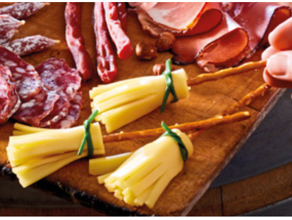

**Ingrediënten voor:** 16 stuks
**Bereidingstijd:** ca. 10 min.
Snijd 6 plakken kaas elk in 2 rechthoeken
(ca. 6 x 10 cm). Snijd de kaasplakjes in de
lengte elke paar millimeter tot de helft in.
Leg een zoute stick op het ongesneden deel
van een plakje kaas en rol hem in de kaas.
Bind vast met bieslook. Herhaal met de rest
van de kaas.

## Knapperig platbrood met

## druiven en crème fraîche

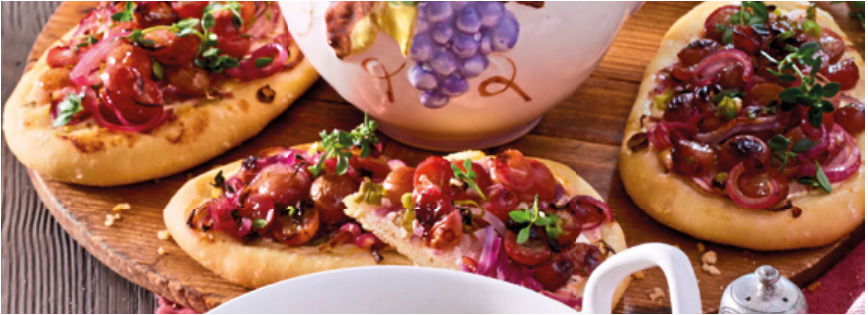

**Ingrediënten voor:** 8 stuks
**Bereidingstijd:** ca. 1 uur en 30 min.
**30 g** verse gist (of 12 g droge gist)
**400 g** bloem (+ bestuiven)
**1 tl** suiker
zout en peper
**10 el** olijfolie
**10 takjes** tijm
**400 g** kleine, pitloze rode druiven
**400 g** crème fraîche
**3-4** rode uien
**2** lente-uitjes
bakpapier

## Uiensoep met pannenkoek

**Ingrediënten voor:** 8 personen
**Bereidingstijd:** ca. 3 uur
**4** grote uien
**2** grote tomaten
**2 el** olie
**2** grote runderschenkels met
been (ca. 1 kg)
**500 g** soepgroente (zak)
**2** laurierblaadjes
**1 el** zwarte peperkorrels
**5** pimentkorrels
zout en peper
**100 g** bloem
**200 ml** melk
**2** eieren
**50 ml** water met koolzuur
**5 el** boter
**½ bosje** bieslook
kaasdoek
1 VOOR HET DEEG Roer de gist en 200 ml lauwwarm water door elkaar. Doe de bloem, de suiker en een
snufje zout in een kom en maak een kuiltje in het midden. Voeg 8 el olie en het gistwater toe en kneed
alles tot een glad deeg. Laat het deeg afgedekt op een warme plek ca. 45 minuten rijzen.
2 VOOR DE TOPPING Was de tijm en de druiven. Neem de druiven van de takjes en halveer ze. Hak de
tijm fijn. Breng de crème fraîche op smaak met flink wat zout en peper. Pel de uien, halveer ze en snijd ze
in dunne halve ringen. Was de lente-uitjes, snijd ze in ringetjes en meng ze met de druiven.
3 Verdeel het deeg op een met bloem bestoven werkblad in acht stukken. Vorm van elk stuk een bolletje
en rol het uit tot een ovaal platbrood (ca. 12 cm). Leg de platbroden op twee met bakpapier beklede
bakplaten en laat nog ca. 15 minuten rijzen.
4 Verwarm de oven voor (elektrisch: 220⁰C / hetelucht: 200⁰C). Bestrijk de platbroden met de crème
fraîche en laat daarbij een randje vrij. Verdeel de rode ui, de druiven met lente-ui en de tijm gelijkmatig
over de broden en besprenkel met 2 el olie. Bak de broden in ca. 15 minuten gaar in de oven.
**Per stuk:** ca. 450 kcal
**8 g** eiwit | 23 g vet | 49 g koolhydraten
1 VOOR DE BOUILLON Halveer 1 ui en bak hem op hoog vuur in een grote, droge pan. Snijd een kruisje
in de tomaten. Neem de ui uit de pan. Verhit 1 el olie in de pan en bak de schenkels er kort in aan. Blus
af met 3,5 l water, breng aan de kook en schep het schuim eraf. Voeg de ui, de tomaten, de soepgroente,
de laurier, de peperkorrels, de pimentkorrels en 1 el zout toe. Laat op laag vuur ca. 2 uur en 30 minuten
zachtjes koken.
2 VOOR DE PANNENKOEK Roer de bloem, de melk, de eieren en een snufje zout door elkaar. Laat het
beslag ca. 30 minuten rusten. Roer het prikwater erdoorheen. Verhit 3 el boter in porties in een kleine
koekenpan (ca. 18 cm Ø). Bak ca. 6 pannenkoeken van het beslag, rol ze op en laat afkoelen. Snijd de
rolletjes schuin in plakjes. Pel 3 uien en snijd ze in dunne ringen. Verhit 2 el boter en 1 el olie in een
koekenpan en bak de ui er ca. 15 minuten in. Breng op smaak met zout.
3 Schenk de bouillon door een met kaasdoek beklede zeef. Breng op smaak met zout en peper. Was de
bieslook en hak hem fijn. Serveer de soep met de pannenkoek, de ui en de bieslook.
**Per portie:** ca. 630 kcal
**5 g** eiwit | 9 g vet | 12 g koolhydraten
BUFFET

## Warme groentesalade

## met krokante pitten

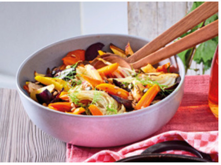

**Ingrediënten voor:** 8 personen
**Bereidingstijd:** ca. 40 min.
2 kg groenten (bijv. knolselderij,
pastinaak, venkel, rode biet en
wortel)
**9 el** olijfolie
zeezout en peper
**1 el** geraspte mierikswortel (pot)
**2 el** schenkstroop
**4 el** appelazijn
**2 el** zonnebloempitten
**2 el** pompoenpitten
bakpapier
1 VOOR DE GROENTEN Verwarm de oven voor
(elektrisch: 180⁰C / hetelucht: 160⁰C). Schil de
groenten, was ze en snijd ze in stukken. Verdeel
de knolselderij, de pastinaak en de venkel over
een met bakpapier beklede bakplaat. Verdeel de
biet en de wortel over een tweede met bakpapier
beklede bakplaat. Besprenkel elke bakplaat met
**3 el** olie, zout en peper. Bak de groenten boven
elkaar ca. 30 minuten in de oven en wissel de
bakplaten halverwege de baktijd om.
2 VOOR DE DRESSING Roer de mierikswortel, de
stroop, de azijn, 4 el water, zout en peper door
elkaar. Klop 3 el olie erdoorheen. VOOR DE KRO-
KANTE PITTEN Rooster de zonnebloempitten
en de pompoenpitten in een droge koekenpan
krokant.
3 Neem alle groenten uit de oven en meng ze nog
heet met de dressing. Bestrooi met de krokante
pitten en serveer warm.
**Per portie:** ca. 190 kcal
**3 g** eiwit | 13 g vet | 14 g koolhydraten
BUFFET

## Varkensgebraad met mosterd

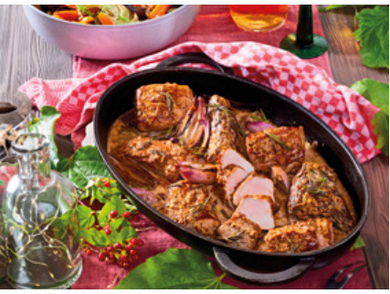

**Ingrediënten voor:** 8 personen
**Bereidingstijd:** ca. 45 min.
**400 g** sjalotjes
**2 takjes** rozemarijn
8
varkenshazen (à ca. 150 g)
**3 el** boter
zout en peper
paprikapoeder
**75** g
mosterd (bijv. rieslingmosterd,
bij de delicatessenzaak)
**300 ml** slagroom
1 Pel de sjalotjes en halveer ze. Was de rozemarijn
en hak hem fijn. Dep het vlees droog. Verhit 2 el
boter in een ondiepe braadpan en bak de sjalotjes
er ca. 10 minuten in. Neem uit de pan. Verhit de
rest van de boter in het hete bakvet en bak de
varkenshazen er ca. 8 minuten rondom in aan.
Bestrooi met zout, peper en paprikapoeder en
bestrijk met de mosterd. Doe sjalotjes weer in de
pan.
2 Verwarm de oven voor (elektrisch: 160⁰C /
hetelucht: 140⁰C). Schenk 200 ml heet water en
de slagroom erbij, breng aan de kook en bestrooi
met de rozemarijn. Bak in ca. 12 minuten gaar in
de oven.
**Per portie:** ca. 350 kcal
**35 g** eiwit | 20 g vet | 4 g koolhydraten

## Hazelnootkoekjes

## met perencompote

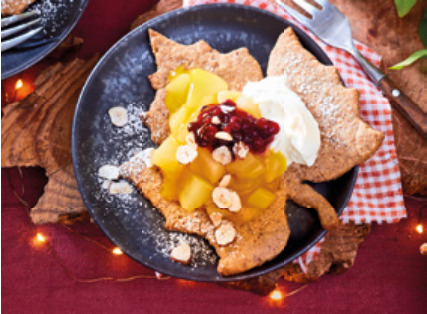

**Ingrediënten voor:** 8 personen
**Bereidingstijd:** ca. 1 uur en 45 min. + ca. 4 uur
wachttijd
**80 g** hazelnootmeel (bijv. van het
merk Smaakt)
**275 g** bloem (+ bestuiven)
**75 g** suiker
**½ tl** bakpoeder
**8 g** vanillesuiker
**1 tl** kaneel
zout
**1** ei
**200 g** koude boter
**1 kg** peren
**3 el** citroensap
**400 ml** perensap
geraspte schil van ½ bio-citroen
**35 g** custardpoeder
**2-3 el** gehakte hazelnoten
**8 tl** crème fraîche
**8 tl** vossenbessenjam of
cranberrycompote
poedersuiker, om te bestuiven
steker of sjabloon van 15-17 cm
Ø, bijv. in blaadjesvorm
bakpapier
BUFFET
1 VOOR DE KOEKJES Rooster het hazelnootmeel
in een droge koekenpan. Neem uit de pan en laat
afkoelen. Meng de bloem, het hazelnootmeel,
de suiker, het bakpoeder, de vanillesuiker, de
kaneel en een snufje zout met elkaar. Voeg het ei
en de boter in stukken toe en kneed snel tot een
glad deeg. Zet het deeg afgedekt ca. 1 uur in de
koelkast.
2 VOOR DE COMPOTE Schil de peren en verwijder
de klokhuizen. Snijd het vruchtvlees in blokjes
en meng met het citroensap in een pan. Voeg
**300 ml** perensap en de citroenschil toe en breng
aan de kook. Roer het custardpoeder met 100 ml
perensap glad en roer het mengsel door de peren.
Breng aan de kook en laat ca. 1 minuut zachtjes
koken. Laat de compote afkoelen.
3 VOOR DE KOEKJES Verwarm de oven voor
(elektrisch: 200⁰C / hetelucht: 180⁰C). Rol het
deeg op een met bloem bestoven werkblad ca.
5 mm dik uit en steek er met een steker 8 koekjes
uit of snijd ze rondom een sjabloon uit. Rol het
restdeeg steeds opnieuw uit, zodat je er genoeg
koekjes uit kunt halen. Verdeel de koekjes over
twee met bakpapier beklede bakplaten en bak
ze in 10-12 minuten gaar in de oven. Neem uit de
oven en laat afkoelen.
4 Rooster de gehakte hazelnoten goudbruin in
een droge koekenpan en neem uit de pan. Verdeel
kort voor het serveren 1 tl crème fraîche en wat
perencompote over elk koekje. Verdeel daarover
de vossenbessenjam en de geroosterde hazelnoten. Bestuif met poedersuiker.
**Per portie:** ca. 590 kcal
**7 g** eiwit | 33 g vet | 62 g koolhydraten
Wil jij je nooit
meer afvragen:
'Wat eten we vandaag?’
VOOR
seizoensgebonden
producten
Ontdek de lekkerste
zoete recepten
ONTVANG 12X
ONTVANG 12X

## KOKEN & GENIETEN

## KOKEN & GENIETEN

VOOR

# €35,

# €35,-

Iedere dag inspiratie voor
ABONNEER JE NU VIA
Iedere dag inspiratie voor
een heerlijke maaltijd
een heerlijke maaltijd
Bomvol recepten met

# WWW.KOKENGENIETEN.NL/ABO

Bomvol recepten met
seizoensgebonden
producten
OF BEL NAAR +31 (0)24 20 27 829
Ontdek de lekkerste
zoete recepten
Deze actie is geldig t/m 22 oktober 2024 of zo lang de voorraad strekt. Je abonneert tot wederopzegging en voor ten minste de actieperiode
van 12 nummers. Na afloop van de actieperiode geldt de reguliere abonnementsprijs en is het abonnement per maand opzegbaar. Prijs onder
voorbehoud. Opzeggen is heel eenvoudig en kan via onze klantenservice.
KOOKBOEK
Titel: Solo
Auteur: Emma de Thouars
Fotografie: Sophia van den Hoek
Receptuur: Emma de Thouars Fotografie: Sophia van den Hoek

# Het rijk alleen

Prijs: 27,99 euro
Uitgeverij: Nijgh & Van Ditmar
De meeste mensen koken graag voor vrienden en familie. Maar wat als je thuis het rijk alleen hebt?
Emma de Thouars is heel goed in “het culinair managen van een eenpersoonshuishouden”, zoals
ze zelf zegt. In haar nieuwste boek Solo deelt ze tips over koken met restjes, hoe je ingrediënten
gevarieerd gebruikt én haar favoriete eenpersoonsgerechten ook met jou.
Tekst: Anne Mebelder
HARISSADRESSING OVER?
Lekker op alle geroosterde groente
(bloemkool, sperziebonen), als
saladedressing (komkommer, little
gem) of over knapperig geroosterde
kikkererwten of bonen.

## Harissa-aubergine caprese

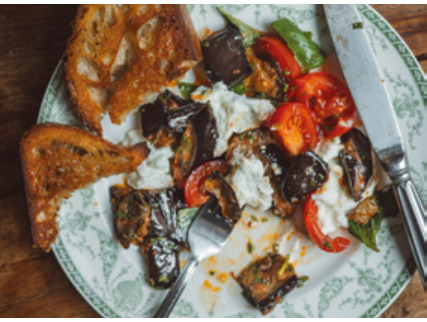

**Ingrediënten voor:** 1 persoon
**Bereidingstijd:** ca. 1 uur
**1 el** (rozen)harissa (Noord-
Afrikaanse saus op basis van
rode peper)
**3 el** olijfolie
**1 teen** knoflook
zout en versgemalen zwarte
peper
**½** aubergine of 1 kleintje
**1** tomaat
**1** handvol basilicum
**1** handvol bieslook
**1** drup azijn of citroensap
**1** kleine bol buffelmozzarella
toast, om te serveren
1 Verwarm de oven voor (elektrisch: 200°C /
hetelucht: 180°C).
2 Meng in een kom de (rozen)harissa en olijfolie.
Rasp de teen knoflook erboven en breng op
smaak met zout en peper. Snijd de aubergine in
stukken van 2 bij 3 centimeter en meng met het
harissamengsel.
3 Doe de aubergine in een ovenschaal en rooster
30 tot 40 minuten. Schep af en toe om. De aubergine moet helemaal zacht zijn en op sommige
plekken bruin. Haal de aubergine uit de oven en
laat afkoelen tot kamertemperatuur.
4 Snijd de tomaat in parten of stukjes, wat je lekkerder vindt happen. Breng op smaak met zout,
meng en laat 10 minuten staan. Hak intussen het
basilicum grof en snijd het bieslook zo fijn als je
kunt. Meng de tomaat met de kruiden, aubergine
en alle rode olie die in de ovenschaal zit. Voeg een
minibeetje azijn toe en nog wat olie als dat nodig
is. Proef en breng op smaak met zout. Scheur de
mozzarella in stukken en meng voorzichtig door
de salade. Ik doe dit als laatst omdat anders de
mozzarella kapot kan gaan en je hele salade wit
kan worden. Serveer met toast.

## Boterkoek

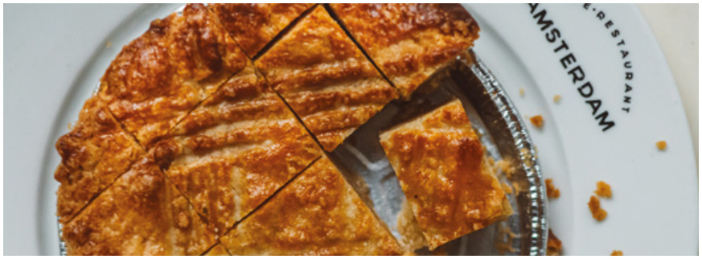

**Ingrediënten voor:** 1 persoon
**Bereidingstijd:** ca. 1 uur
**50** g
witte basterdsuiker, op
kamertemperatuur
**50 g** (plantaardige) boter
**60 g** bloem
zout
**1 el** olijfolie
**1 tl** (plantaardige) melk
kleine taartvorm (10-12 cm Ø)
bakkwast
1 Verwarm de oven voor (elektrisch: 180°C /
hetelucht: 160°C).
KOOKBOEK
TIP
Ook lekker met fijngehakte
verse rozemarijn, limoenblad of
citroenrasp erdoorheen.
2 Kneed in een kom de suiker, boter, bloem en een
snuf zout door elkaar tot het een soort van samenkomt tot een deeg. Kneed het niet te lang, als
je al veel stukken hebt die aan elkaar plakken zit
je goed. Kneed je langer, dan wordt de koek straks
taai. Druk het deeg in een taartvorm en trek er
met een vork een ruitjespatroon in.
3 Kluts in een kom de olijfolie samen met de melk
en strijk dit mengel met een kwastje over je boterkoek. Het patroontje blijft het best zichtbaar
in de koek als je hem eerst even 30 minuten in de
koelkast zet, maar als je daar geen tijd voor hebt
is het niet erg. Bak de boterkoek 15 minuten of tot
de bovenkant goudbruin is. Laat helemaal (het
liefst minimaal een paar uur) afkoelen voordat je
hem eet.

## Pasta met tomaatjes, ansjovis

## en knoflookamandelcrispies

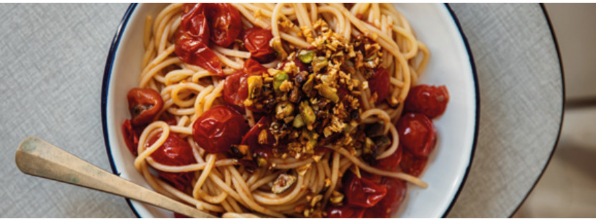

**Ingrediënten voor:** 1 persoon
**Bereidingstijd:** ca. 25 min.
**2 tenen** knoflook
1
handje witte amandelen
olijfolie, om in te bakken
Maldonzout
**100 g** spaghetti
**150 g** cherrytomaatjes
**2 el** boter
**3** ansjovisfilets
versgemalen zwarte peper
keukenpapier
1 Hak de knoflook fijn en de amandelen grof.
Doe de knoflook samen met een paar eetlepels
olijfolie in een steelpan of kleine koekenpan.
Bak op laag vuur in een paar minuten goudbruin
en knapperig. Dit is afhankelijk van hoe groot
je de knoflook snijdt en hoe heet je olie is, maar
het duurt een paar minuten. Zet het vuur niet te
hoog (!) en blijf goed roeren, anders verbrandt de
knoflook. Giet de knoflook af in een zeef boven
een hittebestendige kom en vang de olie op.
2 Laat de knoflookcrispies uitlekken op keukenpapier. Doe de knoflookolie terug in de pan en
bak daar de amandelen goudbruin in. Voeg zo
nodig iets meer olie toe, maar de noten hebben
niet superveel vet nodig. Ze zijn het zelf al. Doe
de goudbruine amandelen bij de knoflook op
het keukenpapier, meng en breng op smaak met
Maldonzout.
3 Breng een pan ruim gezouten water aan de
kook en kook de pasta zoals aangegeven op de
verpakking. Halveer intussen de cherrytomaatjes. Smelt de boter in een koekenpan en voeg de
ansjovis toe. Bak op laag vuur tot de ansjovis is
gesmolten. Voeg de tomaatjes en een paar draaien zwarte peper toe en bak een paar minuten, tot
ze zacht zijn. Giet de pasta af en doe samen met
een scheut kookwater bij de tomaatjes in de pan.
Roer om en schep op een bord. Serveer met de
knoflook-amandelcrispies erop.
KOOKBOEK

# Immuunboost

Het wordt weer kouder, dus om de griep buiten de deur te houden kun je
maar beter lekker gezond eten. Savooiekool, erwten, wortel, bieten, ui en
sinaasappel zijn echte immuunboosters!

## Tropische havermout

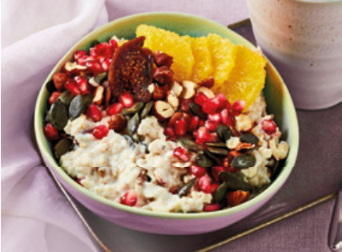

**Ingrediënten voor:** 4 personen
**Bereidingstijd:** ca. 20 min.
**150 g** havervlokken
**800 ml** havermelk
zeezout
**2** kleine sinaasappels
**30 g** hazelnoten
**75 g** gedroogde vijgen
**2** bananen
**1 el** vloeibare honing
**4 el** granaatappelpitten
**30 g** pompoenpitten
1 Breng de havervlokken, de havermelk en een
snufje zeezout al roerend aan de kook. Laat even
zachtjes koken en neem van het vuur. Snijd de
schil van de sinaasappels, inclusief het witte deel.
Snijd de sinaasappels in plakjes. Hak de hazelnoten grof. Snijd de vijgen in stukken.
2 Schil de bananen en prak ze fijn. Roer de banaan en de honing door de havermout. Verdeel
de havermout over kommetjes en verdeel de
sinaasappel, de granaatappelpitten, de vijgen, de
hazelnoten en de pompoenpitten erover.
**Per portie:** ca. 520 kcal
**12 g** eiwit | 20 g vet | 68 g koolhydraten

## Wortel-geitenkaasplaattaart

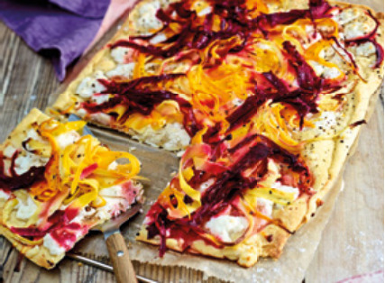

**Ingrediënten voor:** ca. 6 stukken
**Bereidingstijd:** ca. 50 min. + wachttijd
**200 g** bloem (+ bestuiven)
**100 g** koude boter
**1** eidooier
zout en peper
**3-4** wortels
**3** rode bieten
**2** pastinaken
**2 el** wittewijnazijn
**2 el** olijfolie
**150 g** verse geitenkaas
**1** ei
vershoudfolie
bakpapier
DE GEZONDE KEUKEN
1 Kneed met een handmixer met deeghaken de bloem, de boter in stukken, de eidooier, 5 el koud water
en een snufje zout tot een glad deeg. Wikkel het deeg in vershoudfolie en leg ca. 1 uur in de koelkast.
2 Was de wortels, de bieten en de pastinaken en schaaf ze met een dunschiller in linten. Meng met de
azijn, de olie, zout en peper. Rol het deeg op een met bloem bestoven werkblad rechthoekig (ca. 20 x
30 cm) uit en leg het op een met bakpapier beklede bakplaat.
3 Verwarm de oven voor (elektrisch: 200⁰C / hetelucht: 180⁰C). Bestrijk het deeg met de geitenkaas en
verdeel de groenten erover. Kluts het ei en bestrijk de deegranden ermee. Bak de plaattaart in ca. 20 minuten goudbruin in de oven. Neem uit de oven, snijd in stukken en serveer.
**Per stuk:** ca. 380 kcal
**10 g** eiwit | 22 g vet | 34 g koolhydraten

## Erwten-gortrisotto met chorizo

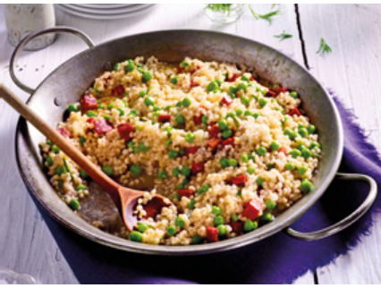

**Ingrediënten voor:** 4 personen
**Bereidingstijd:** ca. 40 min.
**150 g** chorizo
**1** ui
**2** teentjes knoflook
**1 tl** olie
**250 g** parelgort
**1 l** groentebouillon
**2 takjes** rozemarijn
**400 g** erwten (diepvries)
zout en peper
1 Snijd de chorizo in kleine blokjes. Pel en snipper de ui en de knoflook fijn.
Verhit de olie in een koekenpan op middelhoog vuur en bak de chorizo er
3-4 minuten al roerend in. Neem uit de pan.
2 Bak de ui en de knoflook 2-3 minuten al roerend in het hete bakvet. Voeg de
parelgort toe en bak kort mee. Schenk beetje bij beetje de bouillon erbij en
roer af en toe door. Voeg pas nieuwe bouillon toe als de parelgort de vorige
portie heeft opgenomen. Gaar de parelgort zo in ca. 25 minuten.
3 Was de rozemarijn en hak hem fijn. Voeg ca. 5 minuten voor het einde van
de gaartijd de chorizo, de rozemarijn en de erwten toe aan de parelgort.
Breng de risotto op smaak met zout en peper.
**Per portie:** ca. 480 kcal
**19 g** eiwit | 15 g vet | 60 g koolhydraten

## Gebakken uien met tex-mexvulling

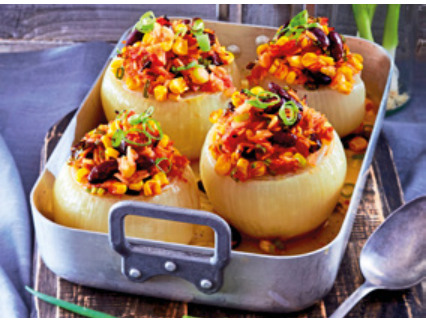

**Ingrediënten voor:** 4 personen
**Bereidingstijd:** ca. 50 min.
**150 g** basmatirijst
zout en peper
4
grote uien (à ca. 250 g)
**400 g** kidneybonen (blik)
**200 g** mais (blik)
**1 bosje** lente-ui
**2 el** olie
**400 g** tomatenblokjes (blik)
chilivlokken
**100 ml** groentebouillon
1 Gaar de rijst volgens de aanwijzingen op de verpakking in water met wat
zout. Pel de uien en snijd een ruim kapje van de bovenkanten af. Hol de uien
uit, bijvoorbeeld met een meloenboller. Kook de uien 5-8 minuten voor in
water met wat zout. Laat uitlekken. Hak de helft van de uienkapjes fijn;
gebruik de rest van de uienkapjes voor een ander recept.
2 Spoel de bonen en de mais met koud water en laat uitlekken. Was de
lente-uitjes en snijd ze in ringetjes. Verhit de olie in een pan en bak de gehakte ui er glazig in. Voeg de tomatenblokjes toe, breng aan de kook en laat
8-10 minuten zachtjes koken. Giet de rijst af en voeg samen met de bonen,
de mais en het grootste deel van de lente-ui toe aan de tomaat. Breng op
smaak met zout, peper en chilivlokken.
3 Verwarm de oven voor (elektrisch: 200⁰C / hetelucht: 180⁰C). Vul de uien
met de rijstvulling en zet ze in een ovenschaal. Schenk de bouillon erbij en
gaar de uien in ca. 15 minuten in de oven. Neem uit de oven en bestrooi met
de rest van de lente-ui.
**Per portie:** ca. 400 kcal
**16 g** eiwit | 7 g vet | 70 g koolhydraten

## Herfstige groentesoep

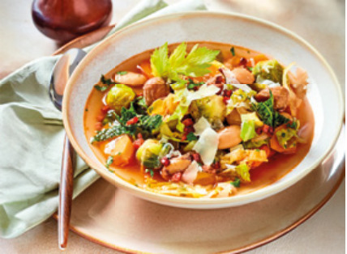

**Ingrediënten voor:** 4 personen
**Bereidingstijd:** ca. 1 uur
**½** savooiekool (ca. 600 g)
**250 g** spruitjes
**4-5** wortels
**2** uien
**1-2** teentjes knoflook
**3** stengels bleekselderij
**1 takje** salie
**2-3 el** olijfolie
**150 g** spekblokjes
**1 el** tomatenpuree
**400 g** tomatenblokjes (blik)
**1,5 l** groentebouillon
zout en peper
paprikapoeder
**6 takjes** basilicum
evt. 200 g gegaarde kastanjes
(vacuümverpakking)
**400 g** witte reuzenbonen (blik of pot)
**80 g** geschaafde parmezaan
DE GEZONDE KEUKEN
1 Was de savooiekool en snijd hem in repen van de stronk. Was de spruitjes en snijd ze in tweeën of in
vieren. Schrap de wortels, was ze en snijd ze in plakjes. Pel de uien en snijd ze in ringen. Pel de knoflook
en hak hem fijn. Was de bleekselderij, houd het loof apart voor de garnering en snijd de bleekselderij in
boogjes. Was de salie en hak hem fijn.
2 Verhit de olie in een grote pan op middelhoog vuur en bak de spekblokjes, de ui, de knoflook en de
bleekselderij er ca. 4 minuten in. Voeg de spruitjes, de wortel en de tomatenpuree toe en bak ca. 1 minuut mee. Blus af met de tomatenblokjes en de bouillon. Voeg de savooiekool en de salie toe. Breng alles
op smaak met zout, peper en paprikapoeder. Breng aan de kook en laat afgedekt ca. 20 minuten zachtjes koken.
3 Was het basilicum en snijd het in dunne reepjes. Halveer de kastanjes. Spoel de bonen met water en
laat uitlekken. Doe de kastanjes en de bonen in de soep en verwarm mee, maar laat niet koken. Roer het
basilicum erdoorheen. Breng op smaak met zout en peper en serveer. Bestrooi met parmezaan en het
bleekselderijloof.
**Per portie:** ca. 500 kcal
**35 g** eiwit | 15 g vet | 62 g koolhydraten

# Gietijzer

Een gietijzeren koekenpan is eigenlijk onmisbaar in je keuken.
Zo’n pan is ontzettend duurzaam, gaat vaak generatieslang mee en kan
zowel op het fornuis als in de oven. Wat wil je nog meer?

## Sappige lamssteaks

## met bietencarpaccio

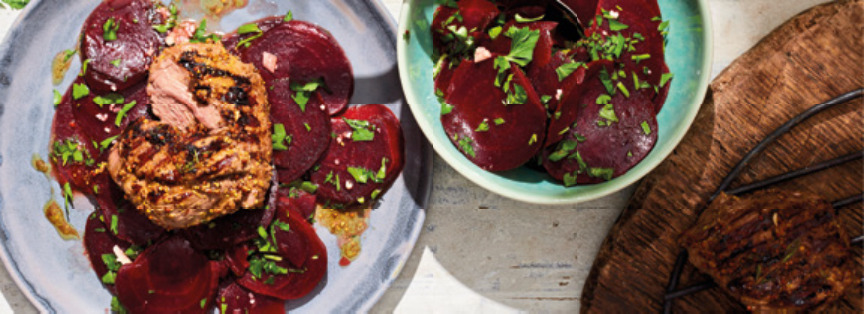

**Ingrediënten voor:** 4 personen
**Bereidingstijd:** ca. 20 min. + ca. 3 uur wachttijd
**4** lamssteaks (à ca. 150 g)
**4 tl** grove mosterd
**4** teentjes knoflook
**250 ml** schwarzbier (bij de slijterij of
bierspeciaalzaak)
**2 tl** gedroogde tijm
**750 g** gekookte rode bieten
(vacuümverpakking)
**5-6 el** olijfolie
**2 el** balsamicoazijn
zout en peper
**4 takjes** peterselie
1 VOOR HET VLEES Dep de steaks droog en bestrijk rondom met de mosterd. Pel de teentjes
knoflook en hak ze fijn. Doe de helft van de knoflook met het bier en de tijm in een ovenschaal.
Leg de steaks erin en laat afgedekt ca. 3 uur in de
koelkast marineren. Draai de steaks halverwege
om.
2 VOOR DE CARPACCIO Halveer de rode bieten
eventueel, snijd ze in dunne plakjes en doe ze in
een kom. Roer 4 el olie en de azijn door elkaar,
roer de rest van de knoflook erdoorheen en breng
op smaak met zout en peper. Meng de bieten met
de vinaigrette en laag afgedekt ca. 1 uur trekken.
Was de peterselie, hak hem fijn en spatel de helft
door de bieten.
3 VOOR HET VLEES Bestrijk een gietijzeren grillof koekenpan met 1-2 el olie en verhit hem. Neem
de steaks uit de marinade, dep ze droog en bak
ze 3-4 minuten per zijde in de hete pan. Breng op
smaak met zout en peper, neem uit de pan en laat
ca. 3 minuten rusten.
4 Beleg vier borden met de bietencarpaccio en
besprenkel met de vinaigrette. Leg de lamssteaks
erop en bestrooi met de rest van de peterselie.
Lekker met stamppot.
**Per portie:** ca. 530 kcal
**32 g** eiwit | 31 g vet | 27 g koolhydraten
FAVORIET VAN DE MAAND

## Varkensfiletpannetje met aardappel

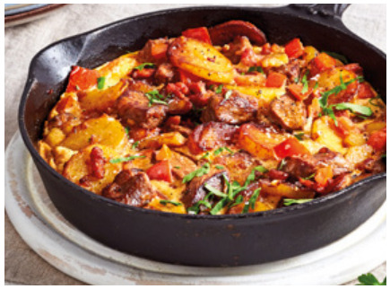

**Ingrediënten voor:** 4 personen
**Bereidingstijd:** ca. 50 min.
**600 g** middelgrote
aardappels
**1** ui
**3** tomaten
**400 g** varkensfiletlapjes
**4** eieren
**4 el** melk
zout en peper
**6 el** olie
**125 g** magere spekblokjes
**2-3 takjes** peterselie
1 Was de aardappels en kook ze in ca. 20 minuten gaar in een pan water. Pel
en snipper de ui. Was de tomaten, snijd ze in kwarten, verwijder de zaadlijsten en snijd de tomaten in blokjes. Dep het de varkensfiletlapjes droog en
snijd in blokjes van ca. 2 cm. Giet de aardappels af, schil ze en laat afkoelen.
2 Kluts de eieren met de melk, zout en peper. Snijd de aardappels in plakjes.
3 Verhit 2 el olie in een grote gietijzeren koekenpan op hoog vuur en bak de
varkensfiletlapjes er in porties in aan. Bestrooi met zout en peper en neem
uit de pan.
4 Verhit 4 el olie in het bakvet en bak de aardappel er in ca. 10 minuten goudbruin in. Voeg de ui en de spekblokjes toe en bak ca. 3 minuten mee. Spatel
de tomatenblokjes en de varkensfiletlapjes erdoorheen. Breng op smaak met
zout en peper. Schenk het eimengsel erover en laat afgedekt op laag vuur in
ca. 10 minuten stollen. Was de peterselie, hak hem fijn en strooi hem over
het gerecht.
**Per portie:** ca. 580 kcal
**34 g** eiwit | 30 g vet | 40 g koolhydraten

## Geroosterde artisjokharten met knoflookrijst

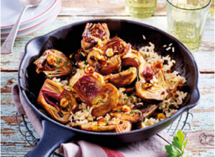

**Ingrediënten voor:** 4 personen
**Bereidingstijd:** ca. 30 min.
**50 g** hazelnoten
**800 g** artisjokharten (blik)
**2 el** olijfolie
zout en peper
paprikapoeder
**1** teentje knoflook
**250 g** rijst
**200 ml** droge witte wijn
**350 ml** groentebouillon
**3-4 takjes** peterselie
1 Rooster de hazelnoten goudbruin in een grote, droge gietijzeren pan. Neem
uit de pan en hak grof. Laat de artisjokharten uitlekken, dep ze goed droog
en halveer ze naar grootte. Verhit de olie in de koekenpan op hoog vuur en
bak de artisjok erin. Draai regelmatig om. Breng op smaak met zout, peper
en paprikapoeder en neem uit de pan.
2 Pel de knoflook en hak hem fijn. Bak de knoflook en de rijst kort in het hete
bakvet in de koekenpan. Blus af met de wijn en de bouillon, breng aan de
kook en laat in ca. 18 minuten garen. Roer regelmatig.
3 Was de peterselie en hak hem fijn. Doe de artisjokken bij de rijst en verwarm kort mee. Breng op smaak met zout en peper en bestrooi met de hazelnoten en de peterselie.
**Per portie:** ca. 530 kcal
**13 g** eiwit | 26 g vet | 43 g koolhydraten

## Pruimen-appeltaart

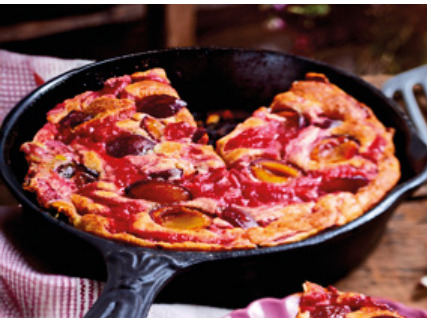

**Ingrediënten voor:** 6 stukken
**Bereidingstijd:** ca. 45 min.
**600 g** pruimen (evt. diepvries)
**2** appels
**2** eieren
**150 g** bloem
**150 g** poedersuiker
**1 tl** bakpoeder
**1 el** boter
1 Halveer de pruimen en verwijder de pit. Laat
diepvriespruimen ca. 30 minuten ontdooien.
Houd 12 halve pruimen apart en pureer de rest.
2 Was de appels, snijd ze in kwarten, verwijder
het klokhuis en rasp de appels fijn. Splits de
eieren. Meng in een grote kom de appel, de eidooiers, de bloem, de poedersuiker en het bakpoeder met elkaar. Klop de eiwitten stijf en spatel
voorzichtig door het beslag.
FAVORIET VAN DE MAAND
3 Verhit de boter in een gietijzeren pan (ca. 26 cm
Ø) met deksel en schenk het beslag erin. Laat op
middelhoog vuur in ca. 8 minuten stollen. Verdeel
de pruimenpuree over de taart en maak met een
mes een marmerpatroon in de taart. Laat nog ca.
4 minuten stollen. Verdeel de halve pruimen over
de taart en laat afgedekt in ca. 10 minuten garen.
Lekker met yoghurtslagroom.
**Per portie:** ca. 310 kcal
**6 g** eiwit | 5 g vet | 58 g koolhydraten

# Süße Grüße

Oftewel: zoete groeten! In Duitsland weten ze wel hoe je
lekkere taart, cake en andere baksels maakt. Geniet van
deze moderne Duitse klassiekers.
GEBAK

## Saffraancake met amandel en frambozen

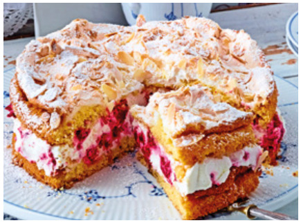

**Ingrediënten voor:** ca. 12 stukken
**Bereidingstijd:** ca. 1 uur en 30 min. + ca. 2 uur wachttijd
**1** plukje saffraan
**300** g
frambozen (vers of diepvries)
**4** eieren
**125** g
boter (+ invetten)
zout
**24 g** vanillesuiker
**325 g** suiker
**150 g** bloem
**16 g** bakpoeder
**5 el** melk
**50 g** amandelschaafsel
**500 ml** slagroom
**16** g
slagroomversteviger (bijv. Dr. Oetker Klop-Fix)
**1-2 el** poedersuiker
1 Week de saffraan in 1 el heet water. VOOR DE VULLING Maak de frambozen
schoon. Laat diepvriesframbozen ontdooien.
2 VOOR DE CAKE Splits de eieren. Klop de boter, een snufje zout, 8 g vanillesuiker en 125 g suiker romig met een handmixer. Roer de eidooiers er één
voor één doorheen. Zeef de saffraan en vang het water op. Meng het saffraanwater met de melk. Meng de bloem met het bakpoeder en voeg het
afwisselend met de melk in porties toe aan het botermengsel. Doe de helft
van het beslag in een ingevette springvorm (26 cm Ø) en strijk glad.
3 Verwarm de oven voor (elektrisch: 180⁰C / hetelucht: 160⁰C). Klop de
eiwitten stijf en voeg tijdens het kloppen 200 g suiker beetje bij beetje toe.
Verdeel de helft van het eiwitschuim luchtig over het beslag in de vorm en
laat daarbij een rand van ca. 1 cm vrij. Zet de rest van het eiwitschuim in de
koelkast. Bestrooi het eiwitschuim in de vorm met de helft van het amandelschaafsel. Bak ca. 25 minuten in de oven. Neem uit de oven, zet op een rooster en verwijder voorzichtig de vorm. Laat afkoelen. Maak de springvorm
schoon en vet hem in. Maak op dezelfde manier nog een cake.
4 Klop de slagroom stijf en voeg tijdens het kloppen de rest van de vanillesuiker en de slagroomversteviger toe. Spatel de frambozen erdoorheen. Leg
een cake op een taartplateau en verdeel de frambozenroom erover. Leg de
andere cake erbovenop en bestuif met poedersuiker.
**Per stuk:** ca. 440 kcal
**6 g** eiwit | 27 g vet | 45 g koolhydraten

## Duitse wafels met ijs

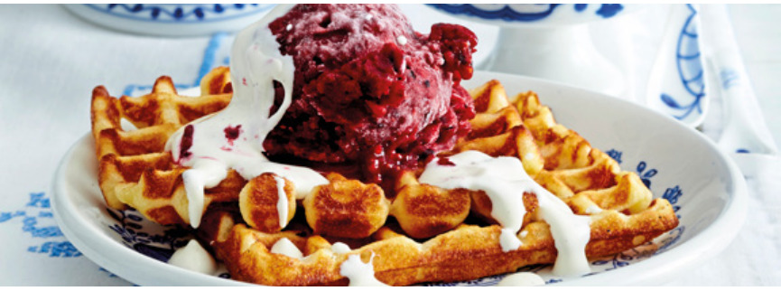

**Ingrediënten voor:** 8 stuks
**Bereidingstijd:** ca. 40 min.
**150 g** zachte boter (+
invetten)
**40 g** + 1 el suiker
zout
**3** eieren
**250 g** bloem
**1 tl** bakpoeder
**200 g** karnemelk
**150 g** crème fraîche
**1 tl** vanille-extract
wafelijzer (voor wafels
van 9 x 15 cm)
1 VOOR DE WAFELS Roer de boter, 40 g suiker en een snufje zout glad. Roer
de eieren er één voor één doorheen. Meng de bloem met het bakpoeder en
voeg afwisselend met de karnemelk toe aan het eimengsel. Vet een wafelijzer (voor wafels van 9 x 15 cm) in met een beetje boter. Bak één voor één 8
wafels van het beslag. Houd de wafels warm.
2 VOOR DE SAUS Roer de crème fraîche, de vanille en 1 el suiker glad. Serveer
de wafels met de saus en bosvruchtensorbetijs.
**Per stuk:** ca. 460 kcal
**8 g** eiwit | 24 g vet | 49 g koolhydraten

## Sinaasappelkwarktaart

**Ingrediënten voor:** ca. 12 stukken
**Bereidingstijd:** ca. 1 uur + minimaal 6 uur wachttijd
**175** g
bloem (+ bestuiven)
**250 g** suiker
**100** g
boter (+ invetten)
**4** eieren
**500 g** kwark
**250 g** crème fraîche
**3** gelatineblaadjes
**5 el** + 150 ml sinaasappelsap
**100** ml
duindoornsap (bij de
reformwinkel)
evt. frambozen, om te versieren
vershoudfolie
1 VOOR DE BODEM Kneed de bloem, 75 g suiker,
**75 g** boter in stukjes en 1 ei met je handen tot een
glad deeg. Druk het deeg plat, wikkel het in folie
en leg ca. 1 uur in de koelkast.
2 VOOR DE KWARKVULLING Smelt 25 g boter.
Roer de kwark, de crème fraîche, 125 g suiker, de
gesmolten boter en 3 eieren glad.
3 Verwarm de oven voor (elektrisch: 180⁰C /
hetelucht: 160⁰C). Rol het deeg op een met bloem
bestoven werkblad rond (ca. 30 cm Ø) uit. Leg de
deeglap in een springvorm (ca. 26 cm Ø) en druk
tegen de randjes omhoog. Prik het deeg een aantal keer in met een vork. Verdeel de kwarkvulling
over de bodem en bak de taart in ca. 40 minuten
onder in de oven gaar. Zet daarna de oven op een
kiertje en laat de taart ca. 1 uur afkoelen in de
oven.
4 VOOR HET SINAASAPPELLAAGJE Laat de gelatine weken in koud water. Verwarm 5 el sinaasappelsap met 50 g suiker. Knijp de gelatine uit en los
hem op in het warme sinaasappelsap. Roer het
duindoornsap en de rest van het sinaasappelsap
erdoorheen. Schenk over de taart en zet minimaal
3 uur in de koelkast om op te stijven. Versier de
taart eventueel met frambozen.
**Per stuk:** ca. 310 kcal
**10 g** eiwit | 14 g vet | 35 g koolhydraten
GEBAK
GEBAK

## Kruimelkoek met appel en pruim

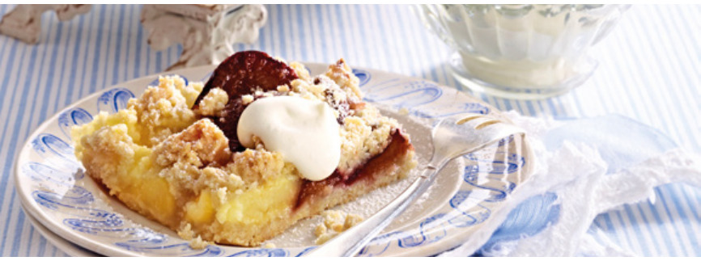

**Ingrediënten voor:** ca. 24 stukken
**Bereidingstijd:** ca. 1 uur en 15 min. + ca. 2 uur wachttijd
**1** kg
zure appels (bijv. goudreinetten)
**400 ml** appelsap
**16 g** vanillesuiker
**2** volle el maizena
**900 g** pruimen
**1** kaneelstokje
**1 el** + 200 g lichte basterdsuiker
**500 g** bloem
**300** g
boter (+ invetten)
zout
**1** ei
**2 el** poedersuiker
1 VOOR DE APPELCOMPOTE Schil de appels, snijd ze in kwarten en verwijder
de klokhuizen. Snijd de appels in kleine blokjes. Doe de appel, 150 ml appelsap en de helft van de vanillesuiker in een pan, breng aan de kook en laat
afgedekt ca. 5 minuten zachtjes koken. Roer 1 el maizena en 50 ml appelsap
glad. Neem de pan van het vuur en roer het maizenamengesl erdoorheen.
Zet terug op het vuur en laat al roerend ca. 1 minuut zachtjes koken. Laat de
appelcompote afkoelen en roer hem regelmatig door.
2 VOOR DE PRUIMENCOMPOTE Was de pruimen, halveer ze en verwijder de
pitten. Doe de pruimen, 150 ml appelsap, het kaneelstokje en 1 el suiker in
een pan en breng aan de kook. Laat afgedekt ca. 3 minuten koken. Roer 1 el
maizena en 50 ml appelsap glad. Neem de pan van het vuur en roer het maizenamengsel erdoorheen. Zet de pan terug op het vuur en laat al roerend ca.
1 minuut zachtjes koken. Laat afkoelen en roer regelmatig door. Neem het
kaneelstokje uit de compote.
3 VOOR HET KRUIMELDEEG Verwarm de oven voor (elektrisch: 180⁰C / hetelucht: 160⁰C). Doe de bloem, de boter in stukken, 200 g suiker, een snufje
zout, de rest van de vanillesuiker en het ei in een grote kom. Maak er eerst
met de deeghaken van een handmixer en vervolgens met je handen een kruimeldeeg van. Verdeel ⅔ van het deeg over een ingevette bakplaat en druk
aan. Verdeel afwisselend de appel- en de pruimencompote in strepen van ca.
10 cm breed over de bodem. Bestrooi met de rest van het kruimeldeeg.
4 Bak ca. 45 minuten onder in de oven. Laat afkoelen op een rooster. Bestuif
met poedersuiker en serveer naar wens met slagroom.
**Per stuk:** ca. 260 kcal
**3 g** eiwit | 11 g vet | 36 g koolhydraten

## Slagroomsoezen met lemoncurd

**Ingrediënten voor:** ca. 18 stuks
**Bereidingstijd:** ca. 1 uur + ca. 30 min. wachttijd
**125 ml** melk
zout
**100 g** boter
**200 g** bloem
**4** eieren
**350 ml** slagroom
**2 el** suiker
**6 el** lemoncurd
spuitzak met stervormig
spuitmondje
spuitzak met rond spuitmondje
bakpapier
1 VOOR DE SOEZEN Breng de melk, 125 ml water,
een snufje zout en de boter in een pan aan de
kook. Voeg de bloem in één keer toe en roer met
een houten lepel door tot het deeg in een klont
van de bodem van de pan loskomt. Doe het deeg
in een mengkom en roer 1 ei erdoorheen. Laat het
deeg 5-10 minuten afkoelen.
2 Verwarm de oven voor (elektrisch: 200⁰C /
hetelucht: 180⁰C). Roer de rest van de eieren één
voor één door het deeg. Doe het deeg in een spuitzak met stervormig spuitmondje en spuit er op
twee met bakpapier beklede bakplaten bolletjes
van ca. 4 cm Ø van. Vul een ovenschaaltje met
water en zet hem op de bodem van de oven. Bak
de soezen in 15-20 minuten gaar in de oven. Neem
uit de oven, laat even afkoelen en knip ze met
een keukenschaar horizontaal doormidden. Laat
helemaal afkoelen.
3 VOOR DE VULLING Klop de slagroom stijf en
voeg tijdens het kloppen beetje bij beetje de
suiker toe. Roer de lemoncurd glad en spatel hem
losjes door de slagroom, zodat je een marmereffect krijgt. Doe het mengsel in een spuitzak en
vul de soezen ermee. Zet de bovenkanten van de
soezen erop en serveer.
**Per stuk:** ca. 190 kcal
**4 g** eiwit | 13 g vet | 13 g koolhydraten

## Klantenservice

Wil je abonnee worden of heb je vragen over je
abonnement? Op onze website vind je antwoord op
de meeste vragen.
www.kokengenieten.nl/contact
Wist je dat je tegenwoordig eenvoudig zelf je adres
kan wijzigen? Ga naar www.kokengenieten.nl/
adreswijzigen om je nieuwe adres door te geven.
Het nieuwe adres wordt vervolgens automatisch in
ons systeem gewijzigd.
Telefoon
We zijn er maandag
tot en met vrijdag
van 09.00 tot
**17.00** uur om je vragen
te beantwoorden.
+31 (0)24-2027 829
E-mail
Stel je vraag per e-mail
aan een van onze
service medewerkers.

## klantenservice@

kokengenieten.nl
ABONNEMENTSINFORMATIE Koken & genieten kost € 3,99 per nummer. De abonnementsprijs is in Nederland € 47,00
en in België € 50,00 (12 nummers). Deze prijs geldt bij betaling per automatische incasso. Voor betaling via een
(digitale) factuur geldt een toeslag van € 2,50. Je kunt eenvoudig een machtiging afgeven via www.fnl.nl/machtigen.
Abonnementen worden automatisch verlengd, tenzij anders vermeld. Het opzeggen van een abonnement kan eenvoudig
telefonisch via +31 (0)24-2027829 of per mail via klantenservice@kokengenieten.nl.
koken & genieten is een
uitgave van F&L Media B.V.
in licentie van Bauer Media
Brand Manager Yvonne Doorten
Redactie Bas Erkens, Anne Mebelder,
Lotus van Overveldt, Willem van Santen en
Marieke Slettenhaar
In samenwerking met Brenda Kookt
Art Direction Nick Groenewold
Vormgeving Mylene Nales, Tom Gerrits,
Lisanne Cobussen, Susan Gerbrands-Derksen,
Ferry Dorresteijn en Ellen Willemsen en
In-Graphic
Sales Marc Bokhove +31 (0)24 2404643
mbokhove@fnl.nl
Marketing Anouk Tolboom +31 24 240 45 95
atolboom@fnl.nl
Drukkerij Senefelder Misset Doetinchem B.V.
Vragen aan de redactie
Heb jij opmerkingen, suggesties of vragen aan
de redactie? lezersvragen@kokengenieten.nl
Nieuwsredactie / Pers
kooknieuws@fnl.nl of het onderstaande adres
o.v.v. redactie koken & genieten
Jonkerbosplein 52, 6534 AB Nijmegen
COPYRIGHT Het auteursrecht op deze uitgave en de gedrukte uitgave en op de daarin verschenen
artikelen wordt door de uitgever voorbehouden. De vertaalrechten berusten bij F&L Media B.V.
te Nijmegen/ Nederland. Het verlenen van toestemming tot publicatie in de gedrukte uitgave
houdt in dat de auteur de uitgever, met uitsluiting van ieder ander onherroepelijk machtigt de
bij of krachtens de auteurswet door derden verschuldigde vergoedingen voor kopiëren te innen
en dat de auteur alle rechten verdraagt aan de uitgever, tenzij anders bepaald. Niets uit deze
uitgave en de gedrukte uitgave mag worden overgenomen, vermenigvuldigd of gekopieerd zonder
uitdrukkelijke schriftelijke toestemming van de uitgever. De uitgever stelt zich niet aansprakelijk
voor eventuele onjuistheden, welke in deze uitgave of de gedrukte uitgave mochten voorkomen.
ISSN: 1875-8517

# Toffe

# peren

De herfst is hét seizoen voor
peren. In dit recept gaat maar
weinig suiker, omdat de peren van
zichzelf al zoet genoeg zijn.
PRONKSTUK

## Perentaart met marsepeinsaus

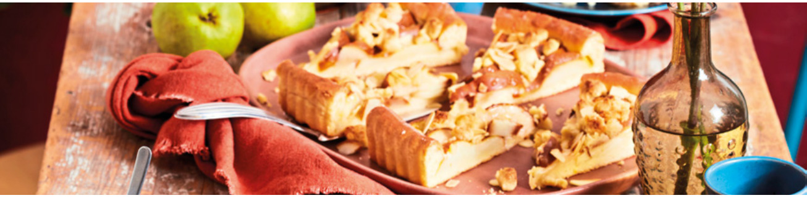

**Ingrediënten voor:** ca. 12 stukken
**Bereidingstijd:** ca. 1 uur + ca. 45 min. wachttijd
**280 g** bloem (+ bestuiven)
geraspte schil van ½ bio-citroen
**14 g** verse gist (of 6 g droge gist)
**3 el** suiker
**80 g** boter (+ invetten)
**1** ei
**2 el** zure room
**80 g** marsepein
**2** eidooiers
**2 el** + 480 ml melk
**1 el** maizena
**½** vanillestokje
**750 g** peren
**30 g** amandelschaafsel
1 VOOR HET DEEG Meng 200 g bloem en de citroenschil in een kom en maak
een kuiltje in het midden. Verbrokkel de verse gist en roer 1 el suiker en
**50 ml** lauwwarm water erdoorheen. Schenk het gistmengsel in het kuiltje en
roer er wat bloem van de rand doorheen. Laat het voordeeg op een warme
plek ca. 10 rijzen. Voeg 30 g boter, het ei en de zure room toe aan het voordeeg en kneed alles glad. Laat op een warme plek afgedekt ca. 1 uur rijzen.
2 VOOR HET KRUIMELDEEG Kneed 80 g bloem, 1 el suiker, 50 g boter en 40 g
marsepein tot een kruimeldeeg. Zet in de koelkast.
3 VOOR DE SAUS Rasp 40 g marsepein fijn. Roer de marsepein, de eidooiers,
**2 el** melk, de maizena en 1 el suiker door elkaar. Splijt het vanillestokje in de
lengte en schraap het merg eruit. Doe het vanillestokje, het merg en 480 ml
melk in een pannetje en verwarm. Roer 3 el hete vanillemelk door het eidooiermengsel. Draai het vuur laag en roer het eidooiermengsel door de
vanillemelk tot de saus een beetje gebonden is. Neem het vanillestokje eruit.
Laat afkoelen en roer daarbij regelmatig door.
4 Verwarm de oven voor (elektrisch: 180⁰C / hetelucht: 160⁰C). Was de peren,
snijd ze in kwarten, verwijder de klokhuizen en snijd de peren in partjes. Rol
het deeg op een met bloem bestoven werkblad rond (30 cm Ø) uit. Bekleed
een quichevorm met uitneembare bodem (26 Ø cm) met het deeg. Verdeel
de partjes peer er waaiervormig in. Bestrooi met het kruimeldeeg en het
amandelschaafsel. Bak in 20-25 minuten gaar in de oven. Neem uit de oven
en serveer warm met de marsepeinsaus.
**Per stuk:** ca. 220 kcal
**4 g** eiwit | 8 g vet | 34 g koolhydraten
Voor- en bijgerechten

# receptenindex

# november

## IN HET

Aardappelsoep met krokante topping 28
Herfstige borrelplank 33
Snelle eenpansspaghetti
met champignons 27
Thaise kokos-kippensoep 22
Kaasbezempjes 33

## NUMMER

Knapperig platbrood met druiven en crème
Traybake van pompoen
met spruitjes en worstjes 7
Varkensfiletpannetje met aardappel 54
Varkensgebraad met mosterd 37
Wildzwijnovenschotel 18
fraîche 34
Wortel-geitenkaasplaattaart 49
Koolraap-bietensoep met pastinaak 21
Tomatensoep 7
Uiensoep met pannenkoek 34
Warme groentesalade met krokante pitten 36
Zalm uit de oven met bieten en sinaasappel 27
Hoofdgerechten
Zoet en desserts
Appeltaartcinnamonrolls 10
Andijvieschotel met gehakt en spek 8
Boterkoek 45
Erwten-gortrisotto met chorizo 50
Gebakken uien met tex-mexvulling 50
Geroosterde artisjokharten
met knoflookrijst 54
Duitse wafels met ijs 58
Hazelnootkoekjes met perencompote 39
Kruimelkoek met appel en pruim 61
Perentaart met marsepeinsaus 65
Pruimen-appeltaart 55
Saffraancake met amandel en frambozen 57
Sinaasappelkwarktaart 58
Slagroomsoezen met lemoncurd 62
Tropische havermout 49

## WINTERSE PASTA’S

Harissa-aubergine caprese 45
Deze recepten laten zien dat
Herfstige groentesoep 51
Kalkoen stroganoff met wilde rijst 30
Kip stroganoff met macaroni 8
pasta echt niet alleen voor de
zomer is
Kipstoof met gepofte parelgort 13
Kogelbiefstuk met tomatenrijst 28
Linzensoep met appel 24
Paddenstoelen-bonennoedels
met misoroom 17
Pasta met tomaatjes, ansjovis
en knoflookamandelcrispies 46
Perzische koolrolletjes 16
Sandwich met prei en rookvlees 30
Sappige lamssteaks met bietencarpaccio 53
= Zonder vlees en vis
Savooiekoolsoep met gehaktballetjes 22

## CHOCOLADEHEMEL

= Snel klaar (max. 30 min.)
Schnitzelschotel met ham en pompoen 14
Puur, melk of wit, alle baksels
zijn even heerlijk
Het volgende nummer verschijnt op 15 oktober 2024
De verschijningsdata in België wijken af van de verschijningsdata in Nederland.
Bestel vóór
**30** september met
gratis verzending!
Ga naar
kokengenieten.nl/
voorverkoop
Mis geen nummer meer!
Neem nu een abonnement en krijg voortaan elke uitgave van
koken & genieten automatisch in je brievenbus.
Ga naar www.kokengenieten.nl/abo of
bel gratis naar +31 (0)24-2027829.
koken&genieten
VOOR ELKE DAG

## GEPOFTE AARDAPPEL

Vier variaties op deze
najaarsklassieker

# 4 LITER AIRFRYER

# met 10 kookprogramma’s

Maak kennis met de Satisfry 7-in-1 Airfryer: jouw sleutel tot moeiteloos heerlijke gerechten!
Bak tot 800 gram frites in een handomdraai, bespaar energie en geniet van gemak met
10 programma’s. En met een handige schudherinnering wordt koken nog simpeler.
Opruimen is een fluitje van een cent dankzij de vaatwasserbestendige onderdelen.
De Satisfry serie omvat meerdere
modellen, inclusief een
multicooker met airfryer functie!
Ook verkrijgbaar bij:
Multicooker 5.5 liter 5 liter
met airfryer functie
scan voor
reviews & prijs
www.russellhobbs.nl | @russellhobbs.benelux
reviews & prijs
