voor

# 4,50

Altijd

# De smaak

# van de

# zomer

· Gemarineerde aardbeien
· Frisse aardappelsalade
· Gegrilde kipspiesjes
Juni 2025 jaargang 20
koken genieten

## Het ultieme

## BBQ-bu et

Vlees, salades &
drankjes

# 59

doordeweekse
inspiratie
BP

# Friszure traktatie,

# het is rabarbertijd!

## Gebak in

## 30 minuten

Met zomerfruit
Lichte recepten van Uit Paulines Keuken

# €4,50

# De snelle weg door het blad

Voorgerechten
& bijgerechten
Salades, soepen en
broodjes: lekker als lichte
maaltijd of om je etentje
mee te beginnen.
IJskoude caipirinha 13 Frisse
regenboogsalade 21
Tomatendip
met amandelen 22
Zomerse rode wijn 22
Kwarkbowl met fruit 45
46
Sweet ‘n’ sticky kip met gebak-
Rabarbercurd 51
Griekse orzosalade met
citroendressing 10
Kipfilet met lentegroenten 45
Ovenpasta
met gerookte ham 29
Mangoguacamole 38 Zelfgebakken colabrood 42 Turkse yoghurtsoep met kö e
Vispakketjes
van de barbecue 10
Knapperige lunchsalade
met spek 30
Currywurst met frisse salade43
Rozencrème-brûlée
met frambozensaus 54
Aardbei-kokostiramisu 55 Zelfgemaakte
Limoensorbet 54 Limoncello-
Rozemarijnkip met ui en
rodebessentulband 57
zoete-aardappelpuree 13
Snel vispannetje
met gnocchi 30
Feijoadinha (Braziliaanse
bonenschotel) 14
Procureursteaks
met café-de-Parissaus 31
Currywurstsaus met cola
43
Kipminestrone
met erwtenpesto 17
Supersnelle snijbietpaprikafrittata 31
Gebakken zalm met Thaise
wortelsalade 46
ken mais, kaas en jalapeño 49
chocoladecrème 55
Zomerse ciderbowl 37
Zonder
Snel klaar
(max. 30 min.)
vlees of vis
Zomerse
barbecuegroenten 22
Rabarberbowl 53
Thaise kipsalade 18
Broodje kalkoendöner 17
Uitleg van symbolen bij de recepten
Alle recepten op een rij
Luchtig kaasbrood 33
Aardappelsalade met kwarteleitjes en dille 62
Hoofdgerechten
Ga je voor snel &
makkelijk, een dagje
zonder vlees of vis
of pak je uit met een
weekendproject?
Vleesspiesjes met chorizo 7
Zoete aardappel van de barbecue 8
In melk gesmoorde
kalkoenfilet 18
Kipfilet met rabarberchutney
Heerlijk barbecuevlees 21
Italiaanse gehaktballen
met pesto 29
Colagoulash 41
Kipspiesjes
van de barbecue 34
Gevulde procureur
met peterselie 35
Gegrilde zalm
op cederhout 38
52
Zoet & desserts
Zoet is altijd goed!
Lekker als tussendoortje,
bij de koffie of als
afsluiting van je diner.
Gemarineerde aardbeien
met hangop 7
Ribeye met colasaus 41
Gegrilde ananas met vanille-ijs
en karamelsaus 24
Frambozenrolletjes 57
Romige karamelflan
Siciliaans zomergebak
met tropisch fruit 14
Maanzaadcake
met fruit 58
Rode-uienconfituur 34
Blauwebessencake met ijs 59
met abrikozencompote 60
Couscous-fetasalade 37
Limoencheesecake
met kumquat 65

## Voorwoord

# Rabarber

You love it or you hate it: rabarber. Ik ben geen
fan. M’n oma maakte vroeger weleens zelf rabarbecompote en ik kan mij die zure, warme moes
nog maar al te goed herinneren. Zowel de smaak
als de structuur kunnen mij niet echt bekoren.
Nu denk je: oké, maar waarom begin je er dan
over? Nou, er zijn ook ontzettend veel mensen
die wél van rabarber houden. Het is een prachtig seizoensproduct. Ieder jaar weer luiden die
kleurige rozegroene stengels het voorjaar in. Op
p. 50 vind je een paar recepten met rabarber. Ik
sla ze zelf even over, maar de rest van de editie
biedt natuurlijk ook genoeg ander lekkers. De
barbecuerecepten van p. 32 met de gegrilde zalm
en de mangoguacamole bijvoorbeeld. En sla ook
zeker het gebakthema van p. 56 niet over. Laat
ik nou gek op nectarines zijn, dus het Siciliaans
zomergebak van p. 58 komt hier thuis op het
menu deze zomer!
Yvo e D rten
**6** Uit Paulines keuken
Dit jaar vind je elke maand heerlijke recepten van Uit Paulines Keuken in Koken
& genieten. Altijd lekker en met verse
seizoensproducten. Deze maand: heerlijk
gezonde gerechten.
**12** Viva Brasil!
In het Zuid-Amerikaanse Brazilië schijnt
de zon gemiddeld 250 dagen per jaar.
Geniet van deze Braziliaanse lekkernijen!
**16** Vederlicht
Als het buiten warm is, willen we het liefst
wat lichtere gerechten. Gevogelte is daar
perfect voor, dus ga lekker aan de slag met
deze recepten.
**20** Zwoele zomeravonden
Trek na een lange werkdag je schoenen uit,
doe je slippers aan en ga tot de late avond
met vrienden in de tuin zitten om te genieten van deze heerlijke gerechten.
**28** Simpel en snel genieten
Het is al druk genoeg met werk, kinderen
en hobby’s. Hier is de oplossing voor iedereen die geen tijd heeft om uitgebreid te
koken, maar toch lekker wil eten.
**32** Op hete kolen
Is er iets zomerser dan een barbecue? Met
deze gerechten is het in ieder geval direct
feest!
**40** Koken met cola
Een glas ijskoude cola in de zon is heerlijk,
maar wist je dat je er ook mee kunt koken?
**44** Anti-hooikoorts
Met deze gerechten ondersteun je je
lichaam, zodat die hooikoorts zich een
beetje koest houdt.
**50** Rabarberseizoen
Met zijn rozerode kleur en frisse smaak
hoort rabarber écht bij de zomer. Verwerk
deze groente in zoete én hartige gerechten.
Abo ement
Elke maand de
koken & genieten
als eerste in de
brievenbus? Kijk op www.
kokengenieten.nl/abo
of blader naar
p. 26.
**54** Zoete inval
Fris sorbetijs, romige chocoladecrème,
fruitige crème brûlée of een zomerse tiramisu: het wordt nog lastig kiezen uit deze
heerlijke toetjes!
**56** Makkie van ’n bakkie
Laat je niet afschrikken door de bereidingstijden, want dit zomerse gebak staat
allemaal binnen een halfuurtje in de oven.
En sterker nog, de oven doet vervolgens al
het werk.
**62** Lekker voor erbij
Kwarteleitjes zijn wat rijker en romiger
van smaak dan kippeneieren en geven
deze aardappelsalade een extra feestelijke
noot. Ideaal voor bij de barbecue!
**64** Frisse cheesecake
Kumquats zijn kleine citrusvruchtjes met
een heerlijk frisse, zoetzure smaak die
doet denken aan een mix van sinaasappel,
citroen en mandarijn. Maak er deze zomerse cheesecake mee.
**66** Index & volgend
Alle recepten van deze uitgave op een rij én
een vooruitblik op volgende maand.
WIN3x
het Uit Paulines
Keuken Magazine
(t.w.v. €25,99)
SPECIALE UITGAVE: HET BESTE UIT 15 JAAR
120
Stap-voor-stap uitleg
€12,99
Bak je eigen
Uit Paulines Keuken
Het beste van
lekkere &
UPK_001000_Cover_ok.indd 1
UPK_001000_Cover_ok.indd 1 18-04-2025 11:04
18-04-2025 11:04
verrassende
desembrood
recepten
Lekker &
makkelijk
Snel & makkelijk
Uit de Airfryer
Binnen
**30** minuten
Snel klaar
op tafel
Easy traybakes
Lekker Italiaans
Salades
Werelds
Weekend
Zoet
Lekkere
borrelhappen
Comfort food
BP
Voor-, hoofd- en nagerechten voor iedere dag
39

## Voorwoord

Inhoud

# In het seizoen...

# snijbiet

## Wat is het?

Hoewel de stengels misschien lijken op rabarber,
is het dat zeker niet. Deze bladgroente wordt ook
wel warmoes genoemd en groeit in de allermooiste
kleuren: van geel tot oranje, wit en rood. Ze
behoren tot dezelfde soort als ‘gewone’ bietjes.
Je kunt de bladeren van de zomer tot de nazomer
oogsten.

## Wat kun je ermee?

Snijbiet is enorm veelzijdig. Je kunt het koken,
roerbakken, wokken, stomen, stoven, verwerken
in stamppotten en soepen of rauw gebruiken in
salades. Benieuwd geworden? Probeer eens de
supersnelle snijbiet-paprikafrittata van p. 31!

## Hoe kan je het vervangen?

Geen snijbiet in de tuin of kun je het niet vinden bij
de groenteboer of in de supermarkt? Vervang het
dan door spinazie.

## Waar smaakt het naar?

De smaak doet het meest denken aan spinazie,
maar dan iets bitterder. Ook proef je het aardse
van ‘gewone’ bietjes terug.

## Hoe moet ik het bewaren?

Gebruik deze bladgroente altijd zo vers mogelijk,
bij voorkeur dezelfde dag. Je kunt snijbiet namelijk
niet heel lang bewaren. Wil je het toch bewaren?
Dan kan dit ca. 2 dagen in de koelkast. Invriezen
kan ook, blancheer het dan kort voordat je het in
de vriezer legt.

# Uit Paulines Keuken

Dit jaar vind je elke maand heerlijke recepten van Uit Paulines Keuken in Koken &
genieten. Altijd lekker en met verse seizoensproducten. Deze maand: alles voor
een complete barbecue.
Receptuur: Uit Paulines Keuken Fotografie: Marianne Snel

## Vleesspiesjes

## met chorizo

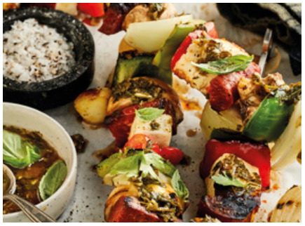

**Ingrediënten voor:** 4 stuks
**Bereidingstijd:** ca. 20 min.
**225** g
chorizo (hele worst, geen
plakjes)
**225 g** halloumi
1
paprika (bijv. ½ groene en
**½** rode)
**1** ui
**100 g** champignons
**8** voorgekookte krieltjes
**5 el** olijfolie (+ bestrijken)
**8 g** basilicum
**8 g** peterselie
**3 el** rodewijnazijn
zout en peper
**4** metalen spiesen
1 Trek het velletje van de chorizo en snijd hem in
stukjes van 3-4 cm. Halveer elk stukje in de lengte. Snijd de halloumi en de paprika ook in stukjes
van 3-4 cm. Pel de ui, snijd hem in kwarten en
haal de rokken los van elkaar.
2 Rijg de chorizo, de halloumi, de paprika, de ui,
de champignons en de krieltjes om en om aan de
spiesen. Bestrijk met een klein beetje olijfolie.
Gril ze op de barbecue of in een grillpan; draai ze
regelmatig om tot ze mooie grillstreepjes krijgen.
3 Hak voor de kruidenolie de basilicum- en de
peterselieblaadjes fijn, eventueel in een keukenmachine. Roer in een kommetje de rodewijnazijn
en de olijfolie door elkaar. Schep de fijngehakte
kruiden erdoorheen en breng verder op smaak
met zout en peper. Verdeel de kruidenolie over de
nog warme vleesspiesjes.
**Per portie:** ca. 622 kcal
**24 g** eiwit | 49 g vet | 18 g koolhydraten

## Gemarineerde aardbeien

## met hangop

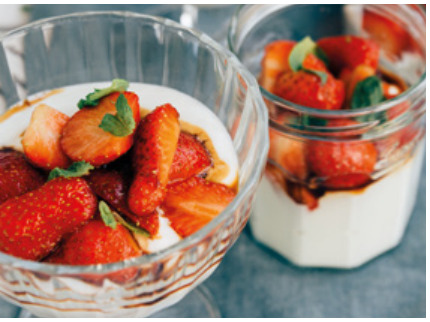

**Ingrediënten voor:** 4 personen
**Bereidingstijd:** ca. 10 min.
**2 el** balsamicoazijn
**2 el** poedersuiker
**500 g** aardbeien
**16** el
hangop (of 4 bolletjes vanilleijs)
verse munt
1 Meng de balsamicoazijn met de suiker tot een
stroperig geheel. Meng de aardbeien met de
balsamico.
2 Verdeel de hangop of het vanille-ijs over glaasjes. Verdeel de aardbeien erover en maak af met
verse munt.
**Per portie:** 131 kcal
**3 g** eiwit | 5 g vet | 21 g koolhydraten

# Uit Paulines Keuken

## Zoete aardappel

## van de barbecue

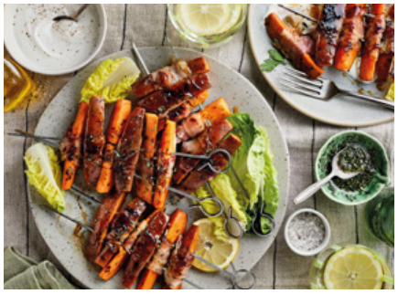

**Ingrediënten voor:** 4 personen
**Bereidingstijd:** ca. 35 min.
**4** zoete aardappels
**200 g** zachte geitenkaas
**300 g** Griekse yoghurt
zout en peper
**12 plakjes** ontbijtspek
olijfolie
**1-2 tl** gedroogde oregano
**100 ml** ahornsiroop
**8** metalen spiesen
1 Borstel de zoete aardappels goed schoon. Snijd
ze in gelijke parten – zo garen ze gelijkmatig.
Kook de parten in ca. 8 minuten net gaar in water
met wat zout.
2 Pureer intussen de geitenkaas en de Griekse
yoghurt in een keukenmachine of met een staafmixer tot een glad mengsel. Breng eventueel op
smaak met peper. Zet in de koelkast tot verder
gebruik.
3 Giet de aardappels af en dep droog met keukenpapier of een schone theedoek. Rijg de parten
om en om met de plakjes spek op twee spiesen;
op deze manier kun je ze gemakkelijk op een
rooster leggen en gelijkmatig grillen. Maak zo
vier spiesen. Bestrijk met olijfolie en bestrooi met
de oregano. Gril de spiesen 8-10 minuten op de
barbecue, of tot de zoete aardappel gaar en het
spek krokant is.
4 Warm intussen de ahornsiroop 3-4 minuten op
in een steelpannetje tot een dikkere stroop. Houd
er rekening mee dat de stroop nog iets indikt
terwijl hij afkoelt.
5 Bestrijk de spiesen met de ahornsiroop. Gril ze
eventueel nog heel kort. Serveer met de geitenkaasdip en eventueel een frisse salade.
**Per portie:** ca. 553 kcal
**19 g** eiwit | 31 g vet | 66 g koolhydraten
Uit Paulines Keuken

## Griekse orzosalade

## met citroendressing

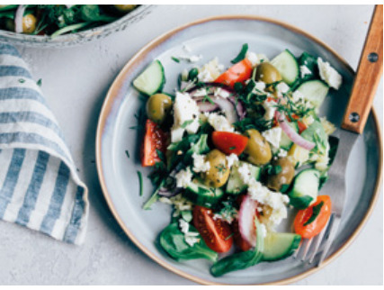

**Ingrediënten voor:** 4 personen
**Bereidingstijd:** ca. 20 min.
**300 g** orzo
**½** komkommer
**250 g** cherrytomaten
**1** rode ui
**75 g** veldsla
**100 g** olijven
**100 g** feta
**VOOR DE** DRESSING
**1 el** citroensap
**3 el** olijfolie
**2 takjes** peterselie, fijngehakt
**1 takje** dille, fijngehakt
zout en peper
1 Kook de orzo volgens de aanwijzingen op de
verpakking gaar. Giet af en laat afkoelen in een
mooie serveerschaal.
2 VOOR DE DRESSING Roer het citroensap, de
olijfolie en de fijngehakte kruiden door elkaar.
Breng op smaak met zout en peper en verdeel
over de orzo.
3 Snijd de komkommer in blokjes en halveer de
cherrytomaatjes. Pel de rode ui en snijd in halve
ringen. Voeg samen met de sla en de olijven toe
aan de orzo en schep om.
4 Verkruimel de feta erboven en serveer direct of
bewaar tot gebruik in de koelkast.
**Per portie:** ca. 462 kcal
**13 g** eiwit | 16 g vet | 65 g koolhydraten

## Vispakketjes

## van de barbecue

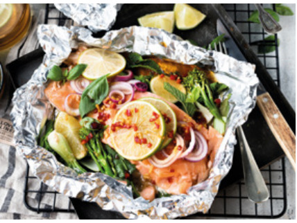

**Ingrediënten voor:** 4 personen
**Bereidingstijd:** ca. 25 min.
**2** cm gember
**1** rode chilipeper
**180 ml** sojasaus
**3 el** honing
**90** ml
mirin (Japanse rijstwijn, bij de
toko of grotere supermarkt)
**½** paksoi
**150 g** aspergebroccoli
**1** rode ui
**2** bio-limoenen
**4** zalmfilets
**1 takje** munt
**1 takje** (Thais) basilicum
aluminiumfolie
1 Schil de gember en hak hem heel fijn. Halveer
de chilipeper, verwijder de zaadlijsten en hak de
peper heel fijn. Schenk de sojasaus, de honing en
de mirin in een kommetje. Roer de gember en de
chilipeper erdoorheen. Houd de marinade apart.
2 Snijd de paksoi in kleine stukken. Halveer
de aspergebroccoli in de lengte. Pel de rode ui
en snijd in dunne plakjes. Snijd de limoenen in
dunne plakjes.
3 Maak van acht grote vellen aluminiumfolie
vier bakjes waar een zalmfilet in past. Door twee
vellen per bakje te gebruiken, weet je zeker dat
de folie niet scheurt. Verdeel de paksoi en de
aspergebroccoli over de bakjes en leg de zalmfilets erop. Schenk de marinade eroverheen en
leg de plakjes rode ui en de plakjes limoen op
de zalm. Vouw de folie dicht of maak van extra
aluminiumfolie vier deksels. Zorg dat je de folie
goed dichtvouwt, zodat het vocht er niet uit kan
lekken.
4 Leg de vispakketjes op het rooster van de barbecue en stoom ze in ca. 15 minuten gaar. Garneer
met de verse muntblaadjes en het basilicum.
**Per portie:** ca. 395 kcal
**26 g** eiwit | 14 g vet | 40 g koolhydraten
Uit Paulines Keuken

# Viva Brasil!

In het Zuid-Amerikaanse Brazilië schijnt de zon
gemiddeld 250 dagen per jaar en dat is goed te merken
aan het zonnige eten dat er vandaan komt. Geniet van
deze Braziliaanse lekkernijen!

## Rozemarijnkip met ui en

## zoete-aardappelpuree

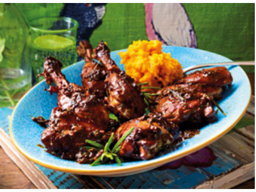

**Ingrediënten voor:** 6 personen
**Bereidingstijd:** ca. 1 uur en 30 min. + ca. 1 uur
wachttijd
**1** limoen
**3** teentjes knoflook
**2 takjes** rozemarijn
**6** kippenbouten (à ca. 200 g)
zout en peper
**3** uien
**1 el** olijfolie
**6 el** boter
**1,5 kg** zoete aardappels
1 Pers de limoen uit. Pel en snipper de knoflook
fijn. Was de rozemarijn en hak de naaldjes fijn.
2 Dep de kippenbouten droog. Snijd bij het gewricht het vel in en trek met je vingers het vel van
het vlees. Verdeel de bouten in pootjes en dijen
en doe ze in een grote kom. Voeg de knoflook, het
limoensap, de rozemarijn en ½ tl peper toe en
meng met elkaar. Laat ca. 1 uur trekken.
3 Pel en snipper de uien fijn. Verhit de olie in een
braadpan en bak de ui donkerbruin erin. Voeg 2 el
boter toe. Neem de kip uit de marinade, voeg de
kip toe aan de pan en bak op hoog vuur aan. Voeg
de marinade toe en laat met het deksel op de pan
in ca. 40 minuten zachtjes garen. Draai halverwege de gaartijd de kip om en voeg ca. 6 el water toe
als het geheel te droog lijkt.
4 Pel de zoete aardappels, was ze en snijd in grove
stukken. Kook de aardappel in ca. 30 minuten
gaar en giet af. Voeg 4 el boter toe en stamp
tot puree. Breng op smaak met zout en peper.
Serveer de kip met de uiensaus en de puree.
**Per portie:** ca. 670 kcal
**32 g** eiwit | 28 g vet | 68 g koolhydraten

## IJskoude caipirinha

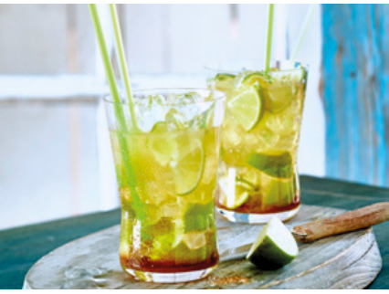

**Ingrediënten voor:** 4 glazen (à ca. 300 ml)
**Bereidingstijd:** ca. 10 min.
Was 4 bio-limoenen en snijd ze in partjes. Verdeel de limoen
en 8 el lichte basterdsuiker over 4 glazen. Plet de limoenpartjes goed met een (cocktail)stamper. Vul de glazen met
crushed ijs en schenk in elk glas 3 el cachaça (Braziliaanse
sterke drank, bij de slijter). Serveer ijskoud.
Seizoen
TIP
Liever
alcoholvrij?
Vervang de
cachaça dan
door gingerale.

## Feijoadinha (Braziliaanse

## bonenschotel)

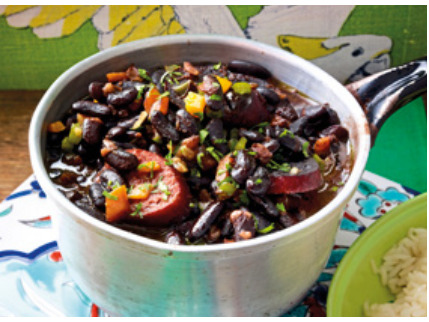

**Ingrediënten voor:** 4-6 personen
**Bereidingstijd:** ca. 2 uur en 15 min. + ca. 12 uur
wachttijd
**500 g** gedroogde zwarte bonen
**400** g
cabanossi (droge worst, bij de
supermarkt)
**3** teentjes knoflook
**2** uien
**1** groene paprika
**1** wortel
**2 el** olijfolie
zout en peper
gemalen komijnzaad
**200 g** langgraanrijst
**4 takjes** peterselie
1 EEN DAG VAN TEVOREN Week de bonen een
nacht in ca. 2,5 l koud water.
2 DE VOLGENDE DAG Snijd de cabanossi in plakjes van ca. 1½ cm dik. Pel de knoflook. Giet de
bonen af in een zeef, spoel met koud water en doe
in een pan. Voeg de cabanossi, de knoflook en ca.
**1,5 l** water toe. Leg het deksel op de pan, breng
aan de kook en laat op laag vuur ca. 2 uur zachtjes
koken.
3 Pel en snipper de uien fijn. Snijd de paprika in
kwarten, verwijder de zaadlijsten, was de paprika
en snijd in kleine blokjes. Schrap de wortel, was
hem en snijd in kleine blokjes. Verhit de olie in
een koekenpan en bak de ui, de paprika en de
wortel 3-4 minuten erin. Breng goed op smaak
met zout, peper en gemalen komijnzaad.
4 Kook de rijst volgens de aanwijzingen op de
verpakking gaar in water met wat zout. Voeg het
groentemengsel 10-15 minuten voor het einde
van de gaartijd van de bonen toe aan de bonen en
gaar mee. Was de peterselie en hak hem fijn.
5 Giet de rijst af. Breng de bonen op smaak met
zout, peper en gemalen komijn. Bestrooi met
peterselie en serveer met de rijst.
**Per portie:** ca. 750 kcal
**39 g** eiwit | 29 g vet | 77 g koolhydraten

## Romige karamelflan

## met tropisch fruit

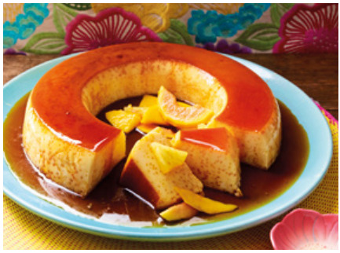

**Ingrediënten voor:** 8-10 personen
**Bereidingstijd:** ca. 1 uur en 45 min. + ca. 8 uur
wachttijd
olie of boter, om in te vetten
**250 g** suiker
**800 g** gecondenseerde melk (blik)
**400 ml** melk
**7** eieren
**1** baby-ananas
**1** papaja
**1** mango
**1 el** lichte basterdsuiker
**2 el** witte rum
1 Vet een savarin- of tulbandvorm (ca. 1,5 l inhoud) in met olie of boter. Breng de suiker met
**275 ml** water in een koekenpan aan de kook en
laat 6-8 minuten zachtjes koken, tot het geheel
goudgeel is gekaramelliseerd. Schenk de karamel
gelijkmatig over de bodem van de vorm en laat
afkoelen. Roer de gecondenseerde melk, de melk
en de eieren door elkaar. Schenk op de karamel
in de vorm.
2 Verwarm de oven voor (elektrisch: 180°C /
hetelucht: 160°C). Vul een diepe bakplaat voor
ca. ⅔ met heet water en zet de vorm erin. Bak ca.
1 uur in de oven, tot de massa gestold is. Neem
uit de oven en laat afkoelen. Zet minimaal 6 uur,
maar liever een nacht, in de koelkast.
3 Schil de ananas en snijd de harde stronk eruit.
Snijd het vruchtvlees in stukken. Halveer de
papaja, verwijder de pitten en schep het vruchtvlees met een lepel uit de schil. Snijd het vruchtvlees in blokjes. Schil de mango, snijd het vruchtvlees van de pit en snijd het in stukken. Meng het
fruit met de suiker en de rum. Stort de flan op een
schaal en serveer met het fruit.
**Per portie:** ca. 520 kcal
**14 g** eiwit | 14 g vet | 79 g koolhydraten
Seizoen

# Vederlicht

Als het buiten warm is, willen we het liefst wat lichtere
gerechten. Gevogelte is daar perfect voor, dus geniet
van deze recepten.

## Kipminestrone

## met erwtenpesto

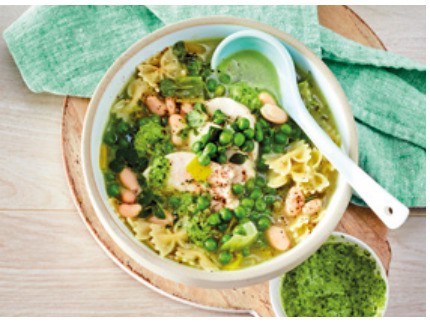

**Ingrediënten voor:** 4 personen
**Bereidingstijd:** ca. 40 min.
**300 g** doperwten (diepvries)
**1 l** groentebouillon
**2** kipfilets (à ca. 200 g)
**1 bosje** lente-ui
**400 g** witte bonen (blik)
**250 g** pasta (bijv. farfalle)
zout en peper
**6 takjes** tijm
**2** teentjes knoflook
**1 el** geraspte parmezaan
**5 el** olijfolie
1 VOOR DE MINESTRONE Laat de erwten ontdooien. Breng de bouillon aan de kook. Dep de
kipfilets droog, doe ze in de bouillon en laat op
laag vuur ca. 10 minuten zachtjes koken. Schep
het schuim eraf.
2 Was de lente-uitjes en snijd ze in ringetjes. Laat
de bonen uitlekken. Kook de pasta volgens de
aanwijzingen op de verpakking gaar in water met
wat zout en giet af. Was de tijm en ris de blaadjes
van de takjes. Voeg de helft van de erwten, de
lente-ui, de bonen, de pasta en de helft van de
tijm toe aan de kip en kook ca. 10 minuten zachtjes mee.
3 VOOR DE ERWTENPESTO Pel en snipper de
knoflook. Pureer de knoflook met de rest van de
erwten, de rest van de tijm, de parmezaan en de
olie. Breng op smaak met zout en peper.
4 Neem de kip uit de minestrone en snijd in
plakjes. Doe terug in de pan en breng op smaak
met zout en peper. Serveer met de erwtenpesto.
Lekker met ciabatta.
**Per portie:** ca. 450 kcal
**21 g** eiwit | 13 g vet | 48 g koolhydraten

## Broodje kalkoendöner

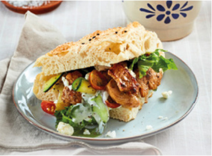

**Ingrediënten voor:** 4 personen
**Bereidingstijd:** ca. 30 min.
**500 g** kalkoenschnitzel
(ongepaneerd)
**1 tl** gyroskruiden
**2 el** olie
**1** courgette
**1** kropje baby-romainesla
**100 g** cherrytomaten
**100 g** feta
**½** komkommer
**1** teentje knoflook
**300 ml** volle yoghurt
zout en peper
**1** ui
**1** Turks brood (ca. 500 g)
1 Dep de kalkoenschnitzel droog en snijd in
reepjes. Kneed met de gyroskruiden en 1 el olie
door elkaar. Was de courgette, halveer hem in de
lengte en snijd in dunne plakken. Was de sla en
Seizoen
snijd in reepjes. Was de tomaten en halveer ze.
Verbrokkel de feta grof.
2 VOOR DE TZATZIKI Was de komkommer en
rasp hem grof. Pel de knoflook en hak fijn. Roer
de yoghurt, de komkommer en de knoflook door
elkaar. Breng op smaak met zout en peper.
3 Pel de ui en snijd in reepjes. Verhit 1 el olie in
een koekenpan en bak de kalkoen in ca. 5 minuten goudbruin erin. Voeg de ui en de courgette toe
en bak ca. 5 minuten mee. Breng op smaak met
zout en peper. Snijd het brood in kwarten en snijd
ze open. Vul met de voorbereide ingrediënten en
serveer met de tzatziki.
**Per portie:** ca. 330 kcal
**37 g** eiwit | 8 g vet | 26 g koolhydraten

## Thaise kipsalade

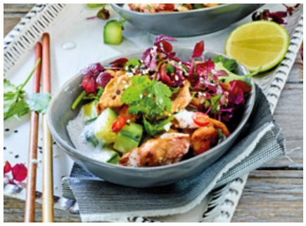

**Ingrediënten voor:** 4 personen
**Bereidingstijd:** ca. 25 min.
**3-4** kipfilets (ca. 600 g)
**2 el** olie
zout en peper
**3 el** sojasaus
**1** komkommer
**½ bosje** koriander
**2** rode chilipepers
**165 ml** kokosmelk
**1** limoen (alleen het sap)
gemalen komijn
**1 el** sesamzaad
bakje rode shiso cress (online
verkrijgbaar, of gebruik
tuinkers)
1 Dep de kipfilets droog en snijd in plakjes. Verhit
de olie in een koekenpan op hoog vuur en bak het
vlees al roerend in ca. 5 minuten gaar erin. Breng
op smaak met zout en peper. Blus af met de sojasaus en breng kort aan de kook. Neem van het
vuur en laat afkoelen.
1
2 Was de komkommer, snijd hem in de lengte in
vieren en snijd in blokjes. Was de koriander en
neem de blaadjes van de takjes. Snijd de chilipepers in de lengte open, verwijder de zaadlijsten.
Was de chilipepers en snijd in ringetjes. Meng
de kip met de komkommer, de chilipeper en de
koriander.
3 Maak de kokosmelk, het limoensap en een
snufje gemalen komijn schuimig met een staafmixer. Breng op smaak met zout en peper. Verdeel
de salade over kommen en besprenkel met de
kokosdressing. Bestrooi met het sesamzaad. Knip
de cress uit het bakje en strooi over de salade.
Lekker met basmatirijst.
**Per portie:** ca. 370 kcal
**36 g** eiwit | 22 g vet | 4 g koolhydraten

## In melk gesmoorde

## kalkoenfilet

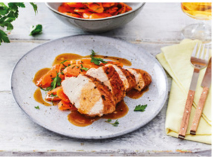

**Ingrediënten voor:** 4 personen
**Bereidingstijd:** ca. 1 uur en 15 min.
**1 kg** kalkoenfilet
**3** teentjes knoflook
zout en peper
**6 takjes** oregano
**2 el** olie
**3 el** balsamicoazijn
**10** zwarte peperkorrels
**3** laurierblaadjes
**1 tl** korianderzaad
**500 ml** melk
**750 g** wortels
**1 bosje** peterselie
**1 el** boter
**1 el** maizena
1 Dep de kalkoenfilet droog. Pel en snipper de
knoflook fijn. Wrijf de kalkoen in met zout, peper
en de knoflook. Was de oregano en neem de
blaadjes van de takjes. Verhit de olie in een braadpan op hoog vuur en bak de kalkoen rondom ca.
8 minuten aan.
2 Verwarm de oven voor (elektrisch: 180°C /
hetelucht: 160°C). Blus af met de azijn en breng
kort aan de kook. Voeg de peperkorrels, de
laurier, het korianderzaad en de oregano toe.
Schenk de melk beetje bij beetje al roerend in de
pan en breng aan de kook. Leg het deksel op de
pan, zet in de oven en laat ca. 45 minuten smoren.
3 Schrap de wortels, was ze en snijd in plakjes.
Kook de wortel in ca. 5 minuten gaar in water met
wat zout en giet af. Was de peterselie en hak hem
grof. Verhit de boter in een koekenpan en wentel
de wortel en de peterselie erin.
4 Neem de kalkoenfilet uit de oven en laat met
het deksel op de pan ca. 10 minuten rusten.
Schenk het braadvocht door een zeef in een
schone pan en breng aan de kook. Roer de
maizena met 1 el water door elkaar en roer dit
door de saus om hem te binden. Breng de saus op
smaak met zout en peper. Serveer alles samen.
Lekker met gebakken aardappeltjes.
**Per portie:** ca. 510 kcal
**66 g** eiwit | 16 g vet | 26 g koolhydraten
Seizoen

# Zwoele

# zomeravonden

Trek na een lange werkdag je schoenen uit, doe je
slippers aan en ga tot de late avond met vrienden
in de tuin zitten om te genieten van deze heerlijke
gerechten.

## Frisse regenboogsalade

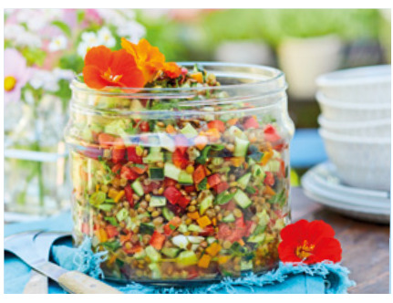

**Ingrediënten voor:** 6 personen
**Bereidingstijd:** ca. 50 min.
**2** uien
**2** wortels
**7 el** olijfolie
**2 tl** kerrie
**250 g** linzen
zout en peper
**1** rode paprika
**1** komkommer
**50 g** gedroogde cranberry’s
**4** lente-uitjes
**5 takjes** dille
**5 takjes** peterselie
**4 el** citroensap
**150 ml** frambozenazijn
**1 tl** suiker
evt. eetbare bloemen, om te
garneren
1 Pel en snipper de uien. Schrap de wortels, was
ze en snijd ze in kleine blokjes. Verhit 2 el olie in
een pan en fruit de ui glazig erin. Bestrooi met
de kerrie, bak kort en roer de linzen erdoorheen.
Blus af met 750 ml water, breng aan de kook en
kook afgedekt ca. 15 minuten op middelhoog
vuur. Voeg de wortel toe en kook nog ca. 10 minuten. Giet het linzenmengsel af en doe het in een
kom. Breng op smaak met zout en peper en laat
afkoelen.
2 Snijd intussen de paprika in vieren, verwijder
de zaadlijsten, was de paprika en snijd hem in
kleine blokjes. Was de komkommer en snijd hem
in kleine blokjes. Hak de cranberry’s grof. Was de
lente-uitjes en snijd ze in dunne ringen. Was de
dille en de peterselie en hak ze fijn.
3 Roer het citroensap, de azijn, zout, peper en
de suiker door elkaar. Klop 5 el olie erdoorheen.
Meng het linzenmengsel, de paprika, de komkommer, de cranberry’s, de lente-ui, de dille en de
peterselie met de vinaigrette. Garneer eventueel
met eetbare bloemen.
**Per portie:** ca. 310 kcal
**11 g** eiwit | 13 g vet | 30 g koolhydraten

## Heerlijk barbecuevlees

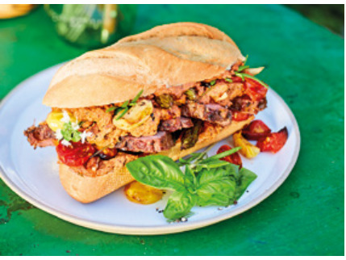

**Ingrediënten voor:** 6 personen
**Bereidingstijd:** ca. 30 min.
**400 g** schouderkarbonade
**2 tl** barbecuekruiden
**3** kipfilets (à ca. 200 g)
2 bio-citroenen (alleen de schil,
geraspt)
peper
**6** plakken parmaham
**2** ribeyes (à ca. 400 g)
fijn zeezout
satéprikkers
1 DE OCHTEND VAN TEVOREN Wrijf de schouderkarbonade in met de barbecuekruiden en zet
afgedekt in de koelkast. Halveer de kipfilets in de
lengte. Meng de citroenschil met ½ tl peper. Wrijf
Buffet
de kipfilets ermee in en wikkel om elk stuk kipfilet een plak parmaham. Steek aan satéprikkers
en zet in de koelkast.
2 KORT VOOR HET SERVEREN Gril de ribeyes op
de hete grill ca. 3 minuten per zijde op directe
hitte. Gril op indirecte hitte nog ca. 15 minuten.
3 Gril de kipfilet en de schouderkarbonade op
de hete grill ca. 3 minuten per zijde op directe
hitte. Gril nog ca. 10 minuten op indirecte hitte.
Bestrooi het vlees met fijn zeezout.
**Per portie:** ca. 530 kcal
**80 g** eiwit | 21 g vet | 1 g koolhydraten

## Zomerse rode wijn

## ‘Tinto de verano’

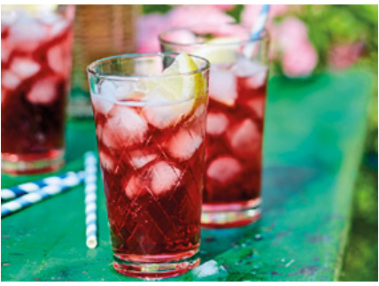

**Ingrediënten voor:** 6 glazen (à ca. 250 ml
**Bereidingstijd:** ca. 5 min.
Was 1 bio-citroen met heet water en snijd hem in parten. Vul 6 glazen tot de helft met ijsblokjes. Verdeel
**750 ml** droge rode wijn over de glazen. Schenk 750 ml
goed gekoelde citroenlimonade erbij. Versier met de
citroenpartjes.

## Tomatendip met amandelen

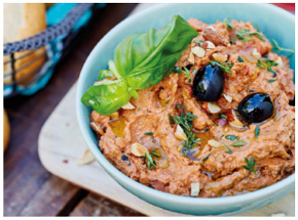

**Ingrediënten voor:** 6 personen
**Bereidingstijd:** ca. 15 min.
Hak 50 g gezouten amandelen grof. Was 4 takjes tijm en hak de blaadjes fijn. Laat 350 g
zongedroogde tomaten op olie (pot) uitlekken en vang hierbij 75 ml olie op. Hak de tomaten
grof. Hak 50 g pitloze zwarteolijven klein. Pureer de tomaten, de olijven, de tijm en de olie.
Voeg 2 el tomatenpuree, 150 g roomkaas en 5 el water toe en roer goed door elkaar. Breng op
smaak met zout en peper. Roer de gezouten amandelen erdoorheen.
**Per portie:** ca. 230 kcal
**5 g** eiwit | 20 g vet | 8 g koolhydraten

## Zomerse

## barbecuegroenten

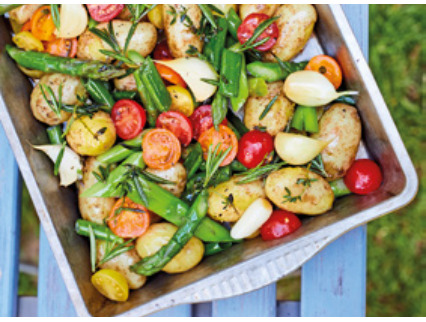

**Ingrediënten voor:** 4 personen
**Bereidingstijd:** ca. 1 uur
**1,2 kg** vastkokende aardappeltjes
**400 g** groene asperges
zout en peper
**4** lente-uitjes
**5** teentjes knoflook
**400** g
cherrytomaten (bijv. rode,
gele en oranje)
**2 takjes** rozemarijn
**4 takjes** tijm
**4 el** olijfolie
fijn zeezout
1 Was de aardappels grondig, kook ze in ca. 20 minuten gaar en spoel kort met koud water. Was de
asperges en snijd de houtige uiteinden er ruim af.
Snijd de asperges in stukken en blancheer ze ca.
3 minuten in kokend water met een snufje zout.
Laat goed uitlekken. Was de lente-uitjes en snijd
ze in stukken. Pel de teentjes knoflook en halveer
ze naar grootte. Was de tomaten en halveer ze.
Was de rozemarijn en de tijm en hak ze fijn.
2 Meng de aardappels, de asperges, de kruiden,
de lente-ui, de knoflook, de tomaten, zout, peper
en de olie in een diep bakblik. Bak ca. 10 minuten
op de hete grill op direct vuur. Bestrooi met fijn
zeezout.
**Per portie:** ca. 220 kcal
**6 g** eiwit | 7 g vet | 30 g koolhydraten
Buffet

## Gegrilde ananas

## met vanille-ijs en karamelsaus

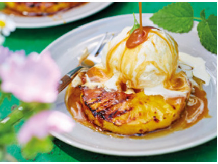

**Ingrediënten voor:** 6 personen
**Bereidingstijd:** ca. 15 min.
**1** ananas (à ca. 1,25 kg)
**3 el** vloeibare honing
**3 takjes** citroenmelisse
6 bolletjes vanille-ijs (à ca. 50 g)
**125 ml** karamelsaus (fles)
1 Schil de ananas, snijd hem in 6 dikke plakken en steek
met een appelboor het houtige midden eruit. Bedruppel de
ananas gelijkmatig met de honing en gril op directe hitte
ca. 4 minuten per zijde.
2 Was de citroenmelisse en neem de blaadjes van de takjes.
Serveer de ananas met het ijs en de saus. Garneer met de
citroenmelisse.
**Per portie:** ca. 180 kcal
**3 g** eiwit | 5 g vet | 31 g koolhydraten
Lekker eten valt of staat met de ingrediënten die je
gebruikt en het keukengerei dat je tot je beschikking hebt.
Daarom presenteren wij elke maand leuke, verrassende,
handige en/of smakelijke producten.

# TULBAND

# PRACHT

Voor die prachtige tulband van p. 57 heb je wel
een goede bakvorm nodig. In het assortiment
van Nordic Ware zitten de allermooiste
bakvormen van stevig gegoten aluminium, voor
een leven lang bakplezier.
Prijs: €49,95.
Verkrijgbaar via baktotaal.nl.

# VROLIJKE

# VROLIJKE

# KOMMETJES

Of je er nu de minestrone van p. 17 of
de kwarkbowl van p. 45 in serveert,
van deze kommetjes op tafel word je
spontaan vrolijk. Verkrijgbaar in terra en
lichtgroen en leuk te combineren met
ander bijpassend servies, zoals bordjes en
vrolijke mokken.
Prijs: €5,79.
Verkrijgbaar bij Hema.

# Tuintafel

De zon schijnt, dus gauw het tafelkleed op
de tuintafel en lekker buiten eten. Gooit een
vleugje wind roet in het eten? Geen zorgen!
Deze hangers zorgen ervoor dat je tafelkleed
mooi strak blijft liggen. Kun jij lekker van de
zon genieten.
Prijs: €3,50 per stuk.
Verkrijgbaar via dille-kamille.nl.

# Hét magazine voor de

voor

# vraag: “Wat eten we

# vandaag?”

## 4,50

Altijd
Juni 2025 jaargang 20

# De smaak

# van de

# zomer

· Gemarineerde aardbeien
· Frisse aardappelsalade
· Gegrilde kipspiesjes
Het ultieme
BBQ-bu et
Vlees, salades &
drankjes

# 59

doordeweekse
inspiratie
BP
Friszure traktatie,
het is rabarbertijd!
Gebak in
**30** minuten
Met zomerfruit
Lichte recepten van Uit Paulines Keuken

## €4,50

kgNL2506_001000_Cover_ok.indd 1

# 12x van 55,kgNL2506_001000_Cover_ok.indd 1 30-04-2025 09:13

30-04-2025 09:13

# voor maar

42,50
Iedere dag inspiratie
voor een heerlijke
maaltijd.
Bomvol recepten met
seizoensgebonden
producten.
Ontdek de lekkerste
zoete recepten.
Scan de
QR-code

## Abonneer je nu via:

## www.kokengenieten.nl/abo

koken genieten
of bel naar +31 (0)24 20 27 829
Deze actie is geldig t/m 10 juni 2025 of zo lang de voorraad strekt. Je abonneert tot wederopzegging en voor ten
minste de actieperiode van 12 nummers. Na afloop van de actieperiode geldt de reguliere abonnementsprijs en
is het abonnement per maand opzegbaar.

# Simpel en

# snel genieten

Het is al druk genoeg met werk, kinderen en hobby’s.
Hier is de oplossing voor iedereen die geen tijd heeft
om uitgebreid te koken, maar toch lekker wil eten.

## Italiaanse gehaktballen

## met pesto

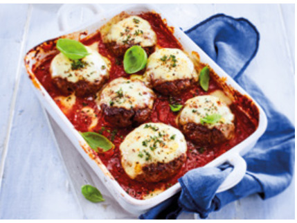

**Ingrediënten voor:** 4-6 personen
**Bereidingstijd:** ca. 30 min.
**1** ui
**2** teentjes knoflook
**1 bosje** tijm (+ extra)
**4 el** olie
**500 ml** tomatensaus (pot)
zout en peper
**500 g** rundergehakt
**2 el** pesto
**1** ei
**2 el** paneermeel
**1 el** boter
**125 g** mozzarella
**3 takjes** basilicum
e
vt. versgemalen zwarte
peper
1 Pel en snipper de ui en de knoflook. Was de tijm
en hak hem fijn.
2 Verhit 2 el olie in een pan en bak de ui en de
knoflook ca. 3 minuten erin. Voeg de tomatensaus toe, breng aan de kook en laat ca. 5 minuten
zachtjes koken. Voeg de tijm toe en breng de saus
op smaak met zout en peper.
3 Verwarm de grill van de oven voor. Kneed het
gehakt, de pesto, het ei en het paneermeel door
elkaar. Maak 6 gehaktballen van het mengsel en
druk ze een beetje platter. Verhit 2 el olie en de
boter in een grote koekenpan en bak de gehaktballen ca. 3 minuten per zijde erin. Neem uit de
pan.
4 Snijd de mozzarella in plakken. Schenk de
tomatensaus in een ovenschaal. Leg de gehaktballen in de saus en beleg met de plakken mozzarella. Zet ca. 5 minuten onder de grill, tot de kaas
gesmolten is.
5 Was het basilicum en neem de blaadjes van
de takjes. Neem de ovenschaal uit de oven en
bestrooi de gehaktballen met het basilicum en
extra tijm. Bestrooi eventueel met versgemalen
zwarte peper.
**Per portie:** ca. 580 kcal
**36 g** eiwit | 42 g vet | 13 g koolhydraten

## Ovenpasta

## met gerookte ham

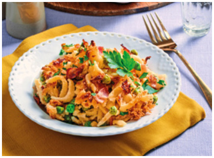

**Ingrediënten voor:** 4-6 personen
**Bereidingstijd:** ca. 30 min.
**4** eieren
**200 g** crème fraîche
**200 ml** slagroom
**60 g** geraspte parmezaan
zout en peper
nootmuskaat
**6 plakjes** gerookte ham
**1** kg
koelverse pasta (bijv.
tagliatelle)
**300 g** doperwten (diepvries)
olie of boter, om in te vetten
**4 takjes** peterselie
**3 el** gebakken uitjes
De snelle keuken
1 Verwarm de oven voor (elektrisch: 200°C /
hetelucht: 180°C). Kluts de eieren met de crème
fraîche en de slagroom. Roer de parmezaan, zout,
peper en nootmuskaat erdoorheen. Snijd de ham
in blokjes. Meng de pasta, de ham en de erwten in
een grote ovenschaal.
2 Schenk het beslag gelijkmatig eroverheen. Bak
in 20-25 minuten gaar in de oven. Was de peterselie en hak hem fijn. Neem de schaal uit de oven
en bestrooi voor het serveren met de peterselie
en de gebakken uitjes.
**Per portie:** ca. 630 kcal
**28 g** eiwit | 32 g vet | 52 g koolhydraten

## Knapperige lunchsalade met spek

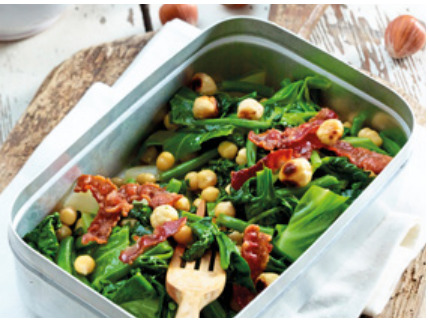

**Ingrediënten voor:** 4 personen
**Bereidingstijd:** ca. 20 min.
**250 g** sperziebonen (diepvries)
zout en peper
**250 g** spitskool
**200 g** babyspinazie
**2 el** blanke hazelnoten
**100 g** gerookt ontbijtspek
**1 el** ahornsiroop
**400 g** kikkererwten (blik)
**3 el** wittewijnazijn
suiker
**3 el** olijfolie
1 Kook de sperziebonen in ca. 8 minuten gaar in water met wat zout. Was de
kool en snijd in grove stukken. Was de spinazie. Voeg de kool en de spinazie
ca. 2 minuten voor het einde van de gaartijd van de sperziebonen toe aan de
pan. Giet af, spoel met koud water en laat goed uitlekken.
2 Rooster de hazelnoten in een droge koekenpan. Neem uit de pan en laat afkoelen. Bak het spek in een koekenpan aan beide zijden krokant. Besprenkel
met de ahornsiroop. Spoel de kikkererwten met koud water en laat goed
uitlekken.
3 Roer de azijn, zout, peper en een snufje suiker door elkaar. Klop de olie
erdoorheen. Meng de groenten met de hazelnoten, de kikkererwten en de
vinaigrette. Breng de salade eventueel nogmaals op smaak. Snijd het spek in
stukken en verdeel over de salade.
**Per portie:** ca. 330 kcal
**14 g** eiwit | 20 g vet | 22 g koolhydraten

## Snel vispannetje met gnocchi

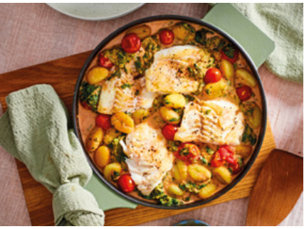

**Ingrediënten voor:** 4 personen
**Bereidingstijd:** ca. 30 min.
**600 g** koolvisfilet
**2 el** citroensap
**3 el** olijfolie
zout en peper
**2** teentjes knoflook
**400 g** gnocchi (koeling)
**150 g** droge witte wijn
**500 g** spinazie (diepvries)
**200 ml** slagroom
**400 g** cherrytomaten (blik)
1 Dep de vis droog en snijd in vier stukken. Besprenkel met het citroensap.
Verhit 2 el olie in een grote koekenpan op hoog vuur en bak de vis 1-2 minuten per zijde erin aan. Bestrooi met zout en peper. Neem de vis uit de pan.
2 Pel en snipper de knoflook. Verhit 1 el olie in het bakvet en bak de gnocchi
en de knoflook kort erin. Schenk de wijn erbij en breng aan de kook. Voeg de
spinazie en de slagroom toe, breng aan de kook en laat met het deksel op de
pan in 6-8 minuten garen.
3 Doe de tomaten in de pan en verwarm kort mee. Breng op smaak met zout
en peper. Leg de vis op de gnocchi en verhit kort met het deksel op de pan.
**Per portie:** ca. 600 kcal
**40 g** eiwit | 28 g vet | 36 g koolhydraten

## Procureursteaks met café-de-Parissaus

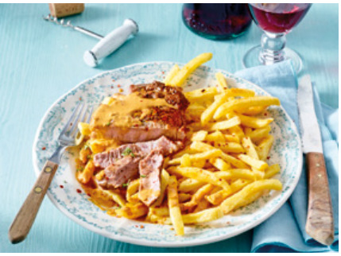

**Ingrediënten voor:** 4 personen
**Bereidingstijd:** ca. 25 min.
**600 g** dunne ovenfriet
(diepvries)
**4** procureursteaks (à
ca. 150 g, bij de
slager)
**2-3 el** olie
zout en peper
**1** ui
**1** teentje knoflook
**1 el** tomatenpuree
**100 ml** marsala (Italiaanse
dessertwijn)
**125 ml** groentebouillon
**150 ml** slagroom
**3 takjes** tijm
chilivlokken, om te
bestrooien
1 Bak de friet volgens de aanwijzingen op de verpakking gaar in de oven. Dep
de steaks droog. Verhit 1-2 el olie in een koekenpan op hoog vuur en bak de
steaks ca. 2 minuten per zijde erin. Bestrooi met zout en peper en neem uit
de pan. Leg de steaks naast de friet op de bakplaat en bak in nog 6-8 minuten
in de oven gaar.
2 Pel en snipper de ui en de knoflook. Verhit 1 el olie in het hete bakvet en
bak de ui en de knoflook glazig erin. Roer de tomatenpuree erdoorheen. Blus
af met de marsala, de bouillon en de slagroom en breng aan de kook. Laat 3-4
minuten zachtjes koken. Neem de saus van het vuur en pureer hem fijn. Was
de tijm, ris de blaadjes van de takjes en roer door de saus. Breng op smaak
met zout en peper. Serveer alles samen en bestrooi met de chilivlokken.
**Per portie:** ca. 650 kcal
**35 g** eiwit | 36 g vet | 38 g koolhydraten
De snelle keuken

## Supersnelle snijbiet-paprikafrittata

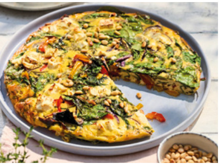

**Ingrediënten voor:** 4 personen
**Bereidingstijd:** ca. 20 min.
**½ bosje** tijm
**150 g** camembert
**6** eieren
**200 ml** melk
**30 g** geraspte gruyère
cayennepeper
zout en peper
**2** rode uien
**150 g** snijbiet
**2** paprika’s (bijv. rood
en geel)
**2 el** pijnboompitten
**3 el** olijfolie
1 Was de tijm en hak hem fijn. Snijd de camembert in stukken. Kluts de
eieren met de melk. Roer de tijm, de gruyère, de helft van de camembert,
cayennepeper en zout erdoorheen. Pel de uien en snijd ze in dunne ringen.
Was de snijbiet. Snijd de paprika’s in kwarten, verwijder de zaadlijsten en
was de paprika’s. Snijd de snijbiet en de paprika in reepjes.
2 Rooster de pijnboompitten in een droge koekenpan en neem uit de pan.
Verhit de olie in de pan en bak de ui, de snijbiet en de paprika ca. 2 minuten
erin. Voeg de helft van de pijnboompitten toe en breng op smaak met zout en
peper. Schenk het beslag erover en bestrooi met de rest van de camembert.
Laat ca. 4 minuten stollen. Leg het deksel op de pan en bak in 4-5 minuten
gaar. Bestrooi met de rest van de pijnboompitten.
**Per portie:** ca. 420 kcal
**23 g** eiwit | 32 g vet | 8 g koolhydraten
Is er iets zomerser dan een barbecue? Met deze
gerechten, een koud drankje in je hand en een zonnebril
op je neus is het in ieder geval direct feest!

# Op hete kolen

## Luchtig kaasbrood

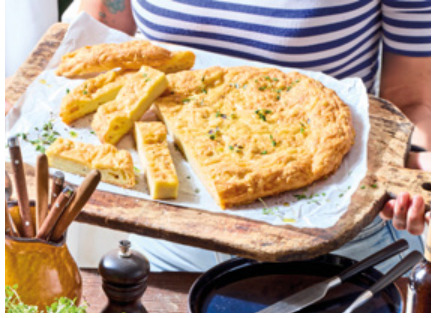

**Ingrediënten voor:** ca. 16 sneetjes
**Bereidingstijd:** ca. 1 uur en 15 min.
**150 g** boter
zout en peper
**250 g** bloem
**5** eieren
**250 g** geraspte gruyère
bakpapier
Buffet
1 Breng 350 ml water met de boter aan de kook. Roer zout en peper erdoorheen en neem de pan van het
vuur. Voeg alle bloem in één keer toe en roer door elkaar. Zet de pan weer op het vuur en verhit al
roerend tot het deeg van de bodem loskomt. Doe het deeg in een kom en roer direct 1 ei erdoorheen.
Laat ca. 10 minuten rusten. Roer de rest van de eieren één voor één erdoorheen. Roer ⅔ van de kaas
door het deeg.
2 Verwarm de oven voor (elektrisch: 180°C / hetelucht: 160°C). Leg het deeg met behulp van twee
pollepels op een met bakpapier beklede bakplaat en vorm tot een groot platbrood. Bestrooi met de rest
van de kaas en bak in ca. 40 minuten gaar in de oven. Laat het brood afkoelen.
Per sneetje: ca. 190 kcal
**8 g** eiwit | 12 g vet | 11 g koolhydraten

## Rode-uienconfituur

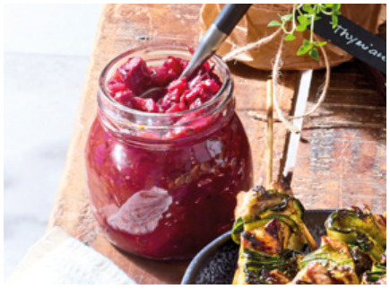

**Ingrediënten voor:** 2 potjes
(à ca. 500 ml)
**Bereidingstijd:** ca. 50 min. +
ca. 12 uur wachttijd
Houdbaarheid: ca. 2 weken
Pel 1 kg rode uien en snijd in partjes. Verhit 5 el
olijfolie in een pan en voeg de ui en 1 tl zout toe.
Bak de ui glazig. Blus af met 150 ml rode wijn en
200 ml balsamicoazijn en breng aan de kook.
Roer ½ tl gedroogde tijm, ½ tl gemalen komijnzaad en ½ tl gerooktepaprikapoeder erdoorheen
en laat met het deksel op de pan ca. 10 minuten
smoren. Roer 50 g geleisuiker 2:1 erdoorheen.
Breng opnieuw aan de kook en laat al roerend
ca. 4 minuten flink koken. Doe de confituur in
gesteriliseerde potjes, sluit af en laat een nacht
afkoelen.

## Kipspiesjes

## van de barbecue

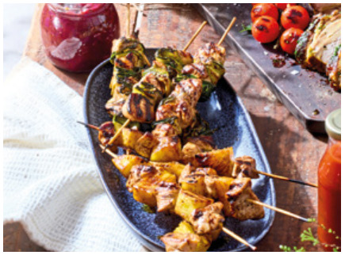

**Ingrediënten voor:** 16 stuks
**Bereidingstijd:** ca. 1 uur + ca. 2 uur wachttijd
Laat 16 houten spiesjes ca. 2 uur in koud water
weken. Dep 1,2 kg kipfilet droog en snijd in blokjes van ca. 2 cm. Meng met 75 ml teriyakisaus
en laat ca. 2 uur marineren. Schil 1 middelgrote
ananas, snijd hem in kwarten en verwijder de
stronk. Snijd de ananas in stukjes. Was 2 courgettes (à ca. 200 g) en schaaf met een dunschiller
in de lengte in dunne plakken. Laat de spiesjes
uitlekken. Prik de ananas en de helft van de
kip afwisselend aan de helft van de spiesjes en
bestrijk de ananas met 2 el ahornsiroop. Steek
de courgette waaiervormig en de rest van de kip
afwisselend aan de rest van de spiesjes. Bestrijk
de courgette met ca. 3 el olie en bestrooi met
zeezout en peper. Gril de spiesjes op de directe
hitte van de barbecue in ca. 5 minuten per zijde
goudbruin en gaar.
Buffet

## Gevulde procureur

## met peterselie

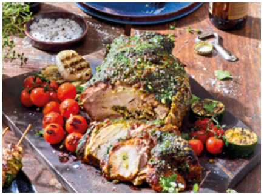

**Ingrediënten voor:** 8 personen
**Bereidingstijd:** ca. 3 uur en 15 min. + ca. 12 uur
wachttijd
**2,2-2,5** kg
procureur zonder bot (bij de
slager)
**1** grote ui
**4 el** barbecuekruiden
**1** flinke bos peterselie
**2** teentjes knoflook
zout en peper
**3 el** olijfolie
**3 el** pijnboompitten
vershoudfolie
keukengaren
1 EEN DAG VAN TEVOREN Dep de procureur droog
en leg het op een groot stuk vershoudfolie. Pel de
ui en rasp hem heel fijn. Wrijf het vlees in met de
ui. Bestrooi het vlees rondom met de barbecuekruiden. Wikkel het vlees in de folie en leg in de
koelkast. Laat een nacht de smaken in elkaar
trekken.
2 DE VOLGENDE DAG Was de peterselie en hak
hem fijn. Pel en snipper de knoflook. Pureer de
peterselie, de knoflook, zout, peper en de olie
fijn. Rooster de pijnboompitten goudbruin in
een droge koekenpan en laat afkoelen. Snijd het
midden van het vlees diep in, maar niet helemaal
door; houd links en rechts een stuk van ca. 3 cm
aan elkaar. Roer het grootste deel van de peterseliepuree en de pijnboompitten door elkaar en
vul de holte van het vlees ermee. Knoop het vlees
dicht met keukengaren. Leg de procureur op de
indirecte hitte van de barbecue en gril 2-2½ uur,
tot het vlees gaar is. Neem van de barbecue, laat
ca. 5 minuten rusten en bestrijk met de rest van
de peterseliepuree. Lekker met sausjes en groenten van de barbecue.
**Per portie:** ca. 530 kcal
**56 g** eiwit | 31 g vet | 3 g koolhydraten

## Couscous-fetasalade

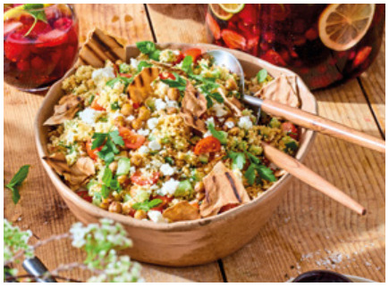

**Ingrediënten voor:** 8 personen
**Bereidingstijd:** ca. 50 min. + wachttijd
**400 g** kikkererwten (blik)
**2 tl** gemalen komijnzaad
**1½ tl** sumak
zout en peper
**8 el** olijfolie
**500 g** couscous
**1** komkommer
**350 g** cherrytomaten
**4 takjes** peterselie
**2 takjes** munt
**1** citroen (alleen het sap)
**4 el** witte balsamicoazijn
paprikapoeder
**1 el** agavesiroop
**200 g** feta
**1** dun platbrood (ca. 200 g)
Buffet
1 VOOR DE SALADE Spoel de kikkererwten
met koud water en dep ze goed droog. Kruid de
kikkererwten met 1 tl komijn, ½ tl sumak en een
snufje zout. Verhit 2 el olie in een koekenpan en
bak de kikkererwten ca. 10 minuten erin. Neem
uit de pan. Kook de couscous gaar volgens de
aanwijzingen op de verpakking. Giet zo nodig af
en laat afkoelen.
2 Was de komkommer, verwijder de zaadlijsten
eventueel en snijd in kleine blokjes. Was de tomaten en snijd ze in kwarten. Was de kruiden en hak
ze fijn. Doe de voorbereide ingrediënten in een
grote kom en meng met het citroensap, de azijn,
peper, 1 tl komijn, 1 tl sumak, paprikapoeder, de
agavesiroop en 6 el olie. Verbrokkel de feta boven
de salade, voeg de kikkererwten toe en spatel
alles door elkaar.
3 VOOR DE CHIPS Rooster het platbrood op de
barbecue in 1-2 minuten per zijde krokant. Breek
het in kleine stukjes. Breng voor het serveren de
salade nogmaals op smaak en bestrooi met de
platbroodchips.
**Per portie:** ca. 440 kcal
**13 g** eiwit | 16 g vet | 57 g koolhydraten

## Zomerse ciderbowl

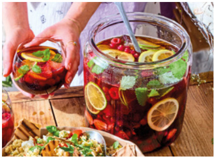

**Ingrediënten voor:** 8 glazen
**Bereidingstijd:** ca. 15 min. + ca. 3 uur wachttijd
Was 500 g aardbeien, 250 g frambozen en 250 g rode
bessen en doe ze in een grote kom of pot. Schenk 350 ml
crème de cassis erbij en laat ca. 3 uur trekken. Was
2 bio-citroenen en 3 bio-limoenen en snijd ze in dunne
plakjes. Was 5 takjes melisse (of gebruik munt) en neem
de blaadjes van de takjes. Doe de citroen, de limoen en
de melisse in de kom en schenk 1,5 l gekoelde appelcider
erbij. Verdeel voor het serveren ijsblokjes over glazen en
schenk de ciderbowl erop.
8

## Gegrilde zalm

## op cederhout

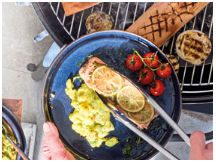

**Ingrediënten voor:** 8 personen
**Bereidingstijd:** 50 min. + wachttijd
**8** zalmfilets (à ca. 125 g)
**3 el** olijfolie
**5 takjes** tijm
**4 takjes** rozemarijn
**4 el** lichte basterdsuiker
**2** el
gerookt zout (online of bij de
grotere supermarkt)
**3** bio-limoenen
cederhouten wraps (bijv. van
het merk Weber, online of bij
de kookwinkel)
keukengaren
1 Week de houten wraps volgens de aanwijzingen
op de verpakking in koud water. Dep de zalm
droog en wrijf in met de olie. Was de kruiden en
verdeel over de zalmfilets. Bestrooi met de suiker
en het gerookte zout. Was de limoenen en snijd
in heel dunne plakjes. Leg op elke zalmfilet licht
overlappend 4 plakjes limoen.
2 Wikkel de zalm in de houten wraps en bind vast
met keukengaren. Leg de pakketjes op de directe
hitte van de barbecue en gril ca. 3 minuten per
zijde. Laat op de indirecte hitte nog ca. 3 minuten
rusten. Lekker met mangoguacamole (zie onder).
**Per portie:** ca. 440 kcal
**31 g** eiwit | 29 g vet | 10 g koolhydraten

## Mangoguacamole

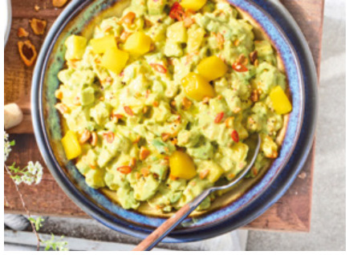

**Ingrediënten voor:** 8 personen
**Bereidingstijd:** ca. 15 min.
Halveer 1 avocado, verwijder de pit en schep het
vruchtvlees uit de schil. Snijd het vruchtvlees
in blokjes. Schil 1 mango, snijd het vruchtvlees
van de pit en snijd het in blokjes. Pel en snipper
1 teentje knoflook. Snijd 1 rode chilipeper in de
lengte in, verwijder de zaadlijsten, was de peper
en hak hem fijn. Roer de avocado, de knoflook,
de chilipeper, 75 g Griekse yoghurt, 2 el limoensap, zout en peper door elkaar; druk daarbij de
avocado fijn met een vork. Roer de mango door
de guacamole. Breng de guacamole nogmaals op
smaak. Hak 2 el krokante nootjes grof en strooi
over de guacamole.
120
**98** 99 100 101
**103** 104 105
ondertrouw 11 seconde 14 plaats in West-Vlaanderen 18 hoofd van een moskee 19 ver-
21 ontsnapping 24 land in Azië 26 deel van Europa 28 ton 29 pausennaam 31 Chinese

## Horizontaal

1 toga 7 vrouw in ondertrouw 11 seconde 14 plaats in West-Vlaanderen 18 hoofd
van een moskee 19 verspreidingsgebied 21 ontsnapping 24 land in Azië 26 deel
van Europa 28 ton 29 pausennaam 31 Chinese deegwaar 32 bibliotheek
34 niet vóór 35 plaats op de Veluwe 37 trede van een ladder 39 vermogend
otheek 34 niet vóór 35 plaats op de Veluwe 37 trede van een ladder 39 vermogend man
genzin 45 rund 46 getemd 48 groente 50 id est (afk.) 51 mestvocht 53 doorschijnend weefman 41 schminker 44 tegenzin 45 rund 46 getemd 48 groente 50 id est
(afk.) 51 mestvocht 53 doorschijnend weefsel 55 traag weekdier 57 kleding
voor scholieren 62 broer van Abel 64 gedorste graanhalmen 66 deel van de
ier 57 kleding voor scholieren 62 broer van Abel 64 gedorste graanhalmen 66 deel van de
ppelijk onderwijs 68 vreemde munt 70 klein hert 71 anno Domini (afk.) 72 maand
voet 67 wetenschappelijk onderwijs 68 vreemde munt 70 klein hert 71 anno
eming 77 tientje (volkstaal) 78 scheur 80 Verenigde Arabische Emiraten (afk.) 82 technische
Domini (afk.) 72 maand 73 krachtige uitademing 77 tientje (volkstaal) 78 scheur
80 Verenigde Arabische Emiraten (afk.) 82 technische universiteit (afk.) 83 bedrijf
van een toneelstuk 85 aansporing tot zwijgen 87 eenkleurig 88 koordans
83 bedrijf van een toneelstuk 85 aansporing tot zwijgen 87 eenkleurig 88 koordans 90 arm-
96 mystiek wijsgerig stelsel 99 fijne geestigheid 101 alleenspel 102 Arabisch stamhoofd
90 armzalig 93 werkman 96 mystiek wijsgerig stelsel 99 fijne geestigheid
ertje 105 Viking.
aamse uitroep van verbazing 3 plaats van oorsprong 4 body mass index (afk.) 5 knaag-
101 alleenspel 102 Arabisch stamhoofd 103 dicht 104 pelsdiertje 105 Viking.
uitroep van afkeer 8 joods godsdienstleraar 9 uitgebreid lager onderwijs 10 Europese
Europees Kampioenschap 13 plaats in Engeland 14 zeer vurig 15 plus 16 sneeuwhut 17 fier

## Verticaal

el 23 mama 25 lid van een Germaans volk 27 kortstondige neerslag 30 vorm van verwe-
6 balspel 38 snee 40 boom 42 militair (afk.) 43 gebouw in Amsterdam 47 op die tijd
1 hoofddeksel 2 Vlaamse uitroep van verbazing 3 plaats van oorsprong
uifel 54 oerstom 56 beschadiging aan een auto 58 uitroep 59 ongeveer (afk.) 60 zandheu-
(afk.) 63 ongeladen deeltje van een atoomkern 65 kleine woning 69 ongaarne 71 vergis-
4 body mass index (afk.) 5 knaagdier 6 bezinksel 7 uitroep van afkeer 8 joods
elderland 75 Oost-Vlaamse stad 76 stijf 79 godsdienstig gebruik 81 even 84 erbinnen
ek) 89 en omgeving (afk.) 91 bolgewas 92 voordat 94 bruto (afk.) 95 Israël (afk.) 97 huns
godsdienstleraar 9 uitgebreid lager onderwijs 10 Europese rivier 11 plaats
derofficier (afk.) 100 postscriptum (afk.).
Kruiswoord
12 Europees Kampioenschap 13 plaats in Engeland 14 zeer vurig 15 plus
e letters uit de genummerde vakjes over naar de gelijkgenummerde vakjes van de oplossingsbalk.
© DENKSPORT PUZZELBLADEN
16 sneeuwhut 17 fier 20 erg leuk 22 nikkel 23 mama 25 lid van een Germaans volk
24 72 37 103 19 64 93 29 51 10 81
27 kortstondige neerslag 30 vorm van verwering 33 bijwoord 36 balspel 38 snee
40 boom 42 militair (afk.) 43 gebouw in Amsterdam 47 op die tijd 49 voorvechter
52 luifel 54 oerstom 56 beschadiging aan een auto 58 uitroep 59 ongeveer (afk.)
60 zandheuvel 61 mejuffrouw (afk.) 63 ongeladen deeltje van een atoomkern
65 kleine woning 69 ongaarne 71 vergissing 74 plaats in Gelderland 75 Oost-
Vlaamse stad 76 stijf 79 godsdienstig gebruik 81 even 84 erbinnen 86 rustteken
(muziek) 89 en omgeving (afk.) 91 bolgewas 92 voordat 94 bruto (afk.) 95 Israël
(afk.) 97 huns inziens (afk.) 98 onderofficier (afk.) 100 postscriptum (afk.).
inziens (afk.) 98 onderofficier (afk.) 100 postscriptum (afk.).
© DENKSPORT PUZZELBLADEN
T A B B E R D B R U I D S E C H E I S T
VUL DE PUZZEL IN EN MAAK KANS
I M A M A R E A A L O N T K O M I N G R
P A K I S T A N B O S N I E V A T L E O
OP 1 VAN DE 3 EXEMPLAREN VAN
M I E A B I E B N A E P E S P O R T
U R IJ K E G R I M E U R O N W I L O S

## Uit Paulines Keuken Magazine

T A M S L A T I E A A L T G A A S
S L A K S C H O O L U N I F O R M K A I N

## t.w.v. 12,99 euro

S T R O T E E N W O D Y E N R E E
A D A P R I L G E B L A A S J O E T U
Op de website van Uit Paulines Keuken vind je al 15 jaar de lekkerste
B A R S T V A E T U A K T E D S S T
U N I R E I F U T I E L A R B E I D E R
recepten – hoog tijd om de allerbeste daarvan te bundelen in een
I T H E O S O F I E E S P R I T S O L O
S J E I K T O E N E R T S N O O R M A N pastasalade
magazine. In het allereerste Uit Paulines Kookt-magazine vind je
24 72 37 103 19 64 93 29 51 10 81
5 6 7 8 9 10 11 12 13 14 15 16 17
heerlijke recepten uit de Italiaanse keuken, maaltijden die je mak-
**19** 20 21 22 23
**25** 26 27 28 29 30
kelijk in de airfryer maakt, gerechten die in een handomdraai op
**32** 33 34 35 36 37 38
**40** 41 42 43 44 45
tafel staan, frisse salades, wereldse gerechten, traybakes, feestelijke
**48** 49 50 51 52 53 54
**57** 58 59 60 61 62 63
recepten en natuurlijk de lekkerste succesrecepten van de afgelopen
**65** 66 67 68 69 70
**73** 74 75 76 77
15 jaar. Een must have voor iedereen die van koken houdt!
**80** 81 82 83 84 85 86
1 2 3 4 5 6 7 8 9 10 11 12 13 14 15 16 17
**88** 89 90 91 92 93 94 95
**18** 19 20 21 22 23
SPECIALE UITGAVE: HET BESTE UIT 15 JAAR
**24** 25 26 27 28 29 30
**31** 32 33 34 35 36 37 38
**39** 40 41 42 43 44 45
Stap-voor-stap uitleg
**46** 47 48 49 50 51 52 53 54
**55** 56 57 58 59 60 61 62 63
€12,99
**64** 65 66 67 68 69 70
Bak je eigen
Uit Paulines Keuken
**71** 72 73 74 75 76 77
Het beste van
**78** 79 80 81 82 83 84 85 86
UPK_001000_Cover_ok.indd 1
**87** 88 89 90 91 92 93 94 95
verrassende
UPK_001000_Cover_ok.indd 1 18-04-2025 11:04
**96** 97 98 99 100 101
desembrood
18-04-2025 11:04
**102** 103 104 105
recepten
makkelijk
Snel & makkelijk
Binnen
Uit de Airfryer
**30** minuten
Snel klaar
op tafel
lekkere &
Easy traybakes
Lekker Italiaans
Salades
Werelds
Weekend
Zoet
Lekkere
borrelhappen
Comfort food
BP
Voor-, hoofd- en nagerechten voor iedere dag
Lekker &
Titel: Uit Paulines Keuken
Magazine
Auteur: Uit Paulines Keuken
Uitgeverij: F&L Media
Prijs: 12,99 euro
Het antwoord kun je vóór 17 juni 2025
sturen naar: koken & genieten, o.v.v. oplossing puzzel
Postbus 296, 6500 AG Nijmegen
Of op onze website: kokengenieten.nl/puzzel

# Koken

# met cola

Een glas ijskoude cola in de zon is
heerlijk, maar wist je dat je er ook mee
kunt koken? Probeer deze verrassende
recepten maar eens!

## Ribeye met colasaus

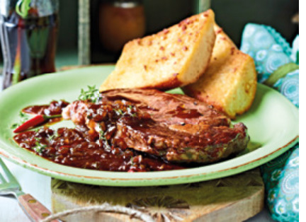

**Ingrediënten voor:** 4 personen
**Bereidingstijd:** ca. 45 min.
**1-2** teentjes knoflook
**5 el** zachte boter
zout en peper
**1** stokbrood (ca. 250 g)
**2** rode uien
**1** rode chilipeper
**8 takjes** tijm
**4** ribeyes (à ca. 250 g)
**3 el** olie
**50 g** lichte basterdsuiker
**300 ml** cola
**1** kneepje citroensap
1 Pel de knoflook en hak hem fijn. Meng de boter
met de knoflook, zout en peper. Halveer het
stokbrood in de lengte en snijd elke helft in vier
stukken. Bestrijk de snijvlakken van het brood
met de knoflookboter. Leg het brood op een helft
van een bakplaat.
2 Pel en snipper de uien heel fijn. Snijd de chilipeper in de lengte in, verwijder de zaadlijsten en
snijd de peper in ringetjes. Was de tijm en ris de
blaadjes van de takjes.
3 Verwarm de oven voor (elektrisch: 180°C /
hetelucht: 160°C). Dep het vlees droog. Verhit
**2 el** olie in een koekenpan op hoog vuur en bak
2 ribeyes ca. 2 minuten per zijde erin. Bestrooi
met zout en peper en leg ze op de andere helft van
de bakplaat. Verhit 1 el olie in het hete bakvet en
bak de overige 2 ribeyes ook erin en leg ze op de
bakplaat. Bak het brood en het vlees 6-7 minuten
in de oven.
4 Bak de ui, de chilipeper en ¾ van de tijm ca.
5 minuten in het hete bakvet. Bestrooi met de
suiker en laat goudbruin karamelliseren. Blus af
met de cola, breng aan de kook en laat op hoog
vuur ca. 5 minuten inkoken. Breng de saus op
smaak met zout, peper en citroensap. Serveer het
brood, de ribeyes en de colasaus samen.
**Per portie:** ca. 870 kcal
**66 g** eiwit | 43 g vet | 49 g koolhydraten

## Colagoulash

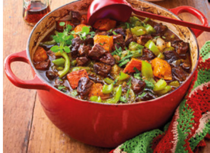

**Ingrediënten voor:** 6-8 personen
**Bereidingstijd:** ca. 2 uur en 30 min.
**2** uien
**2** teentjes knoflook
**1** groene paprika
**1** stengel bleekselderij
**2** zoete aardappels (ca. 750 g)
**2 kg** runderriblappen
**4 el** olie
**3 tl** gedroogde oregano
**330 ml** cola
zout en peper
**1 tl** chilivlokken
verse oregano, om te
serveren
1 Pel de uien en de knoflook. Snijd de uien in
kwarten en vervolgens in reepjes. Hak de knoflook fijn. Snijd de paprika in kwarten, verwijder
de zaadlijsten, was de paprika en snijd klein.
Was de bleekselderij en snijd klein. Schil de zoete
aardappels, was ze en snijd in blokjes.
Favoriet van de maand
2 Dep het vlees droog. Verhit de olie in een grote
braadpan en bak het vlees in porties erin aan en
neem uit de pan. Bak de voorbereide groenten
en de gedroogde oregano kort in het hete bakvet
en voeg het vlees weer toe. Blus af met de cola
en 1 l water en breng aan de kook. Breng goed op
smaak met zout, peper en de chilivlokken.
3 Verwarm de oven voor (elektrisch: 180°C /
hetelucht: 160°C). Leg het deksel op de pan, zet
in de oven en laat ca. 2 uur smoren. Breng de
goulash op smaak met zout en peper. Bestrooi
voor het serveren met verse oregano. Lekker met
stokbrood.
**Per portie:** ca. 460 kcal
**53 g** eiwit | 19 g vet | 18 g koolhydraten

## Zelfgebakken colabrood

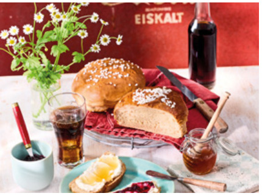

**Ingrediënten voor:** 2 broden (à ca. 10 sneetjes)
**Bereidingstijd:** ca. 45 min. + ca. 3 uur en 15
min. wachttijd
tarwebloem type 550 (bij de
molen of online verkrijgbaar
+ bestuiven)
**21 g** verse gist (of 8 g droge gist)
**2 el** + 250 ml cola
**4 el** olie
zout
**2 el** melk
evt. parelsuiker, om te
bestrooien
bakpapier
**425** g
1 Doe de bloem in een kom en maak in het
midden een kuiltje. Verbrokkel de gist boven het
kuiltje en schenk 2 el cola erop. Roer de gist in
de cola tot hij vloeibaar is. Dek af en laat ca. 10
minuten staan.
2 Doe de olie, een snufje zout en 250 ml cola bij de
bloem en kneed ca. 5 minuten met de deeghaken
van een handmixer. Dek af en laat op een warme
plek ca. 2 uur rijzen.
3 Halveer het deeg en vorm er op een met bloem
bestoven werkblad twee broden van. Leg de
broden op een met bakpapier beklede bakplaat
en laat afgedekt nog ca. 30 minuten rijzen.
4 Verwarm de oven voor (elektrisch: 200°C /
hetelucht: 180°C). Bestrijk de broden met de
melk en bestrooi eventueel met parelsuiker. Bak
in 30-35 minuten goudbruin en gaar in de oven.
Neem uit de oven en laat afkoelen.
5 Snijd de colabroden in sneetjes en bestrijk naar
wens met roomkaas en bosbessenjam of honing.
Per sneetje: ca. 90 kcal
**2 g** eiwit | 2 g vet | 16 g koolhydraten

## Currywurst

## met frisse salade

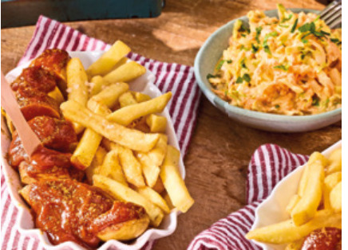

**Ingrediënten voor:** 4 personen
**Bereidingstijd:** ca. 50 min.
**400 g** ovenfriet (diepvries)
**½** krop ijsbergsla
**1** wortel
zout en peper
**2 el** appelazijn
**1 tl** + 1-2 el olie
**2 el** crème fraîche
**1 el** mayonaise
**2 takjes** peterselie
**4** braadworsten ( à ca. 100 g)
**400 ml** currywurstsaus met cola (zie
kader hierboven)
bakpapier
Favoriet van de maand

## Currywurstsaus met cola

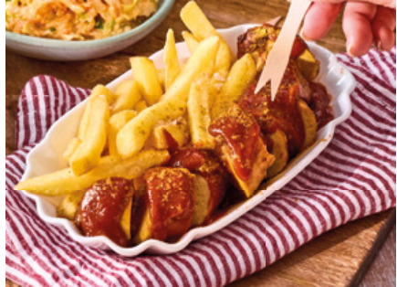

**Ingrediënten voor:** ca. 800 ml
**Bereidingstijd:** ca. 15 min.
Breng 500 ml cola in een pan en de kook en laat inkoken tot ca. 100
ml. Voeg 500 ml ketchup, 8 el appelmoes, 3 el worcestershiresaus,
een paar druppels tabasco en 2 el curry toe, roer door elkaar en
verhit kort. Breng de saus op smaak met 2 tl limoensap en zout.
1 VOOR DE FRIET Verdeel de friet over een met
bakpapier beklede bakplaat. Bak de friet volgens
de aanwijzingen op de verpakking gaar in de
oven.
2 VOOR DE SALADE Was de ijsbergsla en snijd
hem in fijne reepjes. Schrap de wortel en rasp
hem fijn. Kneed de ijsbergsla, de wortel en een
snufje zout kort door elkaar. Roer de azijn en 1 tl
olie erdoorheen. Roer de crème fraîche glad met
de mayonaise. Was de peterselie en hak hem grof.
Spatel de peterselie en het mayonaisemengsel
door de sla.
3 VOOR DE WORST Verhit 1-2 el olie in een
koekenpan op middelhoog vuur en bak de
worsten rondom in 5-8 minuten gaar erin.
Serveer de friet met de worst en de saus. Geef de
salade erbij.
**Per portie:** ca. 690 kcal
**13 g** eiwit | 46 g vet | 50 g koolhydraten

# Antihooikoorts

Mooi weer betekent helaas ook dat het
hooikoortsseizoen weer is aangebroken. Met deze
gerechten ondersteun je je lichaam, zodat die
hooikoorts zich een beetje koest houdt.

## Gebakken zalm met Thaise

## wortelsalade

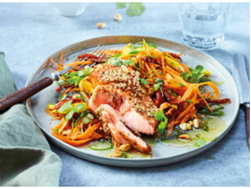

**Ingrediënten voor:** 4 personen
**Bereidingstijd:** ca. 45 min. + ca. 45 min. wachttijd
5 zongedroogde tomaten (in olie)
**500 g** wortels
**2** lente-uitjes
**1** mango
**1** chilipeper
**1** teentje knoflook
**2** bio-limoenen
**2 el** vissaus
**1 el** lichte basterdsuiker
zout en peper
**4 el** olie
**1 tl** sesamolie
**4** zalmfilets (à ca. 125 g)
gemalen koriander
**1 tl** sesamzaad
**4 takjes** koriander
**2 el** geroosterde, gezouten pinda’s
1 VOOR DE SALADE Laat de tomaten uitlekken en
snijd in dunne reepjes. Schrap de wortels en rasp ze
grof. Was de lente-uitjes, snijd in ringetjes en houd
de helft apart. Schil de mango, snijd het vruchtvlees
van de pit en snijd het in dunne reepjes. Halveer de
chilipeper in de lengte, verwijder de zaadlijsten, was
de chilipeper en snijd in reepjes. Pel en snipper de
knoflook fijn. Meng de voorbereide ingrediënten met
elkaar.
2 VOOR DE DRESSING Was de limoenen en rasp de
schil van 1 limoen fijn. Pers beide limoenen uit. Roer 3
el limoensap, de vissaus, de suiker en een snufje zout
door elkaar. Klop 3 el olie en de sesamolie erdoorheen.
Meng de salade met de dressing en de helft van de
limoenschil. Zet afgedekt ca. 1 uur in de koelkast.
3 VOOR DE ZALM Dep de zalm droog. Verhit 1 el olie
in een koekenpan en bak de zalm ca. 4 minuten aan
één zijde erin. Draai de zalm om en bestrooi met zout,
peper, gemalen koriander en het sesamzaad. Neem
de pan van het vuur en laat de zalm in de restwarmte
verder garen.
4 Was de koriander en neem de blaadjes van de takjes. Hak de pinda’s grof. Breng de salade nogmaals
op smaak en serveer met de zalm. Bestrooi met de
koriander, de pinda’s, de apart gehouden lente-ui en
de rest van de limoenschil.
**Per portie:** ca. 480 kcal
**29 g** eiwit | 30 g vet | 21 g koolhydraten

## Kwarkbowl met fruit

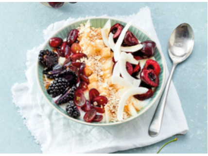

**Ingrediënten voor:** 4 personen
**Bereidingstijd:** ca. 15 min.
**500 g** kwark
**500 g** skyr (IJslands zuivelproduct)
**1 el** ahornsiroop
kaneel
**8** el
appel-mangopuree (bij de
ecologische supermarkt)
**125 g** bramen
**150 g** kersen
**400 g** pitloze rode druiven
**½** honingmeloen
**4 el** havermout
**2 el** kokoschips
De gezonde keuken
1 VOOR DE KWARK Roer de kwark, de
skyr, de ahornsiroop en een snufje kaneel
door elkaar. Verdeel over vier kommen.
Besprenkel met de appel-mangopuree.
2 VOOR DE TOPPING Was de bramen, de
kersen en de druiven. Ontpit de kersen.
Halveer de bramen, de kersen en de druiven. Verwijder de pitten van de meloen en
schil hem. Snijd het vruchtvlees in kleine
blokjes. Verdeel het fruit, de havermout en
de kokoschips apart van elkaar in banen op
de kwark en serveer.
**Per portie:** ca. 430 kcal
**35 g** eiwit | 5 g vet | 56 g koolhydraten

## Turkse yoghurtsoep met köfte

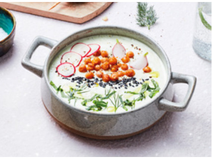

**Ingrediënten voor:** 4 personen
**Bereidingstijd:** ca. 40 min.
**125 g** bulgur
zout en peper
**2** teentjes knoflook
**4 takjes** munt
**½ bosje** dille
**700 ml** volle yoghurt
**200 ml** groentebouillon
**4 el** olijfolie
**1 tl** citroensap
**1** kleine ui
**200 g** rundergehakt
kaneel
gemalen komijnzaad
**400 g** kikkererwten (blik)
paprikapoeder
**4** radijsjes
**2 tl** zwart sesamzaad
satéprikkers
1 VOOR DE SOEP Kook de bulgur volgens de aanwijzingen op de verpakking
gaar in water met wat zout. Pel 1 teentje knoflook en hak het grof. Was de
munt en de dille en hak ze grof. Pureer de helft van de kruiden met de yoghurt, de knoflook, de bouillon, 2 el olijfolie en het citroensap. Giet de bulgur
af, voeg toe aan de soep en pureer kort. Breng de soep op smaak met zout en
peper en zet in de koelkast.
2 VOOR DE KÖFTE Pel en snipper de ui en 1 teentje knoflook fijn. Kneed het
gehakt, de ui, de knoflook en een snuf zout, peper, kaneel en komijn door
elkaar. Verdeel het mengsel in vier porties, maak er korte worstjes van en
steek ze aan satéprikkers. Verhit 2 el olie in een koekenpan en bak de köfte
8-10 minuten rondom gaar erin. Neem uit de pan en houd warm.
3 VOOR DE TOPPING Giet de kikkererwten af, spoel met koud water en laat
uitlekken. Bak de kikkererwten krokant in het hete bakvet van de köfte.
Breng op smaak met zout, peper en paprikapoeder. Was de radijsjes en snijd
in dunne plakjes. Verdeel de soep over vier kommen en maak af met de
kikkererwten, de radijsjes, de rest van de kruiden en het sesamzaad. Serveer
met de köfte.
**Per portie:** ca. 500 kcal
**24 g** eiwit | 26 g vet | 39 g koolhydraten

## Kipfilet met lentegroenten

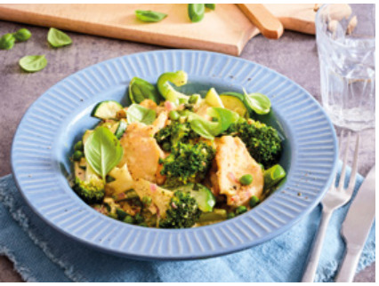

**Ingrediënten voor:** 4 personen
**Bereidingstijd:** ca. 40 min.
**2** rode uien
**2** teentjes knoflook
**500 g** broccoli
**2** courgettes
**1** groene paprika
**2-3** kipfilets (ca. 600 g)
zout en peper
**3-4 el** bloem
**3 el** olijfolie
**400 ml** groentebouillon
**200 ml** slagroom
**1-2 tl** mosterd
**1 tl** kerrie
chilipoeder
**300 g** erwten (diepvries)
**½ bosje** basilicum
**100 g** crème fraîche
1 Pel en snipper de uien en de knoflook fijn. Was de broccoli en snijd hem in
kleine roosjes van de stronk. Was de courgettes, halveer ze in de lengte en
snijd in plakjes. Snijd de paprika in kwarten, verwijder de zaadlijsten, was de
paprika en snijd in reepjes.
2 Dep de kip droog en snijd in dunne plakjes. Bestrooi met zout en peper en
wentel door de bloem. Klop de overtollige bloem eraf. Verhit 2 el olie in een
braadpan of grote koekenpan op middelhoog vuur en bak de kip per zijde ca.
2 minuten erin. Neem uit de pan.
3 Verhit 1 el olie in het hete bakvet en bak de broccoli, de courgette en de
paprika ca. 3 minuten erin. Neem de groenten uit de pan. Doe de ui en de
knoflook in het hete bakvet en bak ca. 2 minuten. Schenk de bouillon en de
slagroom erbij, breng aan de kook en laat kort zachtjes koken. Breng de saus
op smaak met de mosterd, zout, peper, de kerrie en een snufje chilipoeder.
Doe de kip, de gebakken groenten en de erwten in de saus. Breng aan de
kook en laat met het deksel op de pan ca. 8 minuten zachtjes koken.
4 Was het basilicum, neem de blaadjes van de takjes en hak ze grof. Roer de
crème fraîche door de kip en de groenten. Breng zo nodig opnieuw op smaak,
bestrooi met het basilicum en serveer. Lekker met basmatirijst.
**Per portie:** ca. 490 kcal
**23 g** eiwit | 32 g vet | 25 g koolhydraten

## Klantenservice

Wil je abonnee worden of heb je vragen over je
abonnement? Op onze website vind je antwoord op
de meeste vragen.
www.kokengenieten.nl/contact
Wist je dat je tegenwoordig eenvoudig zelf je adres
kan wijzigen? Ga naar www.kokengenieten.nl/
adreswijzigen om je nieuwe adres door te geven.
Het nieuwe adres wordt vervolgens automatisch in
ons systeem gewijzigd.
Telefoon
We zijn er maandag
tot en met vrijdag
van 09.00 tot
**17.00** uur om je vragen
te beantwoorden.
+31 (0)24-2027 829
E-mail
Stel je vraag per e-mail
aan een van onze
service medewerkers.

## klantenservice@

kokengenieten.nl
ABONNEMENTSINFORMATIE koken & genieten kost €4.50 per nummer. De abonnementsprijs in Nederland € 49,- en
in België € 52,- (12 nummers) Deze prijs geldt bij betaling per automatische incasso. Voor betaling via een (digitale)
factuur geldt een toeslag van € 2,50. Je kunt eenvoudig een machtiging afgeven via www.fnl.nl/machtigen.
Abonnementen worden automatisch verlengd, tenzij anders vermeld. Het opzeggen van een abonnement kan eenvoudig
telefonisch via +31 (0)24-2027829 of per mail via klantenservice@kokengenieten.nl.
koken & genieten is een
uitgave van F&L Media B.V.
in licentie van Bauer Media
Brand Manager Yvonne Doorten
Redactie Bas Erkens, Anne Mebelder,
Lotus van Overveldt, Willem van Santen,
Marieke Slettenhaar en Julie van den Berg
In samenwerking met Uit Paulines Keuken
Marianne Snel en Russell Hobbs
Art Direction Nick Groenewold
Vormgeving Mylene Nales, Tom Gerrits,
Lisanne Cobussen, Susan Gerbrands-Derksen,
Ferry Dorresteijn en Ellen Willemsen
Sales Marc Bokhove +31 (0)24 2404643
mbokhove@fnl.nl
Marketing Anouk Tolboom +31 24 240 45 95
atolboom@fnl.nl
Drukkerij Senefelder Misset Doetinchem B.V.
Vragen aan de redactie
Heb jij opmerkingen, suggesties of vragen aan
de redactie? lezersvragen@kokengenieten.nl
Nieuwsredactie / Pers
kooknieuws@fnl.nl of het onderstaande adres
o.v.v. redactie koken & genieten
Jonkerbosplein 52, 6534 AB Nijmegen
COPYRIGHT Het auteursrecht op deze uitgave en de gedrukte uitgave en op de daarin verschenen
artikelen wordt door de uitgever voorbehouden. De vertaalrechten berusten bij F&L Media B.V.
te Nijmegen/ Nederland. Het verlenen van toestemming tot publicatie in de gedrukte uitgave
houdt in dat de auteur de uitgever, met uitsluiting van ieder ander onherroepelijk machtigt de
bij of krachtens de auteurswet door derden verschuldigde vergoedingen voor kopiëren te innen
en dat de auteur alle rechten verdraagt aan de uitgever, tenzij anders bepaald. Niets uit deze
uitgave en de gedrukte uitgave mag worden overgenomen, vermenigvuldigd of gekopieerd zonder
uitdrukkelijke schriftelijke toestemming van de uitgever. De uitgever stelt zich niet aansprakelijk
voor eventuele onjuistheden, welke in deze uitgave of de gedrukte uitgave mochten voorkomen.
ISSN: 1875-8517
Er is maar weinig dat de airfryer niet kan en dat bewijst
ook dit recept maar weer eens. Met de sticky kip en de
kazige, pittige mais waan je je even in Mexico.

# Mexico in je mandje

## Sweet ‘n’ sticky kip

## met gebakken mais, kaas

## en jalapeño

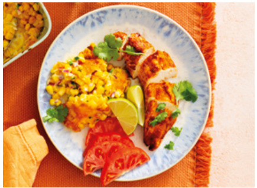

**Ingrediënten voor:** 4-6 personen
**Bereidingstijd:** ca. 40 min. + ca. 1 uur wachttijd
**3** grote kipfilets
**1 el** olie
**25 g** lichte basterdsuiker
**2 el** barbecuesaus
**1 tl** gerooktepaprikapoeder
zout en peper
**2 el** rodewijnazijn
**4 takjes** koriander
**1** limoen, in partjes
**1** tomaat, in plakjes
hot sauce, om te serveren
**VOOR DE** MAIS
**1** rode ui
**1** jalapeñopeper
**400 g** mais (blik)
**100 g** zure room
**100 g** geraspte cheddar
1 Snijd de kipfilets in de lengte door, zodat je zes
stukken hebt. Meng in een kom de olie met de
basterdsuiker, de barbecuesaus, het paprikapoeder, wat zout en de azijn. Marineer de kip in het
mengsel en zet ca. 1 uur afgedekt in de koelkast.
2 VOOR DE MAIS Pel en snipper de rode ui. Snijd
de jalapeñopeper fijn. Laat de maiskorrels uitlekken in een zeef. Meng de mais met de zure
room, de rode ui, de jalapeño en de helft van de
cheddar. Breng op smaak met zout en peper.
Schep het mengsel in een (oven)schaal die in de
airfryermand past. Strooi de rest van de cheddar
eroverheen.
3 Leg de gemarineerde kipstukken in het andere
airfryermandje. Stel de mand voor de kip in op
200°C en 15 minuten. Stel de mand met de mais
in op 160°C en 15 minuten.
4 Controleer of de kip gaar is. Serveer de kip met
de mais, de koriander, de limoen en de tomaat.
Geef er hot sauce naar keuze bij.
Per portie (4): ca. 500 kcal
**45 g** eiwit | 19 g vet | 36 g koolhydraten
Russell Hobbs ♥ koken & genieten
– of gewoon extra veel. De Sync-functie
DUAL BASKET AIRFRYER
zorgt dat alles tegelijk klaar is, zonder
gedoe. Dankzij 9 kookprogramma’s, PFAS-
Til je maaltijden naar een hoger niveau met
vrije coating en vaatwasserbestendige
krijg je bij aankoop via bol.com ook het
de Russell Hobbs Satisfry™ Dual Basket
airfryerboek van Sabine Koning cadeau,
Airfryer. Met twee manden van 4,5 liter
bereid je makkelijk twee gerechten tegelijk
– of gewoon extra veel. De Sync-functie
zorgt dat alles tegelijk klaar is, zonder
gedoe. Dankzij 9 kookprogramma’s, PFASvrije coating en vaatwasserbestendige
onderdelen is koken gezonder en
makkelijker dan ooit. In mei en juni
krijg je bij aankoop via bol.com ook het
airfryerboek van Sabine Koning cadeau,
met 75 snelle en lekkere recepten.

# Rabarbertijd

Met zijn rozerode kleur en frisse, zoetzure
smaak hoort rabarber écht bij de zomer.
Verwerk deze groente in zoete én hartige
gerechten.

## Rabarbercurd

**Ingrediënten voor:** 4 potjes (à ca. 200 ml)
**Bereidingstijd:** ca. 40 min.
Houdbaarheid: ca. 2 weken in de koelkast
Was 500 g rabarber (bijv. rode) en snijd klein. Breng met 50 g suiker en 5 el
water aan de kook en laat ca. 4 minuten zachtjes koken. Pureer de rabarber en
laat even afkoelen. Klop 4 verse eidooiers, 150 g suiker, het merg van 1 vanillestokje, een snufje zout, het sap van 1 citroen en 2 el maizena au bain-marie
romig. Voeg het eimengsel toe aan de rabarberpuree en verhit al roerend. Roer
**110 g** koude boter in stukjes erdoorheen, tot je een dikke crème hebt. Doe de
rabarbercurd in gesteriliseerde potjes. Sluit de potjes af en laat afkoelen.
Favoriet van de maand

## Kipfilet

## met rabarberchutney

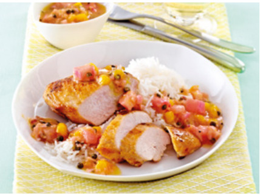

**Ingrediënten voor:** 4 personen
**Bereidingstijd:** ca. 45 min.
**2** sjalotjes
**2 el** ingelegde groene
peperkorrels (pot, bijv. van
het merk Carbonell)
**300 g** rabarber
**1** kleine mango
**4 el** olie
**2 el** honing
**100 ml** wittewijnazijn
**5 el** sinaasappelsap
zout en peper
**200 g** basmatirijst
**4** kipfilets (à ca. 150 g)
1 VOOR DE CHUTNEY Pel de sjalotjes en snipper ze fijn. Hak de peperkorrels grof. Was de rabarber, schil
hem eventueel en snijd in kleine blokjes. Schil de mango, snijd het vruchtvlees van de pit en snijd het
in kleine blokjes. Verhit 2 el olie in een pan en bak de sjalot, de peperkorrels, de mango en de rabarber
erin. Voeg de honing toe. Schenk de azijn en het sinaasappelsap erbij en breng aan de kook. Laat op laag
vuur ca. 5 minuten zachtjes koken. Breng op smaak met zout.
2 VOOR DE RIJST EN DE KIP Kook de rijst volgens de aanwijzingen op de verpakking gaar in water met
wat zout. Dep de kipfilets droog. Verhit 2 el olie in een koekenpan en bak de kipfilets ca. 6 minuten per
zijde gaar erin. Breng op smaak met zout en peper. Serveer met de rijst en de rabarberchutney.
**Per portie:** ca. 480 kcal
**39 g** eiwit | 12 g vet | 56 g koolhydraten

## Rabarberbowl

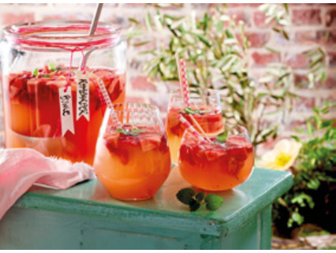

**Ingrediënten voor:** 12 glazen (à ca. 300 ml)
**Bereidingstijd:** ca. 15 min. + ca. 1 uur en 30 min. wachttijd
Was 1 kg aardbeien, verwijder de kroontjes en snijd de aardbeien
klein. Doe de aardbeistukjes in een grote glazen kom en bestrooi
met 150 g suiker en 8 g vanillesuiker. Laat de aardbeien ca. 1 uur
trekken. Schenk 1 l gekoelde rabarbernectar (online verkrijgbaar,
of gebruik cranberrysap) en 750 ml gekoelde witte wijn erbij en zet
de bowl ca. 30 minuten in de koelkast om op smaak te komen. Was
**3 takjes** citroenmelisse en neem de blaadjes van de takjes. Voeg
voor het serveren de melisse toe aan de bowl en vul aan met 750 ml
gekoelde prosecco.
Favoriet van de maand

# Zoete inval

Fris sorbetijs, romige chocoladecrème, fruitige crème
brûlée of een zomerse tiramisu: het wordt nog lastig
kiezen uit deze heerlijke toetjes!

## Rozencrème-brûlée met frambozensaus

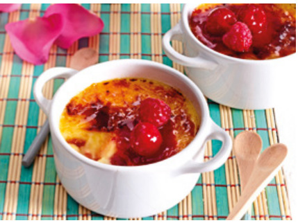

**Ingrediënten voor:** 4 personen
**Bereidingstijd:** ca. 1 uur en 15 min. + minimaal 6 uur wachttijd

## Limoensorbet

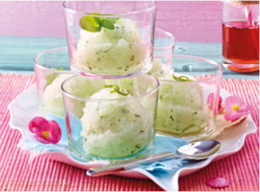

**Ingrediënten voor:** 6-8 personen
**Bereidingstijd:** ca. 45 min. + ca. 4 uur wachttijd
**50 g** + 6 el suiker
**400 ml** slagroom
**100 g** lichte basterdsuiker
**400 g** frambozen
**150 ml** melk
**200 g** suiker
**5** verse eidooiers
**8** limoenen
gasbrandertje
**5-6 el** rozenwater (bij de
**4 el** witte rum
**3 takjes** munt
toko of grotere super
**1** vers eiwit
markt)
1 bio-limoen (alleen de schil, geraspt)
1 VOOR DE CRÈME BRÛLÉE Roer de slagroom, de melk, de eidooiers, 3 el
1 Breng 450 ml water met de basterdsuiker en de suiker kort aan de kook tot
de suiker is gesmolten. Laat a oelen. Pers de limoenen uit en meet 300 ml
rozenwater en 50 g suiker goed door elkaar. Schenk het mengsel door een
zeef in vier kleine ovenschaaltjes (à ca. 250 ml inhoud).
sap af. Doe met de suikersiroop en de rum in een metalen kom en roer goed
door elkaar. Zet de kom in een ijswaterbad en laat al roerend a oelen.
2 Verwarm de oven voor (elektrisch: 160°C / hetelucht: 140°C). Zet de ovenschaaltjes in een grote ovenschaal en schenk er heet water bij tot de vorm-
2 Was de munt en neem de blaadjes van de takjes. Hak de helft van de blaadjes fijn. Klop het eiwit stijf. Spatel het eiwit, de fijngehakte munt en de helft
pjes voor de helft onder staan. Bak ca. 1 uur in de oven, tot de crème gestold
is. Neem uit de oven, laat even a oelen en zet minimaal 6 uur in de koelkast.
van de limoenschil door het suikermengsel. Zet de kom in de diepvries en
3 VOOR DE SAUS Maak de frambozen schoon. Pureer ⅔ van de frambozen en
vries ca. 3 uur in. Roer het mengsel daarbij elke ca. 30 minuten goed door.
Maak bolletjes van het ijs en zet nog ca. 30 minuten in de diepvries. Bestrooi
druk ze door een zeef. Roer de frambozenpuree, 2 el suiker en 2-3 el rozende sorbet met de rest van de munt en de rest van de limoenschil.
water door elkaar. Spatel de rest van de frambozen erdoorheen. Bestrooi elke
crème brûlée met 1 el suiker en karamelliseer goudbruin met een gasbrandertje. Serveer de crème brûlée met de frambozensaus.
**Per portie:** ca. 180 kcal
**1 g** eiwit | 0 g vet | 39 g koolhydraten
HEB JE GEEN
**Per portie:** ca. 600 kcal
GASBRANDERTJE?
**9 g** eiwit | 41 g vet | 45 g koolhydraten
Bestrooi de crème brûlée
dan met de suiker en zet kort
onder de voorverwarmde
grill van de oven, tot
de suiker goudbruin
gekaramelliseerd is.

## Aardbei-kokostiramisu

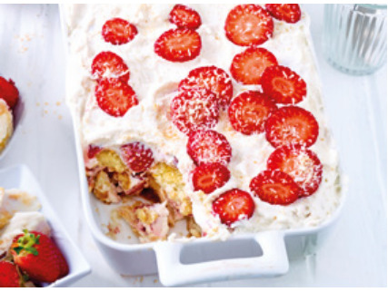

**Ingrediënten voor:** 6-8 personen
**Bereidingstijd:** ca. 1 uur + ca. 3 uur wachttijd
**80 g** kokosrasp
**250 g** suiker
**2 tl** espressopoeder
**100 ml** kokoslikeur
**200 g** lange vingers
**100 g** witte chocolade
**500 g** kwark
**500 g** mascarpone
**8 g** vanillesuiker
**2 el** citroensap
**1 kg** aardbeien
**200 ml** slagroom
1 Rooster de kokosrasp goudbruin in een droge koekenpan en laat a oelen.
Breng 150 ml water met 150 g suiker en het espressopoeder aan de kook en
laat 2-3 minuten zachtjes koken. Roer de likeur erdoorheen en laat a oelen.
Leg de lange vingers naast elkaar op een bakplaat en besprenkel met het
likeurmengsel.
2 Hak de chocolade fijn en meng met de kwark, de mascarpone, de vanillesuiker, 100 g suiker, het citroensap en ⅔ van de kokosrasp. Was de aardbeien. Snijd de helft in blokjes en spatel door het kwarkmengsel. Klop de slagroom stijf en spatel erdoorheen.
3 Beleg de bodem van een ovenschaal met de helft van de lange vingers.
Bestrijk met de helft van de kwarkroom. Verdeel de rest van de lange vingers
erover en bestrijk met de rest van de kwarkroom. Zet de tiramisu ca. 2 uur in
de koelkast.
4 Snijd de rest van de aardbeien dwars in plakjes en verdeel met de rest van
de kokosrasp over de tiramisu.
**Per portie:** ca. 610 kcal
**14 g** eiwit | 34 g vet | 57 g koolhydraten
Het zoete leven

## Zelfgemaakte chocoladecrème

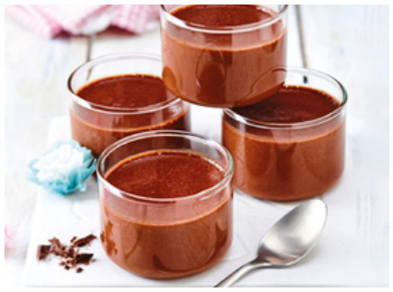

**Ingrediënten voor:** 6 personen
**Bereidingstijd:** ca. 15 min. + ca. 6 uur wachttijd
**150 g** pure chocolade
**250 ml** slagroom
**250 ml** melk
**5** eidooiers
**50 g** suiker
1 Hak de chocolade fijn. Verwarm de slagroom en de melk in een pan. Klop de
eidooiers en de suiker met een handmixer licht en luchtig. Schenk het
slagroommengsel langzaam al kloppend erbij.
2 Doe het mengsel terug in de pan. Verhit al roerend op laag vuur tot het
mengsel een beetje is ingedikt. Schenk door een zeef bij de chocolade en roer
tot de chocolade is gesmolten. Verdeel de crème over zes glaasjes
(à ca. 150 ml inhoud) en zet ca. 6 uur in de koelkast om op te stijven.
**Per portie:** ca. 380 kcal
**17 g** eiwit | 28 g vet | 23 g koolhydraten

# Makkie

# van ’n bakkie

Laat je niet afschrikken door de bereidingstijden,
want dit zomerse gebak staat allemaal binnen een
halfuurtje in de oven. Die doet vervolgens de rest van
het werk, dus kun jij lekker achteroverleunen in de
zomerzon.

## Limoncellorodebessentulband

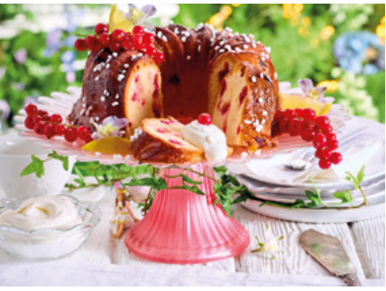

**Ingrediënten voor:** ca. 16 stukken
**Bereidingstijd:** ca. 1 uur en 20 min. + ca. 1 uur
wachttijd
**500 g** rode bessen
**2 tl** maizena
**6** eieren
**300 g** suiker
**8 g** vanillesuiker
zout
**200 g** crème fraîche (+ evt. extra)
**220 ml** olie (+ invetten)
**500 g** bloem (+ bestuiven)
**2 tl** bakpoeder
**50 ml** limoncello
**3-4 el** citroenmarmelade
**2-3 el** parelsuiker (bij de bakwinkel)
**½** bio-citroen
evt. eetbare bloemen, om te
versieren
1 VOOR DE BESSEN Was de rode bessen en laat
goed uitlekken. Houd drie takjes apart en ris de
rest van de bessen van de takjes. Meng 350 g
bessen goed met de maizena.
2 VOOR HET BESLAG Klop de eieren, de suiker,
de vanillesuiker en een snufje zout met een
handmixer in ca. 6 minuten licht en romig. Klop
de crème fraîche lepel voor lepel erdoorheen.
Schenk de olie al kloppend langzaam erbij. Meng
de bloem met het bakpoeder, zeef boven het
beslag en spatel erdoorheen. Roer de helft van
de limoncello erdoorheen. Spatel de rode bessen
door het beslag.
3 Verwarm de oven voor (elektrisch: 180°C / hetelucht: 160°C). Doe het beslag in een ingevette en
met bloem bestoven tulbandvorm (24 cm Ø; 3,5 l
inhoud) en bak onder in de oven in ca. 55 minuten
gaar. Neem uit de oven en laat ca. 10 minuten
afkoelen. Stort de cake op een rooster en laat
helemaal afkoelen.
4 VOOR DE VERSIERING Verwarm de marmelade
en de rest van de limoncello al roerend een beetje. Bestrijk de cake met het warme marmelademengsel. Bestrooi met de parelsuiker. Was de
citroen en snijd hem in partjes. Versier de cake
met de citroenpartjes, de takjes rode bessen en
eventueel wat eetbare bloemen. Serveer
eventueel met een lepel crème fraîche.
**Per stuk:** ca. 390 kcal
**7 g** eiwit | 18 g vet | 47 g koolhydraten

## Frambozenrolletjes

**Ingrediënten voor:** 12 stuks
**Bereidingstijd:** ca. 50 min. + ca. 30 min.
wachttijd
**500** g
kant-en-klaar deeg met
roomboter (bijv. bladerdeeg,
rol,
koeling)
**300 g** frambozen
**120 g** frambozenjam
**100 g** amarettini (Italiaanse
amandelkoekjes, bij de
delicatessenzaak of grotere
supermarkt)
**1** eidooier
**1 tl** slagroom
**50 g** Griekse yoghurt
**80 g** poedersuiker
diepvrieszak
bakpapier
1 VOOR DE ROLLETJES Rol het deeg met het
bakpapier uit. Maak de frambozen schoon.
Bestrijk het deeg met de jam en bestrooi met de
Gebak
frambozen. Doe de amarettini in een diepvrieszak
en verbrokkel grof door er met een deegroller op
te slaan. Strooi de amarettini over de frambozen.
Rol het deeg vanaf de lange zijde op. Snijd de
deegrol in ca. 12 plakken.
2 Verwarm de oven voor (elektrisch: 180°C /
hetelucht: 160°C). Leg de deegplakjes dicht tegen
elkaar in een met bakpapier beklede ovenschaal
(20 x 28 cm). Kluts de eidooier met de slagroom
en bestrijk het deeg ermee. Zet net onder het
midden van de oven en bak in ca. 35 minuten
gaar. Neem uit de oven en laat afkoelen.
3 VOOR HET GLAZUUR Roer de yoghurt en de
poedersuiker tot een dik glazuur. Besprenkel de
frambozenrolletjes ermee.
**Per stuk:** ca. 210 kcal
**4 g** eiwit | 3 g vet | 40 g koolhydraten

## Siciliaans zomergebak met fruit

**Ingrediënten voor:** 9 stukken
**Bereidingstijd:** ca. 55 min. + ca. 30 min. wachttijd
**2-3** rijpe nectarines
**250 g** aardbeien
**4** eieren
**200 g** suiker
zout
**250 g** ricotta
**200 g** bloem
**1½ tl** bakpoeder
**100 g** amandelmeel
boter of olie, om in te vetten
**2 el** amandelschaafsel
**200 ml** slagroom
**8 g** vanillesuiker
**½** bio-limoen
poedersuiker, om te
bestuiven
1 Verwarm de oven voor (elektrisch: 180°C / hetelucht: 160°C). VOOR HET
FRUIT Was de nectarines en verwijder de pit. Snijd het vruchtvlees in
partjes. Was de aardbeien, verwijder de kroontjes en snijd de aardbeien in
kwarten.
2 VOOR HET BESLAG Klop de eieren, de suiker en een snufje zout schuimig.
Klop de ricotta beetje bij beetje erdoorheen. Meng de bloem met het bakpoeder. Spatel de bloem met het amandelmeel kort door het beslag. Verdeel het
beslag over een ingevette, vierkante springvorm (24 cm). Verdeel het fruit
gelijkmatig eroverheen. Bak in ca. 35 minuten gaar in de oven. Laat afkoelen.
3 VOOR DE VERSIERING Rooster het amandelschaafsel goudbruin in een
droge koekenpan. Neem uit de pan en laat afkoelen. Klop de slagroom stijf
en voeg al kloppend de vanille-suiker toe. Was de limoen en rasp de schil
er fijn af. Bestuif het gebak met poedersuiker en snijd in stukken. Serveer
naar wens met een lepel slagroom. Bestrooi met het amandelschaafsel en de
limoenschil.
**Per stuk:** ca. 430 kcal
**11 g** eiwit | 21 g vet | 47 g koolhydraten
Gebak

## Blauwebessencake met ijs

**Ingrediënten voor:** ca. 16 stukken
**Bereidingstijd:** ca. 45 min. + ca. 30 min.
wachttijd
**500 g** blauwe bessen
**500 g** bloem
**350 g** suiker
**8 g** vanillesuiker
zout
**16 g** bakpoeder
**4** eieren
**400 ml** karnemelk
olie of boter, om in te vetten
16 bolletjes yoghurtbosvruchtenijs
evt. paarse viooltjes, om te
versieren
1 Maak de blauwe bessen schoon. Meng de bloem,
de suiker, de vanillesuiker, een snufje zout en het
bakpoeder in een grote kom. Voeg de eieren en
de karnemelk toe en klop met een handmixer tot
een glad beslag. Spatel de blauwe bessen door het
beslag.
2 Verwarm de oven voor (elektrisch: 180°C /
hetelucht: 160°C). Verdeel het beslag over een ingevette, diepe bakplaat en bak in 30-35 minuten
gaar in de oven. Neem uit de oven en laat
afkoelen.
3 Snijd de cake in stukken en serveer elk stuk met
een bolletje ijs. Versier naar wens met viooltjes.
**Per stuk:** ca. 340 kcal
**7 g** eiwit | 7 g vet | 61 g koolhydraten

## Maanzaadcake

## met abrikozencompote

**Ingrediënten voor:** ca. 15 plakjes
**Bereidingstijd:** ca. 1 uur en 30 min. + ca. 1 uur
wachttijd
**1** eidooier
**1 el** slagroom
evt. madeliefjes, om te
versieren
VOOR HET DEEG
**200 g** kwark
**100 ml** olie (+ invetten)
**100 ml** melk
**75 g** suiker
zout
**400 g** bloem (+ bestuiven)
**16 g** bakpoeder
**VOOR DE** MAANZAADVULLING
**250 g** maanzaad
**120 ml** melk
**50 g** zachte boter
**80 g** suiker
**1** ei
**100 g** crème fraîche
**50 g** gehakte pistachenoten
**VOOR DE** ABRIKOZENCOMPOTE
**350 g** rijpe abrikozen
**5 el** suiker
**1 el** boter
**1-2 el** citroensap
1 VOOR DE MAANZAADVULLING Maal het maanzaad bijna helemaal fijn in een keukenmachine.
Roer de melk, de boter, de suiker, het ei en de
crème fraîche erdoorheen. Roer de pistachenoten
erdoorheen.
2 VOOR HET DEEG Roer de kwark, de olie, de
melk, de suiker en een snufje zout glad. Meng
de bloem met het bakpoeder en roer door het
kwarkmengsel. Rol het deeg op een met bloem
bestoven werkblad uit tot een rechthoek (30 x
40 cm).
3 Verwarm de oven voor (elektrisch: 180°C / hetelucht: 160°C). Bestrijk het deeg gelijkmatig het
de maanzaadvulling en laat daarbij een rand van
1 cm vrij. Rol het deeg vanaf de korte zijde op en
leg het in een ingevette cakevorm (30 cm lang; ca.
**2 l** inhoud). Snijd de bovenkant zigzaggend ½ cm
diep in. Bak onder in de oven in 5055 minuten
gaar. Roer de eidooier en de slagroom door elkaar.
Bestrijk de cake ca. 5 minuten voor het einde van
de baktijd met het eimengsel. Neem uit de oven
en laat afkoelen.
4 VOOR DE ABRIKOZENCOMPOTE Was de abrikozen, halveer ze en verwijder de pitten. Laat de
suiker in een koekenpan goudgeel karamelliseren. Roer de boter en 2 el water erdoorheen en
laat kort koken. Voeg de abrikozen toe en laat
al roerend in ca. 5 minuten op laag vuur zachter
worden. Breng op smaak met het citroensap.
Serveer de maanzaadcake met de abrikozencompote. Versier eventueel met madeliefjes.
Per plakje: ca. 350 kcal
**10 g** eiwit | 17 g vet | 36 g koolhydraten
Gebak
Kwarteleitjes zijn wat rijker en romiger van smaak dan
kippeneieren en geven deze aardappelsalade een extra
feestelijke noot. Ideaal voor bij de barbecue!

# Lekker voor erbij

## Coverrecept

## Aardappelsalade

## met kwarteleitjes en dille

**Ingrediënten voor:** 4 personen
**Bereidingstijd:** ca. 40 min.
**800 g** vastkokende aardappels
**100 ml** groentebouillon
**8** kwarteleitjes
**1** komkommer
**1** rode ui
**5 takjes** peterselie
**½ bosje** bieslook
**4 takjes** dille
**4** cornichons
**4 el** augurkennat uit het potje
cornichons (+ evt. extra)
**2 el** azijn
**2 el** koolzaadolie
suiker
zout en peper
**150 g** mayonaise
nootmuskaat
1 Was de aardappels en kook ze ca. 20 minuten
in een pan water. Giet af, spoel met koud water
en pel ze. Snijd of schaaf de aardappels in dunne
plakjes. Verhit de bouillon en schenk over de
aardappel. Laat a oelen.
2 Kook de kwarteleitjes ca. 4 minuten, spoel
met koud water en pel ze. Was de komkommer,
halveer in de lengte en schraap met een lepel de
zaadlijsten eruit. Snijd de komkommer in dunne
halve ringen. Pel en snipper de ui fijn. Was de
kruiden en hak fijn. Snijd de cornichons in dunne
plakjes.
3 Meng de komkommer, de ui, de cornichon, het
augurkennat, de azijn, de olie en 2 snu es suiker. Breng op smaak met zout en peper. Halveer
4 eitjes en hak de rest grof. Meng het komkommermengsel, de gehakte eieren, de kruiden en
de mayonaise met de aardappel. Breng de salade
op smaak met zout, peper, eventueel wat extra
augurkennat en nootmuskaat. Verdeel de halve
eitjes erover.
**Per portie:** ca. 540 kcal
**11 g** eiwit | 42 g vet | 28 g koolhydraten
KUN JE GEEN KWARTELEITJES
VINDEN?
Gebruik dan 4-5 kippeneieren en kook
ze 7-8 minuten.

# Het beste uit 15 jaar

## Bestel via:

## www.kokengenieten.nl/uitpaulineskeuken

# Nieuw!

## Nu voor

## maar

12,99
Scan de
Scan de
qr-code
qr-code
Pronkstuk

# Frisse

# cheesecake

Kumquats zijn kleine citrusvruchtjes met een heerlijk
frisse, zoetzure smaak die doet denken aan een mix
van sinaasappel, citroen en mandarijn. Maak er deze
zomerse cheesecake mee.
Je hoeft de
kumquats niet
te pellen; de
schil is gewoon
eetbaar en
lekker zoet!

## Limoencheesecake met kumquat

**Ingrediënten voor:** ca. 12 stukken
**Bereidingstijd:** ca. 45 min. + minimaal 4 uur wachttijd
**200 g** roomboterkoekjes
**125 g** boter
**200 ml** slagroom
**3** limoenen (waarvan
**1** bio)
**250 g** mascarpone
**150 g** Griekse yoghurt
**60 g** gelatinepoeder (bij de
kookwinkel)
**200 g** + 4 el poedersuiker
100 g kumquats (citrusfruit,
bij de groentewinkel)*
diepvrieszak
bakpapier
1 VOOR DE BODEM Doe de koekjes in een diepvrieszak, sluit de zak af en
verbrokkel de koekjes fijn met een deegroller. Smelt de boter en meng met
het koekkruim. Bekleed de bodem van een springvorm (26 cm Ø) met bakpapier. Verdeel het koekmengsel over de bodem, druk goed aan en zet in de
koelkast.
2 VOOR DE VULLING Klop de slagroom stijf. Was de bio-limoen met heet
water en rasp 1 tl schil er fijn af. Halveer de bio-limoen en pers hem uit.
Roer de mascarpone, de yoghurt en het limoensap glad. Houd 1 el gelatine
apart en roer de rest met 200 g poedersuiker door het mascarponemengsel.
Verdeel het mengsel over de taartbodem en strijk glad. Ze de taart minimaal
1 uur in de koelkast.
3 VOOR DE TOPPING Was de kumquats met heet water, snijd ze in plakjes en
doe in een kleine pan. Halveer 2 limoenen en pers ze uit. Roer het limoensap,
**2 el** water en 4 el poedersuiker door elkaar. Voeg toe aan de kumquats, breng
aan de kook en laat kort zachtjes koken. Neem van het vuur en schenk door
een zeef; vang daarbij de limoensiroop op. Roer de siroop en de apart gehouden gelatine door elkaar en laat even a oelen. Verdeel de kumquatplakjes
over de taart. Verdeel met een lepel de siroop over de kumquat. Zet de
cheesecake minimaal 3 uur, maar liever een nacht, in de koelkast. Neem uit
de vorm en serveer.
**Per stuk:** ca. 390 kcal
**6 g** eiwit | 26 g vet | 35 g koolhydraten

## Voor- en bijgerechten

Aardappelsalade met kwarteleitjes en dille 62
Couscous-fetasalade 37

## In het

# juli

Frisse regenboogsalade 21

## nummer

IJskoude caipirinha 13
Rozemarijnkip met ui en zoete-aardappelpuree 13
Snel vispannetje met gnocchi 30
Kwarkbowl met fruit 45
Supersnelle snijbiet-paprikafrittata VS 31
Luchtig kaasbrood 33
Mangoguacamole 38
Sweet ‘n’ sticky kip met gebakken mais, kaas en
jalapeño 49
Rabarberbowl 53
Thaise kipsalade 18
Vispakketjes van de barbecue 10
Vleesspiesjes met chorizo 7
Zoete aardappel van de barbecue 8
Rabarbercurd 51
Rode-uienconfituur 34
Tomatendip met amandelen 22
Turkse yoghurtsoep met kö e 46
Zelfgebakken colabrood 42

## Zoet en desserts

Aardbei-kokostiramisu 55
Zomerse barbecuegroenten 22
Blauwebessencake met ijs 59
Zomerse ciderbowl 37
Zomerse rode wijn 22

## In de buitenlucht

Frambozenrolletjes 57

## Hoofdgerechten

Nergens smaakt eten
Gegrilde ananas
met vanille-ijs en karamelsaus 24
Gemarineerde aardbeien met hangop 7
lekkerder dan buiten in de
Limoencheesecake met kumquat 65
Limoensorbet 54
Broodje kalkoendöner 17
Limoncello-rodebessentulband 57
Maanzaadcake met abrikozencompote 60
Romige karamelflan met tropisch fruit 14
Rozencrème-brûlée met frambozensaus 54
zon
Siciliaans zomergebak met fruit 58
Zelfgemaakte chocoladecrème 55
Colagoulash 41
Currywurst met frisse salade 43
Currywurstsaus met cola 43
Feijoadinha (Braziliaanse bonenschotel) 14
Gebakken zalm met Thaise wortelsalade 46
Gegrilde zalm op cederhout 38
Gevulde procureur met peterselie 35
Griekse orzosalade met citroendressing 10
Heerlijk barbecuevlees 21
In melk gesmoorde kalkoenfilet 18
Italiaanse gehaktballen met pesto 29
Kipfilet met lentegroenten 45
Kipfilet met rabarberchutney 52

## Diner en blanc

Nodig familie en vrienden
= Zonder vlees en vis
Kipminestrone met erwtenpesto 17
Kipspiesjes van de barbecue 34
uit en organiseer een chic
= Snel klaar (max. 30 min.)
Knapperige lunchsalade met spek 30
etentje
Het volgende nummer valt rond 10 juni 2025 bij abonnees op
de mat en ligt rond 17 juni 2025 in de winkels.
De verschijningsdata in België wijken af van de verschijningsdata in Nederland.
Ovenpasta met gerookte ham 29
Mis geen nummer meer!
Procureursteaks met café-de-Parissaus 31
Ribeye met colasaus 41
Neem nu een abonnement en krijg voortaan elke uitgave van koken &
genieten automatisch in je brievenbus. Ga naar www.kokengenieten.nl/abo
of bel gratis naar +31 (0)24-2027829.

## Korrels met karakter

Zwart, roze, wit of groen:
maak gerechten met peper!

# Dual Basket Airfryer 9 liter

Met zijn stijlvolle champagne accenten, keramische PFAS-vrije coating en met de Sync- en
Matchfuncties zijn beide manden tegelijk klaar. Deze airfryer is een aanwinst voor elke keuken.
Bereid snel en eenvoudig je favoriete gerechten met minder energieverbruik!
Til je kookkunsten naar een hoger niveau met de Russell Hobbs Satisfry™ Dual Basket Airfryer.
Til je kookkunsten naar een hoger niveau met de Russell Hobbs Satisfry™ Dual Basket Airfryer.
collectie
scan voor
meer informatie
meer informatie
**9 liter** 8.3 liter 5.5 liter 4.3 liter
*) Bij aankoop van een Dual Basket airfryer t/m 30 juni 2025 bij bol.com
Nu met gratis*
Til je kookkunsten naar een hoger niveau met de Russell Hobbs Satisfry™ Dual Basket Airfryer.
receptenboek

# Dual Basket Airfryer 9 liter

# Dual Basket Airfryer 9 liter

www.russellhobbs.nl | @russellhobbs.benelux
Nu met gratis*
Nu met gratis*
receptenboek
receptenboek
