voor

# 4,50

Altijd
Juli 2025 jaargang 20
koken genieten
en zonnig

# buffet

· Citroenrisotto met garnalen
· Romige pestokip met feta
· Groente-kokossoep

# 49

doordeweekse
inspiratie
Gek op fruit
Toetjes en gebak
met zomerfruit
BP
Meer eiwitten? Eitje!
4x eiwitrijke
gerechten
akkelijke

# zomermaaltijden

op de camping
Vier de zomer met Uit Paulines Keuken

# €4,50

# De snelle weg door het blad

Voorgerechten
& bijgerechten
Salades, soepen en
broodjes: lekker als lichte
maaltijd of om je etentje
mee te beginnen.
Gazpacho 7 Zomerse groente-kokossoep
met hartige wenteltee es 18
Sperzieboontjes
op silken tofu 28
Avocadogarnalensalade 44
Quesadilla’s
met avocado en feta 45
Roerei met kampotpeper 53
Ontbijtwrap met fruit 43
Avocadofrietjes 45
Citroenrisotto met gesmoorde komkommer en garnalen 13
BBQ-enchilada’s
caprese met entrecote 14
Romige pestokip
met feta 14
Hete zoetzure kip 28
Duits runderstoofpotje
met peper 53
Biefstuk
met spicy ponzu-saus 28
Zoet & desserts
Zoet is altijd goed!
Lekker als tussendoortje,
bij de koffie of als
afsluiting van je diner.
Kokos-kersentiramisu 37
Roerbak van satékip met pittige kokos-pindasaus 31
Aardbeientiramisu 7
Varkenshaas
in knoflookboter 17
Honing-chilikalkoen
met komkommerrelish 33
Verkoelend citroenen mangoijs 55
Peren met Oostenrijkse
buchteln en vanillesaus 58
Chique kersenmuffins 57 Abrikozenplaatcake
met amandel 60
Zonder
Snel klaar
(max. 30 min.)
Supersnel cassistoetje 55
vlees of vis
Gnocchi
Uitleg van symbolen bij de recepten
Aardappelcarpaccio
met hamroom 34
Griekse wraps 10
Camembertdip
met abrikoos 37
Hoofdgerechten
Ga je voor snel &
makkelijk, een dagje
zonder vlees of vis
of pak je uit met een
weekendproject?
Carpacciopastasalade 8
Krokante baguettes 38
Tiramisurol 46
Bruschetta-worstrolletjes 21
Orzosalade met garnalen 35
Zomers chorizobonenpannetje 21
Gevulde paprika
met venkelworst 22
met gorgonzolasaus 47
Tomatencouscous met feta 10
Granola met gojibessen 43 Blauwebessengelei
met luchtige sabayon 54
Appeltaart
met custard en hazelnoot 60
Kruimelcheesecake met kwetsencompote 62
Alle recepten op een rij
Gehaktballetjes
met avocadovulling 44
Lichte ragout met worstballetjes 23
Runderburgers met
Aardbeien-rozentaart 65
peper en cognacsaus 51
Shakshuka met pompoen 41
Linzenpannetje
met groene peper 52
Perzikcrumble met vanille 54
Gesuikerde rozen 65
Zaden-notenbrood 43

## Voorwoord

# Eiwithype

Het is wel het jaar van de eiwitten, als je het
mij vraagt. Overal moet tegenwoordig eiwit
in zitten en het moet in ieder geval benoemd
worden dat het ergens in zit. Van kwark tot
brood en mueslirepen tot limonade en zelfs
popcorn; ja, ik zag laatst dat er reclame werd
gemaakt voor ‘eiwitrijke popcorn’. Ik heb het
vermoeden dat die hele eiwithype uit de sport
vandaan komt. Men neemt daar ook massaal
‘extra’ eiwitten, uit poedertjes. Ik sport ook
graag, maar haal m’n eiwitten vooralsnog gewoon het liefst uit m’n voeding. Elke dag een
gekookt eitje, daar zweer ik bij. ’s Ochtends
ontbijten met kwark en genoeg groenten
gedurende de dag. Dat werkt voor mij, maar
ik hoef dan ook geen topsporter te worden.
Hoe jij je eiwitten ook het liefst binnenkrijgt,
op p. 40 geven we je inspiratie voor eiwitrijke
maaltijden. Dikke kans dat je die gerechten al
in je repertoire hebt. Gewoon gezond. Lekker.
En toevallig eiwitrijk.
Yvo e D rten

## 6 Uit Paulines keuken

Dit jaar vind je elke maand heerlijke
recepten van Uit Paulines Keuken in Koken
& genieten. Altijd lekker en met verse
seizoensproducten. Deze maand: heel veel
zomerse gerechten.

## 12 In de buitenlucht

Nergens smaakt eten lekkerder dan buiten
in de zomerzon. Deze recepten zijn perfect
om aan de tuintafel of op de camping van
te genieten!

## 20 Of je worst lust

Is het even geen barbecueweer? Deze
recepten met worst smaken ook goed
zonder dat je hoeft te grillen!

## 26 Boek: Wokexpress

Heel veel simpele wokgerechten die iedereen aan tafel kan bekoren. Allemaal uit het
nieuwe boek Wok express.

## 32 Diner en blanc

Bij dit chique diner gaat iedereen in het wit
gekleed en geniet je samen van een verrukkelijke, elegante maaltijd. Bon appétit!

## 40 Proteïnepower

Uitgekeken op dat bammetje met kaas?
Probeer deze eiwitrijke ontbijtjes dan eens
– echt een goede start van je dag!

## 44 4x lekker

Avocado’s zitten vol met onverzadigde
vetten en zijn dus goed voor je hart en je
bloedvaten. Des te meer reden om deze
recepten eens te maken dus!

## 46 Gek op kaas

Ik durf wel te stellen dat ik bijna iedere dag
kaas eet. Van geraspte parmezaan over de
risotto tot provolone op de pizza en een
goede bol buffelmozzarella op een salade.
Abo ement
Elke maand de
koken & genieten
als eerste in de
brievenbus? Kijk op www.
kokengenieten.nl/abo
of blader naar
p. 24.

## 50 Korrels met karakter

Een potje zwarte peper heb je waarschijnlijk wel in huis, maar wat dacht je van
groene, witte of misschien kampotpeper?
Maak deze gerechten met pit eens!

## 54 Zoet zomerfruit

De zon maakt het fruit heerlijk zoet en rijp,
zodat jij er deze heerlijke toetjes mee kunt
maken. Geniet ervan!

## 56 Fruit van de boom

In de zomer buigen de boomtakken bijna
door van al het rijpe zomerfruit dat eraan
hangt. Laten hangen is zonde, dus maak er
dit heerlijke gebak mee!

## 64 Sprookjestaart

Is deze taart niet fabelachtig mooi? Je
maakt hem met gesuikerde rozen, die je
overigens gewoon op kunt eten! Dan leef je
zeker nog lang en gelukkig.

## 66 Index & volgend

Alle recepten van deze uitgave op een rij én
een vooruitblik op volgende maand.
WIN3x
het boek Wok
express (t.w.v. 24,00 euro)
48

## Voorwoord

Inhoud

# In het seizoen...

# radicchio

## Wat is het?

Radicchio is een kleine ronde krop met
paarsrode bladeren en witte nerven, die
strak op elkaar zitten. De groente hoort bij
de witloffamilie en smaakt, net als witlof,
wat bitter. Radicchio wordt voornamelijk
gebruikt in de Italiaanse keuken. Radicchio
uit Nederland is verkrijgbaar van juni tot
en met december. De rest van het jaar is
de groente vaak ook verkrijgbaar, maar
afkomstig uit het buitenland.

## Wat kun je ermee?

Radicchio wordt veelal rauw gegeten als
basis voor salades. Daarnaast kun je de
groente grillen of verwerken in gerechten
als risotto of pasta, of als topping bij soep
serveren.

## Hoe kan je het vervangen?

Kun je geen radicchio vinden? Qua smaak
kun je deze groente het beste vervangen
door witlof, andijvie of krulandijvie. In
een salade is voor de kleur fijngesneden
rodekool een goede vervanger.

## Waar smaakt het naar?

Net als witlof is rauwe radicchio vrij bitter
van smaak. Wanneer je de groente kookt,
roostert of stooft neemt de bitterheid af
en wordt de smaak wat zachter.

## Hoe moet ik het bewaren?

Bewaar radicchio in de groentela van de
koelkast, zo blijft hij ca. 1 week goed.
Ook kun je de groente goed invriezen.
Blancheer hem dan kort voor invriezen.
In de vriezer kun je radicchio ca. 1 jaar
bewaren.

# Uit Paulines

# Keuken

Dit jaar vind je elke maand heerlijke recepten van
Uit Paulines Keuken in Koken & genieten. Altijd
lekker en met verse seizoensproducten. Deze
maand: heel veel zomerse gerechten.

## Aardbeientiramisu

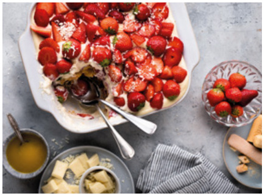

**Ingrediënten voor:** 6-8 personen
**Bereidingstijd:** ca. 25 min. + ca. 2 uur wachttijd
**4** verse eieren
**110 g** suiker
**500 g** mascarpone
**2 tl** vanille-extract
**750 g** aardbeien
**50 ml** vlierbloesemsiroop
**250 ml** vers sinaasappelsap
**350 g** lange vingers
**75 g** witte chocolade, geschaafd
1 Splits de eieren. Klop in een mengkom met een
mixer de eidooiers samen met 50 g suiker in
ca. 5 minuten tot een romig mengsel. Voeg de
mascarpone en 1 tl vanille-extract toe en klop tot
een glad mengsel. Houd even apart.
2 Klop in andere mengkom 3 eiwitten stijf
(gebruik het overige eiwit voor een ander recept).
Voeg daarna eetlepel voor eetlepel de overige
**60 g** suiker toe. Wacht tussen elke keer ca. 30 seconden tot je de volgende eetlepel toevoegt, dan
weet je zeker dat de suiker goed is opgenomen in
het eiwit. Spatel het eiwit door het mascarponemengsel tot een gladde crème. Probeer de crème
zo luchtig mogelijk te houden.
3 Verwijder de kroontjes van de aardbeien en
snijd de aardbeien in plakjes. Roer de vlierbloesemsiroop en 1 tl vanille-extract door het sinaasappelsap. Schenk in een lage schaal. Doop de
lange vingers één voor één in het mengsel. Haal
ze uit de schaal en begin met het opbouwen van
de tiramisu.
4 Bedek de bodem van de ovenschaal met een rijtje lange vingers. Beleg met een laag aardbeienplakjes. Schep de helft van het mascarponemengsel erover en strijk glad. Bedek opnieuw met een
rijtje lange vingers. Leg hier een laag aardbeienplakjes op en bestrijk met de overige helft van het
mascarponemengsel. Beleg ook de bovenkant van
de tiramisu met aardbeienplakjes. Zet ca. 2 uur in
de koelkast, zodat hij goed stevig wordt.
5 Garneer de aardbeientiramisu vlak voor het
serveren met het wittechocoladeschaafsel.
Per portie (8): ca. 640 kcal
**11 g** eiwit | 37 g vet | 70 g koolhydraten
Receptuur: Uit Paulines Keuken Fotografie: Marianne Snel

## Gazpacho

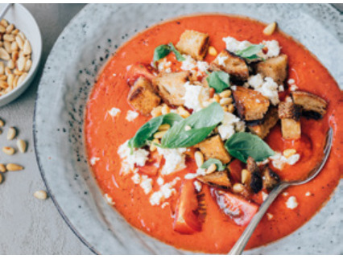

**Ingrediënten voor:** 4 personen
**Bereidingstijd:** ca. 15 min.
**2** uien
**2** teentjes knoflook
**2** rode paprika’s
**1 el** olijfolie
**600 g** tomaten
**90 ml** sinaasappelsap
zout en peper
**VOOR DE** TOPPING
**100 g** wit zuurdesembrood
**50 g** boter
zeezout, naar smaak
**100 g** feta
**4** tomaten
**4 tl** pijnboompitten
**4 takjes** basilicum
olijfolie, naar smaak
1 Snipper de uien en knoflook fijn. Halveer de
paprika’s, verwijder de zaadlijst en hak de
paprika’s in stukjes. Verhit de olijfolie in een
koekenpan en bak de ui, de knoflook en de
paprika goudbruin erin.
Uit Paulines Keuken
2 Snijd de tomaten in grove stukken. Doe ze
samen met de ui, de knoflook en de paprika in de
blender. Hak alles tot een gladde soep. Voeg het
sinaasappelsap toe en breng op smaak met zout
en peper. Zet tot gebruik in de koelkast.
3 VOOR DE TOPPING Snijd het brood in dobbelsteentjes van 1 x 1 cm. Smelt de boter in een
koekenpan en bak de croutons (brooddobbelsteentjes) rondom bruin erin. Bestrooi eventueel
met wat zeezout.
4 Schep de gazpacho in soepborden en verdeel de
croutons erover. Verkruimel de feta over de soep,
snijd de tomaten voor de topping in partjes en leg
ze in de gazpacho. Garneer met de pijnboompitten en het basilicum. Drizzle wat van je favoriete
olijfolie erover.
**Per portie:** ca. 394 kcal
**10 g** eiwit | 25 g vet | 33 g koolhydraten

## Carpacciopastasalade

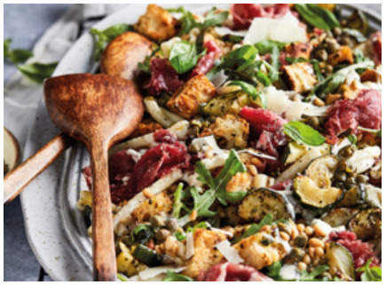

**Ingrediënten voor:** 4 personen
**Bereidingstijd:** ca. 30 min.
**½** ciabatta
**3 el** pesto
**1** courgette
zout en peper
**300 g** pasta
**1 el** olijfolie
**3 el** truffelmayonaise
**2 el** kappertjes
**1½ tl** wittewijnazijn
**75 g** rucola
**4 takjes** basilicum, blaadjes
geplukt
**240 g** rundercarpaccio
**2 el** pijnboompitten
**50 g** parmezaan
1 Verwarm de oven voor (elektrisch: 200°C /
hetelucht: 180°C). Snijd de ciabatta in blokjes en
meng met 2 el pesto. Snijd de courgette in dunne
plakjes of blokjes en meng met 1 el pesto.
2 Verdeel de ciabattablokjes en de courgette over
een bakplaat of braadslede, bestrooi met zout en
peper en rooster 12-15 minuten in de oven, tot
ze goudbruin en knapperig zijn. Hussel ze na ca.
7 minuten even om.
3 Kook intussen de pasta volgens de aanwijzingen op de verpakking gaar in ruim, gezouten
water. Giet af en meng direct met 1 el olijfolie om
plakken te voorkomen. Laat afkoelen.
4 Meng de truffelmayonaise, de kappertjes en de
wittewijnazijn met elkaar en schep de dressing
door de afgekoelde pasta. Breng royaal op smaak
met zout en peper.
5 Voeg de rucola, de basilicumblaadjes, de croutons en de geroosterde courgette toe en schep
alles goed om. Verdeel alles over een groot bord
(zodat iedereen zelf op kan scheppen) of vier
losse borden. Leg de plakjes carpaccio her en der
over de salade heen.
6 Rooster de pijnboompitjes in een droge koekenpan lichtbruin schud ze op een bord. Laat ze kort
afkoelen.
7 Strooi de pijnboompitjes over de carpacciopastasalade. Rasp tot slot, bijvoorbeeld met een
dunschiller of Microplanerasp, de parmezaan
over de salade.
**Per portie:** ca. 722 kcal
**32 g** eiwit | 32 g vet | 75 g koolhydraten
VARIATIETIP
Liever vega? Vervang de carpaccio
door gegrilde aubergine of
gemarineerde champignons.
Uit Paulines Keuken

## Griekse wraps

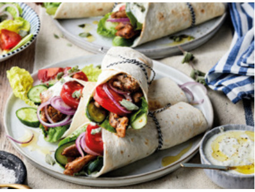

**Ingrediënten voor:** 4 stuks
**Bereidingstijd:** ca. 20 min.
**½** komkommer
**200 g** feta
**100 g** Griekse yoghurt
**½ takje** verse oregano, blaadjes
geplukt (+ evt. extra)
1 bio-citroen (alleen de schil,
geraspt)
zout en peper
**400 g** kippendijfilets
**15 g** gyroskruiden
olijfolie
**1** rode ui
**1-2** tomaten
**1** krop romainesla
**8** wraps
evt. prikkers of touwtje
1 Snijd de helft van de halve komkommer in
stukjes. Pureer samen met de feta, de Griekse
yoghurt, de oregano en de citroenschil in een
keukenmachine tot een smeuïg en glad smeersel.
Voeg naar smaak peper toe en houd tot gebruik
apart.
2 Snijd de kippendijfilets in reepjes. Meng de
gyroskruiden met 2 el olijfolie en schep de kip
door het kruidenmengsel; zorg dat alle kipreepjes
goed bedekt zijn. Bak de kip rondom bruin en
gaar in een koekenpan. Breng eventueel verder
op smaak met zout en peper.
3 Snijd de andere helft van de komkommer in
lange reepjes, de ui in dunne ringen en de tomaat
in plakjes. Haal de slablaadjes los van elkaar.
4 Verwarm de wraps zoals aangegeven op de
verpakking. Bestrijk ze met het fetamengsel en
leg de gyrosreepjes erop. Vul de wraps verder met
de komkommer, de sla, de tomaat en de uiringen.
Bestrooi eventueel met nog wat blaadjes verse
oregano.
5 Rol de Griekse wraps op en zet ze vast met een
prikker of bindt ze vast met een touwtje.
**Per portie:** ca. 317 kcal
**19 g** eiwit | 16 g vet | 24 g koolhydraten

## Tomatencouscous met feta

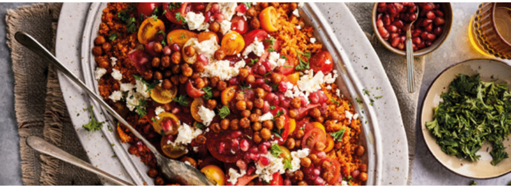

**Ingrediënten voor:** 4 personen
**Bereidingstijd:** ca. 25 min.
+ ca. 25 min. wachttijd
**115 g** kikkererwten (blik)
olijfolie
**1 tl** gemalen komijn
**½ tl** gerooktepaprikapoeder
zout en peper
**1** ui
**2** teentjes knoflook
**300 g** couscous
**70 g** tomatenpuree
**400 ml** groentebouilllon (heet)
**650 g** gemengde tomaten
**5 el** granaatappelpitjes
**100 g** feta
**10 g** verse peterselie
bakpapier
1 Verwarm de oven voor (elektrisch: 200°C /
hetelucht: 180°C). Spoel de kikkererwten af onder
de kraan. Laat uitlekken en dep goed droog. Doe
ze in een kom en voeg 1 el olijfolie, de komijn, het
paprikapoeder en een snufje zout toe. Verdeel
ze over een met bakpapier beklede bakplaat en
rooster de kikkererwten in ca. 25 minuten
krokant in de oven.
2 Pel en snipper de ui en de knoflook fijn. Verhit
een scheutje olijfolie in een ruime koekenpan
met deksel op laag vuur en bak de ui en knoflook
4-5 minuten erin. Voeg de couscous en de tomaten-puree toe en bak 1-2 minuten mee.
3 Schenk de hete bouillon in de pan en schep goed
om, zodat de couscous bedekt is met bouillon. De
bouillon moet goed heet zijn, anders kan de couscous niet goed wellen. Leg direct het deksel op de
pan en zet het vuur uit. Laat ca. 15 minuten staan.
Roer de couscous door en breng verder op smaak
met zout en peper. Verdeel over een schaal.
4 Snijd de tomaten in plakjes en parten en
verdeel over de couscous. Voeg de krokante
kikkererwten en de granaatappelpitjes toe.
Verkruimel de feta over de couscous.
5 Garneer de tomatencouscous met de grof
gehakte peterselie en top af met een drizzle
olijfolie.
**Per portie:** 275 kcal
**11 g** eiwit | 9 g vet | 37 g koolhydraten
Uit Paulines Keuken

# In de

# buitenlucht

Nergens smaakt eten lekkerder dan buiten in de
zomerzon. Deze recepten zijn perfect om aan de
tuintafel of op de camping van te genieten!

## Citroenrisotto

## met gesmoorde komkommer en garnalen

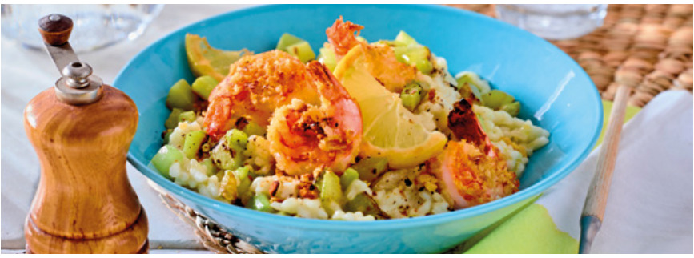

**Ingrediënten voor:** 4 personen
**Bereidingstijd:** ca. 1 uur
**2** bio-citroenen
**2** uien
**2** komkommers (ca. 750 g)
**3 el** olie (bijv. olijfolie)
**300 g** risottorijst
**1-1,2 l** groentebouillon
**50** g
panko (Japans paneermeel, bij de toko of grotere
supermarkt)
**6 el** boter
**16** gepelde gamba’s (ca. 400 g)
zout en peper
paprikapoeder
1 Was de citroenen en rasp van 1 citroen de schil eraf. Halveer de citroenen
en pers 2 helften uit. Snijd 1 helft in partjes; gebruik de overige helft in een
ander recept. Pel en snipper de uien. Schil de komkommers. Halveer de komkommers in de lengte en schraap met een lepel de zaadlijsten eruit. Snijd de
komkommers in blokjes.
Seizoen
2 Verhit 2 el olie in een pan en bak de ui glazig erin. Voeg de komkommer
toe en bak kort mee. Voeg de rijst toe en bak kort mee. Schenk beetje bij
beetje de bouillon en het citroensap erbij en roer daarbij af en toe door. Voeg
de volgende portie bouillon of sap pas toe als de rijst de vorige portie heeft
opgenomen. Kook de risotto op deze manier in ca. 25 minuten gaar.
3 Kneed de panko, 4 el boter en de citroenschil door elkaar. Dep de garnalen
droog. Verhit 1 el olie in een koekenpan en bak de garnalen ca. 1 minuut
erin. Bestrooi met zout, peper en paprikapoeder. Verdeel de garnalen over
een bakplaat en verdeel het pankomengsel erover. Gratineer de garnalen
2-3 minuten onder de hete grill van de oven. Roer 2 el boter door de risotto.
Breng op smaak met zout en peper. Serveer alle samen en garneer met de
citroenpartjes.
**Per portie:** ca. 640 kcal
**34 g** eiwit | 23 g vet | 69 g koolhydraten

## BBQ-enchilada’s caprese

## met entrecote

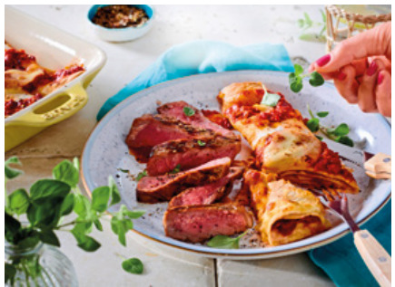

**Ingrediënten voor:** 4 personen
**Bereidingstijd:** ca. 30 min.
**1** ui
**1 el** olie (bijv. olijfolie)
**800** ml
tomatensaus met basilicum
(pot of fles)
zout en peper
**400 g** mozzarella
**6 takjes** oregano
**6** tarwetortilla’s
**2** entrecotes (à ca. 300 g)
1 Pel en snipper de ui fijn. Verhit de olie in een pan
en bak de ui glazig erin. Schenk de tomatensaus
erbij en verhit ca. 3 minuten. Breng op smaak met
zout en peper. Snijd de helft van de mozzarella in
plakjes en rasp de rest grof. Was de oregano en
neem de blaadjes van de takjes.
2 Verhit de tortilla’s ca. 1 minuut in een koekenpan en bestrijk met ¾ van de saus. Verdeel de
geraspte kaas over de saus en bestrooi met de
oregano. Rol de tortilla’s op, leg ze in een barbecueschaal en besprenkel met de rest van de saus.
Leg de mozzarellaplakjes erop.
3 Zet de schaal op de indirecte hitte van de barbecue, sluit de barbecue en bak ca. 15 minuten. Dep
de entrecotes droog en gril ze op de directe hitte
van de barbecue ca. 3 minuten per zijde. Bestrooi
met zout en peper. Laat afgedekt ca. 5 minuten
rusten. Snijd de entrecotes in plakjes en serveer
met de enchilada’s.
**Per portie:** ca. 840 kcal
**58 g** eiwit | 34 g vet | 71 g koolhydraten

## Romige pestokip met feta

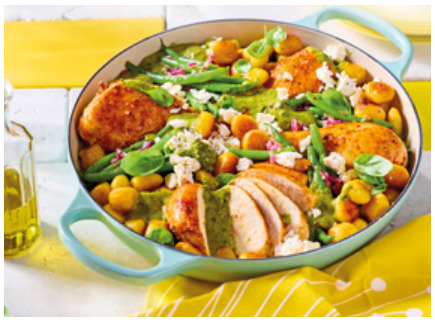

**Ingrediënten voor:** 4 personen
**Bereidingstijd:** ca. 50 min.
**600 g** sperziebonen
zout en peper
**4** kipfilets (à ca. 250 g)
**4 el** olie
paprikapoeder
**2 el** boter
**800 g** verse gnocchi (koeling)
**1** ui
**150 g** pesto
**200 ml** groentebouillon
**175 g** feta
1 Was de sperziebonen en halveer ze als ze groot
zijn. Kook de sperziebonen in ca. 10 minuten gaar
in water met wat zout. Giet af, spoel met koud
water en laat goed uitlekken.
2 Verwarm de oven voor (elektrisch: 180°C /
hetelucht: 160°C). Dep de kipfilets droog en bestrooi met zout en peper. Verhit 3 el olie in een
grote koekenpan of een ondiepe braadpan op
hoog vuur en bak de kipfilets ca. 2 minuten per
zijde erin. Bestuif met 1 tl paprikapoeder en bak
nog even kort. Leg de kipfilets in een ovenschaal
en bak in 12-15 minuten gaar in de oven.
3 Verhit 1 el olie en de boter in het hete bakvet en
bak de gnocchi in ca. 10 minuten goudbruin erin.
Pel en snipper de ui fijn. Neem de gnocchi uit de
pan. Bak de ui glazig in het hete bakvet. Voeg de
sperziebonen toe. Roer de pesto en de bouillon
erdoorheen en breng aan de kook. Breng op
smaak met zout en peper. Doe de gnocchi en de
kipfilets in de pan en verhit kort mee. Verbrokkel
de feta erboven.
**Per portie:** ca. 980 kcal
**70 g** eiwit | 43 g vet | 71 g koolhydraten
Seizoen

## Varkenshaas

## in knoflookboter

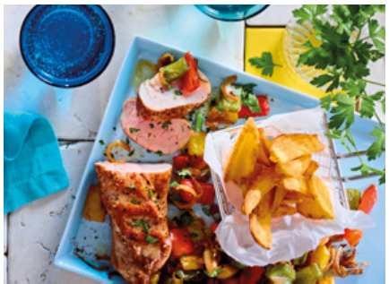

**Ingrediënten voor:** 4 personen
**Bereidingstijd:** ca. 40 min.
Seizoen
**1** varkenshaas (ca. 600 g)
**2 el** olie
zout en peper
**70 g** knoflookboter
**500 g** ovenfriet (diepvries)
3
paprika’s (bijv. rood, geel en
groen)
**2** uien
**4 takjes** peterselie
aluminiumfolie of bakpapier
1 Verwarm de oven voor (elektrisch: 200°C / hetelucht: 180°C). Dep de varkenshaas droog. Verhit
de olie in een koekenpan op hoog vuur en bak de
varkenshaas 2-3 minuten rondom erin. Bestrooi
met zout en peper, neem uit de pan en leg op een
groot stuk aluminiumfolie of bakpapier. Houd de
koekenpan met het bakvet apart. Snijd de knoflookboter in stukken en verdeel ze over het vlees.
Wikkel in de folie of het bakpapier en leg op een
zijde van een bakplaat. Leg op de vrije zijde de
friet. Bak in ca. 25 minuten gaar in de oven.
2 Snijd de paprika’s in kwarten, verwijder de
zaadlijsten, was de paprika’s en snijd ze in stukken. Neem de varkenshaas na ca. 12 minuten
uit de oven. Draai de friet om en zet terug in de
oven. Open de folie of het bakpapier, schenk de
gesmolten knoflookboter in de apart gehouden
pan en verhit. Wikkel de varkenshaas weer in de
folie of het papier en laat rusten. Bak de paprika
en de ui ca. 10 minuten op hoog vuur in de hete
boter. Breng op smaak met zout en peper. Was de
peterselie en hak hem fijn. Serveer alles samen en
bestrooi met de peterselie. Besprenkel de
varkenshaas met wat knoflookboter uit de pan.
**Per portie:** ca. 430 kcal
**31 g** eiwit | 22 g vet | 23 g koolhydraten

## Zomerse groentekokossoep met hartige

## wentelteefjes

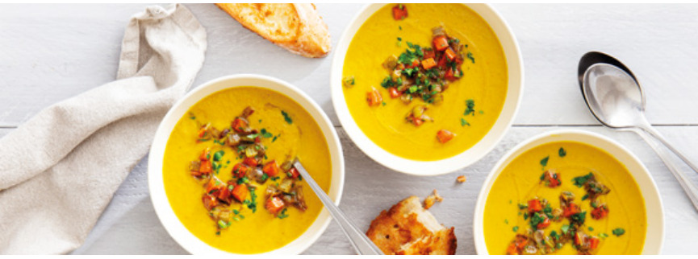

**Ingrediënten voor:** 4 personen
**Bereidingstijd:** ca. 50 min.
**¼** knolselderij
**2** wortels
**1** prei
**2** uien
**6 el** olie
**1-2 el** kerrie
zout en peper
**400 ml** kokosmelk (blik)
**1 l** groentebouillon
**3 el** hoisinsaus
**2** eieren
4 sneetjes desembrood (ca.
**200** g)
**2 takjes** peterselie
1 VOOR DE SOEP Schil de knolselderij, snijd ¾ in
grove stukken en ¼ in kleine blokjes. Schrap de
wortels, snijd ¾ in grove stukken en ¼ in kleine
blokjes. Maak de prei schoon, snijd ¾ in ringen en
snijd ¼ fijn. Pel en snipper de uien. Verhit 2 el olie
in een pan en bak de grof gesneden groenten en
de ui ca. 10 minuten erin. Bestuif met de kerrie en
bak kort mee. Breng op smaak met zout en peper.
Houd 5 el kokosmelk apart en schenk de rest met
de bouillon in de pan. Breng aan de kook en laat
ca. 15 minuten zachtjes koken op laag vuur.
2 VOOR DE TOPPING Verhit 2 el olie in een
koekenpan en bak de in kleine blokjes gesneden
knolselderij en wortel en de fijngesneden prei in
ca. 10 minuten knapperig erin. Besprenkel met
2 el hoisinsaus en roer kort door elkaar.
3 VOOR DE WENTELTEEFJES Kluts de eieren met
**5 el** kokosmelk, zout en peper. Wentel het brood
erin en laat kort intrekken. Verhit 2 el olie in een
andere koekenpan en bak de wentelteefjes in ca.
3 minuten per zijde goudbruin en gaar erin.
4 Pureer de soep fijn. Breng op smaak met zout,
peper en 1 el hoisinsaus. Was de peterselie en
hak hem fijn. Bestrooi de soep met de gebakken
groenten en de peterselie. Serveer met de

## wentelteefjes.

**Per portie:** ca. 560 kcal
**9 g** eiwit | 39 g vet | 38 g koolhydraten

## Coverrecept

Fotografie: Willem van Santen

# Win een

# airfryer van

# Russell Hobbs!

# Facebook Kookclub

# kookliefhebbers!

# Dé online plek voor

Wat kun je hier doen?

# Dé online plek voor

# Dé online plek voor

Jouw heerlijke gerechten delen

# Dé online plek voor

Kooktips en inspiratie opdoen
Je vragen over recepten stellen
Om deze nieuwe groep te vieren geven we een Satisfry™ Dual Basket
Airfryer van Russell Hobbs t.w.v. 169,99 weg! Word vóór 1 juli lid en
maak kans!

## Scan de QR-code of zoek ‘Koken & genieten kookclub’ op

## Facebook.

Alle voorwaarden voor de winactie zijn te vinden via kokengenieten.nl/voorwaarden-winacties.
Scan de
QR-code

# Dé online plek voor

Is het even geen barbecueweer? Deze recepten met
worst smaken ook goed zonder dat je hoeft te grillen!

# Of je worst lust

## Bruschetta-worstrolletjes

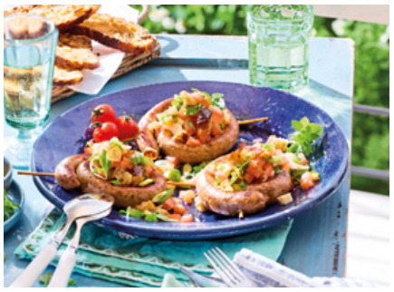

**Ingrediënten voor:** 4 personen
**Bereidingstijd:** ca. 40 min.
**1** ciabatta (ca. 350 g)
**2** teentjes knoflook
**4 el** boter
**400 g** tomaten
**1 bosje** lente-uitjes
**125 g** mozzarella
**4 el** olijfolie
**4** dunne braadworsten, opgerold
(à ca. 180 g, bij de slager)
**8 el** witte balsamicoazijn
zout en peper
suiker
**8 takjes** basilicum
1 VOOR DE CROUTONS Snijd de helft van de
ciabatta in blokjes van ca. 1 cm. Snijd de andere
helft in ca. 8 dunne plakjes. Pel de knoflook en
snijd in plakjes. Verhit 2 el boter in een koekenpan en voeg de helft van de knoflook toe. Voeg de
broodblokjes toe en bak al roerend goudbruin.
Neem de broodblokjes en de knoflook uit de pan
en houd apart. Houd de pan ook apart.
2 VOOR HET BRUSCHETTAMENGSEL Was de
tomaten, snijd ze in kwarten, verwijder de zaadlijsten en snijd de tomaten in kleine blokjes. Was
de lente-uitjes en snijd in dunne ringetjes. Dep de
mozzarella droog en snijd in kleine blokjes.
3 VOOR DE TOAST Verhit 2 el boter in de apart
gehouden koekenpan en bak de plakjes brood
in ca. 3 minuten per zijde goudbruin erin. Voeg
kort voor het einde van de baktijd de rest van de
knoflook toe en bak mee. Neem de knoflook en de
toast uit de pan.
4 Verhit 2 el olie in een koekenpan. Bak de worstrolletjes in 3-4 minuten per zijde gaar erin.
5 VOOR HET BRUSCHETTAMENGSEL Roer de
azijn, zout, peper en een snu e suiker door
elkaar. Klop 2 el olie erdoorheen. Meng de
croutons, de tomaat, de lente-ui en de mozzarella
met de vinaigrette. Was het basilicum, neem de
blaadjes van de takjes en meng met het
bruschettamengsel. Serveer de worstrolletjes
met het bruschettamengsel. Geef de toast erbij.
**Per portie:** ca. 810 kcal
**29 g** eiwit | 53 g vet | 48 g koolhydraten

## Zomers chorizobonenpannetje

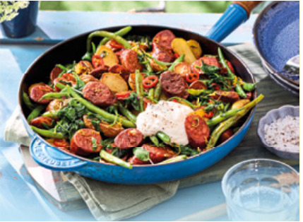

**Ingrediënten voor:** 4 personen
**Bereidingstijd:** ca. 50 min.
**500 g** sperziebonen
zout en peper
**400 g** chorizo
**500 g** krieltjes met schil
**1** teentje knoflook
**4 takjes** tijm
**2 takjes** rozemarijn
**6** salieblaadjes
**1** rode chilipeper
**150 g** babyspinazie
**2 el** olie
**125 ml** groentebouillon
**1** bio-citroen
1 Was de sperziebonen en kook ze in ca. 7 minuten
gaar in water met wat zout. Trek het vel eventueel
van de chorizo en snijd de worst in plakjes. Was de
krieltjesenhalveerze.Pelensnipperdeknoflook.
Was de kruiden en hak ze kleiner. Snijd de chilipeper in de lengte in, verwijder de zaadlijsten,
was de peper en snijd hem in ringetjes. Was de
spinazie.
Seizoen
2 Giet de sperziebonen af. Verhit de olie in een
grote, diepe koekenpan en bak de chorizo in ca.
10 minuten krokant erin. Neem uit de pan. Bak de
krieltjes in ca. 10 minuten goudbruin in het hete
bakvet. Voeg de knoflook en de sperziebonen toe
en bak ca. 3 minuten mee. Schenk de bouillon
erbij, breng aan de kook en laat zonder deksel ca.
3 minuten zachtjes koken.
3 Roer de kruiden en de helft van de chilipeper
erdoorheen. Breng op smaak met zout en peper.
Voeg de spinazie toe en laat slinken. Spatel de
chorizo erdoorheen. Was de citroen en rasp de
schil er fijn af. Pers de helft van de citroen uit.
Breng het chorizopannetje op smaak met citroensap. Bestrooi met de citroenschil en de rest van
de chilipeper.
**Per portie:** ca. 640 kcal
**32 g** eiwit | 43 g vet | 27 g koolhydraten

## Gevulde paprika met

## venkelworst

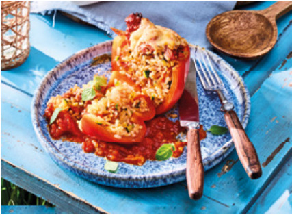

**Ingrediënten voor:** 4 personen
**Bereidingstijd:** ca. 1 uur en 15 min.
**2** uien
**2** teentjes knoflook
**4 el** olijfolie
**1 el** tomatenpuree
**800 g** gepelde tomaten (blik)
**4-5 el** balsamicoazijn
zout en peper
suiker
**150 g** langgraanrijst
**4** rode paprika’s
**1** courgette
**4** Italiaanse venkelworsten
(ca. 400 g, bij de supermarkt)
**100 g** comté (harde Franse kaas)
1 Pel en snipper de uien en de knoflook. Verhit 2 el
olie in een koekenpan en bak de knoflook en de helft
van de ui ca. 3 minuten erin. Voeg de tomatenpuree
toe en bak ca. 1 minuut mee. Blus af met de gepelde
tomaten inclusief het sap, prak de tomaten fijn en
breng aan de kook. Breng op smaak met de azijn,
zout, peper en een snu e suiker. Laat zonder deksel
ca. 15 minuten zachtjes koken. Breng de saus op
smaak met zout en peper.
2 Kook de rijst volgens de aanwijzingen op de verpakking gaar in water met wat zout. Snijd de dekseltjes
van de paprika’s, verwijder de zaadlijsten en was de
paprika’s. Snijd de dekseltjes in kleine blokjes. Was de
courgette en snijd in blokjes.
3 Snijd de worsten in de lengte in en neem het worstvlees eruit. Verhit 2 el olie in een koekenpan en bak
het worstvlees in ca. 6 minuten al roerend rul erin.
Neem uit de pan. Bak de courgette en de paprikablokjes ca. 8 minuten in het hete bakvet. Voeg de rest van
de ui toe en bak ca. 2 minuten mee. Voeg de rijst en
het worstvlees toe en verhit kort mee. Was de oregano en hak fijn. Breng het rijstmengsel op smaak met
de oregano, zout, peper en 4 el van de tomatensaus.
4 Verwarm de oven voor (elektrisch: 200°C / hetelucht: 180°C). Verdeel de rest van de tomatensaus
over een ovenschaal (25 x 30 cm). Zet de paprika’s in
de saus en vul met het rijstmengsel. Rasp de kaas fijn
en strooi hem over de vulling. Bak in ca. 25 minuten
gaar in de oven.
**Per portie:** ca. 620 kcal
**22 g** eiwit | 36 g vet | 55 g koolhydraten

## Lichte ragout met worstballetjes

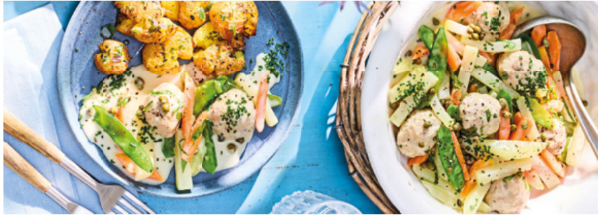

**Ingrediënten voor:** 4 personen
**Bereidingstijd:** ca. 1 uur
**600 g** krieltjes
**500 g** fijne braadworst (evt. bij de slager)
zout en peper
**1** koolrabi
**3** wortels
**150 g** peultjes
**½ bosje** tijm
**3 el** boter
**2 el** bloem
**200 ml** slagroom
**1 el** kappertjes
**1** citroen (alleen het sap)
worcestershiresauce
**1 bosje** bieslook
bakpapier
1 Was de krieltjes goed en kook ze in ca. 20 minuten gaar in een
pan water. Knijp het worstvlees uit het vel en maak ca. 20 balletjes ervan. Breng 1 l water met 1 tl zout aan de kook en kook de
balletjes op laag vuur in ca. 15 minuten gaar erin; ze zijn gaar als
ze boven komen drijven. Giet de aardappels af. Neem de worstballetjes uit het water. Houd het water apart.
2 Schil de koolrabi en de wortels en was ze. Snijd de koolrabi
in reepjes. Snijd de wortels schuin in stukken. Was de peultjes
en halveer ze eventueel. Kook de koolrabi en de wortel in ca.
5 minuten gaar in het water van de worstballetjes. Voeg de
peultjes in de laatste ca. 2 minuten toe en laat mee garen.
Giet de groenten af, vang daarbij het water op en meet
ca.500mlaf.
3Wasdetijmenhakhemfijn.Smelt1elboter.
Verdeel de krieltjes over een met bakpapier beklede bakplaat. Druk met een pureestamper of de
bodem van een pan de krieltjes wat platter, zodat
de schil barst. Verdeel de boter, de tijm en zout
over de krieltjes. Bak in ca. 10 minuten krokant
onderdegrillvandeoven.
4 Verhit 2 el boter in een pan en bak de bloem erin.
Blus al roerend af met het opgevangen kookwater
en de slagroom. Breng aan de kook. Roer de kappertjes en het citroensap erdoorheen. Breng de saus op
smaak met zout, peper en wat worcestershiresauce.
5 Verhit de worstballetjes en de groenten kort in de saus. Was
debieslookenhakhemfijn.Serveerallessamenenbestrooi
metdebieslook.
**Per portie:** ca. 670 kcal
**22 g** eiwit | 49 g vet | 37 g koolhydraten
Seizoen

# Hét magazine voor de

# vraag: “Wat eten we

# vandaag?”

Scan de
QR-code

# 12x van 55,voor maar

42,50
Iedere dag inspiratie
voor een heerlijke
maaltijd.
Bomvol recepten met
seizoensgebonden
producten.
Ontdek de lekkerste
zoete recepten.

## Abonneer je nu via:

## www.kokengenieten.nl/abo

of bel naar +31 (0)24 20 27 829
Deze actie is geldig t/m 20 juli 2025 of zo lang de voorraad strekt. Je abonneert tot wederopzegging en voor ten
minste de actieperiode van 12 nummers. Na afloop van de actieperiode geldt de reguliere abonnementsprijs en
is het abonnement per maand opzegbaar.
Hete zoetzure kip
Boek
Titel: Wok express
Auteur: Ching-He Huang
Fotografie: Tamin Jones
Prijs: 24,00 euro
Uitgeverij: Becht

# Lekker uit

# de wok

In het boek Wok express vind je 100 recepten uit de wok die in minder
dan 30 minuten op tafel staan. De gerechten zijn beschreven voor
twee personen, maar makkelijk aan te passen voor meer. Van deze
recepten leer je uit welke elementen een goede wok bestaat én hoe je
ervoor zorgt dat je groenten niet te zacht en te klef worden of je vlees
overgaar. Oefening is key, dus haal die wok maar snel uit de kast!
Tekst: Yvonne Doorten

## Hete zoetzure kip

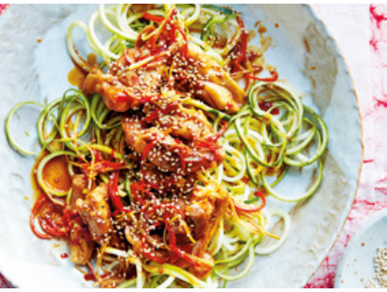

**Ingrediënten voor:** ca. 2 personen
**Bereidingstijd:** ca. 15 min.
**1 el** koolzaadolie
**1 teen** knoflook, fijngehakt
**2,5** cm
verse gember, in dunne
reepjes
middelgrote rode chilipepers,
zaadjes verwijderd en in
dunne ringen
**250 g** scharrelkippendijfilet, in
reepjes van 1 x 2,5 cm
**1** el
shaoxing (rijstwijn) of droge
sherry
**250 g** courgettespaghetti
(courgetti)
**1** handje geroosterde
sesamzaadjes, ter garnering
**VOOR DE** SAUS
**50 ml** mirin
**1 tl** chilibonenpasta
**2 el** zouarme sojasaus
**2 el** rijstazijn
**2 el** vloeibare honing
1 VOOR DE SAUS Doe de ingrediënten in een
kommetje. Roer goed door en zet opzij.
2 Verhit een wok op hoog vuur tot hij begint te
roken en schenk de koolzaadolie erin. Voeg zodra
de olie heet is de knoflook, gember en chilipepers
toe en roer een paar seconden om hun aroma vrij
te laten komen. Voeg de kipreepjes toe en schroei
in 15 seconden aan één kant dicht; draai dan om
en bak nog 1 minuut. Voeg zodra de kipreepjes
bruin beginnen te worden de rijstwijn of droge
sherry toe. Roerbak nog 2 minuten tot de kip
zacht en gaar is. Giet de saus erbij en roerbak tot
de saus ingedikt en glanzend is.
3 Verdeel de courgetti over twee borden, schik
de kip erop, strooi de geroosterde sesamzaadjes
erover voor een ‘vleugje noot’ en serveer meteen.
2

## Sperzieboontjes

## op silken tofu

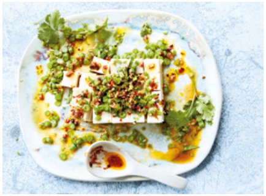

**Ingrediënten voor:** 2 personen
**Bereidingstijd:** ca. 20 min.
**1 el** koolzaadolie
**2,5** cm
verse gember, geschild en
geraspt
**1 tl** gemalen sichuanpeperkorrels
(bij de toko)
1
middelgrote rode chilipeper,
zaadjes verwijderd en
fijngesneden
**200** g
sperziebonen, in stukjes van
**5** mm
**1 el** citroensap
**1** el
heldere rijstazijn of
appelciderazijn
**1 el** zoutarme lichte sojasaus
**1 el** chiliolie
**1 tl** geroosterde-sesamolie
**400** g
stevige silken tofu, uitgelekt
en in blokjes van ca. 1 cm*
klein handje
verse koriander, steeltjes
en blaadjes, fijngehakt, ter
garnering
1 Verhit een wok op hoog vuur tot hij begint te
roken en schenk de koolzaadolie erin. Voeg zodra
de olie heet is de gember, sichuanpeper en chilipeper toe enroer een paar seconden.
2 Voeg de sperziebonen toe en schep goed om.
Druppel vervolgens een klein scheutje koud
water langs de rand van de wok om de bonen gaar
te stomen. Roer 2-3 minuten tot de bonen zacht
zijn, breng dan op smaak met citroensap, azijn,
lichte sojasaus, chiliolie en geroosterde-sesamolie en haal de wok van het vuur.
3 Leg de gekoelde silken tofu op een serveerschaal. Verdeel de bonen erover, garneer met
de gehakte korianderblaadjes en -steeltjes en
serveer meteen.
*Silken tofu eet je meestal rauw. Zorg
dat hij goed gekoeld is. Serveer ‘m in dit
recept als één blok en schep daarover het
bonenmengsel.

## Biefstuk

## met spicy ponzu-saus

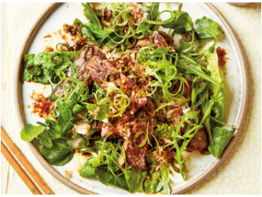

**Ingrediënten voor:** ca. 2 personen
**Bereidingstijd:** ca. 8 min.
**1 el** koolzaadolie
**2 tenen** knoflook, geplet en fijngehakt
1
rode chilipeper, in dunne
ringen
**300** g
biefstuk, vet verwijderd en in
plakjes van 1 cm dik (tegen de
draad in)
**1 el** mirin
**200** g
gemengde sla (romaine,
spinazie, waterkers, rucola)
**VOOR DE** DRESSING
**1 el** zoutarme lichte sojasaus
Sap van 1 citroen
snuf lichte basterdsuiker
**VOOR DE** GARNERING
klein handje bonitovlokken*
**1** bosui, in dunne ringen
1 VOOR DE DRESSING Doe de ingrediënten in een
kannetje. Roer goed door en zet opzij.
2 Verhit intussen een wok op hoog vuur tot hij
begint te roken en schenk de koolzaadolie erin.
Voeg zodra de olie heet is de knoflook en chilipeper toe en roer een paar seconden om de smaken
vrij te laten komen. Voeg de plakjes rundvlees
toe en schroei in 10 seconden rondom dicht en
bruin. Roerbak dan nog 15 seconden (voor medium doorbakken) of 1 minuut (voor doorbakken).
Breng op smaak met de mirin.
3 Verdeel de sla over twee borden. Schep het
rundvlees erop, besprenkel met de dressing en
garneer met de bonitovlokken en bosui. Serveer
meteen.
*Bonitovlokken zijn schaafsels van
gedroogde, gefermenteerde en gerookte
tonijn. Het wordt veel gebruikt als
smaakmaker in de Japanse keuken. Je
koopt bonitovlokken bij de toko. Je kunt
het evt. ook weglaten.
Sperzieboontjes op silken tofu
Boek
Biefstuk met spicy ponzu-saus

## Roerbak van satékip met

## pittige kokos-pindasaus

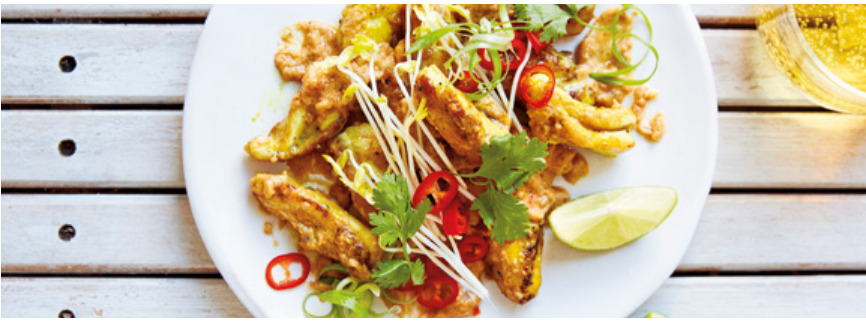

**Ingrediënten voor:** 2 personen
**Bereidingstijd:** ca. 20 min.
**250** g
scharrelkippendijfilet, in
reepjes van 1 cm
**½ tl** gemalen kurkuma
**½ tl** gemalen koriander
**1 tl** gemalen citroengras
snuf zeezoutvlokken
snuf gemalen witte peper
**1 el** maizena
**1 el** koolzaadolie
**1** el
shaoxing (rijstwijn) of droge
sherry
**1 el** zoutarme lichte sojasaus
sap van ½ limoen
**VOOR DE** SAUS
**1 teen** knoflook, fijngehakt
1
middelgrote rode chilipeper,
zaadjes verwijderd en in
dunne ringen
**1** grote sjalot, fijngesneden
1/2 tl tamarindepasta
**½ tl** garnalenpasta (optioneel)
**1 tl** chilipasta
**3 el** pindakaas met stukjes
**1 el** vloeibare honing
**50 ml** heet water
**150 ml** kokosmelk light
**VOOR DE** GARNERING
**1** handvol taugé
1
bosui, diagonaal in dunne
ringen
verse korianderblaadjes
partjes limoen
1 Doe de kipreepjes in een kom en breng op
smaak met de kurkuma, gemalen koriander,
het citroengras en wat zout en peper. Strooi de
maizena erover en meng goed om de kip aan alle
kanten te coaten. Zet opzij.
2 VOOR DE SAUS Doe alle ingrediënten, behalve
het hete water en de kokosmelk, in een foodprocessor en mix tot een fijne pasta. Voeg het
hete water toe en roer het handmatig door de
pasta. Voeg dan de kokosmelk toe en roer opnieuw.
Boek
3 Verhit een wok op hoog vuur tot hij begint te
roken en schenk de koolzaadolie erin. Voeg zodra
de olie heet is de kipreepjes toe en laat 2 minuten
in de wok liggen tot ze dichtgeschroeid en bruin
zijn. Voeg dan de rijstwijn of droge sherry toe
en roerbak nog 2-3 minuten tot de kipreepjes
door en door gaar zijn. Giet de saus erbij en roer
30 seconden om het aroma vrij te laten komen.
Breng op smaak met de lichte sojasaus en het
limoensap.
4 Verdeel de satékip over twee borden en leg de
taugé, bosui, korianderblaadjes en partjes limoen
erop. Serveer meteen.

# Diner

# en blanc

Bij dit chique diner gaat iedereen in het
wit gekleed en geniet je samen van een
verrukkelijke, elegante maaltijd. Bon appétit!

## Honing-chilikalkoen

## met komkommerrelish

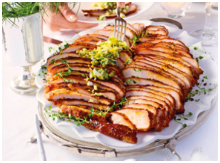

**Ingrediënten voor:** 8 personen
**Bereidingstijd:** ca. 6 uur
**2** kleine kalkoenfilets
(à ca. 800 g)
**2 el** zeezout
**2-3 el** vloeibare honing
**1-2 el** chilivlokken
**300 ml** kippenbouillon
**3** eieren
**250 g** komkommer
**1** appel (bijv. granny smith)
**4** lente-uitjes
**1** bio-citroen
**1 bosje** tijm
zout en peper
suiker
1 VOOR HET VLEES Verwarm de oven voor (elektrisch: 100°C*). Dep de kalkoenfilets droog en
wrijf rondom in met het zeezout. Bestrijk met
de honing en bestrooi met de chilivlokken. Leg
de kalkoenfilets in een diepe bakplaat en bak ca.
5 uur en 30 minuten in de oven. Draai de kalkoen
daarbij elk uur om en bestrijk met het braadvocht.
Zet de grill van de oven aan, bestrijk de kalkoen
nogmaals met braadvocht en rooster in ca. 10 minuten goudbruin onder de grill.
2 VOOR DE RELISH Kook de eieren in ca. 10 minuten hard. Snijd de komkommer in heel kleine
blokjes. Was de appel, snijd hem in kwarten,
verwijder het klokhuis en snijd de appel in heel
kleine blokjes. Was de lente-uitjes en snijd in
Buffet
dunne ringetjes. Spoel de eieren met koud water,
pel ze en hak ze fijn. Was de citroen en rasp de schil
er fijn af. Pers de citroen uit. Was de tijm, houd
een beetje apart om te garneren en hak de rest
fijn. Roer de citroenschil, het -sap, zout, peper, een
snufje suiker en de tijm door elkaar. Meng het kruidenmengsel met de rest van de ingrediënten voor
de relish. Breng zo nodig nogmaals op smaak. Snijd
de kalkoen in dunne plakjes. Serveer met de relish
en bestrooi met de apart gehouden tijm.
**Per portie:** ca. 280 kcal
**51 g** eiwit | 5 g vet | 6 g koolhydraten
* Een heteluchtoven is voor dit recept niet
geschikt.

## Aardappelcarpaccio

## met hamroom

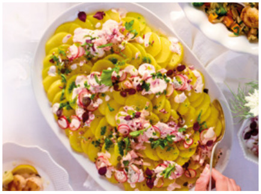

**Ingrediënten voor:** 8 personen
**Bereidingstijd:** ca. 1 uur
**1,2 kg** aardappels
**3 el** wittewijnazijn
**½ tl** mosterd
zout en peper
suiker
**2 el** olie
**75 g** gekookte ham, dunne plakjes
**1** rode ui
**1 bosje** radijsjes
**2 el** olijfolie
**3-4 el** mayonaise
**150 g** crème fraîche
**2 tl** citroensap
**2-3 el** melk
**1** bakje tuinkers
1 Was de aardappels en kook ze in ca. 20 minuten
gaar in een pan water. Giet af, laat even afkoelen
en pel de aardappels. Roer de azijn, de mosterd,
zout, peper en een snufje suiker door elkaar.
Klop 2 el olie erdoorheen. Snijd de aardappels in
dunne plakjes en verdeel ze dakpansgewijs over
een grote schaal. Besprenkel met de vinaigrette
en laat ca. 20 minuten trekken.
2 Snijd de ham in heel dunne reepjes. Pel en
snipper de ui fijn. Was de radijsjes en houd het
loof apart. Schaaf of snijd de radijsjes in heel
dunne plakjes. Pureer 4 blaadjes radijsloof met 2
el olijfolie. Roer de mayonaise, de crème fraîche,
het citroensap en de melk glad. Breng op smaak
met zout en peper. Roer de ham, de ui en de radijs
door de roomsaus. Verdeel de hamroom over de
aardappel. Knip de tuinkers uit het bakje een
verdeel met de radijsloofolie over de aardappelcarpaccio.
**Per portie:** ca. 230 kcal
**6 g** eiwit | 9 g vet | 29 g koolhydraten
Buffet

## Orzosalade met garnalen

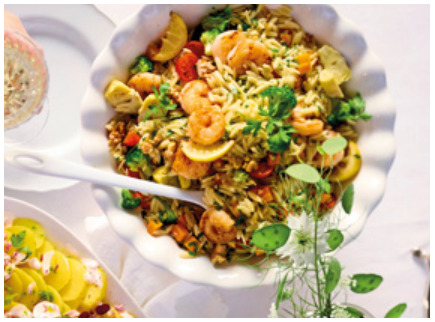

**Ingrediënten voor:** 8 personen
**Bereidingstijd:** ca. 50 min.
**500 g** orzo (korte pasta)
zout en peper
**500 g** broccoli
**3** wortels
**50 g** walnoten
**150 g** cherrytomaten
**390 g** artisjokharten (blik)
**6 takjes** peterselie
**1** bio-citroen
**500 g** kant-en-klare, gepelde
garnalen
**2-3 el** olie
paprikapoeder
**7 el** witte balsamicoazijn
**4 el** walnotenolie
1 Kook de orzo volgens de aanwijzingen op de
verpakking gaar in water met wat zout. Was de
broccoli en snijd hem in heel kleine roosjes van
de stronk. Schrap de wortels, was ze en snijd in
kleine blokjes. Kook de broccoli en de wortel in
ca. 5 minuten gaar in water met wat zout. Giet de
orzo en de groenten af.
2 Rooster de walnoten goudbruin in een droge
koekenpan. Neem uit de pan en hak grof. Was de
tomaten en snijd ze naar grootte in tweeën of in
vieren. Giet de artisjokharten af en snijd in kwarten. Was de peterselie en snijd in reepjes. Was
de citroen en snijd in partjes. Dep de garnalen
droog. Verhit de olie in een koekenpan en bak de
garnalen in porties al roerend in ca. 3 minuten
gaar erin. Bak de citroen ca. 1 minuut mee. Breng
de garnalen op smaak met zout, peper en paprikapoeder.
3 Roer de azijn, zout en peper door elkaar. Klop de
walnootolie erdoorheen. Meng de ingrediënten
voor de salade met de garnalen en de vinaigrette.
Laat de smaken ca. 15 minuten in elkaar trekken.
Breng de salade op smaak met zout en peper en
serveer.
**Per portie:** ca. 380 kcal
**23 g** eiwit | 14 g vet | 38 g koolhydraten

## Kokos-kersentiramisu

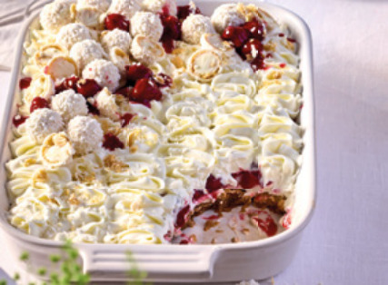

**Ingrediënten voor:** 8 personen
**Bereidingstijd:** ca. 25 min. + ca. 1 uur
en 30 min. wachttijd
**700 g** kersen (pot)
**15 g** custardpoeder
**50 ml** kirschlikeur (bij de slijter)
**125 g** lange vingers
**100 ml** sterke koffie
**250 g** mascarpone
**500 g** kwark
**75 g** suiker
**8 g** vanillesuiker
**150 ml** slagroom
200 g kokoschocolaatjes (bijv.
Raffaello)
evt. nougatine, om te
serveren
spuitzak met plat
spuitmondje
Buffet
1 Giet de kersen af en vang het sap daarbij op.
Roer 5 el sap en het custardpoeder glad. Breng de
rest van het sap met de likeur aan de kook. Voeg
het custardmengsel al roerend toe en laat ca.
1 minuut zachtjes koken. Roer de kersen erdoorheen. Laat de compote afkoelen.
2 Beleg de bodem van een grote schaal (ca. 25 x
30 cm) met lange vingers. Besprenkel de koekjes
gelijkmatig met de koffie en laat intrekken.
3 Roer de mascarpone, de kwark, de suiker en de
vanillesuiker door elkaar. Klop de slagroom stijf
en spatel door het mascarponemengsel. Verdeel
⅓ van de room over de lange vingers. Houd 2-3 el
van de compote apart en verdeel de rest over de
room. Doe de rest van de room in een spuitzak
met plat spuitmondje. Spuit de room in golfjes op
de compote. Zet de schaal ca. 1 uur in de koelkast.
Versier de tiramisu voor het serveren met de
kokoschocolaatjes, eventueel gehalveerd, de rest
van de compote en eventueel nougatine.
**Per portie:** ca. 460 kcal
**13 g** eiwit | 24 g vet | 45 g koolhydraten

## Camembertdip met abrikoos

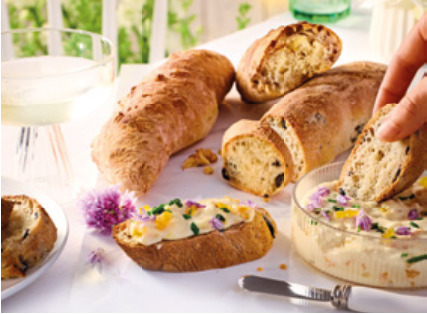

**Ingrediënten voor:** 8 personen
**Bereidingstijd:** ca. 10 min.
Pureer 300 g camembert, 200 g crème fraîche en
**1 el** dijonmosterd fijn. Hak 50 g gedroogde abrikozen fijn. Was 1 bosje bieslook en hak fijn. Roer
samen met de abrikoos door de camembertdip.
Breng op smaak met zout en peper. Bestrooi de dip
eventueel met bieslookbloemetjes en serveer.

## Krokante baguettes

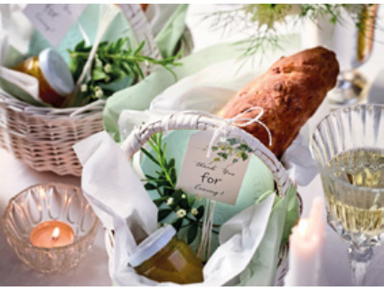

**Ingrediënten voor:** 9 stuks
**Bereidingstijd:** ca. 1 uur en 15 min.
+ ca. 12 uur wachttijd
**21 g** verse gist (of 8 g droge gist)
**1 kg** tarwebloem (type 550)
zout
**50 g** zwarte olijven
**1 el** gedroogde Provençaalse
kruiden
**30 g** walnoten
**20 g** gebakken uitjes
vershoudfolie
bakpapier
1 EEN DAG VAN TEVOREN Doe 600 ml koud water
in een grote kom. Verbrokkel de gist erboven en
laat oplossen. Voeg de bloem toe en kneed glad
met de deeghaken van een handmixer. Voeg 2 tl
zout toe en kneed nog ca. 5 minuten. Dek af, zet in
de koelkast en laat een nacht rijzen.
2 DE VOLGENDE DAG Verdeel het deeg voorzichtig in drieën. Houd één deel apart. Hak de olijven
fijn. Kneed de olijven samen met de Provençaalse
kruiden door een van de delen deeg. Hak de
walnoten fijn. Kneed de walnoten samen met de
gebakken uitjes door een ander deel deeg. Maak
van elk stuk deeg drie kleine, smalle baguettes.
Dek af en laat nog ca. 45 minuten rijzen.
3 Verwarm de oven voor (elektrisch: 200°C / hetelucht: 180°C). Verdeel de baguettes over twee met
bakpapier beklede bakplaten. Bak in ca. 30 minuten gaar in de oven. Lekker met de camembertdip
(zie p. 37).
**Per stuk:** ca. 430 kcal
**12 g** eiwit | 6 g vet | 80 g koolhydraten
Lekker eten valt of staat met de ingrediënten die je
gebruikt en het keukengerei dat je tot je beschikking hebt.
Daarom presenteren wij elke maand leuke, verrassende,
handige en/of smakelijke producten.

# ZOMERS

# WATER

De zon schijnt, dus lekker buiten eten! Een kan water op
tafel is dan altijd een goed idee. Wat dacht je bijvoorbeeld
van dit zonnige exemplaar? Tip: doe wat schijfjes citroen,
sinaasappel en takjes munt in het water, of blauwe bessen en
basilicum, voor een lekker smaakje.
Prijs: €24,99.
Verkrijgbaar via intratuin.nl.
Prijs: €4,44. Verkrijgbaar via sostrenegrene.com.

# VROLIJKE

# Fruitschaaltjes

# SERVETTEN

Gaat de barbecue aan vanavond? Een
vrolijk gedekte tafel maakt zo’n etentje
helemaal af. Deze stoffen servetten
zijn niet alleen heel vrolijk, maar ook
hartstikke handig om vieze vingers weer
schoon te poetsen.
Prijs: €3,50 per stuk.
Verkrijgbaar via dille-kamille.nl

# Fruitschaaltjes

Organiseer je een picknick, een barbecue of
een tuinfeestje? Koop een watermeloen, snijd
hem in parten en zet op tafel. Lekker voor
erbij, of als fris toetje, gegarandeerd succes.
Nóg leuker is het om ze te serveren in dit
schaaltje met bijpassende print.
Prijs: €4,44. Verkrijgbaar via sostrenegrene.com.

# Proteïne

# power

Uitgekeken op dat bammetje met kaas?
Probeer deze eiwitrijke ontbijtjes dan
eens – echt een goede start van je dag!

## Shakshuka met pompoen

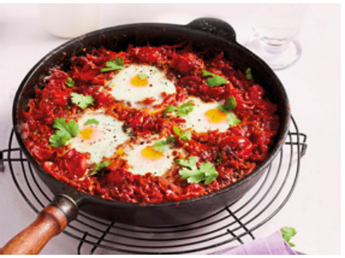

**Ingrediënten voor:** 4 personen
**Bereidingstijd:** ca. 40 min.
**500 g** hokkaidopompoen
**1** rode ui
**1** teentje knoflook
**1** rode chilipeper
**2 el** olijfolie
**200 g** rundergehakt
**½ tl** gemalen komijn
zout en peper
**1 snufje** suiker
**400 g** cherrytomaten (blik)
**4** eieren
**3 takjes** koriander
1 Verwijder de pitten van de pompoen, was de
pompoen, snijd hem in brede parten en rasp hem
grof. Pel en snipper de ui en de knoflook fijn.
Halveer de chilipeper, verwijder de zaadlijsten, was
depeperenhakhemfijn.
2 Verhit de olie in een grote, ovenbestendige koekenpan en bak het gehakt rul erin. Voeg de ui, de
pompoen, de knoflook en de chilipeper toe en bak
mee. Breng goed op smaak met de komijn, zout,
peper en de suiker. Voeg de tomaten en 100 ml
water toe, breng aan de kook en laat ca. 5 minuten
zachtjeskoken.
De gezonde keuken
3 Verwarm de oven voor (elektrisch: 200°C /
hetelucht: 180°C). Maak met een lepel vier kleine
kuiltjes in het mengsel. Breek de eieren één voor
één in een kopje en laat in de kuiltjes glijden. Zet
de pan in de oven en laat de eieren in 8-10 minuten stollen. Was de koriander, neem de blaadjes
van de takjes en strooi over de shakshuka.
**Per portie:** ca. 310 kcal
**20 g** eiwit | 15 g vet | 24 g koolhydraten

## Granola met gojibessen

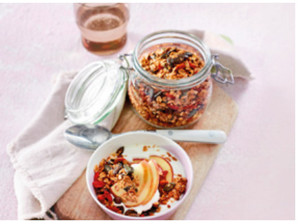

**Ingrediënten voor:** 600 g
**Bereidingstijd:** ca. 30 min. + wachttijd
Verwarm de oven voor (elektrisch: 160°C / hetelucht: 140°C). Meng in een
kom 150 g havervlokken, 150 g speltvlokken (bij de supermarkt), 50 g
sesamzaad en 150 g pompoenpitten met elkaar. Schenk 100 ml ahornsiroop
erbij en roer door elkaar. Verdeel het mengsel over een met bakpapier
beklede bakplaat en bak ca. 20 minuten in de oven. Schep daarbij regelmatig
om. Neem uit de oven en laat afkoelen. Roer 100 g gedroogde gojibessen (bij
de grotere (ecologische) supermarkt of reformwinkel) erdoorheen.

## Ontbijtwrap met fruit

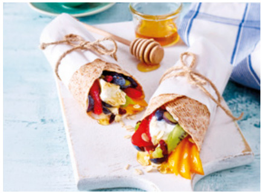

**Ingrediënten voor:** 6 stuks
**Bereidingstijd:** ca. 20 min.
Schil 2 kiwi’s en snijd ze in partjes. Schil 1 mango, snijd het vruchtvlees van de pit en snijd het in plakjes. Was 100 g aardbeien en snijd in
plakjes. Was 125 g blauwe bessen. Splijt 1 vanillestokje in de lengte en
schraap het merg eruit. Roer het vanillemerg, 250 g skyr (IJslandse yoghurt) en 2 el honing door elkaar. Bestrijk 6 tarwetortilla’s met de skyr
en verdeel het fruit erover. Bestrooi met 40 g gedroogde cranberry’s en
50 g havervlokken. Rol de wraps op en besprenkel met 1 el honing.
De gezonde keuken

## Zaden-notenbrood

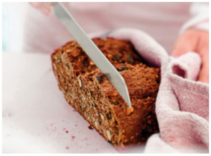

**Ingrediënten voor:** 1 brood (12-16 sneetjes)
**Bereidingstijd:** ca. 1 uur en 15 min.
**225 g** hazelnoten
**5** eieren
**250 g** volle kwark
**275 g** hazelnootmeel (bijv. van het merk Smaakt)
**30 g** zonnebloempitten
**75 g** gebroken lijnzaad
**½** el
psylliumvezels (bij de ecologische supermarkt of de
reformwinkel)
**1 tl** baksoda
**1 tl** zout
bakpapier
1 Hak de hazelnoten grof. Roer de eieren, de kwark en 60 ml lauwwarm
water in een grote kom door elkaar. Voeg de gehakte hazelnoten, het hazelnootmeel, de zonnebloempitten, het lijnzaad, de psylliumvezels, de baksoda
en het zout toe. Klop met een handmixer ca. 2 minuten door elkaar.
2 Verwarm de oven voor (elektrisch: 180°C / hetelucht: 160°C). Leg het deeg
met vochtige handen op een met bakpapier beklede bakplaat en vorm er een
brood van. Snijd in de lengte een beetje in. Bak in 50-60 minuten gaar in de
oven. Laat afkoelen. Lekker met kalkoenfilet, gerookte zalm of kaas.
Per sneetje: ca. 290 kcal
**11 g** eiwit | 25 g vet | 4 g koolhydraten

# 4x

# lekker

# Avocadeautje

Avocado’s zitten vol met onverzadigde vetten en zijn
dus goed voor je hart en je bloedvaten. Des te meer
reden om deze recepten eens te maken dus!

## Gehaktballetjes met avocadovulling

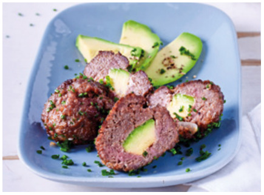

**Ingrediënten voor:** 4 personen
**Bereidingstijd:** ca. 35 min.
**1** ui
**1** teentje knoflook
**500 g** half-om-halfgehakt
**1 el** mosterd
**1** ei
**½ tl** paprikapoeder
**½ tl** kerrie
**2 el** paneermeel
zout en peper
**2** avocado’s
**4 el** olie
**1 bosje** bieslook
**1 el** honing
1 Pel en snipper de ui en de knoflook. Kneed het gehakt, de ui, de knoflook, de
mosterd, het ei, het paprikapoeder, de kerrie, het paneermeel, zout en peper
goeddoorelkaar.
2 Halveer de avocado’s, verwijder de pit en schep het vruchtvlees uit de schil.
Snijd 1 avocado in blokjes van ca. 1 x 1 cm. Maak 8 balletjes van het gehaktmengsel en druk in elk balletje een avocadoblokje. Verhit de olie in een koekenpan en bak de gehaktballetjes in ca. 10 minuten rondom gaar erin.
3 Was de bieslook en hak fijn. Voeg aan het einde van de baktijd van de balletjes de honing toe aan de pan. Bak de balletjes nog ca. 1 minuut in de honing.
4 Snijd de overige avocado in partjes. Doe de bieslook bij de balletjes en
schep om. Leg op elk bord 2 balletjes en garneer met de avocado en bieslook.
**Per portie:** ca. 730 kcal
**30 g** eiwit | 63 g vet | 9 g koolhydraten

## Avocado-garnalensalade

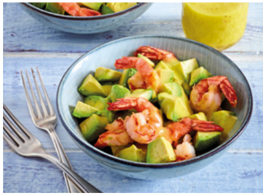

**Ingrediënten voor:** 4 personen
**Bereidingstijd:** ca. 25 min.
**4** avocado’s
**2** citroenen (alleen het sap)
**9 el** olijfolie
**400 g** kant-en-klare, gepelde garnalen
zout en peper
**1** teentje knoflook
**1 tl** honing
1 Halveer de avocado’s, verwijder de pit en neem het vruchtvlees uit de schil.
Snijd de avocado in grove blokjes en besprenkel met 1-2 el citroensap.
2 Verhit 1 el olie in een koekenpan en bak de garnalen in ca. 3 minuten gaar
erin. Draai daarbij regelmatig om. Breng op smaak met zout en peper en
neem de pan van het vuur.
3 Pel en snipper de knoflook. Pureer de rest van het citroensap, de knoflook,
de honing, zout en peper fijn en voeg daarbij de olie in een dun straaltje toe.
Meng de avocado, de garnalen en de dressing met elkaar. Breng de salade
nogmaals op smaak en serveer. Lekker met stokbrood.
**Per portie:** ca. 620 kcal
**22 g** eiwit | 52 g vet | 12 g koolhydraten

## Quesadilla’s met avocado en feta

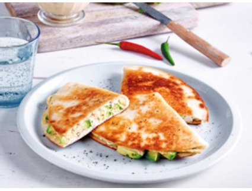

**Ingrediënten voor:** 12 stuks
**Bereidingstijd:** ca. 1 uur
**400 g** kikkererwten
(blik)
**1** teentje knoflook
**1** rode chilipeper
150 g tahin (sesampasta,
bij de toko of grotere
supermarkt)
**½ tl** gemalen komijn
**1** citroen
(alleen het sap)
**9 el** olijfolie
zout en peper
**3** avocado’s
**4 takjes** koriander
**300 g** feta
**6** tarwetortilla’s
1 Laat de kikkererwten uitlekken. Pel en snipper de knoflook. Snijd de chilipeper in de lengte in, verwijder de zaadlijsten, was de peper en hak hem fijn.
Pureer de kikkererwten, de knoflook, de chilipeper, de tahin, de komijn en het
citroensap fijn. Klop 5 el olie erdoorheen. Breng de hummus op smaak met
zoutenpeper.
2 Halveer de avocado’s, verwijder de pit, neem het vruchtvlees uit de schil
en snijd het in partjes. Was de koriander en neem de blaadjes van de takjes.
Verbrokkel de feta fijn. Bestrijk elke tortilla met 1 el hummus en bestrooi met
de koriander. Beleg 3 tortilla’s met de avocado en de feta. Leg de overige tortilla’s erop en druk een beetje aan. Verhit 4 el olie in porties in een koekenpan
en bak de quesadilla’s één voor één in ca. 2 minuten per zijde goudbruin erin.
Neem uit de pan, snijd in kwarten en serveer. Geef de rest van de hummus erbij.
**Per stuk:** ca. 440 kcal
**12 g** eiwit | 35 g vet | 15 g koolhydraten
4x lekker

## Avocadofrietjes

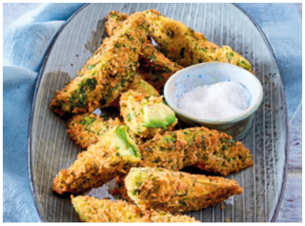

**Ingrediënten voor:** 4 personen
**Bereidingstijd:** ca. 30 min.
**2** avocado’s
**2 el** citroensap
**4 takjes** peterselie
**2** eieren
zout en peper
**½ tl** cayennepeper
50 g panko (Japans paneermeel,
bij de grotere supermarkt of toko)
**2-3 el** bloem
**500 ml** olie, om te frituren
1 Halveer de avocado’s, verwijder de pitten, neem het vruchtvlees uit de schil en
snijd het in partjes van ca. 1 cm breed. Besprenkel de avocado met het citroensap.
2 Was de peterselie en hak hem fijn. Kluts de eieren met zout, peper en de cayennepeper. Meng de panko met de peterselie. Wentel de avocadopartjes achtereenvolgens door de bloem, het ei en het pankomengsel. Druk een beetje aan.
3 Verhit in een diepe koekenpan de olie tot 170°C. Frituur de avocado in porties
in ca. 3 minuten goudbruin erin. Neem uit de pan en laat uitlekken op keukenpapier. Bestrooi eventueel met zeezout en serveer.
**Per portie:** ca. 340 kcal
**9 g** eiwit | 25 g vet | 18 g koolhydraten
Receptuur: Jacqueline Sluijter Fotografie: Sander Damen
Als de Italianen ergens kaas van hebben
gegeten, dan is dat wel van kaas. Van
romige mascarpone tot pittige gorgonzola,
deze recepten wil iedere kaasfanaat
maken.

# Gek op kaas

## Tiramisurol

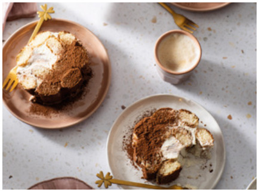

**Ingrediënten voor:** 4 personen
**Bereidingstijd:** ca. 15 minuten
+ minimaal 2 uur wachttijd
**250 g** mascarpone
**250 ml** slagroom
**3 el** suiker
**1 tl** vanille-extract
**30 ml** espresso, afgekoeld
**30** grote lange vingers
cacaopoeder
vershoudfolie
1 Leg een groot stuk vershoudfolie op het werkblad
klaar om straks de tiramisu mee op te rollen. Klop
de mascarpone samen met de slagroom, de suiker
en het vanille-extract tot een stevige en luchtige
room. Houd apart.
2 Haal één voor één de platte kant van de lange
vingers kort door de espresso en leg ze horizontaal op het vershoudfolie. Maak de bodem van
de tiramisurol 3 lange vingers breed en 10 lange
vingers lang.
3 Bestrijk de lange vingers met het mascarponemengsel, en bestuif met cacaopoeder. Rol het
geheel met behulp van het vershoudfolie op, draai
de uiteinden goed vast en leg de rol minimaal
2 uur in de koelkast op te stijven.
4 Snijd de tiramisurol in mooie plakken en bestuif met extra cacaopoeder.
**Per portie:** ca. 818 kcal
**9 g** eiwit | 53 g vet | 74 g koolhydraten
MASCARPONE & GORGONZOLA
Mascarpone is een Italiaanse
roomkaas die voor het eerst gemaakt
werd in de regio Lombardije. De kaas
wordt gemaakt van room en door
de toevoeging van wijnsteenzuur
wordt het een dikke, romige en goed
smeerbare kaas. Gorgonzola wordt
gemaakt van volle koemelk, in de
buurt van Milaan. De schimmel,
Penicillium Glaucum, zorgt voor
de typerende smaak. De kaas rijpt
ongeveer een half jaar.

## Gnocchi

## met gorgonzolasaus

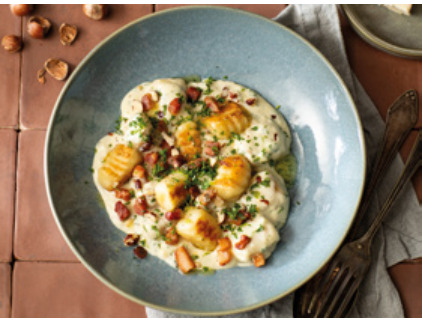

**Ingrediënten voor:** 2 personen
**Bereidingstijd:** ca. 1 uur en 20 minuten
**VOOR DE** GNOCCHI
**500 g** grote iets
kruimige aardappels
**125 g** bloem (+ bestuiven)
**1 tl** zout (+ bestuiven)
pureeknijper
bakpapier
**VOOR DE** SAUS
**200 g** pancetta, in blokjes
**1 el** olijfolie
**1** sjalot, fijngesnipperd
**1** teentje knoflook, geperst
**50 ml** witte wijn
**150 ml** volle kookroom
**125 g** gorgonzola
zout en peper
4 takjes krulpeterselie,
fijngehakt + evt. extra
**25 g** boter
50 g geroosterde hazelnoten,
grof gehakt
1 VOOR DE GNOCCHI Kook de aardappels in de
schil in ca. 20 minuten gaar. Giet af doe ze terug in
de pan. Leg het deksel erop en laat ze ca. 5 minuten uitstomen. Verwijder met een mesje de schil,
pureer de aardappels met de pureeknijper en laat
de puree afkoelen.
2 Doe de puree in een mengkom, voeg de bloem
en het zout toe en kneed met je handen tot een
deeg. Maak op een met bloem bestoven werkblad
zes bolletjes van het deeg en rol uit tot slierten van
1 cm dik. Snijd in stukjes (kussentjes) van 2 cm
lang.
3 Pak een stukje en druk dit met je duim zachtjes
over de bolling van een vork van boven naar beneden. Je hebt hier ook een speciaal instrument voor,
maar met een vork kan ook prima. Leg alle gnocchi
op een stukje bakpapier.
4 VOORDESAUS Bak de pancetta krokant in
een koekenpan en houd apart op een stukje keuken-papier. Verhit 1 el olijfolie in het hete bakvet
en fruit hierin de sjalot en knoflook ca. 2 minuten
aan. Blus af met de wijn en laat volledig inkoken.
koken & genieten Italiaanse kazen
Voeg de room en de gorgonzola toe en verwarm op
een laag vuur tot een egale saus. Breng op smaak
met zout, peper en de peterselie. Houd de saus op
laag vuur warm.
5 Kook de gnocchi in ruim kokend water met
zout in 3-4 minuten gaar; ze zijn gaar als ze boven
komen drijven. Verhit de boter in een koekenpan
en bak de gnocchi goudbruin erin.
6 Verdeel de saus over borden en leg de gnocchi
erop. Garneer met de gebakken pancetta, de hazelnoten en eventueel wat peterselie.
**Per portie:** ca. 1250 kcal
**40 g** eiwit | 97 g vet | 101 g koolhydraten
DOP-KEURMERK
De Italiaanse kaas
Parmigiano Reggiano
heeft een DOPkeurmerk. DOP is
de benaming voor
een traditioneel Italiaans product
(Denominazione di Origine Protetta).
Het keurmerk is geregistreerd bij de
Europese Unie en heeft een vastgelegd
herkomstgebied. De kaas mag alleen
daar geproduceerd worden met een
traditioneel recept. Bovendien moeten
de grondstoffen in het product óók uit
die regio’s komen.
**20** 21 22 23
**27** 28 29
**33** 34 35 36
**40** 41 42 43 44
**52** 53
**57** 58 59 60
**83** 84 85 86
**64** 65 66 67
**71** 72 73 74 75
**89** 90
ktempel 9 trap met de voet 13 uitroep van tevredenheid 18 maatschappelijk
n 24 laagtij 26 Keltisch dichter-zanger 27 zin in eten 28 vergrootglas 29 Guam
ent (afk.) 32 plaats in Oekraïne 34 bijzonder aantrekkelijk 35 plaats in Enge-
37 Nederlander 39 teken van de dierenriem 41 aangehecht takje 42 betaald
hut 46 uitgestorven rund 48 zwarte lijster 50 plaats in Zeeland 51 van bepaald
es 53 boomvrucht 54 grondsoort 55 historisch jachtwapen 57 angst 59 onderbergte 63 Luxemburgse omroep (afk.) 64 bladzijde (afk.) 66 wintersportartikel
rootmoeder 71 wezenlijk 73 rivier in Duitsland 75 open strook in een bos
e van olielanden 78 bijwoord 79 karakter 81 sint (afk.) 82 klokjesbloem 84 ach-
**47** 48 49 50
**78** 79 80 81

## Horizontaal

1 Schotse familiestam 5 muziektempel 9 trap met de voet 13 uitroep van
tevredenheid 18 maatschappelijk aanzien 20 genoeg! 22 zeer klein 24 laagtij
26 Keltisch dichter-zanger 27 zin in eten 28 vergrootglas 29 Guam (in
internetadressen) 30 regiment (afk.) 32 plaats in Oekraïne 34 bijzonder
aantrekkelijk 35 plaats in Engeland 36 ten opzichte van (afk.) 37 Nederlander
39 teken van de dierenriem 41 aangehecht takje 42 betaald (afk.) 43 hemelruim
45 sneeuwhut 46 uitgestorven rund 48 zwarte lijster 50 plaats in Zeeland 51 van
bepaald materiaal 52 box voor suggesties 53 boomvrucht 54 grondsoort
55 historisch jachtwapen 57 angst 59 onderhuidse vetlaag 61 Russisch gebergte
63 Luxemburgse omroep (afk.) 64 bladzijde (afk.) 66 wintersportartikel 67 flink
en sterk 68 bejaard 69 grootmoeder 71 wezenlijk 73 rivier in Duitsland 75 open
strook in een bos 76 per week (afk.) 77 organisatie van olielanden 78 bijwoord
79 karakter 81 sint (afk.) 82 klokjesbloem 84 achteruit 85 inwisseling 87 partij in
rechtszaak 88 deel van een viool 89 belofte 90 niet vet.
rechtszaak 88 deel van een viool 89 belofte 90 niet vet.
ainbike (afk.) 4 zonder kleren 5 senior 6 dominee (afk.) 7 kelner 8 land 9 op-
1 onder meer (afk.) 12 bestuurster van een vliegtuig 13 patiënt 14 olm

## Verticaal

2 lectori salutem (afk.) 3 allterrainbike (afk.) 4 zonder kleren 5 senior 6 dominee
(afk.) 7 kelner 8 land 9 opvallende daad 10 alle acteurs 11 onder meer (afk.)
12 bestuurster van een vliegtuig 13 patiënt 14 olm 15 emeritus (afk.) 16 verzameld
werk 17 Italiaanse componist 19 vlekkenwater 21 soort bereide dierenhuid
werk 17 Italiaanse componist 19 vlekkenwater 21 soort bereide dierenhuid
makkelijk lerend 31 met uitgebreide kennis toegerust 33 afwisselende thealand 36 serviesgoed 38 opera van Bellini 40 voorbeeld 42 geldbuidel 44 sa-
23 gevangenis 25 poema 29 gemakkelijk lerend 31 met uitgebreide kennis
rden 46 honderd gram 47 Sociaal-Economische Raad 48 met behulp van
ekfiguurtje 56 rechtsgeding 58 door water omringd gebied 60 vulkaanmond
toegerust 33 afwisselende theatervoorstelling 35 plaats in Zeeland 36 serviesgoed
prikkelgeleider in het lichaam 67 entstof 70 schil 71 kerkelijke rechtbank
e 80 projectieplaatje 82 verbrandingsrest 83 binnen 85 ingenieur (afk.) 86 lan-
38 opera van Bellini 40 voorbeeld 42 geldbuidel 44 samenhangend geheel
Kruiswoord
enummerde vakjes over naar de gelijkgenummerde vakjes van de oplossingsbalk.
van woorden 46 honderd gram 47 Sociaal-Economische Raad 48 met behulp
© DENKSPORT PUZZELBLADEN
**29** 34 83 54 72 53 4
van (afk.) 49 schoolopgave 54 muziekfiguurtje 56 rechtsgeding 58 door water
omringd gebied 60 vulkaanmond 62 schaakstuk 64 knaagdier 65 prikkelgeleider
in het lichaam 67 entstof 70 schil 71 kerkelijke rechtbank 72 woordmerk 74 café
77 in orde 80 projectieplaatje 82 verbrandingsrest 83 binnen 85 ingenieur (afk.)
86 lange golf.
ge golf.
© DENKSPORT PUZZELBLADEN
L A N O D E O N S C H O P Z I E Z O
S T A T U S B A S T A M I N I E M E
B A R D E E T L U S T L O E P G U
G K I E V R I A N T Y O R K T O V
E N T R A M E N T B E T E T H E R
L O O E R O S G M E R E L E E D E
E R E N I D E E E N B U S E I K E L
E M S P E E R N V R E E S S P E K
R A L R T L B L Z S K I S T O E R
VUL DE PUZZEL IN EN MAAK KANS
D O P O E R E E E L E L B E T R A
O P E C B O V E N O P A A R D S T
OP 1 VAN DE 3 EXEMPLAREN VAN
A K E L E I T E R U G I N R U I L E
S E R S N A A R W O O R D M A G E R grillen

## Wok express t.w.v. 24,00 euro

**29** 34 83 54 72 53 4
**6** 7 8 9 10 11 12 13 14 15 16
De ideale maaltijd voor een drukke doordeweekse avond? Dat is toch
echt wel een wokje! Met dit boek haal je 100 ideeën voor wokmaaltijden in huis. Van vlees tot vis en vegetarisch. Niet alleen krijg je een
goed beeld van welke gerechten je in een wok met elkaar kunt combineren, je leert ook hoe lang je iets moet wokken. Zo heb je nooit
meer overgaar vlees of te slappe groenten! Op p. 26 geven we je een
voorproe e van dit kookboek. Ga bijvoorbeeld alvast aan de slag met
het recept voor Zoetzure kip, terwijl je ondertussen aan het duimendraaien bent dat je deze puzzelprijs in de wacht sleept!
1 2 3 4 5 6 7 8 9 10 11 12 13 14 15 16
**17** 18 19 20 21 22 23
Titel: Wok express
**24** 25 26 27 28 29
**30** 31 32 33 34 35 36
Auteur: Ching-He Huang
**37** 38 39 40 41 42 43 44
**45** 46 47 48 49 50
Uitgeverij: Becht / Harper
**51** 52 53
**54** 55 56 57 58 59 60
Collins Nederland
**61** 62 63 64 65 66 67
**68** 69 70 71 72 73 74 75
Prijs: 24,00 euro
**76** 77 78 79 80 81
**82** 83 84 85 86
Het antwoord kun je vóór 22 juli 2025
**87** 88 89 90
sturen naar: koken & genieten, o.v.v. oplossing puzzel
Postbus 296, 6500 AG Nijmegen
Of op onze website: kokengenieten.nl/puzzel

# Jouw favoriete recepten

# altijd bij de hand!

# Speciaal

# voor

# abonnees

## Vanaf nu in de nieuwe Koken & Genieten app, gratis voor abonnees.

## In de app kan je:

• Het magazine lezen op je telefoon of tablet
Scan de
• Gemakkelijk recepten uit het magazine opslaan en terugvinden
QR-code
• Eerdere edities van Koken & Genieten digitaal lezen
Meer informatie via:

## www.kokengenieten.nl/digitaallezen

# Korrels

# met karakter

Een potje zwarte peper heb je
waarschijnlijk wel in huis, maar
wat dacht je van groene, witte of
misschien kampotpeper? Maak
deze gerechten met pit eens!

## Runderburgers

## met peper en cognacsaus

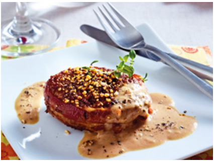

**Ingrediënten voor:** 4 personen
**Bereidingstijd:** ca. 25 min.
**2 sneetjes** wit
casinobrood
**1** ui
**500 g** rundergehakt
**1** ei
zout
**2 tl** mosterd
**8 plakjes** gerookt
ontbijtspek
**2-3 el** olie
**1 el** tellicherrypeperkorrels (bij de
kruidenwinkel of de grotere
supermarkt)
**1 el** witte peperkorrels
**2 el** boter
**4 el** cognac
**100 ml** slagroom
**300 ml** groentebouillon
**1 tl** maizena
**1 el** water
suiker
1 VOOR DE BURGERS Laat het brood in water
weken. Pel en snipper de ui. Knijp het brood uit.
Kneed het gehakt, het brood, de ui, het ei, zout
en de mosterd door elkaar. Maak 8 burgers van
het mengsel, druk een beetje plat en omwikkel de
rand met het spek.
2 Verhit de olie in een grote koekenpan en bak de
burgers in 3-4 minuten per zijde gaar erin. Stamp
intussen in een vijzel de tellicherrypeper en de
witte peper grof. Neem de burgers uit de pan en
houd warm.
3 VOOR DE SAUS Verhit de boter in het hete
bakvet. Blus af met de cognac, de slagroom en
de bouillon, breng aan de kook en laat ca. 4 minuten zachtjes koken. Roer de maizena en het
water door elkaar en roer het mengsel door de
saus. Laat ca. 1 minuten zachtjes koken om in te
dikken. Breng op smaak met zout en een snu e
suiker.
4 Bestrooi de steaks met de peper en serveer met
de saus. Lekker met gebakken aardappeltjes en
broccoli met boter.
**Per portie:** ca. 620 kcal
**36 g** eiwit | 45 g vet | 10 g koolhydraten
Favoriet van de maand

## Linzenpannetje

## met groene peper

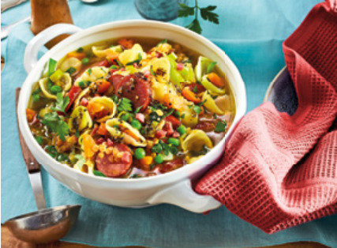

**Ingrediënten voor:** 6 personen
**Bereidingstijd:** ca. 1 uur
**1** ui
**¼** knolselderij
**2** wortels
**1** prei
**300 g** cabanossi (droge worst, bij de
supermarkt)
**2 el** olie
**125 g** hamblokjes
**150 g** rode linzen
**1,5 l** groentebouillon
zout en grove zwarte peper
**1-2 tl** groene peperkorrels
**100 g** erwten (diepvries)
**150 g** gnocchi
**1** bio-limoen
**1½ el** vloeibare honing
**8 takjes** peterselie
1 Pel en snipper de ui. Schil de knolselderij en snijd in blokjes. Schrap de wortels en snijd in blokjes. Was
de prei en snijd in ringen.
2 Snijd de cabanossi in plakjes. Verhit de olie in een pan en bak de hamblokjes knapperig erin. Voeg de
ui, de knolselderij, de wortel en de prei toe en bak kort mee. Voeg de linzen en de cabanossi toe en blus
af met de bouillon. Breng op smaak met zout, zwarte peper en de groene peperkorrels en breng aan de
kook. Leg het deksel op de pan en laat ca. 15 minuten zachtjes koken. Voeg de erwten toe en kook nog
ca. 5 minuten mee. Kook de pasta volgens de aanwijzingen op de verpakking gaar in water met wat zout.
3 VOOR DE PEPERPASTA Was de limoen en rasp de schil er fijn af. Pers de limoen uit. Roer de honing, 2 tl
peper, de limoenschil en het -sap goed door elkaar.
4 Was de peterselie en hak hem grof. Giet de pasta af. Breng de linzen goed op smaak met zout en peper.
Voeg de pasta en de peterselie toe aan de linzen. Serveer en besprenkel met de peperpasta.
**Per portie:** ca. 610 kcal
**25 g** eiwit | 36 g vet | 41 g koolhydraten

## Duits runderstoofpotje met peper

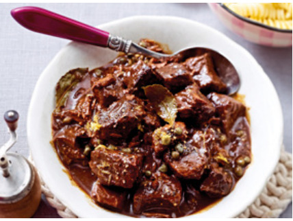

**Ingrediënten voor:** 4 personen
**Bereidingstijd:** ca. 2 uur
**500 g** ui
**800 g** runderstoofvlees, in
blokjes
**2 el** reuzel (bij de slager)
zout en grove zwarte
peper
**1 tl** tomatenpuree
**850 ml** heldere bouillon
**150 ml** droge rode wijn
**2** laurierblaadjes
**3** kruidnagels
400 g korte pasta (bijv.
fusilli)
**2-3 tl** kappertjes
**½** bio-citroen (rasp en
**2 tl** sap)
1 Pel de uien en snijd ze in dunne reepjes. Dep het vlees droog. Verhit de
reuzel in een grote braadpan op hoog vuur en bak het vlees in porties rondom goudbruin erin.
2 Doe al het vlees weer in de pan en bestrooi met flink wat zout en peper.
Voeg de ui toe en bak kort mee. Roer de tomatenpuree erdoorheen en bak
kort mee. Blus af met de bouillon en de wijn. Voeg de laurierblaadjes en de
kruidnagels toe. Breng aan de kook en laat met het deksel op de pan ca. 1 uur
en 30 minuten stoven.
3 Kook de pasta volgens de aanwijzingen op de verpakking gaar in water met
wat zout. Voeg de kappertjes toe aan het vlees. Breng op smaak met zout,
peper, de citroenschil en het -sap. Serveer met de pasta.
**Per portie:** ca. 770 kcal
**52 g** eiwit | 34 g vet | 58 g koolhydraten
Favoriet van de maand

## Roerei met kampotpeper

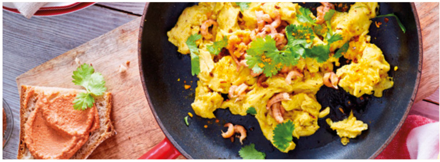

**Ingrediënten voor:** 4 personen
**Bereidingstijd:** ca. 30 min.
**12** eieren
**4 tl** kerrie
zout
**200 ml** slagroom
**2 tl** gefermenteerde kampotpeperkorrels
(potje, online verkrijgbaar)
**2 el** olie
**2 el** boter
**3-4 takjes** koriander
**200 g** Hollandse garnalen
1 Kluts de eieren met de kerrie, 1-2 tl zout en de slagroom. Doe de peperkorrels in een vijzel en maal fijn. Verhit de olie en de boter in twee porties in
een grote koekenpan en bak het eimengsel in twee porties tot romig roerei.
2 Was de koriander en neem de blaadjes van de takjes. Bestrooi het roerei
met de kampotpeper en de koriander. Serveer met de garnalen. Lekker met
vers brood.
**Per portie:** ca. 520 kcal
**28 g** eiwit | 42 g vet | 4 g koolhydraten

# Zoet zomerfruit

De zon maakt het fruit heerlijk zoet en rijp,
zodat jij er deze heerlijke toetjes mee
kunt maken. Geniet ervan!

## Blauwebessengelei met luchtige sabayon

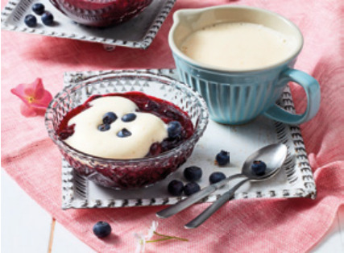

**Ingrediënten voor:** 4 personen
**Bereidingstijd:** ca. 25 min. + 2-3 uur wachttijd
**650 g** blauwe bessen
**120 g** suiker
**200 ml** appelsap
**150 ml** kersensap
**1** bio-citroen (schil in
reepjes + 3 el sap)
**30 g** maizena
**2** verse eidooiers
**8 g** vanillesuiker
**100 ml** witte wijn (bijv. droge
riesling)
1 VOOR DE GELEI Maak 600 g blauwe bessen schoon. Breng met 80 g
suiker, het appelsap, het kersensap, de citroenschil en 2 el citroensap aan
de kook. Laat ca. 1 minuut zachtjes koken. Roer de maizena met 3-4 el koud
water glad, voeg toe aan de pan en laat ca. 1 minuut zachtjes koken. Neem
de citroenschil uit de pan. Verdeel het mengsel over vier schaaltjes en laat
a oelen.
2 VOOR DE SABAYON Klop de eidooier, 40 g suiker en de vanillesuiker in
een metalen kom romig. Schenk de wijn en 1 el citroensap erbij en klop au
bain-marie tot een luchtige crème. Zet de kom in een bak ijswater en klop tot
de sabayon koud is. Maak de rest van de blauwe bessen schoon. Verdeel wat
sabayon over de schaaltjes en bestrooi met de blauwe bessen. Serveer met
de rest van de sabayon.
**Per portie:** ca. 330 kcal
**4 g** eiwit | 4 g vet | 62 g koolhydraten

## Perzikcrumble met vanille

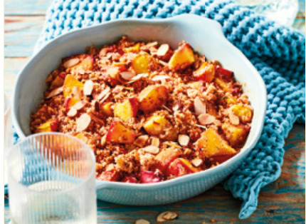

**Ingrediënten voor:** 4-6 personen
**Bereidingstijd:** ca. 45 min.
**8** rijpe perziken
**16 g** vanillesuiker
**75 g** koude boter (+ invetten)
**75 g** bloem
**75 g** amandelmeel
**5 el** lichte basterdsuiker
zout
**2-3 el** amandelschaafsel
1 VOOR DE PERZIK Was de perziken, verwijder de pit en snijd het vruchtvlees in stukken. Meng de perzik met de vanillesuiker en verdeel over een
ingevette ovenschaal.
2 VOOR HET KRUIMELDEEG Kneed de bloem, het amandelmeel, de suiker,
een snu e zout en de boter in stukken tot een grof kruimeldeeg.
3 Verwarm de oven voor (elektrisch: 200°C / hetelucht: 180°C). Verdeel het
kruimeldeeg gelijkmatig over de perzik en bak ca. 25 minuten in de oven.
4 Strooi ca. 5 minuten voor het einde van de baktijd het amandelschaafsel
over de crumble en bak mee. Lekker met vanillesaus of slagroom.
**Per portie:** ca. 360 kcal
**5 g** eiwit | 20 g vet | 37 g koolhydraten

## Supersnel cassistoetje

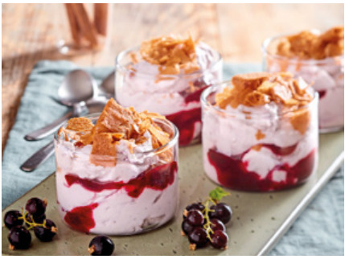

**Ingrediënten voor:** 4 personen
**Bereidingstijd:** ca. 10 min.
**150 g** zwarte bessen (bij de groentewinkel)
**50 g** poedersuiker
**200 g** mascarpone
**250 ml** slagroom
6-8 wafelrolletjes (bijv. crêpes dentelles)
1 VOOR DE CASSISPUREE Maak de bessen schoon en neem ze
van de takjes. Pureer ze fijn met 15 g poedersuiker en 2 el koud
water.
2 VOOR DE MASCARPONEROOM Roer de mascarpone en
**35 g** poedersuiker door elkaar. Klop de slagroom stijf en spatel
door de mascarpone.
3 Spatel de helft van de cassispuree door de mascarponeroom.
Doe de rest van de puree afwisselend met de mascarponeroom
in laagjes in glaasjes. Hak de wafelrolletjes grof en strooi vlak
voor het serveren over het toetje.
**Per portie:** ca. 470 kcal
**4 g** eiwit | 40 g vet | 22 g koolhydraten
Het zoete leven

## Verkoelend citroen- en mangoijs

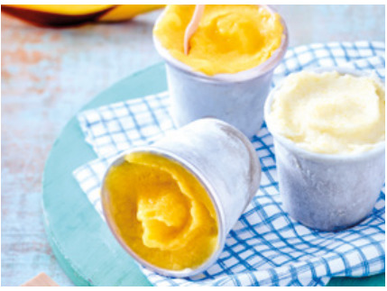

**Ingrediënten voor:** 6 personen
**Bereidingstijd:** ca. 30 min. + minimaal 6 uur wachttijd
**220 g** suiker
**4** bio-citroenen (voor ca. 230
ml sap)
**4** verse eiwitten
**2** mango’s
12 metalen timbaaltjes (à ca.
**150 ml** inhoud)
1 VOOR HET CITROENIJS Kook 100 g suiker en 300 ml water al roerend in ca. 10 minuten
tot een siroop. Was de citroenen, wrijf ze droog en rasp de schil eraf. Pers de citroenen
uit en meet 200 ml sap af. Doe het sap en de schil bij de siroop en zet in de koelkast.
2 Klop 2 eiwitten stijf met een handmixer en voeg daarbij beetje bij beetje 20 g suiker
toe. Voeg de koude citroensiroop al kloppend in een dun straaltje toe. Verdeel het
citroenmengsel over 6 metalen timbaaltjes (à ca. 150 ml inhoud) en zet minimaal 6 uur,
maar liefst een nacht, in de diepvries.
3 VOOR HET MANGOIJS Kook 80 g suiker en 150 ml water al roerend in ca. 6 minuten tot
een siroop. Schil de mango’s, snijd het vruchtvlees van de pit en snijd het in grove blokjes. Pureer de mango en roer de siroop en 2 el citroensap erdoorheen.
4 Klop 2 eiwitten stijf met een handmixer en voeg daarbij beetje bij beetje 20 g suiker
toe. Spatel de meringue door het mangomengsel. Verdeel het mengsel over 6 metalen
timbaaltjes (à ca. 150 ml inhoud) en zet minimaal 6 uur, maar liefst een nacht, in de
diepvries.
**Per portie:** ca. 210 kcal
**3 g** eiwit | 1 g vet | 44 g koolhydraten

# Fruit

# van de boom

In de zomer buigen de boomtakken bijna door van al
het rijpe zomerfruit dat eraan hangt. Laten hangen is
zonde, dus maak er dit heerlijke gebak mee!
Gebak

## Chique kersenmuffins

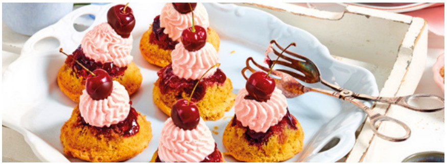

**Ingrediënten voor:** 12 stuks
**Bereidingstijd:** ca. 1 uur + ca. 1 uur en 15 min. wachttijd
**500 g** kersen (bijv. zure kersen)
**125 g** boter (+ invetten)
**12 tl** + 100 g lichte basterdsuiker
zout
**16 g** vanillesuiker
**3** eieren
**100 g** bloem
**50 g** maizena
**1 tl** bakpoeder
**50 g** pure chocolade
**200 g** mascarpone
**200 g** kwark
**2-3 el** poedersuiker
een paar druppels rode levensmiddelenkleurstof
muffinbakblik voor 12 stuks
spuitzak met stervormig spuitmondje
1 VOOR DE KERSEN Was de kersen, houd 12 stuks apart en verwijder van
de rest de steeltjes. Ontpit de kersen. Vet het muffinbakblik heel goed in en
verdeel over elke holte 1 tl lichte basterdsuiker.
2 VOOR HET BESLAG Klop de boter, 100 g suiker, een snufje zout en de vanillesuiker romig met een handmixer. Klop de eieren één voor één erdoorheen.
Meng de bloem, de maizena en het bakpoeder met elkaar en klop kort door
het beslag.
3 Verwarm de oven voor (elektrisch: 180°C / hetelucht: 160°C). Verdeel
4-5 kersen over elke holte van het muffinbakblik. Verdeel het beslag eroverheen en bak in ca. 20 minuten gaar in de oven. Neem het bakblik uit de oven
en zet het op een rooster. Snijd met een mes de randjes van de muffins voorzichtig los van het bakblik. Laat ca. 10 minuten afkoelen en snijd de muffins
nogmaals los. Leg een grote snijplank op het bakblik en draai het bakblik
met de plank om, zodat de muffins op de plank terechtkomen. Verwijder het
bakblik en laat de muffins helemaal afkoelen.
4 VOOR DE VERSIERING Breek of hak de chocolade in stukken, smelt ze en
laat ca. 5 minuten afkoelen. Doop de 12 apart gehouden kersen tot de helft in
de gesmolten chocolade. Laat de chocoladekersen op een rooster uitharden.
5 VOOR DE ROOM Roer de mascarpone, de kwark en de poedersuiker glad.
Kleur de room roze met rode levensmiddelenkleurstof. Doe de room in een
spuitzak met stervormig spuitmondje. Spuit kleine toefjes op de muffins en
zet ze ca. 40 minuten in de koelkast. Versier voor het serveren elke muffin
met 1 chocoladekers.
**Per stuk:** ca. 300 kcal
**6 g** eiwit | 16 g vet | 35 g koolhydraten

## Peren met Oostenrijkse

## buchteln en vanillesaus

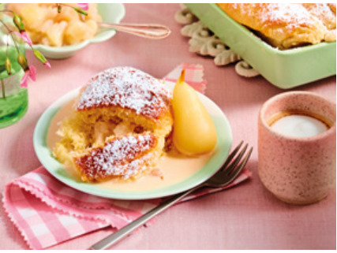

**Ingrediënten voor:** 12 stuks
**Bereidingstijd:** ca. 1 uur en 15 min. + ca. 50
min. wachttijd
**2** bio-citroenen
**400 ml** melk
**42 g** verse gist, of 17 g droge gist
**500 g** bloem (+ bestuiven)
**75 g** + 2 el poedersuiker
zout
**8 g** vanillesuiker
**2** eidooiers
**120 g** boter (+ invetten)
**1 kg** rijpe peren
**400 ml** perensap
**40-50 g** maizena
**75 g** suiker
**½ tl** kaneel
**1 tl** vanille-extract
**400 g** kleine peren (blik)
**500 ml** vanillesaus, kant-en-klaar of
zelfgemaakt
1 VOOR HET DEEG Was de citroenen en rasp de
schil er fijn af. Pers 1 citroen uit. Verhit 250 ml
melk tot lauwwarm, verbrokkel de gist erboven en los al roerend op. Zeef de bloem en 50 g
poedersuiker boven een kom. Voeg een snufje
zout, de vanillesuiker, de eidooiers, 60 g boter,
de helft van de citroenschil en de gistmelk toe.
Kneed met de deeghaken van een handmixer
tot een glad deeg. Laat het deeg afgedekt op een
warme plek ca. 30 minuten rijzen.
2 VOOR DE VULLING Was de peren, schil ze, snijd
ze in kwarten en verwijder het klokhuis. Snijd de
peren in kleine blokjes en meng met het citroensap. Roer het perensap met de maizena glad in
een pan. Voeg de suiker, de kaneel, de rest van
de citroenschil en het vanille-extract toe. Breng
onder constant roeren aan de kook en laat ca.
1 minuut zachtjes koken. Voeg de perenblokjes
toe en laat nog ca. 2 minuten koken; roer hierbij
meermaals door. Laat de compote afkoelen.
3 VOOR DE BUCHTELN Rol het deeg op een
met bloem bestoven werkblad rechthoekig (ca.
20 x 60 cm) uit en halveer de rechthoek in de
lengte. Snijd elke helft in 6 stukken. Leg in het
midden van elk stuk ca. 2 tl perenvulling, vouw
het deeg eromheen tot een bolletje en druk de
naad goed aan. Leg deze buchteln met de naad
naar beneden in een ingevette ovenschaal. Dek af
en laat op een warme plek ca. 20 minuten rijzen.
4 Verwarm de oven voor (elektrisch: 180°C /
hetelucht: 160°C). Verwarm 150 ml melk, 60 g
boter en 25 g poedersuiker en schenk gelijkmatig
over de buchteln. Bak in ca. 25 minuten gaar in
de oven. Giet de peren uit blik af en laat uitlekken. Bestuif de buchteln met 2 el poedersuiker.
Serveer met de vanillesaus, de rest van de perencompote en de kleine peertjes.
**Per stuk:** ca. 450 kcal
**9 g** eiwit | 13 g vet | 71 g koolhydraten
Gebak

## Abrikozenplaatcake met amandel

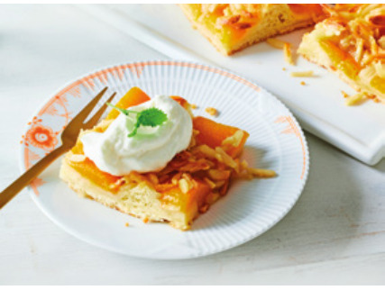

**Ingrediënten voor:** ca. 24 stukken
**Bereidingstijd:** ca. 1 uur en 15 min. + wachttijd
**375 ml** + 2 el melk
**42** g
verse gist, of 17 g droge gist
**2 el** + 200 g suiker
**1** ei
**325 g** boter (+ invetten)
**750 g** bloem
**200 g** amandelstiften
**8 g** vanillesuiker
**1 kg** abrikozen
1 VOOR HET DEEG Verhit 375 ml melk tot lauwwarm. Verbrokkel de gist
erboven en los hem op. Doe de gistmelk in een kom en kneed met 2 el suiker,
het ei, 125 g boter en de bloem glad. Dek af en laat op een warme plek ca.
30 minuten rijzen.
2 VOOR DE AMANDELEN Smelt 200 g boter. Voeg de amandelen, 200 g
suiker, de vanillesuiker en 2 el melk toe en breng al roerend aan de kook.
Laat afkoelen.
3 VOOR DE ABRIKOZEN Blancheer de abrikozen in porties ca. 5 seconden in
een pan kokend water. Neem met een schuimspaan uit de pan en doe in een
kom koud water. Trek de schil van de abrikozen, halveer ze en verwijder de
pit. Rol het deeg op een diepe, ingevette bakplaat uit en beleg met de abrikozen. Dek af en laat op een warme plek nogmaals ca. 20 minuten rijzen.
4 Verwarm de oven voor (elektrisch: 200°C / hetelucht: 180°C). Verdeel het
amandelmengsel over de abrikozen. Bak in 25-30 minuten gaar in de oven.
Lekker met slagroom.
**Per stuk:** ca. 370 kcal
**6 g** eiwit | 17 g vet | 47 g koolhydraten

## Appeltaart met custard en hazelnoot

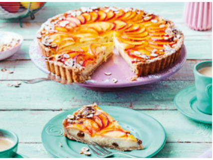

**Ingrediënten voor:** ca. 16 stukken
**Bereidingstijd:** ca. 1 uur en 15 min. + ca. 4 uur wachttijd
**250 g** bloem (+ bestuiven)
50 g hazelnootmeel (bijv.
van het merk Smaakt)
**200 g** suiker
**200** g
koude boter (+ invetten)
**1** ei
**70 g** custardpoeder
**750 ml** melk
**750** g
zure, rode appels
(bijv. elstar)
**2-3 el** citroensap
**8 g** vanillesuiker
**250 g** kwark
**2 el** rozijnen
**4 el** abrikozenjam
**2 el** hazelnoten
**1 el** poedersuiker
vershoudfolie
quichevorm met
uitneembare bodem
(ca. 28 cm Ø)
bakpapier
blindbakbonen
1 VOOR DE BODEM Kneed met de deeghaken van een handmixer de bloem,
het hazelnootmeel, 100 g suiker, de boter in kleine stukjes en het ei tot een
glad deeg. Wikkel het deeg in vershoudfolie en leg ca. 30 minuten in de
koelkast.
2 VOOR DE CUSTARD Roer het custardpoeder, 100 g suiker en 100 ml melk
glad. Breng 650 ml melk in een pan aan de kook. Roer het custardmengsel
erdoorheen, breng opnieuw aan de kook en laat ca. 1 minuut zachtjes koken.
Doe de custard in een kom, leg een vel vershoudfolie direct op het oppervlak
en laat afkoelen.
3 VOOR DE APPEL Was de appels, snijd ze in kwarten en verwijder het klokhuis. Snijd de appels in dunne partjes en besprenkel met het citroensap.
4 VOOR DE BODEM Verwarm de oven voor (elektrisch: 200°C / hetelucht:
180°C). Rol het deeg op een met bloem bestoven werkblad rond (ca. 32 cm
Ø) uit. Leg de deeglap in een ingevette quichevorm met uitneembare bodem
(ca. 28 cm Ø) en druk tegen de randjes omhoog. Prik de bodem meermaals in
met een vork. Leg een vel bakpapier in de bodem en vul met blindbakbonen.
Bak de bodem onder in de oven 18-20 minuten voor.
5 Roer de custard glad en roer de vanillesuiker, de kwark en de rozijnen
erdoorheen. Neem de bodem uit de oven en verwijder het bakpapier met de
blindbakbonen voorzichtig. Verdeel de custard over de bodem en strijk glad.
Beleg waaiervormig met de appelpartjes. Bak op dezelfde temperatuur in
nog ca. 35 minuten gaar in de oven.
6 Verwarm de jam al roerend. Neem de taart uit de oven en bestrijk de appel
met de warme jam. Laat de taart in de vorm helemaal afkoelen en neem uit
de vorm. Hak de hazelnoten grof. Bestrooi de rand van de taart met de hazelnoten en de poedersuiker.
**Per stuk:** ca. 330 kcal
**7 g** eiwit | 15 g vet | 42 g koolhydraten
Gebak

## Kruimelcheesecake

## met kwetsencompote

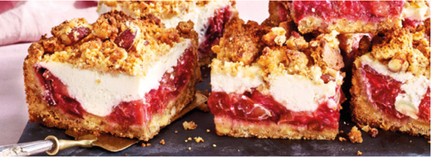

**Ingrediënten voor:** ca. 15 stukken
**Bereidingstijd:** ca. 1 uur en 15 min. + ca. 2 uur
wachttijd
**250 g** boter (+ invetten)
**450 g** cantuccini (Italiaanse
amandelkoekjes, bij de
grotere supermarkt)
**100 g** bloem (+ bestuiven)
**175 g** amandelmeel
**150 g** suiker
**750 g** kwetsen, of andere pruimen
**70 g** custardpoeder
**5 el** + 150 ml pruimensap
**100 ml** pruimenlikeur (bij de slijter)
**1** bio-citroen
**600 g** roomkaas
**2** eieren
**8 g** vanillesuiker
diepvrieszak
1 VOOR DE BODEM Smelt de boter. Doe de cantuccini in een diepvrieszak en verbrokkel fijn met een
deegroller. Meng met de bloem, het amandelmeel, 50 g suiker en de gesmolten boter. Verdeel de helft
van het mengsel over de bodem en tegen de rand van een ingevette en met bloem bestoven vierkante
springvorm (24 x 24 cm). Zet in de koelkast.
2 VOOR DE COMPOTE Was de kwetsen, verwijder de pit en snijd het vruchtvlees in stukken. Roer het
custardpoeder met 5 el pruimensap glad. Laat 50 g suiker goudbruin karamelliseren in een pan. Blus af
met 150 ml pruimensap en de likeur. Breng al roerend aan de kook en laat zachtjes koken tot de karamel
is opgelost in het sap. Voeg het custardmengsel al roerend toe, breng aan de kook en laat kort zachtjes
koken. Spatel de kwetsen erdoorheen en laat de compote afkoelen.
3 VOOR HET CHEESECAKEMENGSEL Verwarm de oven voor (elektrisch: 180°C / hetelucht: 160°C). Was
de citroen, wrijf droog en rasp de schil er fijn af. Roer de roomkaas, de eieren, de vanillesuiker, 50 g
suiker en de citroenschil glad. Verdeel de compote losjes over de koekbodem. Verdeel het cheesecakemengsel in lepels over de compote en strijk glad. Bak ca. 20 minuten in de oven.
4 VOOR HET KRUIMELDEEG Verdeel de rest van het deeg in stukjes over het roomkaasmengsel en bak
in nog ca. 20 minuten gaar. Neem uit de oven en laat afkoelen.
**Per stuk:** ca. 440 kcal
**10 g** eiwit | 25 g vet | 41 g koolhdyraten

## Klantenservice

Wil je abonnee worden of heb je vragen over je
abonnement? Op onze website vind je antwoord op
de meeste vragen.
www.kokengenieten.nl/contact
Wist je dat je tegenwoordig eenvoudig zelf je adres
kan wijzigen? Ga naar www.kokengenieten.nl/
adreswijzigen om je nieuwe adres door te geven.
Het nieuwe adres wordt vervolgens automatisch in
ons systeem gewijzigd.
Telefoon
We zijn er maandag
tot en met vrijdag
van 09.00 tot
**17.00** uur om je vragen
te beantwoorden.
+31 (0)24-2027 829
E-mail
Stel je vraag per e-mail
aan een van onze
service medewerkers.

## klantenservice@

kokengenieten.nl
ABONNEMENTSINFORMATIE koken & genieten kost €4.50 per nummer. De abonnementsprijs in Nederland € 49,- en
in België € 52,- (12 nummers) Deze prijs geldt bij betaling per automatische incasso. Voor betaling via een (digitale)
factuur geldt een toeslag van € 2,50. Je kunt eenvoudig een machtiging afgeven via www.fnl.nl/machtigen.
Abonnementen worden automatisch verlengd, tenzij anders vermeld. Het opzeggen van een abonnement kan eenvoudig
telefonisch via +31 (0)24-2027829 of per mail via klantenservice@kokengenieten.nl.
koken & genieten is een
uitgave van F&L Media B.V.
in licentie van Bauer Media
Hoofdredacteur Yvonne Doorten
Redactie Bas Erkens, Anne Mebelder,
Lotus van Overveldt, Willem van Santen,
Marieke Slettenhaar en Julie van den Berg
In samenwerking met Uit Paulines Keuken,
Marianne Snel, Italiaanse Kazen, Russell Hobbs
Ching-He Huan
Art Direction Nick Groenewold
Vormgeving Mylene Nales, Tom Gerrits,
Lisanne Cobussen, Susan Gerbrands-Derksen,
Ferry Dorresteijn en Ellen Willemsen
Sales Marc Bokhove +31 (0)24 2404643
mbokhove@fnl.nl
Marketing Anouk Tolboom +31 24 240 45 95
atolboom@fnl.nl
Drukkerij Senefelder Misset Doetinchem B.V.
Vragen aan de redactie
Heb jij opmerkingen, suggesties of vragen aan
de redactie? lezersvragen@kokengenieten.nl
Nieuwsredactie / Pers
kooknieuws@fnl.nl of het onderstaande adres
o.v.v. redactie koken & genieten
Jonkerbosplein 52, 6534 AB Nijmegen
COPYRIGHT Het auteursrecht op deze uitgave en de gedrukte uitgave en op de daarin verschenen
artikelen wordt door de uitgever voorbehouden. De vertaalrechten berusten bij F&L Media B.V.
te Nijmegen/ Nederland. Het verlenen van toestemming tot publicatie in de gedrukte uitgave
houdt in dat de auteur de uitgever, met uitsluiting van ieder ander onherroepelijk machtigt de
bij of krachtens de auteurswet door derden verschuldigde vergoedingen voor kopiëren te innen
en dat de auteur alle rechten verdraagt aan de uitgever, tenzij anders bepaald. Niets uit deze
uitgave en de gedrukte uitgave mag worden overgenomen, vermenigvuldigd of gekopieerd zonder
uitdrukkelijke schriftelijke toestemming van de uitgever. De uitgever stelt zich niet aansprakelijk
voor eventuele onjuistheden, welke in deze uitgave of de gedrukte uitgave mochten voorkomen.
ISSN: 1875-8517

# Sprookjestaart

Is deze taart niet fabelachtig mooi? Je maakt hem met
gesuikerde rozen, die je overigens gewoon op kunt eten! Dan
leef je zeker nog lang en gelukkig.

## gesuikerde rozen.

**Ingrediënten voor:** decoratie van 1 taart
**Bereidingstijd:** ca. 2 uur en 30 min.
Verwarm de oven voor (hetelucht: 50°C)*. Was de knopjes en blaadjes van 7-8 onbespoten rozen en dep droog. Klop 2 eiwitten stijf.
Doop de rozen erin, bestrooi met 200 g suiker en verdeel over een
met bakpapier beklede bakplaat. Bak 90-120 minuten in de oven
met de deur op een kier. Draai de rozen tijdens het bakken af en toe
om en controleer of ze niet aanbranden. Neem uit de oven en laat de
rozen op een droge plek verder drogen.
* Een elektrische oven is voor dit recept niet geschikt.
Pronkstuk

## Aardbeien-rozentaart

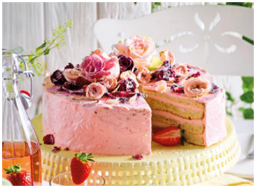

**Ingrediënten voor:** 12-16 stukken
**Bereidingstijd:** ca. 3 uur en 30 min. + ca. 7 uur wachttijd
**5** eieren
**300 g** poedersuiker
**8 g** vanillesuiker
zout
**250 ml** olie (+ invetten)
**200 g** bloem (+ bestuiven)
**100 g** maizena
**16 g** bakpoeder
**250 ml** melk
**8** gelatineblaadjes
**500 g** aardbeien
**2 el** citroensap
**3** druppels vanille-aroma
**600 g** roomkaas
**200 g** mascarpone
**400 g** crème fraîche
1 EEN DAG VAN TEVOREN Maak de gesuikerde rozen (zie kader). DE
VOLGENDE DAG Klop de eieren, 200 g poedersuiker, de vanillesuiker en een
snufje zout in ca. 5 minuten heel romig. Voeg al kloppend langzaam de olie
toe. Meng de bloem met de maizena en het bakpoeder en roer afwisselend
met de melk in delen kort door het beslag. Doe de helft van het beslag in een
ingevette, met bloem bestoven springvorm (26 cm Ø) en strijk glad. Bak in
ca. 25 minuten gaar in de oven en laat afkoelen. Neem de cake uit de vorm en
was de vorm af. Bak van de rest van het beslag op dezelfde manier nog een
cake en laat afkoelen.
2 VOOR DE CRÈME Week de gelatine in water. Was de aardbeien, verwijder
de kroontjes en halveer de aardbeien. Pureer met het citroensap en de vanille. Knijp de gelatine uit, los hem op volgens de aanwijzingen op de verpakking en meng met 2 el aardbeienpuree. Meng het gelatinemengsel met de
rest van de puree. Roer de roomkaas, de mascarpone, de crème fraîche, de
aardbeienpuree en 100 g poedersuiker door elkaar. Zet de crème ca. 1 uur in
de koelkast.
3 Halveer de cakes horizontaal. Sluit om één cakeplak een taartring en
bestrijk met ¹∕₅ van de crème. Leg een tweede cakeplak erop. Herhaal tot alle
cake en ⁴∕₅ van de crème opgebruikt zijn. Zet de taart en de overige crème
minimaal 5 uur in de koelkast. Neem de taart uit de taartring. Roer de
overige crème door en bestrijk de rand van de taart ermee. Versier met de

## Gesuikerde rozen

**Per stuk:** ca. 560 kcal
**10 g** eiwit | 37 g vet | 43 g koolhydraten

## Voor- en bijgerechten

Aardappelcarpaccio met hamroom 34
Avocadofrietjes 45

## In het

Runderburgers met peper en cognacsaus 51
Shakshuka met pompoen 41

# augustus

Tomatencouscous met feta 10
Varkenshaas in knoflookboter 17
Zomers chorizo-bonenpannetje 21
Avocado-garnalensalade 44

## nummer

Camembertdip met abrikoos 37
Gazpacho 7

## Zoet en desserts

Aardbeien-rozentaart 65
Gehaktballetjes met avocadovulling 44
Aardbeientiramisu 7
Abrikozenplaatcake met amandel 60
Appeltaart met custard en hazelnoot 60
Blauwebessengelei met luchtige sabayon 54
Krokante baguettes 38
Quesadilla’s met avocado en feta 45
Roerei met kampotpeper 53
Sperzieboontjes op silken tofu 28
Zaden-notenbrood 43
Zomerse groente-kokossoep
Chique kersenmuffins 57
Gesuikerde rozen 65
met hartige wentelteefjes 18
Granola met gojibessen 43

## Hoofdgerechten

Kokos-kersentiramisu 37
Kruimelcheesecake met kwetsencompote 62
Ontbijtwrap met fruit 43

## Salute!

BBQ-enchilada’s caprese met entrecote 14
Biefstuk met spicy ponzu-saus 28
Maak een uitgebreid
Bruschetta-worstrolletjes 21
Peren met Oostenrijkse buchteln en vanillesaus 58
Perzikcrumble met vanille 54
Italiaans buffet voor familie
Carpacciopastasalade 8
en vrienden
Citroenrisotto met gesmoorde komkommer
Supersnel cassistoetje 55
Tiramisurol 46
Verkoelend citroen- en mangoijs 55
en garnalen 13
Duits runderstoofpotje met peper 53
Gevulde paprika met venkelworst 22
Gnocchi met gorgonzolasaus 47
Griekse wraps 10
Hete zoetzure kip 28
Honing-chilikalkoen met komkommerrelish 33
Lichte ragout met worstballetjes 23
Linzenpannetje met groene peper 52
Orzosalade met garnalen 35
= Zonder vlees en vis
Roerbak van satékip

## Romige risotto

met pittige kokos-pindasaus 31
In vier verschillende
= Snel klaar (max. 30 min.)
Romige pestokip met feta 14
smaken… Welke maak jij als
eerst?
Het volgende nummer valt rond 15 juli 2025 bij abonnees op de
mat en ligt rond 22 juli 2025 in de winkels.
De verschijningsdata in België wijken af van de verschijningsdata in Nederland.
Mis geen nummer meer!
Neem nu een abonnement en krijg voortaan elke uitgave van koken &
genieten automatisch in je brievenbus. Ga naar www.kokengenieten.nl/abo
of bel gratis naar +31 (0)24-2027829.

## Hasta la pasta!

Farfalle, orzo, noedels…
over de hele wereld eten ze
pasta

# Dual Basket Airfryer 9 liter

Airfryer. Met zijn stijlvolle champagne accenten, keramische PFAS-vrije coating, dubbele
manden en gebruiksvriendelijke functies, is deze airfryer een aanwinst voor elke keuken.
Bereid snel en eenvoudig je favoriete gerechten met minder energieverbruik!
Til je kookkunsten naar een hoger niveau met de Russell Hobbs Satisfry™ Dual Basket
collectie
scan voor
meer informatie
meer informatie
Ook verkrijgbaar bij:
Til je kookkunsten naar een hoger niveau met de Russell Hobbs Satisfry™ Dual Basket
**9 liter** 8.3 liter 5.5 liter 4.3 liter
www.russellhobbs.nl | @russellhobbs.benelux
