voor
Altijd

# €4,50

Augustus 2025 jaargang 20
koken genieten

# Heerlijke

# I taliaanse

# zomer

# Groen in

# ’t seizoen

Koken met zomerkruiden
Een prachtig dakje

# Het lekkerste

# kruimelgebak

Geheim ontrafeld

# Zó maak je de

# perfecte risotto

# 53

doordeweekse
inspiratie
Van antipasti tot dolci: Italiaans met Uit Paulines Keuken

# 4,50

# De snelle weg door het blad

Voorgerechten
& bijgerechten
Salades, soepen en
broodjes: lekker als lichte
maaltijd of om je etentje
mee te beginnen.
Bruschetta met burrata 8 Tomatensalade met
basilicumdressing 11
Campari Amalfi 49
Sugo (tomatensaus) 14
Frisse courgettemuntdip 43
Varkenshaasmedaillons
met tomaten 15
Frisse salade
met gegrilde kip 38
Siciliaanse risotto met
gorgonzola en vijgen 53
Antipasti
met basilicumolie 46
Bonencrème 46 Antipasti di verdure 46
Provençaalse tomaten
met kabeljauw 16
Tomatensalade
met kipspiesjes 17
Zomerse ravioli uit de oven 21
koningsoesterzwam 22
Courgetti
met kruidenpesto 38
Biefstuk
met courgette-fetasalade 41
Gevulde courgette
met ham en bulgur 41
Zomerse gehaktschotel
met basilicumcrunch 42
Udonnoedels met
Zoet &
nagerechten
Zoet is altijd goed!
Lekker als tussendoortje,
bij de koffie of als
afsluiting van je diner.
Instant mascarponemousse
Maritozzi met pistacheroom 7
van citroen & witte chocolade 34
Île flottante 54 Appel-bramentaart 57 Knapperige gebakjes met kersenroom 58
Basisrecept kruimeldeeg 56
Zonder
Snel klaar
(max. 30 min.)
vlees of vis
Uitleg van symbolen bij de recepten
Ketchup van geroosterde
tomaten 18
Hoofdgerechten
Ga je voor snel &
makkelijk, een dagje
zonder vlees of vis
of pak je uit met een
weekendproject?
Tomatenchips 18
Plaatpizza
met venkel en pancetta 8
Zoetzure
ingelegde tomaat 18
Pasta
met ricotta en tomaat 11
Burrata met citroenige
lentegroenten 31
Tomatentaart
met geitenkaasroom 13
Alle recepten op een rij
Koude erwtenmuntsoep 37
Spaghetti all’amatriciana 14
Spaghettipizza
met salami 23
Pasta met twee sauzen 45
Griekse orzoschotel
met gyros 24
Citroenrepen met
polentadeeg en olijfolie 34
Bosvruchtenkruimelgebak 60
Torta al limone 48
Frisse pastasalade met venkel
en Griekse yoghurt 26
Courgette-carbonara
met citroen 33
Risotto
met linzen en worst 52
Warm rabarbertoetje
met amandel 54
Milanese risotto
met saffraan en garnalen 52
Scaloppine al tartufo 50
Lavacakejes
met pindakaas 54
Kwetsentaart
met ko ekruimels 62
Zelfgemaakte
ko esiroop 62
Koolvis met romige
komkommersalade 37
Noord-Italiaanse risotto met
pompoen en geitenkaas 53
Aardbeien-ijsbeker 54
Blauwebessen-skyrrepen 65

## Voorwoord

# Smaakmaker

Ken je die filmpjes op Instagram waarin ouders
hun baby’s een citroen laten proeven? Ik ga mij
niet uitlaten over of het wel of niet verantwoord
is, maar grappig is het wel. Probeer zelf maar
eens je gezicht in de plooi te houden bij zo’n zure
smaakbom! Ik heb eigenlijk altijd wel citroenen
in huis. Niet om zo op te eten, maar om gerechten
mee op smaak te brengen. Een frisse zomerpasta
met ricotta en wat citroen, een lekker broodje
burrata met tomaat en een kneepje citroensap:
citroen is een echte alleskunner in de keuken.
In de zomer doe ik ’m ook vaak in een karaf met
water en sinaasappel of munt. Zo heb je een lekkere frisse en gezonde dorstlesser! Op p. 30 laten
we je zien wat je allemaal nog meer met citroen
in de keuken kunt doen. Ik heb de wittechocolademousse van p. 34 laatst voor een etentje
gemaakt. Echt superluchtig en fris, niet te zoet.
Een aanrader!
Yvo e D rten
**6** Uit Paulines keuken
Dit jaar vind je elke maand heerlijke recepten van Uit Paulines Keuken in Koken
& genieten. Altijd lekker en met verse
seizoensproducten. Deze maand: lekkers
uit Italië
**12** Prima pomodori
Tomaten zijn dé groente van Italië. Niet zo
gek, want ze zijn bijna overal wel lekker in.
Nog niet overtuigd? Probeer deze recepten
dan maar eens!
**20** Hasta la pasta!
De Italianen staan bekend om hun lekkere
pasta’s, maar ook in andere landen kunnen
ze er wat van! Probeer deze pastagerechten van over de hele wereld
**30** Boek: For the Love of
Lemons
In dit prachtige zomerse kookboek leer je
de veelzijdigheid van citroen kennen in de
keuken
**36** Zomerkruiden
Peterselie, basilicum en munt zijn tegenwoordig het hele jaar verkrijgbaar,
maar in de zomer gebruiken we ze toch ’t
meest. Lekker in frisse salades, soepen of
drankjes
**40** Groeten uit de moestuin
Heb je courgettes in overvoed in je tuin?
Wat een geluk! Gevuld, gegrild of in een
dip: met deze zomergroente kun je alle
kanten op.
**44** Salute!
Lekkere wijnen, gezellige kaarsjes en lang
tafelen met schalen vol heerlijk eten: dát is
een echte Italiaanse avond. Buon appetito!
Abo ement
Elke maand de
koken & genieten
als eerste in de
brievenbus? Kijk op www.
kokengenieten.nl/abo
of blader naar
p. 28.
**52** 4x risotto
Risotto moeilijk? Niet met deze recepten!
Het enige dat risotto vereist is aandacht.
Goed blijven roeren en dan komt alles
goed!
**54** Goeie toetjes
Zin in een toetje na het eten? Daar weten
we wel wat op! Met deze zwaardere en wat
lichtere toetjes zit er altijd iets lekkers
tussen
**56** De laatste kruimel
Een laag kruimeldeeg maakt van elke soort
gebak meteen een krokant feestje. Geniet
van dit kruimelgebak vol zoet zomerfruit
**64** Frisse skyr
Op zoek naar een zomers gebakje dat niet
al te zoet is? Dan is hier het antwoord!
Dankzij de IJslandse skyr zijn deze repen
lekker fris – heerlijk voor op warme
dagen!
**66** Index & volgend
Alle recepten van deze uitgave op een rij én
een vooruitblik op volgende maand.

## Voorwoord

WIN3x
het Uit Paulines
Keuken Magazine
(t.w.v. €12,99)
SPECIALE UITGAVE: HET BESTE UIT 15 JAAR
120
Stap-voor-stap uitleg
€12,99
Bak je eigen
Uit Paulines Keuken
Het beste van
lekkere &
UPK_001000_Cover_ok.indd 1
UPK_001000_Cover_ok.indd 1 18-04-2025 11:04
18-04-2025 11:04
verrassende
desembrood
recepten
Lekker &
makkelijk
Snel & makkelijk
Uit de Airfryer
Binnen
**30** minuten
Snel klaar
op tafel
Easy traybakes
Lekker Italiaans
Salades
Werelds
Weekend
Zoet
Lekkere
borrelhappen
Comfort food
BP
Voor-, hoofd- en nagerechten voor iedere dag
19
Inhoud

# In het seizoen...

# rucola

## Wat is het?

Rucola, ook wel raketsla of mosterdkruid genoemd,
is een pittige bladgroente die behoort tot de
kruisbloemenfamilie. Rucola is makkelijk zelf te zaaien
en verbouwen. Het plantje vormt steeds nieuwe blaadjes,
dus je kunt er van blijven plukken. De blaadjes zitten
boordevol vitamies en mineralen, zoals vitamine K, C,
ijzer en calcium. Hartstikke gezond dus!

## Wat kun je ermee?

Rucola kun je op allerlei manieren verwerken. Jonge
bladeren kun je goed rauw eten, in een salade, op een
broodje of als garnering op bijvoorbeeld pizza. Ouder
blad is vaak iets scherper van smaak en wordt milder
bij koken of roerbakken. Verwerk deze bladeren daarom
bijvoorbeeld in stamppot, pasta met pijnboompitten
en ricotta of in een soep. Ook lekker: gebruik rucola als
vervanger van basilicum in pesto!

## Hoe kan je het vervangen?

Afhankelijk van hoe je de groente gebruikt kun je hem
door verschillende bladgroente vervangen. Waterkers,
friséesla of radicchio hebben bijvoorbeeld een
vergelijkbare pittige smaak, maar (baby)spinazie is wat
milder alternatief.

## Waar smaakt het naar?

Rucola heeft een pittige, wat bittere, walnootachtige
smaak. De knapperige blaadjes zijn daarom lekker
in combinatie met wat mildere slasoorten. Wanneer
je rucola verwarmt, wordt de groente wat milder van
smaak.

## Hoe moet ik het bewaren?

Koop rucola wanneer deze stevig en donkergroen van
kleur is. Je bewaart de blaadjes het beste in de groentela
van de koelkast. De groente is vers het lekkerst, dus
gebruik het idealiter binnen een paar dagen na aankoop.
Rucola is niet geschikt om in te vriezen.

# Keuken

# Uit Paulines

Dit jaar vind je elke maand heerlijke recepten van Uit
Paulines Keuken in Koken & genieten. Altijd lekker
en met verse seizoensproducten. Deze maand: de
allerlekkerste Italiaanse gerechten.
Receptuur: Uit Paulines Keuken Fotografie: Marianne Snel

## Maritozzi

## met pistacheroom

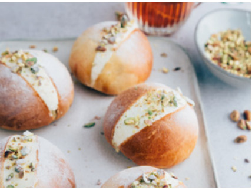

**Ingrediënten voor:** 10 stuks
**Bereidingstijd:** ca. 50 min. +
ca. 2 uur wachttijd
**VOOR DE** BROODJES
**260 ml** lauwwarme melk
**45 g** suiker
**9 g** droge gist
**500 g** bloem
**10 g** zout
**2** eieren
1 bio-citroen (alleen de schil,
geraspt)
**100 g** roomboter (op
kamertemperatuur)
olie, om in te vetten
bakpapier
**VOOR DE** VULLING
**300 ml** slagroom
**25 g** poedersuiker (+ bestuiven)
8 g slagroomversteviger (bijv. Dr.
Oetker Klop-Fix)
**100 g** gezoete pistachepasta
**50 g** pistachenoten, gehakt
1 VOOR DE BROODJES Meng de melk met de suiker en de gist. Laat even staan tot de gist gaat werken.
Als het mengsel gaat bubbelen is het klaar om gebruikt te worden.
2 Doe de bloem met het zout in de kom van een staande mixer. Voeg 1 ei, de citroenschil en het melkmengsel toe en kneed er een soepel deeg van. Voeg, zodra het deeg zich tot een bal vormt, beetje bij
beetje de boter toe. Kneed tot alle boter is opgenomen en je een heel elastisch deeg hebt; als je het uit
elkaar trekt, moet er een soort kauwgombaleffect ontstaan.
3 Leg het deeg in een met olie ingevette kom, draai het om en dek af met een vochtige theedoek. Laat
het deeg ca. 1 uur op een warme plek rijzen.
4 Stort het deeg op je werkblad en druk met je vingers de lucht eruit. Verdeel het deeg in 10 gelijke stukken van elk ca. 80 g. Vouw de buitenkanten naar binnen zodat er een bolletje ontstaat. Maak het bolletje
iets ovaal. Leg de bolletjes op een met bakpapier geklede bakplaat. Dek af met een vochtige theedoek en
laat nog ca. 1 uur rijzen.
5 Verwarm de oven voor (elektrisch: 200°C / hetelucht: 180°C). Bestrijk de broodjes met geklutst ei en
bak in ca. 20 minuten gaar in de oven. Laat ze volledig afkoelen. Je kunt de broodjes nu ook invriezen.
6 VOOR DE VULLING Klop de slagroom stijf met de poedersuiker en de slagroomversteviger. Snijd de
broodjes aan de bovenkant op en bestrijk vanbinnen met de pistachepasta. Vul de broodjes met de slagroom en schraap de overtollige slagroom eraf met een spatel. Garneer met de gehakte pistachenoten en
bestuif met poedersuiker.
**Per stuk:** ca. 511 kcal
**10 g** eiwit | 29 g vet | 53 g koolhydraten
Uit Paulines Keuken

## Bruschetta met burrata

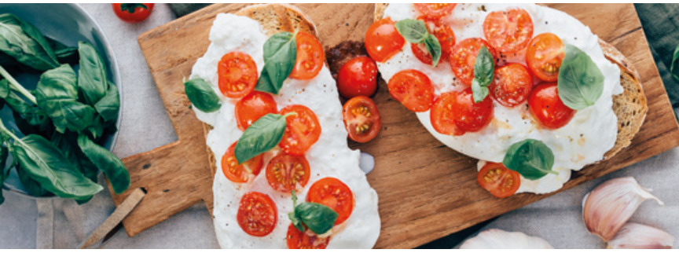

**Ingrediënten voor:** 4 personen
**Bereidingstijd:** ca. 15 min.
**500 g** trostomaatjes
**2** teentjes knoflook, gepeld
olijfolie
zout en peper.
**8 sneetjes** (stok)brood
**4** bollen burrata
**15** g
vers basilicum, blaadjes
geplukt
1 Snijd de tomaten in stukjes. Hak 1 teentje
knoflook fijn en voeg toe aan de tomaat. Breng
op smaak met wat olijfolie, zout en peper. Houd
apart.
2 Bestrijk de sneetjes brood aan beide zijden
met wat olijfolie. Bak het brood aan weerszijden
goudbruin in een contactgrill of grillpan. Wrijf
vervolgens met een hele knoflookteen over het
brood heen. Zo krijgt de toast een lekkere knoflooksmaak.
3 Verdeel over elk sneetje brood een halve bol
burrata. Verdeel daarover een lepel van de gemarineerde tomaten. Garneer met het verse basilicum, een drizzle olijfolie en eventueel nog een
snuf zout en peper.
**Per portie:** ca. 532 kcal
**19 g** eiwit | 31 g vet | 40 g koolhydraten

## Plaatpizza

## met venkel en pancetta

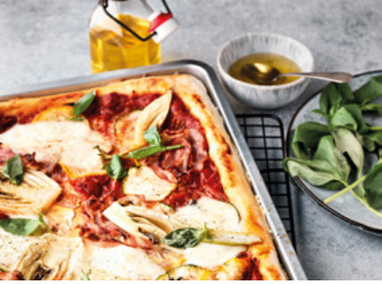

**Ingrediënten voor:** 4 personen
**Bereidingstijd:** ca. 30 min.
**1** kant-en-klare pizzabodem
olijfolie
**2** uien
**1 tl** venkelzaad
**2** venkels
1
courgette (of ½ gele en ½
groene courgette)
**800 g** cerise- of
pompodorinitomaten (blik)
**125 g** pancettaplakjes
**125 g** mozzarella, in plakjes
3
takjes basilicum, blaadjes
geplukt
versgemalen zwarte peper
1 Verwarm de oven voor (elektrisch: 220°C /
hetelucht: 200°C). Neem de pizzabodem uit de
koelkast. Vet een bakplaat in met olijfolie. Pel en
snipper de uien fijn. Verhit een scheutje olijfolie
in een diepe koekenpan en fruit de ui erin. Voeg
het venkelzaad toe en bak 1-2 minuten mee op
laag vuur. Roer de tomaten erdoorheen, zet het
vuur hoog en laat in 8-10 minuten inkoken tot
een dikke saus. Druk de tomaatjes plat en roer
regelmatig door. Breng de saus op smaak met
zout en peper
2 Rol het deeg uit op de bakplaat en verdeel de
saus erover. Snijd de venkels en de courgette in
superdunne plakken van ½ cm en verdeel over de
saus. Leg de plakjes pancetta erop en verdeel de
mozzarella erover. Bak de pizza in 8-10 minuten
gaar in de oven. Garneer met de basilicumblaadjes, versgemalen zwarte peper en wat van je
favoriete olijfolie.
**Per portie:** ca. 530 kcal
**21 g** eiwit | 23 g vet | 55 g koolhydraten
Uit Paulines Keuken

## Pasta met ricotta en tomaat

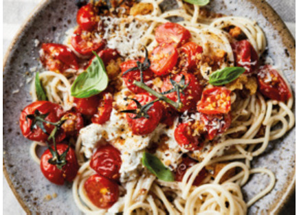

**Ingrediënten voor:** 4 personen
**Bereidingstijd:** ca. 1 uur
**750** g
zoete cherrytomaatjes aan tak
olijfolie
zout en peper
**1** bio-citroen
**250** g
ricotta (op kamertemperatuur)
**25 g** parmezaan, geraspt
**300 g** spaghetti
3
sneetjes wit (zuurdesem)brood
(mag oud zijn)
**¼ tl** chilivlokken
**1 teen** knoflook, geperst
2-3
takjes basilicum, blaadjes geplukt
1 Verwarm de oven voor (elektrisch: 160°C / hetelucht:
140°C). Halveer de cherrytomaatjes en leg ze met de
snijzijde naar boven in een ovenschaal of braadslede. Als je tomaten aan de tak gebruikt, kun je de tak
laten zitten – die geeft veel smaak (gooi hem na het
bakken weg). Besprenkel de tomaten met wat olijfolie
en bestrooi met zout en peper. Rooster de tomaatjes
35-40 minuten in de oven, tot ze zacht en licht gekaramelliseerd zijn.
2 Rasp de schil van de citroen. Meng de citroenschil
met de ricotta en de parmezaan. Breng op smaak met
zout en peper. Houd apart.
3 Kook de pasta volgens de aanwijzingen op de verpakking beetgaar in ruim water met wat zout. Giet af
en vang een soeplepel kookvocht op.
4 Hak terwijl de pasta kookt het brood in een keukenmachine of hakmolentje van een staafmixer tot grof
kruim. Bak het broodkruim met de chilivlokken in ca.
5 minuten goudbruin en krokant in een koekenpan
met wat olie. Voeg halverwege de baktijd de knoflook
toe (zorg dat deze niet verbrandt en voeg zo nodig wat
extra olie toe). Schep de pangrattato uit de pan en laat
uitlekken op keukenpapier.
5 Meng de geroosterde tomaatjes met de warme
pasta. Voeg een scheutje kookvocht toe om het geheel
smeuïg te maken en roer goed door. Verdeel over
borden, schep het ricottamengsel eroverheen en
bestrooi met de pangrattato. Garneer met de basilicumblaadjes.
**Per portie:** ca. 528 kcal
**13 g** eiwit | 9 g vet | 78 g koolhydraten

## Tomatensalade met

## citroen-basilicumdressing

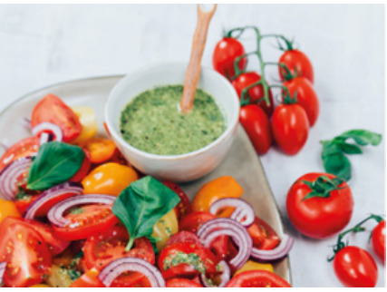

**Ingrediënten voor:** 4 personen
**Bereidingstijd:** ca. 10 min.
**15** g
basilicum (+ extra, om te
garneren)
**1** teentje knoflook
**2 el** citroensap
**4 el** olijfolie
zout en peper
**500 g** cherrytomaten
(verschillende kleuren)
**6** trostomaten
**1** rode ui
1 Voor de dressing Maal het basilicum, de knoflook, het citroensap en de olijfolie glad in een
keukenmachine. Breng op smaak met zout en
peper.
Uit Paulines Keuken
2 VOOR DE SALADE Halveer de cherrytomaten.
Snijd de trostomaten in parten en in plakjes. Pel
de ui en snijd hem in halve ringen. Verdeel de
tomaten en de ui over een schaal.
3 Besprenkel de tomaten met de dressing en
garneer met extra basilicum. Ook lekker met
feta of mozzarella.
**Per portie:** ca. 157 kcal
**3 g** eiwit | 11 g vet | 15 g koolhydraten

# Prima

# pomodori

Tomaten zijn dé groente van Italië. Niet zo gek, want
ze zijn bijna overal wel lekker in. Nog niet overtuigd?
Probeer deze recepten dan maar eens!
Coverrecept

## Tomatentaart met geitenkaasroom

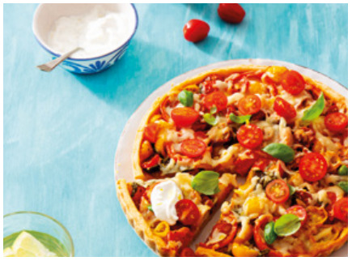

**Ingrediënten voor:** ca. 12 stukken
**Bereidingstijd:** ca. 2 uur en 30 min. + ca. 13 uur wachttijd
**VOOR DE** RODE PESTO
**300 g** cherrytomaten
**2-3** teentjes knoflook
**1 el** poedersuiker
**3 takjes** oregano
**3 takjes** tijm
**3 takjes** basilicum
zout en peper
**50 g** pijnboompitten
**60 g** geraspte gruyère
**4-5 el** olijfolie
bakpapier
**VOOR DE** TAART
**200 g** bloem
**100 g** koude boter
**125 g** geraspte gruyère
**1 tl** knoflookpoeder
zout en peper
**2-3 el** crème fraîche
**3 el** ijswater
**6 takjes** basilicum
**600** g
tomaten (bijv. rode,
gele en zwarte)
**2 el** paneermeel
**125 g** mozzarella
**1 tl** poedersuiker
**150 g** verse geitenkaas
**3 el** melk
**1-2 el** vloeibare honing
½
bio-citroen (alleen de
schil, geraspt)
**1 el** olijfolie (+ invetten)
1 EEN DAG VAN TEVOREN VOOR DE PESTO Verwarm de oven voor (hetelucht:
100°C*). Was de tomaten, halveer ze en leg ze met de snijzijde naar beneden op
een met bakpapier beklede bakplaat. Plet de knoflookteentjes en verdeel ze over
de bakplaat. Bestuif de tomaten met de poedersuiker. Was de kruiden en neem
de blaadjes van de takjes. Strooi samen met zout en peper over de tomaten. Bak
ca. 90 minuten in de oven. Zet de oven uit, zet de ovendeur op een kier en laat de
tomaten een nacht in de oven drogen. DE VOLGENDE DAG Rooster de pijnboompitten in een droge koekenpan. Neem uit de pan. Pureer de pijnboompitten, de
tomaten, de kaas, de gepelde knoflookteentjes en de olie met een staafmixer fijn.
Breng de pesto op smaak en doe hem in een pot (ca. 200 ml inhoud).
2 VOOR HET DEEG Roer de bloem, de boter in stukjes, 50 g gruyère, het knoflookpoeder, 1 tl zout en peper door elkaar. Voeg de crème fraîche en het ijswater toe
en kneed glad. Laat het deeg even rusten. Doe het deeg in een ingevette springvorm (28 cm Ø) en druk tegen de bodem en de randen. Zet de springvorm ca.
30 minuten in de koelkast.
3 Verwarm de oven voor (elektrisch: 180°C / hetelucht: 160°C). Was het basilicum
en neem de blaadjes van de takjes. Was de tomaten en halveer ze. Meng de tomaten met het basilicum, zout en peper. Prik de bodem van de taart meermaals in
met een vork en bestrooi met het paneermeel. Verdeel 2-3 el van de pesto over
de bodem. Druk de mozzarella goed uit tussen twee lagen keukenpapier. Snijd
de mozzarella in dunne plakjes en verdeel over de pesto. Verdeel het tomatenmengsel erover en bestuif met de poedersuiker. Bestrooi met 75 g gruyère. Bak in
40-45 minuten onder in de oven gaar.
4 VOOR DE ROOM Roer de geitenkaas, de melk, de honing en de citroenschil door
elkaar. Breng op smaak met zout en peper. Neem de taart uit de oven en
besprenkel met de olijfolie. Serveer de taart met de geitenkaasroom.
* Een elektrische oven is voor dit recept niet geschikt.
**Per stuk:** ca. 290 kcal
**10 g** eiwit | 19 g vet | 17 g koolhydraten
Seizoen

## Spaghetti all’amatriciana

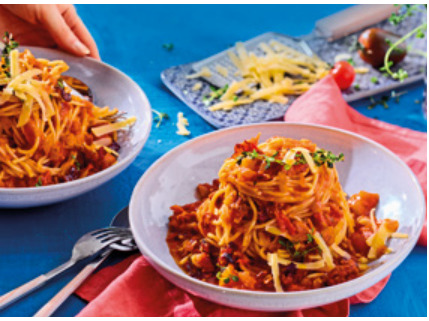

**Ingrediënten voor:** 4-6 personen
**Bereidingstijd:** ca. 2 uur en 30 min.
**500 g** spaghetti
zout en peper
**1** rode chilipeper
**10 takjes** tijm
**1-2 el** olijfolie
**100 g** gerookt ontbijtspek
**800 ml** sugo (zie rechts)
**75 g** oude kaas
1 VOOR DE SPAGHETTI Kook de pasta volgens de aanwijzingen op de verpakking gaar in ruim water met zout.
2 VOOR DE SAUS Halveer de chilipeper in de lengte, verwijder de zaadlijsten,
was de peper en hak hem fijn. Was de tijm en dep hem droog. Verhit de olie
in een pan en bak de chilipeper kort erin. Snijd het spek in stukken, voeg
toe aan de chilipeper en bak mee. Voeg de tijm toe en roer kort erdoorheen.
Neem de tijm uit de pan. Voeg de sugo toe, breng aan de kook en laat ca. 5 minuten zachtjes koken. Breng op smaak met zout en peper. Giet de spaghetti
af en meng met de saus. Bestrooi met de kaas en de tijm en serveer.
**Per portie:** ca. 420 kcal
**16 g** eiwit | 17 g vet | 48 g koolhydraten

## Sugo (tomatensaus)

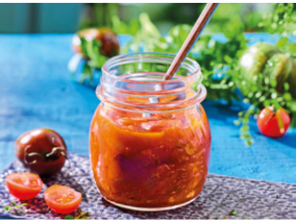

**Ingrediënten voor:** 6-7 potten (à ca. 400 ml)
**Bereidingstijd:** ca. 1 uur en 45 min. + wachttijd
Houdbaarheid: ca. 6 maanden
Was 2,5 kg rijpe tomaten en snijd in
blokjes. Pel 500 g uien en 5 teentjes
knoflook en snipper fijn. Verhit 100 ml
olijfolie in een grote pan en bak de ui en
de knoflook glazig erin. Voeg de tomaat
toe, breng aan de kook en laat met het
deksel op de pan ca. 45 minuten smoren.
Hak 150 g Kalamataolijven fijn. Was
**10 takjes** tijm en 10 takjes oregano en
hak fijn. Doe de olijven en de kruiden bij
de saus, breng aan de kook en laat ca. 5 minuten zachtjes koken. Breng
op smaak met 100 ml witte balsamicoazijn, zout, peper en 2 el lichte
basterdsuiker. Breng de sugo nogmaals aan de kook. Doe de sugo in
gesteriliseerde potten en sluit ze af. Schenk heet water in een grote
pan en zet de potten sugo erin, zodat ze voor ⅔ onder staan. Breng het
water aan de kook en laat ca. 40 minuten koken. Laat afkoelen.

## Varkenshaasmedaillons

## met tomaten

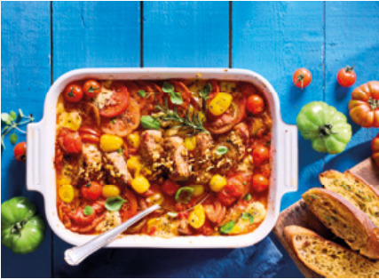

**Ingrediënten voor:** 4 personen
**Bereidingstijd:** ca. 50 min.
**2** rode uien
**4** teentjes knoflook
**600 g** rijpe tomaten
**4-5 el** olijfolie
**1 tl** suiker
zout en peper
**½ tl** gedroogde oregano
**600 g** varkenshaas (aan één stuk)
**5 takjes** rozemarijn
**30 g** geraspte parmezaan
**30 g** panko (Japans paneermeel, bij de toko of
grotere supermarkt)
800 g tomaten (bijv. groene, gele, zwarte, rode,
vleestomaten, coeur de boeuf en/of
cherrytomaten)
**150 g** mini-mozzarellabolletjes
**½** rogge- of speltstokbrood
**1-2 el** boter
**4 takjes** oregano
**4 takjes** basilicum
1 VOOR DE SAUS Pel de uien en 2 teentjes knoflook en snipper
ze fijn. Was de tomaten en snijd ze in blokjes. Verhit 1 el olie in
een pan en bak de ui en de knoflook glazig erin. Bestrooi met
de suiker en laat karamelliseren. Voeg de tomaat toe, breng
aan de kook en roer zout, peper en de gedroogde oregano
erdoorheen. Laat ca. 10 minuten zachtjes koken en roer
daarbij meermaals door.
2 VOOR HET VLEES Dep de varkenshaas droog en snijd in
ca. 8 medaillons. Was de rozemarijn. Meng de parmezaan met
de panko. Bestrijk de medaillons met 1 el olie en bestrooi met
zout en peper. Wentel de medaillons in het parmezaanmengsel. Verhit 1-2 el olie in een koekenpan en bak de medaillons
ca. 2 minuten per zijde erin. Bak 2 takjes rozemarijn kort mee.
3 Verwarm de oven voor (elektrisch: 220°C / hetelucht: 200°C).
Was de tomaten en snijd ze naar grootte in stukken. Verdeel
met de tomatensaus in een grote ovenschaal en besprenkel
met 1 el olijfolie. Laat de mozzarella uitlekken. Verdeel met de
medaillons en de gebakken rozemarijn in de ovenschaal. Bak
in 20-22 minuten gaar in de oven.
4 VOOR HET BROOD Snijd het stokbrood schuin in plakjes. Pel
2 teentjes knoflook en hak fijn. Neem de naaldjes van 3 takjes
rozemarijn en hak ze fijn. Verhit de boter en bak de knoflook
en de rozemarijn erin. Bak de sneetjes brood erin en draai
regelmatig om. Was de oregano en het basilicum en neem de
blaadjes van de takjes. Serveer alles samen.
**Per portie:** ca. 580 kcal
**49 g** eiwit | 26 g vet | 34 g koolhydraten
Seizoen

## Provençaalse tomaten

## met kabeljauw

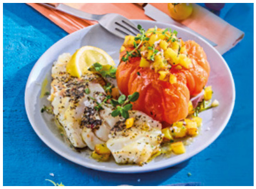

**Ingrediënten voor:** 4 personen
**Bereidingstijd:** ca. 1 uur en 15 min.
4
grote vleestomaten (à ca. 350 g)
fleur de sel
**8 el** olijfolie
**6 takjes** tijm
**5 takjes** oregano
**2 takjes** rozemarijn
**500 g** vastkokende aardappels
**2** sjalotjes
**2** teentjes knoflook
zout en peper
**1-2 el** boter
4 kabeljauwfilets (à ca. 175 g)
**2 el** viskruiden
citroenpartjes, om te serveren
1 VOOR DE TOMATEN Was de tomaten en snijd een
dun dekseltje van de bovenkant. Bestrooi het
snijoppervlak met wat fleur de sel. Verhit 5 el olie in
een ovenbestendige koekenpan. Leg de tomaten met
snijoppervlak naar beneden in de olie, leg het deksel
op de pan en laat op laag vuur ca. 25 minuten smoren.
Was de kruiden en neem de naaldjes van de rozemarijn van de takjes. Doe de helft van de kruiden bij de
tomaten en laat ca. 10 minuten mee smoren.
2 VOOR DE TOPPING Verwarm de oven voor (elektrisch: 180°C / hetelucht: 160°C). Schil de aardappels,
was ze en snijd in kleine blokjes. Pel en snipper de
sjalotjes en de knoflook fijn. Hak de rest van de
kruiden fijn. Verhit 2 el olie in een koekenpan en bak
de aardappelblokjes al roerend ca. 10 minuten erin.
Voeg de sjalot, de knoflook en de kruiden ca. 2 minuten voor het einde van de baktijd toe en bak mee.
Breng op smaak met zout en peper. Neem de tomaten
van het vuur en wentel ze in het bakvet. Verdeel de
aardappel over de tomaten. Verdeel de boter in
stukjes erover en bak ca. 15 minuten in de oven.
3 VOOR DE VIS Dep de kabeljauw droog en wrijf
voorzichtig in met de viskruiden. Laat de vis kort
rusten, zodat de smaken erin kunnen trekken. Verhit
**1 el** olie in het bakvet van de aardappels en bak de
kabeljauw ca. 2 minuten per zijde erin. Serveer alles
samen. Serveer met citroenpartjes. Besprenkel de
kabeljauw met wat van het bakvet.
**Per portie:** ca. 460 kcal
**41 g** eiwit | 17 g vet | 33 g koolhydraten

## Tomatensalade

## met kipspiesjes

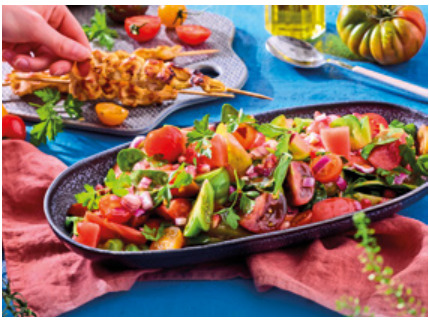

**Ingrediënten voor:** 4 personen
**Bereidingstijd:** ca. 45 min.
800 g tomaten (bijv.
honingtomaten, zwarte, gele,
groene, oranje en rode)
**500 g** pitarme watermeloen
**1** kleine granaatappel
**1** rode ui
**6-8 takjes** peterselie
**75 g** babyspinazie
**100 ml** frambozenazijn
gemalen vanille (bijv.
Dr. Oetker vanillemolen)
zout en peper
**7 el** olijfolie
**600 g** kipfilet
**1 tl** kerrie
**1 tl** paprikapoeder
ca. 12 satéprikkers
Seizoen
1 Week de satéprikkers in koud water. VOOR DE SALADE Was de tomaten en snijd ze naar grootte in
tweeën, vieren, partjes of in blokjes. Snijd het vruchtvlees van de watermeloen uit de schil en snijd het
in grove blokjes. Halveer de granaatappel en klop de pitten voorzichtig eruit. Pel de ui en snipper fijn.
Was de peterselie en neem de blaadjes van de takjes. Was de spinazie en laat uitlekken.
2 Roer de azijn, een mespuntje vanille, zout en peper door elkaar. Klop 5 el olie erdoorheen. Meng de
voorbereide salade-ingrediënten en de vinaigrette in een grote kom met elkaar.
3 VOOR DE SPIESJES Dep de kip droog en snijd in de lengte in repen. Steek de kiprepen golvend aan de
satéprikkers. Roer 2 el olie, de kerrie en het paprikapoeder door elkaar. Bestrijk de kip ermee en laat
kort trekken. Leg de spiesjes op de directe hitte van de barbecue en gril ca. 2 minuten per zijde of leg de
spiesjes in een hete grillpan en bak in ca. 5 minuten rondom gaar. Bestrooi met zout en peper. Breng de
salade op smaak. Serveer de salade met de spiesjes.
**Per portie:** ca. 440 kcal
**35 g** eiwit | 22 g vet | 23 g koolhydraten

## Ketchup

## van geroosterde tomaten

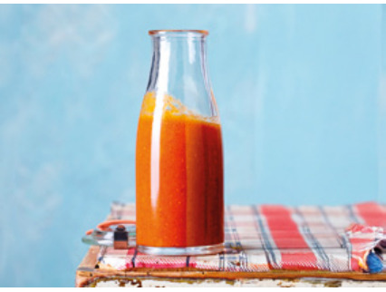

**Ingrediënten voor:** ca. 400 ml
**Bereidingstijd:** ca. 1 uur en 45 min.
Houdbaarheid: ca. 1 maand,
in de koelkast
Verwarm de oven voor (elektrisch: 230°C / hetelucht: 210°C). Pel 6 teentjes knoflook en hak ze
fijn. Was 1,2 kg rijpe tomaten (bijv. vleestomaten), halveer ze en leg op een bakplaat. Bestrooi
met zout en peper en verdeel de knoflook erover.
Leg 4 laurierblaadjes erbij en bak ca. 45 minuten
in de oven. Pel 2 rode uien en hak grof. Schil 2 cm
gember en rasp fijn. Halveer 1 vanillestokje in
de lengte en schraap het merg eruit. Verhit 2-3 el
olie in een grote pan en bak de ui erin. Voeg het
vanillemerg, het -stokje en de gember toe en bak
mee. Bestrooi met 100 g lichte basterdsuiker en
laat karamelliseren. Schenk 100 ml appelazijn
erbij en breng aan de kook. Neem de tomaten van
de bakplaat en doe ze in de pan. Breng opnieuw
aan de kook en breng op smaak met zout en
peper. Laat zonder deksel 15-20 minuten zachtjes
koken en roer daarbij meermaals door. Schenk in
porties door een zeef. Bewaar in een gesteriliseerde fles of pot.

## Tomatenchips

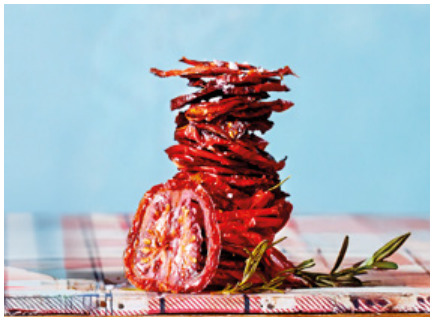

**Ingrediënten voor:** ca. 60 g
**Bereidingstijd:** ca. 5 uur en 30 min.
Houdbaarheid: ca. 1 maand,
luchtdicht verpakt
Verwarm de oven voor (elektrisch: 90°C / hetelucht: 70°C). Was 700 g rijpe tomaten (bijv.
pruimtomaten) en dep droog. Snijd in de lengte
in plakjes van ca. 3 mm dik en verdeel gelijkmatig
over twee met bakpapier beklede bakplaten.
Pel 2 teentjes knoflook en hak fijn. Was 2 takjes
rozemarijn en hak fijn. Roer de rozemarijn, de
knoflook, 4 el olijfolie en ½ tl zout door elkaar.
Bestrijk de tomaat met het mengsel. Laat ca.
5 uur drogen in de oven.

## Zoetzure ingelegde tomaat

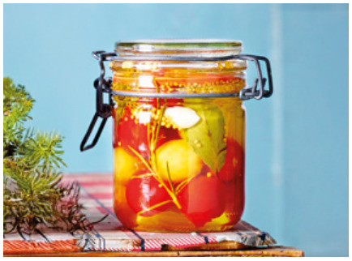

**Ingrediënten voor:** 1 pot (à 400 ml)
**Bereidingstijd:** ca. 30 min. +
ca. 1 dag wachttijd
Houdbaarheid: ca. 2 weken, in de koelkast
Was 150 g cherrytomaten (gele en rode) en prik
ze met een satéprikker twee à drie keer in. Pel
1 teentje knoflook. Was 1 takje rozemarijn. Doe
alles in een weckpot. Breng 250 ml witte
balsamicoazijn, 120 g suiker, 1 tl mosterdzaad
en 1 laurierblaadje aan de kook en laat ca. 5
minuten zachtjes koken. Schenk de hete azijn
over de tomaten, zodat alles bedekt is. Sluit de
pot af en laat ca. 1 dag op smaak komen.
1 2 3 4 5 6 7 8 9 10 11 12 13 14 15 16
**17** 18 19 20 21 22
**23** 24 25 26 27 28 29 30
120
**31** 32 33 34 35 36 37
**38** 39 40 41 42 43 44
**45** 46 47 48 49
**50** 51 52 53 54
**55** 56 57 58 59 60
**61** 62 63 64 65 66 67
**68** 69 70 71 72 73 74
**75** 76 77 78 79 80 81
**82** 83 84 85 86 87 88
**89** 90 91
© DENKSPORT PUZZELBLADEN
S I N L IJ V E N A L G D A G E N L A N G
T A A I D A G I N G R E I Z E N O F E
E N P I E R S A R E N A N I M F A L
M T V B L E S A V O N D D O G E B L IJ
M I A M I N E R G E N S F I T S T E E K
E R O S E R E E D B O A E T A G E
R U I T L O V E N S W A A R D I G K E R S
N A I E F I E T A Z E E O K E R N
D I N E R L E L P R U I L E N E L I T E
R E T I R I S P L E I N M A T E G E L
U K S N O B K R A N T E W E S P E B
I R A M E L O E N J U T T E R E C R U
F E E S T E L IJ K T E E S L E P E N D S frambozen
**89** 45 26 72 33 22 58 81 7
4 5 6 7 8 9 10 11 12 13 14 15 16
**19** 20 21 22
**26** 27 28 29 30
**34** 35 36 37
**40** 41 42 43 44
**46** 47 48 49
**52** 53 54
**90** 91
edurende enige tijd 17 moeilijk breekbaar 19 dagvaarding 20 toeren 22 voegwoord
26 strijdperk 28 bekoorlijk meisje 30 reeds 31 tv-zender 33 witte vlek bij paarden 35 na
et oude Venetië 37 opgetogen 38 stad in de Verenigde Staten 40 op geen enkele
45 lichtrode wijn 47 hertensoort 48 grote wurgslang 49 woonlaag 50 gelijkzijdige vier-
**57** 58 59 60
**62** 63 64 65 66 67
**70** 71 72 73 74
**77** 78 79 80 81
**83** 84 85 86 87 88

## Horizontaal

2 invoegen 8 wier 10 gedurende enige tijd 17 moeilijk breekbaar 19 dagvaarding
20 toeren 22 voegwoord 23 plus 24 regenworm 26 strijdperk 28 bekoorlijk
meisje 30 reeds 31 tv-zender 33 witte vlek bij paarden 35 na zessen 36 hoofd
van het oude Venetië 37 opgetogen 38 stad in de Verenigde Staten 40 op
geen enkele plaats 42 vitaal 43 prik 45 lichtrode wijn 47 hertensoort 48 grote
wurgslang 49 woonlaag 50 gelijkzijdige vierhoek 52 te prijzen 53 steenvrucht
55 onnozel 57 een weinig 58 water 59 verfstof 61 warme hoofdmaaltijd
eenvrucht 55 onnozel 57 een weinig 58 water 59 verfstof 61 warme hoofdmaaltijd
mokken 66 keurkorps 68 Rotterdamsche ElectrischeTram 69 bloem 71 open plek in
62 deel van het oor 63 mokken 66 keurkorps 68 Rotterdamsche Electrische
d 74 haarvet 75 klein kind 76 quasi-kunstkenner 77 dagblad 79 insect 81 laagwater
ge vrucht 85 stranddief 87 crèmekleurig 89 uitbundig 90 afslagplaats bij golf 91 lang-
Tram 69 bloem 71 open plek in een stad 72 hoeveelheid 74 haarvet 75 klein
slokje 4 koket 5 per schip vervoeren 6 landbouwwerktuig 7 opening in de muur
uiterste rand 10 projectieplaatje 11 voetbalclub uit Alkmaar 12 genoegen 13 heel mooi
kind 76 quasi-kunstkenner 77 dagblad 79 insect 81 laagwater 82 dwarsmast
83 sappige vrucht 85 stranddief 87 crèmekleurig 89 uitbundig 90 afslagplaats
bij golf 91 langdurig.

## Verticaal

1 kiezer 2 ezelsgeluid 3 slokje 4 koket 5 per schip vervoeren 6 landbouwwerktuig
7 opening in de muur 8 tropische vetplant 9 uiterste rand 10 projectieplaatje
11 voetbalclub uit Alkmaar 12 genoegen 13 heel mooi 14 eer 15 gereed 16 meteen
18 tegen 21 stuk 25 nijlreiger 27 spoken 29 plantenvoeding 30 voordat
een 18 tegen 21 stuk 25 nijlreiger 27 spoken 29 plantenvoeding 30 voordat 32 afwijitieman 36 koninklijk hoofdtooisel 37 inhalig 39 voorstel 41 wezenlijk 42 vis 44 hijstoe-
32 afwijking 34 vaatwerk 35 politieman 36 koninklijk hoofdtooisel 37 inhalig
48 eigenares 49 ik (Latijn) 51 enig 54 openbaar vervoer 56 daarbinnen 60 hondenras
ct 63 gewas 64 pleziertocht 65 pijnlijk gevolg 67 frêle 70 plaats in Italië 71 pluspunt
39 voorstel 41 wezenlijk 42 vis 44 hijstoestel 46 sprookjesfiguur 48 eigenares
76 sluiskolk 77 beroep 78 kunstwerk 80 schrijfbenodigdheid 82 muzieknoot 84 van de
49 ik(Latijn)51 enig54 openbaar vervoer56 daarbinnen60 hondenras61 vrucht
62 groot insect 63 gewas 64 pleziertocht 65 pijnlijk gevolg 67 frêle 70 plaats in
Italië 71 pluspunt 73 Friese vluchtheuvel 76 sluiskolk 77 beroep 78 kunstwerk
80 schrijfbenodigdheid 82 muzieknoot 84 van de wind afgekeerde zijde
86 theelepel (afk.) 88 compact disc.
86 theelepel (afk.) 88 compact disc.
Kruiswoord
ers uit de genummerde vakjes over naar de gelijkgenummerde vakjes van de oplossingsbalk.
© DENKSPORT PUZZELBLADEN
**89** 45 26 72 33 22 58 81 7
VUL DE PUZZEL IN EN MAAK KANS
OP 1 VAN DE 3 EXEMPLAREN VAN

## Uit Paulines Keuken Magazine

## t.w.v. 12,99 euro

Op de website van Uit Paulines Keuken vind je al 15 jaar de lekkerste
recepten – hoog tijd om de allerbeste daarvan te bundelen in een
magazine. In het allereerste Uit Paulines Kookt-magazine vind je
heerlijke recepten uit de Italiaanse keuken, maaltijden die je makkelijk in de airfryer maakt, gerechten die in een handomdraai op
tafel staan, frisse salades, wereldse gerechten, traybakes, feestelijke
recepten en natuurlijk de lekkerste succesrecepten van de afgelopen
15 jaar. Een must have voor iedereen die van koken houdt!
SPECIALE UITGAVE: HET BESTE UIT 15 JAAR
Stap-voor-stap uitleg
€12,99
Bak je eigen
Uit Paulines Keuken
Het beste van
UPK_001000_Cover_ok.indd 1
verrassende
UPK_001000_Cover_ok.indd 1 18-04-2025 11:04
desembrood
18-04-2025 11:04
recepten
makkelijk
Snel & makkelijk
Binnen
Uit de Airfryer
**30** minuten
Snel klaar
op tafel
lekkere &
Easy traybakes
Lekker Italiaans
Salades
Werelds
Weekend
Zoet
Lekkere
borrelhappen
Comfort food
BP
Voor-, hoofd- en nagerechten voor iedere dag
Lekker &
Titel: Uit Paulines Keuken
Magazine
Auteur: Uit Paulines Keuken
Uitgeverij: F&L Media
Prijs: 12,99 euro
Het antwoord kun je vóór 19 augustus 2025
sturen naar: koken & genieten, o.v.v. oplossing puzzel
Postbus 296, 6500 AG Nijmegen
Of op onze website: kokengenieten.nl/puzzel
De Italianen staan bekend om hun lekkere pasta’s, maar
ook in andere landen kunnen ze er wat van! Probeer deze
pastagerechten van over de hele wereld.

# Hasta la pasta!

## Zomerse ravioli uit de oven

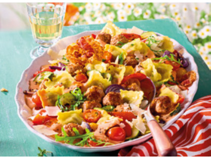

**Ingrediënten voor:** 6 personen
**Bereidingstijd:** ca. 1 uur
**500 g** gekruid half-om-halfgehakt
**75** g
pancetta (Italiaans spek, in
dunne plakjes, of gebruik
gerookt ontbijtspek)
**1** courgette
**2** rode paprika’s
**2** rode uien
**12 takjes** tijm
zout en peper
**4 el** olijfolie
**400** g
cherrytomaten (bijv. gele en
rode)
**200 ml** slagroom
**300 ml** tomatensap
**500** g
ravioli (koeling, bijv. met
paddenstoelenvulling)
**50 g** parmezaan (stuk)
**30 g** rucola
1 Maak met licht vochtige handen ca. 24 balletjes
van het gehakt. Bak de pancetta krokant in een
droge koekenpan. Neem uit de pan en laat uitlekken. Bak de gehaktballetjes in ca. 5 minuten
rondom goudbruin in het hete bakvet. Neem uit
de pan.
2 Verwarm de oven voor (elektrisch: 220°C /
hetelucht: 200°C). Was de courgette, halveer hem
in de lengte en snijd in plakjes. Snijd de paprika’s
in kwarten, verwijder de zaadlijsten, was de
paprika’s en snijd ze in stukken. Pel de uien en
snijd in partjes. Was de tijm en ris de blaadjes van
de takjes. Doe de voorbereide groenten, de ui en
⅔ van de tijm in een braadslee en meng met zout,
peper en de olijfolie. Rooster ca. 10 minuten in
de oven.
Seizoen
3 Was de tomaten en halveer ze naar grootte.
Verdeel de gehaktballetjes en de tomaten over de
groenten en bak nog ca. 5 minuten. Roer de slagroom en het tomatensap door elkaar, schenk in de
braadslee en bak nog ca. 15 minuten.
4 Kook de ravioli volgens de aanwijzingen op de
verpakking gaar in water met wat zout. Giet af,
spatel de ravioli door de groenten en bak nog ca.
5 minuten in de oven. Breng op smaak met zout
en peper en bestrooi met de rest van de tijm.
Schaaf de parmezaan erboven. Was de rucola en
strooi over de ravioli. Bestrooi met de krokante
pancetta.
**Per portie:** ca. 730 kcal
**20 g** eiwit | 48 g vet | 50 g koolhydraten

## Udonnoedels

## met koningsoesterzwam

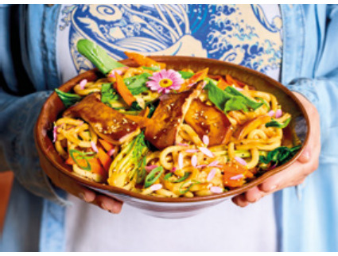

**Ingrediënten voor:** 4 personen
**Bereidingstijd:** ca. 25 min.
**600 g** voorgegaarde udonnoedels
zout en peper
3
Shanghaipaksoi (ca. 200 g, of
gewone paksoi)
**4** lente-uitjes
**2** wortels
**4 el** olie (bijv. sesamolie)
4 koningsoesterzwammen (ca.
**200** g)
**10 el** sojasaus
**1 el** sriracha (Thaise pittige saus)
**50** g
veldzuring (op de markt of bij
de groentewinkel, of vervang
door rucola)
ca. 12
onbespoten madeliefjes, om
te garneren
**2 tl** sesamzaad
1 Kook de noedels volgens de aanwijzingen op de
verpakking gaar in water met wat zout. Laat goed
uitlekken.
2 Was de paksoi en snijd naar grootte in de lengte
in vieren of in zessen. Was de lente-uitjes en snijd
ze in ringetjes. Schrap de wortels, was ze, halveer
in de lengte en snijd schuin in plakjes. Verhit
**2 el** olie in een wok of grote koekenpan en bak de
groenten rondom ca. 8 minuten erin.
3 Maak de oesterzwammen schoon en snijd in de
lengte in drieën. Verhit 2 el olie in een koekenpan
op hoog vuur en bak de zwammen ca. 3 minuten
per zijde erin. Blus af met 2 el sojasaus en 2 el
water, breng aan de kook en laat ca. 2 minuten
zachtjes koken.
4 Doe de udonnoedels bij de groenten en bak
ca. 3 minuten mee. Breng de groenten en noedels
op smaak met 8 el sojasaus, de sriracha en wat
peper. Was de veldzuring, snijd in reepjes en
spatel door de noedels. Serveer de noedels met de
oesterzwammen. Garneer met de madeliefjes en
bestrooi met het sesamzaad.
**Per portie:** ca. 470 kcal
**19 g** eiwit | 14 g vet | 64 g koolhydraten

## Spaghettipizza met salami

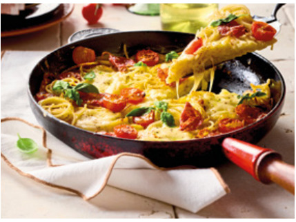

**Ingrediënten voor:** 2 personen
**Bereidingstijd:** ca. 30 min.
**150 g** spaghetti
zout en peper
**2** eieren
**8 el** slagroom
**50 g** geraspte kaas
nootmuskaat
**1 tl** Italiaanse kruiden (diepvries)
**2 el** olijfolie
**125 g** mozzarella
8 plakjes salami (ca. 40 g,
bijv. venkelsalami)
**6** cherrytomaten
**4 takjes** basilicum
Seizoen
1 Kook de spaghetti volgens de aanwijzingen op de verpakking gaar in water met wat zout. Roer de
eieren, de slagroom en de kaas door elkaar. Roer zout, peper en nootmuskaat erdoorheen. Roer de
kruiden erdoorheen. Bestrijk een ovenbestendige koekenpan (26 cm Ø) met 1 el olie en verhit op het
fornuis.
2 Verwarm de oven voor (elektrisch: 220°C / hetelucht: 200°C). Giet de spaghetti af en verdeel
gelijkmatig over de pan. Schenk het eimengsel erover. Snijd de mozzarella in plakjes en verdeel met de
salami over de spaghetti. Bak ca. 3 minuten op middelhoog vuur. Was de tomaten, halveer ze en verdeel
over de pizza. Besprenkel met 1 el olie en bak ca. 15 minuten in de oven. Was het basilicum, neem de
blaadjes van de takjes en strooi over de pizza.
**Per portie:** ca. 900 kcal
**38 g** eiwit | 55 g vet | 58 g koolhydraten

## Griekse orzoschotel

## met gyros

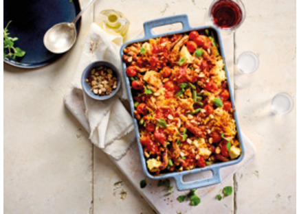

**Ingrediënten voor:** 6 personen
**Bereidingstijd:** ca. 1 uur en 15 min.
4-5 varkensschnitzels (ca. 600 g)
**1 el** gyroskruiden
**6 el** olijfolie
**500 g** orzo
zout en peper
**2** rode uien
**2** teentjes knoflook
**800 g** cherrytomaten (blik)
**200 ml** groentebouillon
**2 tl** gedroogde oregano
kaneel
5-6 el ouzo (Griekse sterke drank,
bij de slijter)
**400 g** sperziebonen
**400 g** witte bonen (blik)
**200 g** feta
**1** bio-citroen
**1 tl** paprikapoeder
**50 g** geroosterde, gezouten
amandelen
**3-4 takjes** oregano
1 VOOR HET VLEES Dep de schnitzel droog en
snijd in reepjes van ca. 1 cm breed. Kneed met de
gyroskruiden en 3 el olie door elkaar. Laat ca. 10
minuten trekken.
2 VOOR DE PASTA Kook de orzo volgens de aanwijzingen op de verpakking al dente in water met
wat zout. VOOR DE SAUS Pel en snipper de uien
en de knoflook heel fijn. Verhit 2 el olie in een pan
en bak de ui en de knoflook glazig erin. Voeg de
cherrytomaten inclusief sap en
de bouillon toe en breng aan
de kook. Laat zonder deksel
ca. 10 minuten zachtjes
koken. Breng de saus op
smaak met de oregano, zout,
peper, kaneel en de ouzo.
**3** VOOR DE GROENTEN Was de
sperziebonen, halveer ze naar grootte
en kook in 8-10 minuten gaar in een pan
water met wat zout. Laat de witte bonen
uitlekken.
4 Verwarm de oven voor (elektrisch: 200°C / hetelucht: 180°C). Bak het gyrosvlees in een droge
koekenpan al roerend in ca. 10 minuten gaar.
Neem van het vuur. Giet de orzo en de sperziebonen af. Doe de voorbereide ingrediënten met
de tomatensaus in een ovenschaal (20 x 30 cm).
Verbrokkel de feta grof en verdeel erover. Was
de citroen en rasp de schil er fijn af. Bestrooi de
ovenschotel met de citroenschil en het paprikapoeder. Besprenkel met 1 el olie. Bak ca. 30
minuten in de oven. Hak de amandelen. Was de
oregano en neem de blaadjes van de takjes. Neem
de ovenschotel uit de oven en bestrooi met de
amandelen en de oregano.
**Per portie:** ca. 800 kcal
**45 g** eiwit | 34 g vet | 72 g koolhydraten
Seizoen

## Frisse pastasalade

## met venkel en Griekse yoghurt

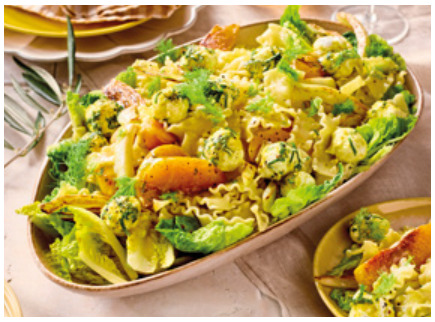

**Ingrediënten voor:** 6-8 personen
**Bereidingstijd:** ca. 50 min. +
ca. 12 uur wachttijd
**500 g** Griekse yoghurt
**1 tl** zout (+ extra)
4
kleine venkels (ca.
**500** g)
**450 g** pruimen (bijv. gele)
**12 el** olijfolie
peper
**500** g
lange pasta (bijv.
mafaldine)
**2** kropjes babyromainesla
**4 takjes** munt
**1 el** ras el hanout
**2-3 el** witte balsamicoazijn
kaasdoek
1 EEN DAG VAN TEVOREN VOOR DE YOGHURTBALLETJES Roer de yoghurt en
het zout door elkaar. Leg een kaasdoek in een zeef en zet dit op een kom. Doe
de yoghurt in het kaasdoek en laat een nacht uitlekken in de koelkast.
2 DE VOLGENDE DAG VOOR DE SALADE Was de venkels, houd het loof apart
en snijd de venkels in partjes van ca. 1 cm. Was de pruimen, halveer ze,
verwijder de pit en snijd elk in acht partjes. Verhit 2 el olie in een grote
koekenpan en bak de venkel ca. 8 minuten erin. Bak de pruimen ca. 3
minuten mee. Breng op smaak met zout en peper en houd apart.
3 Kook de pasta volgens de aanwijzingen op de verpakking gaar in water met
wat zout. Giet af. Was de sla, snijd in kwarten en snijd in reepjes.
4 Was de munt, snijd hem fijn en roer met 4 el olie en de ras el hanout door
elkaar. Knijp de yoghurt in het kaasdoek uit. Maak met behulp van twee
theelepeltjes ca. 24 balletjes van de yoghurt. Wentel ze door de kruidenolie.
5 Meng de pasta, de venkel, de pruimen, de sla, 6 el olie, de azijn, zout en
peper in een grote kom met elkaar. Breng de salade op smaak met zout en
peper en verdeel over een grote schaal. Verdeel de yoghurtballetjes erover.
Bestrooi met het venkelloof.
**Per portie:** ca. 480 kcal
**12 g** eiwit | 23 g vet | 53 g koolhydraten
Lekker eten valt of staat met de ingrediënten die je
gebruikt en het keukengerei dat je tot je beschikking hebt.
Daarom presenteren wij elke maand leuke, verrassende,
handige en/of smakelijke producten.

# CAPPUCCINO

# IEMAND?

De Italianen zijn er heel stellig over: na 11.00 ’s ochtends
drink je geen cappuccino meer. Maar wat je thuis doet, mag
je natuurlijk lekker zelf weten. Zo staat er heel eigenwijs op
deze koffiekopjes geschreven: ‘served all day’.
Prijs voor kop en schotel: €4,-. Verkrijgbaar via hm.com

# Citroenschaaltjes

Bij een zomers drankje kan een kleine snack niet

# MOOI GLAS

Een lekkere prosecco om je diner mee af
ontbreken natuurlijk. Wij serveren het liefst wat
te trappen, een zomerse cocktail of een
bolletje zelfgemaakt ijs? Je serveert het
deze zomer in deze prachtige glazen van
olijven en wat mooie noten bij de borrel. Doe dat deze
HEMA. De kleuren groen en roze geven
een retro tintje aan deze mooie glazen!
zomer in dit mooie serveerschaaltje in de vorm van
Prijs: €4,95. Verkrijgbaar via hema.nl
twee citroenen.
olijven en wat mooie noten bij de borrel. Doe dat deze
zomer in dit mooie serveerschaaltje in de vorm van
Prijs: €20,-. Verkrijgbaar via hm.com

# Citroenschaaltjes

# MOOI GLAS

Een lekkere prosecco om je diner mee af
te trappen, een zomerse cocktail of een
bolletje zelfgemaakt ijs? Je serveert het
deze zomer in deze prachtige glazen van
HEMA. De kleuren groen en roze geven
een retro tintje aan deze mooie glazen!
Prijs: €4,95. Verkrijgbaar via hema.nl

# Pakjouw

# MAGAZINE

# moment

# tot 35%

# korting!

# Abonneer je nu voordelig via

# kokengenieten.nl/

# actie

# kokengenieten.nl/

De actieperiode loopt t/m 3 augustus.

## Scan mij!

Receptuur: Letitia Clark Fotografie: Charlotte Bland

# Op en top zomer

Kookboek
Klaar voor de zomer? Bijna! Want naast de zomeressentials zoals
zonnebril, zonnebrand en een kek badpak, mag ook dit kookboek niet
ontbreken. Zonnige recepten met een vleugje citroen. Om van te genieten
na een fijne dag aan het strand of op een luie zomerdag in je achtertuin.
Tekst: Yvonne Doorten
Titel: For the Love of Lemons
Auteur: Letitia Clark
Fotografie: Charlotte Bland
Prijs: 29,99 euro
Uitgeverij: Becht – Harper Collins NL
zonnebril, zonnebrand en een kek badpak, mag ook dit kookboek niet
ontbreken. Zonnige recepten met een vleugje citroen. Om van te genieten
na een fijne dag aan het strand of op een luie zomerdag in je achtertuin.
Tekst: Yvonne Doorten
Titel: For the Love of Lemons
Auteur: Letitia Clark
Fotografie: Charlotte Bland
Prijs: 29,99 euro
Uitgeverij: Becht – Harper Collins NL

## Burrata met citroenige lentegroenten

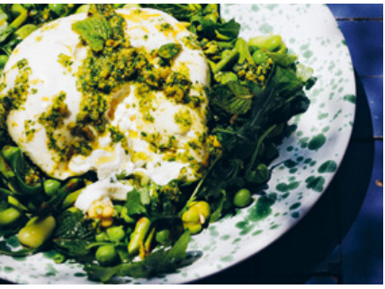

**Ingrediënten voor:** 2 personen
**Bereidingstijd:** ca. 20 min.
**1** grote handvol verse
doperwtjes, gedopt
een paar groene
asperges, in korte
stukjes
**1** grote handvol verse
tuinbonen
geraspte schil en sap
van 1 citroen
zeezout
extra vierge olijfolie,
voor het besprenkelen
**1** grote handvol rucola
**1** grote handvol verse
groene kruiden, grof
gehakt, bijv. munt,
basilicum, peterselie
**1-2** bollen burrata
**VOOR DE** PESTO
**60 g** gedopte pistachenoten
**½ teen** knoflook, zeer
fijn gehakt
zeezout
**1** handvol muntblaadjes
**1** handvol basilicumblaadjes
**20 g** Parmezaanse kaas of
pecorino, fijn geraspt
geraspte schil en sap
van ½ citroen
**50 ml** olijfolie
1 Schik alle verse groenten op een serveerbord en
strooi de citroenrasp erover. Knijp het sap erover
uit, breng flink op smaak met zout en besprenkel
royaal met je beste olijfolie. Meng alles voorzichtig en bestrooi vervolgens met de rucolablaadjes
en verse kruiden.
2 Leg de burrata midden op het bord, besprenkel
ook met olie en strooi er een beetje zout over.
3 VOOR DE PESTO Hak de pistachenoten met de
knoflook, wat zout en de kruiden op een snijplank
tot een grove pasta. Schraap in een kom en voeg
de geraspte kaas en citroenrasp toe. Roer er wat
druppels olijfolie en een kneepje citroensap door
tot de pesto een schepbare consistentie heeft.
Proef en voeg naar smaak eventueel extra citroen
of zout toe. Schep de pesto over de burrata en
salade en serveer.

## Burrata met

## citroenige lentegroenten

## Courgette-carbonara

## met citroen

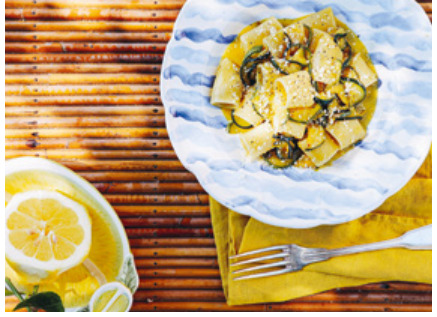

**Ingrediënten voor:** 2 personen
**Bereidingstijd:** ca. 30 min.
**4** el
extra vierge olijfolie (+ extra,
voor erbij)
**1 teen** knoflook, gekneusd
2
middelgrote courgettes, in de
lengte gehalveerd en in halve
maantjes
zeezout
**180 g** pasta naar keuze
**1** ei
**2** eidooiers
**4** el
geraspte pecorino of
Parmezaanse kaas
1
citroen, schil geraspt en de
helft geperst
verse basilicumblaadjes, om
te garneren
1 Verhit de olie in een koekenpan op middellaag
vuur. Bak de teen knoflook erin tot de olie net
begint te sissen en de knoflook lekker begint
te ruiken. Voeg de courgettes toe en bak onder
regelmatig omscheppen tot ze rondom goudbruin zijn, uit elkaar beginnen te vallen en bijna
jamachtig worden. Breng op smaak met flink wat
zout en zet apart (of laat afkoelen en bewaar in de
koelkast voor later gebruik).
2 Kook de pasta volgens de aanwijzingen op de
verpakking al dente in een grote pan flink gezouten water.
3 Schep intussen het ei, de eidooiers, kaas, citroenrasp en het sap door het courgettemengsel.
Verwarm al roerend op laag vuur. Schep de pasta
met een schuimspaan direct in de courgettepan,
samen met een scheutje pastakookwater. Roer
op laag vuur totdat je een romige saus hebt die de
pasta bedekt. Proef en breng zo nodig verder op
smaak. Voeg een paar verse basilicumblaadjes,
extra kaas en een scheutje van je beste olie toe en
serveer.
Kookboek

## Instant mascarponemousse van citroen & witte

## chocolade

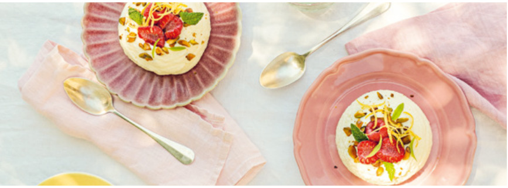

**Ingrediënten voor:** ca. 2 personen
**Bereidingstijd:** ca. 15 min.
**100 g** witte chocolade
**200 ml** slagroom, op
kamertemperatuur
geraspte schil van 1 citroen
(+ extra, voor erover)
**100 g** mascarpone
**1** scheutje melk (optioneel)
VOOR EROVER
**1** handvol gezouten
pistachenoten, grof gehakt
**150 g** frambozen
een paar takjes verse munt
1 Laat de chocolade zachtjes in een glazen kom op
een steelpan met pruttelend water smelten; roer
af en toe door (de onderkant van de kom mag het
water niet raken).
2 Klop in een andere kom de slagroom tot zachte
pieken. Klop de citroenrasp door de chocolade en
spatel de slagroom er voorzichtig door. Klop dan
de mascarpone erdoor tot je een glad geheel hebt.
Voeg als het er korrelig gaat uitzien een scheutje
melk toe en ga door met mixen. Giet de mousse in
een serveerkom.
3 Serveer de mascarponemousse meteen of na
hem even koel te hebben gezet, bestrooid met de
gehakte gezouten pistachenoten en frambozen,
wat extra citroenrasp en een takje munt. Je kunt
de frambozen ook in een beetje vers citroensap
en suiker marineren om het geheel iets sappiger
te maken.

## Citroenrepen met

## polentadeeg en olijfolie

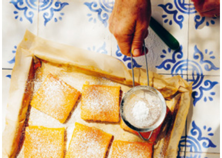

**Ingrediënten voor:** ca. 8-10 blokjes
**Bereidingstijd:** ca. 1 uur
**VOOR DE** BODEM
**100 g** tarwebloem of bloem type 00
**60 g** polenta (maismeel)
**120 g** boter
**1** flinke snuf zout
geraspte schil van 1 citroen
**6 el** suiker
bakpapier
**VOOR DE** CURD
**2** eieren
**3** eidooiers
**4** citroenen, alleen het sap
**280 g** suiker
**2 tl** maizena
Snufje zout
**60 ml** extra vierge olijfolie
**70 g** boter
poedersuiker, ter decoratie
1 Verwarm de oven voor (elektrisch: 170°C / hetelucht: 150°C). Bekleed een brownievorm van 25 x
25 centimeter met bakpapier.
2 VOOR DE BODEM Maal alle ingrediënten in een
keukenmachine tot een fijne, vochtige, zanderige
textuur. Druk het mengsel op de bodem van de
vorm met de bolle kant van een lepel tot een vlakke, gelijkmatige laag aan. Bak de bodem 20-30
minuten in de oven tot hij overal goudbruin is en
koekjesachtig ruikt.
3 VOOR DE CURD Weeg alle ingrediënten behalve
de olijfolie en boter direct in een steelpan af en
klop glad. Verhit de curd al kloppend op halfhoog
vuur tot hij dik is. Het mengsel moet aan de kook
komen en dikt dan na een paar minuten in. Neem
de pan van het vuur en zeef de curd in een kom.
Klop de olie en boter erdoor tot de curd mooi glad
is.
4 Schenk de curd over de gebakken bodem en zet
het geheel nog 10-15 minuten in de oven tot de
curd net is gestold. Neem de vorm uit de oven en
laat afkoelen, snijd de plak in vierkantjes, bestuif
met poedersuiker en serveer.
Kookboek

# Zomerkruiden

Peterselie, basilicum en munt zijn tegenwoordig het
hele jaar verkrijgbaar, maar in de zomer gebruiken we
ze toch ’t meest. Lekker in frisse salades, soepen of
drankjes.

## Koolvis met romige

## komkommersalade

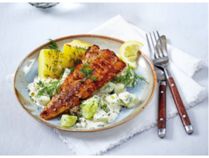

**Ingrediënten voor:** 4 personen
**Bereidingstijd:** ca. 30 min.
**750 g** aardappels
zout en peper
**1** ui
**2** komkommers
**1 bosje** verse dille
**1** citroen
**4 el** boter
**125 ml** groentebouillon
**300 g** crème fraîche
**1 tl** mosterd
**600 g** koolvisfilet
1 Schil de aardappels, was ze en kook in een pan
met gezouten water in ca. 20 minuten gaar. Pel
en snipper de ui. Was de komkommers en snijd ze
in blokjes. Was de dille, houd een beetje apart en
snijd de rest fijn. Was en halveer de citroen. Pers
één helft uit en snijd de andere helft in partjes.
2 Verhit 1 el boter in een koekenpan en bak daarin
de ui en de komkommer 3-4 minuten. Voeg de
bouillon toe en breng aan de kook. Roer de crème
fraîche, de mosterd en het citroensap erdoorheen. Laat ca. 2 minuten zachtjes koken. Voeg de
dille toe en breng het geheel op smaak met zout
en peper.
3 Dep de vis droog en snijd in 4 stukken. Verhit
**2 el** boter in een koekenpan op middelhoog vuur
en bak de vis aan beide zijden 2-3 minuten erin.
Neem uit de pan. Giet de aardappels af. Verhit 1 el
boter in het bakvet van de vis en voeg de aardappels daaraan toe. Schep goed om.
4 Verdeel de komkommersalade over de borden.
Leg de vis erbovenop. Serveer met de aardappels.
Garneer met de rest van de dille en citroenpartjes.
**Per portie:** ca. 530 kcal
**34 g** eiwit | 28 g vet | 31 g koolhydraten

## Koude erwten-muntsoep

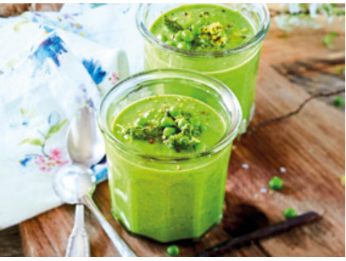

**Ingrediënten voor:** 4 personen
**Bereidingstijd:** ca. 20 min.
+ 3u wachttijd
**1** rode ui
**5 el** olijfolie
**3** laurierblaadjes
**800 g** doperwten (diepvries)
**500 ml** groentebouillon
**1 bosje** verse munt
**4 takjes** verse tijm
**1** bio-citroen
zout en peper
1 Pel en snipper de ui. Verhit 2 el olijfolie in een
kookpan op middelhoog vuur. Bak de ui glazig
erin. Voeg de laurierblaadjes en de doperwten
toe en bak kort mee. Blus het geheel af met de
bouillon en breng aan de kook. Laat ca. 5 minuten
zachtjes koken.
2 Was de munt en de tijm en neem de blaadjes
van de takjes. Was de citroen en rasp de schil fijn.
De gezonde keuken
Schep 2 el erwten en de laurierblaadjes uit de
soep. Houd de erwten apart voor de garnering.
3 Voeg de helft van de kruiden, het citroensap en
de helft van de citroenschil toe aan de erwten en
pureer met een staafmixer tot een gladde soep.
Breng op smaak met zout en peper. Laat de soep
afkoelen en zet daarna minimaal 2 uur in de
koelkast.
4 VOOR DE TOPPING Maal de overige munt en
tijm met 3 el olijfolie glad in een blender of met
een staafmixer. Breng op smaak met zout en
peper. Verdeel de soep over kommen. Garneer
met de kruidenolie, de apart gehouden erwten en
de rest van de citroenschil.
**Per portie:** ca. 310 kcal
**15 g** eiwit | 14 g vet | 27 g koolhydraten

## Frisse salade

## met gegrilde kip

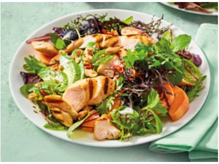

**Ingrediënten voor:** 4 personen
**Bereidingstijd:** ca. 35 min.
**1** bio-limoen
**2** rode chilipepers
**100 ml** kokosmelk
**2 el** agavesiroop
**4 el** olijfolie
zout en (grofgemalen) peper
**300 g** slamelange
**1 bosje** verse koriander
**4 takjes** verse munt
**4 takjes** citroenmelisse
**1** grote avocado
**1** papaya
**100 g** cashewnoten
**400 g** kipfilet
1 VOOR DE DRESSING Was de limoen en rasp
de schil er fijn af. Pers de limoen uit. Snijd de
chilipepers in de lengte open. verwijder de zaadlijsten en was de pepers. Hak 1 peper fijn en snijd
de ander in ringetjes. Meng de kokosmelk met
de agavesiroop. Roer de gehakte chilipeper, het
limoensap (houd 1-2 el apart) en de limoenschil
door elkaar. Klop 2 el olijfolie erdoorheen. Breng
de dressing op smaak met zout en peper.
2 VOOR DE SALADE Was de sla. Was de munt,
de melisse en de koriander en neem de blaadjes
van de takjes. Snijd de avocado doormidden en
verwijder de pit. Snijd het vruchtvlees in plakken.
Besprenkel de avocado met 1-2 el limoensap.
3 Schil en halveer de papaya. Verwijder de pitjes
en snijd het vruchtvlees in plakken. Rooster de
cashewnoten goudbruin in een droge koekenpan.
Neem uit de pan.
4 VOOR DE KIP Dep de kipfilet droog. Bestrooi
met zout en peper. Verhit 2 el olijfolie in een
grillpan en bak de kip ca. 5 minuten per zijde gaar
erin. Neem uit de pan en snijdt schuin in plakken.
5 Verdeel de sla, de kruiden, de avocado, de papaya en de kip over borden. Besprenkel de salade
met de kokos-chilidressing. Garneer met de
geroosterde cashewnoten, de chilipeperringetjes
en eventueel grofgemalen zwarte peper.
**Per portie:** ca. 330 kcal
**27 g** eiwit | 17 g vet | 14 g koolhydraten

## Courgetti

## met kruidenpesto

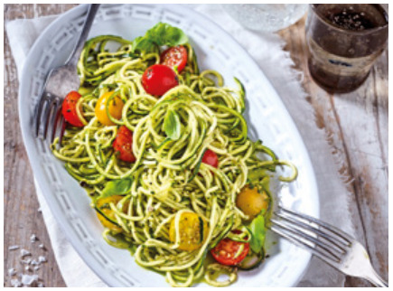

**Ingrediënten voor:** 4 personen
**Bereidingstijd:** ca. 25 min.
**1 bosje** basilicum
**4 takjes** peterselie
**1** teentje knoflook
**50 g** parmezaan (stuk)
**75 ml** olijfolie
zout en peper
**2-3** courgettes (ca. 600 g)
**150 g** rode en gele cherrytomaten
spiraalsnijder
1 VOOR DE PESTO Was het basilicum en de peterselie en neem de blaadjes van de takjes. Pel en
snipper de knoflook. Rasp de parmezaan. Houd
een beetje basilicum achter voor het garneren.
Maal het overige basilicum, de peterselie, de
knoflook, de parmezaan en de olie tot een gladde
pesto. Proef en breng eventueel op smaak met
zout en peper.
2 VOOR DE PASTA Was de courgettes en snijd er
met een spiraalsnijder dunne slieren van. Was en
halveer de tomaten. Verhit 2 el pesto in een koekenpan op middelhoog vuur en voeg de courgetti
toe. Bak ca. 3 minuten voorzichtig omscheppend.
3 Voeg de rest van de pesto en de tomaten toe en
meng voorzichtig. Breng de courgetti op smaak
met zout en peper. Verdeel de courgetti over borden. Garneer met de apart gehouden basilicum.
**Per portie:** ca. 250 kcal
**7 g** eiwit | 23 g vet | 5 g koolhydraten
De gezonde keuken

# Groeten uit

# de moestuin

Heb je courgettes in overvoed in je tuin? Wat een
geluk! Gevuld, gegrild of in een dip: met deze
zomergroente kun je alle kanten op.

## Biefstuk

## met courgette-fetasalade

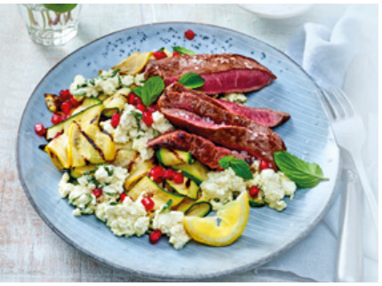

**Ingrediënten voor:** 4 personen
**Bereidingstijd:** ca. 40 min.
**400 g** gele courgette
**400 g** groene courgette
**1** granaatappel
**4 takjes** munt
**1** citroen
**4** biefstukken (à 175 g)
**2 el** olijfolie
zout en peper
grof zeezout
**200 g** feta
1 Was de courgettes en snijd in de lengte in zeer
dunne plakken. Dat gaat het beste met een
dunschiller. Snijd de granaatappel doormidden
en klop de pitjes eruit. Was de munt en neem de
blaadjes van de takjes. Houd er een paar apart en
snijd de rest fijn. Pers de citroen uit.
2 Dep de biefstukken droog met keukenpapier.
Verhit de olie in een koekenpan. Bak de biefstuk
op hoog vuur ca. 3 minuten per zijde. Verhit een
grillpan en bak de courgetteplakken ca. 2 minuten per zijde tot er grillstrepen ontstaan. Breng
de courgette op smaak met zout en peper.
3 Verkruimel de feta en meng met het citroensap
en de fijngesneden munt. Breng op smaak met
zout en peper en meng met de courgette en de
granaatappelpitjes. Breng de biefstuk op smaak
met zout en peper. Serveer de biefstuk met de
salade en bestrooi met de overige muntblaadjes.
**Per portie:** ca. 530 kcal
**62 g** eiwit | 25 g vet | 10 g koolhydraten

## Gevulde courgette

## met ham en bulgur

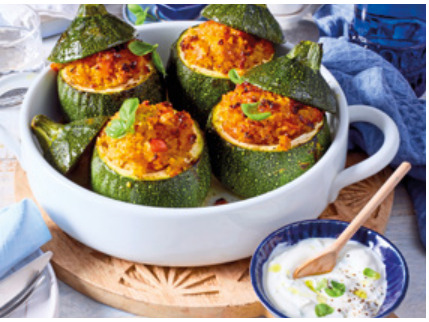

**Ingrediënten voor:** 4 personen
**Bereidingstijd:** ca. 1 uur
**4** bolcourgettes (à 350 g)
**1** ui
**2** tomaten
**100 g** gekookte ham
**6** el
olijfolie (+ extra, voor
invetten)
**1 el** tomatenpuree
**600 ml** groentebouillon
**300 g** bulgur
zout en peper
gemalen komijn
**4 takjes** basilicum
**250 g** Griekse yoghurt
**1 tl** citroensap
1 Was de courgettes, snijd van de bovenkant een
deksel af en houd apart. Hol de courgette uit en
snijd het vruchtvlees fijn. Pel en snipper de ui.
Was de tomaten en snijd in kleine blokjes. Snijd
de ham in kleine blokjes.
2 Verhit 2 el olie in een grote hapjes- of stoofpan
en bak de ham kort erin aan. Voeg de ui en het
courgettevruchtvlees toe en bak ca. 3 minuten
Favoriet van de maand
mee. Voeg de tomatenpuree toe en bak kort mee.
Blus af met de bouillon, breng aan de kook en doe
de bulgur erbij. Kook de bulgur in 12-15 minuten
gaar. Breng op smaak met zout en komijn. Roer
de tomatenblokjes erdoorheen. Verwarm de oven
voor (elektrisch: 200°C / hetelucht: 180°C).
3 Bestrooi de binnenkant van de courgettes licht
met zout en zet ze in een ingevette ovenschaal.
Vul de courgettes met het bulgurmengsel. Leg de
deksels erbij in de ovenschaal. Besprenkel het
geheel met 4 el olie en bestrooi met zout en peper.
Bak de courgettes 35-40 minuten in de oven.
4 Was het basilicum, houd een paar blaadjes
apart en hak de rest in fijn. Meng de yoghurt met
het citroensap en het fijngesneden basilicum.
Breng op smaak met zout en peper. Serveer de
courgettes met de basilicumyoghurt en maak af
met de apart gehouden basilicumblaadjes.
**Per portie:** ca. 590 kcal
**22 g** eiwit | 24 g vet | 68 g koolhydraten

## Zomerse gehaktschotel

## met basilicumcrunch

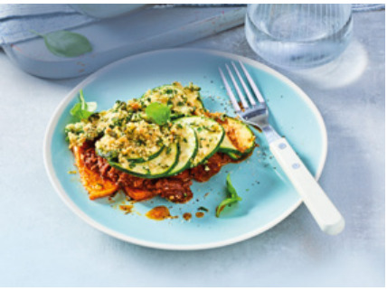

**Ingrediënten voor:** 4 personen
**Bereidingstijd:** ca. 50 min.
**400 g** zoete aardappel
**1 bosje** tijm
**8 el** olijfolie
zout en peper
**1** ui
**1 teen** knoflook
**500 g** rundergehakt
**2 el** tomatenpuree
**1 tl** gemalen komijn
**250 g** tomatenpassata
**2** courgettes (ca. 400 g)
**4 takjes** basilicum
**4 el** geraspte parmezaan
**1 tl** geraspte bio-citroenschil
**3 el** paneermeel
1 Verwarm de oven voor (elektrisch: 200°C hetelucht: 180°C). Schil de zoete aardappels. Was ze
en snijd ze in de lengte doormidden en in plakken
van ca. ½ cm dik. Was de tijm en ris de blaadjes
van de takjes. Meng de zoete aardappel, de helft
van de tijm en 4 el olie in een ovenschaal (ca. 20
x 30 cm) en bestrooi met zout en peper. Bak ca.
20 minuten in de oven.
2 Pel en snipper de ui en de knoflook. Verhit
2 el olie in een pan en bak het gehakt rul erin.
Voeg de ui en de knoflook toe en bak even mee.
Voeg de tomatenpuree toe en bak mee. Breng op
smaak met de rest van de tijm, zout en de komijn.
Schenk de tomatenpassata erbij, breng aan de
kook en laat ca. 10 minuten koken. Breng op
smaak met zout en peper.
3 Was de courgette en snijd in dunne plakjes. Was
de basilicum en hak fijn. Meng de basilicum met
de parmezaan, de citroenschil, het paneermeel
en 2 el olie.
4 Neem de zoete aardappel uit de oven. Verdeel
de tomatensaus erover. Leg de plakjes courgette
er dakpansgewijs bovenop. Bestrooi met het
basilicummengsel, zout en peper. Bak 10-15 minuten in de oven tot de bovenkant goudbruin en
krokant is.
**Per portie:** ca. 590 kcal
**27 g** eiwit | 45 g vet | 20 g koolhydraten
Favoriet van de maand

## Frisse courgette-muntdip

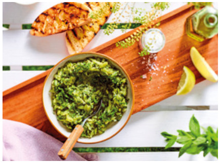

**Ingrediënten voor:** 4 personen
**Bereidingstijd:** ca. 30 min.
Pel en snipper 1 ui fijn. Was 600 g courgette en rasp grof.
Verhit 4 el olie in een pan en fruit de ui erin. Voeg de courgette en 1 tl zout toe. Laat het geheel 12-15 minuten al
roerend rustig koken, tot het vocht is verdampt en de courgette lichtbruin kleurt. Pel en snipper 5 teentjes knoflook.
Was 6 takjes munt, neem de blaadjes van de takjes en hak
fijn. Voeg de knoflook en de munt toe aan de courgette en
roer door. Breng op smaak met zout en ½ tl gemalen komijn. Laat ca. 3 minuten koken. Neem de pan van het vuur
en roer 1 tl citroensap erdoorheen. Laat de dip iets afkoelen. Besprenkel voor het serveren met 1 el olie. Lekker met
gegrild stokbrood of platbrood.

# Salute!

Lekkere wijnen, gezellige kaarsjes en
lang tafelen met schalen vol heerlijk
eten: dát is een echte Italiaanse avond.
Buon appetito!

## Pasta met twee sauzen

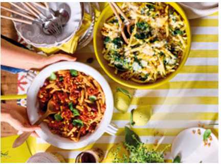

**Ingrediënten voor:** 10 personen
**Bereidingstijd:** ca. 1 uur
**1 kg** pasta (bijv. casarecce)
zout
**300 g** babyspinazie
**4 takjes** basilicum
**VOOR DE** SUGO DI SALSICCIA
**2** uien
**2** teentjes knoflook
**1 kg** salsicce (Italiaanse
venkelbraadworst, bij de
slager of grotere supermarkt)
**3 el** olijfolie
**2 el** tomatenpuree
**800 g** tomatenblokjes (blik)
zout en peper
**50 g** pijnboompitten
**100 g** zwarte olijven
**VOOR DE** ALFREDOSAUS
**2** uien
**2 el** boter
**300 g** roomkaas
**150 g** parmezaan (stuk)
**1** bio-citroen
zout en peper
nootmuskaat
**100 g** walnoten
1 VOOR DE SUGO Pel en snipper de uien en de knoflook fijn. Snijd de salsicce
in de lengte in en neem het vlees uit het velletje. Verhit de olie in een brede
pan en bak de ui en de knoflook glazig erin. Voeg het worstvlees toe en bak
al roerend ca. 10 minuten mee. Voeg de tomatenpuree toe en bak kort mee.
Blus af met de tomatenblokjes en 500 ml water, breng aan de kook en laat
zonder deksel in ca. 20 minuten inkoken tot een saus. Breng de sugo op
smaak met zout en peper. Rooster de pijnboompitten goudbruin in een droge
koekenpan en neem uit de pan. Roer de pijnboompitten en de olijven door de
saus. Houd warm.
2 VOOR DE ALFREDOSAUS Pel de ui en snipper ze fijn. Verhit de boter in een
pan en bak de ui glazig erin. Roer de roomkaas en 400 ml water erdoorheen,
breng aan de kook en laat ca. 5 minuten zachtjes koken. Rasp 100 g parmezaan fijn en roer door de saus. Laat de saus niet meer koken. Was de citroen
en rasp de schil er fijn af. Halveer de citroen en pers één helft uit. Breng de
saus op smaak met zout, peper, nootmuskaat, citroensap en de helft van de
citroenschil. Rooster de walnoten in een droge koekenpan en hak ze grof.
Roer ⅔ van de walnoten door de saus. Houd warm.
3 VOOR DE PASTA Kook de pasta volgens de aanwijzing op de verpakking
gaar in twee pannen ruim water met wat zout. Was de spinazie en doe in een
vergiet. Giet één pan pasta met water af over de spinazie, zodat de spinazie
slinkt.
4 Was het basilicum en neem de blaadjes van de takjes. Giet de andere pan
pasta af en vang daarbij 300 ml kookvocht op. Roer 150 ml kookvocht en
**500 g** pasta door de sugo di salsiccia. Serveer de pasta en bestrooi met het
basilicum.
5 Roer 150 ml kookvocht en het pasta-spinaziemengsel door de alfredosaus.
Serveer en bestrooi met de rest van de citroenschil en de walnoten. Schaaf
50 g parmezaan direct boven de pasta.
**Per portie:** ca. 960 kcal
**38 g** eiwit | 53 g vet | 75 g koolhydraten
Buffet

## Bonencrème

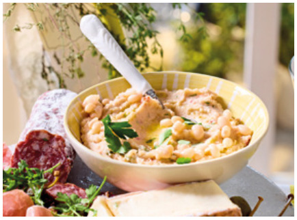

**Ingrediënten voor:** 10 personen
**Bereidingstijd:** ca. 1 uur en
**15** min. + ca. 12 uur wachttijd
**EEN DAG VAN TEVOREN** Laat 500 g gedroogde
kleine, witte bonen een nacht in koud water
weken. DE VOLGENDE DAG Pel 2 tenen knoflook.
Giet de bonen af en doe ze samen met 2,5 l water
in een pan. Voeg de knoflook en 2 laurierblaadjes
toe. Breng aan de kook en laat met deksel op de
pan ca. 1 uur zachtjes koken. Was 4 takjes peterselie en hak fijn. Snijd 1 ingelegde groene peper
(pot) in de lengte in, verwijder de zaadlijsten,
was de peper en hak hem fijn. Was 1 bio-citroen
en rasp de schil er fijn af. Pers de citroen uit. Giet
de bonen af en vang daarbij 5 el kookwater en de
knoflook op. Houd 2 el bonen apart. Pureer de
rest van de bonen met de knoflook en het kookwater fijn. Roer de groene peper, de peterselie,
**4 el** olijfolie, de citroenschil en het -sap door de
bonenpuree. Breng op smaak met zout en peper.
Bestrooi met de apart gehouden bonen en besprenkel met 1 el olijfolie.
4

## Antipasti met basilicumolie

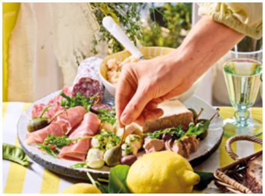

**Ingrediënten voor:** 10 personen
**Bereidingstijd:** ca. 20 min.
**100 g** parmaham, in dunne plakken
**100** g
salami Milano, in dunne plakken
**250 g** Italiaanse salami (stuk)
**200 g** jonge parmezaan
**200** g
Italiaanse zachte kaas (bijv.
taleggio)
**185 g** tonijn in olie (blik)
**100 g** kapperappeltjes (pot, uitgelekt)
**100 g** zwarte olijven (met pit)
**250 g** mini-buffelmozzarellabolletjes
**50 g** rucola
**6 takjes** basilicum
**1** kleine teen knoflook
**100 ml** olijfolie
1 VOOR DE ANTIPASTI Leg de parmaham, beide soorten salami, de parmezaan, de zachte kaas, de
tonijn, de kapperappeltjes, de olijven, de mozzarella en de rucola op een grote schaal of plank.
2 VOOR DE BASILICUMOLIE Was het basilicum eventueel en neem de blaadjes van de takjes. Pel
de knoflook en hak grof. Maal de basilicum met de knoflook en de olijfolie fijn in een vijzel of in het
hakmolentje van een staafmixer. Serveer de basilicumolie bij de antipasti.
**Per portie:** ca. 450 kcal
**27 g** eiwit | 36 g vet | 1 g koolhydraten

## Antipasti di verdure

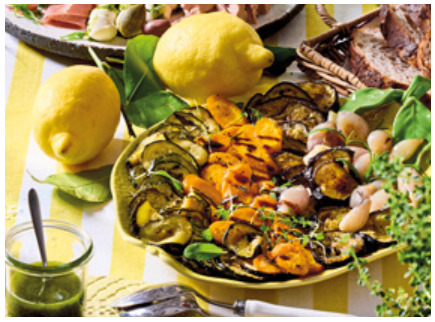

**Ingrediënten voor:** 10 personen
**Bereidingstijd:** ca. 1 uur en 15 min. + wachttijd
**250 g** sjalotten
**2** aubergines (ca. 500 g)
**2** courgettes (ca. 500 g)
zout en peper
**6** wortels (ca. 500 g)
**4 takjes** rozemarijn
takjes tijm (+ evt. extra, om te
garneren)
**2 takjes** salie
**16 el** olijfolie
**4-5 el** balsamicocrème
evt. basilicum, om te garneren
bakpapier
1 Kook de sjalotten ca. 5 minuten zachtjes in een pan water. Giet af en spoel met koud water. Snijd
de uiteindes van de sjalotten af en duw ze uit de schil. Was de aubergine en de courgette en snijd in
plakken van ca. ½ cm dik. Bestrooi de aubergine en de courgette met zout en laat ca. 20 minuten
intrekken. Schrap de wortels, was ze en snijd schuin in dunne plakken. Was de kruiden en scheur in
grove stukken.
3 Verwarm de oven voor (elektrisch: 220°C / hetelucht: 200°C). Dep de aubergine en de courgette
droog. Verdeel de groenten en de sjalotten in aparte, brede strepen op twee met bakpapier beklede
bakplaat. Bestrooi met zout en peper en verdeel de kruiden erover. Besprenkel beide bakplaten elk
met 8 el olie. Zet de bakplaten boven elkaar in de oven en bak de groenten ca. 20 minuten. Wissel de
bakplaten om en bak nog eens ca. 20 minuten.
4 Bestrooi de groenten met zout en peper en laat afkoelen. Verdeel de groenten over een grote
schaal en besprenkel met balsamicocrème. Garneer eventueel met extra tijm en basilicum.
**Per portie:** ca. 190 kcal
**3 g** eiwit | 16 g vet | 8 g koolhydraten
Buffet

## Torta al limone

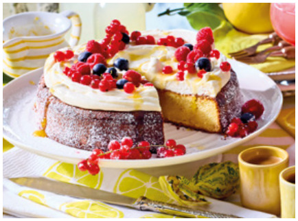

**Ingrediënten voor:** ca. 16 stukken
**Bereidingstijd:** ca. 2 uur en 15 min. + ca. 3 uur wachttijd
**6** bio-citroenen
**250 ml** zonnebloemolie (+ invetten)
**4** eieren
**250 g** + 1 el suiker
**300 g** amandelmeel
**100 g** bloem (+ bestuiven)
**200 ml** slagroom
**8** g
slagroomversteviger (bijv. Dr. Oetker Klop-
Fix)
**250 g** mascarpone
**450** g
rood fruit (bijv. rode bessen, frambozen en
blauwe bessen)
**1 el** poedersuiker
1 VOOR HET BESLAG Was 4 citroenen. Leg ze in hun geheel in
een kleine pan en zet onder water. Leg een bord op de citroenen zodat ze onder blijven. Leg het deksel op de pan en breng
aan de kook. Laat op laag vuur ca. 45 minuten zachtjes koken.
Neem de citroenen uit de pan, laat uitlekken en laat afkoelen.
2 Halveer de citroenen en verwijder de pitjes. Doe de citroenen
in een hoge beker en pureer fijn met een staafmixer. Laat daarbij de olie in een dun straaltje erin lopen, zodat je een romige
emulsie krijgt.
3 Verwarm de oven voor (elektrisch: 160°C / hetelucht: 140°C).
Klop de eieren en 175 g suiker met een handmixer romig. Klop
de citroenpuree, het amandelmeel en de bloem erdoorheen.
Doe het beslag in een goed ingevette en met bloem bestoven
springvorm (24 cm Ø). Bak de cake bijna helemaal onder in
de oven in 60-75 minuten gaar. Neem uit de oven en laat in de
vorm ca. 1 uur afkoelen. Neem uit de vorm en laat helemaal
afkoelen.
4 VOOR DE SIROOP Was 2 citroenen en rasp de schil er fijn af.
Pers beide citroenen uit. Breng 75 g suiker, de citroenschil en
het -sap in een pannetje al roerend aan de kook. Kook in ca. 8
minuten tot een siroop.
5 VOOR DE ROOM Klop de slagroom stijf en voeg daarbij al
kloppend de slagroomversteviger en 1 el suiker toe. Roer de
mascarpone los. Spatel de slagroom erdoorheen. Neem de
bessen van de takjes, was het fruit en laat uitlekken. Bestuif de
rand van de cake met poedersuiker. Strijk de mascarponeroom
in golfjes over de taart. Verdeel ⅓ van het fruit over de taart en
besprenkel met wat citroensiroop. Serveer met de rest van het
fruit en de siroop.
**Per stuk:** ca. 470 kcal
**8 g** eiwit | 35 g vet | 26 g koolhydraten

## Campari Amalfi

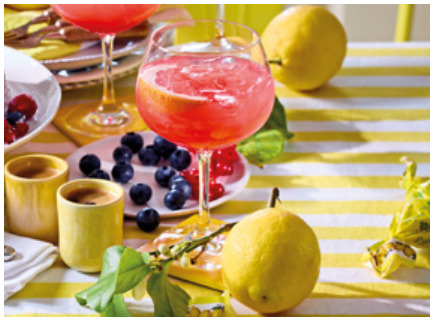

**Ingrediënten voor:** 10 glazen (à ca. 150 ml)
**Bereidingstijd:** ca. 10 min.
Was 2 bio-grapefruits en snijd in partjes. Meng 400 ml
campari (Italiaanse kruidenlikeur, bij de slijter) met 100
ml grapefruitsap. Doe in elk glas wat ijsblokjes. Schenk
het camparimengsel eroverheen en vul aan met 800 ml
gekoelde bitter lemon. Garneer de campari Amalfi met de
grapefruitpartjes en serveer.
Buffet

## Scaloppine al tartufo

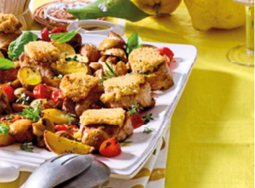

**Ingrediënten voor:** 10 personen
**Bereidingstijd:** ca. 2 uur en 30 min.
**500 g** cherrytomaten
**1,2 kg** kleine krieltjes met schil
**350 g** kleine champignons
**1** bol knoflook
**4 takjes** rozemarijn
**4 takjes** salie
**450 ml** + 4 el olijfolie
**4 takjes** tijm
**50 g** zachte truffelboter (bij de
delicatessenwinkel of grotere
supermarkt)
**50 g** zachte boter
**100 g** paneermeel
**1,5 kg** varkenshaas
zout en peper
bakpapier
1 VOOR DE GEKONFIJTE GROENTEN Verwarm de
oven voor (elektrisch: 120°C / hetelucht: 100°C).
Was de tomaten en halveer ze. Was de krieltjes
en snijd ze in tweeën of in vieren. Wrijf de champignons zo nodig schoon en halveer ze. Halveer
de bol knoflook horizontaal. Verdeel de tomaten,
de champignons en één halve knoflookbol over
een grote ovenschaal. Verdeel de krieltjes en de
rest van de knoflook over een tweede grote ovenschaal. Was de rozemarijn en de salie, neem de
blaadjes van de takjes en strooi over de groenten
en de krieltjes. Besprenkel de schalen met elk 225
ml olie. Zet de schalen boven elkaar in de oven en
bak in ca. 1 uur en 30 minuten gaar.
2 VOOR HET TRUFFELKORSTJE Was de tijm en
hak hem fijn. Kneed de truffelboter, de zachte
boter, het paneermeel en de tijm door elkaar.
Maak er een ca. 20 cm lange rol van, verpak in
bakpapier en leg in de koelkast.
3 Neem de schaal met de tomaten en de champignons uit de oven. Zet de temperatuur van de oven
hoger (elektrisch: 220°C / hetelucht: 200°C) en
bak de krieltjes in nog ca. 30 minuten gaar.
4 VOOR DE SCALOPPINE Dep de varkenshaas
droog en snijd in 3-4 cm dikke medaillons (ca. 20
stuks). Verhit 4 el olie in een koekenpan en bak de
medaillons in porties ca. 3 minuten per zijde erin.
Bestrooi met zout en peper en neem de pan van
het vuur. Neem de krieltjes uit de oven. Leg de
medaillons in beide ovenschalen tussen de krieltjes en tussen de tomaten en de champignons.
Snijd de rol truffelboter in ca. 1 cm dikke plakjes
en verdeel over de medaillons. Zet de schalen
boven elkaar in de oven en laat in ca. 8 minuten
gratineren. Wissel de schalen om en bak nog ca.
6 minuten. Breng de groenten op smaak met zout
en peper. Serveer alles samen op een schaal.
**Per portie:** ca. 740 kcal
**37 g** eiwit | 54 g vet | 22 g koolhydraten

# 4x

# lekker

# Risotto

Risotto moeilijk? Niet met deze recepten! Het enige
wat risotto vereist is aandacht. Goed blijven roeren en
dan komt alles goed!

## Risotto met linzen en worst

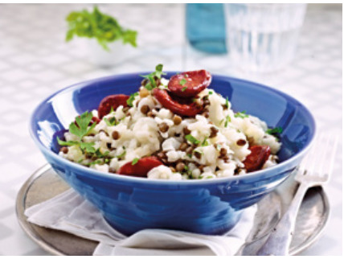

**Ingrediënten voor:** 4 personen
**Bereidingstijd:** ca. 40 min.
**100** g
Puy-linzen (bij de biologische supermarkt)
**2** sjalotten
**1 el** + 1 tl olijfolie
**300 g** risottorijst
**1 l** groentebouillon
**200 ml** droge witte wijn
3
takjes verse peterselie
2 Italiaanse worstjes,
bijv. venkelworstjes
**50 g** parmezaan
**2 el** boter
zout en peper
1 Kook de linzen in ca. 20 minuten in een pan met kokend water zachtjes
gaar. Pel en snipper de sjalotten fijn. Verhit 1 el olijfolie in een brede pan.
Bak de sjalot en de rijst al roerend in ca. 2 minuten glazig erin. Voeg beetje
bij beetje de bouillon en de wijn toe en roer daarbij af en toe door. Voeg de
volgende portie vocht pas toe als de rijst de vorige portie heeft opgenomen.
Kook op deze manier de rijst in 30-35 minuten beetgaar. Giet de linzen af en
houd apart.
2 Was de peterselie en hak hem grof. Snijd de worsten in plakjes. Verhit 1 tl
olie in een koekenpan op middelhoog vuur en bak de worst 3-4 minuten gaar
erin. Draai regelmatig om. Neem de worst uit de pan en laat uitlekken op
keukenpapier. Rasp de parmezaan. Voeg de boter, de linzen, de peterselie en
de parmezaan toe aan de risotto en roer door. Spatel de worst losjes erdoorheen. Breng de risotto op smaak met zout en peper.
**Per portie:** ca. 600 kcal
**20 g** eiwit | 19 g vet | 76 g koolhydraten

## Milanese risotto met saffraan en garnalen

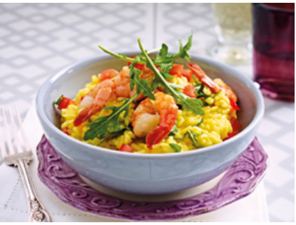

**Ingrediënten voor:** 4 personen
**Bereidingstijd:** ca. 40 min.
**2** sjalotten
**2 el** olijfolie
**300 g** risottorijst
**1** plukje saffraan
**1 l** groentebouillon
**200 ml** droge witte wijn
**2** tomaten
**50 g** rucola
**300 g** panklare garnalen
(ca. 16 stuks, zonder
kop en schaal)
zout en peper
**50 g** parmezaan (stuk)
**2 el** boter
1 Pel en snipper de sjalotten fijn. Verhit 1 el olie in een pan en bak de sjalot en
de rijst al roerend in ca. 2 minuten glazig erin. Roer de saffraan erdoorheen.
Voeg beetje bij beetje de bouillon en de wijn toe en roer daarbij af en toe
door. Voeg de volgende portie vocht pas toe als de rijst de vorige portie heeft
opgenomen. Kook op deze manier de rijst in 30-35 minuten beetgaar.
2 Was de tomaten, snijd ze in kwarten, verwijder de zaadlijsten en snijd het
vruchtvlees in blokjes. Was de rucola en hak grof. Dep de garnalen droog.
Verhit 1 el olie in een koekenpan en bak de garnalen in ca. 3 minuten gaar
erin. Draai regelmatig om. Bestrooi met zout en peper. Rasp de parmezaan.
Roer de boter, de rucola, de tomaat, de parmezaan en de garnalen door de
risotto. Breng op smaak met zout en peper.
**Per portie:** ca. 520 kcal
**23 g** eiwit | 15 g vet | 64 g koolhydraten

## Noord-Italiaanse risotto

## met pompoen en geitenkaas

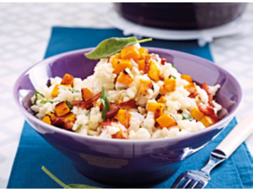

**Ingrediënten voor:** 4 personen
**Bereidingstijd:** ca. 40 min.
**2** sjalotten
**1 el** olijfolie
**300 g** risottorijst
**1 l** groentebouillon
**200 ml** droge witte wijn
**250 g** hokkaidopompoen
**2 takjes** salie
**50 g** gerookt ontbijtspek
zout en peper
**2 el** boter
**75 g** geitenkaas
1 Pel en snipper de sjalotten fijn. Verhit de olie in een pan. Bak de sjalot en de
rijst al roerend in ca. 2 minuten glazig erin. Voeg beetje bij beetje de bouillon
en de wijn toe en roer daarbij af en toe door. Voeg de volgende portie vocht
pas toe als de rijst de vorige portie heeft opgenomen. Kook op deze manier
de rijst in 30-35 minuten beetgaar.
2 Was de pompoen, verwijder de pitten en snijd het vruchtvlees in blokjes.
Was de salie en neem de blaadjes van de takjes. Snijd het spek in reepjes. Bak
het spek in een droge koekenpan krokant en neem uit de pan. Bak de salieblaadjes krokant in het hete bakvet en neem uit de pan. Bak de pompoenblokjes in 5-8 minuten gaar in het hete bakvet en neem de pan van het vuur.
Roer de salie en het spek door de pompoen. Roer de boter, de geitenkaas en
het pompoenmengsel door de risotto. Breng op smaak met zout en peper.
**Per portie:** ca. 480 kcal
**10 g** eiwit | 14 g vet | 66 g koolhydraten
4x lekker

## Siciliaanse risotto

## met gorgonzola en vijgen

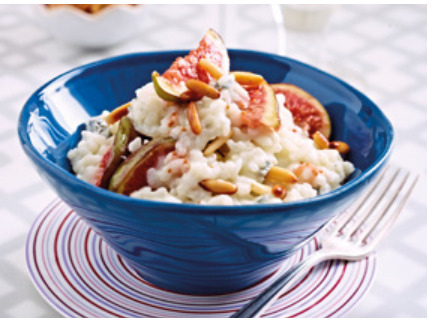

**Ingrediënten voor:** 4 personen
**Bereidingstijd:** ca. 40 min.
**2** sjalotten
**2 el** olijfolie
**300 g** risottorijst
**1 l** groentebouillon
**200 ml** droge witte wijn
**3** vijgen
**2 el** pijnboompitten
**75 g** gorgonzola (Italiaanse
blauwe kaas)
**2 el** boter
zout en peper
1 Pel en snipper de sjalotten fijn. Verhit de olie in een pan. Bak de sjalot en de
rijst al roerend in ca. 2 minuten glazig erin. Voeg beetje bij beetje de bouillon
en de wijn toe en roer daarbij af en toe door. Voeg de volgende portie vocht
pas toe als de rijst de vorige portie heeft opgenomen. Kook op deze manier
de rijst in 30-35 minuten beetgaar.
2 Was de vijgen en snijd ze in partjes. Verhit 1 el olie in een koekenpan met
antiaanbaklaag en bak de pijnboompitten goudbruin erin. Voeg de vijgenpartjes toe en bak kort mee. Neem uit de pan. Snijd de gorgonzola in kleine
blokjes. Roer de boter en de gorgonzola door de risotto. Breng op smaak met
zout en peper. Spatel de vijgenpartjes en de pijnboompitten losjes erdoorheen.
**Per portie:** ca. 530 kcal
**10 g** eiwit | 19 g vet | 67 g koolhydraten

# Goeie

# toetjes

Zin in een toetje na het eten? Daar
weten we wel wat op! Met deze
zwaardere en wat lichtere toetjes zit er
altijd iets lekkers tussen.

## Warm rabarbertoetje met amandel

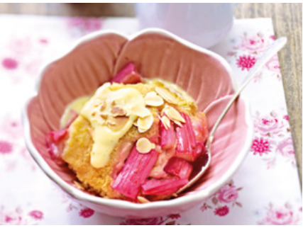

**Ingrediënten voor:** 6-8 personen
**Bereidingstijd:** ca. 1 uur en 45 min.
**300 g** rabarber
**175 g** suiker
**1 el** citroensap
**125 g** boter (+ invetten)
**2** eieren
**150 g** bloem
**2½ tl** bakpoeder
**50 g** amandelmeel
**8-9 el** melk
**3 el** amandelschaafsel
evt. vanillesaus, om
te serveren
aluminiumfolie
1 Was de rabarber en snijd hem klein. Breng met 75 g suiker en het citroensap aan de kook en laat ca. 2 minuten zachtjes koken. Vet een cakevorm (ca.
25 cm lang) in met boter. Verdeel de rabarber over de bodem en laat afkoelen.
2 Roer de boter en 100 g suiker romig. Roer de eieren één voor één erdoorheen. Meng de bloem met het bakpoeder en het amandelmeel. Roer samen
met de melk kort door het beslag.
3 Verwarm de oven voor (elektrisch: 180°C / hetelucht: 160°C). Verdeel het
beslag over de rabarber. Vet een vel aluminiumfolie in met boter en dek de
vorm ermee af. Prik met een scherp mesje wat gaatjes in de folie. Zet de
vorm in een diep bakblik en schenk het bakblik bijna helemaal vol heet water
(zorg dat het beslag in de cakevorm niet in aanraking komt met het water).
Zet voorzichtig in de oven en bak in ca. 1 uur en 15 minuten gaar. Als een
satéprikker droog uit de cake komt is hij klaar.
4 Rooster het amandelschaafsel goudbruin in een droge koekenpan en
neem uit de pan. Neem de cakevorm uit de oven en verwijder de folie. Laat
ca. 20 minuten afkoelen, snijd met een mes van de rand los en stort de cake.
Bestrooi met het amandelschaafsel. Lekker met vanillesaus.
**Per portie:** ca. 330 kcal
**5 g** eiwit | 15 g vet | 41 g koolhydraten

## Lavacakejes met pindakaas

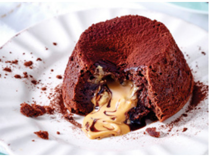

**Ingrediënten voor:** 6 stuks
**Bereidingstijd:** ca. 45 min.
**150 g** pure chocolade
**80 g** boter (+ invetten)
**2** eieren
**2** eidooiers
**75 g** suiker
**2 el** bloem
**6** volle tl pindakaas
**4 tl** cacaopoeder
6 kleine ovenschaaltjes (à ca. 150 ml inhoud)
1 Verdeel de chocolade in stukken en smelt met de boter au bain-marie.
Klop de eieren, de eidooiers en de suiker met een handmixer in ca. 5 minuten romig. Voeg de gesmolten chocolade en de bloem toe en klop erdoorheen.
2 Verwarm de oven voor (elektrisch: 180°C / hetelucht: 160°C). Verdeel de
helft van het beslag over de ovenschaaltjes en lepel 1 tl pindakaas in elk
schaaltje. Verdeel de rest van het beslag erover. Bak ca. 12 minuten in de
oven.
3 Stort de lavacakejes voorzichtig op bordjes en bestuif met het cacaopoeder. Serveer direct.
**Per stuk:** ca. 360 kcal
**7 g** eiwit | 24 g vet | 29 g koolhydraten

## Aardbeien-ijsbeker

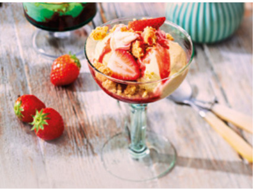

**Ingrediënten voor:** 4 personen
**Bereidingstijd:** ca. 45 min.
**100 g** bloem
**3-4 el** lichte basterdsuiker
zout
**50 g** koude boter
**300 g** aardbeien
**3 tl** poedersuiker
**100 ml** slagroom
**8** bolletjes vanille-ijs
bakpapier
1 VOOR HET KRUIMELDEEG Verwarm de oven voor (elektrisch: 180°C / hetelucht: 160°C). Kneed de bloem, de suiker, een snufje zout en de boter in stukken tot een kruimeldeeg. Verdeel over een met bakpapier beklede bakplaat
en bak in 12-15 minuten gaar in de oven. Laat afkoelen.
2 VOOR DE SAUS Was de aardbeien en halveer ze. Breng ⅔ van de aardbeien, 2 tl poedersuiker en 2 el water aan de kook. Laat 3-4 minuten zachtjes
koken. Laat afkoelen.
3 Klop de slagroom met 1 tl poedersuiker stijf. Snijd de rest van de aardbeien
klein. Verdeel de aardbeien, het ijs, de saus en de slagroom over ijscoupes.
Bestrooi met het kruimeldeeg.
**Per portie:** ca. 480 kcal
**6 g** eiwit | 26 g vet | 52 g koolhydraten
Het zoete leven

## Île flottante

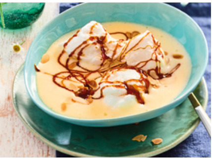

**Ingrediënten voor:** 4 personen
**Bereidingstijd:** ca. 30 min.
**500 ml** melk
**35 g** custardpoeder
**5 el** suiker
**1** vers eiwit
zout
**½ tl** citroensap
**5 el** koolzuurhoudend mineraalwater
**2 el** karamelsaus
evt. geroosterd amandelschaafsel
1 Breng 400 ml melk aan de kook. Roer het custardpoeder, 2 el suiker en 100
ml melk glad. Roer het custardmengsel door de hete melk en laat ca. 1 minuut zachtjes koken. Laat ca. 20 minuten afkoelen.
2 Breng een pan ruim water aan de kook. Klop het eiwit met 3 el suiker, een
snufje zout en het citroensap heel stijf. Schep mooie lepels van het eischuim
en leg ze in het kokende water. Leg het deksel erop en laat in 2-3 minuten
garen.
3 Roer het mineraalwater door de vanillesaus en verdeel over borden. Leg de
eiwitschuimpjes erop. Besprenkel met de karamelsaus en bestrooi eventueel
met amandelschaafsel.
**Per portie:** ca. 190 kcal
**5 g** eiwit | 5 g vet | 31 g koolhydraten

# De laatste

# kruimel

Een laag kruimeldeeg maakt van elke soort
gebak meteen een krokant feestje. Geniet
van dit kruimelgebak vol zoet zomerfruit.

## Basisrecept kruimeldeeg

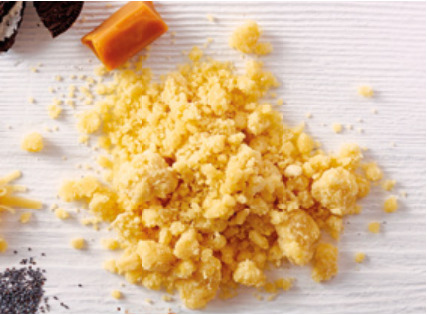

**Ingrediënten voor:** 1 bakplaat, of als bodem en topping voor 1 springvorm (26 cm Ø)
**Bereidingstijd:** ca. 15 min.
Smelt 200 g boter en laat even afkoelen. Meng 375 g bloem met 150 g suiker en een snufje zout. Kneed
de gesmolten boter en 1 ei met de deeghaken van een handmixer erdoorheen. Kneed naar wens extra
ingrediënten erdoorheen. Zie het lijstje hieronder voor inspiratie!
kruimeldeeg is lekker met…
• 150 g gehakte toffees
• 100 g verbrokkelde Oreo’s
• 100 g cranberrymuesli
• 100 g minimarshmallows
• 150 g pinda’s
• 25 g gehakte + 50 g gemalen pistachenoten
• geraspte schil van 1 biosinaasappel
• 100 g geraspte marsepein
• 4 el discodip
• 60 g gemalen gevriesdroogde frambozen
• 4 el maanzaad
• 80 g verbrokkelde pretzelzoutjes
• 100 g gehakte pure chocolade + 2 el cacaopoeder

## Appel-bramentaart

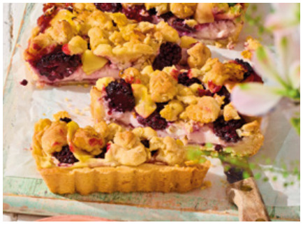

**Ingrediënten voor:** ca. 12 stukken
**Bereidingstijd:** ca. 1 uur en 15 min. + ca. 3 uur en 30 min.
wachttijd
**300** g
bloem (+ bestuiven)
**100 g** poedersuiker
**1 snufje** zout
**200** g
koude boter (+
invetten)
**500 ml** melk
**35 g** custardpoeder
**40 g** suiker
**2** appels
**1-2 el** citroensap
**250 g** bramen
**75 g** bramenjam
**½** bio-citroen
(alleen de schil,
geraspt)
**25 g** gekonfijte
gember
**25 g** havervlokken
**25 g** cornflakes
**150 g** crème fraîche
vershoudfolie
1 VOOR HET DEEG Kneed de bloem, de poedersuiker, het zout
en de boter in stukjes tot een glad deeg. Zet afgedekt ca. 1 uur
in de koelkast.
2 VOOR DE ROOM Roer 100 ml melk, het custardpoeder en
de suiker glad. Breng 400 ml melk aan de kook, neem van het
vuur en roer het custardmengsel erdoorheen. Breng al roerend
nogmaals aan de kook en laat ca. 1 minuut zachtjes koken. Doe
de room in een kom, leg een vel vershoudfolie direct op het
oppervlak en laat afkoelen.
3 VOOR HET FRUIT Was de appels, snijd ze in kwarten, verwijder het klokhuis en snijd de appels schuin in dunne plakjes.
Besprenkel de appel met het citroensap. Maak de bramen
schoon.
4 Rol ⅔ van het deeg op een met bloem bestoven werkblad
rechthoekig (ca. 17 x 39 cm) uit. Bekleed een ingevette rechthoekige taartvorm met uitneembare bodem (ca. 13 x 35 cm)
met het deeg. Duw het tegen de randen aan. Steek de taartbodem meermaals in met een vork. Bestrijk met de bramenjam. Roer de custardroom glad en verdeel over de jam. Bestrooi
met het fruit en de citroenschil.
5 Verwarm de oven voor (elektrisch: 180°C / hetelucht: 160°C).
Hak de gember fijn. Kneed de rest van het deeg tot grof kruimeldeeg en meng met de havervlokken, de cornflakes en de
gember. Strooi het kruimeldeeg over het fruit. Bak onder in de
oven in 40-45 minuten gaar. Laat de taart helemaal afkoelen
in de vorm. Neem uit de vorm en serveer elk stuk met een lepel
crème fraîche.
**Per stuk:** ca. 370 kcal
**5 g** eiwit | 17 g vet | 46 g koolhydraten
Gebak

## Knapperige gebakjes

## met kersenroom

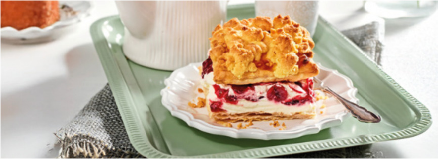

**Ingrediënten voor:** 8 stuks
**Bereidingstijd:** ca. 1 uur en 15 min.
**450 g** bladerdeegplakjes (diepvries)
**150 g** boter
**200 g** + 1 el bloem (+ bestuiven)
**80 g** suiker
**16 g** vanillesuiker
**1** eidooier
**1 el** + 350 ml slagroom
**350 g** kersen (pot)
16 g slagroomversteviger (bijv. Dr.
Oetker Klop-Fix)
**4-5 el** kersenjam (liefst van zure
kersen)
bakpapier
Serveer met een
kopje witte thee
of zelfgemaakte,
frisse limonade.
1 VOOR DE BODEM Laat het bladerdeeg ca. 15
minuten ontdooien. Smelt de boter. Meng 200 g
bloem, de suiker en 8 g vanillesuiker in een kom
met elkaar. Schenk de boter erbij en kneed tot
een kruimeldeeg. Bestuif met 1 el bloem en kneed
door het kruimeldeeg.
2 Verwarm de oven voor (elektrisch: 200°C /
hetelucht: 180°C). Leg de helft van de plakjes
bladerdeeg op elkaar en rol op een licht met
bloem bestoven werkblad rechthoekig (ca. 20 x
40 cm) uit. Doe hetzelfde met de andere helft van
de plakjes bladerdeeg. Leg een deegrechthoek op
een met bakpapier beklede bakplaat. Bak in ca. 15
minuten goudgeel in de oven en laat afkoelen.
3 Snijd de tweede deegrechthoek met een deegwieltje in 8 vierkanten (ca. 10 x 10 cm). Leg ze
op een met bakpapier beklede bakplaat. Roer de
eidooier en 1 el slagroom door elkaar en bestrijk
de vierkanten ermee. Bestrooi gelijkmatig met
het kruimeldeeg. Bak op dezelfde temperatuur in
ca. 20 minuten gaar. Laat afkoelen.
4 VOOR DE VULLING Giet de kersen af en laat
uitlekken. Klop 350 ml slagroom stijf en voeg
daarbij langzaam de helft van de vanillesuiker en
de slagroomversteviger toe. Roer de jam glad en
roer de kersen erdoorheen. Verdeel de helft van
de slagroom over de grote bladerdeegrechthoek
en strijk glad. Verdeel de kersen losjes eroverheen en bedek met de rest van de slagroom. Leg
de kruimeldeegdekseltjes erop. Snijd met een
broodmes het gebak tussen de dekseltjes door in
stukken.
**Per stuk:** ca. 710 kcal
**7 g** eiwit | 45 g vet | 63 g koolhydraten
Gebak

## Bosvruchtenkruimelgebak

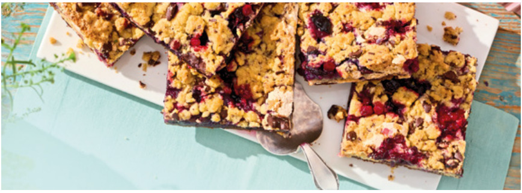

**Ingrediënten voor:** ca. 24 stukken
**Bereidingstijd:** ca. 1 uur + ca. 2 uur wachttijd
**300 g** boter (+ invetten)
**4** eieren
**600 g** bloem (+ bestuiven)
**500 g** suiker
**8 g** vanillesuiker
zout
**25 g** cacao
**100 g** pure chocolade
**125 g** amandelmeel
**1½ el** maizena (15 g)
**500 g** blauwe bessen
**200 g** rode bessen
1 VOOR HET KRUIMELDEEG Smelt de boter en
laat even afkoelen. Splits de eieren en houd het
eiwit apart voor de vulling. Meng de bloem, 300 g
suiker, de vanillesuiker en een snufje zout in een
kom met elkaar. Roer de gesmolten boter erdoorheen. Voeg de eidooiers toe en kneed tot een grof
kruimeldeeg. Doe de helft van het deeg in een
andere kom. Kneed door één helft het cacaopoeder en door de andere helft 2 el ijswater.
2 Verwarm de oven voor (elektrisch: 180°C /
hetelucht: 160°C). Verdeel het cacaodeeg over een
diep, goed ingevet en met bloem bestoven bakblik
en druk met je handen uit tot een bodem. Bak
de bodem bijna onder in de oven ca. 10 minuten
voor.
3 Hak de chocolade grof en kneed door de rest
van het kruimeldeeg. VOOR DE VULLING Rooster
het amandelmeel in een droge koekenpan. Neem
uit de pan en laat afkoelen. Klop het eiwit met
een snufje zout stijf en voeg daarbij beetje bij
beetje 200 g suiker toe. Klop nog ca. 2 minuten
als alle suiker erbij zit. Meng het amandelmeel
met de maizena en spatel voorzichtig door het
eiwitschuim.
4 Maak het fruit schoon en dep voorzichtig heel
goed droog. Verdeel het amandelmengsel over
de taartbodem en strijk glad. Bestrooi met het
fruit. Bestrooi met het kruimeldeeg. Bak in 35-40
minuten gaar in het midden van de oven. Laat het
gebak helemaal afkoelen in de vorm.
**Per stuk:** ca. 350 kcal
**6 g** eiwit | 16 g vet | 44 g koolhydraten
Gebak

## Kwetsentaart

## met koffiekruimels

**Ingrediënten voor:** ca. 12 stukken
**Bereidingstijd:** ca. 1 uur en 30 min. +
ca. 30 min. wachttijd
**350 g** bloem (+ bestuiven)
**325 g** koude boter (+ invetten)
**50 g** suiker
**8 g** vanillesuiker
**4 el** koffiesiroop (zie onder)
**1 snufje** zout
**35 g** custardpoeder
**75 g** poedersuiker
**1** ei
**1 tl** bakpoeder
**900 g** kwetsen (of andere pruimen)
**125 ml** slagroom
**12** chocolade-mokkaboontjes
spuitzak met stervormig
spuitmondje

## Zelfgemaakte

## koffiesiroop

**Ingrediënten voor:** 1 flesje
(ca. 225 ml)
**Bereidingstijd:** ca. 30 min.
Breng 400 ml hete koffie en 150 g lichte basterdsuiker aan de kook. Laat in
10-15 minuten inkoken tot ca. 225 ml en
roer daarbij meermaals door. Breng op
smaak met 1 snufje kaneel. Doe de siroop
in een schoon flesje, sluit goed af en laat
afkoelen. Lekker als aroma in baksels (bijvoorbeeld de kwetsentaart hierboven) of als
topping op desserts, in gebak, in koffies of
cocktails.
1 VOOR HET KRUIMELDEEG Kneed 150 g bloem, 100 g koude boter in stukjes, de suiker, de vanillesuiker,
de koffiesiroop en het zout tot een grof kruimeldeeg. Zet het koffiekruimeldeeg in de koelkast.
2 VOOR HET DEEG Doe het custardpoeder, 225 g koude boter in stukjes, de poedersuiker, het ei, 200 g
bloem, het bakpoeder en 2 el ijswater in een kom en kneed snel door elkaar. Rol het deeg op een met
bloem bestoven werkblad rond (ca. 32 cm Ø) uit. Doe het deeg in een ingevette en met bloem bestoven
taartvorm met uitneembare bodem (28 cm Ø) en druk tegen de rand aan. Steek het deeg meermaals in
met een vork. Zet ca. 30 minuten in de koelkast.
3 Verwarm de oven voor (elektrisch: 180°C / hetelucht: 160°C). Was de kwetsen, halveer ze en verwijder
de pit. Houd 4 halve kwetsen apart en verdeel de rest over de deegbodem. Bestrooi gelijkmatig met het
koffiekruimeldeeg. Bak in ca. 35 minuten gaar in de oven. Neem uit de oven en laat op een rooster in de
vorm helemaal afkoelen.
4 VOOR DE VERSIERING Klop de slagroom stijf en doe hem in een spuitzak met stervormig spuitmondje. Snijd de apart gehouden halve kwetsen in heel dunne partjes. Neem de taart uit de vorm en versier
met toefjes slagroom, de kwetsenpartjes en de mokkaboontjes.
**Per stuk:** ca. 450 kcal
**4 g** eiwit | 27 g vet | 45 g koolhydraten

## Klantenservice

Wil je abonnee worden of heb je vragen over je
abonnement? Op onze website vind je antwoord op
de meeste vragen.
www.kokengenieten.nl/contact
Wist je dat je tegenwoordig eenvoudig zelf je adres
kan wijzigen? Ga naar www.kokengenieten.nl/
adreswijzigen om je nieuwe adres door te geven.
Het nieuwe adres wordt vervolgens automatisch in
ons systeem gewijzigd.
Telefoon
We zijn er maandag
tot en met vrijdag
van 09.00 tot
**17.00** uur om je vragen
te beantwoorden.
+31 (0)24-2027 829
E-mail
Stel je vraag per e-mail
aan een van onze
service medewerkers.

## klantenservice@

kokengenieten.nl
ABONNEMENTSINFORMATIE koken & genieten kost €4.50 per nummer. De abonnementsprijs in Nederland € 49,- en
in België € 52,- (12 nummers) Deze prijs geldt bij betaling per automatische incasso. Voor betaling via een (digitale)
factuur geldt een toeslag van € 2,50. Je kunt eenvoudig een machtiging afgeven via www.fnl.nl/machtigen.
Abonnementen worden automatisch verlengd, tenzij anders vermeld. Het opzeggen van een abonnement kan eenvoudig
telefonisch via +31 (0)24-2027829 of per mail via klantenservice@kokengenieten.nl.
koken & genieten is een
uitgave van F&L Media B.V.
in licentie van Bauer Media
Brand Manager Yvonne Doorten
Redactie Bas Erkens, Anne Mebelder,
Lotus van Overveldt, Willem van Santen,
Marieke Slettenhaar en Julie van den Berg
In samenwerking met Letitia Clark, Uit
Paulines Keuken en Marianne Snel
Art Direction Nick Groenewold
Vormgeving Mylene Nales, Tom Gerrits,
Lisanne Cobussen, Susan Gerbrands-Derksen,
Ferry Dorresteijn en Ellen Willemsen
Sales Marc Bokhove +31 (0)24 2404643
mbokhove@fnl.nl
Marketing Anouk Tolboom +31 24 240 45 95
atolboom@fnl.nl
Drukkerij Senefelder Misset Doetinchem B.V.
Vragen aan de redactie
Heb jij opmerkingen, suggesties of vragen aan
de redactie? lezersvragen@kokengenieten.nl
Nieuwsredactie / Pers
kooknieuws@fnl.nl of het onderstaande adres
o.v.v. redactie koken & genieten
Jonkerbosplein 52, 6534 AB Nijmegen
COPYRIGHT Het auteursrecht op deze uitgave en de gedrukte uitgave en op de daarin verschenen
artikelen wordt door de uitgever voorbehouden. De vertaalrechten berusten bij F&L Media B.V.
te Nijmegen/ Nederland. Het verlenen van toestemming tot publicatie in de gedrukte uitgave
houdt in dat de auteur de uitgever, met uitsluiting van ieder ander onherroepelijk machtigt de
bij of krachtens de auteurswet door derden verschuldigde vergoedingen voor kopiëren te innen
en dat de auteur alle rechten verdraagt aan de uitgever, tenzij anders bepaald. Niets uit deze
uitgave en de gedrukte uitgave mag worden overgenomen, vermenigvuldigd of gekopieerd zonder
uitdrukkelijke schriftelijke toestemming van de uitgever. De uitgever stelt zich niet aansprakelijk
voor eventuele onjuistheden, welke in deze uitgave of de gedrukte uitgave mochten voorkomen.
ISSN: 1875-8517

# Frisse skyr

Op zoek naar een zomers gebakje dat niet al te zoet
is? Dan is hier het antwoord! Dankzij de IJslandse
skyr zijn deze repen lekker fris – heerlijk voor op
warme dagen!
Pronkstuk

## Blauwebessen-skyrrepen

**Ingrediënten voor:** 12-14 stukken
**Bereidingstijd:** ca. 35 min. + ca. 4 uur wachttijd
**175 g** gedroogde vijgen
**150 g** havermout
**150 g** amandelmeel
**1 snufje** zout
**2 el** honing
**100 g** pure chocolade
**30** g
poedergelatine (bij de bakwinkel of online verkrijgbaar,
of gebruik 18 gelatineblaadjes)
**500 g** vanilleskyr (IJslandse yoghurt)
**250 ml** slagroom
**150 g** blauwebessenjam
**200 g** blauwe bessen
vershoudfolie
Ook heel lekker met
aardbeien, frambozen
of kersen!
1 VOOR DE BODEM Laat de vijgen ca. 30 minuten weken in heet water. Giet
het water af en knijp de vijgen een beetje uit. Doe de vijgen, de havermout,
het amandelmeel, het zout en de honing in een blender en maal tot een
homogene massa. Bekleed een rechthoekige vorm (ca. 20 x 30 cm) met vershoudfolie. Verdeel het vijgenmengsel over de vorm en druk aan als bodem.
Zet ca. 30 minuten in de koelkast.
2 Neem de bodem met behulp van de folie uit de vorm en verwijder de folie.
Zet de bodem op een taartplateau. Verdeel de chocolade in stukken en smelt
au bain-marie. Bestrijk de bodem met de gesmolten chocolade en zet ca. 1
uur in de koelkast.
3 VOOR DE SKYRROOM Gebruik je gelatineblaadjes? Laat ze dan weken in
water, knijp uit en los hem op volgens de aanwijzingen op de verpakking.
Gebruik je poedergelatine, voeg hem dan beetje bij beetje al roerend toe aan
de skyr. Klop de skyr met een handmixer ca. 1 minuut op. Klop de slagroom
stijf en spatel erdoorheen. Voeg de gesmolten gelatineblaadjes toe en spatel
erdoorheen. Verdeel de room losjes over de bodem. Zet ca. 2 uur in de koelkast.
4 VOOR DE BLAUWE BESSEN Verwarm de jam al roerend een beetje. Was de
blauwe bessen en halveer grote bessen eventueel. Meng de bessen met de
jam en laat even afkoelen. Verdeel het bessenmengsel over de room. Snijd in
repen en serveer.
**Per stuk:** ca. 300 kcal
**8 g** eiwit | 16 g vet | 30 g koolhydraten

## Voor- en bijgerechten

Antipasti di verdure 46
Antipasti met basilicumolie 46
Bonencrème 46
Bruschetta met burrata 8
Burrata met citroenige lentegroenten 31
Campari Amalfi 49
Frisse courgette-muntdip 43
Ketchup van geroosterde tomaten 18

## Zoet en desserts

Aardbeien-ijsbeker 54
Koude erwten-muntsoep 37
Appel-bramentaart 57
Basisrecept kruimeldeeg 56
Blauwebessen-skyrrepen 65
Sugo (tomatensaus) 14
Tomatenchips 18
Tomatensalade met basilicumdressing 11
Zoetzure ingelegde tomaat 18
Bosvruchtenkruimelgebak 60

## Hoofdgerechten

Citroenrepen met polentadeeg en olijfolie 34
Île flottante 54
Biefstuk met courgette-fetasalade 41
Courgette-carbonara met citroen 33
Instant mascarponemousse
van citroen & witte chocolade 34
Courgetti met kruidenpesto 38
Frisse pastasalade
Knapperige gebakjes met kersenroom 58
Kwetsentaart met koffiekruimels 62
met venkel en Griekse yoghurt 26
Lavacakejes met pindakaas 54
Maritozzi met pistacheroom 7
Torta al limone 48
Warm rabarbertoetje met amandel 54
Frisse salade met gegrilde kip 38
Zelfgemaakte koffiesiroop 62
Gevulde courgette met ham en bulgur 41
Griekse orzoschotel met gyros 24
Koolvis met romige komkommersalade 37
Milanese risotto met saffraan en garnalen 52
Noord-Italiaanse risotto
met pompoen en geitenkaas 53
Pasta met ricotta en tomaat 11
Pasta met twee sauzen 45
Plaatpizza met venkel en pancetta 8
Provençaalse tomaten met kabeljauw 16
Risotto met linzen en worst 52
= Zonder vlees en vis
Scaloppine al tartufo 50
Siciliaanse risotto met gorgonzola en vijgen 53
= Snel klaar (max. 30 min.)
Spaghetti all’amatriciana 14
Spaghettipizza met salami 23
Tomatensalade met kipspiesjes 17
Tomatentaart met geitenkaasroom 13
Udonnoedels met koningsoesterzwam 22
Varkenshaasmedaillons met tomaten 15
Zomerse gehaktschotel met basilicumcrunch 42
Zomerse ravioli uit de oven 21

## In het

# september

## nummer

## Gek op aardappels

Leer variëren met deze
allemansvriend!

## Vier het met cider

Appelcider om te drinken én
om mee te koken.
Het volgende nummer valt rond 12 augustus 2025 bij abonnees
op de mat en ligt rond 19 augustus 2025 in de winkels.
De verschijningsdata in België wijken af van de verschijningsdata in Nederland.
Mis geen nummer meer!
Neem nu een abonnement en krijg voortaan elke uitgave van koken &
genieten automatisch in je brievenbus. Ga naar www.kokengenieten.nl/abo
of bel gratis naar +31 (0)24-2027829.

## 4x camembert

Bak ’m eens knapperig of
serveer hem als carpaccio.

# Jouw favoriete recepten

# altijd bij de hand!

# Speciaal

# voor

# abonnees

## Vanaf nu in de nieuwe Koken & Genieten app, gratis voor abonnees.

## In de app kan je:

• Het magazine lezen op je telefoon of tablet
• Gemakkelijk recepten uit het magazine opslaan en terugvinden
Scan voor
Scan voor
• Eerdere edities van Koken & Genieten digitaal lezen
Apple
Android
Meer informatie via:

## www.kokengenieten.nl/digitaallezen

# 20%

korting*
met code

## KOKEN20

# Dual Basket Airfryer 9 liter

Met dubbele manden en PFAS-vrije keramische coating kook je gezond en snel.
Bespaar energie en bereid moeiteloos twee gerechten tegelijk.
Profiteer tijdelijk van 20% korting op onderstaande types met de code KOKEN20!
De Russell Hobbs Satisfry™ Dual Basket Airfryer combineert stijl en gemak.
Met dubbele manden en PFAS-vrije keramische coating kook je gezond en snel.
collectie
scan voor
meer informatie
meer informatie
De Russell Hobbs Satisfry™ Dual Basket Airfryer combineert stijl en gemak.
**9 liter** 8.3 liter 5.5 liter 4.3 liter
*) Alleen geldig bij bol.com t/m 31 aug 2025
www.russellhobbs.nl | @russellhobbs.benelux
