voor

# 4,50

Altijd

# 1001

# HEERLIJKE

# SMAKEN

Lekker, kruidig &
verwarmend eten
Oktober 2025 jaargang 20
koken genieten

# 51

doordeweekse
inspiratie
Makkelijke herfstgerechten van Uit Paulines Keuken
Makkelijke herfstgerechten van Uit Paulines

## Heel veel soepen

Zo krijg je zin in het najaar
de taarten
Verwerk noten in je
zoete baksels

# 51

## Meer pompoen?

# 1001

## Lekker doen!

Dit kook je er allemaal mee
De n t op
BP

# €4,50

# De snelle weg door het blad

Voorgerechten
& bijgerechten
Salades, soepen en
broodjes: lekker als lichte
maaltijd of om je etentje
mee te beginnen.
Romige pompoensoep
met gember 47
Gochujangnoedels 9
Tiroler pastaschotel 29
Oesterzwammenshoarma 48
Roomkaaspompoen 39
Rijstpudding uit de oven
met appelcompote 55
Geroosterde pompoen
en prei met frisse dip 47
Ingelegde jalapeño’s 49
Pompoencurry met kip 10
Snel zalmvenkelpannetje 29
Krokante kipnuggets
met worteltjes 30
Knolselderijgnocchi met paddenstoelen en hazelnoten 52
Hazelnootschuimgebakjes
met chocoladesaus 55
Plaatkoek met kweepeer
en walnoot 57
Gekaramelliseerde venkel
met linzen en appel 50
Hamburgse aalsoep 13 Russische soljanka 14
Gekonfijte pompoen
met tahin en yoghurt 51
Erwtensoep
met pannenkoeken 15
Spekmedaillons
met bulgursalade 30
Schnitzelspiesjes
met Aziatische rijst 31
Zoet & desserts
Zoet is altijd goed!
Lekker als tussendoortje,
bij de koffie of als
afsluiting van je diner.
Ingelegde citroenen 21 Geurige muntthee 21 Griezelige linzensalade 35
Sinaasappeltaart 10
Shortbreadcheesecake
met pecannotenkaramel 57
Plukcake met pistache 58
Zonder
Snel klaar
(max. 30 min.)
Pruimen-port-ijs 55
vlees of vis
Groentesticks 39
Bietentzatziki 51
Goedgevulde
pompoensoep 16
Groente-broodgratin
met feta 31
Notenvlecht met glazuur 58
Uitleg van symbolen bij de recepten
Hoofdgerechten
Ga je voor snel &
makkelijk, een dagje
zonder vlees of vis
of pak je uit met een
weekendproject?
Heksenbrouwsel 41
Zoete-aardappelgratin
met chorizo 7
Aardappelsoep
met appelcake 18
Lamstajine met couscous 21
Fruitige herfstsalade
Pistachebaklava 24 Plaatpannenkoek
met procureur 32
Ovenkalkoen
met herfstgroenten 36
Spookachtige brownietaart 41
met appel en noten 44
Hazelnootlaagjestaart
met eekhoornkoekjes 62
Kip-dadelbastilla 22
Alle recepten op een rij
Bananen-
Kleurrijke herfstsalade met
Pompoenpuree
met spek-uientopping 46
linzen en grapefruit 44
Griezelige crackers 39
Groentetaart met wortel 9
Köfte in pittige tomatensaus 23
Savooiekool met kip
en appel-yoghurtsaus 43
Tagliatelle met pompoen
en salieboter 46
Zelfgemaakte appelchips 45
Volkoren appel-notencake 62
chocoladetulband 65

## Voorwoord

# Zin in

# de herfst

Ik moet iets opbiechten: ja, het weer is nog redelijk zomers, maar tóch heb ik nu al zin in de
herfst. Lekker knus met een dekentje en een kop
thee op de bank, terwijl in de keuken een grote
pan soep staat te pruttelen. Ja, het wordt wat
vroeger donker, maar met kaarsjes aan is dat
eigenlijk alleen maar gezellig. En met een dikke
sjaal is die gure herfstwind ook wel lekker fris.
Dit nummer staat dan ook in het teken van al het
fijne van het najaar. Zo vind je op p. 12 allerlei
verwarmende maaltijdsoepen, heerlijk na een
lange herfstwandeling. Meer zin in iets zoets?
Dan moet je de prachtige notentaarten (p. 56) en
de chocoladetulband (p. 64) zéker niet overslaan.
Of ga aan de slag met seizoensproducten appel
(p. 42) en pompoen (p. 46). Nog niet toe aan de
herfst? Geen zorgen, er staan ook genoeg recepten voor alle dagen in dit nummer; de lamstajine
met couscous (p. 21) is mijn favoriet!
Yvo e D rten
**6** Uit Paulines keuken
Dit jaar vind je elke maand heerlijke
recepten van Uit Paulines Keuken in Koken
& genieten. Altijd lekker en met verse
seizoensproducten. Deze maand: heerlijke
recepten voor de herfst
**12** Soepen
Niets lekkerder in de herfst dan een groot
bord dampende soep. Deze recepten zorgen er in ieder geval voor dat jij er warmpjes bij zit
**20** 1001 aroma’s
De Marokkaanse keuken zit vol smaakvolle
en geurige aroma’s om bij weg te dromen.
Neem een hap, sluit je ogen en je bent even
in Marrakesh
**28** Simpel en snel genieten
Het is al druk genoeg met werk, kinderen
en hobby’s. Hier is de oplossing voor iedereen die geen tijd heeft om uitgebreid te
koken, maar toch lekker wil eten
**34** Happy Halloween!
Tijd om gezellig te griezelen! Dit spookachtige buffet is leuk om samen met je (klein-)
kinderen te maken én op te eten
**42** Oogappeltjes
Appels zijn het populairste fruit van
Nederland en dat is niet gek: ze zijn lekker
zoetzuur, lang houdbaar én heel gezond.
Met deze recepten krijg jij een extra portie
goede voedingsstoffen binnen
**46** 4x lekker: pompoen
Denk je aan de herfst, dan denk je aan
pompoen. Geroosterd, gepureerd of in de
soep: met deze veelzijdige groente kun je
alle kanten op
**48** Boek: Groentebijbel
deel 2
Van groente krijg je nooit genoeg. Naast
een eerste Groentebijbel, is er daarom nu
ook een deel twee. Hierbij alvast een heerlijk voorproe e!
Abo ement
Elke maand de
koken & genieten
als eerste in de
brievenbus? Kijk op www.
kokengenieten.nl/abo
of blader naar
p. 26.
**54** Knappe toetjes
Deze nagerechten zijn allemaal restaurantwaardig, zo mooi en lekker zijn ze. Maak
ze voor een gezellig etentje of als traktatie
voor het weekend
**56** Notenparadijs
Walnoten, pecannoten, amandelen... Deze
knapperige baksels zijn een feest voor
het oog en de buik. Scoor gegarandeerd
punten bij vrienden en familie met deze
heerlijke notentaarten
**64** Tulbandpracht
Een tulband saai? Helemaal niet! Met dit
recept bak je er een heerlijke bananencake
in, bomvol chocolade en een vleugje rum.
En geloof ons, dat smaakt net zo lekker als
het klinkt
**66** Index & volgend
Alle recepten van deze uitgave op een rij én
een vooruitblik op volgende maand
WIN 3x
Groentebijbel
deel 2 (t.w.v. 34,99)
19
Inhoud

# In het seizoen...

# appels

## Wat is het?

De appel is het meest gegeten fruit in Nederland. Je vindt
dan ook allerlei verschillende soorten in de supermarkt,
bij de groenteboer en op de markt. De populairste zijn
de elstar, goudreinet en jonagold. De elstar is geelgroen
met rood, stevig en zoetzuur van smaak. De goudreinet
is een stevige, zure appel met een doffe, geelrode kleur.
Hij is perfect voor appeltaart of appelmoes, omdat hij
z’n structuur behoudt tijdens het koken. Jonagold is een
kruising van de golden delicious en jonathan – waar de
naam ook vandaan komt – en is stevig en zoetzuur van
smaak. In de nazomer en herfst worden appels geoogst en
opgeslagen in koelhuizen. Hierdoor zijn ze lang houdbaar en
vrijwel het hele jaar door te koop.

## Wat kun je ermee?

Een appeltje eet je zo uit de hand, maar je kunt zoveel meer
met deze veelzijdige vrucht. Bak er appeltaart van of ga
voor een appel-notencake (p. 62). Kook er compote van
(p. 55) of bak appelpannenkoeken. Ook in hartige gerechten
kun je er alle kanten mee op. Verwerk appel in salades,
bijvoorbeeld met geitenkaas of brie. Ook lekker: geroerbakt
met spitskool en kerrie of een stamppot met appel.

## Hoe kan je het vervangen?

Appels zijn eigenlijk altijd en overal verkrijgbaar. Heb je ze
net niet in huis of heb je zin in iets anders? Je kunt appel
eventueel vervangen door peer of pruimen, bijvoorbeeld in
een taart of compote.

## Waar smaakt het naar?

Zoveel verschillende appels er zijn, zoveel smaken. Veel
appels zijn zoetzuur van smaak, zoals elstar en jonagold.
Andere varianten zijn een stuk zoeter, zoals jazz, golden
delicious of royal gala. Granny smith of goudreinet zijn weer
wat zuurder van smaak. Deze laatste is mede daarom bij
uitstek geschikt om mee te bakken.

## Hoe moet ik het bewaren?

Appels kun je het beste op een koele plaats of in de
koelkast bewaren. Gekoeld blijven ze tot wel 4 weken goed.
Leg je ze naast bananen op de fruitschaal? Dan rijpen
de appels sneller. Heb je appel gesneden? Dan kan het
vruchtvlees snel verkleuren. Besprenkel de partjes met een
scheutje citroensap om dit te voorkomen.

# Uit Paulines

# Keuken

Dit jaar vind je elke maand heerlijke recepten
van Uit Paulines Keuken in Koken & genieten.
Altijd lekker en met verse seizoensproducten.
Deze maand: heerlijke recepten voor de
herfst.
Uit Paulines Keuken

## Zoete-aardappelgratin

## met chorizo

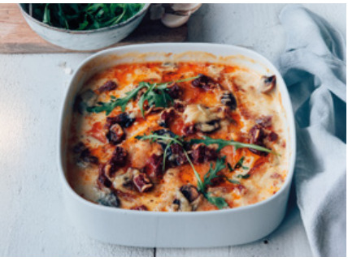

**Ingrediënten voor:** 4 personen
**Bereidingstijd:** ca. 1 uur en 10 min.
boter, om in te vetten
**500 ml** slagroom
**3 tenen** knoflook, fijngehakt
zout en peper
**800 g** zoete aardappels
**225 g** chorizo
**200 g** paddenstoelen
**200 g** belegen kaas, geraspt
**1 handjevol** rucola, voor de garnering
olijfolie, voor de garnering
aluminiumfolie
1 Verwarm de oven voor (elektrisch: 200°C / hetelucht: 180°C). Vet een ovenschaal van ongeveer 30 x 20 cm in met boter.
2 Doe de slagroom en de knoflook in een steelpannetje. Breng de room rustig
aan de kook. Neem van het vuur en laat ca. 15 minuten trekken. Breng op
smaak met zout en peper.
3 Snijd de zoete aardappel in dunne plakken van ongeveer 4-5 mm. Dit kun
je het beste met een mandoline doen, maar zonder lukt het ook. Wanneer de
plakken dikker zijn duurt het garen langer. Snijd de chorizo in blokjes en de
paddenstoelen in dunne plakken.
4 Leg een laag zoete aardappelplakken in de ovenschaal. Bestrooi met zout
en peper. Schenk wat van de room erover. Bestrooi met wat geraspte kaas,
wat blokjes chorizo en wat plakjes paddenstoel. Maak opnieuw een laag met
zoete aardappelplakken en de rest van de ingrediënten. Herhaal tot de ingrediënten op zijn. Eindig met een laag room en kaas.
5 Bedek de ovenschaal met aluminiumfolie en zet de schaal ca. 35 minuten
in de voorverwarmde oven. Haal de folie er af en zet nog eens ca. 20 minuten
zonder folie in de oven, tot de aardappel gaar is. Bestrooi de zoete-aardappelgratin met de rucola en besprenkel met wat olijfolie.
**Per portie:** ca. 934 kcal
**29 g** eiwit | 87 g vet | 49 g koolhydraten
Receptuur en fotografie: Uit Paulines Keuken

## Groentetaart met wortel

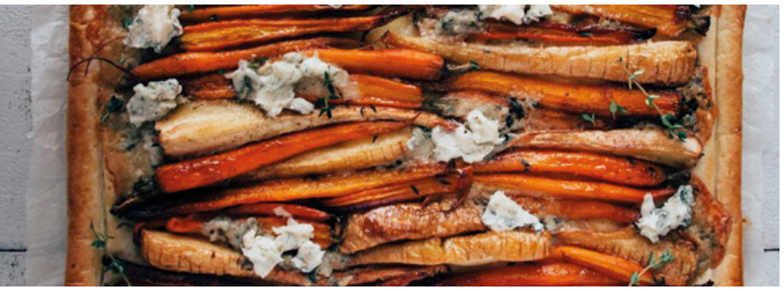

**Ingrediënten voor:** 4 personen
**Bereidingstijd:** ca. 1 uur en 20 min.
**250 g** pastinaak
**500 g** bospeen
**1 el** olijfolie
**20 g** boter
**4 takjes** verse tijm
zout en peper
270 g koelvers bladerdeeg (rol,
koeling)
**100 g** gorgonzola
**1** ei, geklutst
1 Verwarm de oven voor (elektrisch: 220°C / hetelucht: 200°C). Maak de pastinaak en de bospeen
schoon en schil ze. Ik laat aan de bospeen een
stukje van het groen zitten – die worden heel
lekker wanneer ze in de oven geroosterd zijn.
Halveer dikke bospeentjes en snijd de pastinaken
in kwarten. Wanneer je hele grote pastinaken
hebt, dan moeten de parten ongeveer 1-1½ cm dik
worden.
2 Leg de pastinaak en de bospeen in een braadslede of ovenschaal. Besprenkel met de olijfolie.
Snijd de boter in blokjes en verdeel over de groenten. Leg de takjes tijm ertussen. Strooi wat zout
en peper erover en zet de braadslede ca. 45 minuten in de oven. Voor een heel mooi resultaat kun
je de groenten halverwege even omkeren. Het is
niet per se nodig.
3 Leg de bladerdeegrol op het aanrecht op een
stuk bakpapier. Om een mooi opstaande rand te
krijgen snijd je 1½ cm van de rand het deeg voorzichtig in, maar niet helemaal door. Wanneer dit
per ongeluk wel gebeurd, druk je het weer vast.
Prik met een vork gaatjes in het midden (dus niet
in de randen). Zo ontsnapt er lucht uit de gaatjes
en blijft het bladerdeeg in het midden mooi plat,
maar gaat de rand heel mooi opbollen.
4 Leg de geroosterde bospeen en pastinaak in het
midden van het bladerdeeg (op het gedeelte met
de gaatjes) en maak er een mooi patroontje van.
Verdeel de gorgonzola over de groenten en zet de
bladerdeegtaart ca. 25 minuten in de oven, tot het
deeg gaar is. Bestrijk de rand met het gekluste ei.
Bak nog ca. 5 minuten in de oven.
**Per portie:** ca. 542 kcal
**12 g** eiwit | 35 g vet | 47 g koolhydraten

## Gochujangnoedels

**Ingrediënten voor:** 4 personen
**Bereidingstijd:** ca. 25 min.
**1** grote ui
**4** teentjes knoflook
**4** lente-uitjes
**1** paksoi
**250 g** shiitake
**300 g** gemengd gehakt
**3 el** gochujang (Koreaanse
peperpasta, bij de toko of
grotere supermarkt)
**3 el** sojasaus
**3 tl** sesamolie
**2 el** honing
**1** limoen (alleen het sap)
**3 el** pindakaas
**300 g** noedels
olie, om in te bakken
**200 ml** gekookt water
**50 g** gezouten pinda’s, fijngehakt
**1 bosje** koriander, fijngehakt
1 Pel en snipper de ui en de knoflook. Snijd de lente-uitjes in ringetjes. Snijd de paksoi in stukken
en de shiitake in plakjes.
Uit Paulines Keuken
2 Bak het gehakt in een diepe, droge koekenpan
tot het knapperig en bruin is. Breng op smaak
met zout en peper. Schep het gehakt uit de pan op
een bord.
3 Meng in een kom de gochujang, de sojasaus, de
sesamolie, de honing, het limoensap en de pindakaas tot een gladde saus.
4 Kook de noedels gaar volgens de gebruiksaanwijzing op de verpakking. Giet af.
5 Verhit een scheutje olie in de koekenpan en bak
de ui, de knoflook en de lente-ui 2-3 minuten op
laag vuur. Zet het vuur hoger en voeg de shiitake en de paksoi toe en bak kort mee. Schep de
gochujang-pindasaus, het water en de gekookte
noedels bij de groenten en schep 1-2 minuten om.
Verdeel de noedels over de borden en bestrooi
met het knapperige gehakt. Bestrooi met de
fijngehakte pinda’s en de koriander.
**Per portie:** ca. 806 kcal
**34 g** eiwit | 43 g vet | 79 g koolhydraten

## Sinaasappeltaart

**Ingrediënten voor:** ca. 8 stukken
**Bereidingstijd:** ca. 1 uur + 30 min. wachttijd
**225 g** bloem
**2 el** suiker
**100 g** roomboter
**2 tl** appelazijn
**1 tl** vanille-extract
**60 ml** water (koud)
**4** handsinaasappels
**90 g** amandelschaafsel
**1** ei
**55 g** poedersuiker
vershoudfolie
1 Begin met het maken van het deeg. Doe de
bloem, de suiker en de boter in de keukenmachine en meng totdat er kruimels ontstaan en het
mengsel lijkt op grof zand. Voeg de appelazijn,
het vanille-extract en het koude water toe. Meng
opnieuw in de keukenmachine, totdat het deeg
bij elkaar komt.
2 Neem het deeg uit de machine en kneed snel tot
een bal. Omwikkel met vershoudfolie en leg ca.
30 minuten in de koelkast.
3 Verwarm de oven voor (elektrisch: 200°C /
hetelucht: 180°C). Pel de sinaasappels en snijd in
dikke plakken van ca. 1 cm.
4 Leg het deeg op een stuk bakpapier. Rol het
deeg uit in een cirkel van ongeveer 30-35 cm. Prik
het deeg in met een vork en laat ongeveer 5 cm
rand vrij. Strooi ⅔ van het amandelschaafsel in
het midden en leg de sinaasappelplakken erop.
Vouw de randen om. Kluts het ei en bestrijk de
randen ermee. Bestrooi de sinaasappels met de
poedersuiker en de rest van het amandelschaafsel.
5 Zet de galette 35-40 minuten in de oven en bak
goudbruin en gaar. Neem uit de oven, laat afkoelen op een taartrooster en serveer de sinaasappeltaart met slagroom of een bolletje vanille ijs.
**Per stuk:** ca. 363 kcal
**7 g** eiwit | 18 g vet | 42 g koolhydraten

## Pompoencurry met kip

**Ingrediënten voor:** 4 personen
**Bereidingstijd:** ca. 30 min
**2** uien
**1** rode peper
500 g pompoen (bijv.
Hokkaidopompoen)
**300 g** kipdijfilets
zout en peper
zonnebloemolie
**1½ el** curry-madraskruidenmix
**3 el** gembersiroop
**200 ml** kokosmelk
**200 ml** bouillon
**200 g** haricots verts
**150 g** verse doperwten
**2-3 takjes** koriander (of platte
peterselie)
1 Pel de ui en snijd in dunne ringen. Neem de
zaadjes uit de rode peper en hak de peper fijn.
Borstel de pompoen schoon (de schil kun je eten),
halveer de pompoen, verwijder de pitten en snijd
het vruchtvlees in stukjes. Bestrooi de kip royaal
met zout en peper en snijd in stukken (ca. 1½
cm). Je gebruikt de helft van de pompoen, maak
met de andere helft bijvoorbeeld een lekkere
pompoensoep.
2 Verhit een scheutje zonnebloemolie in een
braadpan en fruit de uiringen met de rode peper
2-3 minuten. Roer de curry-madraskruiden
erdoor en bak ca. 1 minuut mee. Voeg de stukjes
pompoen en de kip toe en bak in 5-6 minuten
rondom bruin.
3 Voeg de gembersiroop toe, schenk de kokosmelk en de bouillon in de pan en laat ca. 8 minuten koken. Doe de haricots verts en de doperwten
erbij en laat nog eens ca. 8 minuten koken, tot de
groenten beetgaar zijn. Bestrooi met verse korianderblaadjes (of platte peterselie). Lekker met
naanbrood of rijst.
**Per portie:** ca. 471 kcal
**21 g** eiwit | 26 g vet | 40 g koolhydraten
Uit Paulines Keuken

# Verwarmende

# soepen

Niets lekkerder in de herfst dan een groot bord
dampende soep. Deze recepten zorgen er in ieder geval
voor dat jij er warmpjes bij zit.

## Hamburgse aalsoep

**Ingrediënten voor:** 6 personen
**Bereidingstijd:** ca. 2 uur en 30 min. + ca. 8 uur
wachttijd
150 g gemengd gedroogd fruit (bijv.
pruimen, appels, peren)
**¼** knolselderij
**2** wortels
**1** prei
**1 kg** gerookte spareribs
**2 l** heldere bouillon
**5** kruidnagels
**3** laurierblaadjes
**3-4 takjes** platte peterselie
**200 g** sperziebonen
**200 g** erwten (diepvries)
**1-2 el** wittewijnazijn
**1 snufje** suiker
**1 mespuntje** nootmuskaat
zout en peper
**4 takjes** dille
**1-2 el** olie
**6** kleine eieren
1 EEN DAG VAN TEVOREN Week het gedroogde
fruit een nacht in koud water.
2 DE VOLGENDE DAG Schenk het fruit af. Schil de
knolselderij en de wortels. Maak de prei schoon
en was de overige groenten. Was ook de schillen
en de afsnijdsels. Snijd de knolselderij, de wortels
en de prei in stukjes van ca. 1 cm. Dek af met een
vochtige doek en houd apart.
3 Snijd de spareribs in grove stukken en doe ze
in een grote pan. Schenk de bouillon erbij. Voeg
de kruidnagels, de laurierblaadjes, de peterselie,
de groenteschillen en de afsnijdsels toe. Breng
alles aan de kook en laat ca. 1 uur en 30 minuten
zachtjes koken.
4 Was de sperziebonen en halveer ze. Schenk de
bouillon door een fijne zeef in een tweede pan.
Voeg de rest van de soepgroenten, de sperziebonen en het gedroogde fruit toe aan de soep.
Breng aan de kook en laat ca. 30 minuten zachtjes
koken. Voeg de erwten ca. 5 minuten voor het
einde van de gaartijd toe en laat meegaren. Neem
Hoewel de naam
misschien anders doet
vermoeden, heeft deze
klassieke Duitse aalsoep niets
te maken met de vissoort.
‘Aalns bin’ betekent ‘alles
erin’ in het Nederduits.
Traditioneel is dit dan ook
een soep waar vaak restjes
vlees en groente in werden
verwerkt.
Seizoen
het vlees van de ribbetjes, pluk het in kleine
stukjes en voeg weer toe aan de soep. Breng de
soep op smaak met de azijn, de suiker, de nootmuskaat, zout en peper.
5 Was de dille en neem de blaadjes van de takjes.
Verhit de olie in een pan en bak spiegeleieren van
de eieren. Serveer de soep en leg op iedere portie
een spiegelei. Garneer met de dille.
**Per portie:** ca. 450 kcal
**40 g** eiwit | 21 g vet | 27 g koolhydraten

## Russische soljanka

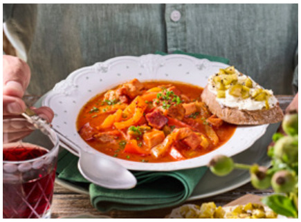

**Ingrediënten voor:** 6 personen
**Bereidingstijd:** ca. 2 uur
**500 g** procureur (bij de slager)
**250 g** gekookte worst
**250 g** boterhamworst
**3** uien
**2 el** olie
zout en peper
**1 tl** paprikapoeder
**2 el** tomatenpuree
**600 ml** groentebouillon
2 paprika’s (bijv. geel en rood)
**150 g** augurken (+ 5 el
augurkenvocht)
**500 g** geroosterde paprika (pot)
**600 g** tomatenblokjes (blik)
**6 sneetjes** brood (bijv. tarwerogge)
**6 el** crème fraîche
**1 bosje** bieslook
1 Dep de procureur droog en snijd in blokjes van ca. 2 cm. Verwijder het vel van de gekookte worst. Snijd
beide soorten worst in stukjes van ca. 1 cm. Pel en snipper de uien. Verhit de olie in een grote pan. Bak
de procureur hierin al omscheppend ca. 5 minuten op hoog vuur. Neem de procureur uit de pan. Bak de
worststukjes ca. 3 minuten in het hete braadvet. Voeg de ui toe en bak kort mee. Doe de procureur terug
in de pan. Breng op smaak met zout, peper en het paprikapoeder. Roer de tomatenpuree erdoor en bak
kort mee. Schenk de bouillon erbij, breng aan de kook en laat afgedekt ca. 45 minuten zachtjes koken.
2 Halveer de paprika’s, verwijder de zaadlijsten, was ze en snijd ze in stukken. Snijd de augurken fijn.
Snijd de geroosterde paprika in stukken. Voeg de verse paprika en de helft van de augurk toe aan het
vlees. Voeg ook de geroosterde paprika en de tomatenblokjes toe. Breng alles aan de kook en laat nog ca.
45 minuten zachtjes koken. Breng de soljanka op smaak met zout, peper en het augurkenvocht.
3 Besmeer de sneetjes brood met de crème fraîche. Verdeel de overige augurk erover en bestrooi met
wat zout en peper. Was de bieslook en hak hem fijn. Bestrooi de soep met de bieslook en serveer met de
broodjes.
**Per portie:** ca. 570 kcal
**33 g** eiwit | 39 g vet | 23 g koolhydraten

## Erwtensoep

## met pannenkoeken

**Ingrediënten voor:** 6 personen
**Bereidingstijd:** ca. 2 uur en 30 min. + ca. 8 uur
wachttijd
**350 g** gedroogde groene erwten
**300 g** gerookt doorregen spek (aan
één stuk)
**1-2** laurierblaadjes
**2** uien
**1** prei
**750 g** aardappels
**250 g** metworst
**2** eieren
**150 g** bloem
**200 ml** melk
zout en peper
**50 ml** bruiswater
**2-3 el** boter
**6 el** fijne leverworst
**1 tl** mosterd
**2-3 el** crème fraîche
**½ bosje** peterselie
1 EEN DAG VAN TEVOREN Week de erwten in ruim
water en laat een nacht staan.
2 DE VOLGENDE DAG Doe het spek in een grote
pan. Schenk ca. 3 l water erbij, breng aan de
kook en laat ca. 1 uur zachtjes koken, terwijl je
het schuim steeds afschept. Neem het spek uit
de bouillon. Schenk de geweekte erwten af, voeg
ze met de laurierblaadjes toe aan de bouillon,
breng aan de kook en kook ca. 45 minuten. Pel en
snipper de uien fijn. Was de prei en snijd hem in
ringen. Schil en was de aardappels en snijd ze in
blokjes van ca. 1 cm. Snijd het spek in hapklare
stukjes. Verwijder het vel van de metworst en
snijd de worst in plakjes. Voeg de ui, de prei, de
aardappel, het spek en de worst toe aan de soep,
breng aan de kook en laat de soep nog 30-40
minuten zachtjes koken.
Seizoen
3 VOOR DE PANNENKOEKEN Kluts de eieren.
Meng met de bloem, de melk en een snufje zout
tot een glad beslag. Roer het bruiswater erdoor.
Laat het beslag ca. 20 minuten staan. Verhit de
boter in porties in een pan met antiaanbaklaag.
Bak achtereenvolgens ca. 6 dunne pannenkoeken
van het beslag. Bestrijk ze met de leverworst, rol
ze op en halveer ze.
4 Roer de mosterd en de crème fraîche door
elkaar. Was de peterselie en hak hem fijn. Breng
de soep op smaak met zout en peper. Serveer
de soep met de mosterdcrème en de peterselie.
Serveer de pannenkoeken erbij.
**Per portie:** ca. 690 kcal
**38 g** eiwit | 31 g vet | 66 g koolhydraten

## Goedgevulde pompoensoep

**Ingrediënten voor:** 6 personen
**Bereidingstijd:** ca. 2 uur
**1-1,2 kg** runderriblappen
**3** uien
**3** wortels
**2** preien
**½** savooiekool
1 kleine hokkaidopompoen (ca. 700 g)
**500 g** aardappels
**2-3 el** olie
zout en peper
**3 el** tomatenpuree
**1 tl** paprikapoeder
**3** laurierblaadjes
**1,5 l** groentebouillon
**1** eidooier
**125 g** roomkaas
**1 mespunt** gemalen
komijn
270 g hartigetaartdeeg (rol,
koeling)
grof zeezout
**4 takjes** peterselie
**6 el** crème fraîche
steker in bloemvorm
(ca. 6 cm Ø)
1 VOOR DE STOOFPOT Dep de runderriblappen droog en snijd in stukjes van
ca. 2 cm. Pel en snipper de uien. Houd 1 tl ui apart. Schil en was de wortels
en snijd ze in plakjes. Was de prei en snijd hem in ringen. Was de savooiekool, snijd hem eerst in parten en dan in reepjes van de stronk. Halveer de
pompoen, verwijder de pitten, was hem en snijd in blokjes. Schil en was de
aardappels en snijd ze in blokjes.
2 Verhit de olie in een grote braadpan. Bak het vlees in porties erin aan en
bestrooi met zout en peper. Doe al het vlees terug in de braadpan. Voeg de
tomatenpuree en het paprikapoeder toe en fruit ca. 3 minuten mee. Leg de
wortels, de prei, de ui, de savooiekool, de laurierblaadjes, de pompoen en de
aardappels in lagen op het vlees. Bestrooi elke laag met wat zout en peper.
Schenk er zoveel bouillon bij tot alles bedekt is. Roer niet! Breng aan de kook
en laat afgedekt ca. 1 uur en 30 minuten zachtjes koken.
3 Verwarm de oven voor (elektrisch: 200°C / hetelucht: 180°C). VOOR DE
BLOEMEN Kluts de eidooier met 1 el water. Roer de roomkaas glad met zout,
peper en de komijn. Roer de apart gehouden ui erdoorheen. Rol het hartige
taartdeeg met het bakpapier uit en steek er met een steker in bloemvorm ca.
28 bloemen (ca. 6 cm Ø) uit. Verdeel op de helft van de bloemen iets minder
dan 1 tl van de roomkaascrème. Bestrijk de overige bloemen met wat van de
geklutste eidooier. Leg ze met de bestreken kant op de bloemen met crème.
Druk de randen stevig aan. Bestrijk de bloemen met de rest van de eidooier.
Strooi er grof zeezout over. Bak ca. 8 minuten in de oven goudbruin en gaar.
4 Was de peterselie en hak hem fijn. Breng de soep op smaak met zout en
peper. Strooi de peterselie erover. Schep er een klodder crème fraîche op.
Serveer de bloemen erbij.
**Per portie:** ca. 690 kcal
**42 g** eiwit | 40 g vet | 42 g koolhydraten
Seizoen

## Aardappelsoep met appelcake

**Ingrediënten voor:** 6 personen
**Bereidingstijd:** ca. 2 uur
**VOOR DE** APPELCAKE
**6** appels
**250 g** zachte boter (+ invetten)
**250 g** suiker
**5** eieren
**350 g** bloem (+ bestuiven)
**½ tl** bakpoeder
**2 el** citroensap
**100 g** amandelschaafsel
**8 g** vanillesuiker
**2 tl** poedersuiker, om te
bestuiven
vierkante springvorm
(24 cm)
**VOOR DE** SOEP
**1 kg** aardappels
**2** wortels
**1** prei
**3** uien
**2 el** boter
**1,5 l** groentebouillon
**6 takjes** oregano
**2 el** olie
paprikapoeder
zout en peper
**150 g** slagroom
**1-2 el** wittewijnazijn
nootmuskaat
1 VOOR DE APPELCAKE Verwarm de oven voor (elektrisch: 180°C / hetelucht:
160°C). Schil de appels, snijd ze in vieren, verwijder de klokhuizen en snijd
ze in partjes. Klop de boter en de suiker romig. Roer de eieren één voor één
erdoorheen. Zeef de bloem en het bakpoeder erboven en spatel erdoor. Meng
de appels, het citroensap, het amandelschaafsel en de vanillesuiker. Vet de
springvorm in en bestuif hem met bloem. Schep het beslag en het appelmengsel afwisselend in de vorm. Bak in ca. 30 minuten gaar in de oven. Laat
afkoelen. Neem de cake uit de vorm, bestuif met de poedersuiker en snijd in
vierkante blokjes van ca. 5 cm.
2 VOOR DE SOEP Schil de aardappels en de wortels, was ze en snijd ze in
kleine stukjes. Was de prei en snijd hem heel fijn. Pel de uien. Snipper 1 ui en
snijd 2 uien in ringen. Verhit de boter in een grote pan. Bak de aardappel, de
groenten en de gesnipperde ui ca. 10 minuten erin. Schenk de bouillon erbij
en breng aan de kook. Was de oregano en voeg de helft van de takjes toe aan
de bouillon. Laat ca. 15 minuten zachtjes koken.
3 VOOR DE GEBAKKEN UIEN Verhit de olie in een pan. Bak de uienringen ca.
8 minuten erin. Bestrooi met wat paprikapoeder en bak kort mee. Breng de
uien op smaak met zout en peper. Neem de oregano uit de soep. Pureer de
soep kort en voeg de slagroom toe. Breng op smaak met de azijn, zout, peper
en nootmuskaat. Neem de blaadjes van de overige takjes oregano. Leg een
stuk appelcake in diepe borden. Schenk de soep om de cake. Bestrooi met de
gebakken uien en de oregano.
**Per portie:** ca. 750 kcal
**14 g** eiwit | 39 g vet | 87 g koolhydraten

## Horizontaal

1 karakter 7 drank 11 spoedig 14 Russische vorst 18 lekkernij 19 beweeggrond
21 tekenmateriaal 24 meer in Zwitserland 26 bezoek 28 te gelegener tijd (afk.)
29 figuur (afk.) 31 roem 32 tijdelijke mode 34 Pools autokenteken 35 insect
37 pressie 39 smart 41 verstoken van geld en goed 44 gestoomd broodje 45 neon
46 Griekse letter 48 Rijkswaterstaat (afk.) 50 managementteam 51 deel van een
lokaal 53 blaasinstrument 55 reputatie 57 schaaldier 62 dunne overjas 64 koffiedik
66 nuttigen 67 Europees Parlement (afk.) 68 rivier in Egypte 70 lidwoord
71 arrestatieteam (afk.) 72 uitroep van tevredenheid 73 aards 77 in gebruik
gegeven goed 78 vrouwelijke gast 80 een zekere 82 plus 83 eens 85 serum
87 klein hert 88 noot der redactie (afk.) 90 persoon van dezelfde rang 93 deel van
de vrouwelijke cyclus 96 vies door vingers 99 verblijf 101 erbinnen 102 tuinkamer
103 schreeuw 104 gemoedsgesteldheid 105 plaats in Noord-Brabant.

## Verticaal

1 intellectuele zelfervaring 2 Europeaan 3 man die een aalmoes vraagt 4 in
orde 5 berichtje op een gsm 6 rit 7 titanium 8 wal 9 forensische dienst 10 land
in Zuid-Amerika 11 tweestemmig gezang 12 Ruth (afk.) 13 gekruld bont
14 voegwoord 15 schoolonderzoek 16 aardappelsoort 17 graansoort 20 tegen
elk aannemelijk bod (afk.) 22 Oude Testament (afk.) 23 kilogram 25 inwendig
orgaan 27 ironie 30 verovering van een vesting 33 gebaar 36 restaurantbediende
38 bos 40 dat wil zeggen (afk.) 42 grootmoeder 43 de heer (afk.) 47 militaire
muziekuitvoering 49 sufferig 52 goed! 54 judoterm 56 zanggodin 58 Engels
kostschoolstadje 59 westnoordwest (afk.) 60 plaats op de Veluwe 61 hakwerktuig
63 onderscheidingsteken 65 rangtelwoord 69 slim 71 reeds binnen korte tijd
74 vliegveld in Drenthe 75 een beetje scheel 76 opschik 79 gebroeders (afk.)
81 stekelig dier 84 plaats in Gelderland 86 plaats in de VS 89 Duits (afk.) 91 oude
lengtemaat 92 deel van het hoofd 94 wintersportartikel 95 stopmechaniek 97 daar
98 mijns inziens (afk.) 100 motorraces in Assen.
© DENKSPORT PUZZELBLADEN
**94** 20 83 56 104 45
VUL DE PUZZEL IN EN MAAK KANS
OP 1 VAN DE 3 EXEMPLAREN VAN

## Groentebijbel deel 2

## t.w.v. 34,99 euro

Van groente krijg je nooit genoeg. Naast een eerste Groentebijbel, is
er daarom nu ook een deel twee. Kookboekenauteur en receptontwikkelaar Welmoed Bezoen bedacht ruim 220 toegankelijke recepten met groente in de hoofdrol. Van borrelen, salades en soepen tot
bakken, hoofdgerechten en zoet. Bovendien leert ze je handige technieken zoals een uitje snipperen én geeft ze tips voor slimmer boodschappen doen en met de seizoenen meekoken. Deze bijbel is voor
iedereen die dol is op groente of er juist meer mee wil gaan koken.
1 2 3 4 5 6 7 8 9 10 11 12 13 14 15 16 17
**18** 19 20 21 22 23
Titel: Groentebijbel deel 2
**24** 25 26 27 28 29 30
**31** 32 33 34 35 36 37 38
Auteur: Welmoed Bezoen
**39** 40 41 42 43 44 45
**46** 47 48 49 50 51 52 53 54
Uitgeverij: Carrera Culinair
**55** 56 57 58 59 60 61 62 63
**64** 65 66 67 68 69 70
Prijs: 34,99 euro
**71** 72 73 74 75 76 77
**78** 79 80 81 82 83 84 85 86
Het antwoord kun je vóór 14 oktober 2025
**87** 88 89 90 91 92 93 94 95
**96** 97 98 99 100 101
sturen naar: koken & genieten, o.v.v. oplossing puzzel
**102** 103 104 105
Postbus 296, 6500 AG Nijmegen
Of op onze website: kokengenieten.nl/puzzel

# 1001 aroma’s

De Marokkaanse keuken zit vol smaakvolle en
geurige aroma’s om bij weg te dromen. Neem een
hap, sluit je ogen en je bent even in Marrakesh.

## Lamstajine met couscous

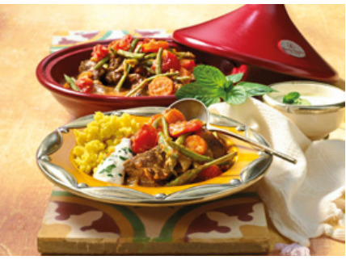

**Ingrediënten voor:** 4 personen
**Bereidingstijd:** ca. 1 uur en 15 min.
**2** uien
**1 kg** lamsschouder (bij de
slager)
**2 el** olijfolie
**2** teentjes knoflook
zout en peper
**1-2 tl** komijnzaad
**1 tl** + 1 mespuntje kurkuma
**1 el** paprikapoeder
**400 g** sperziebonen
**3-4** wortels
**400 g** tomaten
**3 takjes** munt
**200 g** volle yoghurt
**250 g** couscous
1 Pel en snipper de uien. Dep het vlees droog en
snijd het in blokjes. Verhit de olijfolie in een tajine
of een stoofpan. Bak het vlees hierin op hoog vuur
in ca. 4 minuten rondom goudbruin. Voeg de uien
toe en bak ca. 2 minuten mee. Pel de knoflook en
pers hem boven de pan uit. Breng het vlees op
smaak met zout, peper, de komijn, 1 tl kurkuma
en het paprikapoeder en bak kort mee. Schenk er
**400 ml** water bij en laat alles in de gesloten tajine
ca. 1 uur stoven.
2 Was de sperziebonen en halveer ze eventueel.
Schrap de wortels, was ze en snijd ze in plakjes.
Was de tomaten en snijd ze in blokjes. Leg na ca.
30 minuten stooftijd de groenten in lagen op het
vlees in de tajine en bestrooi met zout en peper.
Laat de tajine verder garen.
3 Was de munt, neem de blaadjes van de takjes
en hak ze fijn. Meng de yoghurt met de munt en
breng op smaak met zout en peper. Bereid de
couscous volgens de aanwijzingen op de verpakking in kokend water met wat zout en de rest van
de kurkuma. Serveer de tajine met de couscous.
Geef de yoghurtdip er apart bij.
**Per portie:** ca. 680 kcal
**64 g** eiwit | 21 g vet | 61 g koolhydraten

## Geurige muntthee

**Ingrediënten voor:** ca. 1 liter
**Bereidingstijd:** ca. 10 minuten
Was 5-6 takjes munt. Breng 1 l water in
een pan aan de kook en neem van het vuur.
Voeg de munt, 1 el losse groene thee (of 2
theezakjes) en 100 g suiker toe aan het hete
water. Laat ca. 5 minuten trekken. Schenk
de thee door een zeef in een theepot en
serveer heet.
Seizoen

## Ingelegde citroenen

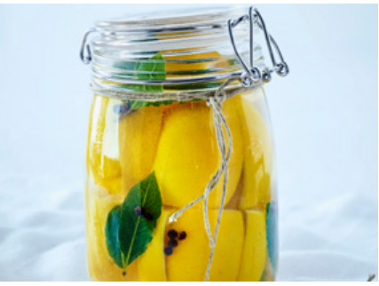

**Ingrediënten voor:** 1 pot (ca. 750 ml)
**Bereidingstijd:** ca. 20 minuten +
**1** dag en 3-4 weken wachttijd
Was 4-5 bio-citroenen met heet water en
wrijf ze droog. Snijd de citroenen in de lengte
kruislings diep in, maar snijd ze niet helemaal
door. Kneus 1 tl zwarte peperkorrels grof in
een vijzel. Weeg 80 g grof zeezout af en bestrooi
de inkepingen met zout. Druk de citroenen,
5-6 laurierblaadjes en de gekneusde peperkorrels stevig in een grote, schone pot. Knijp
stevig in de citroenen terwijl je ze in de pot doet,
zodat er sap vrijkomt. Strooi de rest van het
zout ertussen. Sluit de pot en laat ca. 24 uur op
een koele, donkere plek staan. Schud af en toe
om het zout op te lossen. Pers de volgende dag
3 extra citroenen uit. Schenk het sap bij de citroenen in de pot, sluit de pot en schud opnieuw.
Open de pot en dek het oppervlak af met 60 ml
olijfolie. Sluit de pot goed af en laat 3-4 weken
trekken.

## Kip-dadelbastilla

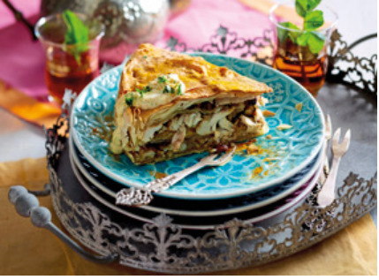

**Ingrediënten voor:** 8 stukken
**Bereidingstijd:** ca. 1 uur
**500 g** filodeeg (koeling of
diepvries, ontdooid)
**500 g** kipfilet
zout en peper
**150 g** amandelen (met
vlies)
**2 el** olijfolie
**7** eieren
**2 tl** ras el hanout
(Marokkaanse specerijenmix, bij de
grotere supermarkt)
**7 tl** suiker
**1 tl** kaneel
**150 g** gedroogde dadels
(zonder pit)
**120 g** boter
**1 bosje** peterselie
**250 g** volle yoghurt
olie, om in te vetten
1 VOOR DE VULLING Laat de vellen filodeeg ca. 10 minuten op kamertemperatuur rusten. Dep de kipfilets droog en bestrooi met zout en peper. Rooster
de amandelen goudbruin in een droge koekenpan en neem ze uit de pan.
Verhit de olijfolie in de pan. Bak de kipfilets ca. 6 minuten per zijde erin.
Kluts 6 eieren met zout en 1 tl ras el hanout. Neem de kip uit de pan. Bak het
eimengsel al roerend in het bakvet en neem ook uit de pan. Meng de suiker
met de kaneel. Pluk de kipfilets met twee vorken uit elkaar. Hak de amandelen. Snijd de dadels in plakjes en meng met de amandelen. Smelt de boter.
2 VOOR DE OPBOUW Leg 5 vellen filodeeg overlappend in een ingevette
springvorm (26 cm Ø) en bestrijk elk vel dun met boter. Verdeel hierover de
helft van het eimengsel en bestrooi met 1 tl van het kaneelsuikermengsel.
Bedek met 2 met boter bestreken vellen filodeeg. Verdeel de helft van het
vlees erover en bestrooi met 1 tl kaneelsuiker. Dek af met 2 met boter bestreken vellen filodeeg. Strooi de helft van het amandelmengsel en 2 tl kaneelsuiker erover. Leg hierop 2 met boter bestreken vellen filodeeg. Herhaal
de lagen met de overige ingrediënten. Bedek de laatste amandellaag met 5
met boter bestreken vellen filodeeg.
3 Verwarm de oven voor (elektrisch: 200°C / hetelucht: 180°C). Kluts het
overgebleven ei en bestrijk de bovenste deeglaag ermee. Bak de pastilla in
ca. 25 minuten goudbruin en gaar in de oven.
4 VOOR DE DIP Was de peterselie, neem de blaadjes van de takjes en hak ze
fijn. Meng de yoghurt met de peterselie en breng op smaak met zout, peper
en ½ tl ras el hanout. Neem de pastilla uit de oven, bestrooi met ½ tl ras el
hanout en serveer met de yoghurtdip.
**Per stuk:** ca. 670 kcal
**33 g** eiwit | 36 g vet | 57 g koolhydraten

## Coverrecept

Fotografie: Willem van Santen

## Köfte in pittige tomatensaus

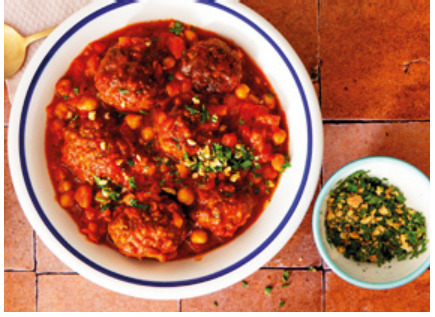

**Ingrediënten voor:** 4 personen
**Bereidingstijd:** ca. 1 uur
**1** ui
**2** wortels
**1** rode puntpaprika
zout en peper
**1 snufje** suiker
**100 g** gedroogde zachte
abrikozen
**75 g** amandelen (zonder vlies)
**1** teentje knoflook
**2 el** paneermeel
**150 g** Griekse yoghurt
**½ bosje** peterselie
**500 g** rundergehakt
**½ tl** kaneel
**3 el** olie
**2 el** tomatenpuree
**1 el** harissa (pittige
Tunesische saus,
bij de grotere
supermarkt)
**300 ml** groentebouillon
**800 g** gepelde tomaten
(blik)
**400 g** kikkererwten
(blik)
**2 takjes** munt
1 Pel de ui en snijd hem in kleine blokjes. Schrap de wortels, was
ze, halveer ze in de lengte en snijd ze in plakjes. Snijd de paprika in
kwarten, verwijder de zaadlijsten, was de paprika en snijd hem in
kleine blokjes. Meng de ui, de wortel en de paprika met wat zout
en een snufje suiker en houd apart. Snijd de abrikozen in zeer fijne
blokjes.
2 Rooster de amandelen in een droge koekenpan en hak ze grof. Pel
de knoflook en hak hem fijn. Meng het paneermeel met 50 g yoghurt.
Was de peterselie en hak de blaadjes fijn. Kneed het gehakt met het
yoghurtmengsel, de knoflook, de kaneel, 1 tl zout, peper, de peterselie (houd 1 el achter) en de amandelen (houd 2 el achter). Vorm er
balletjes van. Verhit 2 el olie in een pan. Bak de balletjes hierin rondom in ca. 4 minuten aan en neem ze uit de pan.
3 Verhit 1 el olie in het hete bakvet. Bak hierin het wortel-paprikamengsel. Voeg de tomatenpuree, 1 el harissa en de abrikozen toe en
bak kort mee. Blus af met de bouillon en de tomaten uit blik en breng
aan de kook. Breng op smaak met zout. Druk de tomaten in de pan
fijn met een spatel. Laat alles zonder deksel ca. 30 minuten zachtjes
koken en roer regelmatig. Voeg de gehaktballetjes de laatste 10
minuten toe om mee te garen.
4 Giet de kikkererwten af, spoel ze af en laat ze uitlekken. Voeg ze toe
aan de saus en breng aan de kook. Breng op smaak met zout, harissa
en een snufje suiker. Was de munt en hak hem fijn. Meng met de
apart gehouden peterselie. Bestrooi de gehaktballetjes met de apart
gehouden amandelen en de kruiden. Roer 100 g yoghurt glad en
serveer erbij. Lekker met platbrood.
**Per portie:** ca. 720 kcal
**42 g** eiwit | 42 g vet | 45 g koolhydraten
Seizoen

## Pistachebaklava

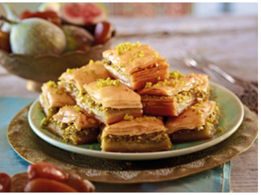

**Ingrediënten voor:** ca. 50 stuks
**Bereidingstijd:** ca. 1 uur en 15 min.
250 g filodeeg (koeling of diepvries,
ontdooid)
**150 g** boter
**200 g** pistachenoten
**4 el** sesamzaad
**400 g** suiker
**3 tl** citroensap
aluminiumfolie
1 Laat de vellen filodeeg ca. 10 minuten op
kamertemperatuur rusten. Smelt de boter in
een kleine pan. Halveer de vellen deeg. Vet een
ovenschaal (20 x 30 cm) in met wat boter. Leg 15
lagen filodeeg op elkaar in de schaal en bestrijk
elke laag dun met gesmolten boter. Leg de vellen
deeg steeds iets verspringend neer, zodat de hele
bodem bedekt is.
2 Hak de pistachenoten fijn in een keukenmachine, houd 2 el apart en meng de rest met het
sesamzaad. Verdeel het mengsel over het deeg.
Leg de overige vellen deeg erop en bestrijk ook
hier elke laag met boter. Snijd het geheel met
een scherp mes in rechthoeken van ca. 3 x 4 cm.
Schenk de resterende boter eroverheen.
3 Verwarm de oven voor (elektrisch: 200°C / hetelucht: 180°C). Bak de baklava in ca. 45 minuten
goudbruin en gaar. Dek na ca. 15 minuten af met
het vel aluminiumfolie.
4 VOOR DE SIROOP Breng de suiker, het citroensap en 300 ml water aan de kook en laat op laag
vuur in ca. 20 minuten inkoken tot een siroop.
Neem de baklava uit de oven en schenk de hete
siroop eroverheen. Laat volledig afkoelen. Bestrooi voor het serveren met de apart gehouden
pistachenoten.
**Per stuk:** ca. 100 kcal
**2 g** eiwit | 6 g vet | 12 g koolhydraten
Lekker eten valt of staat met de ingrediënten die je
gebruikt en het keukengerei dat je tot je beschikking hebt.
Daarom presenteren wij elke maand leuke, verrassende,
handige en/of smakelijke producten.

# KOMMETJE

# SOEP

Als er iets bij de herfst hoort is het wel
een dampende kom soep. Deze prachtige
kommetjes zijn handgeschilderd in Portugal,
en ideaal om soep in te serveren. Blader
gauw naar p. 12, daar vind je de lekkerste
soeprecepten.
Prijs: €8,95.
Verkrijgbaar bij Dille & Kamille.

# BAKKEN MET DE KIDS

De herfstvakantie is dé
periode om met (klein- of
buur-)kinderen te gaan
bakken. Koekjes bijvoorbeeld.
Hoe schattig zijn deze
uitsteekvormpjes van Takkie
en Siepie? Ook verkrijgbaar in
Nijntjevariant.
Prijs per set van 6: €6,49.
Verkrijgbaar bij Hema.

# Alles in de

# airfryer

De schnitzelspiesjes van p. 31 kun je bakken in de oven,
maar wist je dat dat ook kan in de airfryer? De Satisfry™
Dual Basket van Russell Hobbs heeft zelfs twee mandjes,
waardoor je twee dingen op verschillende temperaturen
perfect gaar kunt bakken. Dankzij de handige Sync & Matchfunctie zijn ze bovendien tegelijk klaar! Hij is ook nog eens
vaatwasserbestendig, dus voor jou geen afwas!
Prijs: €149,99.
O.a. verkrijgbaar via bol.com.

# BAKKEN MET DE KIDS

# Hét magazine voor de

# vraag: “Wat eten we

# vandaag?”

Scan de
QR-code

# 12x van 54,voor maar

42,50
Iedere dag inspiratie
voor een heerlijke
maaltijd.
Bomvol recepten met
seizoensgebonden
producten.
Ontdek de lekkerste
zoete recepten.

## Abonneer je nu via:

## www.kokengenieten.nl/abo

of bel naar +31 (0)24 20 27 829
Deze actie is geldig zo lang de voorraad strekt. Je abonneert tot wederopzegging en voor ten minste de actieperiode
van 12 nummers. Na afloop van de actieperiode geldt de reguliere abonnementsprijs en is het abonnement per maand
opzegbaar. Opzeggen is heel eenvoudig en kan via onze klantenservice. Prijswijzigingen onder voorbehoud.

# Simpel en snel

# genieten

Het is al druk genoeg met werk, kinderen en hobby’s. Hier is
de oplossing voor iedereen die geen tijd heeft om uitgebreid
te koken, maar toch lekker wil eten.

## Tiroler pastaschotel

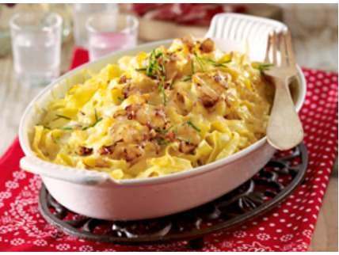

**Ingrediënten voor:** 4 personen
**Bereidingstijd:** ca. 30 min.
**400 g** tagliatelle
zout en peper
**500 ml** melk
**100 ml** slagroom
nootmuskaat
150 g emmentaler of gruyère,
geraspt
**50 g** hüttenkäse
**1** ui
**1 el** boter
**½ bosje** bieslook
olie, voor invetten
1 Verwarm de oven voor (elektrisch: 200°C / hetelucht: 180°C). Kook de tagliatelle in ruim kokend
water met zout gaar volgens de aanwijzingen
op de verpakking. Breng intussen de melk en de
slagroom aan de kook. Breng op smaak met zout,
peper en nootmuskaat. Meng de geraspte harde
kaas met de hüttenkäse. Laat de tagliatelle goed
uitlekken en doe hem terug in de pan. Voeg het
melkmengsel en het kaasmengsel toe en meng
met elkaar.
2 Schenk het pastamengsel in een ingevette ovenbestendige schaal. Bak de schotel ca. 15 minuten
in de hete oven. Pel en snipper intussen de ui.
Verhit de boter in een pan en fruit de ui hierin in
ca. 5 minuten glazig. Was de bieslook, schud hem
droog en hak hem fijn. Bestrooi voor serveren de
pastaschotel met de uie n de bieslook.
**Per portie:** ca. 690 kcal
**31 g** eiwit | 29 g vet | 78 g koolhydraten

## Snel zalm-venkelpannetje

**Ingrediënten voor:** 4 personen
**Bereidingstijd:** ca. 20 min.
**2** venkels
**1** bio-sinaasappel
**400 g** zalmfilet
**2-3 el** pijnboompitten
**2 el** boter
**2 el** olijfolie
zout
cayennepeper
1 Was de venkel en houd het loof apart. Schaaf of
snijd de venkel in dunne plakjes. Was de biosinaasappel, wrijf hem droog en rasp de schil fijn.
Halveer de sinaasappel en pers hem uit. Dep de
zalm droog en snijd in hapklare blokjes.
De snelle keuken
2 Rooster de pijnboompitten in een grote, droge
koekenpan en neem ze uit de pan. Verhit de boter
en de olijfolie in de pan. Bak de venkel hierin al
omscheppend ca. 5 minuten. Voeg de zalm toe en
bak kort mee. Voeg de sinaasappelschil en het sap toe. Breng op smaak met zout en cayennepeper. Breng alles aan de kook en laat ca. 5 minuten
zachtjes koken. Snijd het venkelloof fijn. Proef
de zalm-venkelpan en breng eventueel verder op
smaak. Bestrooi voor het serveren met het
venkelloof en de pijnboompitten.
**Per portie:** ca. 340 kcal
**24 g** eiwit | 26 g vet | 5 g koolhydraten

## Krokante kipnuggets met worteltjes

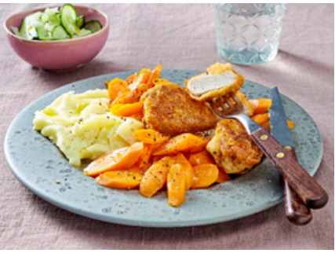

**Ingrediënten voor:** 4 personen
**Bereidingstijd:** ca. 30 min.
**1** ui
**3-4 el** witte balsamicoazijn
zout en peper
**2 el** olie
**1** komkommer
**600 g** wortels
**2-3 el** boter
**600 g** kipfilet
**2** eieren
**2-3 el** bloem
**2 zakjes** poeder voor aardappelpuree (à 75 g)
**1 el** suiker
1 Pel en snipper de ui. Meng met de azijn, zout, peper en de olie. Was de komkommer, schaaf in plakjes en meng met de dressing. Schil de wortels, was ze
en snijd ze in plakjes. Verhit 1 el boter in een pan. Stoof de wortels hierin ca.
5 minuten. Dep de kipfilet droog en snijd in stukken. Kluts de eieren. Meng
de bloem met zout en peper. Doe de bloem, de eieren en 1 zakje pureepoeder
elk in een diep bord. Wentel de stukjes kipfilet achtereenvolgens door de
bloem, het ei en het pureepoeder.
2 Strooi de suiker over de wortels en laat karamelliseren. Schenk er 100 ml
water bij, breng aan de kook en laat 2-3 minuten sudderen. Breng de wortels
op smaak. Breng 500 ml water aan de kook. Verhit 1-2 el boter in een andere
koekenpan. Bak de kipnuggets hierin rondom in ca. 4 minuten goudbruin en
gaar. Neem de pan met kokend water van het vuur. Roer er 1 zakje pureepoeder doorheen. Breng op smaak met zout. Serveer alles samen.
**Per portie:** ca. 550 kcal
**45 g** eiwit | 19 g vet | 50 g koolhydraten

## Spekmedaillons met bulgursalade

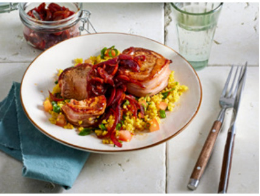

**Ingrediënten voor:** 4 personen
**Bereidingstijd:** ca. 30 min.
**4** rode uien
**5-6 el** olijfolie
**1½ el** lichte basterdsuiker
**1 el** tomatenpuree
zout en peper
**7 el** balsamicoazijn
**400 ml** groentebouillon
**1 tl** kurkuma
**200 g** bulgur
**4** lente-uitjes
**2** tomaten
**1 bosje** peterselie
**8** varkensmedaillons (à
ca. 75 g)
**8 plakjes** gerookt ontbijtspek
1 Pel de rode uien en snijd ze in reepjes. Verhit 1-2 el olijfolie in een pan.
Bak de uien hierin kort aan. Voeg 1 el bruine suiker en de tomatenpuree
toe. Breng op smaak met zout en peper. Schenk 4 el azijn en 6 el water
erbij, breng aan de kook en laat inkoken tot een stroperig geheel. Breng de
groentebouillon met de kurkuma aan de kook, voeg de bulgur toe en kook in
8-10 minuten gaar.
2 Was de lente-uitjes en snijd ze in ringetjes. Was de tomaten, verwijder de
zaadlijsten en snijd het vruchtvlees in blokjes. Was de peterselie en hak hem
fijn. Wikkel om elke varkensmedaillon een plakje spek. Verhit 2 el olijfolie in
een andere pan. Bak de medaillons hierin in 5-6 minuten gaar; draai regelmatig om. Meng 3 el azijn met zout, peper en ½ el suiker. Klop 2 el olijfolie
erdoorheen. Meng de dressing met de bulgur, de tomaten, de lente-uitjes en
de peterselie. Breng de salade op smaak. Serveer alles samen met de medaillons en de uiencompote.
**Per portie:** ca. 620 kcal
**41 g** eiwit | 30 g vet | 49 g koolhydraten

## Schnitzelspiesjes met Aziatische rijst

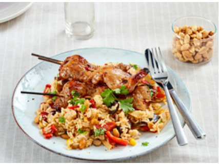

**Ingrediënten voor:** 4 personen
**Bereidingstijd:** ca. 25 min.
**1** ui
**4 el** olie
**200 g** rijst
**30 g** gezouten pinda’s
**1-2 tl** kerrie
**500 ml** groentebouillon
**480 g** roerbakgroente
Aziatisch (diepvries)
6 schnitzels (ongepaneerd, à ca. 100 g)
**4 el** sojasaus
**1 el** citroensap
**½ tl** sambal oelek
**2 el** vloeibare honing
zout en peper
verse koriander, om
te garneren
**12** metalen spiesen
bakpapier
1 Verwarm de oven voor (elektrisch: 220°C / hetelucht: 200°C). Pel de ui en
snipper hem fijn. Verhit 2 el olie in een pan. Fruit hierin de ui, de rijst en de
pinda’s ca. 3 minuten. Voeg de kerrie toe en bak kort mee. Blus af met de
bouillon, breng aan de kook en laat afgedekt ca. 15 minuten garen. Voeg de
wokgroenten ca. 5 minuten voor het einde van de gaartijd toe aan de rijst en
laat meegaren.
2 Dep de schnitzels droog, halveer ze in de lengte en rijg ze golvend aan de
spiesen. Meng de sojasaus, het citroensap, 2 el olie, de sambal oelek en de
honing met elkaar. Bestrijk de schnitzels met de marinade. Leg de spiesen
op een met bakpapier beklede bakplaat. Bak ze in ca. 10 minuten gaar in de
hete oven. Keer de spiesen na ca. 5 minuten om. Breng de Aziatische rijst op
smaak met zout en peper. Serveer de schnitzelspiesjes op de rijst en garneer
met de koriander.
**Per portie:** ca. 540 kcal
**43 g** eiwit | 18 g vet | 52 g koolhydraten
De snelle keuken

## Groente-broodgratin met feta

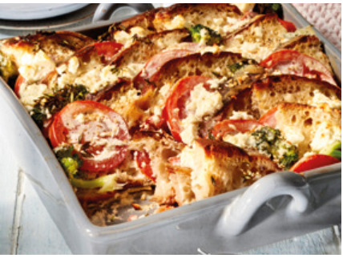

**Ingrediënten voor:** 4 personen
**Bereidingstijd:** ca. 30 min.
**500 g** broccoli
zout en peper
**200 g** feta
**125 ml** melk
**2** eieren
**1** teentje knoflook
**½ bosje** tijm
**4-5 el** olijfolie
**2 el** citroensap
**600 g** tomaten
**8 sneetjes** roggebrood
(à ca. 50 g)
olie, voor invetten
**2 el** sesamzaad
1 Verwarm de oven voor (elektrisch: 200°C / hetelucht: 180°C). Was de broccoli en snijd hem in kleine roosjes. Kook de roosjes ca. 3 minuten in kokend
water met zout. Pureer 100 g feta met de melk met een staafmixer in een
hoge beker. Kluts de eieren met zout en peper en roer door de fetacrème.
Laat de broccoli goed uitlekken.
2 Pel de knoflook en hak hem fijn. Was de tijm en ris de blaadjes van de
takjes. Meng de olijfolie met het citroensap, de tijm en de knoflook. Breng
op smaak met zout en peper. Was de tomaten en snijd ze in dunne plakjes.
Rooster de sneetjes brood eventueel knapperig in een broodrooster.
3 Leg de sneetjes brood en de plakjes tomaat om en om dakpansgewijs in een
ingevette ovenbestendige schaal. Verdeel de broccoliroosjes erover. Schenk
de feta-eicrème eroverheen.
4 Verkruimel de overige 100 g feta grof en verdeel gelijkmatig over de gratin. Besprenkel alles met de knoflook-kruidenolie. Bestrooi tot slot met het
sesamzaad. Bak 15-20 minuten in de hete oven tot de gratin goudbruin en
gaar is.
**Per portie:** ca. 580 kcal
**26 g** eiwit | 31 g vet | 51 g koolhydraten

## Fruitige herfstsalade

## met procureur

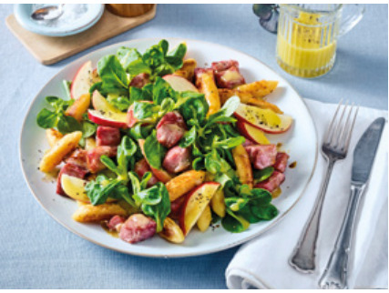

**Ingrediënten voor:** 4 personen
**Bereidingstijd:** ca. 25 min.
**400 g** procureur (bij de slager)
**1-2 el** boter
**500 g** gnocchi (koeling)
zout en peper
**250 g** veldsla
**2** kleine appels (bijv. gala)
**4 el** wittewijnazijn
**1 tl** mosterd
**1 tl** suiker
**4-5 el** olijfolie
1 Dep de procureur droog en snijd in blokjes.
Verhit de boter in een grote pan op hoog vuur en
bak het vlees rondom ca. 3 minuten aan. Voeg de
gnocchi toe en bak op middelhoog vuur ca. 5 minuten mee, tot alles gaar is. Breng op smaak met
zout en peper.
2 Was de veldsla grondig en pluk eventueel in
kleinere stukjes. Was de appels, snijd ze in kwarten en verwijder de klokhuizen. Snijd de partjes
in dunne plakjes. Meng de azijn, de mosterd, zout,
peper en de suiker met elkaar. Klop tot slot de
olijfolie erdoor. Neem de procureur en de gnocchi
uit de pan. Meng met de veldsla en de appels.
Meng voorzichtig met de vinaigrette. Proef de salade en breng eventueel verder op smaak. Serveer
alles samen.
**Per portie:** ca. 500 kcal
**27 g** eiwit | 22 g vet | 48 g koolhydraten

# Superhandige

# kooktips en de

# lekkerste recepten

# in je mailbox?

Meld je aan voor de nieuwsbrief op:

## www.kokengenieten.nl/aanmelden

Scan de
QR-code

# Happy

# Halloween!

Tijd om gezellig te griezelen! Dit spookachtige buffet
is leuk om samen met je (klein-)kinderen te maken én
op te eten.

## Griezelige linzensalade

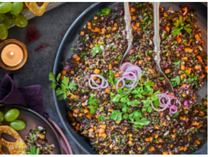

**Ingrediënten voor:** 8 personen
**Bereidingstijd:** ca. 30 min. +
ca. 1 uur wachttijd
**250 g** belugalinzen (bij de
biologische supermarkt)
**3** rode uien
**4** wortels
**100 g** babyspinazie
**6 takjes** peterselie
**50 g** kweepeergelei of
abrikozenjam
**6 el** appelazijn
**1 el** dijonmosterd
zout en peper
**6 el** druivenpitolie (bij de grotere
of biologische supermarkt)
1 Breng een pan water aan de kook. Doe de linzen
erin, breng opnieuw aan de kook en laat ca. 20
minuten zachtjes koken. Pel de uien, snijd 1 ui in
ringen en snipper de overige uien. Schil de
wortels, was ze en snijd ze in kleine blokjes. Was
de spinazie en 4 takjes van de peterselie en hak
fijn. Giet de linzen af en laat ze afkoelen.
2 VOOR DE DRESSING Verwarm de kweepeergelei, de appelazijn, de mosterd, zout en peper en
roer tot een glad geheel. Klop de olie erdoorheen.
Meng de belugalinzen, de wortels, de gesnipperde
ui, de spinazie en de peterselie met de dressing.
Breng op smaak met zout en peper. Laat de salade
ca. 30 minuten trekken. Garneer de salade met de
overige peterselie en de uienringen.
**Per portie:** ca. 200 kcal
**9 g** eiwit | 9 g vet | 23 g koolhydraten
Buffet

## Ovenkalkoen met herfstgroenten

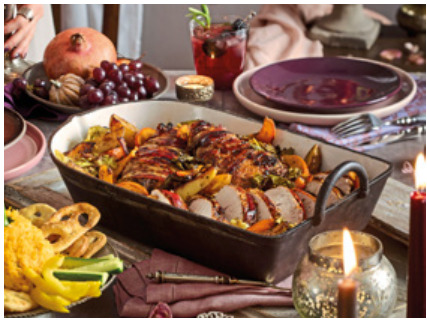

**Ingrediënten voor:** 8 personen
**Bereidingstijd:** ca. 2 uur
**3** kalkoenfilets (à ca. 500 g)
**5 tl** cajunkruiden
**1,5 kg** aardappels
**125 g** sjalotten
**1 kg** hokkaidopompoen
**1 kg** savooiekool
zout en peper
**150 g** kruidenboter
**100 ml** groentebouillon
**30 g** boter
**20 plakjes** gerookt ontbijtspek
**50 g** kweepeergelei of abrikozenjam
olie, om in te vetten
1 Dep de kalkoenfilets droog en wrijf ze rondom in met de cajunkruiden. Laat
afgedekt ca. 30 minuten op kamertemperatuur marineren.
2 VOOR DE OVENGROENTEN Verwarm de oven voor (hetelucht: 180°C*).
Was de aardappels en snijd ze naar grootte in parten. Pel de sjalotten en
halveer ze. Halveer de pompoen, verwijder de pitten, was hem en snijd
hem in partjes van ca. 2 cm dik. Was de savooiekool en snijd in grove repen
van de stronk. Vet twee bakplaten in met olie. Meng op de ene bakplaat
de aardappels en de pompoen en bestrooi met zout en peper. Verdeel op
de tweede bakplaat de kool en de sjalotten en bestrooi met zout en peper.
Smelt de kruidenboter en druppel de helft over de kool en de andere helft
over het pompoenmengsel. Schenk de bouillon over de kool en meng de kool
nogmaals. Schuif de bakplaten tegelijk in de oven (aardappels boven, kool
onder) en bak ca. 20 minuten.
3 Verhit de boter in een koekenpan op hoog vuur. Bak de kalkoenfilets hierin
rondom 5-6 minuten aan. Neem de filets uit de pan, laat ze iets afkoelen en
wikkel ze in het spek.
4 Leg de kalkoen op het pompoenmengsel, verhoog de oventemperatuur
(hetelucht: 200°C) en bak alles in nog ca. 20 minuten gaar. Draai de filets
na ca. 10 minuten een keer om. Neem de bakplaat met de kool uit de oven.
Bestrijk het vlees met de kweepeergelei. Zet de ovengrill aan. Gril de filets op
de groenten ca. 5 minuten.
5 Neem de kalkoen uit de oven en laat ca. 5 minuten rusten. Meng de aardappels, de pompoen en de kool in een grote ovenschaal of op een grote serveerschaal. Breng op smaak met zout en peper. Snijd de kalkoen naar wens in
plakken en serveer op de groenten.
**Per portie:** ca. 570 kcal
**21 g** eiwit | 34 g vet | 44 g koolhydraten
* Een elektrische oven is voor dit recept niet geschikt.
Buffet

## Roomkaaspompoen

**Ingrediënten voor:** 8 personen
**Bereidingstijd:** ca. 20 min. +
minimaal 4 uur wachttijd
**1** ui
**1 bosje** bieslook
**300 g** roomkaas
**100 g** zachte boter
**200 g** geraspte cheddar
**1 tl** paprikapoeder
zout en peper
1 Pel en snipper de ui. Was de bieslook en hak hem
fijn. Meng de roomkaas, de zachte boter, 100 g van de
geraspte cheddar, de ui, de bieslook en het paprikapoeder met elkaar. Breng op smaak met zout en peper.
2 Vorm een grote bal van het roomkaasmengsel. Rol de
roomkaasbal voorzichtig door de resterende cheddar
en zet minimaal 4 uur in de koelkast. Neem de roomkaaspompoen ca. 20 minuten voor het serveren uit de
koelkast. Druk met de achterkant van een mes rondom
inkepingen in de pompoen. Steek de paprikasteel (zie
recept groentesticks hieronder) boven in de pompoen.
Serveer de pompoen met de groentesticks en de griezelcrackers.
**Per portie:** ca. 290 kcal
**10 g** eiwit | 28 g vet | 3 g koolhydraten

## Groentesticks

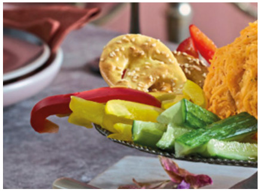

**Ingrediënten voor:** 8 personen
**Bereidingstijd:** ca. 15 min.
Halveer 2 paprika’s (bijvoorbeeld geel en rood) en
verwijder de zaadlijsten. Houd 1 paprikasteel apart
voor de roomkaaspompoen (zie recept hierboven).
Was de paprika’s en snijd ze in repen. Schil 2 grote
wortels, was ze en snijd ze in staafjes. Was 2 snackkomkommers en snijd ze ook in staafjes. Serveer bij
de roomkaaspompoen om te dippen.
Buffet

## Griezelige crackers

**Ingrediënten voor:** ca. 35 stuks
**Bereidingstijd:** ca. 25 min.
**400 g** vers pizzadeeg (koeling)
**1** eidooier
**2 el** sesamzaad
grof zout
bakpapier
1 Rol het pizzadeeg met het bakpapier uit. Steek
uit het deeg dicht op elkaar ca. 35 cirkels uit (6 cm
Ø). Snijd in elke cirkel 3 kleine sneetjes voor de
ogen en de mond. Trek de sneetjes met je handen
voorzichtig iets uit elkaar, zodat er gezichten
ontstaan.
2 Verwarm de oven voor (elektrisch: 220°C / hetelucht: 200°C). Leg de griezelcrackers op twee met
bakpapier beklede bakplaten. Kluts de eidooier
met 1 el water en bestrijk de griezelcrackers
ermee. Bestrooi 12 crackers met het sesamzaad
en 12 crackers met grof zout. Laat de overige
crackers naturel. Bak de crackers in ca. 8 minuten
gaar in de oven. Laat volledig afkoelen en serveer
met de roomkaaspompoen (zie recept hierboven).
**Per stuk:** ca. 40 kcal
**2 g** eiwit | 2 g vet | 6 g koolhydraten

## Heksenbrouwsel

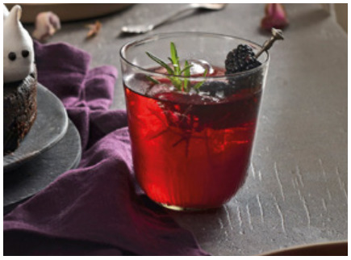

**Ingrediënten voor:** 8 glazen
**Bereidingstijd:** ca. 10 min.
Vul 8 glazen met elk 3-4 ijsblokjes. Meng 300 ml crème
de cassis (zwartebessenlikeur, bij de slijter) en 175 ml
wodka (40% alcohol) met elkaar en verdeel over de
glazen. Vul aan met 1 l gingerbeer. Was 8 takjes rozemarijn en 16 bramen. Rijg de bramen aan 8 houten
prikkers. Garneer de cocktails met de takjes rozemarijn
en de bramenspiesjes.
Buffet

## Spookachtige brownietaart

**Ingrediënten voor:** ca. 16 stukken
**Bereidingstijd:** ca. 2 uur en 45 min. + ca. 4 uur wachttijd
**390 g** suiker
**1 tl** maizena
**1 tl** wijnsteenbakpoeder
(bijv. van het merk
Smaakt, bij de grotere
supermarkt)
**6** eieren
zout
**300 g** pure chocolade (70%
cacao)
**250 g** boter
**150 g** lichte basterdsuiker
**1 tl** vanillepasta
**150 g** bloem
**50 g** cacaopoeder
**150 g** melkchocolade
boter, om in te vetten
**1** spuitzak met ronde
spuitmond (ca.
**1½** cm)
bakpapier
springvorm (26 cm Ø)
1 VOOR DE SPOOKJES Meng de suiker, de maizena en ½ tl van het wijnsteenbakpoeder. Splits 4 eieren. Houd de eidooiers apart voor de brownie. Doe de
eiwitten met een snufje zout in een kom. Klop met een handmixer ca. 2 minuten, tot het eiwit schuimig is. Voeg het suikermengsel lepel voor lepel toe
aan het eiwitschuim. Klop nog 2-3 minuten tot de massa stevig is en glanst.
2 Verwarm de oven voor (hetelucht: 100°C*). Doe de eiwitmassa in de spuitzak. Bekleed twee bakplaten met bakpapier. Spuit de eiwitmassa in kleine
druppels (ca. 3 cm Ø) op de bakplaten. Trek de spuitzak daarbij snel omhoog,
zodat er mooie puntjes ontstaan. Laat de schuimpjes per bakplaat 1½-2 uur
drogen in de oven. Houd de ovendeur op een kier met behulp van een houten
pollepel. Laat de schuimpjes in de uitgeschakelde oven afkoelen met de deur
nog steeds op een keer.
3 VOOR DE BROWNIE Verwarm de oven voor (elektrisch: 180°C / hetelucht:
160°C). Hak 250 g van de pure chocolade en smelt deze samen met de boter
in een pan op laag vuur. Schenk het mengsel in een kom en laat het iets
afkoelen. Voeg de 4 apart gehouden eidooiers, 2 eieren, de basterdsuiker en
de vanillepasta toe en klop kort door met een handmixer. Meng de bloem,
het cacaopoeder en ½ tl wijnsteenbakpoeder en spatel kort door het chocolademengsel. Hak de melkchocolade grof. Spatel de gehakte melkchocolade
door het beslag. Vet de rand van een springvorm (26 cm Ø) in en bekleed de
bodem met bakpapier. Verdeel het beslag over de springvorm en strijk glad.
Bak de brownie in 25-30 minuten gaar in de oven. Laat volledig afkoelen in
de vorm.
4 VOOR DE SPOOKJES Smelt 50 g pure chocolade au bain-marie. Teken met
de vloeibare chocolade oogjes op de schuimspookjes. Laat drogen. Versier de
brownie met de spookjes en serveer de overige spookjes erbij.
**Per stuk:** ca. 480 kcal
**8 g** eiwit | 25 g vet | 58 g koolhydraten
* Een elektrische oven is voor dit deel van het recept niet geschikt.

# Oogappeltjes

Appels zijn het populairste fruit van Nederland en
dat is niet gek: ze zijn lekker zoetzuur, lang houdbaar
én heel gezond. Met deze recepten krijg jij een extra
portie goede voedingsstoffen binnen.

## Savooiekool met kip en

## appel-yoghurtsaus

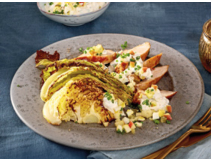

Ingrediënten :voor 4 personen
**Bereidingstijd:** ca. 40 min.·
1 kleine savooiekool (ca. 800 g)
**5 el** olijfolie
**1** sinaasappel (alleen het sap)
nootmuskaat
zout en peper
**4** kipfilets (à ca. 175 g)
**2** eieren
**3-4** augurken (pot)
**1** kleine appel (bijv. elstar)
**½ bosje** bieslook
**100 g** kwark
**200 g** volle yoghurt
**1 el** appelazijn
paprikapoeder
bakpapier
De gezonde keuken
1 Verwarm de oven voor (elektrisch: 200°C / hetelucht: 180°C). Was de savooiekool en snijd hem in acht
gelijke parten. Verdeel de parten naast elkaar over een met bakpapier beklede bakplaat. Meng 3 el olijfolie, de helft van het sinaasappelsap, nootmuskaat en zout met elkaar. Besprenkel de savooiekoolparten
ermee en rooster ze ca. 25 minuten in de oven.
2 Dep de kipfilets droog. Verhit 2 el olijfolie in een pan. Bak de kipfilets hierin aan beide kanten 1-2
minuten. Bestrooi met zout en peper. Leg de kipfilets na ca. 5 minuten van de oventijd bij de savooiekool
op de bakplaat en laat alles samen verder garen.
3 Kook de eieren in ca. 8 minuten hard. Snijd intussen de augurken fijn. Was de appel, snijd hem in
vieren, verwijder het klokhuis en snijd het vruchtvlees in kleine blokjes. Was de bieslook en hak hem
fijn. Meng de kwark, de yoghurt, de appelazijn en de rest van het sinaasappelsap met elkaar. Roer de
augurken, de appel en de bieslook erdoorheen. Breng op smaak met zout, peper en paprikapoeder. Spoel
de eieren met koud water, pel ze, snijd ze in kleine blokjes en schep ze door de saus.
4 Neem de savooiekool en de kip uit de oven. Snijd de kip in repen. Serveer de kiprepen met de savooiekoolparten en een beetje saus. Geef de overige saus er apart bij.
**Per portie:** ca. 470 kcal
**56 g** eiwit | 20 g vet | 16 g koolhydraten

## Kleurrijke herfstsalade

## met linzen en grapefruit

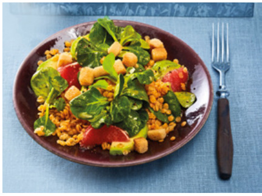

Ingrediënten: voor 4 personen
**Bereidingstijd:** ca. 25 min.
**150 g** rode linzen
**200 g** veldsla
**1** roze grapefruit
**1** avocado
4 sneetjes casinobrood (à ca.
**40** g)
**2 el** boter
**3-4 el** appelazijn
2 tl mosterd (bijv.
honingmosterd)
**4 el** olijfolie
zout en peper
1 Kook de linzen in ca. 10 minuten gaar. Was de
veldsla grondig, laat goed uitlekken en pluk eventueel in kleinere stukjes. Snijd met een scherp
mes de schil, inclusief de witte schil, van de
grapefruit. Snijd de partjes met een scherp mes
tussen de vliezen uit. Knijp het sap uit de overgebleven vliezen. Halveer de avocado, verwijder de
pit en neem het vruchtvlees uit de schil. Snijd het
vruchtvlees in dunne parten en besprenkel direct
met het grapefruitsap, op 1 el na.
2 Schenk de linzen af en laat ze iets afkoelen.
Snijd het casinobrood in blokjes. Verhit de boter
in een pan. Bak de broodblokjes hierin al roerend
in ca. 5 minuten goudbruin. Neem de croutons uit
de pan.
3 Meng de appelazijn, 1 el grapefruitsap en de
mosterd met elkaar. Klop de olijfolie erdoorheen.
Breng de appelvinaigrette op smaak met zout en
peper. Meng de linzen, de veldsla, de avocado, de
grapefruitpartjes en de vinaigrette voorzichtig
met elkaar. Proef de salade en breng eventueel
verder op smaak. Verdeel de salade over borden
en bestrooi met enkele croutons. Geef de overige
croutons er apart bij.
**Per portie:** ca. 450 kcal
**16 g** eiwit | 22 g vet | 46 g koolhydraten

## Plaatpannenkoek

## met appel en noten

Ingrediënten: voor 6 personen
**Bereidingstijd:** ca. 55 min.
**5** eieren
**250 g** bloem
**250 ml** melk
**3 el** bruisend mineraalwater
**2-3 el** suiker
**1 snufje** zout
**1 tl** kaneel
**3** rode appels (ca. 500 g)
**2 el** citroensap
**4 el** walnoten
**4 el** amandelschaafsel
**4 el** havervlokken
**200 g** Griekse yoghurt
**2 el** vloeibare honing
munt, om te garneren
bakpapier
1 Klop de eieren, de bloem, de melk en het mineraalwater met een handmixer glad. Voeg de
suiker, het zout en de kaneel toe en meng tot
een glad beslag. Laat het beslag ca. 15 minuten
wellen.
2 Was de appels, snijd ze in vieren en verwijder
de klokhuizen. Snijd de appels in dunne partjes
en meng ze met het citroensap. Hak de walnoten
grof. Rooster de walnoten en het amandelschaafsel kort in een droge koekenpan. Neem de noten
uit de pan.
3 Verwarm de oven voor (elektrisch: 180°C /
hetelucht: 160°C). Bekleed een ovenschaal (ca.
25 x 35 cm) met bakpapier. Schenk het beslag erin
en strijk het glad. Verdeel de appelpartjes gelijkmatig over het beslag. Bestrooi met de noten
en de havervlokken. Bak de plaatpannenkoek in
15-20 minuten gaar in de oven.
4 Roer de yoghurt glad. Neem de pannenkoek uit
de oven. Serveer de pannenkoek met de yoghurt
en de honing. Garneer met de munt en serveer
direct.
**Per portie:** ca. 450 kcal
**17 g** eiwit | 17 g vet | 57 g koolhydraten

## Zelfgemaakte appelchips

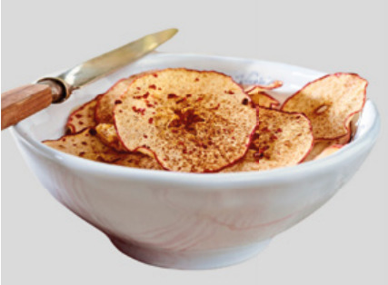

**Ingrediënten voor:** 4-6 personen
**Bereidingstijd:** ca. 5 uur
Houdbaarheid: ca. 1 week
Verwarm de oven voor (hetelucht: 80°C*). Meng 3 el citroensap met 1,5 l water. Was
2 appels en verwijder het klokhuis met een appelboor. Schaaf de appels in dunne
plakjes en leg ze direct in het citroenwater. Laat de plakjes uitlekken en verdeel ze
over twee met bakpapier beklede bakplaten. Droog de appelplakjes 4½-5 uur in de oven.
Klem tijdens het drogen een houten lepel tussen de ovendeur, zodat hij op een kier blijft staan
en het vocht kan ontsnappen. Neem de chips uit de oven en bestrooi naar wens met 1 tl kaneel
en 1 tl chilivlokken. De chips is in een afgesloten trommel ca. 1 week houdbaar.
* Een elektrische oven is voor dit recept niet geschikt.
Klem tijdens het drogen een houten lepel tussen de ovendeur, zodat hij op een kier blijft staan
De gezonde keuken

# 4x

# lekker

# Pompoen

Denk je aan de herfst, dan denk je aan pompoen.
Geroosterd, gepureerd of in de soep: met deze
veelzijdige groente kun je alle kanten op.

## Tagliatelle met pompoen en salieboter

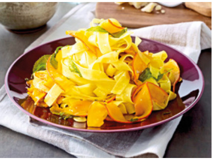

**Ingrediënten voor:** 4 personen
**Bereidingstijd:** ca. 25 min.
**3** sjalotten
**1 teen** knoflook
**½** hokkaidopompoen
(ca. 500 g)
**2 takjes** salie
**500 g** tagliatelle
zout en peper
**2 el** olijfolie
**2 el** boter
1 Pel en snipper de sjalotten. Pel de knoflook en snijd hem in plakjes.
Verwijder de pitten uit de pompoen, was hem en snijd hem met een dunschiller in de lengte in dunne repen. Was de salie en neem de blaadjes van de
takjes.
2 Kook de pasta in ruim water met zout gaar volgens de aanwijzingen op de
verpakking. Verhit de olijfolie in een pan op middelhoog vuur. Bak de salie ca.
1 minuut erin. Neem de salie uit de pan. Verhit de boter in het hete bakvet.
Bak de sjalot, de knoflook en de pompoen 4-5 minuten. Breng op smaak met
zout en peper.
3 Giet de pasta af en doe hem terug in de pan. Meng de pompoen met het
bakvet en de salie erdoorheen. Serveer alles samen. Lekker met parmezaan.
**Per portie:** ca. 380 kcal
**9 g** eiwit | 15 g vet | 54 g koolhydraten

## Pompoenpuree met spek-uientopping

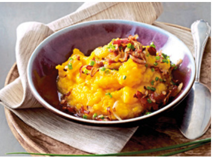

**Ingrediënten voor:** 4 personen
**Bereidingstijd:** ca. 30 min.
**400 g** aardappels
**1** hokkaidopompoen (ca. 800 g)
zout en peper
**½ bosje** bieslook
**8 plakjes** gerookt ontbijtspek
**2** uien
**2 el** boter
nootmuskaat, versgeraspt
1 Schil de aardappels, was ze en snijd ze in blokjes. Halveer de pompoen,
verwijder de pitten, was hem en snijd hem in stukken. Kook beide in ruim
water met zout in ca. 20 minuten gaar.
2 Was de bieslook en hak hem fijn. Snijd het spek in dunne reepjes. Pel de
uien en snijd ze in dunne ringen. Bak het spek in een pan zonder vet krokant.
Voeg de ui toe en bak ca. 3 minuten mee.
3 Giet de pompoen en de aardappels af. Voeg de boter toe en stamp alles grof
door elkaar. Breng op smaak met zout, peper en nootmuskaat. Verdeel het
spek-uienmengsel en de bieslook erover.
**Per portie:** ca. 380 kcal
**8 g** eiwit | 19 g vet | 45 g koolhydraten

## Romige pompoensoep met gember

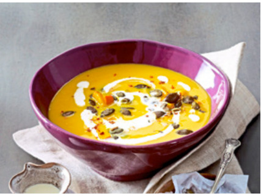

**Ingrediënten voor:** 4 personen
**Bereidingstijd:** ca. 40 min.
**2** sjalotten
**1** teentje knoflook
ca. 2 cm gember
**1** hokkaidopompoen
(ca. 800 g)
**3 el** olie
kerrie
**1 l** groentebouillon
zout en peper
**3 el** pompoenpitten
**200 ml** melk
paprikapoeder
**2 el** crème fraîche
chilivlokken
1 Pel en snipper de sjalotten en de knoflook. Schil de gember en hak hem fijn.
Halveer de pompoen, verwijder de pitten en was de pompoen. Snijd ca. 150 g
pompoen in kleine blokjes. Snijd de rest van de pompoen in kleine stukken.
Verhit 1 el olie in een soeppan. Bak de sjalot en de knoflook hierin glazig.
Voeg de stukken pompoen, de gember en 1 tl kerrie toe en stoof 2-3 minuten
mee. Schenk de bouillon erbij en breng aan de kook. Breng op smaak met
zout en peper. Laat afgedekt ca. 25 minuten zachtjes koken.
2 Verhit 1 el olie in een pan. Bak de pompoenpitten ca. 4 minuten hierin.
Breng op smaak met zout en neem uit de pan. Verhit de overige 1 el olie in het
hete bakvet. Bak de pompoenblokjes ca. 4 minuten hierin. Houd 2 el melk
apart. Roer de rest van de melk door de soep, breng aan de kook en pureer
met een staafmixer. Breng op smaak met zout, kerrie en paprikapoeder. Roer
de crème fraîche en 2 el melk glad. Verdeel de soep en de pompoenblokjes
over kommen. Roer de crème fraîche erdoorheen. Bestrooi met de pitten en
chilivlokken.
**Per portie:** ca. 320 kcal
**10 g** eiwit | 17 g vet | 33 g koolhydraten
4x lekker

## Geroosterde pompoen en prei

## met frisse dip

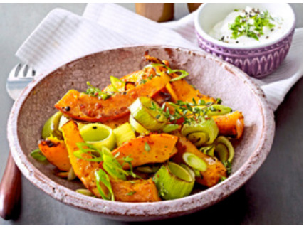

**Ingrediënten voor:** 4 personen
**Bereidingstijd:** ca. 40 min.
**1** hokkaidopompoen
(ca. 1,5 kg)
**1** prei
**1 mespunt** chilivlokken
**5 el** olijfolie
zout en peper
**2** lente-uitjes
**4 takjes** tijm
**3 takjes** peterselie
**200 g** crème fraîche
1 Verwarm de oven voor (elektrisch: 200°C / hetelucht: 180°C). Halveer de
pompoen, verwijder de pitten en was de pompoen. Snijd de pompoenhelften
dwars doormidden en vervolgens in parten. Was de prei en snijd hem in
ringen. Meng de pompoen, de prei, de chilivlokken en 3 el olie op een bakplaat met elkaar. Bestrooi met zout en peper. Rooster 25-30 minuten onder
in de oven.
2 Was de lente-uitjes en snijd ze schuin in ringen. Was de tijm en neem de
blaadjes van de takjes. Meng de lente-uitjes, de helft van de tijm en 2 el olie
met elkaar. Verdeel het mengsel ca. 5 minuten voor het einde van de baktijd
over de groenten op de bakplaat. Rooster alles tot het gaar is.
3 Was de peterselie en hak hem fijn. Meng de crème fraîche met de peterselie
en de rest van de tijm. Breng de dip op smaak met zout en peper. Neem de
groenten uit de oven, breng eventueel verder op smaak en verdeel over diepe
borden. Serveer de dip erbij.
**Per portie:** ca. 530 kcal
**9 g** eiwit | 30 g vet | 57 g koolhydraten
Titel: Groentebijbel deel 2
Auteur: Welmoed Bezoen
Fotografie: Anker van Warmerdam
Prijs: 34,99 euro
Uitgeverij: Carrera Culinair

# Heel veel

# groente

Van groente krijg je nooit genoeg. Naast een
eerste Groentebijbel, is er daarom nu ook een deel
twee. Kookboekenauteur en receptontwikkelaar
Welmoed Bezoen bedacht ruim 220 toegankelijke
en smaakvolle recepten met groente in de
hoofdrol. Van borrelen, salades en soepen tot
bakken, hoofdgerechten en zoet. Bovendien leert
ze je handige technieken als een uitje snipperen
of knolselderij schoonmaken én geeft ze tips voor
slimmer boodschappen doen en met de seizoenen
meekoken. Deze bijbel is voor iedereen die al dol
is op groente of er juist meer mee wil leren koken,
van beginnende chef tot professional.

## Oesterzwammenshoarma

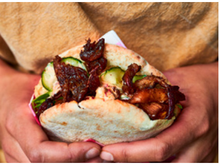

**Ingrediënten voor:** ca. 4 personen
**Bereidingstijd:** ca. 45 min.
**400 g** oesterzwammen
**5 el** extra vierge olijfolie
**1 tl** gerooktepaprikapoeder
**½ tl** knoflookpoeder
**1½ tl** uienpoeder
**1 tl** gemalen komijn
**½ tl** chilipoeder
**¼ tl** kaneel
**1 snufje** versgeraspte
nootmuskaat
zout en peper
**4 el** mayonaise
**2 el** volle yoghurt
**3** knoflooktenen, fijngehakt
**4** grote pita’s
**2 el** ingelegde jalapeño’s (zie
kader op p. 49)
**½** komkommer, in plakjes
**½** ijsbergsla, fijngesneden
1 Verwarm de oven voor (elektrisch: 200°C /
hetelucht: 180°C).
2 Verdeel de oesterzwammen in een enkele laag
over een bakplaat en schuif ze in het midden van
de oven. Rooster de oesterzwammen ongeveer
15 minuten, tot ze iets zijn uitgedroogd. Doe de
oesterzwammen in een kom en voeg de olijfolie,
het gerooktepaprikapoeder, knoflookpoeder, 1
theelepel uienpoeder, de komijn, het chilipoeder,
de kaneel en nootmuskaat toe, hussel goed en
breng op smaak met zout en peper. Laat 15 minuten marineren.
3 Meng intussen de mayonaise, yoghurt, knoflook
en het resterende uienpoeder in een kom. Breng
de saus op smaak met zout en peper.
4 Bak de pita’s volgens de verpakking in de oven
of broodrooster.
5 Verhit een koekenpan op hoog vuur. Voeg de
oesterzwammen toe en bak ze goudbruin aan alle
kanten.
6 Snijd de pita’s open. Besmeer een binnenkant
met sambal en de andere met een beetje knoflookmayonaise. Vul met de komkommer, ijsbergsla, oesterzwammen en ingelegde jalapeño’s
en top af met meer knoflookmayonaise.
Kookboek

## Ingelegde jalapeño’s

## (voor 1 pot van 400 ml)

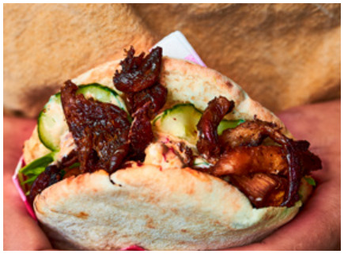

Breng 150 ml appelazijn, 35 g suiker, ½ tl
chipotle-chilivlokken, 2 gekneusde tenen
knoflook en 100 ml water in een pannetje aan
de kook op middelhoog vuur en roer tot de suiker is opgelost. Haal de pan van het fornuis en
zet opzij. Halveer 250 g jalapeno’s en verwijder
de zaadlijsten en kroontjes. Snijd de jalapeno’s
in de lengte in dunne reepjes. Stop ze in de pot
en giet de warme azijn met de smaakmakers
eroverheen. Zorg dat de jalapeno’s onderstaan,
voeg anders een beetje extra azijn toe. Draai het
deksel op de pot en laat de jalapeno’s minimaal
3 dagen in de koelkast marineren. Bewaar ze
afgedekt en gekoeld.

## Gekaramelliseerde venkel

## met linzen en appel

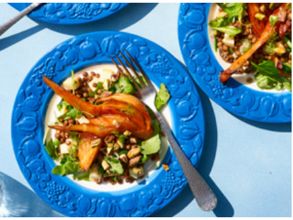

**Ingrediënten voor:** 4 personen
**Bereidingstijd:** ca. 1 uur en 10 min.
**3** venkelknollen
**6 el** extra vierge olijfolie
zout en peper
1 bio-sinaasappel (rasp en sap)
1 el gochujang (Koreaanse chilipasta,
bij de toko of grotere supermarkt)
**200 ml** witte wijn
**5 el** appelazijn
**1 el** honing
**400 g** groene linzen (blik, uitgelekt)
**1** appel, in blokjes
**1 el** dijonmosterd
**15 g** dille
**40 g** basilicum, blaadjes geplukt
**40 g** rucola
**½** citroen (sap)
**35 g** pistachenoten, geroosterd en grof
gehakt
1 Snijd de venkelknollen in partjes van 3 cm. Houd
de kern intact, anders vallen ze uit elkaar. Verwijder
eventueel de buitenste, taaie laag.
2 Verhit de helft van de olijfolie in een koekenpan met
deksel op middelhoog vuur. Voeg de venkel toe en bak
het aan beide kanten goudbruin. Breng op smaak met
zout en peper. Voeg het sinaasappelrasp, sinaasappelsap, de gochujang, witte wijn, 3 eetlepels appelazijn, honing en genoeg water toe zodat de venkel voor
de helft onderstaat.
3 Leg het deksel op de pan en stoof tot het meeste
vocht is verdampt. Draai de venkel om, giet er weer
genoeg water bij zodat de parten voor de helft onderstaan, leg het deksel terug op de pan en stoof weer tot
het meeste vocht is verdampt. Haal het deksel eraf
en bak tot de saus is ingedikt en de venkel begint te
karamelliseren. Haal de pan van het fornuis en breng
de venkel op smaak met zout en peper.
4 Verhit 2 eetlepels olijfolie in een pan op hoog vuur.
Voeg de linzen toe en bak ze ongeveer 5 minuten.
Schep de linzen voorzichtig in een kom en voeg de
resterende olijfolie, azijn, appel, mosterd, dille, het
basilicum en de rucola toe. Meng voorzichtig, om het
basilicum en linzen niet te veel te kneuzen, en breng
op smaak met het citroensap en wat zout en peper.
5 Schep de linzen op, top af met de gekaramelliseerde
venkel en garneer met de pistachenoten.

## Gekonfijte pompoen met tahin en yoghurt

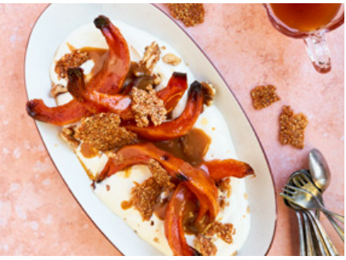

**Ingrediënten voor:** 4 personen
**Bereidingstijd:** ca. 1 uur en 35 min. + 1 nacht wachttijd
500 g hokkaidopompoen,
geschild en in parten
van 2-3 cm dik
**225 g** suiker
**¼ tl** kaneel
zout
**5 el** sesamzaad
**4 el** tahin
**4 el** peknez (Turkse druivenmelasse, bij de
toko)
**750 g** Griekse yoghurt
**50 g** walnoten, geroosterd
1 Meng de pompoen met 175 gram suiker, kaneel en een snufje zout in een
ovenschaal. Schep een paar keer om zodat alle stukken bedekt zijn met
suiker, zet het in de koelkast en laat 1 nacht staan. Suiker trekt vocht uit de
pompoen en creëert een stevige buitenlaag. Draai na een paar uur de stukken om.
2 Verwarm de oven voor (elektrisch: 170°C / hetelucht: 150°C). Zet een
ovenschaal in het midden van de oven en rooster de pompoen 1 uur en 20
minuten. Draai de pompoenpartjes om de 20 minuten om en schep de siroop
eroverheen.
3 Leg intussen 2 bakpapiertjes klaar. Doe het sesamzaad, de resterende 50
gram suiker en een snufje zout in een koekenpan en verhit opmiddelhoog
vuur. Voeg 1 eetlepel water toe zodat de suiker makkelijker smelt. Laat
zachtjes de suiker verkleuren en roer heel af en toe, omalles gelijkmatig te
bakken. Giet, als de suiker gekaramelliseerd is, de karamel op een vel bakpapier. Leg het andere vel erop en rol meteen deegroller de sesamcrunch uit tot
ongeveer de dikte van een sesamzaadje. Laat het volledig afkoelen en breek
dan in stukjes.
4 Meng de tahin met de pekmez en breng op smaak met een snufje zout.
Breng de Griekse yoghurt ook op smaak met een snufje zout.
5 Smeer de yoghurt uit op een groot bord. Leg de pompoenpartjes erop.
Zigzag de tahin-pekmezstroop erover, bestrooi met de walnotenen giet er
een beetje pompoensiroop uit de ovenschaal over. Garneer met de sesamcrunch.
Kookboek

## Bietentzatziki

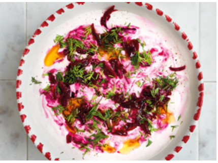

**Ingrediënten voor:** 4 personen
**Bereidingstijd:** ca. 5 min.
**300 g** Griekse yoghurt (minstens 10% vet voor de beste
romigheid)
**2 tl** geraspte mierikswortel (potje)
1 kleine knoflookteen, fijngehakt
**½** bio-citroen (rasp en sap)
zout en peper
2 rauwe of gekookte bieten, geschild en grof geraspt
**10 g** dille, fijngesneden
**2 el** extra vierge olijfolie
trekbrood of pita, om erbij te serveren
1 Roer de yoghurt, mierikswortel, knoflook en het citroenrasp glad. Breng op
smaak met het citroensap en wat zout en peper.
2 Roer de bieten en bijna alle dille er kort maar losjes door, zodat er een gemarmerd effect ontstaat. Giet de olijfolie erover en bestrooi met de overige
dille en nog een snufje zout en peper. Serveer met trekbrood of pita.
Welmoed: “Bieten en yoghurt gaan zo goed samen dat je
er eindeloos mee kan variëren. Soep, salade en zelfs, zoals
hier, in een dip. Gebruik rauwe of gekookte bieten of een mix.
Rauwe bieten zijn aards van smaak en steviger en gekookte
juist zoeter en zacht. Serveer deze tzatziki met een groot
trekbrood en wat olijven en je hebt een heerlijke middag. Roer
er op koude dagen een lepeltje krokante chiliolie doorheen
voor extra warmte. Of voeg wat geroosterde walnoten toe voor
een lekkere crunch.”

## Knolselderijgnocchi

## met paddenstoelen en

## hazelnoten

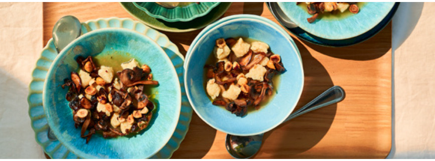

**Ingrediënten voor:** ca. 4 personen
**Bereidingstijd:** ca. 1 uur
**1** knolselderij
**6 el** extra vierge olijfolie
zout en peper
250 ml madeira (versterkte wijn,
bij de slijter of grotere
supermarkt)
**2 el** sherryazijn
**1 tl** worcestersaus
blaadjes van 2 takjes dragon
**1 el** miso
**1** ei
**160 g** bloem (tipo 00)
**500 g** paddenstoelenmix, in plakjes
**50 g** hazelnoten, geroosterd en
grof gehakt
spuitzak
1 Verwarm de oven voor (elektrisch: 180°C /
hetelucht: 160°C). Bekleed een bakplaat met
bakpapier.
2 Schil de knolselderij en bewaar de schillen.
Snijd de knolselderij in blokjes, wentel ze in 1 eetlepel olijfolie, breng op smaak met zout enpeper
en verdeel ze in een enkele laag over de bakplaat.
Rooster de blokjes gaar, maar laat ze zo min mogelijk verkleuren, ongeveer 20 minuten.
3 Verhit intussen een pan met de knolselderijschillen en voeg 2 eetlepels olijfolie toe. Bak de
schillen goudbruin en breng ze op smaak metzout
en peper. Giet de madeira erbij en kook tot de
alcoholgeur weg is. Voeg dan 400 ml water, de
azijn, worcestersaus en dragon toe. Leg hetdeksel
op de pan, breng de bouillon aan de kook, verlaag
het vuur en kook de bouillon ongeveer 45 minuten. Voeg de miso toe en roer kort om het op te
lossen. Giet de bouillon door een zeef en breng op
smaak met zout en peper.
4 Pureer de gare knolselderijblokjes glad met een
staafmixer of in een blender. Schep de puree in
een kom, voeg het ei, de bloem en een snufje zout
toe en roer tot alles helemaal gemengd is. Roer
niet te lang, dan worden de gnocchi taai. Schep
het deeg in een spuitzak en zet opzij.
5 Verhit de resterende olijfolie in een grote koekenpan op hoog vuur. Voeg de paddenstoelen toe
en bak ze goudbruin. Roer af en toe en breng ze
op smaak met zout en peper.
6 Breng ruim gezouten water in een grote pan aan
de kook. Knip een punt van de spuitzak. Let op:
de breedte van de opening bepaalt de dikte van
de gnocchi. Die moet ongeveer 2 cm zijn. Zodra
het water hard kookt, spuit dan het gnocchideeg
uit de spuitzak, knip, terwijl je spuit, de gnocchi
los met een schaar en laat ze direct in het water
vallen. Doe dit met enige snelheid zodat alle
gnocchi gelijktijdig garen. Gnocchi die boven
komen drijven zijn gaar.
7 Schep de gnocchi uit het kokende water met
een schuimspaan en verdeel ze over 4 kommen.
Verdeel de paddenstoelen erover en giet er tot
slot de bouillon bij. Garneer met de hazelnoten.

# Bestel voor

12,99
Van knapperige plaattaarten tot smeuïge ovenschotels
Leer zelf brood bakken, van focaccia tot zuurdesem
Chocoladefans opgelet: zoete baksels in overvloed
Van dampende ovenschotels tot zelfgebakken brood en zoete baksels
met chocolade, Het Grote Ovenboek van Koken & genieten staat bomvol
recepten die je keer op keer wilt maken. Met 156 recepten voor elk
moment van de dag hoef je je oven voorlopig niet meer uit te zetten.
Scan de
QR-code

# Smaakvolle ovenrecepten!

Bestel nu via:

# Smaakvolle ovenrecepten!

## www.kokengenieten.nl/ovenboek

# Knappe

# toetjes

Deze nagerechten zijn allemaal
restaurantwaardig, zo mooi en lekker
zijn ze. Maak ze voor een gezellig
etentje of als traktatie voor het
weekend.

## Pruimen-port-ijs

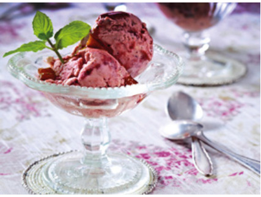

**Ingrediënten voor:** 6 personen
**Bereidingstijd:** ca. 45 min. + ca. 9 uur
wachttijd
**500 g** pruimen
**150 ml** port (of druivensap)
**150 g** suiker
**1** kaneelstokje
**2** eidooiers
**1 tl** maizena
**300 ml** melk
**300 ml** slagroom
vershoudfolie
evt. ijsmachine
1 Was de pruimen, halveer ze en verwijder de
pitten. Breng de port met 125 g suiker al roerend
aan de kook. Voeg de pruimen en het kaneelstokje toe en laat 10-15 minuten zachtjes koken. Laat
het mengsel afkoelen, verwijder het kaneelstokje
en pureer de rest van het mengsel.
2 Meng de eidooiers, de maizena en 25 g suiker
met elkaar. Verwarm de melk en de slagroom tot
net onder het kookpunt en schenk dit al roerend
bij het eidooiermengsel. Schenk alles terug in de
pan en laat het op middelhoog vuur al roerend
zachtjes koken tot de crème indikt. Dek de crème
direct op het oppervlak af met het vel vershoudfolie en laat afkoelen.
3 Meng het afgekoelde roommengsel met de
pruimenpuree. Draai het mengsel in een ijsmachine tot ijs. Heb je geen ijsmachine? Schenk
het mengsel dan in een diepvriesbestendige,
platte bak en vries het in minimaal 8 uur in. Roer
het ijs de eerste 3 uur ieder halfuur goed door.
**Per portie:** ca. 420 kcal
**5 g** eiwit | 24 g vet | 41 g koolhydraten

## Rijstpudding uit de oven

## met appelcompote

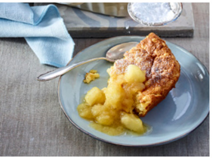

**Ingrediënten voor:** 4 personen
**Bereidingstijd:** ca. 1 uur en 30 min.
**500 ml** melk
zout
**125 g** dessertrijst
**1** bio-citroen
3 zure appels (ca. 500 g, bijv.
granny smith)
**3-4 el** suiker
**2-3 el** kweepeergelei of
abrikozenjam
**2** eieren
**40 g** zachte boter (+ invetten)
**8 g** vanillesuiker
poedersuiker (+ bestuiven)
1 Breng de melk met een snufje zout aan de kook.
Roer de rijst erdoorheen en laat afgedekt op zeer
laag vuur ca. 30 minuten wellen. Roer af en toe
door. Neem de pan van het vuur en laat iets afkoelen. Was de citroen, rasp de helft van de schil
fijn. Halveer de vrucht en pers hem uit.
2 Schil de appels, verwijder de klokhuizen en
snijd het vruchtvlees in blokjes. Breng de appelblokjes met het citroensap, 1-2 el suiker en 2 el
water aan de kook. Laat afgedekt op laag vuur
ca. 15 minuten stoven. Roer de kweepeergelei
erdoorheen. Laat de compote afkoelen.
3 Verwarm de oven voor (elektrisch: 200°C /
hetelucht: 180°C). Splits de eieren. Klop de
eiwitten met een snufje zout stijf. Klop de boter,
**2 el** suiker, de vanillesuiker en de citroenschil
romig. Klop de eidooiers één voor één erdoorheen. Spatel de lauwwarme rijst beetje bij beetje
erdoorheen. Spatel tot slot de stijfgeklopte eiwitten erdoor. Schenk het mengsel in een ingevette
ovenschaal en bak in 40-45 minuten gaar in de
oven. Neem de rijstschotel uit de oven en bestuif
met poedersuiker. Serveer met de appelcompote.
**Per portie:** ca. 440 kcal
**11 g** eiwit | 16 g vet | 59 g koolhydraten
Het zoete leven

## Hazelnootschuimgebakjes

## met chocoladesaus

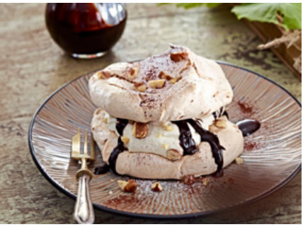

**Ingrediënten voor:** 4 personen
**Bereidingstijd:** ca. 1 uur en 30 min. + ca. 1 uur
wachttijd
**60 g** hazelnoten
**2** eiwitten
**1 tl** wittewijnazijn
**125 g** + 2 el suiker
**3** druppels vanille-extract
**150 g** slagroom
**4 el** chocoladesaus (fles)
cacaopoeder en poedersuiker
(om te bestuiven)
bakpapier
1 Verwarm de oven voor (elektrisch: 180°C /
hetelucht: 160°C). Verdeel de hazelnoten over een
met bakpapier beklede bakplaat en rooster ze
ca. 10 minuten in de oven. Neem ze direct van de
bakplaat, laat kort afkoelen en hak ze grof. Laat
verder afkoelen. Verlaag de oventemperatuur
(elektrisch: 120°C / hetelucht: 100°C).
2 Klop de eiwitten met de azijn stijf in een grote
kom. Voeg al kloppend beetje bij beetje 125 g
suiker toe. Spatel tot slot het vanille-extract en de
hazelnoten (houd 1 el apart) erdoorheen.
3 Schep met een lepel 8 cirkels (ca. 6 cm Ø) van
het eiwitschuim op een met bakpapier beklede
bakplaat. Bak de meringues in ca. 1 uur gaar in de
voorverwarmde oven. Laat afkoelen.
4 Klop kort voor het serveren de slagroom stijf
en voeg beetje bij beetje 2 el suiker toe. Verdeel
de slagroom over de helft van de meringues.
Besprenkel met de chocoladesaus. Leg de
overige meringues erop. Strooi de apart gehouden hazelnoten erover. Bestuif met cacaopoeder
en poedersuiker.
**Per portie:** ca. 410 kcal
**6 g** eiwit | 22 g vet | 48 g koolhydraten

# Notenparadijs

Walnoten, pecannoten, amandelen... Deze knapperige
baksels zijn een feest voor het oog en de buik. Scoor
gegarandeerd punten bij vrienden en familie met deze
heerlijke notentaarten.

## Plaatkoek

## met kweepeer en walnoot

**Ingrediënten voor:** 20 stukken
**Bereidingstijd:** ca. 2 uur en 15 min.
**4** eieren
**300 g** lichte basterdsuiker
**8 g** vanillesuiker
**1 snufje** zout
**1** bio-limoen
2 kweeperen (bij de groentewinkel
of op de markt, of gebruik
stoofperen)
**150 g** walnoten
**225 g** semolina (tarwegriesmeel)
**20 g** wijnsteenbakpoeder (bij
de biologische of grotere
supermarkt)
boter, om in te vetten
**200 g** pure chocolade
**200 g** slagroom
**80 g** paranoten
cacaopoeder, om te bestuiven
geklopte slagroom, om te
serveren
1 VOOR DE CAKE Verwarm de oven voor (elektrisch:
200°C / hetelucht: 180°C). Klop de eieren, 225 g van
de basterdsuiker, de vanillesuiker en het zout met
een handmixer tot een zeer luchtig mengsel. Was de
bio-limoen en rasp de schil er fijn af. Pers de limoen
uit. Was de kweeperen grondig, schil ze, snijd ze in
vieren en verwijder de klokhuizen. Rasp de kweeperen fijn. Meng ze met het limoensap. Roer de
kweepeer door de eimassa. Hak de walnoten. Meng ze
met het griesmeel en het wijnsteenbakpoeder en roer
door de kweeperenmassa. Strijk het deeg uit op een
diepe, ingevette bakplaat. Bak de cake in 18-20
minuten gaar in de oven.
2 VOOR DE SIROOP Breng 75 g bruine suiker en 120
ml water aan de kook en laat al roerend ca. 5 minuten
zachtjes koken. Verdeel de hete siroop over de cake en
laat minimaal 1 uur intrekken.
3 VOOR HET GLAZUUR Breek de chocolade in
stukken. Breng de slagroom aan de kook. Voeg al
roerend de chocolade toe en roer tot de chocolade
gesmolten is. Laat het chocoladeglazuur ca. 10 minuten afkoelen. Verdeel het glazuur gelijkmatig over de
cake. Rooster de paranoten in een droge koekenpan,
neem uit de pan en laat afkoelen. Hak de noten grof
en verdeel ze over de cake. Bestuif de cake voor het
serveren met cacao. Serveer met een toef slagroom.
**Per stuk:** ca. 280 kcal
**6 g** eiwit | 16 g vet | 30 g koolhydraten

## Shortbreadcheesecake

## met pecannotenkaramel

**Ingrediënten voor:** 24 stukken
**Bereidingstijd:** ca. 2 uur en 15 min.
**400 g** pecannoten
**400 g** bloem (+ bestuiven)
**225 g** lichte basterdsuiker
**225 g** boter, in blokjes (+
invetten)
**800 g** roomkaas
**2** eiwitten
**3 tl** maizena
**275 g** suiker
**275 g** slagroom
1 Verwarm de oven voor (elektrisch: 200°C
/ hetelucht: 180°C). Hak 100 g van de noten
fijn in een keukenmachine. Kneed de gehakte
noten met de bloem, de basterdsuiker en de
boter met de deeghaken van een handmixer
tot een glad deeg. Verdeel het deeg over de
bodem van een ingevet en met bloem bestoven
bakblik en druk stevig aan. Bak de bodem ca.
10 minuten. Neem uit de oven en laat ca. 10
minuten afkoelen.
Gebak
2 Roer de roomkaas, de eiwitten, de maizena
en 75 g van de suiker glad. Strijk de massa over
de koekbodem. Verlaag de oventemperatuur
(elektrisch: 180°C / hetelucht: 160°C). Bak het
geheel ca. 15 minuten. Neem uit de oven en
laat ca. 10 minuten afkoelen.
3 Hak 300 g van de noten grof. Breng 200 g suiker en 5 el water in een brede pan aan de kook
en laat inkoken tot een goudbruine karamel.
Schenk al roerend de slagroom erbij, breng
opnieuw aan de kook en laat inkoken tot een
dikke saus. Roer de noten kort erdoorheen.
Verdeel de notenkaramel over de roomkaaslaag en laat afkoelen. Snijd de cheesecake in
stukken.
**Per stuk:** ca. 480 kcal
**8 g** eiwit | 35 g vet | 35 g koolhydraten

## Plukcake met pistache

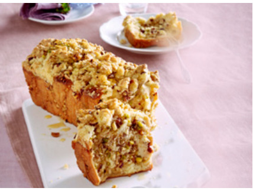

**Ingrediënten voor:** 30 plakken
**Bereidingstijd:** ca. 3 uur en 30 min.
**450 g** bloem (+ bestuiven)
**85 g** + 2 el suiker
**8 g** vanillesuiker
**7 g** gist
**½ tl** zout
**175 g** zachte boter (+ invetten)
**75 ml** melk
**2** eieren
**100 g** amandelschaafsel
**100 g** hazelnoten
**50 g** pistachenoten
**50 g** + 2 el honing
1 Meng 400 g van de bloem, 50 g van de suiker,
de vanillesuiker, de gist en het zout in een grote
kom. Smelt 60 g van de boter in een pan. Schenk
de melk en 50 ml water erbij. Neem de pan van
het vuur. Voeg het mengsel samen met de eieren
toe aan de bloem en kneed met de deeghaken van
een handmixer tot een glad deeg. Laat het deeg
afgedekt op een warme plek ca. 1 uur rijzen.
2 Hak het amandelschaafsel, de hazelnoten en de
pistachenoten fijn. Houd 2 el van het notenmengsel apart. Meng de rest van de noten met 50 g van
de honing en 2 el suiker. Kneed het deeg kort door
en rol het op een met bloem bestoven werkblad
uit tot een vierkant (ca. 50 x 50 cm). Bestrijk met
80 g boter. Snijd in 6 stroken (ca. 8 cm breed).
Verdeel het notenmengsel erover. Snijd elke
deegstrook dwars in 5 stukken (à ca. 8 x 10 cm).
3 Zet een ingevette cakevorm (ca. 30 cm lang)
rechtop. Vouw de deegstukken dubbel, rek ze iets
uit in de lengte en breedte en stapel ze een voor
een in de vorm, met de openingen afwisselend
naar voren en naar achteren. Is de vorm niet
helemaal vol, kantel hem dan en verdeel de deegstukken zodat de vorm gevuld is. Laat afgedekt
nogmaals ca. 15 minuten rijzen.
4 Verwarm de oven voor (elektrisch: 180°C /
hetelucht: 160°C). Kneed 50 g bloem, 35 g suiker,
**35 g** boter en het apart gehouden notenmengsel
tot kruimels. Verdeel de kruimels over het deeg.
Bak de cake in ca. 30 minuten gaar. Neem uit de
oven en laat ca. 20 minuten rusten. Stort de cake
uit de vorm en laat afkoelen. Besprenkel voor het
serveren met 2 el honing.
Per plak: ca. 180 kcal
**4 g** eiwit | 11 g vet | 18 g koolhydraten

## Notenvlecht met glazuur

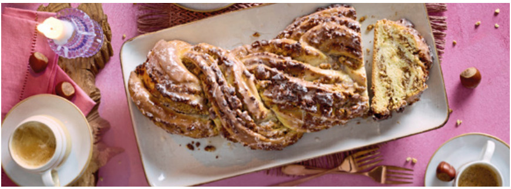

**Ingrediënten voor:** 16 plakken
**Bereidingstijd:** ca. 3 uur en 30 min.
**175 ml** + 2 el melk
**21 g** verse gist (of 8 g droge gist)
**500 g** bloem (+ bestuiven)
**100 g** zachte boter
**75 g** suiker
zout
**2** eieren
**100 g** gehakte hazelnoten
**100 g** hazelnootmeel (bijv. van het
merk Smaakt)
**100 g** amandelmeel
**100 g** marsepein
**150 g** poedersuiker
**75 g** slagroom
**1½ tl** kaneel
bakpapier
1 VOOR HET DEEG Verwarm 175 ml melk tot
lauwwarm. Los de gist erin op. Kneed de bloem,
de boter, de suiker, het zout, 1 ei en de gistmelk
tot een glad deeg. Laat het deeg afgedekt op een
warme plek ca. 1 uur rijzen.
2 VOOR DE VULLING Verwarm de oven voor
(elektrisch: 180°C / hetelucht: 160°C). Verdeel de
gehakte hazelnoten, het hazelnootmeel en het
amandelmeel over een met bakpapier beklede
bakplaat. Rooster de noten 8-10 minuten. Laat ze
op de bakplaat afkoelen.
3 Rasp de marsepein en meng met 50 g van de
poedersuiker. Klop de slagroom, 1 ei en 1 tl van de
kaneel met een handmixer romig. Roer de marsepein erdoor. Spatel het notenmengsel erdoor. Rol
het deeg op een met bloem bestoven werkblad
uit tot een rechthoek (ca. 35 x 40 cm). Verdeel de
notenvulling erover en laat aan een lange zijde
een rand van ca. 3 cm vrij. Rol de deegplaat vanaf
de lange zijde op en druk het uiteinde goed aan.
Snijd de rol in de lengte doormidden. Draai de
twee deegstrengen om elkaar heen tot een vlecht
en druk de uiteinden samen. Laat de vlecht afgedekt nogmaals ca. 1 uur rijzen. Bak op een net
bakpapier beklede bakplaat in 35-40 minuten
gaar in de voorverwarmde oven.
4 VOOR HET GLAZUUR Meng 100 g poedersuiker,
**2 el** melk en ½ tl kaneel met elkaar. Bestrijk de
notenvlecht direct na het bakken, als hij nog heet
is, met het glazuur. Laat het glazuur drogen. Laat
de vlecht afkoelen. Lekker met boter.
Per plak: ca. 400 kcal
**10 g** eiwit | 21 g vet | 43 g koolhydraten
Gebak
Hazelnootlaagjestaart
met eekhoornkoekjes
Volkoren appel-notencake
Gebak

## Hazelnootlaagjestaart

## met eekhoornkoekjes

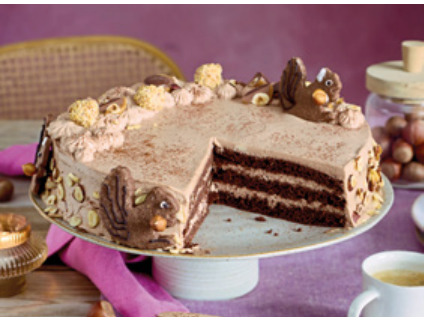

**Ingrediënten voor:** 16 stukken
**Bereidingstijd:** ca. 2 uur en 30 min.
**90 g** koude boter (+ invetten)
**100 g** poedersuiker
zout
**8 g** vanillesuiker
**225 g** bloem (+ bestuiven)
**60 g** cacaopoeder (+ bestuiven)
**20** hazelnoten
**5** eieren
**125 g** suiker
**2 tl** bakpoeder
**50 g** hazelnootmeel (bijv. van het
merk Smaakt)
**200 g** chocolade-hazelnootpasta
**500 g** mascarpone
**2 el** melk
**300 ml** slagroom
8 g slagroomversteviger (bijv. Dr.
Oetker Klop-Fix)
**30 g** hazelnootschaafsel
**6** chocolade-karamelsnoepjes
(bijv. Toffifee)
9 hazelnootchocolaatjes (bijv.
Giotto of Ferrero Rocher)
uitsteker in eekhoornvorm
bakpapier
spuitzak met stervormig
spuitmondje
1 VOOR DE EEKHOORNKOEKJES (CA. 20 STUKS)
Verwarm de oven voor (elektrisch: 180°C / hetelucht: 160°C). Kneed de koude boter met 50 g van
de poedersuiker, een snufje zout en de vanillesuiker door elkaar. Voeg 100 g van de bloem, 20
g van de cacao en 2 el koud water toe en kneed
tot een deeg. Laat het deeg ca. 1 uur rusten in
de koelkast. Rol het deeg op een met bloem bestoven werkblad uit tot een dikte van ca. 3 mm.
Steek met een uitsteker kleine eekhoorntjes uit
het deeg. Kneed de deegresten opnieuw, rol uit
en steek weer uit tot je ca. 20 koekjes hebt. Leg
de eekhoorntjes op een met bakpapier beklede
bakplaat. Bak de koekjes in 9-10 minuten gaar in
de oven. Neem de koekjes uit de oven en laat afkoelen. Roer 50 g poedersuiker en 1 tl heet water
tot een dik glazuur. Meng 10 g cacao met 4 tl heet
water. Versier de koekjes met het witte en donkere glazuur en de hele hazelnoten en laat drogen.
2 VOOR HET BISCUIT Klop de eieren, de suiker
en een snufje zout met een handmixer in ca. 7
minuten tot een witte, romige massa. Meng 125 g
van de bloem, 30 g van de cacao en het bakpoeder
en zeef dit boven de eimassa. Spatel samen met
het hazelnootmeel voorzichtig door de eimassa.
Bekleed de bodem van een springvorm (26 cm Ø)
met bakpapier en schenk het beslag erin. Bak ca.
25 minuten in de voorverwarmde oven. Neem het
biscuit uit de oven en laat afkoelen.
3 VOOR DE CRÈME Roer de chocolade-hazelnootpasta, de mascarpone en de melk glad. Klop de
slagroom stijf en strooi al kloppend de slagroomversteviger erbij. Spatel de slagroom door de
mascarponecrème.
4 VOOR DE AFWERKING Rooster het hazelnootschaafsel in een droge koekenpan, neem uit de
pan en laat afkoelen. Snijd het biscuit horizontaal
in drie gelijke lagen. Bestrijk de onderste laag
met ca. 5 el mascarponecrème. Leg de tweede
laag erop en bestrijk ook met ca. 5 el crème. Dek
af met de derde laag en bestrijk ook deze met
**5 el** crème. Bestrijk de rand van de taart met
ca. ⅔ van de overgebleven crème. Doe de rest
van de crème in een spuitzak met stervormig
spuitmondje. Spuit op de helft van de taart in een
halvemaanvorm toefjes crème. Leg de chocolade-karamelsnoepjes en de hazelnootchocolaatjes
erop. Versier de rand van de taart met het hazelnootschaafsel en de eekhoornkoekjes. Bestuif
voor het serveren met wat cacao.
**Per stuk:** ca. 510 kcal
**9 g** eiwit | 36 g vet | 39 g koolhydraten
Eekhoornkoekjes over? In een luchtdicht
afgesloten bakje blijven ze wel een week
goed.

## Volkoren appel-notencake

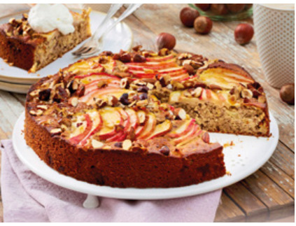

**Ingrediënten voor:** 12 stukken
**Bereidingstijd:** ca. 1 uur
50 g gemengde noten (bijv.
hazelnoten, cashewnoten en
walnoten)
**1** bio-sinaasappel
**80 g** volkorenmeel
**2 tl** bakpoeder
**100 g** hazelnootmeel (bijv. van het
merk Smaakt)
**100 g** amandelmeel
**1 snufje** zout
3 appels (à ca. 200 g, bijv.
elstar)
**3** eieren
**125 g** lichte basterdsuiker
**8 el** olie
**2 el** melk
**75 g** kwark
**2 el** sinaasappelmarmelade
bakpapier
1 Hak de gemengde noten grof. Was de biosinaasappel, wrijf hem droog en rasp de schil er
fijn af. Halveer de sinaasappel en hem uit. Meng
het volkorenmeel, het bakpoeder, het hazelnootmeel, het amandelmeel en het zout met elkaar.
Schil 2 van de appels. Snijd alle appels in vieren
en verwijder de klokhuizen. Snijd de geschilde
appels in blokjes en de ongeschilde appel in
dunne partjes. Besprenkel de appels direct met
het sinaasappelsap.
2 Verwarm de oven voor (elektrisch: 180°C / hetelucht: 160°C). Klop de eieren en de basterdsuiker
met een handmixer schuimig. Roer langzaam
de olie erdoorheen. Roer beetje bij beetje het
meelmengsel en de melk door het beslag. Spatel
de kwark en de sinaasappelschil erdoor. Spatel de
appelblokjes voorzichtig door het beslag. Verdeel
het beslag over een met bakpapier beklede
springvorm (26 cm Ø) en strijk glad. Verdeel de
appelpartjes dakpansgewijs over het beslag en
strooi de gehakte noten ertussen. Bak de cake in
35-40 minuten gaar in de oven.
3 Verhit de marmelade met 1 el water al roerend
in een pan. Neem de cake uit de oven. Bestrijk de
appelpartjes direct met de warme marmelade.
Laat de cake afkoelen, neem hem uit de vorm en
serveer. Lekker met slagroom.
**Per stuk:** ca. 310 kcal
**8 g** eiwit | 20 g vet | 25 g koolhydraten

## Klantenservice

Wil je abonnee worden of heb je vragen over je
abonnement? Op onze website vind je antwoord op
de meeste vragen.
www.kokengenieten.nl/contact
Wist je dat je tegenwoordig eenvoudig zelf je adres
kan wijzigen? Ga naar www.kokengenieten.nl/
adreswijzigen om je nieuwe adres door te geven.
Het nieuwe adres wordt vervolgens automatisch in
ons systeem gewijzigd.
Telefoon
We zijn er maandag
tot en met vrijdag
van 09.00 tot
**17.00** uur om je vragen
te beantwoorden.
+31 (0)24-2027 829
E-mail
Stel je vraag per e-mail
aan een van onze
service medewerkers.

## klantenservice@

kokengenieten.nl
ABONNEMENTSINFORMATIE koken & genieten kost €4.50 per nummer. De abonnementsprijs in Nederland € 49,- en
in België € 52,- (12 nummers) Deze prijs geldt bij betaling per automatische incasso. Voor betaling via een (digitale)
factuur geldt een toeslag van € 2,50. Je kunt eenvoudig een machtiging afgeven via www.fnl.nl/machtigen.
Abonnementen worden automatisch verlengd, tenzij anders vermeld. Het opzeggen van een abonnement kan eenvoudig
telefonisch via +31 (0)24-2027829 of per mail via klantenservice@kokengenieten.nl.
koken & genieten is een
uitgave van F&L Media B.V.
in licentie van Bauer Media
Hoofdredacteur Yvonne Doorten
Redactie Bas Erkens, Anne Mebelder,
Lotus van Overveldt, Willem van Santen,
Marieke Slettenhaar en Julie van den Berg
In samenwerking met Uit Paulines Keuken,
Welmoed Bezoen, Russell Hobbs
Art Direction Nick Groenewold
Vormgeving Mylene Nales, Tom Gerrits,
Lisanne Cobussen, Susan Gerbrands-Derksen en
Ferry Dorresteijn
Sales Marc Bokhove +31 (0)24 2404643
mbokhove@fnl.nl
Marketing Anouk Tolboom +31 24 240 45 95
atolboom@fnl.nl
Drukkerij Senefelder Misset Doetinchem B.V.
Vragen aan de redactie
Heb jij opmerkingen, suggesties of vragen aan
de redactie? lezersvragen@kokengenieten.nl
Nieuwsredactie / Pers
kooknieuws@fnl.nl of het onderstaande adres
o.v.v. redactie koken & genieten
Jonkerbosplein 52, 6534 AB Nijmegen
COPYRIGHT Het auteursrecht op deze uitgave en de gedrukte uitgave en op de daarin verschenen
artikelen wordt door de uitgever voorbehouden. De vertaalrechten berusten bij F&L Media B.V.
te Nijmegen/ Nederland. Het verlenen van toestemming tot publicatie in de gedrukte uitgave
houdt in dat de auteur de uitgever, met uitsluiting van ieder ander onherroepelijk machtigt de
bij of krachtens de auteurswet door derden verschuldigde vergoedingen voor kopiëren te innen
en dat de auteur alle rechten verdraagt aan de uitgever, tenzij anders bepaald. Niets uit deze
uitgave en de gedrukte uitgave mag worden overgenomen, vermenigvuldigd of gekopieerd zonder
uitdrukkelijke schriftelijke toestemming van de uitgever. De uitgever stelt zich niet aansprakelijk
voor eventuele onjuistheden, welke in deze uitgave of de gedrukte uitgave mochten voorkomen.
ISSN: 1875-8517

# Tulbandpracht

Een tulband saai? Helemaal niet! Met dit recept bak je er een
heerlijke bananencake in, bomvol chocolade en een vleugje
rum. En geloof ons, dat smaakt net zo lekker als het klinkt.
Pronkstuk

## Bananen-chocoladetulband

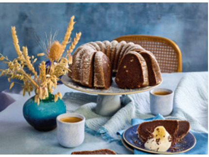

**Ingrediënten voor:** 16 stukken
**Bereidingstijd:** ca. 2 uur
5 bananen (ca. 1 kg; waarvan 4 zeer rijpe en 1 stevige)
**65 ml** bruine rum (bij de slijter)
**60 g** walnoten
**4** eieren
**60 g** kristalsuiker
**60 g** lichte basterdsuiker
**1 tl** vanille-extract
zout en peper
**170 ml** olie
**300 g** speltmeel (type 630)
**50 g** cacaopoeder
**15 g** wijnsteenbakpoeder (bij de biologische supermarkt)
boter, om in te vetten
griesmeel, om te bestuiven
**200 g** slagroom
**50 g** pure chocolade, geraspt
poedersuiker, om te bestuiven
1 Pel de 4 rijpe bananen, snijd ze in stukken en doe ze in een kom. Schenk de
rum erbij en pureer alles met een staafmixer tot een gladde massa. Hak de
walnoten grof.
2 VOOR HET BESLAG Splits de eieren. Klop de eiwitten stijf en houd apart.
Kluts de eidooiers met de kristalsuiker en de basterdsuiker, het vanille-extract en een snufje zout tot een schuimig geheel. Voeg de bananenpuree
en de olie toe en roer goed door. Meng het speltmeel, het cacaopoeder en het
wijnsteenbakpoeder met elkaar, voeg toe aan het bananenmengsel en roer
tot een glad beslag. Spatel eerst de walnoten en vervolgens voorzichtig het
eiwit erdoorheen, tot er geen eiwitvlokken meer zichtbaar zijn.
3 Verwarm de oven voor (elektrisch: 180°C / hetelucht: 160°C). Schenk het
beslag in een ingevette en met griesmeel bestoven tulbandvorm (24 cm Ø, ca.
2,75 l inhoud). Bak de cake ca. 45 minuten in de oven, iets onder het midden.
Controleer met een satéprikker of de cake gaar is.
4 Neem de cake uit de oven en laat hem ca. 30 minuten in de vorm afkoelen.
Stort de cake vervolgens op een rooster en laat volledig afkoelen. Pel intussen de stevige banaan en snijd hem in ca. 16 plakjes. Klop de slagroom stijf.
Bestrooi de tulbandcake met poedersuiker. Snijd de cake in stukken en serveer alles samen met de slagroom, de chocoladerasp en de plakjes banaan.
**Per stuk:** ca. 320 kcal
**7 g** eiwit | 20 g vet | 29 g koolhydraten

## Voor- en bijgerechten

## In het

# november

Bietentzatziki 51
Gekaramelliseerde venkel
met linzen en appel 50

## nummer

Gekonfijte pompoen met tahin en yoghurt 51
Geroosterde pompoen en prei met frisse dip 47
Geurige muntthee 21
Griezelige crackers 39
Griezelige linzensalade 35
Groentesticks 39

## Zoet en desserts

Bananen-chocoladetulband 65
Heksenbrouwsel 41
Hazelnootlaagjestaart met eekhoornkoekjes 62
Ingelegde citroenen 21
Ingelegde jalapeño’s 49
Hazelnootschuimgebakjes met chocoladesaus 55
Notenvlecht met glazuur 58
Kleurrijke herfstsalade
Pistachebaklava 24
Plaatkoek met kweepeer en walnoot 57
Plaatpannenkoek met appel en noten 44
met linzen en grapefruit 44
Pompoenpuree met spek-uientopping 46
Romige pompoensoep met gember 47
Roomkaaspompoen 39

## Knus in de keuken

Plukcake met pistache 58
Heerlijke recepten om

## Hoofdgerechten

Pruimen-port-ijs 55
Rijstpudding uit de oven met appelcompote 55
samen van te genieten
Aardappelsoep met appelcake 18
Shortbreadcheesecake met pecannotenkaramel 57
Sinaasappeltaart 10
Erwtensoep met pannenkoeken 15
Spookachtige brownietaart 41
Volkoren appel-notencake 62
Zelfgemaakte appelchips 45
Fruitige herfstsalade met procureur 32
Gochujangnoedels 9
Goedgevulde pompoensoep 16
Groente-broodgratin met feta 31
Groentetaart met wortel 9
Hamburgse aalsoep 13
Kip-dadelbastilla 22
Knolselderijgnocchi
met paddenstoelen en hazelnoten 52
Köfte in pittige tomatensaus 23
Krokante kipnuggets met worteltjes 30

## Eigen taart

Lamstajine met couscous 21

## is goud waard

= Zonder vlees en vis
Oesterzwammenshoarma 48
Ovenkalkoen met herfstgroenten 36
Maak zoete baksels met
= Snel klaar (max. 30 min.)
Pompoencurry met kip 10
Russische soljanka 14
gouden karamel
Savooiekool met kip en appel-yoghurtsaus 43
Schnitzelspiesjes met Aziatische rijst 31
Het volgende nummer valt rond 7 oktober 2025 bij abonnees
Snel zalm-venkelpannetje 29
Spekmedaillons met bulgursalade 30
op de mat en ligt rond 14 oktober 2025 in de winkels.
Tagliatelle met pompoen en salieboter 46
Tiroler pastaschotel 29
De verschijningsdata in België wijken af van de verschijningsdata in Nederland.
Zoete-aardappelgratin met chorizo 7
Mis geen nummer meer!
Neem nu een abonnement en krijg voortaan elke uitgave van koken &
genieten automatisch in je brievenbus. Ga naar www.kokengenieten.nl/abo
of bel gratis naar +31 (0)24-2027829.

## Diner bij kaarslicht

Een buffet vol verwarmende
hapjes én drankjes

# MULTICOOKER

# met airfryer functie

# 20%

korting*
met code

## KOKEN20

Met Satisfry Air & Grill Multicooker heb je keuze uit AirFryen + 7 veelzijdige kookfuncties.
Maak de lekkerste maaltijden 76% sneller klaar dan een conventionele oven en ook eens nog
gezonder, doordat er weinig tot geen olie nodig is.
Kies voor: Airfryen, Grillen, Roosteren, Slowcooken (low & high), Braden,
Bakken en Warmhouden.
scan voor
reviews & prijs
Profiteer tijdelijk van 20% korting met de code KOKEN20!
www.russellhobbs.nl | @russellhobbs.benelux
