voor

# 4,50

Altijd
November 2025 jaargang 20
koken genieten

# Ontdekde

# bourgondische

# keuken

• Witlof met kip en boursin
• Uienquiche met cranberryjam
Glanzend & goud

# Gebak met

# prachtige

# karamel

# UITDEOVEN

# VANOMA

Van gegrilde kip
tot zalmstrudel
Appeltaart met karamelsaus

# 51

Uienquiche met cranberryjam

# Gebak met

# Gebak met

doordeweekse
Appeltaart met karamelsaus
inspiratie

# Het beste

# van broccoli

Aan de slag met je favo groente
Wereldgerechten van Uit Paulines Keuken
• Appeltaart met karamelsaus
BP

# €4,50

# De snelle weg door het blad

Voorgerechten
& bijgerechten
Salades, soepen en
broodjes: lekker als lichte
maaltijd of om je etentje
mee te beginnen.
Eendenbouillon
met knödels 22
Snelle salade met worst 31 Pittige tomatensoep
met krokante topping 32
Kleurrijke saladekrans 35
Broccoli-kikkererwtensalade 44
Marokkaanse couscous 9
Hoofdgerechten
Ga je voor snel &
makkelijk, een dagje
zonder vlees of vis
of pak je uit met een
weekendproject?
Ajam pangang 7
Parelgort-groente maaltijdsoep met broodharten 17
Ribeye met koolraapfriet 18 Eendenspiesen
met rodekoolsla 24
Pekingeend
Chocolade-kastanjetoetje 55 Choco-karamellaagjestaart 59 Appel-kwarktaart
met pannenkoekjes 21
Gebakken vis met snelle aardappelsalade 32
Aziatische omelet
met aspergebroccoli 43
Franse kip uit de oven 52
Zoet en desserts
Zoet is altijd goed!
Lekker als tussendoortje,
bij de koffie of als
afsluiting van je diner.
Appelkruimelplaatcake 9
Mini-ovenschotels met broccoli en hazelnoten 44
Zoete sneeuwballetjes
met koffiemousse 38
Chocoappels 41
met karamelsaus 59
Amsterdamse koggetjes 57 Snelle karamelkrokant 59
Groene soep met knoflook-
Zonder
Snel klaar
(max. 30 min.)
vlees of vis
Uitleg van symbolen bij de recepten
Bonensoep met procureur 36
fetapasteitjes 36
Rodewijn-rozemarijnzout 38
Lasagne puttanesca 10
Indiase
kikkererwtensoep 10
Wildstoof met spaghetti
en romige savooiekool 13
Uienquiche
met cranberryjam 14
Alle recepten op een rij
croutons 43
Zalmstrudel met pistachenoten 50
Gestoofde runderwangen 14
Romige pasta
met savooiekool 29
Vis Wellington 49
Gehaktballetjes
Banoffeetaart
in tomaten-paprikasaus 29
Kruidige zoeteaardappelcurry 30
Winterburger
met aardappelpartjes 30
Gyrossteaks
op warme witte kool 31
Witte vanillesinaasappelglühwein 41
Chocolade-karamelrepen 61
Chocoladeglühwein 41
Peperkoeksinaasappeltrifle 54
met meringuetoefjes 62
Pannacotta
met kaneelpruimen 54
Botercrèmemaanzaadtaart 65
Pannenkoekenovenschotel 55
Witlof met kip en boursin 50
Puzzel mee en win! 19
Citroen-limoenolie 38
Bladerdeeg-

## Voorwoord

# Stoofpotten

Mijn verloofde is echt een stoofpottenkoning.
Hij geniet er zo van om zijn grote oranje Le
Creusetpan urenlang op het vuur te hebben
staan. Het begint al met het inkopen van het
vlees; een ritje naar de groothandel. Mooie
stukken wild worden ingeslagen. Dan het
snijden van ontelbaarveel uien en wortel; echt
een klusje. Het malen van de jeneverbessen
in de vijzel. En dan de pan op het vuur. Flink
wat roomboter erin en alles aanbraden. Fond
erbij, deksel erop en dan maar wachten. Ieder
half uur even doorroeren. De geur die zich in je
keuken verspreidt is heerlijk. Zelf ben ik ook
gek op stoofvlees. En stiekem vind ik het de
dag erna of de dag daarna nóg lekkerder. Dan
zijn de smaken nog beter getrokken en valt
het vlees echt op je vork uit elkaar. Wat je erbij
serveert? Een goede smeuïge aardappelpuree
– weer met heel veel boter – óf knapperige
friet. Ga snel aan de slag! (p. 13).
Yvo e D rten
**6** Uit Paulines keuken
Dit jaar vind je elke maand heerlijke recepten van Uit Paulines Keuken in Koken
& genieten. Altijd lekker en met verse
seizoensproducten. Deze maand: verwarmende gerechten voor het najaar.
**12** Knus in de keuken
Voor het lekkerste eten heb je vaak wat
geduld nodig. Daarna is het met deze
recepten samen smullen geblazen!
**20** Dat kwaakt naar meer!
Eend staat niet heel vaak op het menu en
dat is zonde; het is namelijk superlekker!
Probeer deze recepten met eend van over
de hele wereld maar eens.
**28** Simpel en snel genieten
Het is al druk genoeg met werk, kinderen
en hobby’s. Hier is de oplossing voor iedereen die geen tijd heeft om uitgebreid te
koken, maar toch lekker wil eten.
**34** Hartverwarmende hapjes
Gloeiende wijn, gloeiende wangen: met dit
knusse buffet zit je er in ieder geval warmpjes bij! Steek gezellig de kaarsjes aan het
geniet ervan.
**42** Het beste van broccoli
Broccoli is een supergezonde groente, die
vol zit met voedingsstoffen die je vitaal en
energiek houden. Gelukkig is hij ook nog
eens heel erg lekker. Kijk maar naar deze
recepten!
**46** Boek: Oma’s
ovengerechten
Denk je aan de herfst, dan denk je aan
ovengerechten. Dit boek staat vol met
nostalgische, verwarmende gerechten van
oma’s.
Abo ement
Elke maand de
koken & genieten
als eerste in de
brievenbus? Kijk op www.
kokengenieten.nl/abo
of blader naar
p. 26.
**54** Herfstige toetjes
Ook bij het toetje kunnen we wel wat
herfstige smaken gebruiken. Geniet van
deze desserts met peperkoek, kaneel en
kastanje.
**56** Goudkoorts in de keuken
Taarten, koekjes en repen: alles wordt
lekkerder met een glanzend laagje gouden
karamel. Met deze hemelse baksels ben jij
wel even zoet!
**64** Zwart & wit
Deze maanzaadtaart is afgewerkt met een
heerlijk romige botercrème. Serveer met
een kopje koffie of thee en je hebt heerlijk
gebak voor het weekend!
**66** Index & volgend
Alle recepten van deze uitgave op een rij én
een vooruitblik op volgende maand.
WIN3x
oma’s ovengerechten (t.w.v. 21,99)
19

# In het seizoen...

Inhoud

# koolraap

## Wat is het?

Koolraap behoort tot de familie van de kool. Hij
wordt vaak verward met knolraap, maar het zijn twee
verschillende groenten. Waarschijnlijk is de koolraap
ontstaan uit een kruising tussen kool en knolraap.
Koolraap heeft een ruwe, geel-paarse schil en in
tegenstelling tot andere koolsoorten groeit hij onder
de grond. Koolraap is rijk aan vitamines. Nederlandse
koolraap is van oktober tot en met maart in het seizoen.

## Wat kun je ermee?

Ga je met koolraap aan de slag? Zorg er dan eerst voor
dat je de harde, houtige schil van koolraap verwijdert.
Deze is niet eetbaar. Het vruchtvlees kun je op allerlei
manieren verwerken: je kunt het koken, stoven of er
soep van maken. Ook kun je de groente rauw eten,
bijvoorbeeld dun geschaafd of in juliennereepjes in een
salade. Of maak er koolraapfrietjes van, zoals op p. 18.

## Hoe kan je het vervangen?

Kun je geen koolraap vinden of houd je niet zo van de
smaak? Dan kun je deze groente prima vervangen door
pastinaak, winterwortel of knolselderij.

## Waar smaakt het naar?

Als je koolraap kookt of stooft krijgt het gele, geurige
vruchtvlees een zacht zoetige, erg aromatische smaak.
Rauw smaakt de groente frisser, wat pittiger en licht
bitter, zoals radijs.

## Hoe moet ik het bewaren?

Koolraap kun je tot wel 6 weken op de fruitschaal
bewaren, of zo’n 5 weken in de koelkast. Eenmaal
aangesneden bewaar je de groente het beste goed
verpakt in folie of een luchtdicht afgesloten bakje in de
koelkast. Heb je veel van deze groente geoogst en wil je
het langer bewaren? In de diepvries (bij minimaal -18°C)
kun je rauwe koolraap tot wel 12 maanden bewaren.
Blancheer de groente dan 2-4 minuten kort voor
invriezen. Bewaar vervolgens in een goed afgesloten
plastic zakje of bakje.

# Keuken

# Uit Paulines

Dit jaar vind je elke maand heerlijke recepten
van Uit Paulines Keuken in Koken & genieten.
Altijd lekker en met verse seizoensproducten.
Deze maand: lekker verwarmende gerechten.

## Ajam pangang

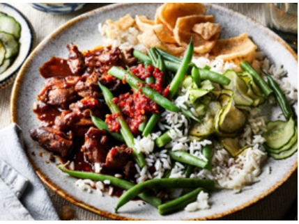

**Ingrediënten voor:** 4 personen
**Bereidingstijd:** ca. 40 min.
+ minimaal 2 uur wachttijd
**2** uien
**3** teentjes knoflook
**2** cm gember
**½ el** sambal oelek
(+ extra, om te serveren)
**6 el** ketjap manis
**300 g** kippendijfilet
zonnebloemolie
**2 el** tomatenpuree
**1½ tl** five-spicepoeder
**2 el** rijstazijn
**250 ml** passata
zout en peper
300 g rijst (bijv. witte,
basmati of zilvervlies)
**300 g** sperziebonen
kroepoek, om te serveren
zoetzure komkommer,
om te serveren
1 Pel en snipper de uien en de knoflook fijn. Schil de gember en rasp hem fijn.
Meng de ui, de knoflook, de gember, de sambal en de ketjap tot een marinade.
Snijd de kip in stukken en meng met de helft van de marinade. Houd de rest van
de marinade apart. Laat de kip minimaal 2 uur marineren in de koelkast.
2 Neem de kip uit de marinade, verhit een scheutje olie in een koekenpan en bak
de kip rondom lichtbruin. Neem uit de pan en houd apart.
3 Verhit nog een scheutje olie in de pan en voeg de apart gehouden marinade, de
tomatenpuree en het five-spicepoeder toe. Bak ca. 2 minuten op laag vuur. Voeg
de rijstazijn, de passata en 200 ml water toe en breng zachtjes aan de kook. Laat
ca. 10 minuten zachtjes koken.
4 Roer in een kommetje de maizena los met wat water en schenk bij de saus om
hem te binden. Breng op smaak met zout en peper. Voeg de kip toe en warm op in
de saus.
5 Kook intussen de rijst gaar volgens de aanwijzingen op de verpakking. Maak de
sperziebonen schoon en kook ze in licht gezouten water in 6-8 minuten beetgaar.
6 Verdeel de rijst over borden en schep de kip met de saus eroverheen. Serveer met
de sperziebonen, kroepoek, zoetzure komkommer en extra sambal.
**Per portie:** ca. 645 kcal
**24 g** eiwit | 19 g vet | 95 g koolhydraten
Receptuur: Uit Paulines Keuken Fotografie: Marianne Snel
Uit Paulines Keuken

## Marokkaanse couscous

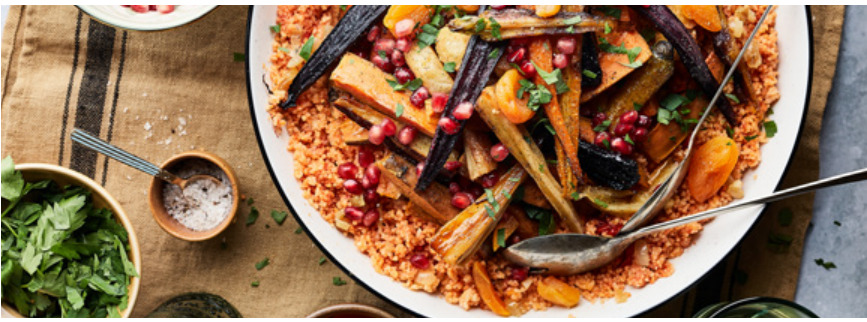

**Ingrediënten voor:** 4 personen
**Bereidingstijd:** ca. 1 uur
**300 g** bospeentjes (bijv. regenboog)
**250 g** pastinaak
**300 g** zoete aardappel
olijfolie
**1** ui
**3** teentjes knoflook
**400 g** tomatenblokjes (blik)
zout en peper
**300 g** couscous
**400 ml** groentebouillon (kokend heet)
**100 g** gedroogde abrikozen
**4-5 takjes** peterselie
**90 g** granaatappelpitten
1 Verwarm de oven voor (elektrisch: 200°C / hetelucht: 180°C). Maak de bospeen, de pastinaak en
de zoete aardappel schoon en dep ze droog met
een theedoek. Snijd in grove stukken en verdeel
in een enkele laag over een bakplaat. Besprenkel
met olijfolie en rooster in 30-40 minuten goudbruin en gaar in de oven.
2 Pel en snipper de ui en de knoflook fijn. Verhit
een flinke scheut olijfolie in een grote hapjespan
of tajine. Voeg de ui en de knoflook toe en bak
ca. 4 minuten op laag vuur.
3 Voeg de tomatenblokjes toe, roer goed en breng
op smaak met zout en peper. Zet het vuur uit.
Roer de couscous door de tomatensaus en schenk
de hete bouillon erbij. Leg het deksel op de pan en
laat de couscous ca. 15 minuten wellen.
4 Haal de couscous los met een vork en schep
hem op een mooie schaal. Verdeel de geroosterde
groenten erover. Snijd de abrikozen in stukjes en
hak de peterselie fijn. Strooi samen met de
granaatappelpitten over de couscous.
**Per portie:** ca. 560 kcal
**13 g** eiwit | 9 g vet | 123 g koolhydraten

## Appelkruimelplaatcake

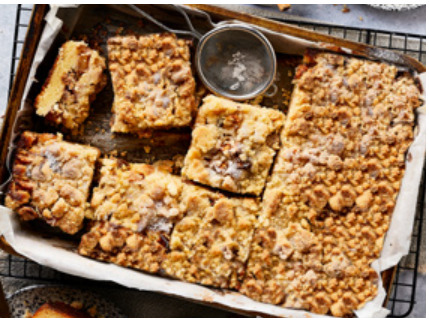

**Ingrediënten voor:** 12-15 stukken
**Bereidingstijd:** ca. 1 uur en 20 min.
**300 g** boter (+ invetten)
**5** appels
**1½ tl** kaneel
**½** citroen (alleen het sap)
**90 g** rozijnen
**300 g** witte basterdsuiker
**1** snuf zout
**5** eieren
**150 g** volle kwark
**300 g** zelfrijzend bakmeel
poedersuiker, om te bestuiven
bakpapier
**VOOR DE** TOPPING
**150 g** bloem
**100 g** boter (in blokjes)
**150 g** suiker
1 Verwarm de oven voor (elektrisch: 175°C / hetelucht: 160°C). Vet een bakvorm (ca. 24 x 34 cm) in
met boter en bekleed de bodem en de randen met
bakpapier.
2 Schil de appels, verwijder het klokhuis en snijd
de appels in blokjes. Doe de appelblokjes in een
Uit Paulines Keuken
mengkom en schep de kaneel, het citroensap en
de rozijnen erdoorheen. Zet afgedekt in de koelkast tot verder gebruik.
3 VOOR DE TOPPING Wrijf de ingrediënten voor
de topping met je vingertoppen tot kruimels. Doe
het kruimeldeeg in een bakje en zet tot gebruik in
de diepvries.
4 Klop met een staande of handmixer de boter,
de basterdsuiker en het zout in ca. 10 minuten
romig. Klop de eieren één voor één erdoorheen.
Roer de kwark erdoorheen. Zeef het zelfrijzend
bakmeel boven het beslag en spatel tot een glad
mengsel. Schep het beslag in de bakvorm en
verdeel de appelstukjes en de rozijnen erover.
5 Neem de kruimels uit de diepvries en verdeel
over de appel. Bak de plaatcake in 55-60 minuten
goudbruin en gaar in de oven. Laat afkoelen en
snijd in stukken. Bestuif eventueel met wat
poedersuiker.
Per stuk (15): ca. 404 kcal
**6 g** eiwit | 24 g vet | 65 g koolhydraten

## Lasagne puttanesca

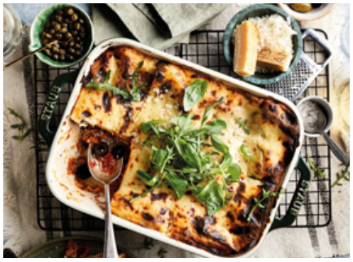

**Ingrediënten voor:** 4-6 personen
**Bereidingstijd:** ca. 1 uur en 10 min.
**1** ui
**2 tenen** knoflook
olijfolie
**1 tl** gedroogde oregano
**½ tl** chilivlokken
**45 g** ansjovisfilets (blik)
**800 g** gepelde tomaten (blik)
zout en peper
**50 g** zwarte, pitloze olijven
**2 el** kappertjes
**100 g** boter
**100 g** bloem
**1 l** volle melk
**100 g** parmezaan
**15** lasagnebladen
**20 g** rucola
**1 takje** basilicum
1 VOOR DE PUTTANESCASAUS Verwarm de oven
voor (elektrisch: 200°C / hetelucht: 180°C). Pel
en snipper de ui en de knoflook fijn. Verhit een
scheutje olijfolie in een koekenpan op laag vuur
en fruit de ui en de knoflook erin. Voeg de oregano, de chilivlokken en de ansjovis toe en laat de
vis smelten in de pan. Voeg de tomaten toe, breng
op smaak met zout en peper en laat de saus ca.
15 minuten zachtjes koken, tot hij iets is ingedikt.
Hak de olijven grof en voeg samen met de kappertjes toe aan de saus.
2 VOOR DE BECHAMELSAUS Smelt de boter in
een pan. Voeg in één keer alle bloem toe en bak
al roerend ca. 2 minuten op middelhoog vuur,
tot een gladde roux ontstaat. Neem de pan van
het vuur en voeg al roerend geleidelijk de melk
toe, tot je een gladde saus hebt. Zet terug op laag
vuur en laat inkoken tot een dikke saus. Voeg 50 g
geraspte parmezaan toe en breng goed op smaak
met zout en peper. Voeg niet te veel zout toe, de
ansjovis en kappertjes zijn ook al zout.
3 Schep ⅔ van de bechamelsaus door de puttanescasaus. Schep een laagje van de puttanescasaus op de
bodem van een ovenschaal. Dek af met een laagje
lasagnevellen en verdeel opnieuw 2-3 el puttanescasaus erover, gevolgd door een beetje tonijn en
wat parmezaan. Herhaal tot je 4-5 laagjes hebt en
schenk de rest van de bechamelsaus eroverheen.
4 Bak de lasagne in ca. 25 minuten (voor verse
lasagnebladen) of ca. 40 minuten (gedroogde
lasagnebladen) in het midden van de oven, tot
de bovenkant goudbruin is en de lasagnebladen
gaar. Neem uit de oven en laat 5-10 minuten
rusten voor je hem aansnijdt. Bestrooi met de
rucola en het verse basilicum en serveer.
Per portie (6): ca. 470 kcal
**22 g** eiwit | 33 g vet | 60 g koolhydraten

## Indiase kikkererwtensoep

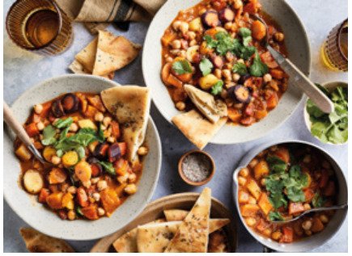

**Ingrediënten voor:** 4 personen
**Bereidingstijd:** ca. 30 min.
**1** rode ui
**2** teentjes knoflook
**2** cm gember
**2** bospenen
olijfolie
**1 el** garam masala
(Indiaas specerijenmengsel)
**1 tl** kurkuma
**300 g** flespompoenblokjes
**400 g** kikkererwten (blik, uitgelekt)
**400 g** tomatenblokjes (blik)
**270 ml** kokosmelk (blik)
**200 ml** groentebouillon
zout en peper
2 naan (bijv. van het merk Patak’s)
**2 tl** zachte boter
**2 tl** komijnzaad
**3 takjes** koriander
1 Verwarm de oven voor (elektrisch: 200°C /
hetelucht: 180°C). Pel en snipper de ui en de
knoflook fijn. Schil de gember en rasp fijn. Maak
de bospenen schoon en snijd in blokjes.
2 Verhit een scheutje olijfolie in een grote soeppan en fruit de ui, de knoflook en de gember
3-4 minuten erin, tot ze zacht zijn. Voeg de garam
masala en de kurkuma toe en bak 1-2 minuten mee.
3 Voeg de wortel, de pompoenblokjes, de kikkererwten, de tomatenblokjes, de kokosmelk en
de groentebouillon toe. Roer alles goed door en
breng op smaak met zout en peper. Laat ca. 20
minuten zachtjes koken, tot de groenten gaar zijn.
4 Bestrijk intussen de naan met de boter en
bestrooi met het komijnzaad. Bak in 4-6 minuten
knapperig in de oven. Serveer de kikkererwtensoep met de naan en bestrooi met de koriander.
**Per portie:** ca. 445 kcal
**17 g** eiwit | 30 g vet | 76 g koolhydraten
Uit Paulines Keuken

# Knus in de

# keuken

Voor het lekkerste eten heb je vaak wat geduld nodig.
Daarna is het met deze recepten samen smullen geblazen!

## Wildstoof met spaghetti en

## romige savooiekool

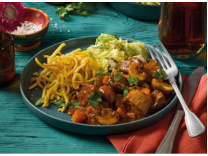

**Ingrediënten voor:** 8 personen
**Bereidingstijd:** ca. 2 uur en 30 min.
**1,2 kg** stoofvlees (bijv. wild zwijn en
hert)
**1 kg** kalkoendij (zonder bot)
**¼** knolselderij
**2** wortels
**1** prei
**250 g** sjalotjes
**4** teentjes knoflook
**5 el** boter
zout en peper
1 el kruidenmix (bijv.
gehaktkruiden)
**2 el** tomatenpuree
**2 tl** suiker
**500 ml** donker bier
**300 g** champignons
**1,2 kg** savooiekool
**2** uien
**200 ml** groentebouillon
**500 g** verse spaghetti
**60 g** paneermeel
**1 bosje** peterselie
**100 g** roomkaas
nootmuskaat
1 Dep het vlees en de kalkoen droog en snijd in
grove blokjes. Maak de knolselderij, de wortels
en de prei schoon en snijd fijn. Pel de sjalotten
en de knoflook. Hak de knoflook grof. Verhit 2 el
boter in een grote braadpan op hoog vuur. Bak
het vlees hierin in porties aan. Bestrooi met zout,
peper en de kruidenmix en neem uit de pan. Bak
de knolselderij, de wortel, de prei, de sjalotten en
de knoflook in het hete bakvet. Roer de tomatenpuree en de suiker erdoorheen en bak kort mee.
Voeg het vlees weer toe. Blus af met 200 ml bier,
breng aan de kook en laat onafgedekt bijna volledig inkoken. Schenk de rest van het bier en 500
ml water erbij, breng aan de kook en laat afgedekt ca. 1½ uur stoven. Voeg indien nodig nog ca.
250 ml water toe.
2 Maak de champignons schoon en halveer ze
afhankelijk van de grootte. Verhit 1 el boter in een
pan. Bak de champignons hierin ca. 10 minuten
krachtig aan. Breng op smaak met zout en peper,
voeg toe aan de goulash en laat nog ca. 30 minuten meestoven.
3 Was de savooiekool, snijd in vieren en snijd
in fijne reepjes van de stronk. Pel en snipper de
uien. Verhit 2 el boter in een pan. Fruit de uien
hierin glazig. Voeg de savooiekool toe en stoof
ca. 10 minuten mee. Breng op smaak met zout en
peper. Blus af met de bouillon, breng aan de kook
en laat afgedekt ca. 15 minuten stoven. Kook de
Seizoen
spaghetti volgens de aanwijzingen op de verpakking in water met wat zout. Giet de spaghetti af.
Voeg 2 el boter toe, bestrooi met paneermeel en
schep goed om. Was de peterselie en hak fijn.
4 Roer de roomkaas door de savooiekool en laat
smelten. Breng de savooiekool op smaak met zout
en nootmuskaat. Breng de stoofpot op smaak met
zout en peper. Serveer alles samen. Bestrooi met
de peterselie.
**Per portie:** ca. 760 kcal
**69 g** eiwit | 40 g vet | 31 g koolhydraten

## Coverrecept

## Uienquiche met cranberryjam

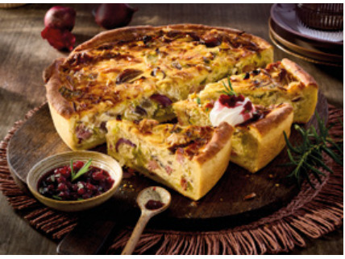

**Ingrediënten voor:** ca. 12 stukken
**Bereidingstijd:** ca. 1 uur en 45 min. + 1 nacht wachttijd
**10 g** verse gist (of 4 g
droge gist)
**225 g** bloem (+ bestuiven)
**½ tl** suiker
**75 g** aardappelpureepoeder
zout en peper
**3 el** olijfolie
**2** uien
**300 g** rode uien
**2** preien (à ca. 250 g)
**600 g** gepekelde eisbein (of
varkensschenkel, bij
de slager)
**250 g** raclettekaas
**6** eieren
**500 g** crème fraîche
boter, om in te vetten
**150 g** cranberryjam
**1 takje** rozemarijn
**2-4** jeneverbessen
1 EEN DAG VAN TEVOREN VOOR HET DEEG Los de gist op in 50 ml koud
water. Kneed de bloem, de suiker, het aardappelpureepoeder, 225 ml koud
water en het gistwater door elkaar. Voeg tijdens het kneden ½ tl zout en 1 el
olie toe. Laat het deeg afgedekt een nacht rijzen in de koelkast.
2 DE VOLGENDE DAG VOOR DE VULLING Pel alle uien en snijd in dunne reepjes. Was de preien en snijd in ringen. Verhit 2 el olie in een grote pan. Fruit de
ui en de prei hierin in ca. 10 minuten glazig. Neem de pan van het vuur.
3 Verwijder het zwoerd en het vet van de eisbein. Pluk of snijd het vlees
in stukken. Snijd de kaas in fijne blokjes. Kluts de eieren met 400 g crème
fraîche, ¾ van de kaas, zout en peper. Meng het eimengsel met het uienmengsel. Spatel het vlees van de eisbein erdoor.
4 Verwarm de oven voor (elektrisch: 200°C / hetelucht: 180°C). Rol het deeg
op een met bloem bestoven werkblad uit tot een ronde lap (ca. 32 cm Ø).
Bekleed een ingevette springvorm (ca. 28 cm Ø) ermee en druk tegen de rand
omhoog. Laat het deeg in de vorm ca. 20 minuten rijzen. Verdeel de vulling
over het deeg. Strooi de rest van de kaas erover. Bak de quiche in 6075 minuten onder in de oven gaar.
5 VOOR DE GREMOLATA Roer de cranberryjam glad. Was de rozemarijn en
hak de naaldjes fijn. Hak de jeneverbessen fijn. Roer de rozemarijn en de
jeneverbessen door de jam. Serveer de uienquiche met de rest van de crème
fraîche en de gremolata.
**Per stuk:** ca. 440 kcal
**22 g** eiwit | 26 g vet | 30 g koolhydraten

## Gestoofde runderwangen

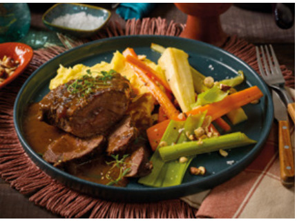

**Ingrediënten voor:** 4 personen
**Bereidingstijd:** ca. 5 uur en 45 min. + 1 nacht wachttijd
4 runderwangen (à ca.
**250** g, bij de slager)
zout en peper
**3 el** bloem
**2 el** boter
**3** uien
**250 g** knolselderij
**5** wortels
**10 takjes** tijm
**3 el** tomatenpuree
**400 ml** rode wijn
**4-6 el** sojasaus
**3 el** hazelnoten
**750 g** aardappels
**2** preien
**300 g** pastinaak
**2-3 el** boter
**1 el** honing
**1 el** maizena
**150 ml** melk
nootmuskaat
1 EEN DAG VAN TEVOREN Dep de runderwangen droog. Bestrooi met zout
en peper en wentel door de bloem. Klop de overtollige bloem eraf. Verhit de
boter in een braadpan op hoog vuur. Bak de wangen hierin rondom in ca. 5
minuten. Pel en snipper de uien. Schil de knolselderij en 2 wortels, was ze en
snijd in grove stukken.
2 Verwarm de oven voor (elektrisch: 140°C / hetelucht: 120°C). Neem de
runderwangen uit de pan. Bak de uien, de knolselderij en de wortels ca. 5 minuten in het hete braadvet. Was de tijm en voeg 6 takjes toe aan de groenten.
Roer de tomatenpuree erdoor en bak kort mee. Schenk de wijn erbij, breng
aan de kook en laat 34 minuten inkoken. Schenk 1 l water erbij, breng aan
de kook en voeg de runderwangen weer toe. Breng alles royaal op smaak met
zout, peper en de sojasaus. Stoof alles afgedekt ca. 3 uur en 30 minuten in de
oven. Laat de runderwangen in de saus afkoelen.
3 DE VOLGENDE DAG Verwarm de oven voor (elektrisch: 100°C / hetelucht:
80°C). Neem de runderwangen uit de saus. Schep het vet van de saus en zeef
de saus. Breng de saus aan de kook, laat ca. 5 minuten inkoken en breng
op smaak. Doe de runderwangen en ⅓ van de saus terug in de braadpan.
Verwarm alles afgedekt ca. 2 uur in de oven.
4 Rooster de hazelnoten in een droge koekenpan. Leg ze op een theedoek en
wrijf de velletjes eraf. Hak de noten grof. Schil en was de aardappels en snijd
in vieren. Kook ze in water met wat zout in ca. 20 minuten gaar. Schil en was
de overige wortels en halveer ze in de lengte. Was de preien, halveer in de
lengte en snijd in stukken van 15 cm. Schil en was de pastinaken en halveer
ze in de lengte. Verhit 12 el boter in een grote pan. Fruit de groenten hierin
licht aan. Breng op smaak met zout en peper. Druppel de honing erover en
laat karamelliseren. Schenk 100 ml water erbij, breng aan de kook en laat
afgedekt 1012 minuten garen. Breng op smaak met zout en peper.
5 Breng de rest van de saus aan de kook. Roer de maizena glad met 4 el
water, roer door de saus en laat ca. 1 minuut zachtjes koken. Breng de saus
op smaak. Giet de aardappel af, voeg de melk en 1 el boter toe en stamp grof.
Breng op smaak met zout en nootmuskaat. Serveer alles samen. Bestrooi de
groenten met de noten. Garneer de runderwangen met de overige tijm.
**Per portie:** ca. 940 kcal
**63 g** eiwit | 39 g vet | 68 g koolhydraten
Uienquiche met cranberryjam
Seizoen
Gestoofde runderwangen

## Parelgort-groentemaaltijdsoep

## met broodharten

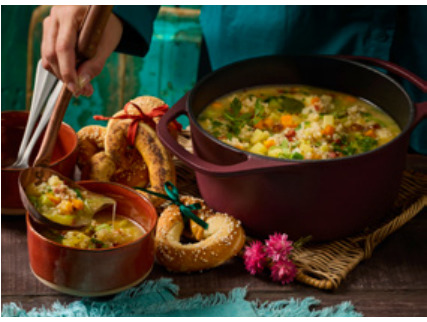

**Ingrediënten voor:** 6 personen
**Bereidingstijd:** ca. 1 uur en 45 min.
**700 g** pizzadeeg (rol, koeling)
**200 g** spek (aan één stuk)
**¼** knolselderij
**2** wortels
**1** prei
**400 g** aardappels
**1** ui
**1-2** teentjes knoflook
**3 el** olie
zout en peper
**½ tl** gemalen karwijzaad
**250 g** parelgort
**2** laurierblaadjes
**2,5 l** groentebouillon
grof zout, om te bestrooien
maanzaad, om te
bestrooien
sesamzaad, om te
bestrooien
**4-6 takjes** peterselie
bakpapier
1 Neem het pizzadeeg uit de koeling. Snijd het spek in fijne blokjes. Maak de
knolselderij, de wortels en de prei schoon. Schil de wortels en de knolselderij
en snijd in fijne blokjes. Halveer de prei in de lengte en snijd in fijne reepjes.
Schil en was de aardappels en snijd in fijne blokjes. Pel de ui en de knoflook.
Snipper de ui en hak de knoflook fijn.
Seizoen
2 Verhit de olie in een grote pan. Bak het spek hierin knapperig. Voeg de ui en
de knoflook toe aan het spek en bak kort mee. Voeg de knolselderij, de wortel, de prei en de aardappel toe en stoof 56 minuten mee. Bestrooi met zout,
peper en het karwijzaad. Spoel de parelgort in een zeef af met koud water,
laat uitlekken en voeg toe aan de pan. Voeg de laurierblaadjes toe. Schenk de
bouillon erbij, breng aan de kook en laat afgedekt op laag vuur ca. 30 minuten zachtjes koken.
3 Verwarm de oven voor (elektrisch: 220°C / hetelucht: 200°C). Verdeel het
pizzadeeg in 14 stukken. Rol elk stuk uit tot een streng van ca. 28 cm lang
en vorm tot een hart. Druk de uiteinden goed op elkaar. Leg de harten op
twee met bakpapier beklede bakplaten. Bestrijk de harten met koud water.
Bestrooi enkele harten met grof zout of naar wens met maanzaad of sesamzaad. Bak de platen na elkaar ca. 10 minuten in de voorverwarmde oven.
4 Was de peterselie en hak fijn. Breng de soep op smaak met zout en peper
en bestrooi met de peterselie. Serveer de broodharten erbij.
**Per portie:** ca. 740 kcal
**24 g** eiwit | 21 g vet | 115 g koolhydraten

## Ribeye met koolraapfriet

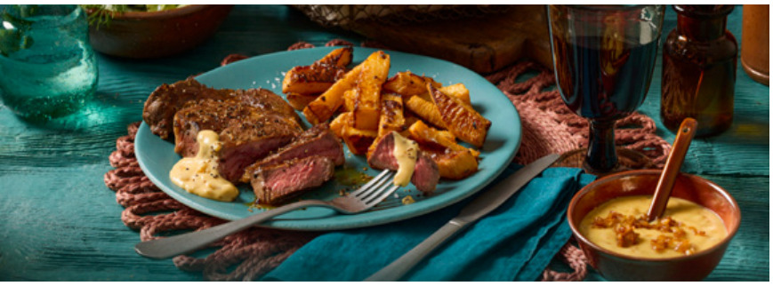

**Ingrediënten voor:** 4 personen
**Bereidingstijd:** ca. 1 uur en 30 min.
**2** komkommers
zout en peper
**1,5 kg** koolraap
**15 g** maizena
**2 tl** gerooktepaprikapoeder
**1** bio-citroen (alleen de
schil, geraspt)
**5 el** olijfolie
**1** ui
**100 g** slagroom
**1 zakje** hollandaisesausmix (voor 125 g
boter)
**50 g** koude boter
**150 g** zure room
**2 el** wittewijnazijn
**3 el** citroensap
**1 el** suiker
**3-4 takjes** peterselie
**5-6 takjes** dille
**2 el** boter
**4** ribeyes (à ca. 200 g)
grof gemalen zwarte
peper
grof zout of fleur de
sel, om te bestrooien
olie, om in te vetten
1 Was de komkommers, schaaf in dunne plakjes en bestrooi met zout. Meng
goed en laat afgedekt trekken.
2 Verwarm de oven voor (elektrisch: 200°C / hetelucht: 180°C). Halveer
de koolraap, snijd in dikke plakken (1½ 2 cm) en schil. Snijd de koolraapplakken in lange frieten en doe in een grote kom. Zeef de maizena en 1½ tl
gerooktepaprikapoeder erover. Voeg de citroenschil, 1 tl zout en peper toe en
meng alles met elkaar. Schenk 4 el olie eroverheen en meng goed. Bestrijk
een diepe bakplaat met olie. Verdeel de koolraapfriet gelijkmatig in een
enkele laag over de plaat. Bak ca. 50 minuten in de oven tot ze goudbruin en
gaar zijn. Maak de frieten tussendoor 2 keer los van de plaat en draai ze om.
3 Pel en snipper de ui. Verhit 1 el olie in een pan. Bak de ui hierin goudbruin.
Breng op smaak met zout en ½ tl gerooktepaprikapoeder. Meng de slagroom
met 100 ml water. Roer de sausmix erdoor en breng al roerend aan de kook.
Klop 50 g koude boter erdoorheen. Roer de gebakken ui door de saus. Houd
de saus warm.
4 Laat de komkommer uitlekken en knijp eventueel uit. Meng de zure room
met de azijn en het citroensap. Breng op smaak met zout, peper en de suiker.
Was de kruiden. Hak de peterselie. Neem de blaadjes van de dille, houd een
beetje apart en hak de rest fijn. Roer de kruiden door de zure room en roer de
komkommer erdoor. Breng de salade op smaak met zout en peper.
5 Verhit 2 el boter in een grote pan. Bak de ribeyes hierin op hoog vuur ca. 4
minuten per zijde. Neem uit de pan. Bestrooi met grof gemalen zwarte peper
en zout. Laat de ribeyes afgedekt ca. 5 minuten rusten.
6 Bestrooi de koolraapfriet met grof zout. Serveer met de steaks en de
uienhollandaise. Garneer de komkommersalade met de dille en serveer
erbij.
**Per portie:** ca. 890 kcal
**54 g** eiwit | 59 g vet | 34 g koolhydraten

## Horizontaal

2 huishoudapparatuur 8 tijdrekening 10 het gewone overschrijdend 17 Mexicaanse
maïspannenkoek 19 sportbeoefenaar 20 onderwijskracht 22 water in Friesland
23 geheel 24 borrel 26 bereiken 28 gebaksoort 30 reeks 31 buitenverblijf bij
Apeldoorn 33 telwoord 35 zacht 36 opsomming van keuzes 37 kloosterlinge
38 deel van de rug 40 noodvoorraad 42 breimateriaal 43 katholiek 45 melodie
47 insect 48 afgebakend gedeelte 49 lichaamsslagader 50 taaie lekkernij
52 lachwekkend persoon 53 helemaal 55 nevens 57 United States of America
58 rekenopgave 59 wild zwijn 61 kledingmaat 62 ruiterhouding 63 oefenen
voor een wedstrijd 66 voorname mensen 68 blauwwit metaal 69 monumentaal
verhaal 71 afwezigheid van oorlog 72 schoorsteenzwart 74 muzieknoot 75 plus
76 jonge vrouw 77 haarkleur 79 opeengedrongen menigte 81 getij 82 kiem
83 dadelijk beschikbaar 85 vrouwelijk dier 87 crèmekleurig 89 sierplant
90 plaaggeest 91 ingesloten.

## Verticaal

1 parkeren 2 toilet 3 geladen deeltje 4 spoedig 5 roofdier 6 oude maat
7 toiletartikel 8 hemelruim 9 dreef 10 asbus 11 ezelsgeluid 12 katrol 13 oorsprong
14 achterzijde van de hals 15 lidwoord 16 gezichtsuitdrukking 18 tropische
vetplant 21 lof 25 spijs 27 aanbevelen 29 Europese munt 30 boekwerk 32 geen
erg hebben in 34 klein restaurant 35 licht bruinrood 36 Amsterdammer
37 openbaar ambtenaar 39 tweeledig 41 plaats in Utrecht 42 deel van een
trein 44 muziekinstrument 46 Oost-Europeaan 48 zienswijze 49 vlaktemaat
51 vijandschap 54 openbaar vervoer 56 grote dure auto 60 verbod 61 prik
van een insect 62 voegwoord 63 hoogmoed 64 slang 65 vereist 67 rit
70 bleek 71 nagerecht 73 nadien 76 onjuist 77 tapkast 78 rag 80 onbepaald
voornaamwoord 82 daar 84 zangnoot 86 windvrije kant 88 compact disc.
© DENKSPORT PUZZELBLADEN
**91** 49 89 71 5 30 76
VUL DE PUZZEL IN EN MAAK KANS
OP 1 VAN DE 3 EXEMPLAREN VAN

## Oma’s ovengerechten

## t.w.v. 21,99 euro

In Oma’s ovengerechten delen de leukste oma’s (en opa’s) van
Nederland hun ovengerechten: van plaattaarten en quiches tot
lasagnes en traybakes - en de verhalen die achter hun recepten
schuilgaan. Eén ding is zeker: oma weet wel raad als het gaat om
de lekkerste ovenschotels. In dit vijfde deel in de Oma’s soep-reeks
delen de leukste oma’s (en opa’s) van Nederland hun ovengerechten:
van plaattaarten en quiches tot lasagnes en traybakes. Denk aan een
klassieke quiche lorainne of broccoli-hamtaart.
1 2 3 4 5 6 7 8 9 10 11 12 13 14 15 16
**17** 18 19 20 21 22
Titel: Oma’s ovengerechten
**23** 24 25 26 27 28 29 30
**31** 32 33 34 35 36 37
Auteur: Stichting Oma’s Soep
**38** 39 40 41 42 43 44
**45** 46 47 48 49
Uitgeverij: Becht - Harper Collins
**50** 51 52 53 54
**55** 56 57 58 59 60
Prijs: 21,99 euro
**61** 62 63 64 65 66 67
**68** 69 70 71 72 73 74
Het antwoord kun je vóór 13 november 2025
**75** 76 77 78 79 80 81
**82** 83 84 85 86 87 88
sturen naar: koken & genieten, o.v.v. oplossing puzzel
**89** 90 91
Postbus 296, 6500 AG Nijmegen
Of op onze website: kokengenieten.nl/puzzel

# Dat kwaakt

# naar meer!

Eend staat niet heel vaak op het menu en dat is zonde;
het is namelijk superlekker! Probeer deze recepten met
eend van over de hele wereld maar eens.
Seizoen

## Pekingeend met pannenkoekjes

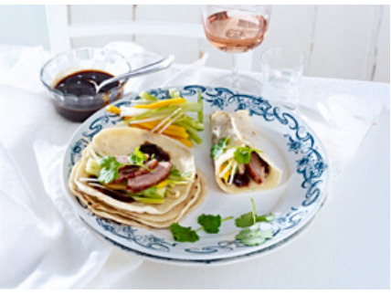

**Ingrediënten voor:** 6 personen
**Bereidingstijd:** ca. 2 uur en 45 min. + ca. 2 uur wachttijd
1 panklare eend (ca. 2 kg,
bij de poelier)
zout
**5 el** lichte suikerstroop
**4 el** sojasaus
**1 tl** gemberpoeder
**1 bosje** koriander
**1 bosje** lente-uitjes
**300 g** bloem
**3 el** sesamolie (+ extra, om
in te bakken)
**2** wortels
**150 g** taugé
bloem, om te bestuiven
olie, voor de pannenkoekjes
**200 ml** hoisinsaus (Chinese
saus, bij de supermarkt)
bakpapier
1 Was de eend, dep hem droog en wrijf hem vanbinnen en vanbuiten in met zout.
Meng de suikerstroop, de sojasaus, 3 el heet water en het gemberpoeder met elkaar. Bestrijk de eend met ⅔ van deze siroop. Wikkel de eend losjes in bakpapier
en laat hem op een koele plek ca. 2 uur drogen.
2 Verwarm de oven voor (elektrisch: 200°C / hetelucht: 180°C). Was de koriander,
neem de blaadjes van de takjes en houd de steeltjes apart. Was de lente-uitjes
en snijd het groen eraf. Stop de koriandersteeltjes en het groen van de lente-ui
in de buikholte van de eend. Leg de eend met de borstzijde naar boven op een
ovenrooster. Schuif het rooster in de oven en schuif een diepe bakplaat eronder.
Schenk ca. 500 ml warm water op de bakplaat. Laat de eend ca. 1 uur braden.
3 VOOR DE PANNENKOEKJES Zeef de bloem boven een kom. Voeg de sesamolie
en 250 ml kokend water toe. Roer met een pollepel tot een glad deeg. Vorm het
deeg tot een bal en laat ca. 30 minuten rusten.
4 Schil de wortels, was ze en snijd ze samen met de rest van de lente-uitjes in
dunne reepjes van ca. 5 cm lang. Schenk kokend water over de taugé in een vergiet en laat uitlekken. Verlaag de oventemperatuur (elektrisch: 180°C / hetelucht:
160°C). Laat de eend nog ca. 1 uur braden.
5 Kneed het pannenkoekendeeg nogmaals door. Vorm er een rol van (ca. 5 cm Ø)
en snijd deze in 18 plakken. Rol elke plak op een met bloem bestoven werkblad
uit tot een cirkel (ca. 9 cm Ø). Bestrijk 9 deegcirkels dun met olie. Leg de overige
9 cirkels op de met olie bestreken cirkels. Rol de dubbele cirkels vervolgens dun
uit (ca. 15 cm Ø). Bak de pannenkoekjes in een hete, droge koekenpan aan beide
zijden lichtbruin en gaar. Neem de pannenkoekjes uit de pan. Trek de twee laagjes voorzichtig van elkaar en houd de pannenkoekjes warm.
6 Verhoog de oventemperatuur (elektrisch: 220°C / hetelucht: 200°C). Bestrijk de
eend met de overgebleven siroop en laat hem in ca. 15 minuten knapperig worden. Neem de eend uit de oven en laat hem iets afkoelen. Snijd al het eendenvlees
in kleine stukjes van het bot. Serveer het vlees met de groenten, de korianderblaadjes, de pannenkoekjes en de hoisinsaus.
**Per portie:** ca. 770 kcal
**69 g** eiwit | 31 g vet | 55 g koolhydraten

## Eendenbouillon met knödels

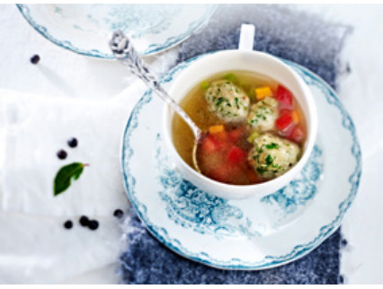

**Ingrediënten voor:** 6 personen
**Bereidingstijd:** ca. 2 uur en 15 min.
**2** uien
**1 kg** eendenkarkas en -afsnijdsels
(bestel vooraf bij de slager)
**2** wortels
**1** prei
**¼** knolselderij
**5** pretzels (broodjes)
**150 ml** melk
**1 el** olie
**1 bosje** peterselie
**2** eieren
**80 g** bloem
**4** tomaten
zout en peper
1 Halveer 1 ui en rooster de helften op de snijzijden
in een grote, droge pan tot ze donker zijn. Schenk er
**2 l** koud water bij. Voeg het eendenkarkas toe, breng
aan de kook en schuim de bouillon af met een schuimspaan. Neem 1 wortel en een klein stukje prei van de
soepgroenten en houd apart. Was de overige wortel
en prei en de knolselderij en snijd ze in grove stukken.
Voeg de groenten met 2 tl zout toe aan de bouillon en
laat alles ca. 2 uur zachtjes koken.
2 Snijd de pretzels in kleine blokjes. Verwarm de
melk, schenk hem over de pretzelblokjes en laat ca.
5 minuten weken. Pel en snipper de overgebleven ui.
Verhit de olie in een koekenpan en fruit de ui glazig.
Was de peterselie en hak hem fijn. Voeg de eieren,
de bloem, de gefruite ui en de peterselie toe aan het
pretzelmengsel. Bestrooi met zout en peper en kneed
alles goed met elkaar. Vorm met vochtige handen ca.
18 kleine knödels van het deeg. Kook de knödels in
ruim kokend water met zout in 4-5 minuten gaar.
3 Schil de apart gehouden wortel en was het stuk prei.
Snijd beide in fijne blokjes. Was de tomaten, snijd ze
in vieren, verwijder de zaadlijsten en snijd het vruchtvlees in fijne blokjes. Zeef de bouillon en vang hem
op in een andere pan. Breng de bouillon op smaak
met zout en peper en breng hem aan de kook. Kook
de blokjes wortel en prei ca. 2 minuten in de bouillon.
Verwarm de knödels en de tomatenblokjes kort mee
in de bouillon. Serveer alles samen.
**Per portie:** ca. 480 kcal
**26 g** eiwit | 21 g vet | 43 g koolhydraten
Seizoen

## Eendenspiesen

## met rodekoolsla

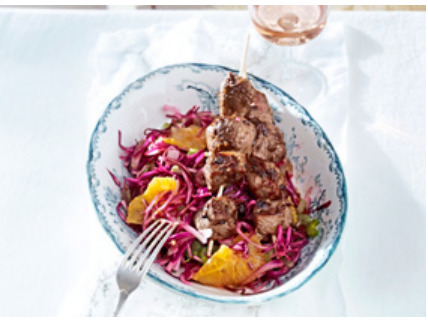

**Ingrediënten voor:** 4 personen
**Bereidingstijd:** ca. 1 uur en 25 min.
**2** milde groene pepers (pot)
**150 ml** sinaasappelsap
**4 el** honing
**9 el** olijfolie
**3** eendenborstfilets (à ca. 250
g)
**1** kleine rodekool
**4 el** wittewijnazijn
**1 tl** mierikswortelpuree (potje)
suiker
zout en peper
**3** rode uien
**2-3** stengels bleekselderij
**2** sinaasappels
**8** satéprikkers
1 Snijd de groene pepers fijn. Meng ze met het
sinaasappelsap, de honing en 5 el olijfolie. Breng
op smaak met peper. Verwijder het vel van de
eendenborstfilets en houd dit apart. Snijd het
vlees in blokjes van ca. 3 cm. Meng het vlees met
de marinade en laat ca. 1 uur marineren.
2 Was de rodekool, snijd hem in vieren, verwijder
de stronk en snijd de kool in fijne reepjes. Meng
de wittewijnazijn met de mierikswortelpuree, 1
tl suiker, 1 tl zout en wat peper. Klop 4 el olijfolie
erdoorheen. Meng de dressing met de kool en
kneed alles ca. 5 minuten goed door. Pel de uien
en snijd ze in fijne reepjes. Was de bleekselderij
en snijd hem in fijne plakjes. Schil de sinaasappels tot op het vruchtvlees, zodat al het wit verwijderd is. Halveer de sinaasappels in de lengte
en snijd ze vervolgens in plakjes. Meng de ui, de
bleekselderij en de sinaasappel met de salade.
3 Neem het vlees uit de marinade en laat het
uitlekken. Rijg het vlees aan de satéprikkers.
Leg het apart gehouden eendenvel in een koude
koekenpan. Verhit de pan en laat het vet uit het
vel smelten. Neem het eendenvel uit de pan. Bak
de spiesen in het hete eendenvet rondom in ca.
6 minuten gaar. Breng op smaak met zout. Laat
de spiesen uitlekken op keukenpapier en serveer
ze op de koolsla.
**Per portie:** ca. 600 kcal
**40 g** eiwit | 31 g vet | 38 g koolhydraten
Lekker eten valt of staat met de ingrediënten die je
gebruikt en het keukengerei dat je tot je beschikking hebt.
Daarom presenteren wij elke maand leuke, verrassende,
handige en/of smakelijke producten.

# WARME

# THEETJES

Koud hè, die gure herfstwind? Hoog tijd voor een
lekker warm kopje thee! Serveer het bijvoorbeeld
in deze glazen theepot met roze handvat. Mooi én
handig, want zo kun je precies zien wanneer het weer
tijd is om een nieuwe pot te zetten.
Prijs: €7,94.
Verkrijgbaar bij Søstrene Grene.

# Vrolijke

# spuitzak

Als je graag bakt is het handig om
een herbruikbare spuitzak in huis te
hebben. Deze leuke oranje van de
Hema bijvoorbeeld! Je krijgt er drie
verschillende vormen spuitmondjes bij,
dus eigenlijk kun je er elk bakklusje wel
mee klaren.
Prijs: €5,49.
Verkrijgbaar bij Hema.

# HERFSTBOTER

Bij een lekker herfstontbijtje kan deze leuke
botervloot van Le Creuset natuurlijk niet ontbreken.
Je kunt hem ook gebruiken als klein ovenschaaltje,
want hij kan tot 230°C hebben! Ook verkrijgbaar in
tijmgroen en wit.
Prijs: €69,-.
Verkrijgbaar via lecreuset.nl

# Hét magazine voor de

# vraag: “Wat eten we

# vandaag?”

Scan de
QR-code

# 12x van 54,voor maar

42,50
Iedere dag inspiratie
voor een heerlijke
maaltijd.
Bomvol recepten met
seizoensgebonden
producten.
Ontdek de lekkerste
zoete recepten.

## Abonneer je nu via:

## www.kokengenieten.nl/abo

of bel naar +31 (0)24 20 27 829
Deze actie is geldig zo lang de voorraad strekt. Je abonneert tot wederopzegging en voor ten minste de actieperiode
van 12 nummers. Na afloop van de actieperiode geldt de reguliere abonnementsprijs en is het abonnement per maand
opzegbaar. Opzeggen is heel eenvoudig en kan via onze klantenservice. Prijswijzigingen onder voorbehoud.

# Simpel en snel

# genieten

Het is al druk genoeg met werk, kinderen en hobby’s. Hier is de
oplossing voor iedereen die geen tijd heeft om uitgebreid te koken,
maar toch lekker wil eten.

## Romige pasta

## met savooiekool

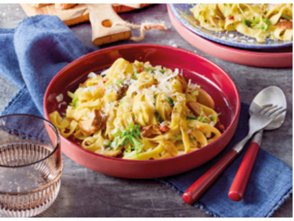

**Ingrediënten voor:** 4 personen
**Bereidingstijd:** ca. 30 min.
**½** savooiekoola
**1** ui
**2** teentjes knoflook
**250 g** eekhoorntjesbrood of
champignons
**400 g** pasta (bijvoorbeeld
tagliatelle)
zout en peper
**2 el** olijfolie
**50 g** hamblokjes
**150 g** slagroom
**1 el** koude boter
**1 el** citroensap
**40 g** parmezaan
1 Was de savooiekool, halveer hem en snijd in
reepjes. Pel en snipper de ui en de knoflook. Maak
de champignons schoon en snijd ze in plakjes.
Kook de pasta volgens de aanwijzingen op de
verpakking gaar in water met wat zout. Voeg de
savooiekool ca. 2 minuten voor het einde van
de kooktijd toe. Verhit de olijfolie in een grote
pan. Bak de hamblokjes, de ui, de knoflook en de
champignons ca. 5 minuten hierin.
2 Giet de pasta af en vang daarbij ca. 100 ml van
het kookvocht op. Blus de champignons af met
het kookvocht en de slagroom en breng aan de
kook. Laat ca. 4 minuten zachtjes koken. Roer de
koude boter erdoor. Voeg de pasta en de savooiekool toe en meng met elkaar. Breng op smaak met
zout, peper en het citroensap. Serveer de pasta en
schaaf de parmezaan er direct overheen.
**Per portie:** ca. 630 kcal
**26 g** eiwit | 25 g vet | 76 g koolhydraten

## Gehaktballetjes in

## tomaten-paprikasaus

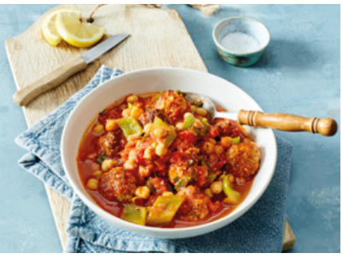

**Ingrediënten voor:** 4 personen
**Bereidingstijd:** ca. 25 min.
**500 g** half-om-halfgehakt
**1** ei
**2 el** magere kwark
**2 el** paneermeel
zout en peper
**4** lente-uitjes
**1** groene paprika
**400 g** kikkererwten (blik)
**2 el** olijfolie
**800** gepelde tomaten (blik)
**1 tl** citroensap
1 Kneed het gehakt, het ei, de kwark en het paneermeel door elkaar. Breng op smaak met zout
en peper. Vorm met vochtige handen ca. 24 kleine
balletjes van het mengsel. Was de lente-uitjes
en snijd ze in dunne ringen. Halveer de paprika,
De snelle keuken
verwijder de zaadlijsten, was de paprika en snijd
hem in blokjes. Spoel de kikkererwten af en laat
ze goed uitlekken.
2 Verhit de olijfolie in een pan. Bak de gehaktballetjes ca. 5 minuten rondom. Neem uit de pan.
Voeg de paprika en de kikkererwten toe aan de
pan en bak ze kort op hoog vuur. Voeg de tomaten met het sap toe, prak ze fijn met een spatel
en breng aan de kook. Voeg de balletjes weer
toe en laat ca. 7 minuten zachtjes koken. Roer
ca. 2 minuten voor het einde van de kooktijd de
lente-uitjes erdoor. Breng de saus op smaak met
zout, peper en het citroensap.
**Per portie:** ca. 530 kcal
**35 g** eiwit | 32 g vet | 28 g koolhydraten

## Kruidige zoete-aardappelcurry

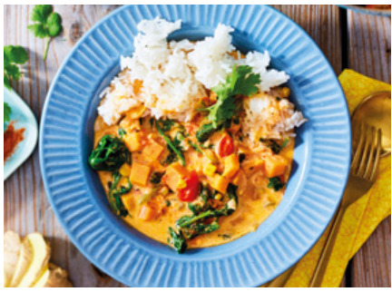

**Ingrediënten voor:** 4 personen
**Bereidingstijd:** ca. 30 min.
**200 g** basmatirijst
zout en peper
**1** ui
**2** teentjes knoflook
**2** zoete aardappels
**1** groene paprika
**250 g** cherrytomaten
**200 g** mais (blik)
**200 g** spinazie
**2 el** olie
**1-2 tl** garam masala
(Indiaas specerijenmengsel, bij de supermarkt)
**1 mespuntje** gemalen
komijn
**1 el** tomatenpuree
**400 ml** kokosmelk (blik)
**3 takjes** koriander
1 Kook de basmatirijst volgens de aanwijzingen op de verpakking gaar in
water met wat zout. Pel en snipper de ui. Hak de knoflook fijn. Schil en was
de zoete aardappels en snijd ze in blokjes. Halveer de paprika, verwijder de
zaadlijsten, was de paprika en snijd hem in blokjes. Was de cherrytomaten
en halveer ze. Spoel de mais af en laat uitlekken. Was de spinazie.
2 Verhit de olie in een pan. Fruit de ui en de knoflook ca. 3 minuten hierin.
Voeg de garam masala en de gemalen komijn toe en bak kort mee. Bak de
tomatenpuree even mee. Schenk de kokosmelk erbij en breng aan de kook.
Voeg de zoete aardappel en de paprika toe. Laat ca. 10 minuten garen. Voeg
de cherrytomaten, de mais en de spinazie toe aan de curry. Laat nog ca.
5 minuten verder garen. Breng de curry op smaak met zout en peper. Was de
koriander en neem de blaadjes van de takjes. Giet de rijst af. Serveer alles
samen en garneer met de koriander.
**Per portie:** ca. 440 kcal
**11 g** eiwit | 8 g vet | 80 g koolhydraten

## Winterburger met aardappelpartjes

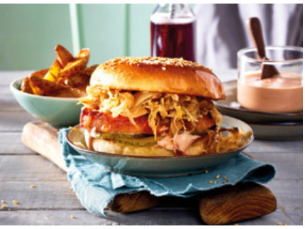

**Ingrediënten voor:** 4 personen
**Bereidingstijd:** ca. 25 min.
**1** ui
**1** sjalot
**100 g** mayonaise
**2 el** ketchup
**1 el** mosterd
**1 tl** worcestershiresaus
zout en peper
**600 g** aardappelpartjes
(diepvries)
**2 el** boter
**1 tl** suiker
**400 g** zuurkool (zak of pot)
**1** laurierblad
**4** varkensfiletlapjes à la
minute (à ca. 100 g)
**1** augurk
**4** burgerbroodjes
bakpapier
1 Pel en snipper de ui en de sjalot. Meng de sjalot met de mayonaise, de
ketchup, de mosterd en de worcestershiresaus. Breng op smaak met zout
en peper. Verwarm de oven voor (elektrisch: 200°C / hetelucht: 180°C). Bak
de aardappelpartjes in 20-22 minuten gaar op een met bakpapier beklede
bakplaat in de oven.
2 Verhit 1 el boter in een pan. Fruit de ui hierin. Strooi de suiker eroverheen. Laat de zuurkool uitlekken. Voeg de zuurkool met het laurierblad toe.
Breng op smaak met zout en peper. Laat de zuurkool ca. 15 minuten stoven.
Verwijder het laurierblad. Breng de zuurkool op smaak. Verhit 1 el boter
in een pan. Bak het vlees ca. 3 minuten per zijde hierin. Snijd de augurk in
plakjes. Snijd de broodjes open en rooster ze eventueel. Bestrijk beide helften met de burgersaus. Beleg de onderste helften met de augurk, het vlees
en de zuurkool. Leg de bovenste helften van de broodjes erop. Serveer met de
aardappelpartjes.
**Per portie:** ca. 590 kcal
**28 g** eiwit | 31 g vet | 32 g koolhydraten

## Gyrossteaks op warme witte kool

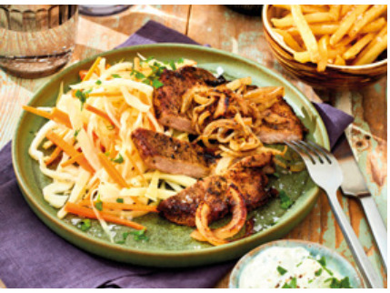

**Ingrediënten voor:** 4 personen
**Bereidingstijd:** ca. 30 min.
**½** witte kool (ca. 500 g)
**2** wortels
**3** uien
**650 g** ovenfriet (diepvries)
**5 el** olie
**200 ml** groentebouillon
**4 el** wittewijnazijn
zout en peper
**4** procureursteaks (à
ca. 175 g, bij de slager)
**2 tl** gyroskruiden
**4 takjes** peterselie
**200 g** tzatziki
bakpapier
1 Was de kool en snijd hem in reepjes. Schil en was de wortels en snijd ze in
staafjes. Pel de uien en snipper 1 ui. Verwarm de oven voor (elektrisch: 200°C
/ hetelucht: 180°C). Bak de friet op een met bakpapier beklede bakplaat in
ca. 22 minuten gaar in de oven; draai ze halverwege de baktijd om.
2 Verhit 2 el olie in een pan. Fruit de gesnipperde ui ca. 2 minuten hierin.
Schenk de bouillon en de azijn erbij en breng aan de kook. Breng op smaak
met zout en peper. Schenk het vocht over de kool, laat kort afkoelen en
kneed door. Schep de wortels erdoor. Dep het vlees droog. Snijd de overige
2 uien in reepjes. Meng de uienreepjes met het vlees, de gyroskruiden en 3 el
olie. Bak alles in een hete pan al omscheppend ca. 10 minuten. Was de peterselie, hak hem fijn en meng ¾ ervan door de kool. Breng op smaak. Serveer
alles samen. Bestrooi de tzatziki met de overige peterselie.
**Per portie:** ca. 560 kcal
**49 g** eiwit | 23 g vet | 40 g koolhydraten
De snelle keuken

## Snelle salade met worst

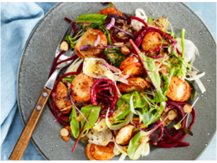

**Ingrediënten voor:** 4 personen
**Bereidingstijd:** ca. 25 min.
**250 g** rode bieten
**250 g** venkel
ca. 100 g babyleafsla
**4** worsten
**30 g** hazelnoten
**6 el** olie
**4 el** azijn (bijv. appelazijn)
**2 el** grove mosterd
**1 tl** suiker
zout en peper
**1** bakje tuinkers
spiraalsnijder
1 Schil en was de rode bieten en snijd ze met een spiraalsnijder tot dunne
sliertjes. Was de venkel en schaaf of snijd hem in dunne plakjes. Was de
babyleafsla, laat goed uitlekken en scheur in iets kleinere stukjes. Snijd de
worsten in plakjes.
2 Rooster de hazelnoten in een droge koekenpan goudbruin. Neem de noten
uit de pan en laat ze even afkoelen. Verhit 2 el olie in de pan. Bak de plakjes
worst op middelhoog vuur in 5-6 minuten gaar; draai regelmatig om. Hak de
hazelnoten grof.
3 VOOR DE VINAIGRETTE Meng de azijn, de mosterd, de suiker, zout en
peper. Klop 4 el olie erdoorheen.
4 Meng de rode biet, de venkel, de babyleafsla en de worst met elkaar.
Besprenkel met de mosterdvinaigrette, meng alles en breng eventueel verder op smaak. Knip de tuinkers uit het bakje. Strooi vlak voor het serveren
de tuinkers en de hazelnoten over de salade.
**Per portie:** ca. 470 kcal
**13 g** eiwit | 43 g vet | 11 g koolhydraten

## Gebakken vis

## met snelle aardappelsalade

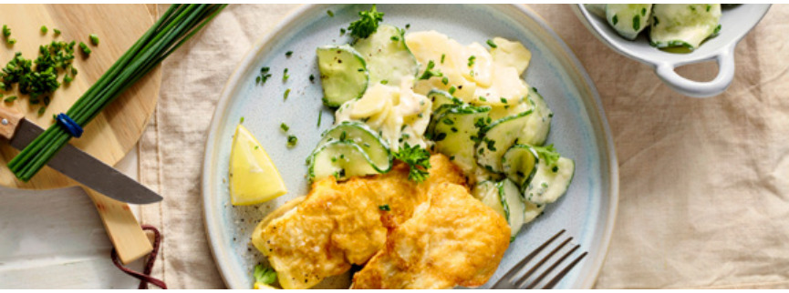

**Ingrediënten voor:** 4 personen
**Bereidingstijd:** ca. 25 min.
**1** komkommer
**½ bosje** bieslook
**½ bosje** peterselie
**1 kg** aardappelsalade
**3-4 tl** mierikswortel (potje)
4 kabeljauwfilets (à ca. 150 g)
**2-3 el** citroensap
**3 el** bloem
zout en peper
**2** eieren
**2-3 el** olie
evt. citroen, om te serveren
1 Was de komkommer grondig en schaaf of snijd hem in dunne plakjes. Was
de kruiden, houd een paar takjes apart en hak de rest fijn. Meng de aardappelsalade, de mierikswortel, de komkommerplakjes en ¾ van de gehakte
kruiden met elkaar.
2 Spoel de vis af, dep hem droog en halveer elke filet. Besprenkel de vis direct
met het citroensap. Meng de bloem met zout en peper op een bord. Kluts de
eieren in een diep bord. Haal de vis eerst door de bloem en vervolgens door
de geklutste eieren.
3 Verhit de olie in een grote koekenpan. Bak de vis op middelhoog vuur in
ca. 3 minuten per zijde goudbruin. Breng de aardappelsalade nogmaals op
smaak. Serveer met de gebakken vis. Bestrooi met de overige kruiden en
serveer eventueel met de citroen.
**Per portie:** ca. 450 kcal
**35 g** eiwit | 20 g vet | 32 g koolhydraten

## Pittige tomatensoep

## met krokante topping

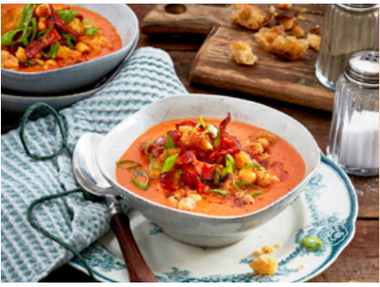

**Ingrediënten voor:** 4 personen
**Bereidingstijd:** ca. 30 min.
**4** lente-uitjes
**1** teentje knoflook
**2** wortels
**400 g** witte bonen (blik)
**4 el** olie
**800 g** gepelde tomaten (blik)
zout en peper
**1 snufje** suiker
**80 g** chorizo (pittige Spaanse worst)
**100 g** stokbrood (bijvoorbeeld van de vorige dag)
**1 mespuntje** chilivlokken
1 Was de lente-uitjes en snijd ze in ringen. Houd het groen van de lente-ui
apart. Pel en hak de knoflook. Schil en was de wortels en snijd ze in kleine
stukjes. Spoel de bonen af.
2 Verhit 2 el olie in een pan. Fruit de knoflook en het wit van de lente-uitjes
hierin. Schenk 500 ml water erbij. Voeg de tomaten met het sap, de wortel en
¾ van de bonen toe. Breng op smaak met zout, peper en de suiker. Breng aan
de kook en laat ca. 15 minuten zachtjes koken.
3 Snijd de chorizo in reepjes. Scheur het brood in stukjes. Verhit 2 el olie in
een koekenpan. Bak de chorizo knapperig hierin. Voeg het brood toe en bak
mee. Voeg de overige bonen en het groen van de lente-ui toe en bak kort mee.
Pureer de soep, breng nogmaals op smaak en schep in kommen. Verdeel de
chorizotopping erover. Bestrooi met de chilivlokken.
**Per portie:** ca. 390 kcal
**16 g** eiwit | 18 g vet | 43 g koolhydraten

# Zorgeloos rijden?

# AutoReviewPrivateLease

# Wijzijnerookvoorjou!

# Kijk voor de beste aanbiedingen op

# autoreview.nl/

# privatelease

## startmet

## vergelijken

# Zorgeloos rijden?

# Zorgeloos rijden?

# autoreview.nl/

# privatelease

# Hartverwarmende

# hapjes

Gloeiende wijn, gloeiende wangen: met dit knusse buffet zit je er in ieder geval
warmpjes bij! Steek gezellig de kaarsjes aan en geniet ervan.

## Kleurrijke saladekrans

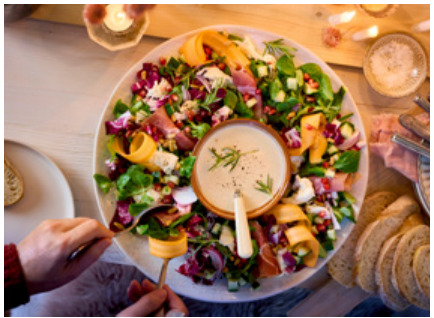

**Ingrediënten voor:** 8 personen
**Bereidingstijd:** ca. 30 min.
**200 g** crème fraîche
**4 el** frambozenazijn
**4 el** olijfolie
**2 tl** mosterd
**2 tl** honing
chilivlokken
zout en peper
**30 g** pijnboompitten
**100 g** veldsla
**2** rode uien
**1** radicchio (Italiaanse
roodlof, bij de supermarkt of
groentewinkel)
**1** wortel
**125 g** mozzarella
**1** snackkomkommer
**150 g** parmaham
**6 takjes** rozemarijn
**50 g** granaatappelpitten
1 VOOR DE DRESSING Doe de crème fraîche, de
azijn, de olie, de mosterd, de honing, chilivlokken,
zout en peper in een glazen pot met schroefdeksel
en schud krachtig.
2 VOOR DE SALADE Rooster de pijnboompitten in
een droge koekenpan goudbruin. Neem ze uit de
pan en laat afkoelen. Was de veldsla. Pel de uien
en snijd ze in fijne partjes. Was de radicchio en
snijd klein. Schil en was de wortel en schaaf met
een dunschiller in de lengte repen ervan. Scheur
de mozzarella in stukjes. Was de komkommer en
snijd in blokjes van ca. 1 cm. Rol de plakken ham
losjes op. Was de rozemarijn en neem de naaldjes
van de takjes. Leg de salade-ingrediënten en de
rozemarijn als een krans op een grote, ronde
schaal of plank. Zet de dressing in een schaaltje
in het midden. Bestrooi de salade met de granaatappelpitten en de pijnboompitten.
**Per portie:** ca. 266 kcal
**11 g** eiwit | 23 g vet | 7 g koolhydraten
Buffet

## Bonensoep met procureur

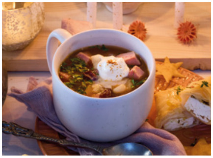

**Ingrediënten voor:** 8 personen
**Bereidingstijd:** ca. 1 uur
**4-5** wortels
**1** knolselderij (ca. 750 g)
**2** uien
**2** teentjes knoflook
**1,2 kg** gerookte procureur, zonder
been (bij de slager)
**2** laurierblaadjes
**5** jeneverbessen
zout en peper
**2 el** tomatenpuree
**2 tl** paprikapoeder
**½ tl** pittig paprikapoeder
250 g witte bonen (blik,
uitlekgewicht)
250 g kidneybonen (blik,
uitlekgewicht)
**400 g** witte bonen in tomatensaus
(blik)
**6 takjes** peterselie

## Bladerdeeg-fetapasteitjes

**Ingrediënten voor:** 8 personen
**Bereidingstijd:** ca. 1 uur en 30 min.
**600 g** feta (4 plakken)
250 g filodeeg (koeling of diepvries,
ontdooid)
**100 g** boter
**1** bio-citroen
**6 takjes** tijm
**50 g** vloeibare honing
bakpapier
1 Schil de wortels en de knolselderij, was ze en snijd de helft grof. Pel de uien en de knoflook en snipper
ze grof. Dep de procureur droog. Doe de procureur in een grote pan en bedek met ca. 2 liter water. Voeg
de laurierblaadjes en de jeneverbessen toe. Breng aan de kook en laat ca. 10 minuten zachtjes koken.
Schep het ontstane schuim eraf. Bestrooi met zout en peper. Voeg de grof gesneden groenten, de ui, de
knoflook, de tomatenpuree en beide soorten paprikapoeder toe en laat de procureur in nog ca. 30 minuten gaar koken.
2 Snijd de overige groenten in blokjes van ca. 1 cm. Neem de procureur uit de bouillon en snijd het vlees
in kleine stukjes. Schenk de bouillon door een zeef in een tweede pan en wrijf de groenten door de zeef.
Giet de witte bonen en de kidneybonen af en voeg ze toe aan de bouillon. Voeg ook de witte bonen in
tomatensaus toe. Voeg de kleine groenteblokjes toe. Breng alles aan de kook en laat 10-12 minuten
zachtjes koken. Voeg de stukjes vlees toe en verwarm kort. Breng de soep op smaak met zout en peper.
Was de peterselie en hak hem fijn. Serveer de soep en bestrooi met de peterselie. Lekker met een lepel
crème fraîche.
**Per portie:** ca. 304 kcal
**43 g** eiwit | 5 g vet | 23 g koolhydraten
1 Laat de feta goed uitlekken en snijd elke plak in drieën. Neem de vellen filodeeg uit de verpakking.
Smelt de boter. Leg 3 vellen deeg op het werkblad. Bestrijk één vel met de gesmolten boter, leg het tweede vel erop en bestrijk opnieuw. Leg het derde vel erop en bestrijk ook dit met de boter. Snijd de stapel
deeg in 4 gelijke stukken.
2 Was de citroen en rasp de schil er fijn af. Was de tijm, neem de blaadjes van de takjes en hak ze fijn. Leg
op elk stuk filodeeg een stuk feta. Bestrooi met wat citroenschil en tijm. Vouw of rol het deeg om de feta
heen tot kleine pakketjes. Bestrijk de deegpakketjes dun met de overige boter. Herhaal dit proces met
nog 6 vellen deeg en de rest van de feta.
3 Verwarm de oven voor (elektrisch: 180°C / hetelucht: 160°C). Leg de fetapakketjes op een met bakpapier beklede bakplaat. Bak ze in 25-30 minuten goudbruin in de oven. Steek uit het resterende vel deeg
sterren van verschillende groottes en leg deze op een met bakpapier beklede bakplaat. Bestrijk ze met
boter. Bak de sterren in 8-10 minuten goudbruin in de hete oven. Besprenkel de fetapasteitjes met de
honing. Garneer met de deegsterren en eventueel wat tijm.
**Per portie:** ca. 430 kcal
**15 g** eiwit | 31 g vet | 25 g koolhydraten
Buffet

## Rodewijn-rozemarijnzout

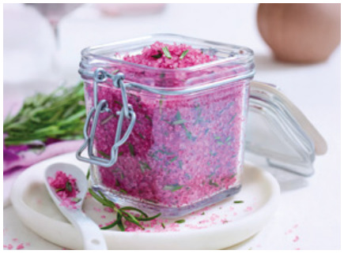

**Ingrediënten voor:** 8 potjes (à ca. 80 ml)
**Bereidingstijd:** ca. 3 uur en 15 min. + ca. 1 uur wachttijd
Verwarm de oven voor (elektrisch: 80°C / hetelucht: 60°C). Doe 600 g grof zeezout in een kom. Schenk 150 ml rode wijn er geleidelijk bij en meng alles goed.
Verdeel het zout over een met bakpapier beklede bakplaat. Laat het ca. 3 uur in
de oven drogen met de ovendeur op een kier. Roer het zout regelmatig om. Droog
het zout tot de wijn volledig verdampt is. Was 3 takjes rozemarijn, dep goed
droog en hak fijn. Neem de bakplaat uit de oven en roer de rozemarijn door het
zout. Laat volledig afkoelen. Verdeel het zout over 8 potjes.

## Citroen-limoenolie

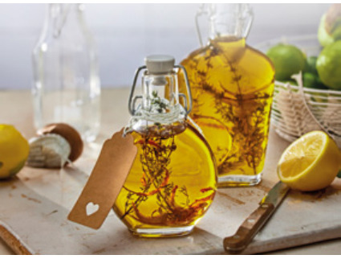

**Ingrediënten voor:** 2 flessen (à ca. 300 ml)
**Bereidingstijd:** ca. 10 min. + 2-3 weken wachttijd
Was 2 bio-limoenen en 1 grote bio-citroen met heet water en wrijf ze goed
droog. Schil de schil er met een dunschiller in lange, dunne spiralen af. Verdeel de
schillen over 2 schone flessen. Was 4 takjes tijm, dep hem goed droog en doe 2
takjes in elke fles. Schenk 600 ml olijfolie erbij en zorg ervoor dat de schillen en
de kruiden volledig bedekt zijn. Sluit de flessen goed af. Laat de olie 2-3 weken op
een donkere en koele plek trekken. Schud de flessen regelmatig.

## Zoete sneeuwballetjes

## met koffiemousse

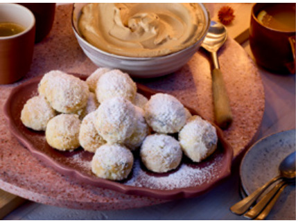

**Ingrediënten voor:** ca. 36 stuks
**Bereidingstijd:** ca. 1 uur en 15 min.
**350 g** boter
**160 g** suiker
**2** eieren
1 bio-citroen (alleen de schil,
geraspt)
**1 tl** vanille-extract
**4 tl** rumaroma
**600 g** bloem
**1 snufje** zout
**2-3 tl** koek- en speculaaskruiden
**1 zakje** bakpoeder
**150 g** gehakte amandelen
**200 g** rozijnen
**2 el** melk (optioneel)
**200 g** poedersuiker
**16 g** vanillesuiker
**560 g** slagroom
**6 el** oploskoffie
8 g slagroomversteviger (bijv. Dr.
Oetker Klop-Fix)
**150 g** gecondenseerde
melk (blik)
bakpapier
1 VOOR DE SNEEUWBALLETJES Verwarm de oven voor (elektrisch:
180°C / hetelucht: 160°C). Klop 200 g boter met 160 g suiker romig
en wit. Voeg de eieren, de geraspte citroenschil, het vanille-extract en het rumaroma toe en meng alles goed met elkaar. Voeg de
bloem, het zout, de koek- en speculaaskruiden en het bakpoeder
toe aan het mengsel en meng met elkaar. Kneed de amandelen en
de rozijnen door het deeg. Voeg eventueel de melk toe als het deeg
niet soepel genoeg is. Vorm van het deeg ca. 36 kleine balletjes en
leg ze op een met bakpapier beklede bakplaat. Bak de balletjes in
ca. 15 minuten gaar in de oven. Laat ze afkoelen.
2 Smelt 150 g boter. Wentel de nog warme balletjes erdoorheen.
Rol ze vervolgens door een mengsel van 180 g poedersuiker en de
vanillesuiker tot ze volledig bedekt zijn. Laat afkoelen. Bestuif vlak
voor het serveren met de overige poedersuiker.
3 VOOR DE MOUSSE Verwarm 60 g slagroom tot hij lauwwarm is.
Roer de oploskoffie erdoor en blijf roeren tot er een romige, lichtbruine massa ontstaat.
4 Klop 500 g slagroom met de slagroomversteviger stijf en voeg al
kloppend de gecondenseerde melk toe. Spatel de koffiecrème voorzichtig erdoorheen. Zet de mousse tot het serveren in de koelkast
en serveer alles samen met de sneeuwballetjes.
**Per portie:** ca. 1255 kcal
**18 g** eiwit | 73 g vet | 133 g koolhydraten
Buffet

## Chocoappels

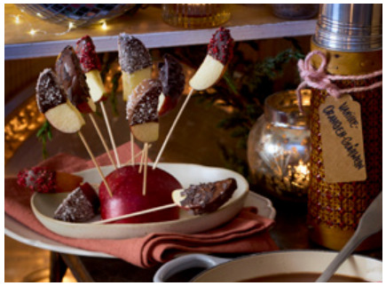

**Ingrediënten voor:** 8 personen
**Bereidingstijd:** ca. 45 min.
**4** appels
**1** citroen (alleen het sap)
**200 g** melkchocolade
**200 g** pure chocolade
**2-3 el** gevriesdroogde frambozen
(bij de bakwinkel of online
verkrijgbaar)
**2-3 el** kokosrasp
**2-3 el** purechocoladeschaafsel
**24** lange satéprikkers
1 Was 3 appels, snijd elk in acht partjes, verwijder de klokhuizen en leg ze in een kom met
water en het sap van de citroen.
2 Breek de melkchocolade en de pure chocolade in stukken en smelt beide soorten apart van
elkaar au bain-marie. Neem de appelpartjes
uit het water, dep ze zeer goed droog en steek
ze op de satéprikkers. Doop de appels in de
gesmolten chocolade en versier ze met de
gevriesdroogde frambozen, de kokosrasp en
de chocoladerasp. Was de overgebleven appel
en halveer hem. Steek de snack-appels in de
appelhelften en serveer alles samen.
**Per portie:** ca.357 kcal
**6 g** eiwit | 19 g vet | 43 g koolhydraten

## Witte vanillesinaasappelglühwein

**Ingrediënten voor:** 8 glazen
(à ca. 250 ml)
**Bereidingstijd:** ca. 20 min.
Schil ca. 5 cm gember en snijd grof.
Meng in een pan 500 ml sinaasappelsap, 750 ml droge witte wijn, de
gember, 1½ tl kaneel, 8 g vanillesuiker, 1 sanufje gemalen anijszaad, 3
kruidnagels en 3 el suiker met elkaar.
Verhit het mengsel (laat het niet
koken!) en laat 10-15 minuten trekken.
Serveer heet. Garneer naar wens met
schijfjes bio-sinaasappel in het glas.

## Chocoladeglühwein

**Ingrediënten voor:** 8 bekers
(à ca. 300 ml)
**Bereidingstijd:** ca. 20 min.
Verwarm in een pan 500 ml rode wijn,
300 ml rode port, 2 kaneelstokjes,
2 steranijs, 2 kruidnagels en 4 el
lichte basterdsuiker en laat op laag
vuur ca. 15 minuten trekken. Verwarm
intussen de melk in een andere pan.
Hak 300 g pure chocolade grof en laat
hem al roerend op laag vuur smelten
in 1 l melk. Schenk het rode-wijnmengsel door een zeef langzaam bij de
hete chocolademelk. Serveer de hete
chocoladeglühwein direct. Garneer
naar wens met een toef stijfgeklopte
slagroom.
Buffet

# Het beste

# van broccoli

Broccoli is een supergezonde groente, die vol
zit met voedingsstoffen die je vitaal en energiek
houden. Gelukkig is hij ook nog eens heel erg
lekker. Kijk maar naar deze recepten!

## Aziatische omelet

## met aspergebroccoli

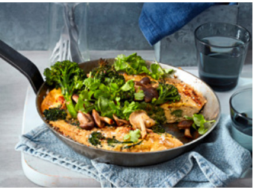

**Ingrediënten voor:** 4 personen
**Bereidingstijd:** ca. 40 min.
**300 g** aspergebroccoli
**1** teentje knoflook
**1** sjalot
**150 g** shiitake (paddenstoelen, bij
de supermarkt)
**4 el** sesamolie
**2 el** sojasaus
**1** kleine rode chilipeper
**6** eieren
zout en peper
**4-5 takjes** koriander
1 Was de aspergebroccoli. Pel de knoflook en hak
fijn. Pel en snipper de sjalot. Maak de shiitake
schoon. Verhit 3 el van de sesamolie in een ovenbestendige pan op hoog vuur. Voeg de shiitake,
de sjalot en de knoflook toe en bak ca. 2 minuten.
Blus af met de sojasaus en neem uit de pan. Veeg
de pan schoon en verhit 1 el sesamolie erin. Bak
de aspergebroccoli hierin al omscheppend ca.
4 minuten.
2 Snijd de chilipeper in de lengte doormidden,
verwijder de zaadlijsten, was de peper en hak fijn.
Kluts de eieren met zout, peper en de chilipeper.
Schenk het eimengsel over de aspergebroccoli in
de pan en laat ca. 1 minuut stollen.
3 Verwarm de oven voor (elektrisch: 200°C / hetelucht: 180°C). Bak de omelet ca. 15 minuten op het
middelste rooster in de oven. Verdeel de shiitake
erover en bak nog ca. 5 minuten. Was intussen
de koriander en neem de blaadjes van de takjes.
Neem de omelet uit de oven en bestrooi met de
koriander.
**Per portie:** ca. 250 kcal
**14 g** eiwit | 19 g vet | 8 g koolhydraten

## Groene soep

## met knoflookcroutons

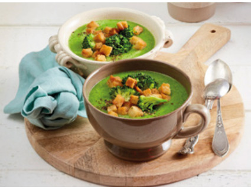

**Ingrediënten voor:** 4 personen
**Bereidingstijd:** ca. 20 min.
**1 kg** broccoli
**1,5 l** groentebouillon
**2 sneetjes** wit casinobrood
**1** teentje knoflook
**2 el** boter
zout en peper
1 Was de broccoli en snijd de roosjes van de
stronk. Schil de stronk en snijd grof. Breng de
groentebouillon aan de kook. Kook de broccoliroosjes en de stronk er afgedekt ca. 10
minuten in. Neem na de helft van de kooktijd
10-12 roosjes met een schuimspaan uit de pan en
houd apart.
De gezonde keuken
2 Snijd het brood in blokjes. Pel de knoflook en
hak fijn. Verhit de boter in een pan. Bak de toastblokjes met de knoflook goudbruin. Pureer de
soep fijn en breng op smaak met zout en peper.
Voeg de apart gehouden broccoliroosjes weer toe
aan de soep en verwarm kort mee. Serveer de
soep en bestrooi met de knoflookcroutons.
**Per portie:** ca. 120 kcal
**8 g** eiwit | 5 g vet | 14 g koolhydraten

## Broccolikikkererwtensalade

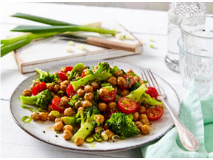

**Ingrediënten voor:** 4 personen
**Bereidingstijd:** ca. 25 min.
**800 g** kikkererwten (blik)
**5 el** olijfolie
**½ tl** paprikapoeder
**½ tl** gemalen komijnzaad
**½ tl** gemalen koriander
zout en peper
**750 g** broccoli
**4** lente-uitjes
**250 g** cherrytomaten
**3 el** balsamicoazijn
**1 tl** mosterd
**1 snufje** suiker
1 Verwarm de oven voor (elektrisch: 200°C /
hetelucht: 180°C). Laat de kikkererwten uitlekken, spoel ze af en dep ze droog. Meng ze met 1 el
van de olijfolie, het paprikapoeder, de komijn en
de koriander. Bestrooi met zout en peper. Verdeel
over een met bakpapier beklede bakplaat.
Rooster 10-12 minuten in de oven. Schep na ca.
6 minuten om.
2 Was de broccoli en snijd in kleine roosjes. Kook
4-5 minuten in kokend water met zout, giet af
en laat afkoelen. Was de lente-uitjes en snijd in
dunne ringen. Was de cherrytomaten en halveer
ze. Klop de balsamicoazijn, de mosterd en de
suiker door elkaar. Klop de overige olijfolie in een
dun straaltje erdoorheen. Breng op smaak met
zout en peper
3 Neem de kikkererwten uit de oven. Meng in
een grote kom met de broccoli, de lente-uitjes, de
cherrytomaten en de dressing. Verdeel de salade
over borden.
**Per portie:** ca. 360 kcal
**16 g** eiwit | 17 g vet | 37 g koolhydraten

## Mini-ovenschotels

## met broccoli en hazelnoten

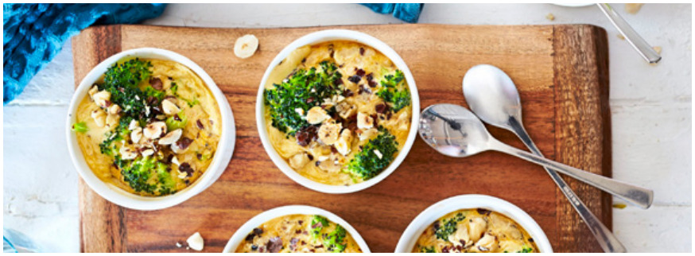

**Ingrediënten voor:** 6 personen
**Bereidingstijd:** ca. 45 min.
**500 g** broccoli
**50 g** hazelnoten
**3** eieren
**200 ml** slagroom
**100 ml** melk
zout en peper.
nootmuskaat
boter, om in te vetten
**6** ovenschaaltjes (8 cm Ø)
1 Was de broccoli en snijd in kleine roosjes.
Kook de roosjes in kokend water met zout ca.
4 minuten beetgaar. Giet af en laat afkoelen. Hak
de hazelnoten grof en rooster ze in een droge
koekenpan goudbruin. Neem uit de pan. Kluts
de eieren, de slagroom, de melk, zout, peper en
nootmuskaat door elkaar. Roer de helft van de
hazelnoten erdoor.
2 Verwarm de oven voor (elektrisch: 180°C / hetelucht: 160°C). Verdeel de broccoli over de ingevette ovenschaaltjes. Schenk het roommengsel er
gelijkmatig overheen en bestrooi met de overige
noten. Bak 25-30 minuten in de oven tot ze goudbruin en gaar zijn. Neem uit de oven en serveer.
**Per portie:** ca. 220 kcal
**9 g** eiwit | 20 g vet | 5 g koolhydraten
De gezonde keuken

# Uit oma’s oven

Kookboek
Titel: Oma’s ovengerechten
Auteur: Stichting Oma’s Soep
Fotografie: Saskia Lelieveld
Prijs: 21,99 euro
Uitgeverij: Becht – Harper Collins
Stichting Oma’s Soep gaat eenzaamheid onder ouderen tegen.
Jongeren gaan op vrijwillige basis samen koken met ouderen. Na al die
kooksessies werd langzaam duidelijk: de recepten van deze opa’s en
oma’s mogen niet verloren gaan! Al die jaren kookervaring resulteerden
in zoveel smakelijke maaltijden. Daarom maakt Oma’s Soep ook
kookboeken. De nieuwste in de reeks: Oma’s ovengerechten. Hét boek
voor wie deze herfst wil genieten van comfortfood. En nodig dan ook je
eigen (groot)ouders eens uit aan tafel.

## Vis Wellington

## Van Oma Bep Boon

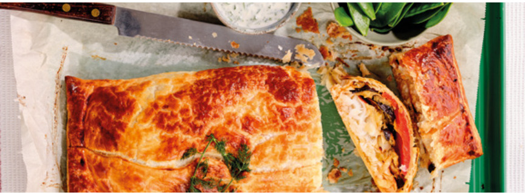

**Ingrediënten voor:** 6 personen
**Bereidingstijd:** ca. 1 uur en 45 min.
**40 g** boter
**3** uien, in dunne plakjes
4 kabeljauwfilets zonder vel, à
**150 g** per stuk
**½ tl** paprikapoeder
**2** rode paprika’s
**1** aubergine, in plakken van 1
cm
**2 el** olijfolie
**1** rol koelvers bladerdeeg
**35 g** vers broodkruim
**1** ei, losgeklopt
**150 ml** Griekse yoghurt
**2 el** fijngesneden dille
klein scheutje Cointreau
**125 g** peultjes
zout en peper
bakpapier
Kookboek
Oma’s tip: Steek met een
visvormige uitsteker visjes uit
een extra stuk bladerdeeg en
versier daar de Wellington
mee voordat je hem afbakt.
1 Smelt de boter in een koekenpan op middelhoog vuur en voeg de uien toe.
Smoor de uien 15 minuten met het deksel op de pan. Roer af en toe door.
2 Haal het deksel van de koekenpan en bak nog eens 15 minuten, tot de uien
heel zacht en lichtbruin zijn. Laat de uien afkoelen en breng op smaak met
zout en peper. Wrijf de visfilets aan één kant in met het paprikapoeder en leg
met de witte kanten op elkaar.
3 Verhit de ovengrill op de hoogste stand. Gril de paprika’s totdat het vel
rondom geblakerd is. Doe in een kom, dek af met vershoudfolie en laat afkoelen. Trek daarna het vel van de paprika’s, verwijder steeltjes en zaadjes en
snijd de paprika’s in kleinere stukken. Bekleed een bakplaat met aluminiumfolie en leg daar de plakken aubergine op. Bestrijk aan beide kanten met de
olijfolie en bestrooi met zout en peper. Leg de aubergine onder de ovengrill
tot beide kanten goudbruin zijn. Draai halverwege om.
4 Schakel de ovengrill uit en verwarm de oven voor tot 220 °C (hetelucht)
of 240 °C (elektrisch). Rol het bladerdeeg uit op een met bakpapier beklede
bakplaat. Strooi het broodkruim over het midden van de deeglap en leg
de vis aan de onderste kant van de deeglap. Schep de uien erover en leg de
paprika en aubergine dakpansgewijs erbovenop. Bestrijk de randen van het
deeg met wat losgeklopt ei. Vouw het deeg over de vis en groenten dicht en
druk de naden goed aan. Duw ook de zijkanten goed dicht.
5 Bestrijk met het ei en bak de wellington 30 minuten in de oven. Dek het
deeg af met aluminiumfolie als het te donker begint te worden.
6 Meng ondertussen de yoghurt, dille en Cointreau met zout en peper tot een
mooie saus. Zet tot gebruik in de koelkast.
7 Kook de peultjes in ruim gezouten water beetgaar. Snijd de wellington in
plakken en serveer met de peultjes en yoghurtsaus.

## Witlof met kip en boursin

## Van Oma Anny

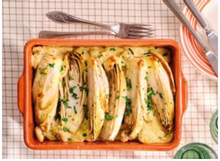

**Ingrediënten voor:** ca. 4 personen
**Bereidingstijd:** ca. 40 min.
**400 g** kipfilet, in blokjes
**2-3 el** olijfolie + extra om in te
vetten
**100 g** Boursin knoflook en fijne
kruiden
**1** ei
**3** stronken witlof
zout en peper
ovenschaal van 26 cm
(eventueel) appelboor
1 Verwarm de oven voor tot 180 °C (hetelucht) of
200 °C (elektrisch). Vet de ovenschaal in met wat
olijfolie.
2 Bestrooi de kipfilet met zout en peper. Verhit de
olijfolie in een koekenpan op middelhoog vuur en
bak de kipblokjes rondom goudbruin en gaar.
3 Klop in een kom de Boursin en het ei met een
vork tot een luchtig mengsel. Verwijder het bittere hart uit de witlofstronken met een appelboor.
Snijd de stronken eventueel in de lengte doormidden.
4 Verdeel de witlof over de bodem van de ovenschaal, verdeel daarover de kip en schenk vervolgens het Boursin-mengsel erover. Bak het gerecht
ca. 20 minuten in het midden van de oven, tot de
bovenkant goudbruin is.

## Zalmstrudel met

## pistachenoten

## Van Oma Bep Boon

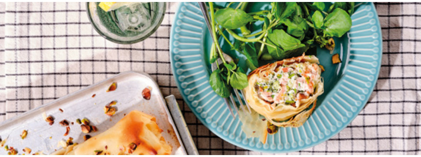

**Ingrediënten voor:** ca. 4 personen
**Bereidingstijd:** ca. 1 uur
**300 g** broccoli, in roosjes
**200 g** gerookte zalm, in reepjes
**125 g** gezouten pistachenoten, grof
gehakt
**125 g** roomkaas
**40 g** bieslook, fijngesneden +
extra om te garneren
**55 g** boter
**5** vellen filodeeg, ontdooid
**100 g** waterkers
**12** cherrytomaten, gehalveerd
peper
huishoudfolie
bakpapier
1 Breng een pan met ruim gezouten water aan de
kook. Kook de broccoli in circa 4 minuten beetgaar en spoel af in een zeef onder koud stromend
water. Laat goed uitlekken.
2 Meng de zalm, broccoli, pistachenoten, roomkaas, bieslook en wat peper in een kom. Meng
goed door elkaar.
3 Verwarm de oven voor tot 225 °C (hetelucht) of
245 °C (elektrisch) en bekleed de bakplaat met
bakpapier. Smelt de boter in een steelpan. Spreid
het filodeeg uit op huishoudfolie en bestrijk elk
vel met wat gesmolten boter. Stapel alle vellen
op elkaar. Verdeel het zalmmengsel als een worst
over het deeg.
4 Rol het deeg voorzichtig op en plak de naden
vast met water. Leg de strudel met de naad naar
beneden op de bakplaat. Bestrijk de bovenkant
met de rest van de boter. Bak de strudel 15-20 minuten in het midden van de oven, of tot het deeg
goudbruin en knapperig is.
5 Verdeel de waterkers en cherrytomaten over
de borden. Snijd de strudel in 4 stukken en verdeel over de borden. Garneer met de rest van de
bieslook.
Kookboek

## Franse kip uit de oven

## Van Oma Donna

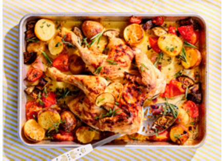

**Ingrediënten voor:** 6 personen
**Bereidingstijd:** ca. 1 uur en 35 min.
**1** hele kip
**4** aardappelen, ongeschild, in
grove stukken
**3** tomaten, in kwarten
**1** rode ui, in grove stukken
**1** aubergine, in grove stukken
**1 tl** gedroogde salie
**1 tl** gedroogde rozemarijn
**1 tl** gedroogde tijm
**1 tl** gedroogd basilicum
**1 tl** grof zeezout
**2 takjes** tijm
**2 el** olijfolie
**1** citroen, gehalveerd
**2 el** honing
zout en peper
braadslee van 28 cm
wildschaar
1 Verwarm de oven voor tot 180 °C (hetelucht) of 200 °C (elektrisch). Breng
een pan met ruim gezouten water aan de kook en kook de aardappelen 5
minuten. Giet af en verdeel over de braadslee.
2 Voeg de tomaten, rode ui en aubergine toe aan de aardappelen. Meng de
salie, rozemarijn, tijm, het basilicum en zeezout in een kommetje. Strooi dit
kruidenmengsel over de groenten.
3 Leg de kip met de ruggengraat naar boven op een snijplank. Knip de kip
met een wildschaar langs de ruggengraat open en vouw open. Druk stevig
aan zodat de kip plat ligt.
4 Leg de kip met de borst naar boven op de groenten. Leg de takjes tijm
tussen de kip en groenten. Bestrijk de kip met olijfolie. Knijp de citroen
boven de kip uit en snijd de uitgeknepen helften in stukken. Leg tussen de
kip en groenten. Bestrooi de kip royaal met zout en peper en besprenkel met
de honing.
5 Zet de braadslee in de oven en rooster de kip 45-55 minuten, tot de kip gaar
is en de groenten goudbruin zijn.

# +

# Gratis

## gourmetgids

## cadeau!

# Inspiratie voor de

# hele decembermaand!

## Van Sinterklaasavond en kerst tot oud & nieuw

Bestel nu voor 12,99 via:

## www.kokengenieten.nl/feestdagen

Deze actie is geldig t/m 9 november 2025
Scan de
Scan de
qr-code
qr-code

# Herfstige

# toetjes

Ook bij het toetje kunnen we wel wat
herfstige smaken gebruiken. Geniet
van deze desserts met peperkoek,
kaneel en kastanje.

## Peperkoek-sinaasappeltrifle

**Ingrediënten voor:** 4 personen
**Bereidingstijd:** ca. 40 min.
**200 g** peperkoek met
chocolade
**200 g** mascarpone
**300 g** kwark
**2-3 el** suiker
**8 g** vanillesuiker
**3** sinaasappels
**3 el** sinaasappellikeur
**1 el** maizena
1 Verkruimel de peperkoek grof. VOOR DE CRÈME Klop de mascarpone, de
kwark, de suiker en de vanillesuiker met een handmixer romig.
2 Schil de sinaasappels en snijd de partjes vruchtvlees tussen de vliezen uit;
zorg ervoor dat al het wit verwijderd is. Knijp het sap uit de overgebleven
vliezen en verwarm dit met de sinaasappellikeur. Roer de maizena glad met
**2 el** water. Roer het maizenapapje door het sap, breng aan de kook en laat
kort zachtjes koken. Voeg de sinaasappelpartjes toe en roer erdoor. Laat het
geheel afkoelen.
3 Schep de helft van de peperkoekkruimels, de crème en de sinaasappels
om en om in een dessertschaal. Herhaal de laagjes en eindig met een paar
sinaasappelpartjes en wat peperkoekkruimels.
**Per portie:** ca. 560 kcal
**20 g** eiwit | 29 g vet | 46 g koolhydraten

## Pannacotta met kaneelpruimen

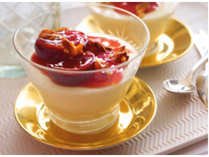

**Ingrediënten voor:** 4 personen
**Bereidingstijd:** ca. 40 min. + ca. 3 uur wachttijd
**1** vanillestokje
**500 ml** slagroom
**105 g** suiker
**2-3 el** amandellikeur
**3** gelatineblaadjes
olie, om in te vetten
**1-2 el** amandelschaafsel
**720 g** pruimen (pot)
**½** kaneelstokje
**1 el** maizena
aluminiumfolie
1 Splijt het vanillestokje in de lengte en schraap het merg eruit. Breng het
merg samen met het stokje, de slagroom en 75 g suiker aan de kook. Laat afkoelen en neem het vanillestokje eruit. Schenk de amandellikeur bij de room.
Week de gelatine in koud water. Verwarm 5 el van de vanilleroom. Knijp de
gelatine uit en los hem op in de warme room. Roer het gelatinemengsel door
de overige vanilleroom.
2 Schenk de vanilleroom in 4 dessertglazen (à ca. 175 ml) en laat afkoelen.
Dek de glazen af en zet minimaal 2 uur in de koelkast om op te stijven.
3 Bestrijk een vel aluminiumfolie dun met olie. Smelt 30 g suiker in een
pan. Roer het amandelschaafsel erdoorheen. Strijk de massa uit over de
aluminiumfolie en laat afkoelen.
4 Laat de pruimen uitlekken en vang het sap op. Breng het sap met het kaneelstokje aan de kook. Roer de maizena glad met 2 el water, roer door het
sap en laat ca. 1 minuut zachtjes koken. Neem de pan van het vuur en voeg de
pruimen toe. Laat afkoelen. Neem het kaneelstokje eruit. Serveer de panna
cotta met de compote. Breek de amandelkrokant in stukjes en strooi erover.
**Per portie:** ca. 620 kcal
**6 g** eiwit | 42 g vet | 51 g koolhydraten

## Pannenkoekenovenschotel

**Ingrediënten voor:** 6 personen
**Bereidingstijd:** ca. 1 uur en 30 min.
**8** eieren
**625 ml** melk
**150 g** bloem
**6 el** suiker
**1 snufje** zout
**1-2 tl** olie
**60 g** boter (+ invetten)
**500 g** kwark
**1** bio-citroen (alleen de
schil, geraspt)
**8 g** vanillesuiker
poedersuiker, om te
bestuiven
1 VOOR HET BESLAG Kluts 3 eieren met 375 ml melk, de bloem, 1 el suiker en het
zout tot een glad beslag. Laat ca. 10 minuten rusten.
2 Verhit de olie in delen in een koekenpan met antiaanbaklaag (ca. 24 cm Ø). Bak
van het beslag 9 dunne pannenkoeken.
3 VOOR DE VULLING Splits 2 eieren. Klop de eiwitten met 3 el suiker stijf. Smelt de
boter. Laat iets afkoelen. Meng de boter met de kwark, de eidooiers, de citroenschil
en de vanillesuiker. Spatel de stijfgeklopte eiwitten voorzichtig erdoorheen.
4 Verwarm de oven voor (elektrisch: 180°C / hetelucht: 160°C). Bestrijk elke pannenkoek gelijkmatig met wat van de kwarkcrème. Rol de pannenkoeken op en halveer
de rolletjes. Leg de pannenkoekrolletjes dakpansgewijs in een ingevette ovenschaal
(ca. 30 x 20 cm). Bak de pannenkoeken ca. 10 minuten.
5 VOOR DE SAUS Kluts 3 eieren met 250 ml melk en 2 el suiker. Schenk de saus over
de pannenkoeken. Bak in nog 30-35 minuten op dezelfde temperatuur gaar. Bestuif
voor het serveren met poedersuiker.
**Per portie:** ca. 450 kcal
**27 g** eiwit | 21 g vet | 39 g koolhydraten
Het zoete leven

## Chocolade-kastanjetoetje

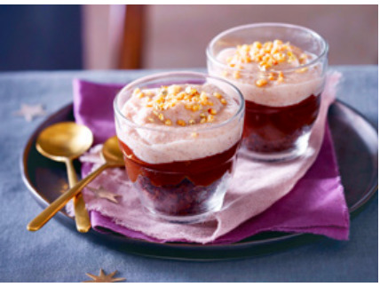

**Ingrediënten voor:** 4 personen
**Bereidingstijd:** ca. 50 min. + ca. 1 uur wachttijd
**100 g** pure chocolade
**200 ml** slagroom
**75 g** kastanjecrème (pot, bijv. van Bonne Maman, of
vervang door amandelpasta)
**100 g** kant-en-klare brownies
**2 el** nougatine
evt. bladgoud, om te decoreren
1 VOOR DE CHOCOLADECRÈME Breek de chocolade in stukken. Breng
100 ml slagroom in een pannetje aan de kook en neem van het vuur.
Laat de chocolade in de slagroom smelten en roer tot een gladde
massa. Laat de chocoladeroom afkoelen.
2 VOOR DE KASTANJEROOM Roer de kastanjecrème glad. Klop
**100 ml** slagroom stijf. Spatel de kastanjecrème beetje bij beetje
voorzichtig erdoorheen.
3 VOOR DE BODEMS Verkruimel de brownies fijn. Verdeel de
browniekruimels gelijkmatig over 4 dessertglazen. Verdeel hier de
chocoladecrème over. Strijk tot slot de kastanjeroom erover uit. Zet
de glazen ca. 1 uur in de koelkast om op te stijven.
4 Bestrooi de desserts voor het serveren met de nougatine en eventueel wat bladgoud.
**Per portie:** ca. 460 kcal
**6 g** eiwit | 32 g vet | 38 g koolhydraten

# Goudkoorts

# in de keuken

Taarten, koekjes en repen: alles wordt lekkerder
met een glanzend laagje gouden karamel. Met deze
hemelse baksels ben jij wel even zoet!

## Amsterdamse koggetjes

**Ingrediënten voor:** ca. 18 stuks
**Bereidingstijd:** ca. 1 uur en 15 min. +
ca. 1 uur wachttijd
**225 g** suiker
**125 g** zachte boter
**100 g** lichte basterdsuiker
**150 g** ahornsiroop
**8 g** vanillesuiker
**1 snufje** zout
**1** ei
**300 g** bloem
**½ tl** baksoda
**1 tl** bakpoeder
bakpapier
1 VOOR DE KARAMELKROKANT Bekleed een
bakplaat met bakpapier. Karamelliseer de suiker
in een pan op middelhoog vuur tot hij goudgeel
is. Schenk de karamel direct op het bakpapier en
strijk glad met bijvoorbeeld een paletmes. Laat
hard worden.
2 VOOR HET DEEG Klop de zachte boter, de lichte
basterdsuiker, de ahornsiroop, de vanillesuiker
en het zout met een handmixer romig. Voeg het
ei toe en klop het erdoor. Meng de bloem, de
baksoda en het bakpoeder met elkaar, voeg toe
aan het beslag en roer glad. Breek de karamel
in stukken. Spatel voorzichtig ca. 150 g van de
karamel door het deeg. Zet het deeg minimaal 30
minuten in de koelkast.
3 Verwarm de oven voor (elektrisch: 180°C /
hetelucht: 160°C). Vorm met twee eetlepels ca.
18 bolletjes ter grootte van een walnoot van het
deeg. Rol de bolletjes door de overige karamel.
Leg 9 deegbolletjes met voldoende tussenruimte
op een met bakpapier beklede bakplaat. Bak de
koekjes per bakplaat in 10-12 minuten gaar in de
voorverwarmde oven. Laat de koekjes ca. 5 minuten afkoelen op de bakplaat. Leg ze daarna op een
rooster om volledig af te koelen.
**Per stuk:** ca. 211 kcal
**3 g** eiwit | 7 g vet | 37 g koolhydraten
Gebak
De perfecte taart
om dit weekend te maken!

## Choco-karamellaagjestaart

**Ingrediënten voor:** 16 stukken
**Bereidingstijd:** ca. 1 uur en 45 min.
**4** eieren
**1 snufje** zout
**200 g** suiker
**8 g** vanillesuiker
**125 g** bloem
**20 g** maizena
**1½ tl** bakpoeder
**20 g** cacaopoeder
**185 g** kook- of kloppuddingpoeder karamel
**750 ml** melk
**600 g** boter
**100 g** Daimchocolaatjes of
andere chocoladekaramelsnoepjes
**170 g** rodebessen- of cranberrygelei
bakpapier
vershoudfolie
spuitzak met groot
stervormig spuitmondje
diepvrieszakje
1 Verwarm de oven voor (elektrisch: 180°C / hetelucht: 160°C). Splits de
eieren. Klop de eiwitten met 4 el lauwwarm water stijf. Voeg al kloppend het
zout, 125 g suiker en de vanillesuiker toe. Roer de eidooiers één voor één erdoorheen. Meng de bloem, de maizena, het bakpoeder en de cacao. Zeef het
mengsel boven de eiwitmassa en spatel voorzichtig erdoorheen. Bekleed de
bodem van een springvorm (26 cm Ø) met bakpapier. Schenk het beslag erin
en strijk glad. Bak in 30-35 minuten gaar in de voorverwarmde oven. Neem
uit de oven en laat afkoelen.
2 VOOR KOOKPUDDINGPOEDER Roer het puddingpoeder, 75 g suiker en 100
ml melk glad. Breng 650 ml melk aan de kook. Neem de pan van het vuur.
Roer het aangemengde puddingpoeder erdoor en laat al roerend ca. 1 minuut
zachtjes koken. Schenk de pudding in een kom. Dek direct af met de vershoudfolie en laat afkoelen. VOOR KLOPPUDDINGPOEDER Roer het puddingpoeder, 75 g suiker en de melk glad. Klop het geheel in ca. 1 minuut flink op
met een handmixer. Dek direct af met vershoudfolie en houd apart.
3 Klop de boter met een handmixer wit en romig. Klop de pudding los en
voeg hem lepel voor lepel al kloppend toe aan de boter. Halveer de botercrème. Houd 8 Daimchocolaatjes apart en hak de rest fijn. Spatel de fijngehakte Daim door een helft van de botercrème.
4 Snijd de cake twee keer horizontaal door, zodat je drie cakelagen hebt.
Bestrijk de onderste cakelaag met 75 g rodebessengelei. Verdeel de helft
van de Daimbotercrème erover. Leg de tweede cakelaag erop. Bestrijk ook
deze met 75 g gelei en de rest van de Daimbotercrème. Dek af met de laatste
cakelaag. Bestrijk de taart met ⅔ van de overige Daimbotercrème. Doe de
andere helft van de botercrème in een spuitzak met een groot stervormig
spuitmondje. Spuit een sierrand langs de taartrand. Verwarm 20 g gelei een
beetje. Doe in een diepvrieszakje en knip er een heel klein puntje af. Halveer
de overgebleven Daims diagonaal. Versier de sierrand met de Daims en de
gelei.
**Per stuk:** ca. 491 kcal
**5 g** eiwit | 37 g vet | 36 g koolhydraten
Gebak

## Appel-kwarktaart met karamelsaus

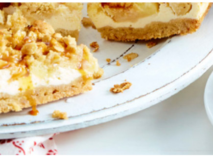

**Ingrediënten voor:** 20 stukken
**Bereidingstijd:** ca. 1 uur en 45 min.
**400 ml** slagroom
**430 g** suiker
**420 g** bloem
**225 g** havervlokken
**225 g** lichte basterdsuiker
**1 snufje** zout
**360 g** zachte boter (+ invetten)
**½** bio-citroen
**1 kg** appels (bijv. elstar)
**1 el** kaneel
**1 kg** volle kwark
**4** eieren
**8 g** vanillesuiker
**1 el** maizena
1 VOOR DE KARAMELSAUS Verwarm de slagroom. Karamelliseer 300 g
suiker in een grote pan tot hij goudbruin is. Blus af met de warme slagroom,
breng aan de kook en laat ca. 30 minuten zachtjes koken. Roer regelmatig
tot de karamel is opgelost. Schenk de saus in schone, met heet water omgespoelde flessen, sluit af en laat afkoelen.
2 VOOR HET DEEG Verwarm de oven voor (elektrisch: 200°C / hetelucht:
180°C). Meng de bloem, de havermout, de lichte basterdsuiker en het zout.
Voeg de boter toe en kneed met de deeghaken van een handmixer. Druk
⅔ van het deeg uit op de bodem van een ingevette, diepe bakplaat. Bak de
bodem ca. 15 minuten voor.
3 VOOR DE VULLING Was de citroen, rasp de schil er fijn af en pers de citroen
uit. Schil de appels, snijd ze in vieren en verwijder het klokhuis. Snijd de
appels in blokjes en besprenkel met het citroensap. Meng de kaneel en 30
g suiker en meng met de appels. Roer de kwark, de eieren, 100 g suiker, de
vanillesuiker en de citroenrasp door elkaar. Roer de maizena erdoorheen.
4 Strijk het kwarkmengsel uit over de voorgebakken bodem. Verdeel de
kaneelappels erover. Verkruimel de rest van het deeg erover. Bak de taart in
ca. 35 minuten gaar in de oven. Laat de taart afkoelen op de bakplaat. Snijd
de taart in stukken. Besprenkel met wat karamelsaus en serveer. Bewaar de
rest van de saus in de koelkast.
**Per stuk:** ca. 430 kcal
**13 g** eiwit | 19 g vet | 52 g koolhydraten

## Snelle karamelkrokant

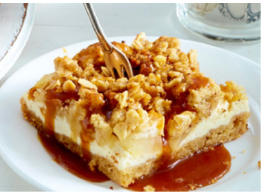

**Ingrediënten voor:** ca. 200 g
**Bereidingstijd:** ca. 10 minuten
Houdbaarheid: ca. 1 maand
Bekleed een bakplaat met het bakpapier. Karamelliseer 200 g suiker
in een pan tot hij goudbruin is. Schenk direct op het bakpapier. Strijk
eventueel glad met een paletmes. Laat hard worden. Breek in stukken
en bewaar luchtdicht. Gebruik als decoratie of (fijngehakt) als strooisel
voor taarten of klein gebak.
Appel-kwarktaart
met karamelsaus

## Chocolade-karamelrepen

**Ingrediënten voor:** ca. 28 stuks
**Bereidingstijd:** ca. 1 uur en 30 min. +
ca. 3 uur wachttijd
**1** vanillestokje
**180 g** bloem (+ bestuiven)
**210 g** lichte basterdsuiker
**320 g** boter (+ invetten)
**25 g** honing
**400 g** gecondenseerde melk (blikje)
**200 g** melkchocolade
1 Splijt het vanillestokje in de lengte en schraap
het merg eruit. Meng de bloem, 60 g lichte
basterdsuiker en het vanillemerg in een kom.
Voeg 120 g boter in stukjes toe. Kneed eerst met
de deeghaken van een handmixer en daarna met
de hand snel tot een glad deeg.
2 Verwarm de oven voor (elektrisch: 180°C / hetelucht: 160°C). Doe het deeg in een ingevette en
met bloem bestoven vierkante bakvorm (ca. 20
x 20 cm) en druk met de hand aan tot een gladde
bodem. Bak de bodem in ca. 25 minuten goudbruin en gaar in de voorverwarmde oven. Neem
uit de oven en laat afkoelen.
3 Smelt 150 g lichte basterdsuiker, 200 g boter en
de honing in een pan. Zet het vuur lager, schenk
de gecondenseerde melk erbij en laat al roerend
ca. 10 minuten zachtjes koken. Schenk de karamel over de bodem en strijk gelijkmatig uit. Laat
de karamellaag ca. 1 uur afkoelen.
4 Breek de chocolade in stukjes en smelt hem au
bain-marie. Laat de gesmolten chocolade ca. 10
minuten afkoelen, schenk hem dan gelijkmatig
over de karamel en strijk voorzichtig glad. Laat
de chocolade ca. 1 uur en 30 minuten afkoelen.
Neem de koek uit de vorm en snijd in repen (ca.
1½ x 10 cm). Serveer op een schaal.
**Per stuk:** ca. 224 kcal
**3 g** eiwit | 14 g vet | 25 g koolhydraten
Gebak

## Banoffeetaart

## met meringuetoefjes

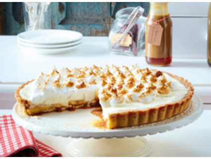

**Ingrediënten voor:** 12 stukken
**Bereidingstijd:** ca. 1 uur + ca. 3 uur wachttijd
**2** eieren
**200 g** bloem (+ bestuiven)
**225 g** suiker
**1 snufje** zout
**120 g** koude boter (+ invetten)
**3 el** karamelpasta (bijv. De Ruijter
Bebogeen)
**2** rijpe bananen
**400 g** crème fraîche
vershoudfolie
bakpapier
blindbakbonen of gedroogde
bonen
spuitzak met rond
spuitmondje
crème-brûléebrander
1 Splits de eieren en zet het eiwit in de koelkast. Kneed de bloem, de eidooiers, 50 g suiker, het zout en
de boter in stukjes snel tot een glad deeg. Wikkel het deeg in de vershoudfolie en laat ca. 30 minuten
rusten in de koelkast.
2 Verwarm de oven voor (elektrisch: 200°C / hetelucht: 180°C). Rol het deeg op een met bloem bestoven
werkblad uit tot een ronde lap (ca. 28 cm Ø). Leg het deeg in een ingevette springvorm (24 cm Ø). Druk
het deeg zachtjes tegen de rand omhoog. Prik met een vork meerdere gaatjes in de deegbodem. Leg een
vel bakpapier op de deegbodem en verdeel de blindbakbonen erover. Bak de bodem ca. 15 minuten in
de voorverwarmde oven. Neem de vorm uit de oven. Verwijder de bakbonen en het bakpapier. Bak de
bodem in nog ca. 5 minuten gaar. Neem uit de oven en laat afkoelen op een rooster.
3 Bestrijk de taartbodem met de karamelpasta. Pel de bananen, snijd ze in plakjes en verdeel ze over de
taart. Klop de crème fraîche met 75 g suiker op, verdeel dit over de bananen en strijk glad. Zet de taart
ca. 2 uur in de koelkast.
4 Klop vlak voor het serveren het eiwit zeer stijf. Voeg al kloppend de resterende 100 g suiker toe en
klop nog 1-2 minuten door. Doe de meringue in een spuitzak met een ronde spuitmond. Versier de taart
met kleine toefjes meringue. Brand de meringuetoefjes kort met een crème-brûléebrander.
**Per stuk:** ca. 344 kcal
**5 g** eiwit | 20 g vet | 38 g koolhydraten

## Klantenservice

Wil je abonnee worden of heb je vragen over je
abonnement? Op onze website vind je antwoord op
de meeste vragen.
www.kokengenieten.nl/contact
Wist je dat je tegenwoordig eenvoudig zelf je adres
kan wijzigen? Ga naar www.kokengenieten.nl/
adreswijzigen om je nieuwe adres door te geven.
Het nieuwe adres wordt vervolgens automatisch in
ons systeem gewijzigd.
Telefoon
We zijn er maandag
tot en met vrijdag
van 09.00 tot
**17.00** uur om je vragen
te beantwoorden.
+31 (0)24-2027 829
E-mail
Stel je vraag per e-mail
aan een van onze
service medewerkers.

## klantenservice@

kokengenieten.nl
ABONNEMENTSINFORMATIE koken & genieten kost €4.50 per nummer. De abonnementsprijs in Nederland € 49,- en
in België € 52,- (12 nummers) Deze prijs geldt bij betaling per automatische incasso. Voor betaling via een (digitale)
factuur geldt een toeslag van € 2,50. Je kunt eenvoudig een machtiging afgeven via www.fnl.nl/machtigen.
Abonnementen worden automatisch verlengd, tenzij anders vermeld. Het opzeggen van een abonnement kan eenvoudig
telefonisch via +31 (0)24-2027829 of per mail via klantenservice@kokengenieten.nl.
koken & genieten is een
uitgave van F&L Media B.V.
in licentie van Bauer Media
Hoofdredacteur Yvonne Doorten
Redactie Bas Erkens, Anne Mebelder,
Lotus van Overveldt, Willem van Santen,
Marieke Slettenhaar en Julie van den Berg
In samenwerking met Uit Paulines Keuken,
en Stichting Oma’s Soep
Art Direction Nick Groenewold
Vormgeving Mylene Nales, Tom Gerrits,
Susan Gerbrands-Derksen, Ferry Dorresteijn ,
Carlijn Masselink en Skip Lelieveldt
Sales Marc Bokhove +31 (0)24 2404643
mbokhove@fnl.nl
Marketing Anouk Tolboom +31 24 240 45 95
atolboom@fnl.nl
Drukkerij Senefelder Misset Doetinchem B.V.
Vragen aan de redactie
Heb jij opmerkingen, suggesties of vragen aan
de redactie? lezersvragen@kokengenieten.nl
Nieuwsredactie / Pers
kooknieuws@fnl.nl of het onderstaande adres
o.v.v. redactie koken & genieten
Jonkerbosplein 52, 6534 AB Nijmegen
COPYRIGHT Het auteursrecht op deze uitgave en de gedrukte uitgave en op de daarin verschenen
artikelen wordt door de uitgever voorbehouden. De vertaalrechten berusten bij F&L Media B.V.
te Nijmegen/ Nederland. Het verlenen van toestemming tot publicatie in de gedrukte uitgave
houdt in dat de auteur de uitgever, met uitsluiting van ieder ander onherroepelijk machtigt de
bij of krachtens de auteurswet door derden verschuldigde vergoedingen voor kopiëren te innen
en dat de auteur alle rechten verdraagt aan de uitgever, tenzij anders bepaald. Niets uit deze
uitgave en de gedrukte uitgave mag worden overgenomen, vermenigvuldigd of gekopieerd zonder
uitdrukkelijke schriftelijke toestemming van de uitgever. De uitgever stelt zich niet aansprakelijk
voor eventuele onjuistheden, welke in deze uitgave of de gedrukte uitgave mochten voorkomen.
ISSN: 1875-8517

# Zwart & wit

Deze maanzaadtaart is afgewerkt met een heerlijk
romige botercrème. Serveer met een kopje koffie of
thee en je hebt heerlijk gebak voor het weekend!
Pronkstuk

## Botercrème-maanzaadtaart

**Ingrediënten voor:** ca. 16 stukken
**Bereidingstijd:** ca. 1 uur en 30 min. + ca. 4 uur wachttijd
**270 g** maanzaad, gemalen
**300 g** tarwegriesmeel
**370 g** suiker
**50 g** bloem (+ bestuiven)
**16 g** bakpoeder
**3** eieren
**180 ml** zonnebloemolie
6 druppels amandel- of citroenaroma
**35 g** custardpoeder
**500 ml** melk
**250 g** zachte boter (+ invetten)
**300 ml** slagroom
**8 g** vanillesuiker
**30 g** chocoladerolletjes
vershoudfolie
spuitzak met groot stervormig spuitmondje
1 VOOR DE BODEM Verwarm de oven voor (elektrisch: 180°C / hetelucht:
160°C). Meng het maanzaad, het griesmeel, 320 g van de suiker, de bloem en
het bakpoeder met elkaar. Doe de eieren, 100 ml water, de olie en het aroma
in een aparte kom. Voeg het maanzaadmengsel toe en roer tot een glad beslag. Schenk het beslag in een ingevette en met bloem bestoven springvorm
(26 cm Ø). Bak de taartbodem in ca. 45 minuten onder in de oven gaar. Neem
uit de oven en laat volledig afkoelen.
2 VOOR DE BOTERCRÈME Roer het custardpoeder met 100 ml van de melk
en de resterende 50 g suiker tot een glad papje. Breng de resterende 400 ml
melk aan de kook. Roer het custardmengsel erdoorheen en laat al roerend
ca. 1 minuut zachtjes koken. Schenk de custard in een kom en dek direct af
met vershoudfolie, zodat er geen vel op komt. Laat in ca. 2 uur afkoelen tot
kamertemperatuur.
3 Klop de zachte boter met een handmixer in ca. 5 minuten licht en romig.
Roer de afgekoelde custard kort door en klop hem vervolgens lepel voor
lepel door de boter. Neem de taartbodem uit de springvorm en snijd hem
horizontaal doormidden. Plaats de onderste helft op een schaal en zet er
een taartring omheen. Verdeel de helft van de botercrème over de bodem en
strijk glad. Leg de bovenste helft erop en bestrijk met de rest van de botercrème. Zet de taart ca. 2 uur in de koelkast.
4 VOOR DE GARNERING Klop de slagroom met de vanillesuiker stijf. Doe de
helft van de slagroom in een spuitzak met een groot stervormig spuitmondje. Verwijder de taartring. Bestrijk de taart rondom met de rest van de slagroom. Garneer met toefjes slagroom en de chocoladerolletjes. Zet de taart
tot het serveren in de koelkast.
**Per stuk:** ca. 579 kcal
**10 g** eiwit | 41 g vet | 46 g koolhydraten

## In het

# december

## Voor- en bijgerechten

## nummer

Wildstoof met spaghetti en romige savooiekool 13
Winterburger met aardappelpartjes 30
Bladerdeeg-fetapasteitjes 36
Witlof met kip en boursin 50
Zalmstrudel met pistachenoten 50
Bonensoep met procureur 36
Broccoli-kikkererwtensalade 44
Citroen-limoenolie 38
Eendenbouillon met knödels 22

## Zoet en desserts

Amsterdamse koggetjes 57
Groene soep met knoflookcroutons 43
Appelkruimelplaatcake 9
Appel-kwarktaart met karamelsaus 59
Banoffeetaart met meringuetoefjes 62
Kleurrijke saladekrans 35
Pittige tomatensoep met krokante topping 32
Rodewijn-rozemarijnzout 38
Snelle salade met worst 31
Botercrème-maanzaadtaart 65

## Hoofdgerechten

Chocoappels 41
Choco-karamellaagjestaart 59
Chocoladeglühwein 41
Ajam pangang 7

## Complete kerstmenu’s

Aziatische omelet met aspergebroccoli 43
Heel veel voor-, hoofd-,
Eendenspiesen met rodekoolsla 24
Chocolade-karamelrepen 61
Chocolade-kastanjetoetje 55
bij- en nagerechten
Panna cotta met kaneelpruimen 54
Pannenkoekenovenschotel 55
Peperkoek-sinaasappeltrifle 54
Snelle karamelkrokant 59
Franse kip uit de oven 52
Witte vanille-sinaasappelglühwein 41
Zoete sneeuwballetjes met koffiemousse 38
om eindeloos mee te
Gebakken vis met snelle aardappelsalade 32
combineren
Gehaktballetjes in tomaten-paprikasaus 29
Gestoofde runderwangen 14
Gyrossteaks op warme witte kool 31
Indiase kikkererwtensoep 10
Kruidige zoete-aardappelcurry 30
Lasagne puttanesca 10
Marokkaanse couscous 9
Mini-ovenschotels
met broccoli en hazelnoten 44
Parelgort-groentemaaltijdsoep met broodharten 17
Pekingeend met pannenkoekjes 21
Ribeye met koolraapfriet 18
= Zonder vlees en vis
Romige pasta met savooiekool 29

## Betoverend buffet

Uienquiche met cranberryjam 14a
Maak deze kerst een tafel
= Snel klaar (max. 30 min.)
Vis Wellington 49
vol magisch lekker eten
Het volgende nummer valt rond 4 november 2025 bij abonnees
op de mat en ligt rond 11 november 2025 in de winkels.
De verschijningsdata in België wijken af van de verschijningsdata in Nederland.
Mis geen nummer meer!
Neem nu een abonnement en krijg voortaan elke uitgave van koken &
genieten automatisch in je brievenbus. Ga naar www.kokengenieten.nl/abo
of bel gratis naar +31 (0)24-2027829.

## De kerst op de taart

Bak prachtige taarten,
cakes en gebakjes voor de
feestdagen

# Het grote

# kerstnummer

## www.foodiesmagazine.nl/kerst2025

De complete gids voor een heerlijke kersttafel

## GRATIS

wijn-spijs
Bestel nu met tijdelijk gratis verzending via

## www.foodiesmagazine.nl/kerst2025

Deze actie is geldig t/m 26 oktober 2025

# +

## MASTER

## CLASS

## GRATIS

wijn-spijs

## MASTER

## CLASS

## GRATIS

wijn-spijs
