Populaire kerstgerechten van Uit Paulines Keuken
voor
N
u
Tafels vol

# KERST

# GELUK

Verrassende menu’s

# Voor-, hoofd- en

# nagerechten

Populaire kerstgerechten van Uit Paulines Keuken
Onmisbaar op tafel

# 4x heerlijke

# aardappelgratins

# GELUK

# 4x heerlijke

December 2025 jaargang 20
koken genieten

## EXTRA DIK

## KERSTNUMMER

# 70

## feestelijke

# Iedereen

## inspiratie

# maakt iets

Ga voor een
buffet deze kerst
Populaire kerstgerechten van Uit Paulines Keuken
Populaire kerstgerechten van Uit Paulines Keuken
Flirten
m zo
Taarten die
betoveren

# KERST

BP

# €5,50

# 5,50

# De snelle weg door het blad

Voorgerechten
& bijgerechten
Salades, soepen en
broodjes: lekker als lichte
maaltijd of om je etentje
mee te beginnen.
Romige
pompoenzuurkool 16
Gouden bloemkoolsoep
met granaatappel 46
Varkenshaas
met spek en whiskysaus 15
Kokostequilacocktail
Italiaanse gegratineerde aardappel met gorgonzola 50
Mediterraanse gegratineerde
aardappel 50
Scandinavische gegratineerde
aardappel met zalm 51
appel met lenteui en ham 51
Boereneend met knödels 17
Kabeljauw met mascarpone
Filodeeggroentetaart
met kastanje 20
puree en chorizotomaatjes 19
Klassiek zuurgebraad
met rodewijnsaus 27
Paté Hawaï
op boerenbrood 36
Kersenkokosdessert 24
Kaneeltaart
met sinaasappel 35
Zalmtaart
met verse kruiden 42
Cranberryschmarrn
met sinaasappel 59
Koekkerstboompjes 61 Kerstcake
Kip uit de oven met saliegnocchi en bietensalade 47
Kabeljauwfilet
met amandelkorst 69
Speculaasmarmertulband 39
met Cointreau 42
Carpacciobonbon 7 Ahornspruitjes 16 Aardappelkroketjes 16
Franse gegratineerde aard
Chocoladespritsen
met wittechocoladevulling 61
Florentinekoekjes 62
Ravioli met
paddenstoelenvulling 70
Chaiparfait
met rumvruchten 48
met wittechocoladeroom 64
Zonder
Snel klaar
(max. 30 min.)
vlees of vis
Kaascranberryflapjes 18
Crème brûlée
van geitenkaas 69
Uitleg van symbolen bij de recepten
Sinaasappel
Sandwiches
met appelkerriesalade 73
Walnotensoep
met truffelolie 21
Laagjessalade
met garnalen 22
Sinaasappelrodekool 21
Hoofdgerechten
Ga je voor snel &
makkelijk, een dagje
zonder vlees of vis
of pak je uit met een
weekendproject?
Truffelrisotto
met paddenstoelen 8
Gnocchiovenschotel
caprese 33
Snelle broccolikaaspasta 33
Zoet en desserts
Zoet is altijd goed!
Lekker als tussendoortje,
bij de koffie of als
afsluiting van je diner.
Chocoladepudding
met room 11
Citroentulband
met basilicum 53
Croissantpudding
met frambozen 55
Krokante roodbaars
met romige zuurkool 35
Linzensalade met savooiekool
Appelmarsepeintaart 80
en granaatappel 34
Tulbandcake
met stroopwafel 11
Pistachepavlovaatjes 55
Tiramisu met marsepein
en sinaasappel 23
Zwartebessenscones
met jam en clotted cream 73
Speculaasbrokken 56
Feestelijke kaneelstertaart 75
chocoladespekkoek 76
Luxe redvelvettaart 79
Alle recepten op een rij
Rundercarpaccio
met parmezaancrème 22
Gevulde kip met gehakt 9
Malse filetlapjes met
spinazie en roomsaus 36
Tobleronemousse 23
Amandelmeringuetaart
met rumkersen 58

## Voorwoord

# Bijgerechten

Het is grappig dat we met kerst vooral heel
veel aandacht aan het hoofdgerecht besteden.
Dat is hét pronkstuk. Bijvoorbeeld de kalkoen
of de rosbief. Misschien een mooie moot zalm.
Maar onderschat ook zeker de bijgerechten niet. Zonder een goed bijgerecht valt je
hoofdgerecht in het niet. Daarom delen wij
in de editie (naast alle inspiratie voor voor-,
hoofd- en nagerechten) verschillende lekkere
bijgerechten die dit jaar echt de show stelen
op je kersttafel. Denk aan een écht goede
aardappelgratin. Wij maakten vier smaakvariaties, maar die met gorgonzola is wel echt
mijn favoriet (p. 50). Het klassieke aardappelkroketje mag natuurlijk ook niet ontbreken,
maar die maak je dit jaar wel helemaal zelf
(p. 16). De grootste verrassing dit jaar vind ik
de romige pompoenzuurkool (p. 16). Dat past
bij elk stuk vlees of vis eigenlijk wel, al is het
met de varkenshaas (p. 15) een match made in
heaven.
Yvo e D rten
**6** Uit Paulines keuken
Dit jaar vind je elke maand heerlijke
recepten van Uit Paulines Keuken in
Koken & genieten. Deze maand: de
heerlijkste kerstgerechten.
**14** Complete kerstmenu’s
Maak je kerstdiner onvergetelijk met een
heerlijk menu. Met al deze voor-, hoofd-,
bij- en nagerechten kun je eindeloos
combineren.
**26** Kerstklapstuk
Dit klassieke zuurgebraad wordt zonder
twijfel hét spektakel van jouw kerstmenu.
Serveer hem met gebakken aardappels en
rodekool en je hebt een feestmaal waar je
u tegen zegt.
**28** Snelle sausjes
Wil je je kerstmenu naar een hoger niveau
tillen? Maak dan een van deze supersnelle
sauzen! Weinig moeite, groot effect.
**32** Simpel en snel genieten
Het is al druk genoeg met werk, kinderen
en hobby’s. Hier is de oplossing voor
iedereen die geen tijd heeft om uitgebreid
te koken, maar toch lekker wil eten.
**38** Sinterklaascake
Door de speculaaskruiden doet deze
tulband meteen denken aan sinterklaas.
Serveer hem met pakjesavond, dat is pas
een cadeautje!
**40** Betoverend buffet
Kerst heeft altijd iets magisch – de knusse
lampjes, de versierde kerstboom en de
gezelligheid van samen aan tafel. Maak
met dit buffet een betoverend kerstdiner.
**50** Goed gegratineerd
Door aardappels te gratineren krijgen
ze een heerlijk goudbruin korstje. De
klassieker met geraspte kaas kennen we
inmiddels wel, maar wat dacht je van deze
vier variaties?
Abo ement
Elke maand de
koken & genieten als eerste
in de brievenbus? Kijk op
www.kokengenieten.nl/abo
of blader naar
p. 30.
**52** Boek De Zoete Oven
Karin Luiten – de koningin van zonder
pakjes en zakjes koken – maakte een boek
vol zelfgemaakte zoetigheden uit de oven.
**58** Feestelijk duet
Zo rond de feestdagen gaat er elke dag
wel een stukje taart in… Ga jij voor de
amandeltaart met rumkersen of voor de
kaneeltaart met sinaasappel?
**60** Koekcadeautjes
Met deze recepten maak je lekker veel
winterse koekjes – heerlijk én leuk om als
eetbaar cadeautje te geven!
**64** Kerstige cake
Neem cranberry’s, sinaasappel en
chocolade en het voelt meteen als kerst. Al
die ingrediënten samen in één cake maken
dit het ultieme kerstdessert.
**68** Fijne kerst voor iedereen
Eet jij of een kerstgast glutenvrij,
veganistisch of lactosevrij? Maak dan een
van deze recepten! Lekker voor iedereen
en zo geniet je samen van hetzelfde diner.
**72** Kerst op z’n Engels
Met een grote pot thee en deze heerlijke
sandwiches en scones waan je je even
in het mooie Engeland. Lekker als lunch
tijdens de kerst! Fancy a cuppa?
**74** De kerst op de taart
Met deze oogverblindende baksels maak
jij deze kerst wel indruk! Met winterse
smaken als kaneel, amandel en speculaas
maak je er echt een feestje van.
**82** Index & volgend
Alle recepten van deze uitgave op een rij én
een vooruitblik op volgende maand.

# In het seizoen...

Inhoud

# cranberry’s

## Wat is het?

Cranberry’s zijn ovaalvormige, rode besjes. Ze zijn
vrij zuur van smaak, soms zelfs wat wrang, en worden
daarom meestal niet rauw gegeten. De naam komt van
kraanbere, wat kraanvogel betekent, omdat het steeltje van de bloem op de nek van een kraanvogel lijkt.
Cranberry’s komen oorspronkelijk uit Noord-Amerika,
maar in Nederland worden ze tegenwoordig ook verbouwd, onder andere op de Waddeneilanden. De oogst
van Nederlandse cranberry’s loopt meestal van september tot en met november. Meestal zijn ze nog tot en met
januari verkrijgbaar in de winkel.
Wat kun je ermee?
Cranberry’s worden ook wel de kerstbes genoemd en
staan dan ook regelmatig op het kerstmenu. De rode
vruchtjes doen het goed als friszure compote bij de rollade of bij kalkoen, maar ook in zoete gerechten kun je
cranberry’s verwerken. Wat dacht je van de combinatie
met witte chocolade, zoals in de taart van de cover
(p. 64)? Of roer ze eens door het beslag van pannenkoeken of kaiserschmarrn (p. 35)! Gedroogde cranberry’s
smaken lekker door de granola of in de yoghurt, of als
snack in een notenmix.
Hoe kan je het vervangen?
Kun je geen verse cranberry’s vinden? In de grotere
supermarkten vind je ze het hele jaar door in de diepvries. Eventueel kun je ze vervangen door rode bessen.
Gedroogde cranberry’s kun je eventueel vervangen door
rozijnen, maar deze zijn wel een stuk minder zuur.
Waar smaakt het naar?
De besjes zijn vrij zuur van smaak, en daarom worden ze
over het algemeen niet zo uit de hand gegeten.
Hoe moet ik het bewaren?
Verse cranberry’s kun je uitgespreid op een met keukenpapier bekleed bord in de koelkast 1 tot 3 dagen bewaren. Ingevroren in een goed afgesloten zak kun je ze
wel 8 tot 12 maanden bewaren. Daarna kan de kwaliteit
achteruit gaan.

# Keuken

# Uit Paulines

Dit jaar vind je elke maand heerlijke recepten van
Uit Paulines Keuken in Koken & genieten. Altijd
lekker en met verse seizoensproducten. Deze
maand: de lekkerste recepten voor de feestdagen.

## Carpacciobonbon

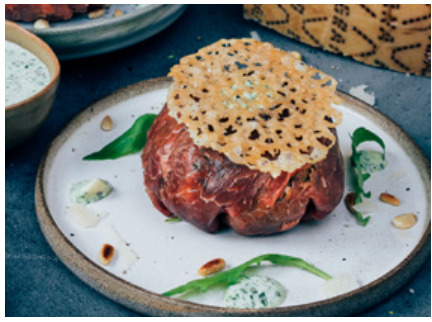

**Ingrediënten voor:** 4 personen
**Bereidingstijd:** ca. 15 min.
**140 g** Grana Padano of parmezaan
**40 g** pijnboompitten
**100 g** zongedroogde tomaten
**50 g** rucola (+ extra, om te serveren)
**300 g** carpaccio
bakpapier
vershoudfolie
**VOOR DE** CITROEN-BASILICUMMAYONAISE
**3 el** mayonaise
**½** citroen (alleen het sap)
**15 g** basilicum
zout en peper
1 Verwarm de oven voor (elektrisch: 200°C / hetelucht: 180°C) en
bekleed een bakplaat met bakpapier. Rasp 100 g van de Grana
Padano en verdeel in hoopjes van 1 el over de bakplaat met wat
ruimte ertussen. Bak ca. 8 minuten in de oven; de kaaskoekjes zijn
klaar als de randjes goudbruin kleuren. Laat de koekjes afkoelen op
de bakplaat.
2 VOOR DE CITROEN-BASILICUMMAYONAISE Pureer de mayonaise
met het citroensap en het basilicum in het hakmolentje van een
staafmixer. Breng op smaak met zout en peper. Houd apart.
3 Rooster de pijnboompitten kort in een droge koekenpan. Snijd
de zongedroogde tomaten in stukjes. Meng de rucola met de pijnboompitten en zongedroogde tomaat in een kom. Rasp ca. 30 g van
de Grana Padano grof erboven; houd de rest van de kaas apart voor
de garnering. Breng de salade op smaak met zout, peper en 1 el van
de basilicummayonaise.
4 Bekleed een schaaltje of cappuccinokopje met vershoudfolie.
Verdeel ¼ van de carpaccio over de folie, zodat je een ‘bakje’ van
carpaccio krijgt. Vul met de salade. Vouw de folie dicht en knoop
vast. Herhaal met de rest van de ingrediënten. Laat de carpacciobonbons ca. 30 minuten of een hele nacht opstijven in de koelkast.
5 Leg de carpacciobonbons op borden en verdeel de mayonaise erop
en -omheen. Garneer met wat extra rucola, geraspte Grana Padano
en de kaaskoekjes.
**Per portie:** ca.480 kcal
**32 g** eiwit | 29 g vet | 18 g koolhydraten
Receptuur: Uit Paulines Keuken Fotografie: Marianne Snel
Uit Paulines Keuken

## Truffelrisotto

## met paddenstoelen

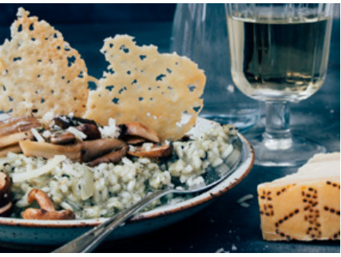

**Ingrediënten voor:** 4 personen
**Bereidingstijd:** ca. 30 min.
**150 g** Grana Padano
**1** ui
olijfolie, om in te bakken
**300 g** risottorijst
**150 ml** droge witte wijn
**1 l** bouillon (heet)
**2-3 el** truffelsalsa of -tapenade
**1** klontje boter
**2** teentjes knoflook
**300 g** gemengde paddenstoelen
**1 takje** tijm
bakpapier
1 Verwarm de oven voor (elektrisch: 200°C /
hetelucht: 180°C) en bekleed een bakplaat met
bakpapier. Rasp de Grana Padano en verdeel
**100 g** ervan in hoopjes over de bakplaat met wat
ruimte ertussen; maak grotere en kleinere hoopjes. Bak 8-10 minuten in de oven; de kaasschotsen
zijn klaar als de randjes goudbruin kleuren. Laat
afkoelen op de bakplaat en breek in stukken.
2 Pel en snipper de ui. Verhit olijfolie in een
hapjespan op laag vuur en fruit de ui erin. Zet het
vuur iets hoger en voeg de risottorijst toe. Bak al
roerend ca. 2 minuten, tot de korrels glazig zien.
Blus af met de witte wijn en verhit al roerend tot
al het vocht is opgenomen. Voeg beetje bij beetje
de hete bouillon toe. Schep steeds een soeplepel
bouillon bij de rijst, blijf roeren en wacht tot al
het vocht verdwenen is. Herhaal tot alle bouillon
door de rijst is opgenomen. De risotto is klaar als
hij al dente is; gaar met nog een kleine bite in het
midden. Roer de truffelsalsa erdoorheen. Roer
de rest van de Grana Padano en de boter erdoorheen. De risotto moet vloeiend van de lepel lopen.
3 Bak intussen de paddenstoelen. Pel de knoflook
en hak fijn. Maak de paddenstoelen schoon en
snijd in stukken. Verhit wat olijfolie in een koekenpan, voeg de knoflook en paddenstoelen toe
en bak rondom goudbruin. Breng op smaak met
zout, peper en het geriste takje tijm.
4 Verdeel de truffelrisotto over borden. Verdeel
de gebakken paddenstoelen erover en garneer
met de kaasschotsen. Serveer meteen.
**Per portie:** ca. 592 kcal
**23 g** eiwit | 22 g vet | 69 g koolhydraten

## Gevulde kip

## met gehakt

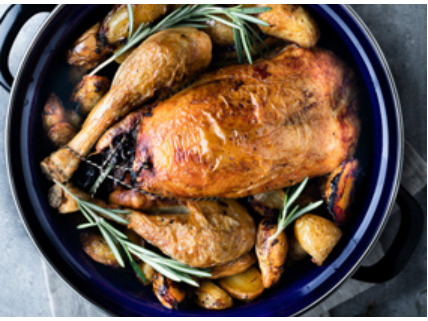

**Ingrediënten voor:** 4 personen
**Bereidingstijd:** ca. 30 min. + ca. 1 uur en
**30** min. wachttijd
**150 g** Grana Padano
**1** ui
olijfolie, om in te bakken
**300 g** risottorijst
**150 ml** droge witte wijn
**1 l** bouillon (heet)
**2-3 el** truffelsalsa of -tapenade
**1** klontje boter
**2** teentjes knoflook
**300 g** gemengde paddenstoelen
**1 takje** tijm
bakpapier
1 Verwarm de oven voor (elektrisch: 180°C / hetelucht: 160°C). Pel en snipper de ui en de knoflook
fijn. Snijd de abrikozen in stukjes. Neem de naaldjes van de rozemarijn en hak fijn.
2 Verhit olijfolie in een braadpan op laag vuur en
bak de ui en de knoflook in ca. 5 minuten goudbruin erin. Voeg de fijngehakte rozemarijn toe en
bak al roerend ca. 1 minuut mee. Voeg het gehakt
toe en bak al omscheppend tot het gehakt bruin
kleurt. Schep in een mengkom en roer de rozijnen, stukjes abrikozen en cranberry’s erdoorheen. Laat afkoelen.
3 Verwijder eventuele touwtjes van de kip.
Bestrooi de kip royaal met zout en peper. Vul de
holte van de kip met het gehakt. Bind de kip op
met keukengaren, zodat hij mooi in model blijft
tijdens het bakken. Bestrijk de borst en poten
met de boter.
4 Borstel de krieltjes schoon en dep droog.
Verdeel de krieltjes over de braadpan en leg de
kip erop. Bak de kip in ca. 1 uur en 30 minuten
gaar in de oven. De kip is gaar als het vocht dat
eruit loopt als je met een scherp mes in het dikste
deel prikt helder is. Gebruik je een kernthermometer? De kip is gaar als de kerntemperatuur
72°C is. Serveer de kip met de krieltjes.
**Per portie:** ca. 944 kcal
**74 g** eiwit | 65 g vet | 74 g koolhydraten
Uit Paulines Keuken

## Chocoladepudding

## met room

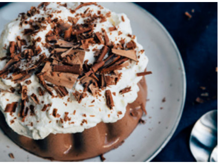

**Ingrediënten voor:** 6 personen
**Bereidingstijd:** ca. 10 min. + ca. 6 uur wachttijd
**4** gelatineblaadjes
**250 ml** melk
**375 ml** slagroom
**55 g** suiker
**150 g** pure chocolade
boter, om in te vetten
puddingvorm (500 ml
inhoud) of individuele
puddingschaaltjes
1 Laat de gelatine weken in koud water. Verhit
**250 ml** van de slagroom met de melk en 40 g van
de suiker ca. 10 minuten in een steelpannetje.
Roer tot de suiker is opgelost in de room.
2 Hak de chocolade in kleine stukjes en houd iets
achter voor de garnering. Neem de pan van het
vuur. Knijp de gelatine uit en roer met een garde
door de hete room; zorg dat de gelatine goed is
opgelost. Voeg de gehakte chocolade toe en meng
alles met elkaar.
3 Schenk het mengsel (eventueel door een zeef)
in een ingevette puddingvorm of individuele
puddingschaaltjes. Laat minimaal 6 uur opstijven
in de koelkast.
4 Klop de rest van de slagroom stijf met de rest
van de suiker. Garneer de chocoladepudding met
de slagroom en de apart gehouden chocolade.
**Per portie:** ca. 416 kcal
**5 g** eiwit | 34 g vet | 25 g koolhydraten
Gevulde kip
met gehakt
Chocoladepudding
met room
Uit Paulines Keuken

## Tulbandcake

## met stroopwafel

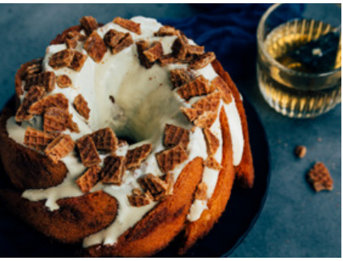

**Ingrediënten voor:** 8-10 stukken
**Bereidingstijd:** ca. 1 uur
**200 g** zachte boter
**175 g** witte basterdsuiker
**4** eieren
**200 g** bloem
**2 tl** bakpoeder
**1** snuf zout
**3** stroopwafels
**180 g** witte chocolade
tulbandvorm (ca. 23 cm Ø)
1 Verwarm de oven voor (elektrisch: 170°C / hetelucht: 150°C). Klop de boter met de suiker met een
handmixer luchtig. Klop de eieren één voor één
erdoorheen. Voeg de bloem, het bakpoeder en het
zout toe en klop nog even kort.
2 Hak de stroopwafels in stukjes en spatel de helft
door het beslag. Bewaar de rest voor de garnering.
Schenk het beslag in een ingevette tulbandvorm.
Bak in ca. 50 minuten goudbruin en gaar in de
oven. De tulband is gaar als een satéprikker
schoon en droog eruit komt als je hem in de cake
steekt. Laat de cake helemaal afkoelen.
3 Smelt de witte chocolade au bain-marie. Schenk
de gesmolten chocolade over de tulband. Garneer
met de rest van de stukjes stroopwafel.
Per stuk (8): ca. 466 kcal
**6 g** eiwit | 26 g vet | 53 g koolhydraten

## Bestel nu voor

12,99

# Inspiratie voor de

# hele decembermaand!

## Van Sinterklaasavond en kerst tot oud & nieuw

## Bestel nu via:

## www.kokengenieten.nl/feestdagen

Deze actie is geldig zo lang de voorraad strekt
Scan de
Scan de
qr-code
qr-code

# Complete

# kerstmenu’s

Maak je kerstdiner onvergetelijk met een
heerlijk menu. Met al deze voor- hoofd-, bij- en
nagerechten kun je eindeloos combineren. Zo is je
kerstmenu precies zoals jij het wil hebben!
Seizoen

## Varkenshaas met spek en whiskysaus

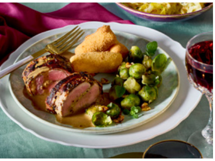

**Ingrediënten voor:** 6 personen
**Bereidingstijd:** ca. 1 uur en 30 min.
**4 el** boter
**3 el** lichte basterdsuiker
**3 el** mosterd
**6 el** + 150 ml whisky
**4 takjes** oregano
**4 takjes** peterselie
**2** varkenshazen (à ca. 600 g)
**16 plakjes** gerookt ontbijtspek
**2 el** olie
**300 ml** slagroom
zout en peper
vershoudfolie
keukengaren
1 Verhit de boter in een kleine pan. Voeg de lichte basterdsuiker, de mosterd
en 6 el whisky toe. Breng kort aan de kook en laat afkoelen. Was de oregano
en de peterselie, hak fijn en roer door de marinade. Dep de varkenshazen
droog. Snijd elke filet in de lengte één keer diep in, maar niet helemaal door.
2 Verdeel een kwart van de marinade over de inkepingen. Vouw de filets
weer dicht. Vouw de punt van de filet eronder, zodat deze niet te snel gaar
wordt.
3 Leg 2 vellen vershoudfolie (elk ca. 30 cm lang) op het werkblad. Leg op elk
vel 8 plakjes spek naast elkaar, licht overlappend. Leg een varkensfilet aan
een lange zijde van het spek. Bestrijk met nog een kwart van de marinade.
Rol op met behulp van de folie. Bind vast met het keukengaren en leg ca.
30 minuten in de koelkast.
4 Verwarm de oven voor (elektrisch: 100°C)*. Verhit de olie in een pan op
hoog vuur. Bak de filets ca. 8 minuten aan alle zijden aan. Leg de filets vervolgens op een bakplaat en laat ze 15-20 minuten garen in de voorverwarmde
oven. Blus het bakvocht in de pan af met 150 ml whisky, breng kort aan de
kook en schenk door een zeef in een pan.
5 Breng het whiskybakvocht aan de kook. Voeg de resterende marinade en
de slagroom toe, breng opnieuw aan de kook en laat ca. 5 minuten zachtjes
koken. Breng de saus op smaak met zout en peper. Neem de filets uit de oven.
Verwijder het keukengaren. Serveer alles samen. Lekker met aardappelkroketjes (p. 16), ahornspruitjes (p. 16) en romige pompoenzuurkool (p. 16).
**Per portie:** ca. 600 kcal
**50 g** eiwit | 39 g vet | 9 g koolhydraten
*Een heteluchtoven is voor dit recept niet geschikt.

## Aardappelkroketjes

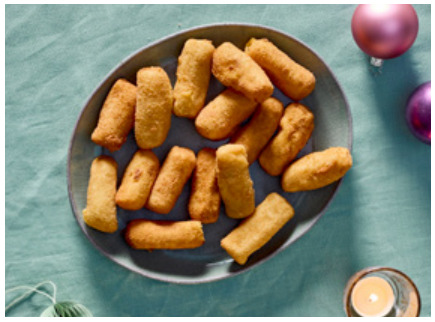

**Ingrediënten voor:** 6 personen
**Bereidingstijd:** ca. 1 uur en 15 min.
Was 1 kg aardappels en kook ze in water in ca. 20 minuten gaar. Giet
af, laat iets afkoelen en schil ze. Pers de warme aardappels door een
aardappelpers in een kom. Splits 2 eieren. Houd het eiwit apart. Voeg
de eidooiers, 110 g bloem, 35 g maizena, zout en nootmuskaat toe aan
de aardappels en kneed alles snel door elkaar. Kneed niet te lang,
anders wordt het deeg taai. Verdeel het aardappeldeeg in vieren en rol
elk deel op een beetje bloem uit tot een rol (ca. 1,5 cm Ø). Snijd de rollen in stukken van 3-4 cm en vorm er kroketjes van. Kluts de eiwitten.
Haal de kroketten eerst door het eiwit en daarna door 150 g
paneermeel. Verhit 1 l frituurolie in een diepe pan of brede pot tot
160°C. Frituur de aardappelkroketjes in porties in 5-6 minuten goudbruin en gaar. Laat uitlekken. Lekker bij varkenshaas (p. 15).

## Ahornspruitjes

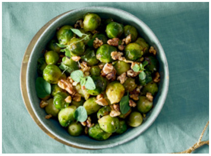

**Ingrediënten voor:** 6 personen
**Bereidingstijd:** ca. 45 min.
Maak 750 g spruitjes schoon, was ze en kook ze in kokend water met zout in
ca. 10 minuten beetgaar. Pel en snipper intussen 1 ui. Rooster 50 g walnoten
in een droge koekenpan. Neem ze uit de pan en hak ze grof. Giet de spruitjes
af. Verhit 2 el boter en 1 el olie in een pan. Fruit de ui glazig erin. Voeg de
spruitjes toe en bak ca. 5 minuten. Schenk 4 el ahornsiroop erover bestrooi
met de walnoten en meng alles met elkaar. Breng op smaak met zout en
peper. Lekker bij varkenshaas (p. 15).

## Romige pompoenzuurkool

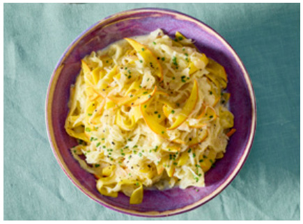

**Ingrediënten voor:** 6 personen
**Bereidingstijd:** ca. 45 min.
Pel en snipper 1 ui. Verhit 2 el boter in een pan en fruit de ui glazig. Voeg
**850 g** zuurkool (zak of pot), 2 tl suiker, 4 jeneverbessen en 2 laurierblaadjes toe en bak kort mee. Blus af met 400 ml groentebouillon, breng
aan de kook en laat afgedekt ca. 15 minuten zachtjes koken. Snijd intussen
**750 g** hokkaidopompoen in vieren, verwijder de pitten, was de stukken en
snijd ze in dunne plakjes. Snijd de plakjes vervolgens in repen van ca. 1 cm
breed. Schep de pompoen door de zuurkool en laat nog ca. 10 minuten zachtjes koken. Was en hak ½ bosje bieslook fijn. Roer 100 g crème fraîche door
de zuurkool, breng aan de kook en breng op smaak met zout, peper en
1 tl suiker. Serveer warm. Lekker bij varkenshaas (p. 15).

## Boereneend met knödels

## en sinaasappelrodekool

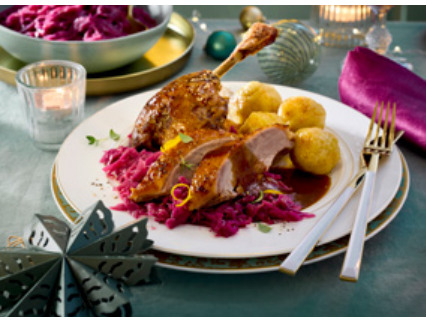

**Ingrediënten voor:** 6 personen
**Bereidingstijd:** ca. 3 uur en 45 min.
**3** uien
**3** appels
**12 takjes** tijm
**2** eenden (à ca. 2,7 kg, bij de
poelier)
zout en peper
**¼** knolselderij
**2** wortels
**1** prei
**2 el** vloeibare honing
**800 ml** eenden- of gevogeltefond
(pot)
**1-2 el** maizena
**2 el** koude boter
satéprikkers
keukengaren
Seizoen
1 Pel de uien en snipper ze grof. Was de appels, snijd ze in vieren en verwijder
het klokhuis. Was de tijm en hak hem grof. Meng alles met elkaar. Verwijder
het vet uit de buikholtes van de eenden. Spoel de eenden vanbinnen en
vanbuiten en dep ze droog. Wrijf de eenden in met zout en peper. Verdeel
de appelvulling over de buikholtes. Sluit de opening met de satéprikkers
en bind dicht met keukengaren. Maak de knolselderij, de wortels en de prei
schoon, was ze en snijd ze grof. Verdeel de groenten over een diepe bakplaat
en plaats deze onder in de oven. Schenk 200 ml water over de groenten. Leg
de eenden met de borstzijde naar boven op een ovenrooster en schuif ze in
de koude oven boven de bakplaat. Zet de oven aan (elektrisch: 160°C / hetelucht: 140°C) en braad de eenden ca. 2 uur en 30 minuten.
2 Verhoog de oventemperatuur (elektrisch: 180°C / hetelucht: 160°C) en
braad de eenden nog ca. 15 minuten. Bestrijk de eenden met de honing en
braad ze nog ca. 10 minuten. Neem de eenden en de groenten uit de oven.
Schenk de eendenfond op de bakplaat en roer de aanbaksels los. Schenk de
fond door een zeef in een pan, schep het vet eraf en breng aan de kook. Meng
de maizena met ca. 4 el koud water, roer dit door de fond en breng opnieuw
kort aan de kook. Breng de saus op smaak met zout en peper. Klop de koude
boter erdoorheen. Laat de saus niet meer koken. Serveer alles samen. Lekker
met aardappelbolletjes (p. 18) en sinaasappelrodekool (p. 21).
**Per portie:** ca. 950 kcal
**100 g** eiwit | 56 g vet | 5 g koolhydraten

## Aardappelbolletjes

**Ingrediënten voor:** 6 personen
**Bereidingstijd:** ca. 1 uur en 30 min. + ca. 12 uur wachttijd
**2 kg** aardappels
**200 g** witbrood
**1** wortel (ca. 150 g)
**4 el** boter
**200 g** volle kwark
**2** eieren
**60 g** semolina (tarwegriesmeel)
**20 g** aardappelzetmeel
zout
nootmuskaat
gemalen karwijzaad
1 EEN DAG VAN TEVOREN Was de aardappels en kook ze afgedekt in water in
ca. 20 minuten gaar. Giet de aardappels af, laat ze iets afkoelen, schil ze en
laat ze een nacht volledig afkoelen.
2 DE VOLGENDE DAG Rasp de gekookte aardappels fijn. Snijd het witbrood in
kleine blokjes. Schil de wortel, was hem en rasp hem fijn. Smelt de boter.
3 Meng de aardappel, de kwark, het brood, de eieren en de gesmolten boter.
Meng de wortel, de semolina en het aardappelzetmeel en voeg dit toe aan
het mengsel. Kneed tot een deeg.
4 Kneed zout, nootmuskaat en gemalen karwijzaad naar smaak door het
deeg. Vorm ca. 20 balletjes ervan. Breng een pan met ruim water en zout aan
de kook. Leg de aardappelbolletjes in het water, breng aan de kook en laat
ca. 15 minuten op laag vuur garen. Lekker met eend (p. 17).
**Per portie:** ca. 490 kcal
**18 g** eiwit | 9 g vet | 81 g koolhydraten

## Kaas-cranberryflapjes

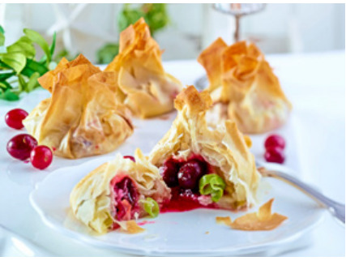

**Ingrediënten voor:** ca. 15 stuks
**Bereidingstijd:** ca. 1 uur en 15 min.
**75 g** suiker
**150 g** cranberry’s (diepvries)
**4** lente-uitjes
**250 g** cheddar
**50 g** boter
**250 g** filodeeg (koeling of diepvries, ontdooid)
bakpapier
1 VOOR DE SAUS Breng 60 ml water, de suiker en de cranberry’s aan de kook
en laat ca. 15 minuten zachtjes koken op laag vuur. Schenk het mengsel in
een kom en laat afkoelen.
2 Was de lente-uitjes en snijd ze in dunne ringetjes. Snijd de cheddar in
kleine blokjes en meng met de lente-uitjes. Smelt de boter in een kleine pan.
Neem 5 vellen filodeeg uit de verpakking.
3 Verwarm de oven voor (elektrisch: 200°C / hetelucht: 180°C). Snijd elk
vel filodeeg in 9 vierkantjes (elk ca. 10 cm). Leg 3 vierkantjes op elkaar en
bestrijk elke laag met de gesmolten boter. Leg de 15 stapeltjes deeg naast
elkaar.
4 Leg in het midden van elk stapeltje een lepel van het kaasmengsel en wat
cranberrysaus. Vouw de hoeken over de vulling heen zodat er een pakketje
ontstaat.
5 Leg de envelopjes op een met bakpapier beklede bakplaat en bestrijk ze
met de resterende boter. Bak ze in de oven in 12-15 minuten goudbruin en
gaar. Serveer warm.
**Per stuk:** ca. 150 kcal
**6 g** eiwit | 9 g vet | 13 g koolhydraten

## Kabeljauw met mascarponepuree

## en chorizotomaatjes

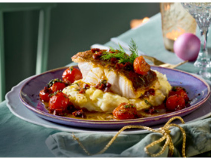

**Ingrediënten voor:** 4 personen
**Bereidingstijd:** ca. 1 uur
**1 kg** aardappels
**50 g** chorizo (Spaanse pittige worst, bij de
supermarkt)
**200 g** cherrytomaten
**6 takjes** tijm
**1** bio-citroen
**125 ml** melk
**100 g** mascarpone
**30 g** parmezaan, geraspt
zout en peper
nootmuskaat
4 kabeljauwfilets met huid (à ca. 200 g)
**1-2 el** bloem
**2 el** boter, om te bakken
peper
**5-6 el** boter
**1 el** honing
dille, om te garneren
1 VOOR DE BIJGERECHTEN Schil de aardappels, was ze, halveer ze
en kook ze in water met zout in ca. 20 minuten gaar. Verwijder het
vel van de chorizo en snijd in kleine blokjes. Bak de chorizo in een
grote, droge koekenpan krokant. Neem de chorizo uit de pan en
laat uitlekken op keukenpapier. Schenk het bakvet in een kom en
houd apart. Was de tomaten. Was de tijm en neem de blaadjes van
de takjes.
2 Was de citroen, rasp de schil fijn en pers het sap uit. Giet de aardappels af en doe terug in de pan. Voeg de melk, de mascarpone en
de parmezaan toe en stamp alles fijn. Breng de puree op smaak met
zout en nootmuskaat. Houd warm.
3 VOOR DE KABELJAUW Dep de kabeljauwfilets droog en snijd de
huidzijde een paar keer in met een scherp mes. Bestuif de filets licht
met de bloem en schud de overtollige bloem eraf. Verhit de boter in
het bakvet van de chorizo. Bak de kabeljauwfilets eerst ca. 3 minuten op de huidzijde. Draai ze om en bak ze nog 3-4 minuten op de
andere zijde. Breng de vis op smaak met zout en peper, neem uit de
pan en houd warm.
4 Verhit de boter en het apart gehouden chorizovet in een pan, voeg
de cherrytomaten toe en bak ze al omscheppend ca. 3 minuten.
Voeg als laatste de tijm toe en bak kort mee. Voeg de honing, de
chorizo, 3 el citroensap en de citroenrasp toe en meng alles kort
met elkaar. Breng op smaak met zout en peper. Leg de kabeljauw
op de mascarponepuree. Schenk de citroen-tomatenboter erover.
Garneer met de dille.
**Per portie:** ca. 690 kcal
**48 g** eiwit | 34 g vet | 47 g koolhydraten
Seizoen

## Filodeeg-groentetaart

## met kastanje

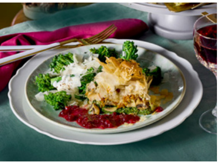

**Ingrediënten voor:** 6 personen
**Bereidingstijd:** ca. 1 uur en 45 min.
**800 g** wortels
**1 tl** gerooktepaprikapoeder
zout en peper
**12 el** + 5 tl olijfolie
**50 g** pijnboompitten
**500 g** spinazie
**3** teentjes knoflook
**400 g** champignons
**8 takjes** peterselie
**125 g** gekookte kastanjes
(vacuümverpakt)*
250 g filodeeg (koeling of diepvries,
ontdooid)
**4 el** paneermeel
**2 el** sesamzaad (bijv. wit en zwart)
**750 g** aspergebroccoli
**50 g** parmezaan
**200 g** crème fraîche
**2 el** mayonaise
**1-2 el** citroensap
worcestershiresauce
**150 g** cranberryjam (pot)
*Je koopt kastanjes bij de toko. Kun
je ze niet vinden? Vervang ze door
kastanjechampignons en voeg ze toe
bij de champignons.
1 VOOR DE VULLING Verwarm de oven voor (elektrisch: 200°C / hetelucht: 180°C). Schil en was de wortels en snijd ze grof. Verdeel ze over een bakplaat. Meng met het paprikapoeder, zout en 3 el olijfolie.
Rooster ca. 30 minuten in de voorverwarmde oven.
2 Rooster de pijnboompitten in een droge koekenpan. Was de spinazie, hak hem grof en doe in een
blender. Pel 2 teentjes knoflook en snijd in stukken. Voeg de knoflook samen met de pijnboompitten en
6 el olijfolie toe aan de spinazie. Pureer alles. Breng de pesto op smaak met zout en peper en houd apart.
Maak de champignons schoon en snijd ze in vieren. Verhit 3 el olijfolie in een pan. Bak de champignons
ca. 10 minuten hierin. Was en hak de peterselie en roer erdoor. Breng op smaak met zout en peper en
laat afkoelen. Hak de kastanjes fijn. Neem de wortels uit de oven en prak ze grof.
3 Vet een springvorm (26 cm Ø) in met ½ tl olijfolie en zet een kleine ovenbestendige kom of een leeg
blik (8,5 cm Ø; 8 cm hoog) in het midden. Bestrijk dit ook met ½ tl olijfolie. Neem het filodeeg uit de
verpakking. Halveer de vellen diagonaal. Bekleed de vorm met de driehoeken filodeeg en bestrijk elke
laag dun met in totaal 3 tl olijfolie. Bestrooi de bodem met het paneermeel. Verdeel de spinaziepesto
erover. Leg daarop in lagen de champignons, de wortels en de kastanjes. Vouw het overhangende deeg
over de vulling en bestrijk met 1 tl olijfolie. Bestrooi met het sesamzaad. Bak de taart onder in de oven in
ca. 30 minuten gaar.
4 VOOR DE SALADE Was de aspergebroccoli en kook hem in kokend water met zout in ca. 4 minuten
beetgaar. Schaaf de parmezaan. Pel en hak 1 teentje knoflook. Meng de crème fraîche, de mayonaise,
de knoflook, het citroensap, een paar druppels worcestershiresauce, zout en peper met elkaar. Giet de
aspergebroccoli af, laat afkoelen en meng met de saladedressing. Bestrooi met de parmezaan. Serveer
alles samen met de cranberryjam.
**Per portie:** ca. 860 kcal
**23 g** eiwit | 54 g vet | 57 g koolhydraten

## Sinaasappelrodekool

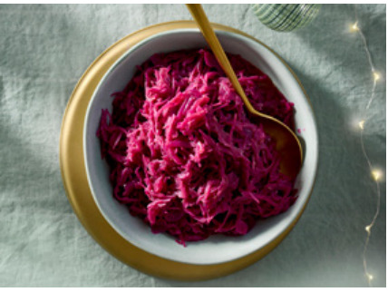

**Ingrediënten voor:** 6 personen
**Bereidingstijd:** ca. 1 uur en 30 min. + ca. 12 uur wachttijd
**2 kg** rodekool
zout en peper
**2** uien
**2 el** olie
**250 ml** rode port
**4 el** rodewijnazijn
**150 g** rodebessen- of cranberrygelei
**1 el** honing
**2 el** boter
**2** bio-sinaasappels
**1** grote aardappel (ca. 100 g)
1 EEN DAG VAN TEVOREN Was de rodekool, snijd hem in vieren en snijd
hem in dunne reepjes. Meng de kool met ca. 4 tl zout en kneed ca. 5 minuten stevig. Pel de uien en snijd ze in reepjes.
2 Verhit de olie in een pan en fruit de ui glazig erin. Blus af met de rode
port, breng aan de kook en laat ca. 1 minuut koken. Roer de azijn, de
gelei en de honing erdoorheen. Meng dit, terwijl het nog heet is, met de
rodekool. Laat het geheel afgedekt op een koele plek een nacht marineren.
3 DE VOLGENDE DAG Verhit de boter in een grote pan. Voeg de rodekool
toe en bak ca. 5 minuten. Was de sinaasappels, rasp de schil fijn en pers
het sap uit. Voeg het sinaasappelsap en de geraspte schil toe aan de
rodekool. Breng op smaak met zout en peper.
4 Blus af met ca. 400 ml water, breng aan de kook en laat afgedekt ca. 35
minuten zachtjes koken. Schil de aardappel, was hem en rasp hem fijn.
Roer de geraspte aardappel door de rodekool. Laat de kool nog ca. 20
minuten koken, roer af en toe. Breng op smaak met zout en peper.
**Per portie:** ca. 310 kcal
**7 g** eiwit | 8 g vet | 42 g koolhydraten
Seizoen

## Walnotensoep met truffelolie

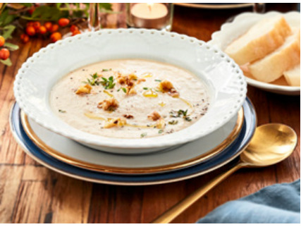

**Ingrediënten voor:** 6 personen
**Bereidingstijd:** ca. 45 min.
**1** ui
**1** teentje knoflook
**500 g** aardappels
**250 g** knolselderij
**4 takjes** tijm
**200 g** walnoten
**2 el** boter
**1 l** groentebouillon
**4 el** truffelolie (+ besprenkelen)
**150 g** crème fraîche
zout en peper
1 Pel en snipper de ui en de knoflook. Schil en was de aardappels en de knolselderij en snijd ze in stukken. Was de tijm. Hak de helft van de tijm fijn en de
rest grof voor de garnering. Hak 150 g van de walnoten fijn.
2 Verhit de boter in een grote pan. Fruit de ui en de knoflook glazig erin. Voeg
de aardappel, de knolselderij en de gehakte walnoten toe en bak kort mee.
3 Schenk de groentebouillon erbij en breng aan de kook. Voeg de truffelolie
en de fijngehakte tijm toe. Breng op smaak met zout en peper. Laat de soep
afgedekt ca. 20 minuten zachtjes koken.
4 Voeg de crème fraîche toe aan de soep en pureer glad. Breng opnieuw op
smaak. Serveer de soep. Garneer met de overgebleven tijm, de resterende
walnoten en een beetje truffelolie. Lekker met ciabatta.
**Per portie:** ca. 470 kcal
**9 g** eiwit | 40 g vet | 20 g koolhydraten

## Laagjessalade met garnalen

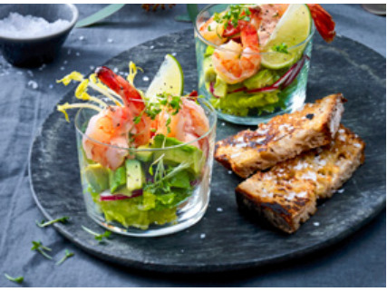

**Ingrediënten voor:** 4 personen
**Bereidingstijd:** ca. 45 min.
16 garnalen (diepvries, zonder kop, in schaal)
**125 g** mayonaise
**1 el** gin (sterkedrank, bij de slijter)
**1 el** tomatenpuree
**3 el** sinaasappelsap
**1 tl** mierikswortelpuree (potje)
**3** mini-romaineslablaadjes
**3** radijsjes
**1** avocado
**2 el** limoensap
**100 g** kiemgroente
**2 el** olijfolie
zout en peper
tabasco
evt. tuinkers, om te bestrooien
evt. limoenpartjes, om te serveren
1 Laat de garnalen ontdooien. Meng de mayonaise met de gin, de tomatenpuree, het sinaasappelsap en de mierikswortelpuree. Breng de saus op
smaak met zout, peper en een paar druppels tabasco.
2 Was de sla en scheur in stukjes. Was de radijsjes en snijd ze in dunne
plakjes. Halveer de avocado, verwijder de pit, neem het vruchtvlees uit de
schil en snijd in blokjes. Meng de avocado direct met het limoensap. Was de
kiemgroente.
3 Pel de garnalen, maar laat het staartje eraan zitten. Maak een ondiepe
snede langs de rug en verwijder het darmkanaal. Was de garnalen en dep
ze droog. Verhit de olijfolie in een pan. Bak de garnalen in ca. 2 minuten per
zijde gaar. Breng op smaak met zout en peper.
4 Verdeel de sla, de radijsjes, de kiemgroente, de avocado en de garnalen in
laagjes over 4 glazen. Schenk de saus erover. Garneer naar wens met tuinkers en limoen. Serveer met geroosterd brood.
**Per portie:** ca. 460 kcal
**21 g** eiwit | 40 g vet | 6 g koolhydraten

## Rundercarpaccio

## met parmezaancrème

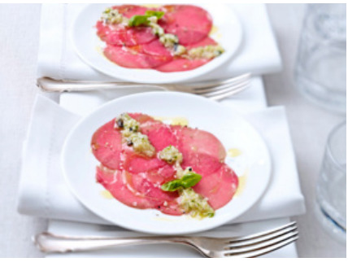

**Ingrediënten voor:** 6 personen
**Bereidingstijd:** ca. 20 min. + ca. 2 uur wachttijd
**250 g** ossenhaas (smal stuk)
**25 g** parmezaan
**1** sjalot
**4 takjes** basilicum
**6** pitloze zwarte olijven
**5-6 el** olijfolie
zout en peper
vershoudfolie
1 Dep de ossenhaas droog. Wikkel hem strak in vershoudfolie tot een
rol en leg ca. 2 uur in de vriezer.
2 Rasp de parmezaan fijn. Pel de sjalot en snijd in kleine blokjes. Was
het basilicum en hak de blaadjes van 3 takjes zeer fijn. Hak de olijven
zeer fijn.
3 Meng de olijven, het basilicum, de parmezaan en de olijfolie en breng
op smaak met een beetje peper.
4 Snijd de ossenhaas zeer dun met een vleessnijmachine of een scherp
mes en verdeel de plakjes naast elkaar over 6 kleine borden. Bestrooi
met zout en peper en besprenkel met de parmezaancrème. Garneer
met de rest van de basilicumblaadjes. Serveer met grissini (Italiaanse
soepstengels).
**Per portie:** ca. 170 kcal
**14 g** eiwit | 13 g vet | 1 g koolhydraten

## Tiramisu met marsepein en sinaasappel

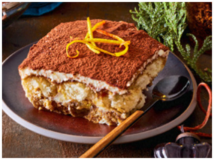

**Ingrediënten voor:** 6 personen
**Bereidingstijd:** ca. 50 min. + ca. 4 uur wachttijd
**2** bio-sinaasappels
**200 g** marsepein
**125 ml** melk
**2** gelatineblaadjes
**250 g** kwark
**250 g** mascarpone
**50 g** suiker
**200 g** lange vingers
**250 ml** koude espresso
**3 el** cacaopoeder
1 Was 1 sinaasappel en rasp de schil fijn. Halveer de sinaasappel en pers hem
uit. Snijd de marsepein in stukjes. Pureer de melk en de marsepein tot een
romig mengsel.
2 Week de gelatine in koud water. Meng de kwark, de mascarpone, de marsepeincrème en de suiker met elkaar. Knijp de gelatine uit. Verwarm het
sinaasappelsap in een klein pannetje en los de gelatine erin op. Meng het
sinaasappelsap met 2-3 el van het roommengsel en roer dit vervolgens door
de rest van het roommengsel.
3 Bedek de bodem van een ondiepe schaal (ca. 25 x 35 cm) met de helft van
de lange vingers. Snijd ze eventueel op maat. Besprenkel met de helft van de
espresso. Bestuif met 1 el cacaopoeder. Verdeel de helft van de mascarponecrème erover.
4 Maak nog een laag met de resterende lange vingers, espresso, 1 el cacaopoeder en de rest van de crème. Laat minimaal 4 uur opstijven in de koelkast.
5 Was voor het serveren de overgebleven sinaasappel en snijd de schil in
fijne reepjes eraf. Bestuif de tiramisu met 1 el cacaopoeder en garneer met
de sinaasappelreepjes.
**Per portie:** ca. 590 kcal
**19 g** eiwit | 33 g vet | 54 g koolhydraten

## Tobleronemousse

**Ingrediënten voor:** 4 personen
**Bereidingstijd:** ca. 40 min. + 2-3 uur wachttijd
Seizoen
**6 el** melk
**200 g** Toblerone (chocolade)
**300 g** slagroom
**50 g** hazelnoten
**4** zandkoekjes
bakpapier
1 Verwarm de melk zachtjes in een pan. Hak de chocolade grof en laat al
roerend smelten in de warme melk. Schenk het mengsel in een kom en laat
ca. 10 minuten afkoelen. Klop de slagroom stijf. Spatel de slagroom voorzichtig, beetje bij beetje, door de vloeibare chocolade.
2 Verdeel de mousse over vier glazen en laat afgedekt 2-3 uur opstijven in de
koelkast.
3 Verwarm de oven voor (elektrisch: 160°C / hetelucht: 140°C). Verdeel de
hazelnoten over een met bakpapier beklede bakplaat en rooster ze in ca. 15
minuten goudbruin in de oven. Neem uit de oven en wrijf de velletjes eraf
met een theedoek. Hak de noten.
4 Bestrooi de mousse vlak voor het serveren met de hazelnoten en garneer
met de koekjes.
**Per portie:** ca. 610 kcal
**10 g** eiwit | 51 g vet | 31 g koolhydraten

## Gepofte appel

## met marshmallows en vanillesaus

**Ingrediënten voor:** 4 personen
**Bereidingstijd:** ca. 1 uur
**2 el** amandelschaafsel
**10 g** boter (+ invetten)
**75 g** marsepein
**1 snufje** kaneel
**1 snufje** gemalen kruidnagel
**4** appels (à ca. 200 g)
**2 tl** citroensap
**20 g** mini-marshmallows (ca. 40 stuks)
**40 g** kloppuddingpoeder vanille
**100 ml** advocaat
**150 g** slagroom
**4 tl** cranberryjam
kaneelsuiker, om te bestrooien
appelboor
1 Rooster het amandelschaafsel in een droge koekenpan. Smelt de boter.
Verkruimel de marsepein. Kneed het amandelschaafsel, de boter, de marsepein, de kaneel en de kruidnagel door elkaar.
2 Was de appels. Snijd een kapje van de bovenkant. Verwijder het klokhuis
met een appelboor. Besprenkel de appels met het citroensap. Leg ze in een
ingevette ovenschaal. Vul ze met het marsepeinmengsel. Leg de kapjes erop.
3 Verwarm de oven voor (elektrisch: 200°C / hetelucht: 180°C). Bak de appels
ca. 35 minuten in de voorverwarmde oven. Neem ca. 7 minuten voor het
einde van de baktijd de kapjes eraf, verdeel de marshmallows over de appels
en bak verder.
4 Klop het puddingpoeder, de advocaat en de slagroom in een hoge mengkom in ca. 1 minuut op. Serveer de gepofte appels met de cranberryjam en de
saus en bestrooi met kaneelsuiker.
**Per portie:** ca. 500 kcal
**6 g** eiwit | 24 g vet | 61 g koolhydraten

## Kersen-kokosdessert

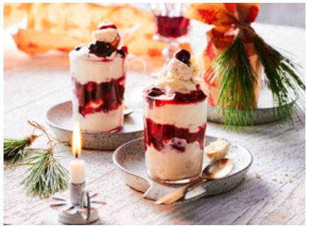

**Ingrediënten voor:** 6 personen
**Bereidingstijd:** ca. 25 min. + ca. 2 uur wachttijd
**250 ml** + 5 el kersensap
**1** kaneelstokje
**1-2** steranijs
**2** kruidnagels
**90 g** suiker
**8 g** vanillesuiker
**2 el** maizena
**500 g** gemengde bessen (diepvries)
**400 g** crème fraîche
**150 g** kokoschocolaatjes (bijv. Raffaello)
1 VOOR DE BESSENSAUS Breng 250 ml kersensap, het kaneelstokje, de
steranijs, de kruidnagels, 40 g suiker en de vanillesuiker aan de kook in een
pan. Meng de maizena met 5 el kersensap tot een glad papje. Roer dit door
de kokende nectar en laat al roerend ca. 2 minuten koken. Roer de diepvriesbessen erdoor en laat 2-3 minuten trekken op laag vuur. Neem de pan van
het vuur, verwijder de specerijen en laat het geheel afkoelen.
2 VOOR DE ROOM Klop de crème fraîche en 50 g suiker met een handmixer
in ca. 5 minuten romig. Snijd alle chocolaatjes, op 6 na, in stukjes en spatel
door de room.
3 Verdeel de room en de bessensaus, op een klein beetje na, afwisselend in
laagjes in glazen. Garneer elk met een praline en de resterende saus. Zet tot
serveren in de koelkast.
**Per portie:** ca. 430 kcal
**5 g** eiwit | 26 g vet | 44 g koolhydraten

## Horizontaal

1 internetverbinding 5 klein vaartuig zonder dek 9 okerachtige aardverf 13 vrucht
18 verafschuwd 20 mensachtige machine 22 op deze plek 24 teken van
aarzeling 26 contant geld 27 aanzienlijk 28 klank 29 zeilboottype 30 sociaal
(afk.) 32 langlopend tv-feuilleton 34 dun 35 modderige plas 36 Spaanse
uitroep 37 Hawaïaanse dans 39 mannelijk schaap 41 plaaggeest 42 nieuwe
lerarenopleiding (afk.) 43 plotseling opkomende gedachte 45 sneeuwhut
46 tafelfles 48 bijna 50 plaats in Zeeland 51 tekengerei 52 trog 53 binnen
54 kerkleider55 rivierinFrankrijk57 holteonderdearm59 tegenelkaannemelijk
bod (afk.) 61 wondvocht 63 eenkleurig 64 dierenmond 66 voorzetsel
67 hoofdstuk van de Koran 68 nieuw (in samenstellingen) 69 grote batterij
71 gebergte in Europa 73 traag 75 noot der redactie (afk.) 76 doctor (afk.)
77 organisatie van olielanden 78 hoofd van een vrouwenklooster 79 klap
81 etage (afk.) 82 klokjesbloem 84 lengtemaat 85 rompslomp 87 sterke lichtstraal
88 suikergoed 89 vrouwelijke gast 90 koppelbuis.

## Verticaal

2 decigram 3 seconde 4 plaats in Tibet 5 woestijn in Noord-Afrika 6 luitenant
(afk.) 7 bijwoord 8 kaliumcarbonaat 9 matig 10 computerdeskundige 11 natrium
12 immer 13 knoflooksaus 14 schrijfgerei 15 persoonlijk record 16 plaats in
Overijssel 17 Japans gerecht 19 asociaal (afk.) 21 bewaarplaats op een station
23 op welke wijze 25 ogenblik dat de vloed op zijn hoogst is 29 humus
31 gevangenwagen 33 snob 35 kleefstof 36 op hetzelfde 38 haaksteek
40 oorspronkelijk bewoner van Nieuw-Zeeland 42 zonder kleren 44 zonder
verpakkingsgewicht 46 Japanse kleurkarper 47 sprookjesfiguur 48 hoger
beroepsonderwijs (afk.) 49 duivenhok 54 hanglamp 56 gelukkige afloop
58 uitholling door stromend water 60 Hongaarse componist 62 aardappelrooier
64 hoge pieptoon 65 vent 67 verdriet 70 deel van een gevangenis 71 behoeftige
72 tiran 74 loofboom 77 in orde 80 ontastbare stof 82 aanstaande (afk.)
83 modern 85 zangnoot 86 megaton.
© DENKSPORT PUZZELBLADEN
**84** 13 9 26 19 39 35 57 68 81
VUL DE PUZZEL IN EN MAAK KANS
OP 1 VAN DE 3 EXEMPLAREN VAN

## De zoete oven

## t.w.v. 26,99 euro

Mix voor appelkruimeltaart of marmercake, mix voor boterkoek
of bananenbrood: je kunt het zo gek niet verzinnen, of er bestaat
een kant-en-klare bakmix voor. Totaal onnodig, de magie van de
oven is nu juist dat je met bloem, boter, suiker en eieren de hele
wereld bij elkaar bakt. Dé antipakjeskoningin van Nederland
schreef daarom De zoete oven. Een basisbakboek met 99 verschillende cakes, taarten, toetjes en koekjes. Van verslavend
knapperige havermoutkoekjes tot een fraaie citroentulband met
basilicum en van een verleidelijke mokka-chocoladetaart tot een
super easy bruidstaart.
1 2 3 4 5 6 7 8 9 10 11 12 13 14 15 16
**17** 18 19 20 21 22 23
Titel: De zoete oven
**24** 25 26 27 28 29
**30** 31 32 33 34 35 36
Auteur: Karin Luiten
**37** 38 39 40 41 42 43 44
**45** 46 47 48 49 50
Prijs: 26,99 euro
**51** 52 53
**54** 55 56 57 58 59 60
Het antwoord kun je vóór 23 december 2025
**61** 62 63 64 65 66 67
**68** 69 70 71 72 73 74 75
sturen naar: koken & genieten, o.v.v. oplossing puzzel
**76** 77 78 79 80 81
**82** 83 84 85 86
Postbus 296, 6500 AG Nijmegen
**87** 88 89 90
Of op onze website: kokengenieten.nl/puzzel

# Kerstklapstuk

Dit klassieke zuurgebraad wordt zonder twijfel hét
spektakel van jouw kerstmenu. Serveer hem met
gebakken aardappels en rodekool en je hebt een
feestmaal waar je u tegen zegt.

## Klassiek zuurgebraad

## met rodewijnsaus

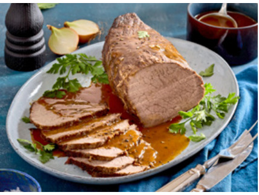

**Ingrediënten voor:** 6 personen
**Bereidingstijd:** ca. 3 uur + 3 dagen wachttijd
**¼** knolselderij
**2** wortels
**1** prei
**1** ui
**250 ml** rodewijnazijn
**750 ml** rode wijn
**4** kruidnagels
**1 el** mosterdzaad
**2** laurierblaadjes
**1 el** peperkorrels
**2 kg** runderbraadstuk
(bij de slager)
zout en peper
**3 el** olie
**1 el** tomatenpuree
**50 g** peperkoek
**1** grote diepvrieszak
(ca. 10 l)
1 DRIE DAGEN VAN TEVOREN Maak de knolselderij, de wortels en de
prei schoon en snijd ze in grove stukken. Snijd de ui met schil en al in
kleine stukjes. Breng in een pan de rodewijnazijn, de rode wijn, 500 ml
water, de kruidnagels, het mosterdzaad, de laurierblaadjes en de
peperkorrels aan de kook. Neem de pan van het vuur, voeg de gesneden
groenten en de ui toe en laat de marinade volledig afkoelen. Plaats een
diepvrieszak in een grote kom. Leg het runderbraadstuk in de zak en
schenk de afgekoelde marinade erbij. Sluit de zak goed af. Laat het vlees
3 dagen in de koelkast marineren. Draai de zak regelmatig om.
2 OP DE DAG ZELF Verwarm de oven voor (elektrisch: 180°C / hetelucht:
160°C). Neem het vlees uit de marinade, dep het goed droog en bestrooi
met zout. Schenk de marinade door een zeef. Vang de vloeistof op en
houd de groenten apart. Verhit de olie in een braadpan op hoog vuur en
bak het vlees hierin rondom aan. Voeg de apart gehouden groenten toe
en bak kort mee. Breng op smaak met zout en peper. Voeg de tomatenpuree toe en bak ca. 1 minuut mee. Blus af met ca. 150 ml van de opgevangen marinade, breng aan de kook en laat het vocht bijna volledig
verdampen. Schenk de rest van de marinade erbij en breng opnieuw aan
de kook. Leg het deksel op de pan en laat het vlees ca. 2 uur tot 2 uur en
30 minuten stoven in de oven.
3 VOOR DE SAUS Controleer of het vlees gaar is door er met een vleesvork in te prikken. Als de vork er gemakkelijk weer uit glijdt, is het vlees
gaar. Neem het braadstuk uit de pan en houd het warm, bijvoorbeeld
onder aluminiumfolie. Schenk het braadvocht door een fijne zeef in
een steelpan. Breng aan de kook en laat op hoog vuur tot ongeveer de
helft inkoken. Verkruimel de ontbijtkoek boven de saus en roer met een
garde tot de koek is opgelost. Breng nogmaals aan de kook. Proef de
saus en breng eventueel verder op smaak met zout en peper. Snijd het
vlees in plakken en serveer met de saus. Heerlijk met aardappeltjes en
rodekool.
**Per portie:** ca. 560 kcal
**75 g** eiwit | 14 g vet | 16 g koolhydraten
Kookschool

# 4x

# lekker

# Snelle sausjes

Wil je je kerstmenu naar een hoger niveau tillen?
Maak dan een van deze supersnelle sauzen! Kwestie
van weinig moeite, groot effect.

## Pittige champignon-pepersaus

**Ingrediënten voor:** 4 personen
**Bereidingstijd:** ca. 15 min.
**250 g** kleine champignons
**2 el** olie
zout en peper
**3 el** cognac (bij de slijter)
**150 ml** groentebouillon
**200 g** slagroom
**1 tl** mosterd
**1 tl** groene peperkorrels
**1 el** allesbinder
1 Maak de champignons schoon en halveer of snijd ze in vieren, afhankelijk van de grootte. Verhit de olie in een diepe pan op hoog vuur. Bak de
champignons ca. 8 minuten erin. Breng de champignons op smaak met
zout en peper.
2 Blus de champignons af met de cognac. Schenk de bouillon en de slagroom erbij en breng het geheel aan de kook. Roer de mosterd, de groene
peperkorrels en de allesbinder door de saus. Laat op laag vuur al roerend
ca. 1 minuut zachtjes koken. Breng de saus op smaak met zout en peper.
Lekker bij gevogelte, biefstuk en varkenshaas.
**Per portie:** ca. 240 kcal
**4 g** eiwit | 22 g vet | 5 g koolhydraten

## Sinaasappel-sjalotsaus

**Ingrediënten voor:** 4 personen
**Bereidingstijd:** ca. 20 min.
**8** sjalotten
**1** bio-sinaasappel
**1 takje** rozemarijn
**1 tl** olie
**2 el** rodebessen- of
cranberrygelei
**200 ml** rode wijn
**2 el** balsamicoazijn
**200 ml** groentebouillon
**40 g** koude boter
zout en peper
1 Pel de sjalotten en snijd ze in vieren. Was de sinaasappel, wrijf hem droog en
rasp de schil fijn. Was de rozemarijn en hak hem fijn. Houd een beetje rozemarijn
apartvoordegarnering.
2 Verhit de olie in een pan. Bak de sjalot ca. 2 minuten hierin, neem een beetje uit
de pan en houd apart. Roer de rodebessengelei door de sjalot in de pan. Blus af
met de wijn en de azijn, breng aan de kook en laat ca. 5 minuten zachtjes koken.
Voeg de bouillon, de sinaasappelrasp en de gehakte rozemarijn toe en laat nog
ca. 2 minuten zachtjes koken.
3 Schenk de saus door een zeef in een hoge mengbeker. Pureer de saus met een
staafmixer en voeg hierbij geleidelijk de boter in stukjes toe. Doe de apart gehouden sjalot terug in de saus. Breng de saus op smaak met zout en peper en garneer
met de apart gehouden rozemarijn. Lekker bij wild, eend en pittige worstjes.
**Per portie:** ca. 170 kcal
**2 g** eiwit | 10 g vet | 11 g koolhydraten

## Kruidenmayonaise

**Ingrediënten voor:** 4 personen
**Bereidingstijd:** ca. 15 min.
**2 tl** kappertjes
**½ bosje** bieslook
**6 takjes** peterselie
**50 ml** groentebouillon
**2** verse eidooiers
**1-2 tl** mosterd
**1 snufje** suiker
**2-3 el** citroensap
**8 el** olie
zout en peper
1 Laat de kappertjes uitlekken en vang daarbij 2 tl van het vocht op. Hak de
kappertjes fijn. Was de kruiden. Hak de bieslook en de peterselie fijn.
2 Doe de kappertjes met het opgevangen vocht, de bouillon, de eidooiers,
de mosterd, de suiker en het citroensap in een hoge mengbeker en pureer
1-2 minuten met een staafmixer. Schenk de olie er in een dun straaltje bij
terwijl je de staafmixer langzaam omhoog beweegt. Roer de kruiden erdoorheen. Breng de mayonaise op smaak met zout en peper. Lekker bij rosbief,
gerookte zalm en aardappel.
**Per portie:** ca. 220 kcal
**2 g** eiwit | 24 g vet | 1 g koolhydraten
4x lekker

## Zwitserse kaassaus

**Ingrediënten voor:** 4 personen
**Bereidingstijd:** ca. 15 min.
**1** klein teentje knoflook
**100 g** gruyère (Zwitserse
kaas, bij de
supermarkt)
100 g vacherin (Franse kaas,
bij de kaaswinkel)
**2-3 takjes** tijm
**1 tl** boter
**1 tl** bloem
**50 ml** witte wijn
**125 ml** groentebouillon
**150 ml** melk
zout
nootmuskaat
**1 tl** roze peperkorrels
1 Pel en hak de knoflook. Rasp de beide kazen grof. Was de tijm en hak hem
fijn. Houd een beetje tijm apart voor de garnering.
2 Verhit de boter in een steelpan. Fruit de knoflook en de gehakte tijm kort
erin. Roer de bloem erdoorheen en laat het mengsel licht kleuren. Schenk al
roerend de wijn en de bouillon erbij. Roer de melk erdoorheen en breng aan
de kook. Laat de saus onder regelmatig roeren ca. 5 minuten zachtjes koken.
Roer de kaas erdoor en laat op laag vuur in de saus smelten. Breng de saus op
smaak met zout en nootmuskaat. Strooi de apart gehouden tijm en de roze
peperkorrels erover. Lekker bij gevogelte, vis en groente.
**Per portie:** ca. 240 kcal
**17 g** eiwit | 17 g vet | 3 g koolhydraten
Scan mij!
12x voor
37,50
i.p.v. 54,-
Deze actie is geldig t/m 7 december 2025

# Bekijk de actie via:

# kokengenieten.nl/actie

# Simpel en snel

# genieten

Het is al druk genoeg met werk, kinderen en hobby’s. Hier is de
oplossing voor iedereen die geen tijd heeft om uitgebreid te koken,
maar toch lekker wil eten.

## Gnocchi-ovenschotel

## caprese

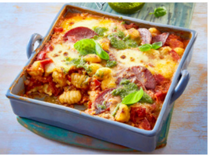

**Ingrediënten voor:** 4 personen
**Bereidingstijd:** ca. 30 min.
**2** uien
**2 el** olie
**1 el** tomatenpuree
**500 ml** passata (tomatensaus)
**400 ml** groentebouillon
zout en peper
**1 snufje** suiker
**150 g** salami, in plakjes
**200 g** mozzarella
**500 g** verse gnocchi (koeling)
**2 takjes** basilicum
**1-2 el** pesto
1 Verwarm de oven voor (elektrisch: 220°C / hetelucht: 200°C). Pel en snipper de uien. Verhit de
olie in een pan en fruit de uien glazig erin. Voeg
de tomatenpuree toe en bak kort mee. Roer de
passata en de bouillon erdoor, breng aan de kook
en laat ca. 5 minuten zachtjes koken. Breng de
saus op smaak met zout, peper en de suiker.
2 Halveer de plakjes salami en bak ze knapperig
in een droge koekenpan. Snijd de mozzarella in
dunne plakjes. Verdeel de gnocchi, de tomatensaus en de salami in laagjes over een ovenschaal.
Verdeel de mozzarella erover. Gratineer 8-10
minuten in de hete oven.
3 Was het basilicum en neem de blaadjes van de
takjes. Neem de ovenschotel uit de oven en lepel
de pesto erover. Bestrooi met het basilicum en
serveer.
**Per portie:** ca. 560 kcal
**24 g** eiwit | 31 g vet | 48 g koolhydraten

## Snelle broccoli-kaaspasta

**Ingrediënten voor:** 4 personen
**Bereidingstijd:** ca. 30 min.
**500 g** broccoli
**400 g** pasta (bijv. macaroni)
zout en peper
**2** uien
**2** teentjes knoflook
**20 g** boter
**20 g** bloem
**500 ml** melk
paprikapoeder
**100 g** belegen kaas, geraspt
**75 g** cheddar, geraspt
1 Was de broccoli en snijd hem in kleine roosjes.
Kook de pasta volgens de aanwijzingen op de
verpakking gaar in water met wat zout. Voeg de
broccoli toe en kook ca. 4 minuten mee. Pel en
snipper intussen de uien en hak de knoflook fijn.
Giet de pasta en de broccoli af.
De snelle keuken
2 Verhit de boter in een pan. Fruit hierin de ui en
de knoflook. Voeg de bloem toe en bak al roerend
even mee. Schenk de melk al roerend erbij, breng
aan de kook en laat ca. 8 minuten zachtjes koken.
Breng de saus op smaak met zout, peper en paprikapoeder. Laat beide kaassoorten al roerend in
de saus smelten. Voeg de pasta en de broccoli toe,
verwarm alles in de saus en breng het gerecht op
smaak. Serveer de kaaspasta en bestrooi met wat
peper.
**Per portie:** ca. 700 kcal
**33 g** eiwit | 24 g vet | 86 g koolhydraten

## Linzensalade

## met savooiekool en

## granaatappel

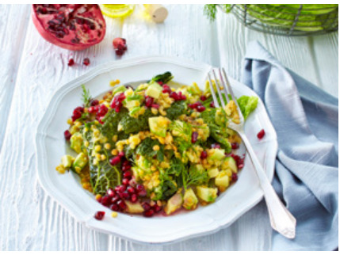

**Ingrediënten voor:** 4 personen
**Bereidingstijd:** ca. 25 min.
**200 g** rode linzen
**600 g** savooiekool
**4 el** appelazijn
**1** sinaasappel (alleen het sap)
**2 el** citroensap
**1 tl** suiker
**1 tl** gedroogde oregano
zout en peper
**4 el** olijfolie
**1** avocado
**1** granaatappel
**4-5 takjes** dille
1 Breng de linzen met 600 ml water aan de kook.
Laat ze afgedekt 6-8 minuten garen op laag vuur.
Was de savooiekool, snijd hem in kleine stukjes
en doe in een grote kom. Meng de appelazijn, het
sinaasappelsap, het citroensap, de suiker, de oregano, zout en peper met elkaar. Klop de olijfolie
erdoor. Schenk de vinaigrette over de savooiekool
en kneed 2-3 minuten tot de kool zacht is. Laat de
savooiekool ca. 5 minuten trekken.
2 Giet de linzen af. Halveer de avocado, verwijder
de pit en neem het vruchtvlees uit de schil. Snijd
de avocado in kleine blokjes. Halveer de granaatappel en klop de pitten eruit. Was de dille en hak
fijn. Voeg de linzen, de avocado, de granaatappelpitten en de dille toe aan de savooiekool en meng
voorzichtig met elkaar. Breng de salade op smaak
met zout en peper en serveer.
**Per portie:** ca. 390 kcal
**18 g** eiwit | 18 g vet | 38 g koolhydraten

## Cranberryschmarrn met sinaasappel

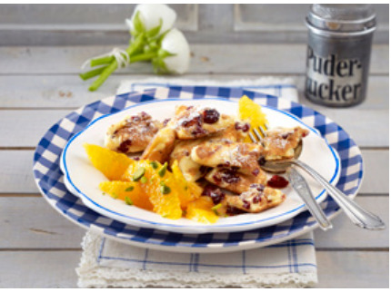

**Ingrediënten voor:** 4 personen
**Bereidingstijd:** ca. 25 min.
**4** sinaasappels
**8 el** suiker
**20 g** + 2 el boter
**4** eieren
**1 snufje** zout
**375 ml** melk
**225 g** bloem
**60 g** cranberry’s
**1 tl** poedersuiker
**1-2 el** pistachenoten, gehakt
1 Schil de sinaasappels met een mes, zodat ook het witte vlies wordt verwijderd. Snijd de partjes tussen de vliezen uit en knijp het sap uit de overgebleven vliezen. Karamelliseer 3 el suiker in een pan, blus af met het sap en laat
kort zachtjes koken. Voeg de sinaasappelpartjes toe.
2 Smelt 20 g boter. Splits de eieren. Klop de eiwitten stijf. Meng de eidooiers, 5 el suiker, het zout, de gesmolten boter en de melk met elkaar. Roer de
bloem erdoor. Hak de cranberry’s grof en meng ze door het beslag. Spatel tot
slot voorzichtig de opgeklopte eiwitten door het beslag.
3 Verhit 2 el boter in een koekenpan (ca. 28 cm Ø). Schenk het beslag erin en
laat ca. 3 minuten stollen. Draai de pannenkoek om en bak nog ca. 3 minuten.
Trek de pannenkoek met twee vorken in stukken. Bestrooi met de poedersuiker en schud kort om. Serveer alles samen. Bestrooi met de pistachenoten.
**Per portie:** ca. 600 kcal
**19 g** eiwit | 21 g vet | 84 g koolhydraten
De snelle keuken

## Krokante roodbaars het romige zuurkool

**Ingrediënten voor:** 4 personen
**Bereidingstijd:** ca. 30 min.
**2** uien
**2 el** olie
**850 g** wijnzuurkool (zak of pot)
**1-2 tl** paprikapoeder
**200 ml** slagroom
zout en peper
**1 snufje** suiker
8 stukken roodbaarsfilet (à ca. 75 g, bij de viswinkel)
**2-3 el** bloem
**2** eieren
**2-3 el** boter
**6 takjes** peterselie
1 Pel en snipper de uien. Verhit de olie in een pan en fruit de ui erin. Voeg
de zuurkool toe, trek hem een beetje uit elkaar en stoof kort mee. Bestrooi
met het paprikapoeder en bak kort mee. Schenk de slagroom erbij en breng
aan de kook. Breng de zuurkool op smaak met zout, peper en de suiker. Laat
afgedekt 18-20 minuten smoren op laag vuur.
2 Spoel de vis af en dep hem droog. Meng de bloem met wat zout en peper.
Kluts de eieren. Wentel de vis eerst door de bloem en vervolgens door de
eieren. Verhit de boter in een grote koekenpan. Bak de vis hierin in 3-4 minuten per zijde gaar. Was de peterselie, hak fijn en roer hem door de zuurkool.
Breng de zuurkool nogmaals op smaak en serveer met de vis.
**Per portie:** ca. 500 kcal
**36 g** eiwit | 35 g vet | 10 g koolhydraten

## Malse filetlapjes met spinazie en roomsaus

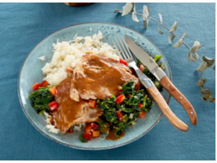

**Ingrediënten voor:** 4 personen
**Bereidingstijd:** ca. 25 min.
**200 g** basmatirijst
zout en peper
**2** tomaten
**2** uien
**500 g** bladspinazie
**3 el** olie
nootmuskaat
8 filetlapjes à la minute (à ca. 80 g)
**250 ml** groentebouillon
**2 el** allesbinder
1 Kook de rijst volgens de aanwijzingen op de verpakking gaar in water met
wat zout. Was de tomaten en snijd ze in fijne blokjes. Pel en snipper de uien.
Was de spinazie. Verhit 1 el olie in een pan en fruit hierin de uien glazig. Voeg
de spinazie toe en stoof ca. 4 minuten. Schep de tomaten erdoor. Breng de
spinazie op smaak met zout en nootmuskaat.
2 Dep de filetlapjes droog. Verhit 2 el olie in porties in een koekenpan. Bak de
filetlapjes hierin in twee porties in 1-2 minuten per zijde op hoog vuur gaar.
Breng op smaak met zout en peper. Neem uit de pan en houd warm. Blus het
bakvet af met de bouillon en breng aan de kook. Roer de allesbinder erdoor
en laat al roerend ca. 1 minuut zachtjes koken. Breng de saus op smaak. Giet
de rijst af. Serveer de filetlapjes met de saus, de spinazie en de rijst.
**Per portie:** ca. 610 kcal
**62 g** eiwit | 19 g vet | 47 g koolhydraten

## Paté Hawaï op boerenbrood

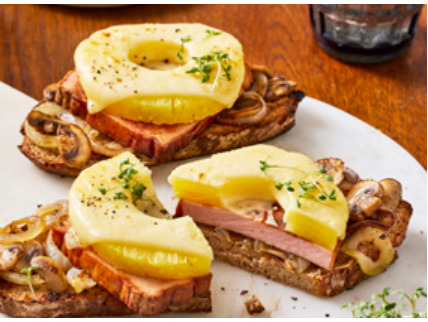

**Ingrediënten voor:** 4 personen
**Bereidingstijd:** ca. 30 min.
**1** grote ui
**300 g** champignons
**4** schijven ananas (blik)
**2 el** olie
**4** plakken paté (à ca. 100 g)
zout en peper
**4** sneden boerenbrood
4 plakken belegen kaas (à ca. 40 g)
**1** bakje tuinkers
1 Verwarm de oven voor (elektrisch: 220°C / hetelucht: 200°C). Pel de ui
en snijd hem in dunne ringen. Maak de champignons schoon en snijd ze in
plakjes. Laat de ananas uitlekken. Verhit de olie in een grote koekenpan. Bak
de plakken paté hierin ca. 2 minuten per zijde en neem ze uit de pan.
2 Bak de ui en de champignons in het hete bakvet in ca. 8 minuten goudbruin. Breng op smaak met zout en peper. Verdeel het ui-champignonmengsel gelijkmatig over de sneden brood. Leg op elke snee een plak paté en een
schijf ananas. Leg de kaas op de ananas. Gratineer de broodjes ca. 8 minuten
in de hete oven. Knip de tuinkers uit het bakje. Neem de broodjes uit de oven.
Bestrooi ze met de tuinkers en wat peper.
**Per portie:** ca. 510 kcal
**35 g** eiwit | 27 g vet | 34 g koolhydraten

# Het grote

# kerstnummer

De complete gids voor een heerlijke kersttafel
Scan de QR-code of bestel via

## www.foodiesmagazine.nl/kerst2025

Nu voor
12,50

# Sinterklaascake

Door de speculaaskruiden doet deze tulband meteen
denken aan Sinterklaas. Serveer hem met pakjesavond,
dat is pas een cadeautje!
Pronkstuk

## Speculaasmarmertulband

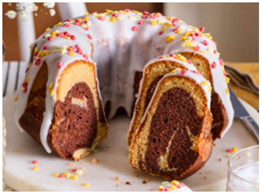

**Ingrediënten voor:** ca. 14 stukken
**Bereidingstijd:** ca. 4 uur en 30 min.
**200 g** zachte boter (+ invetten)
**200 g** suiker
**4** eieren
**300 g** bloem (+ bestuiven)
**16 g** bakpoeder
**3 tl** speculaaskruiden
**1 snufje** zout
**150 ml** melk
**2 el** cacaopoeder
**180 g** poedersuiker
**2 el** citroensap
kleurrijke suikersterretjes, om te versieren
1 VOOR HET BESLAG Klop in een kom de boter en de suiker met een handmixer romig. Klop de eieren één voor één erdoorheen. Meng de bloem met
het bakpoeder, 2 tl van de speculaaskruiden en het zout. Voeg het bloemmengsel afwisselend met de melk toe aan het eiermengsel en mix tot een
glad beslag. Halveer het beslag. Meng door de ene helft het cacaopoeder en
de resterende speculaaskruiden.
2 Verwarm de oven voor (elektrisch: 180°C / hetelucht: 160°C). Vet een tulbandvorm (22 cm Ø) in en bestuif met bloem. Schep het lichte en donkere
beslag om en om in de vorm. Haal een vork erdoorheen voor een marmereffect. Bak de cake in ca. 45 minuten gaar op een rooster onder in de oven.
Controleer met een satéprikker of de cake gaar is. Komt deze er schoon uit,
dan is de cake klaar. Neem de tulband uit de oven en laat ca. 30 minuten
afkoelen in de vorm. Stort de tulband op een rooster en laat in ca. 1 uur en
30 minuten volledig afkoelen.
3 VOOR HET GLAZUUR Meng de poedersuiker met het citroensap en 1-2 el
heet water tot een dik, glad mengsel. Schenk het glazuur over de tulband,
zodat het er aan de zijkanten een beetje afloopt. Bestrooi direct met suikersterretjes en laat het glazuur in ca. 1 uur drogen.
**Per stuk:** ca. 324 kcal
**5 g** eiwit | 15 g vet | 44 g koolhydraten

# Betoverend

buffet
De kersttijd heeft altijd iets magisch – de knusse
lampjes, de versierde kerstboom en natuurlijk de
gezelligheid van samen rond de tafel lekker eten. Maak
met dit buffet een betoverend feestje van deze kerst.
Buffet

## Zalmtaart met verse kruiden

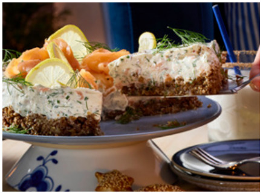

**Ingrediënten voor:** 6 personen
**Bereidingstijd:** ca. 5 uur en 10 min.
**6 sneetjes** zonnebloempittenbrood
(ca. 300 g)
**100 g** boter
**400 g** roomkaas
**150 g** crème fraîche
16 g slagroomversteviger (bijv.
Dr Oetker Klop-Fix)
**200 g** gerookte zalm, in plakjes
**2** rode uien
**3** jeneverbessen
**1 bosje** bieslook
**1 bosje** dille
**1** bio-citroen
zout en peper
bakpapier
1 Snijd de sneetjes brood in blokjes. Rooster de blokjes krokant in een droge koekenpan. Neem ze uit de
pan en laat a oelen. Smelt de boter. Maal het brood
fijn in een keukenmachine. Meng het broodkruim met
de gesmolten boter. Bekleed een springvorm (ca. 20
cm Ø) met bakpapier en druk het broodmengsel als
bodem in de vorm. Zet de vorm ca. 15 minuten in de
koelkast.
2 Klop de roomkaas, de crème fraîche en de slagroomversteviger met een handmixer in ca. 1 minuut op.
Snijd 100 g van de zalm in fijne reepjes. Pel de uien en
snipper ze fijn. Hak de jeneverbessen zeer fijn. Was de
bieslook en de dille en hak fijn. Houd wat dille apart
voor de garnering. Meng de zalmreepjes, de ui, de
jeneverbessen en de kruiden met de roomkaascrème.
Was de citroen met heet water en halveer hem. Pers
één helft uit. Breng de crème op smaak met zout,
peper en 1-2 el van het citroensap. Verdeel de kruidencrème over de broodbodem. Zet de zalmtaart ca.
4 uur in de koelkast om op te stijven.
3 Snijd de andere citroenhelft in zeer dunne plakjes.
Draai de overige 100 g zalm tot roosjes. Versier de
zalmkruidentaart met de zalmroosjes, de citroenplakjes en de apart gehouden dille.
**Per portie:** ca. 600 kcal
**20 g** eiwit | 47 g vet | 26 g koolhydraten

## Kokos-tequilacocktail met Cointreau

**Ingrediënten voor:** 6 glazen (à 200 ml)
**Bereidingstijd:** ca. 15 min.
Strooi de overgebleven kaneelsuiker (restant van de sterren en manen, zie rechts) op een plat
bord. Bestrijk de randen van 6 glazen met wat limoensap en doop ze in de kaneelsuiker. Meng
**120 ml** limoensap, 180 ml tequila (bij de slijter), 120 ml Cointreau (bij de slijter), 250 ml
kokosmelk (blik) en 2 el suiker- of agavesiroop met elkaar. Verdeel ijsblokjes over de glazen.
Schud het tequilamengsel in twee porties krachtig in een cocktailshaker. Schenk in de glazen.
Garneer de glazen met de koekjes (zie sterren en manen, rechts).

## Krokante sterren en manen

**Ingrediënten voor:** ca. 30 stuks
**Bereidingstijd:** ca. 30 min.
Meng 1 mespuntje kaneel met 2 el suiker. Rol 270 g bladerdeeg (rol, koeling) met het bijbehorende bakpapier uit. Steek met uitsteekvormpjes
halvemanen (ca. 6 cm) en sterren (ca. 5 cm) dicht op elkaar uit het deeg.
Kluts 1 eidooier met 1 el melk. Bestrijk de deegvormpjes hiermee. Snijd
voor de cocktailglazen (zie recept links) 6 deegvormpjes ca. 2 mm breed
in en bestrooi ze met wat van de kaneelsuiker. Bestrooi de overige deegvormpjes met 2 el sesamzaad. Verwarm de oven voor (elektrisch: 200°C
/ hetelucht: 180°C). Leg de deegvormpjes op een met bakpapier beklede
bakplaat. Bak ca. 8 minuten in de oven. Neem uit de oven en laat a oelen.
Buffet
Gouden bloemkoolsoep
met granaatappel
Kip uit de oven met
saliegnocchi en bietensalade
Buffet

## Gouden bloemkoolsoep

## met granaatappel

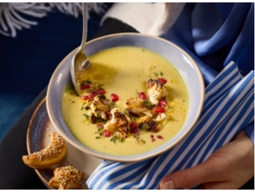

**Ingrediënten voor:** 6 personen
**Bereidingstijd:** ca. 40 min.
**1** bloemkool (ca. 1 kg)
**2** aardappels (ca. 300 g)
**1** ui
**2 el** sesamolie
**2 tl** kurkuma
**1 l** groentebouillon
**500 ml** haverroom
**2 el** tahin (sesampasta, bij de
supermarkt)
**6 takjes** tijm
**3 el** sesamzaad
**1** granaatappel
zout en peper
1 Snijd de bloemkool in kleine roosjes en was ze.
Houd ca. ¼ van de roosjes apart voor de garnering. Schil de aardappels, was ze en snijd ze in
grove blokjes. Pel de ui en snipper hem.
2 Verhit de sesamolie in een grote pan. Fruit de ui
glazig erin. Voeg de bloemkool (behalve de apart
gehouden roosjes) en de aardappels toe en bak
kort mee. Breng op smaak met zout en peper.
Strooi de kurkuma erover. Schenk de bouillon
erbij, breng aan de kook en laat ca. 20 minuten
zachtjes koken. Voeg de haverroom en de tahin
toe, breng opnieuw aan de kook en laat nog ca. 5
minuten zachtjes koken. Pureer de soep met een
staafmixer en breng op smaak met zout en peper.
3 Halveer de apart gehouden bloemkoolroosjes in
de lengte en kook ze in water met zout in ca. 3 minuten gaar. Giet de roosjes af. Was de tijm en hak
hem fijn. Rooster het sesamzaad in een pan zonder vet goudbruin. Voeg de tijm toe, bak kort mee
en neem alles uit de pan. Halveer de granaatappel
en klop de pitten eruit. Serveer de soep. Garneer
met de bloemkoolroosjes, het sesam-tijmmengsel en de granaatappelpitten.
**Per portie:** ca. 320 kcal
**8 g** eiwit | 23 g vet | 22 g koolhydraten

## Kip uit de oven

## met saliegnocchi en

## bietensalade

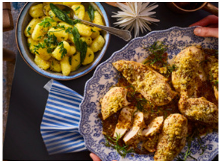

**Ingrediënten voor:** 6 personen
**Bereidingstijd:** ca. 1 uur en 30 min.
**2** teentjes knoflook
**4 el** honing
**4 el** grove mosterd
**4 el** appelazijn
**2 el** sojasaus
**100 ml** kippenbouillon
**6** kipfilets (à ca. 175 g)
**750 g** aardappelpuree (kant-enklaar of zelfgemaakt)
**1** eidooier
**110 g** bloem
**6 takjes** rozemarijn
30 g panko (Japans paneermeel,
bij de supermarkt)
**30 g** geraspte parmezaan
**500 g** gekookte rode bieten
(vacuümverpakt)
**3** sinaasappels
**2** rode uien
**150 g** babyspinazie
**100 g** gezouten amandelen
**4 el** walnootolie
**4 takjes** salie
**8 takjes** tijm
**4 takjes** peterselie
**1 el** boter
**2 el** olie
**100 g** slagroom
zout en peper
1 VOOR DE KIP Pel de teentjes knoflook en hak
ze grof. Meng de honing, de mosterd, 2 el van de
appelazijn, de sojasaus, de bouillon en de knoflook met elkaar. Dep de kipfilets droog, leg ze in
de marinade en laat ca. 30 minuten marineren.
2 VOOR DE GNOCCHI Kneed de aardappelpuree met de eidooier en de bloem tot een deeg.
Halveer het deeg en vorm er twee rollen van (ca.
2 cm Ø). Snijd elke rol in ca. 30 stukjes. Druk de
stukjes met een vork aan beide kanten licht in
om gnocchi te vormen. Kook ze in 2 porties in
ruim kokend water met zout in ca. 5 minuten
gaar. Neem ze met een schuimspaan uit de pan en
houd apart.
3 Leg de kipfilets met de marinade in een grote
ovenschaal. Breng op smaak met zout en peper.
Was de rozemarijn, ris de naaldjes van de takjes
en verdeel ze tussen de filets. Verwarm de oven
voor (elektrisch: 200°C / hetelucht: 180°C). Laat
de kip in ca. 25 minuten garen in de oven. Meng
de panko met de parmezaan, verdeel over de
filets en bak nog 10-15 minuten.
4 VOOR DE SALADE Snijd de rode bieten in dunne
plakjes. Snijd met een scherp mes de schil inclusief de witte schil van de sinaasappel. Snijd de
partjes tussen de vliezen uit. Knijp de vliezen uit
en vang het sap op. Pel de rode uien en snijd ze in
reepjes. Was de babyspinazie. Hak de gezouten
amandelen grof. VOOR DE VINAIGRETTE Klop 2
el appelazijn, 5 el van het sinaasappelsap, zout en
peper door elkaar. Klop de walnootolie erdoor.
5 Was de salie, de tijm en de peterselie en hak ze
fijn. Verhit de boter en de olie in een grote pan.
Frituur de kruiden hierin in porties kort knapperig. Neem ze uit de pan en laat goed uitlekken.
Bak de gnocchi goudbruin in het hete kruidenvet.
Schenk de slagroom erbij, breng kort aan de kook
en wentel de gnocchi erdoor. Breng op smaak met
zout en peper. Meng de rode bieten, de sinaasappelpartjes, de ui en de spinazie voorzichtig met de
vinaigrette. Breng de salade op smaak. Strooi de
amandelen erover. Serveer de kip uit de oven met
de gnocchi, de salade en de gefrituurde kruiden.
**Per portie:** ca. 810 kcal
**48 g** eiwit | 45 g vet | 53 g koolhydraten
Buffet

## Chaiparfait

## met rumvruchten

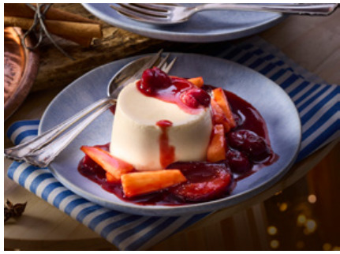

**Ingrediënten voor:** 6 personen
**Bereidingstijd:** ca. 35 min. +
ca. 12 uur wachttijd
**400 ml** slagroom
**4 zakjes** chai (kruidige thee)
**4** eidooiers
**75 g** poedersuiker
**1** kleine ananas (ca. 750 g)
**250 ml** kersensap
**2 el** suiker
**2** steranijs
**1** kaneelstokje
**2 tl** maizena
**250 g** kersen (diepvries)
250 g pruimen (diepvries of pot,
uitgelekt)
**4 el** rum (bij de slijter)
**1** siliconen muffinvorm
(voor 6 stuks)
1 EEN DAG VAN TEVOREN VOOR DE PARFAIT
Verwarm 150 ml slagroom. Laat de theezakjes
hier ca. 4 uur in trekken. Neem de theezakjes
uit de room en knijp ze goed uit. Klop de gekruide room, de eidooiers en de poedersuiker au
bain-marie tot een witte, romige massa. Zet de
kom in een grotere kom deels gevuld met koud
water en ijsblokjes en klop de room tot hij koud
is. Klop 250 ml slagroom stijf en spatel voorzichtig door het eimengsel. Schenk het mengsel in
de holtes van een siliconen muffinvorm en laat
afgedekt een nacht invriezen.
2 DE VOLGENDE DAG VOOR DE RUMVRUCHTEN
Schil de ananas, snijd hem in zessen en verwijder
de harde kern. Snijd de ananas in kleine stukjes.
Breng het kersensap met de suiker, de steranijs
en het kaneelstokje aan de kook. Meng de maizena met 3 el water tot een glad papje. Roer het
maizenapapje door het kokende sap en breng al
roerend opnieuw aan de kook. Voeg de kersen,
de pruimen en de ananas toe en verwarm 2-3
minuten mee. Breng de vruchten op smaak met
de rum.
3 Neem de parfaits uit de siliconen vormpjes en
serveer met de rumvruchten.
**Per portie:** ca. 450 kcal
**5 g** eiwit | 26 g vet | 45 g koolhydraten

## Klantenservice

Wil je abonnee worden of heb je vragen over je
abonnement? Op onze website vind je antwoord op
de meeste vragen.
www.kokengenieten.nl/contact
Wist je dat je tegenwoordig eenvoudig zelf je adres
kan wijzigen? Ga naar www.kokengenieten.nl/
adreswijzigen om je nieuwe adres door te geven.
Het nieuwe adres wordt vervolgens automatisch in
ons systeem gewijzigd.
Telefoon
We zijn er maandag
tot en met vrijdag
van 09.00 tot
**17.00** uur om je vragen
te beantwoorden.
+31 (0)24-2027 829
E-mail
Stel je vraag per e-mail
aan een van onze
service medewerkers.

## klantenservice@

kokengenieten.nl
ABONNEMENTSINFORMATIE koken & genieten kost €4.50 per nummer. De abonnementsprijs in Nederland € 49,- en
in België € 52,- (12 nummers) Deze prijs geldt bij betaling per automatische incasso. Voor betaling via een (digitale)
factuur geldt een toeslag van € 2,50. Je kunt eenvoudig een machtiging afgeven via www.fnl.nl/machtigen.
Abonnementen worden automatisch verlengd, tenzij anders vermeld. Het opzeggen van een abonnement kan eenvoudig
telefonisch via +31 (0)24-2027829 of per mail via klantenservice@kokengenieten.nl.
koken & genieten is een
uitgave van F&L Media B.V.
in licentie van Bauer Media
Hoofdredacteur Yvonne Doorten
Redactie Bas Erkens, Anne Mebelder,
Lotus van Overveldt, Willem van Santen,
Marieke Slettenhaar en Julie van den Berg
Met medewerking van Uit Paulines Keuken
en Karin Luiten
In samenwerking met Fissler en XinZuo
Art Direction Nick Groenewold
Vormgeving Mylene Nales, Tom Gerrits,
Susan Gerbrands-Derksen, Ferry Dorresteijn,
Carlijn Masselink en Skip Lelieveldt
Sales Marc Bokhove +31 (0)24 2404643
mbokhove@fnl.nl
Marketing Anouk Tolboom +31 24 240 45 95
atolboom@fnl.nl
Drukkerij Senefelder Misset Doetinchem B.V.
Vragen aan de redactie
Heb jij opmerkingen, suggesties of vragen aan
de redactie? lezersvragen@kokengenieten.nl
Nieuwsredactie / Pers
kooknieuws@fnl.nl of het onderstaande adres
o.v.v. redactie koken & genieten
Jonkerbosplein 52, 6534 AB Nijmegen
COPYRIGHT Het auteursrecht op deze uitgave en de gedrukte uitgave en op de daarin verschenen
artikelen wordt door de uitgever voorbehouden. De vertaalrechten berusten bij F&L Media B.V.
te Nijmegen/ Nederland. Het verlenen van toestemming tot publicatie in de gedrukte uitgave
houdt in dat de auteur de uitgever, met uitsluiting van ieder ander onherroepelijk machtigt de
bij of krachtens de auteurswet door derden verschuldigde vergoedingen voor kopiëren te innen
en dat de auteur alle rechten verdraagt aan de uitgever, tenzij anders bepaald. Niets uit deze
uitgave en de gedrukte uitgave mag worden overgenomen, vermenigvuldigd of gekopieerd zonder
uitdrukkelijke schriftelijke toestemming van de uitgever. De uitgever stelt zich niet aansprakelijk
voor eventuele onjuistheden, welke in deze uitgave of de gedrukte uitgave mochten voorkomen.
ISSN: 1875-8517

# 4x

# lekker

# Goed

# gegratineerd

Door aardappels te gratineren krijgen ze een
heerlijk goudbruin korstje. De klassieker met
geraspte kaas kennen we inmiddels wel, maar
wat dacht je van deze vier variaties?

## Italiaans met gorgonzola

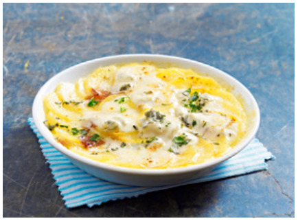

**Ingrediënten voor:** 4 personen
**Bereidingstijd:** ca. 1 uur
**800 g** aardappels
boter of olie, om in te
vetten
**200 ml** slagroom
zout en peper
nootmuskaat
**2 takjes** oregano
**100 g** gorgonzola
1 Schil de aardappels, was ze en snijd of schaaf ze in dunne plakjes. Vet
4 kleine ovenschaaltjes in en verdeel de aardappelplakjes dakpansgewijs
erover. Breng de slagroom op smaak met zout, peper en nootmuskaat en
schenk het over de aardappels. Verwarm de oven voor (elektrisch: 200°C /
hetelucht: 180°C) en bak de gratins in ca. 45 minuten gaar.
2 Was intussen de oregano en hak de blaadjes fijn. Verdeel ca. 10 minuten
voor het einde van de baktijd de gorgonzola in stukjes over de gratins en
bak ze op dezelfde temperatuur verder. Neem de gratins uit de oven en
bestrooi met de gehakte oregano.
**Per portie:** ca. 390 kcal
**10 g** eiwit | 24 g vet | 33 g koolhydraten

## Mediterraan met courgette en tomaat

**Ingrediënten voor:** 4 personen
**Bereidingstijd:** ca. 1 uur
**2** tomaten
**½** courgette (ca. 100 g)
**700 g** aardappels
boter of olie, om in te
vetten
**200 ml** slagroom
zout en peper
nootmuskaat
**2 takjes** rozemarijn
1 Was de tomaten en snijd iedere tomaat in zes plakken. Was de courgette
en snijd in dunne plakjes. Schil de aardappels, was ze en snijd of schaaf ze
ook in dunne plakjes. Vet vier kleine gratineerschaaltjes in en verdeel de
aardappel- en courgetteplakjes dakpansgewijs erover.
2 Breng de slagroom op smaak met zout, peper en nootmuskaat en schenk
over de aardappels en courgette. Leg 3 plakjes tomaat in het midden op
iedere gratin. Verwarm de oven voor (elektrisch: 200°C / hetelucht: 180°C)
en bak de gratins in ca. 45 minuten gaar. Was intussen de rozemarijn, hak
de naaldjes fijn en strooi over de gratins.
**Per portie:** ca. 290 kcal
**6 g** eiwit | 17 g vet | 31 g koolhydraten

## Scandinavisch met zalm en spinazie

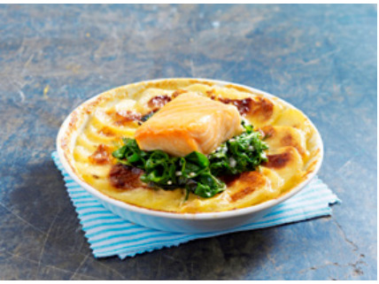

**Ingrediënten voor:** 4 personen
**Bereidingstijd:** ca. 1 uur
**800 g** aardappels
boter of olie, om in te
vetten
**200 ml** slagroom
zout en peper
nootmuskaat
**200 g** babyspinazie
**1** ui
**1** teentje knoflook
**2 el** boter
**2** zalmfilets
(à ca. 125 g)
1 Schil de aardappels, was ze en snijd of schaaf ze in dunne plakjes. Vet vier
kleine ovenschaaltjes in en verdeel de aardappelplakjes dakpansgewijs
erover. Breng de slagroom op smaak met zout, peper en nootmuskaat en
schenk over de aardappels. Verwarm de oven voor (elektrisch: 200°C /
hetelucht: 180°C) en bak de gratins ca. 45 minuten.
2 Was intussen de spinazie. Pel de ui en de knoflook en snipper ze fijn.
Verhit de boter in een pan en fruit de ui en de knoflook hierin glazig. Voeg
de spinazie met aanhangend water toe en laat slinken. Breng op smaak
met zout, peper en nootmuskaat. Dep de zalm droog, halveer de filets en
bestrooi met zout. Verdeel ca. 10 minuten voor het einde van de baktijd de
spinazie over het midden van de gratins. Leg op iedere gratin een stuk zalm
en bak verder gaar.
**Per portie:** ca. 480 kcal
**20 g** eiwit | 29 g vet | 35 g koolhydraten
4x lekker

## Frans met lente-ui en ham

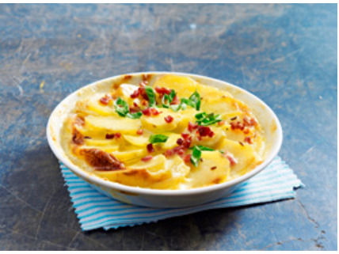

**Ingrediënten voor:** 4 personen
**Bereidingstijd:** ca. 1 uur
**800 g** aardappels
boter of olie, om in te
vetten
**50 g** hamblokjes
**200 ml** slagroom
zout en peper
nootmuskaat
gemalen komijnzaad
**1** lente-uitje
1 Schil de aardappels, was ze en snijd of schaaf ze in dunne plakjes. Vet
vier kleine gratineerschaaltjes in en verdeel de aardappelplakjes dakpansgewijs erover. Strooi de hamblokjes over de aardappels. Breng de slagroom
op smaak met zout, peper, nootmuskaat en komijn en schenk over de
aardappels. Verwarm de oven voor (elektrisch: 200°C / hetelucht: 180°C)
en bak de gratins in ca. 45 minuten gaar.
2 Was de lente-ui en snijd hem in fijne ringen. Strooi de lente-uiringen
ca. 10 minuten voor het einde van de baktijd over de gratins en bak ze op
dezelfde temperatuur verder.
**Per portie:** ca. 340 kcal
**9 g** eiwit | 19 g vet | 34 g koolhydraten

# Zoet uit de oven

Hoewel je in de supermarkt oneindig veel kant-en-klare bakmixen kunt
vinden, heb je voor de lekkerste zoete baksels helemaal geen pakjes
nodig. Daarom komt de zonder-pakjes-en-zakjes-koningin Karin Luiten
met een nieuw boek: De Zoete Oven. Dit basisbakboek - haar 22ste
kookboek welteverstaan – staat vol met 99 koekjes, taarten en cakes.
Inclusief een decemberhoofdstuk speciaal voor de feestdagen. Wij geven
je vast een voorproefje met onze favoriete recepten.

## Citroentulband

## met basilicum

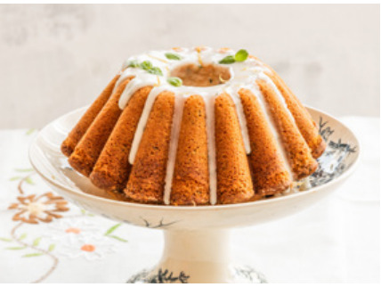

**Ingrediënten voor:** ca. 12 plakken
**Bereidingstijd:** ca. 1 uur + ca. 1 uur en 15 min.
wachttijd
**175 g** boter (op kamertemperatuur
+ extra voor invetten)
**175 g** zelfrijzend bakmeel (+ extra
voor bestuiven)
**175 g** suiker
**3** eieren (op
kamertemperatuur)
snufje zout
**1** citroen
**15 blaadjes** basilicum
tulbandvorm (ca. 1 l inhoud)
satéprikker
**VOOR DE** CITROENSIROOP
**30 g** suiker
sap van ½ citroen
VOOR HET GLAZUUR
**75 g** poedersuiker
**2 blaadjes** basilicum
**1-2 el** citroensap
Kookboek
Titel: De Zoete Oven
Auteur: Karin Luiten
Fotografie: Harold Pereira
Prijs: 26,99 euro
Uitgeverij: Rood
1 Verwarm de oven voor op 160°C. Beboter en
bebloem een tulbandvorm grondig. Klop de boter
met de suiker met de mixer 2-3 minuten licht en
luchtig. Klop één voor één de eieren erdoor. Zeef
het bakmeel met zout boven de kom.
2 Rasp de schil van de citroen erboven fijn en voeg
ook 2 el sap toe. Hak het basilicum fijn en doe
erbij. Spatel nu alles luchtig door elkaar. Schep
het beslag in de vorm.
3 Bak op een rooster iets onder het midden in de
oven in ca. 40 minuten gaar. Check of een satéprikker er droog uitkomt.
4 VOOR DE CITROENSIROOP Meng suiker en
citroensap. Prik de tulband meteen uit de oven
overal in met diezelfde satéprikker. Giet dit
mengsel erover. Laat 15 minuten staan, stort de
cake dan ondersteboven op een bord en verwijder
de vorm. Laat 30 minuten afkoelen.
5 VOOR HET GLAZUUR Zeef de poedersuiker
boven een kom. Hak het basilicum fijn en meng
erdoor. Doe het citroensap erbij en meng tot
een dik glazuur. Verdun eventueel met een drup
water. Laat even 5 minuten staan en giet dan over
de bovenkant van de tulband. Laat vooral mooi
via de buitenste groeven naar beneden lopen.
En nu liefst nog een half uurtje geduld zodat het
glazuur kan opdrogen.
TIP
Vet tulbandvormen altijd extra goed
in en bestuif goed met bloem, door
al die hoekige holtes komt de cake
anders niet heelhuids uit de vorm.

## Croissantpudding

## met frambozen

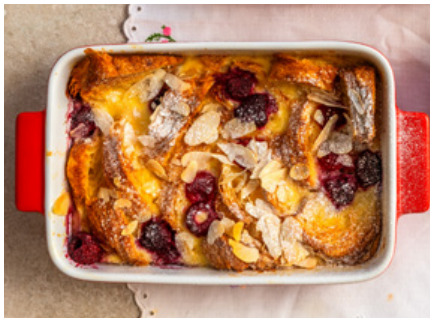

**Ingrediënten voor:** 4 personen
**Bereidingstijd:** ca. 35 min.
**4** oudbakken croissants
boter (voor invetten)
**200 g** diepvriesframbozen
**2** grote eieren
**200 ml** slagroom
**150 ml** (volle) melk
**3 el** suiker
**2** volle el amandelschaafsel
poedersuiker (voor erbij)
slagroom (voor erbij)
1 Oven voorverwarmen op 160 °C. Vet een
ovenschaal (of 4 eenpersoonsschaaltjes) dik
in met boter.
2 Snijd de croissants in vingerdikke plakken
en verdeel dakpansgewijs over de schaal. Zorg
dat ze een beetje rechtop staan, de uitsteeksels worden straks lekker knapperig. Strooi
de (bevroren of ontdooide, dat maakt niet
uit) frambozen erover en duw ze er een beetje
tussen.
3 Klop in een kom de eieren, slagroom, melk
en suiker glad met een garde. Giet gelijkmatig over de schaal en zorg dat alles minstens
voor de helft onder water staat. Bestrooi met
amandelschaafsel.
4 Zet 20-30 minuten in de oven; kleine bakjes
gaan veel sneller dan één grote schaal. Als
de eilaag gestold is, het fruit pruttelt en de
bovenkant goudbruin en knapperig oogt, is
het goed. Serveer warm. Bestrooi met wat
poedersuiker en geef een schaaltje lobbig
geklopte slagroom erbij.

## Pistachepavlovaatjes

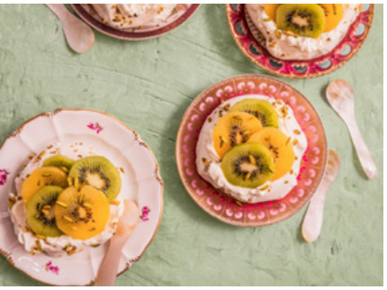

**Ingrediënten voor:** 4 personen
**Bereidingstijd:** ca. 1 uur en 20 min. + ca. 1 uur
wachttijd
**2** grote eiwitten
snufje zout
**100 g** suiker
**1 tl** maizena
**1 tl** citroensap
**1** volle el pistachenootjes
**125 ml** slagroom
**4** kiwi’s (2 groene, 2 gele)
bakpapier
1 Verwarm de oven voor op 125°C. VOOR DE
MERINGUES Klop de eiwitten met een snufje zout
met de mixer tot slappe pieken in een brandschone, vetvrije kom. Voeg de suiker toe en klop door
tot stijve pieken. Mix ten slotte kort maizena en
citroensap erdoor.
Kookboek
TIP
Plak elke meringue vast op een bordje met
een dotje slagroom eronder, zo gaan ze
niet schuiven.
2 Hak de pistachenootjes fijn. Schep ⅔ door de eiwitten. Schep vier eilandjes op een met bakpapier
beklede bakplaat, of spuit mooie vogelnestjes
met een spuitzak. Strooi de resterende pistachenootjes erover. Bak 1 uur in de oven, zet de oven
uit en laat rustig in de oven helemaal afkoelen.
3 VOOR DE GARNERING Klop de slagroom stijf
(zonder suiker). Schil de kiwi’s en snij in hele of
(als het joekels zijn) halve plakjes.
4 Leg de compleet afgekoelde meringues op
4 bordjes. Lepel er een dot slagroom erop.
Parkeer de kiwiplakjes er groen-geel om en om zo
elegant mogelijk bovenop.

## Speculaasbrokken

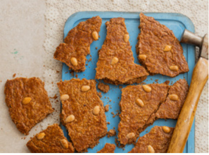

**Ingrediënten voor:** 15-20 stukken
**Bereidingstijd:** ca. 55 min. + ca. 1 uur wachttijd
**125 g** donkerbruine basterdsuiker
**2 el** speculaaskruiden (zie kader
rechtsonder)
**250 g** zelfrijzend bakmeel
snuf zout
**3 el** melk
**150 g** boter (koud)
**25 g** halve blanke amandelen
(garneeramandelen)
losgeklopt ei, om te
bestrijken
vershoudfolie
bakpapier
1 Verwarm de oven voor op 170°C. Meng de basterdsuiker en de speculaaskruiden in een grote
kom. Zeef bakmeel en zout erboven en roer alles
door elkaar.
2 Doe de melk en de boter in blokjes erbij. Kneed
snel met de hand tot een soepele deegbal, eventueel met een extra drupje melk of water als het
echt niet wil pakken. Verpak het deeg in folie en
laat 1 uur rusten in de koelkast.
3 Rol het deeg tussen 2 vellen bakpapier uit
tot een lap van 1 cm dik, duw het gerust wat bij
elkaar als het uit elkaar brokkelt. Verwijder het
bovenste vel papier en hevel de deegplak met
onderpapier en al over op een bakplaat. Duw de
amandelen erin. Kwast in met losgeklopt ei.
4 Bak in de oven in ± 30-35 minuten gaar. Laat
afkoelen en breek dan naar hartenlust in brokstukken.
SPECULAASKRUIDEN (VOOR EEN POTJE)
Breek 20 kardemompeulen open en laat de bruinzwarte zaadjes in de vijzel vallen. Doe 10 kruidnagels, 1 el korianderzaad en ½ el venkelzaad of anijszaad erbij en stamp fijn. Roer 8 el kaneel,
1 el versgemalen witte peper, 1 el versgeraspte nootmuskaat en 1 el gemberpoeder erdoor.
Bewaar luchtdicht in een potje in een donker keukenkastje.
Lekker eten valt of staat met de ingrediënten die je
gebruikt en het keukengerei dat je tot je beschikking hebt.
Daarom presenteren wij elke maand leuke, verrassende,
handige en/of smakelijke producten.

# KERSTSERVETTEN

Op zoek naar mooie servetten die je elke kerst opnieuw kunt
gebruiken? Wat dacht je dan van deze van H&M Home, met
geborduurde kerstsymbooltjes. De servetten zijn van een
katoen/linnenmix en kunnen gewoon in de wasmachine.
Prijs: €14,99 per set van 4.
Verkrijgbaar bij H&M Home.

# Croissantbal

Croissantjes op de kersttafel én croissantjes in de boom!
Deze gouden croissantkerstbal van de HEMA laat iedere
kerstboom stralen. Niet zo van de croissantjes? Er is ook
een tompouce- en een rookworstkerstbal.
Prijs: €4,49.
Verkrijgbaar bij HEMA.

# KROKANTE KOEKJES

Ga je zelf de koekjes van p. 60 bakken? Dan is het wel zo lekker
als ze krokant blijven! In deze leuke kerstkoektrommel van
Søstrene Grene kun je ze lekker lang bewaren. Ook heel leuk
om een stapel koekjes in cadeau te geven, met een grote strik
eromheen!
Prijs: €2,84.
Verkrijgbaar bij Søstrene Grene.

# Feestelijk

# duet

Zo rond de feestdagen gaat er elke
dag wel een stukje taart in… Ga jij
als eerste voor de amandeltaart
met rumkersen of voor de
kaneeltaart met sinaasappel?

## Amandel-meringuetaart met rumkersen

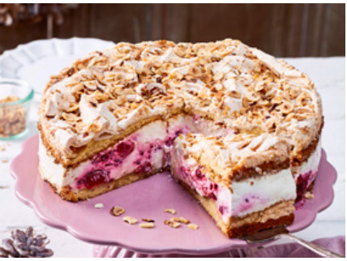

**Ingrediënten voor:** 16 stukken
**Bereidingstijd:** ca. 1 uur en 15 min. + ca. 7 uur wachttijd
**125 g** zachte boter (+ invetten)
**450 g** suiker
**24 g** vanillesuiker
zout
**5** eieren
**120 g** bloem
40 g hazelnootmeel (bijv.
van het merk Smaakt)
**1 tl** bakpoeder
**85 ml** hazelnootlikeur (bij
de slijter)
**100 g** hazelnootschaafsel of
gehakte hazelnoten
**100 ml** rum
**3 tl** maizena
500 g kersen op siroop (pot,
uitgelekt)
**2** gelatineblaadjes
**250 g** magere kwark
**300 g** roomkaas
**200 ml** slagroom
**2 tl** vanillearoma
1 Klop de boter, 125 g suiker, 8 g vanillesuiker en een snufje zout met een
handmixer romig. Splits de eieren en houd het eiwit apart in de koelkast.
Roer de eidooiers één voor één door het suikermengsel. Meng de bloem, het
hazelnootmeel en het bakpoeder met elkaar. Roer afwisselend met de likeur
door het beslag. Verdeel het beslag over twee ingevette springvormen (26
cm Ø).
2 Verwarm de oven voor (elektrisch: 180°C / hetelucht: 160°C). Klop het eiwit
met een snufje zout en 250 g suiker stijf. Verdeel de meringue gelijkmatig
over de twee deegbodems. Strooi het hazelnootschaafsel over een van de
meringuelagen. Bak de bodems samen ca. 25 minuten in de voorverwarmde
oven. Wissel halverwege de baktijd de posities van de vormen. Neem uit de
oven en laat volledig afkoelen.
3 Breng de rum en 16 g vanillesuiker aan de kook. Roer de maizena met 3 el
water glad. Roer het papje door de rum en breng het al roerend opnieuw aan
de kook. Spatel de kersen erdoor en laat afkoelen.
4 Week de gelatine in koud water. Klop de kwark, de roomkaas, de slagroom,
het vanillearoma en 75 g suiker met een handmixer op. Knijp de gelatine uit,
los hem op en meng met 2-3 el van de crème. Spatel dit mengsel door de rest
van de crème.
5 Neem de bodems uit de vormen. Plaats een taartring om de meringuebodem zonder noten. Verdeel de crème erover. Verdeel de kersen erover en
spatel ze losjes erdoor. Leg de tweede bodem erop. Zet ca. 6 uur in de koelkast om op te stijven. Verwijder de taartring voor het serveren.
**Per stuk:** ca. 523 kcal
**10 g** eiwit | 24 g vet | 47 g koolhydraten
Taarten

## Kaneeltaart met sinaasappel

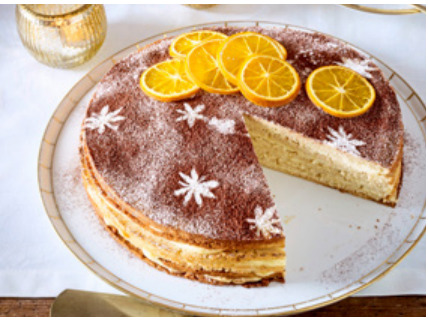

**Ingrediënten voor:** 16 stukken
**Bereidingstijd:** ca. 2 uur + ca. 2 uur wachttijd
**1** vanillestokje
**250 g** zachte boter
**320 g** suiker
zout
**4** eieren
**250 g** bloem
**1 tl** wijnsteenbakpoeder (bij de toko)
**2 tl** kaneel
2 grote sinaasappels (waarvan 1 bio)
**25 g** maizena
**500 g** mascarpone
**5 el** sinaasappellikeur (bijv. Grand Marnier, bij de slijter)
poedersuiker, om te bestuiven
**1** steranijs (als sjabloon)
cacaopoeder, om te bestuiven
evt. gekonfijte sinaasappelschijfjes, ter decoratie
bakpapier
1 Splijt het vanillestokje in de lengte en schraap het merg eruit. Klop de
boter, 230 g suiker, het vanillemerg en een snufje zout met een handmixer
romig. Voeg de eieren één voor één toe en klop goed na elke toevoeging.
Meng de bloem, het bakpoeder en de kaneel met elkaar. Zeef het mengsel
boven het beslag en spatel erdoor. Verdeel het beslag in zes gelijke porties.
2 Verwarm de oven voor (elektrisch: 180°C / hetelucht: 160°C). Strijk een
portie beslag glad uit in een met bakpapier beklede springvorm (26 cm Ø).
Bak in ca. 10 minuten gaar in de voorverwarmde oven. Neem de vorm uit de
oven, stort de cake op een rooster, trek voorzichtig het bakpapier eraf en laat
de cake afkoelen. Herhaal dit met de overige beslagporties.
3 Was de bio-sinaasappel met heet water, wrijf hem droog en rasp de schil er
fijn af. Pers beide sinaasappels uit en meet 300 ml sap af. Roer de maizena
met 5 el van het sap glad. Breng de overige 250 ml sap met 90 g suiker aan de
kook. Roer het maizenapapje erdoor en laat het ca. 1 minuut zachtjes koken.
Roer de sinaasappelrasp erdoor en laat afkoelen. Meng de mascarpone en de
sinaasappelcrème met elkaar.
4 Besprenkel een cakelaag met 1 el sinaasappellikeur en bestrijk met van de
sinaasappel-mascarponecrème. Leg er een tweede cakelaag op. Stapel op
deze manier alle cakes en de crème op elkaar en eindig met een cakelaag.
Bestuif de taart met poedersuiker. Leg de steranijs als sjabloon op verschillende plekken op de taart en bestuif met cacaopoeder. Garneer de taart
eventueel met gekonfijte sinaasappelschijfjes.
**Per stuk:** ca. 422 kcal
**6 g** eiwit | 28 g vet | 38 g koolhydraten

# Koekcadeautjes

Met deze recepten maak je lekker veel
winterse koekjes – leuk om als eetbaar
cadeautje te geven! Bestuif ze met wat
poedersuiker voor een sneeuweffect.

## Koek-kerstboompjes

**Ingrediënten voor:** 4-5 boompjes
(ca. 96 koekjes)
**Bereidingstijd:** ca. 1 uur en 45 min. +
ca. 2 dagen en 2 uur wachttijd
**400 g** bloem (+ bestuiven)
**125 g** suiker
**2 tl** cacao
**125 g** boter, in stukjes
**1** ei
**225 g** stroop
**1 tl** gemalen kardemom
**1 tl** baksoda
**400 g** poedersuiker
**2** eiwitten
**1 el** citroensap
stervormige uitstekers (9 cm
Ø, 8 cm Ø, 7 cm Ø, 6 cm Ø, 5
cm Ø en 4 cm Ø)
bakpapier
1 Doe de bloem, de suiker, de cacao, de boter, het
ei, de stroop, de kardemom en de baksoda in een
kom. Kneed eerst met de deeghaken van een
handmixer en daarna met met bloem bestoven
handen op je werkblad tot een glad deeg. Dek
het deeg af en laat het ca. 2 dagen rusten in de
koelkast.
2 Verwarm de oven voor (elektrisch: 180°C / hetelucht: 160°C). Verdeel het deeg in 6 porties. Rol
iedere portie op een met bloem bestoven werkblad dun uit (2-3 mm). Steek met stervormige
uitstekers (9 cm Ø, 8 cm Ø, 7 cm Ø, 6 cm Ø, 5 cm Ø
en 4 cm Ø) 16 sterren van iedere maat. Kneed tussendoor de deegresten opnieuw en steek er weer
sterren uit. Leg de sterren voorzichtig op vier met
bakpapier beklede bakplaten. Bak de bakplaten
één voor één ca. 10-12 minuten in de oven, tot de
koekjes goudbruin en gaar zijn. Neem de koekjes
uit de oven en laat ze volledig afkoelen.
3 Meng de poedersuiker, de eiwitten en het
citroensap tot een glad glazuur. Stapel de koekjes op maat, van groot naar klein, en plak ze op
elkaar met een beetje glazuur om 4-5 kerstboompjes te vormen. Versier de overgebleven sterren
naar smaak met het resterende glazuur. Laat het
glazuur drogen.
**Per stuk:** ca. 55 kcal
**1 g** eiwit | 2 g vet | 11 g koolhydraten
Koekjes bakken

## Chocoladespritsen met wittechocoladevulling

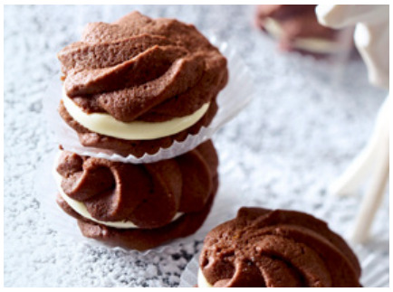

**Ingrediënten voor:** ca. 35 stuks
**Bereidingstijd:** ca. 1 uur + ca. 1 uur wachttijd
**300 g** boter, op kamertemperatuur
**100 g** poedersuiker
**16 g** vanillesuiker
1 bio-sinaasappel (alleen de schil, geraspt)
**2** eieren
**2-3 el** melk
**350 g** bloem
**50 g** cacaopoeder
**270 g** wittechocoladepasta
bakpapier
spuitzak met groot, stervormige spuitmondje
wegwerpspuitzak
1 Klop de boter, de poedersuiker en de vanillesuiker met een handmixer romig. Roer de sinaasappelrasp, de eieren en de melk achtereenvolgens erdoorheen. Spatel de bloem met de cacao en roer
kort door het beslag. Doe het beslag in een spuitzak met een grote stervormige spuitmond. Spuit ca.
70 platte toefjes op drie met bakpapier beklede bakplaten.
2 Verwarm de oven voor (elektrisch: 200°C / hetelucht: 180°C). Bak de koekjes per bakplaat in 6-8
minuten gaar in de oven. Neem ze uit de oven en laat ze volledig afkoelen. Doe de wittechocoladepasta in een wegwerpspuitzak. Spuit de pasta op de onderkant van 35 koekjes. Leg de overige
koekjes erop en druk ze licht aan. Bewaar de spritsen koel en luchtdicht. Ze zijn dan ca. 2 weken
houdbaar.
**Per stuk:** ca. 139 kcal
**3 g** eiwit | 10 g vet | 13 g koolhydraten

## Florentinekoekjes

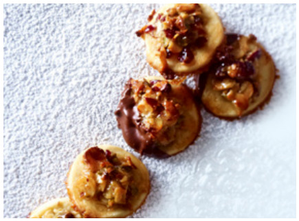

**Ingrediënten voor:** ca. 60 stuks
**Bereidingstijd:** ca. 1 uur en 30 min. + ca. 15 uur wachttijd
**200 g** boter
**1** eidooier
**165 g** poedersuiker
**8 g** vanillesuiker
**1 el** bloem
**50 g** pistachenoten
**50 g** gedroogde cranberry’s
**125 ml** slagroom
**50 g** vloeibare honing
**100 g** hazelnootschaafsel
**350 g** + 1 el bloem
**150 g** pure chocolade
**15 g** kokosolie
vershoudfolie
bakpapier
1 VOOR HET DEEG Klop 175 g boter, de eidooier, 125 g poedersuiker en de
vanillesuiker met een handmixer door elkaar. Zeef 350 g bloem erboven.
Voeg 2 el koud water toe en kneed alles tot een deeg. Vorm van het deeg
2 rollen (elk ca. 26 cm lang), wikkel ze in vershoudfolie en laat een nacht
rusten in de koelkast.
2 VOOR HET FLORENTINEMENGSEL Hak de pistachenoten en de cranberry’s
fijn. Breng 25 g boter, de slagroom, 40 g poedersuiker en de honing al roerend aan de kook in een steelpan. Voeg het hazelnootschaafsel, de pistachenoten en de cranberry’s toe en laat het mengsel op laag vuur onder af en toe
roeren ca. 2 minuten zachtjes koken. Roer 1 el bloem erdoorheen. Neem de
pan van het vuur en laat het mengsel ca. 15 minuten rusten.
3 Verwarm de oven voor (elektrisch: 200°C / hetelucht: 180°C). Snijd iedere
deegrol in ca. 30 plakjes. Verdeel deze over vier met bakpapier beklede
bakplaten. Verdeel het florentinemengsel erover. Bak de bakplaten één voor
één ca. 8-10 minuten in de oven, tot de koekjes goudbruin en gaar zijn. Laat
volledig afkoelen.
4 Hak de chocolade fijn en smelt samen met de kokosolie au bain-marie.
Doop de koekjes naar wens in de gesmolten chocolade. Laat ze uitlekken, leg
ze op bakpapier en laat drogen. Bewaar de florentinekoekjes koel en luchtdicht. Ze zijn dan ca. 3 weken houdbaar.
**Per stuk:** ca. 99 kcal
**2 g** eiwit | 6 g vet | 11 g koolhydraten

## Kerststolkoekjes

## met walnootvulling

**Ingrediënten voor:** 27 stuks
**Bereidingstijd:** ca. 1 uur en 15 min. + ca. 1 uur
wachttijd
**2 tl** rozijnen
**20 g** walnoten
**50 g** marsepein
**38 ml** rumaroma (of
amandelaroma)
**500 g** bloem (+ bestuiven)
**2** afgestr. tl bakpoeder
**150 g** suiker
**16 g** vanillesuiker
**1 snufje** zout
**100 g** amandelmeel
**2** eieren
**300 g** boter, in stukjes
**2** eiwitten
poedersuiker, om te
bestuiven
bloem, voor het werkblad
bakpapier
Koekjes bakken
1 VOOR DE VULLING Was de rozijnen en dep ze droog. Hak de walnoten en de
rozijnen fijn. Rasp de marsepein. Doe alles in een kom, besprenkel met het
rumaroma en meng met elkaar. Houd apart.
2 VOOR HET DEEG Meng de bloem en het bakpoeder in een kom. Voeg de
suiker, de vanillesuiker, het zout, het amandelmeel, de eieren en de boter toe.
Kneed de ingrediënten eerst met de deeghaken van een handmixer en daarna met koele handen tot een glad deeg.
3 Halveer het deeg. Rol iedere helft op een met bloem bestoven werkblad
uit tot een rechthoek (13½ x 40½ cm) en snijd elk in drie stroken (elk 4½ x
40½ cm), zodat je zes stroken krijgt. Verdeel over drie deegstroken de vulling
in negen hoopjes per strook, op gelijke afstand van elkaar. Kluts de eiwitten
en bestrijk het deeg rondom de hoopjes ermee. Leg de onbelegde deegstroken op de belegde stroken. Snijd de gevulde stroken elk in 9 vierkantjes van
4½ cm. Druk de randen van het deeg goed aan. Druk voor het patroon met
een vork licht in de vier zijkanten van de stollenkoekjes.
4 Verwarm de oven voor (elektrisch: 200°C / hetelucht: 180°C). Leg de stollenkoekjes op met bakpapier beklede bakplaten. Bak de bakplaten één voor
één ca. 14 minuten in de oven, tot de koekjes goudbruin en gaar zijn. Neem ze
uit de oven en laat ze afkoelen. Bestuif met poedersuiker. Bewaar ze in een
luchtdichte trommel.
**Per stuk:** ca. 217 kcal
**5 g** eiwit | 13 g vet | 22 g koolhydraten

# Kerstige cake

Neem cranberry’s, sinaasappel en chocolade en je krijgt
meteen een kerstgevoel. Al die ingrediënten samen in één
cake maken dit het ultieme kerstdessert.

## Kerstcake met wittechocoladeroom en

## cranberrycompote

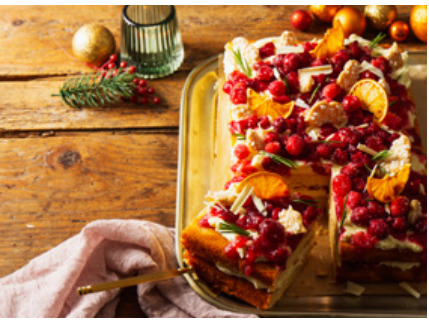

**Ingrediënten voor:** 20 stukken
**Bereidingstijd:** ca. 2 uur + min. 1 uur wachttijd
**1** sinaasappel
**100 g** suiker
**50 g** witte chocolade
een paar takjes
rozemarijn
een paar kerstkransjes
vershoudfolie
keukenpapier
**VOOR DE** WITTECHOCOLADEROOM
**1 tl** vanille-extract
**500 ml** slagroom
**500 g** witte chocolade, grof
gehakt
**VOOR DE** CAKE
**275 g** boter, op
kamertemperatuur
**400 g** suiker
**2 tl** vanille-extract
**½ tl** zout
**5** eieren, op
kamertemperatuur
**400 g** bloem
**60 g** maizena
**2 el** bakpoeder
**375 ml** karnemelk
**VOOR DE** CRANBERRYCOMPOTE
**1** bio-sinaasappel
**250 g** cranberry’s
**1** kaneelstokje
**50 g** suiker
**2 takjes** rozemarijn
**50 ml** rode port*
1 Verwarm de oven voor (elektrisch: 110°C / hetelucht: 90°C). Snijd de sinaasappel in dunne plakjes. Halveer de plakjes en leg op een met bakpapier beklede bakplaat. Laat de sinaasappelschijfjes ca. 2 uur en 30 minuten drogen
in de oven. Draai ze halverwege de baktijd om.
2 VOOR DE WITTECHOCOLADEROOM Doe de witte chocolade in een kom.
Verwarm de slagroom met het vanille-extract in een pannetje tot tegen de
kook en schenk over de witte chocolade. Roer met een garde tot een gladde
room. Dek af met vershoudfolie en zet minimaal 1 uur, maar het liefst een
nacht, in de koelkast.
3 VOOR DE CAKE Verwarm de oven voor (elektrisch: 200°C / hetelucht:
180°C). Vet een braadslee (ca. 35 x 45 cm) in met boter en bekleed de bodem
met bakpapier. Doe de boter, de suiker, het vanille-extract en het zout in een
kom en klop in enkele minuten romig. Voeg de eieren één voor één toe. Meng
Coverrecept
goed tot het ei volledig is opgenomen, voor je het volgende ei toevoegt. Meng
in een andere kom de bloem, de maizena en het bakpoeder en voeg de helft
daarvan toe aan het botermengsel. Spatel dit rustig erdoorheen. Voeg de
helft van de karnemelk toe en spatel ook dit door het beslag. Doe hetzelfde
met de andere helft van de bloem en de karnemelk.
4 Verdeel het cakebeslag over de braadslee en bak de cake in ca. 30 minuten
goudbruin en gaar. Controleer dit met een satéprikker. Als deze er droog uit
komt, is de cake gaar. Laat de cake ca. 15 minuten afkoelen op een rooster.
Neem dan uit de vorm en laat helemaal afkoelen op een rooster. Snijd de
cake dwars doormidden.
5 VOOR DE CRANBERRYCOMPOTE Boen de sinaasappel schoon onder heet
water. Rasp de schil en pers het sap. Houd een paar cranberry’s apart. Breng
de rest van de cranberry’s met de sinaasappelschil, het sap, het kaneelstokje,
de suiker, de rozemarijn en de port aan de kook. Laat ca. 15 minuten op laag
vuur koken, tot de bessen stuk zijn. Laat helemaal afkoelen.
6 Strooi 100 g suiker op een bord. Rol de apart gehouden cranberry’s erdoorheen. Leg op een stukje keukenpapier en laat drogen. Schaaf met een dunschiller krullen van de witte chocolade.
7 Klop de wittechocoladeroom op met een (hand)mixer totdat deze stevig
en luchtig is. Strijk met een spatel de helft van de room uit over een van de
cakes. Leg de andere cake erop. Verdeel de rest van de room erover. Verdeel
de cranberrycompote erover. Maak af met de gesuikerde cranberry’s, de
chocoladekrullen, de gedroogde sinaasappelplakjes, een paar takjes rozemarijn en kerstkransjes.
**Per stuk:** ca. 570 kcal
**4 g** eiwit | 32 g vet | 66 g koolhydraten
*Liever geen alcohol? Dan kun je ook wat meer sinaasappelsap
gebruiken.
Coverrecept

# De beste messen

Op zoek naar nog een mooi kerstcadeau voor jezelf of voor
een ander? Goede messen zijn onmisbaar in de keuken. Het
opkomende merk XinZuo heeft verschillende messen in het
assortiment, voor iedere keukenklus een geschikt exemplaar.
Wij gingen ermee aan de slag.
Een goed mes maakt een wereld van verschil in de
keuken. Misschien heb je het zelf weleens ervaren
hoe vervelend het is om tomaten te snijden met
een bot mes? XinZuo is een opkomende Chinese
messenmaker die staat voor kwaliteit én betaalbaarheid. Daarmee biedt XinZuo een interessant
alternatief voor dure Japanse messen.
Om die kwaliteit te bereiken, werkt XinZuo
met zorgvuldig geselecteerde materialen van
over de hele wereld. De meest innovatieve en
hardste staalsoorten worden geïmporteerd uit
Japan en voor de handgrepen wordt zorgvuldig
gekozen voor mooie en duurzame houtsoorten.
De harde stalen kern zorgt ervoor dat de messen
lang scherp blijven - en dus ook duurzamer zijn in
gebruik. Door deze kern te omhullen met afwisselende lagen roestvrij staal, ontstaan de karakteristieke Damascuspatronen in de lemetten. Wij
testten de messen aan de hand van allerhande
keukenklussen.

## XinZuo B37

## Damascus

## Series

Deze messen zijn onderdeel
van de XinZuo B37 Damascus
Series. Ze roesten niet, zijn
slijtvast en worden met de hand
geslepen, gepolijst en afgewerkt.
De lemetten zijn voorzien van
handgrepen van Europees olijfhout, afgewerkt met een mozaïekklinknagel. Kijk voor alle messen
én messensets op xinzuo.nl.
Het koksmes
Een goed koksmes is de basis van elke keuken. Binnen de XinZuo B37 Damascus Series
vind je zowel het Europese als het Chinese
koksmes, elk met hun eigen snijtechniek.
Bij het Europese koksmes (bovenste foto),
blijft de punt op de snijplank en maak je een
vloeiende, wiegende beweging. Het Chinese
koksmes (onderste foto), vraagt juist om een
op-en-neergaande snijtechniek, waarbij het
extra gewicht van het mes helpt om moeiteloos door hardere ingrediënten te snijden,
zoals aardappel of wortel. Tijdens het testen
merkten we dat beide messen goed in balans
liggen en comfortabel in de hand voelen.
Bovendien blijven ze lange tijd scherp.
XinZuo koken & genieten
Het uitbeenmes
Serveer jij dit jaar kip of kalkoen met kerst? Dan is een goed uitbeenmes onmisbaar. Dit mes
heeft een smal en stevig lemmet, waarmee je gemakkelijk vlees losmaakt van het bot en pezen
of vet verwijdert, zonder onnodig vlees te verliezen. Een uitbeenmes is speciaal ontworpen voor
kracht en precisie dicht langs het bot: het lemmet is relatief kort, stijf en biedt de benodigde
controle bij het werken rondom gewrichten en kleinere stukken vlees. De XinZuo B37 Damascus
Series bevat ook een fileermes. Hoewel de messen op elkaar lijken, hebben ze een andere functie.
Het fileermes is iets langer en dunner, en daarmee vooral bedoeld voor het fileren van vis of het
heel nauwkeurig snijden van zachterige vleessoorten.
Het sashimimes
Een voorgerecht dat bestaat uit
dungesneden plakjes verse tonijn of
zalm? Of wat dacht je van de perfecte ceviche? Voor zulke gerechten
komt een sashimimes goed van pas.
Dit mes is ontworpen voor precisiewerk zoals bij sashimi of sushi.
Het sashimimes, a omstig van de
XinZuo SO series, heeft een lang,
smal lemmet van wel 27 cm, dat
enkelzijdig geslepen is - een typisch
kenmerk van Japanse messen.
Hierdoor kun je zeer dunne, egale
sneden maken in één vloeiende
beweging, zonder de structuur van
de vis te beschadigen.

## Meer ervaringen lezen?

Onze chef Willem gebruikt de messen van XinZuo inmiddels
al enige tijd in onze studio en hij is enthousiast over het
gebruik. Willem: “Het zijn allemaal vrij forse messen met
een goede gewichtsverdeling, wat voor mij heel fijn werkt.
Ze zijn echt vlijmscherp! En, het oog wil natuurlijk ook wat,
de messen zien er prachtig uit!” Scan de QR-code voor meer
ervaringen en een uitgebreide review van Willem.

# Fijne kerst

# voor iedereen

Eet jij of een kerstgast glutenvrij, veganistisch of lactosevrij? Maak
dan een van deze recepten! Ze zijn voor iedereen heerlijk en zo kun je
samen van hetzelfde kerstdiner genieten.

## Crème brûlée van geitenkaas

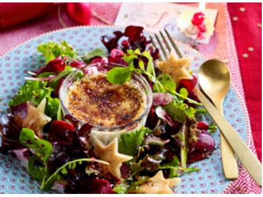

**Ingrediënten voor:** 4 personen
**Bereidingstijd:** ca. 25 min. + ca. 1 uur wachttijd
**4 takjes** tijm
**150 ml** melk
**150 g** slagroom
**180 g** verse geitenkaas
**1 el** vloeibare honing
**2** eieren
**2** eidooiers
zout en peper
nootmuskaat
**4 sneetjes** toastbrood
**5 el** olijfolie
2 gekookte rode bieten (vacuümverpakt)
**4** sjalotten
**150 g** babyleafsla
**3 el** rodewijnazijn
**1 tl** suiker
**4 tl** lichte basterdsuiker
uitsteker in stervorm (ca. 3 cm)
keukenpapier
1 Verwarm de oven voor (elektrisch: 100°C / hetelucht: 80°C). Was
de tijm en neem de blaadjes van de takjes. Pureer de melk, de slagroom, de kaas, de tijm, de honing, de eieren en de eidooiers met een
staafmixer fijn. Breng het mengsel stevig op smaak met zout, peper
en nootmuskaat. Verdeel het mengsel over vier ovenschaaltjes
(à ca. 200 ml). Zet de vormpjes op een diepe bakplaat en schenk
ca. 3 cm heet water in de bakplaat. Bak de crème brûlées in ca. 60
minuten gaar op een rooster in het midden van de oven.
2 Rol de sneetjes toastbrood dun uit met een deegroller. Steek uit
elk sneetje 4 sterren (ca. 3 cm) met een stervormige uitsteker.
Verhit 2 el olijfolie in een pan en bak de toaststerren hierin in ca.
3 minuten goudgeel; draai regelmatig om. Neem ze uit de pan en
laat ze op keukenpapier uitlekken.
3 Neem de crème brûlées uit de oven en laat afkoelen. Schaaf de
rode bieten in dunne plakjes. Pel de sjalotten en snijd ze in dunne
ringen. Was de sla. Meng de rode biet, de sjalotten en de sla met de
rodewijnazijn en 3 el olijfolie en breng op smaak met zout, peper en
de suiker.
4 Dep het oppervlak van de crème brûlée droog met keukenpapier.
Verdeel de basterdsuiker erover en karamelliseer met een keukenbrander. Serveer de crème brûlées met de salade en de toaststerren.
**Per portie:** ca. 607 kcal
**18 g** eiwit | 46 g vet | 32 g koolhydraten
De gezonde keuken

## Kabeljauwfilet met amandelkorst

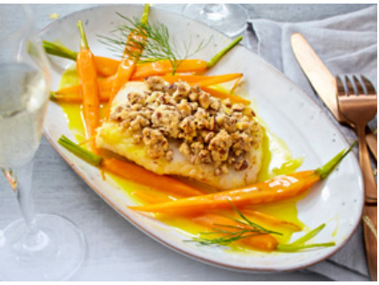

**Ingrediënten voor:** 4 personen
**Bereidingstijd:** ca. 45 min.
**1** bos wortels
**5 el** boter (waarvan 1 el koud)
**1 el** suiker
**200 ml** visfond (uit een pot)
**1** klein plukje saffraan
zout en peper
**75 g** amandelen
**2 el** bloem
4 kabeljauwfilets (à ca. 150 g)
**2 el** olijfolie
**2 takjes** dille
1 Maak de wortels schoon, laat een stukje van het groen zitten, schil de wortels en was
ze. Halveer de wortels in de lengte. Verhit 2 el boter in een grote koekenpan. Stoof de
wortels hierin ca. 5 minuten. Voeg de suiker toe en karamelliseer licht. Blus af met de
fond, breng aan de kook en roer de saffraan erdoorheen. Breng op smaak met zout en
peper. Laat afgedekt op laag vuur ca. 10 minuten zachtjes koken.
2 Verwarm de oven voor (elektrisch: 230°C / hetelucht: 210°C). Hak de amandelen
grof. Kneed de amandelen, 2 el boter en de bloem tot kruimels. Dep de vis droog en
bestrooi met zout en peper. Verhit de olijfolie in een tweede grote koekenpan op hoog
vuur. Bak de vis hierin aan elke zijde ca. 1 minuut. Neem de vis uit de pan en leg op een
bakplaat. Verdeel de amandelkruimels gelijkmatig over de vis en gratineer 6-8 minuten in de voorverwarmde oven.
3 Neem de wortels uit de pan en laat uitlekken. Vang het kookvocht op en doe het in
een pan. Breng het kookvocht aan de kook en laat ca. 2 minuten inkoken. Voeg de
koude boter toe en roer met een garde snel erdoorheen.
4 Was de dille en neem de blaadjes van de takjes. Serveer de wortels met de vis.
Besprenkel met de saffraanbotersaus en garneer met de dille.
**Per portie:** ca. 470 kcal
**37 g** eiwit | 30 g vet | 16 g koolhydraten

## Ravioli met paddenstoelenvulling

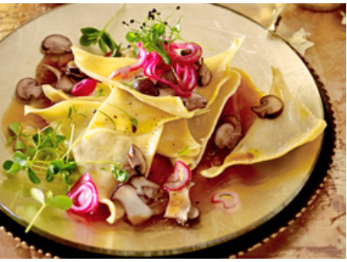

**Ingrediënten voor:** 4 personen
**Bereidingstijd:** ca. 2 uur
**1** ui
**1** teentje knoflook
**750 g** paddenstoelen
(bijv. oesterzwammen, eekhoorntjesbrood,
champignons of koningsoesterzwammen)
**7 el** olijfolie
**80 ml** lichte balsamicoazijn
**2 takjes** oregano
**1 takje** salie
**2 el** paneermeel
zout en peper
**400 g** bloem
**200 ml** sinaasappelsap
**2 el** sojasaus
**2** rode uien
**2 el** suiker
tuinkers, om te garneren
bloem, om uit te rollen
vershoudfolie
1 VOOR DE VULLING Pel en snipper de ui en de knoflook. Maak
**500 g** paddenstoelen schoon en snijd grof. Verhit 2 el olijfolie en
fruit de ui en de knoflook hierin. Voeg de gesneden paddenstoelen toe en bak ca. 10 minuten mee. Schenk 3 el balsamicoazijn
erbij. Was de oregano en de salie. Pureer ze met de gebakken
paddenstoelen, het paneermeel en 2 el olijfolie. Breng op smaak
met zout en peper.
2 VOOR HET DEEG Meng de bloem, 150 ml water, 1 el olijfolie en
**½ tl** zout eerst met de deeghaken van een handmixer en kneed
het deeg daarna met de hand op een met bloem bestoven werkblad in ca. 10 minuten glad. Wikkel het deeg in de vershoudfolie
en laat ca. 30 minuten rusten.
3 Maak de overige 250 g paddenstoelen schoon en snijd in
plakjes. Verhit 2 el olijfolie en bak de paddenstoelen hierin ca.
5 minuten. Schenk het sinaasappelsap en de sojasaus erbij, breng
aan de kook en laat kort zachtjes koken. Breng op smaak met
zout en peper. Pel de rode uien en snijd in ringen. Breng aan de
kook met 50 ml balsamicoazijn, 50 ml water en de suiker. Laat
ca. 3 minuten zachtjes koken.
4 Rol het deeg op een met bloem bestoven werkblad uit tot een
dikte van ca. 3 mm en snijd in vierkanten (ca. 8 cm). Verdeel over
elk vierkant 1 tl vulling. Vouw de vierkanten tot driehoeken en
druk de randen aan. Laat de ravioli in kokend water met zout in
4-5 minuten gaar worden. Serveer de ravioli met de paddenstoelensaus en de uien. Garneer met de tuinkers.
**Per portie:** ca. 630 kcal
**20 g** eiwit | 20 g vet | 93 g koolhydraten

## Glutenvrij kerstbrood

**Ingrediënten voor:** ca. 32 plakken
**Bereidingstijd:** ca. 1 uur en 30 min. +
ca. 1 uur wachttijd
**375 ml** melk
**1 tl** + 500 g glutenvrij meel
**7 g** gedroogde gist
**1 tl** + 125 g suiker
**225 g** boter (+ invetten)
**2** eieren
zout
**4 el** appelazijn
**250 g** sultanarozijnen
**250 g** gehakte amandelen
**50 g** gekonfijte sinaasappelschil
(bij de bakwinkel)
**50 g** sukade (gekonfijte
citroenschil)
**75 g** poedersuiker
bakpapier
1 VOOR HET VOORDEEG Verwarm de melk in een
kleine pan tot lauwwarm. Meng 50 ml lauwwarme melk met 1 tl meel, de gist en 1 tl suiker. Laat
het mengsel ca. 15 minuten staan.
2 Voeg 500 g meel, de overige 325 ml melk, 125 g
suiker, 125 g boter, de eieren, een snufje zout en
de appelazijn toe aan het voordeeg. Kneed met de
deeghaken van een handmixer tot een glad deeg.
Kneed de rozijnen, de amandelen, de sinaasappelschil en de sukade erdoorheen. Halveer het
deeg. Vul 2 ingevette stollenvormen (ca. 12 x 22
cm; 1 l inhoud) met het deeg. Laat het deeg afgedekt op een warme plek ca. 1 uur rijzen.
De gezonde keuken
3 Verwarm de oven voor (elektrisch: 180°C /
hetelucht: 160°C). Zet beide vormen ondersteboven op een met bakpapier beklede bakplaat. Bak
de broden ca. 1 uur in de voorverwarmde oven.
Neem de vormen na ca. 30 minuten weg en bak
de broden verder gaar.
4 Smelt de overige 100 g boter in een pan. Neem
de stollen uit de oven en bestrijk ze direct met de
gesmolten boter. Bestuif met de poedersuiker en
laat afkoelen.
Per plak: ca. 220 kcal
**4 g** eiwit | 11 g vet | 28 g koolhydraten

# Kerst op

# z’n Engels

Met een grote pot thee en deze heerlijke sandwiches
en scones waan je je even in het mooie Engeland.
Lekker als lunch tijdens de kerst! Fancy a cuppa?
*Kun je geen zwarte
bessen vinden?
Blauwe bessen zijn
net zo lekker voor
dit recept!

## Zwartebessenscones

## met jam en clotted cream

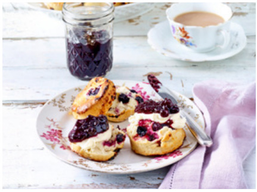

**Ingrediënten voor:** 12 stuks
**Bereidingstijd:** ca. 50 min.
**100 g** zwarte bessen* (vers of
diepvries)
**1** ei
**100 ml** melk
**250 g** bloem (+ bestuiven)
**8 g** bakpoeder
**½ tl** baksoda
**2 el** suiker (+ bestrooien)
**1 snufje** zout
**125 g** boter (koud, in blokjes)
**100 g** zwarte- of blauwebessenjam
**170 g** clotted cream (potje, bij de
delicatessenafdeling)
uitsteker (ca. 6 cm Ø)
bakpapier
1 Was de zwarte bessen, laat ze goed uitlekken en
ris de bessen van de takjes. Laat diepvriesbessen
eerst ontdooien. Kluts het ei met 80 ml van de
melk. Meng in een kom de bloem met het bakpoeder, de baksoda, de suiker en het zout. Voeg
de blokjes boter toe en wrijf met je vingertoppen
door het bloemmengsel tot een kruimelig deeg.
Voeg het eimengsel en de bessen toe en kneed
kort tot een samenhangend deeg.
2 Verwarm de oven voor (elektrisch: 200°C /
hetelucht: 180°C). Rol het deeg op een met bloem
bestoven werkblad uit tot een lap van ca. 2 cm
dik. Steek met een ronde uitsteker 12 rondjes (ca.
6 cm Ø) uit het deeg. Leg de rondjes op een met
bakpapier beklede bakplaat. Bestrijk de scones
met de overige melk en bestrooi met wat extra
suiker. Bak de scones in ca. 15 minuten goudbruin
en gaar. Laat afkoelen op een rooster. Serveer de
scones met de zwartebessenjam en de clotted
cream.
**Per stuk:** ca. 250 kcal
**4 g** eiwit | 16 g vet | 25 g koolhydraten

## Sandwiches

## met appel-kerriesalade

**Ingrediënten voor:** 4 personen
**Bereidingstijd:** ca. 25 min.
**1** stengel bleekselderij
**1** appel
**1 el** citroensap
**1 bosje** bieslook
**200 g** mayonaise
zout en peper
**1 tl** kerrie
**1 bosje** rucola
**12 sneetjes** wit casinobrood
**8** plakken gekookte ham
(à ca. 30 g)
satéprikkers
1 VOOR DE APPEL-KERRIESALADE Was de bleekselderij en snijd hem heel fijn. Schil de appel,
halveer hem, verwijder het klokhuis en rasp de
appel fijn. Besprenkel de geraspte appel direct
met het citroensap. Was de bieslook en hak hem
Culinair onderweg
fijn. Roer de mayonaise glad. Roer de bleekselderij, de geraspte appel en de meeste bieslook
erdoorheen. Breng de salade op smaak met zout,
peper en de kerrie.
2 VOOR DE SANDWICHES Was de rucola en laat
hem goed uitlekken. Bestrijk 8 sneetjes brood
met elk 1 el van de appelkerriesalade. Beleg de
salade met een plak ham en wat rucola. Houd ook
wat rucola apart voor de garnering. Leg steeds
2 belegde sneetjes op elkaar en dek af met een
onbelegd sneetje sandwichtoast. Steek de sandwiches vast met satéprikkers. Snijd eventueel de
korstjes eraf. Snijd de sandwiches elk in vieren
en garneer met de apart gehouden bieslook en
rucola.
**Per portie:** ca. 580 kcal
**22 g** eiwit | 32 g vet | 53 g koolhydraten

# op de

# De kerst

Met winterse smaken als kaneel,
amandel en speculaas maak je er

# taart

echt een feestje van.
Met deze oogverblindende baksels
maak jij deze kerst wel indruk!

## Feestelijke kaneelstertaart

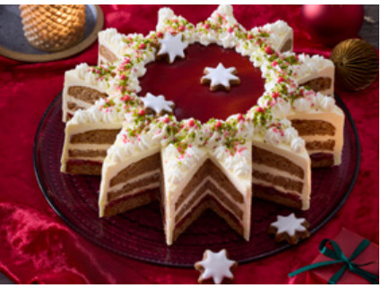

**Ingrediënten voor:** 24 stukken
**Bereidingstijd:** ca. 2 uur en 15 min.
+ ca. 5 uur wachttijd
**650 g** zachte boter (+ invetten)
**100 g** amandelpasta
**175 g** + 4 el suiker
**8 g** vanillesuiker
zout
**5** eieren
**100 g** maizena
**150 g** bloem (+ bestuiven)
**16 g** bakpoeder
**2 el** + 1 mespunt kaneel
**800 ml** melk
**220 g** vanillepuddingpoeder
(bijv. van Dr. Oetker)
**300 g** frambozenjam
**200 ml** slagroom
**1-2 tl** gehakte pistachenoten
rode (mini-)suikerparels,
om te decoreren
kleine sterrenkoekjes,
om te decoreren
vershoudfolie
spuitzak met grote
stervormige spuitmond
spuitzak met heel klein
stervormig spuitmondje
1 VOOR DE BODEM Verwarm de oven voor (elektrisch: 180°C / hetelucht: 160°C). Klop 150 g boter,
de amandelpasta, 175 g suiker, de vanillesuiker
en een snufje zout romig met een handmixer.
Voeg de eieren één voor één toe, afgewisseld
met telkens 1 el maizena. Meng de bloem, de
resterende maizena, het bakpoeder en 2 el kaneel
met elkaar, zeef het mengsel boven het beslag en
roer kort door. Doe het beslag in een ingevette en
met bloem bestoven springvorm. Bak in 35-40
minuten gaar in de oven. Laat de cake volledig
afkoelen.
2 VOOR DE BOTERCRÈME Roer 200 ml melk, 4
el suiker en het puddingpoeder glad. Breng 600
ml melk aan de kook, roer het puddingmengsel
erdoor en laat al roerend ca. 1 minuut zachtjes
koken. Schep de pudding in een kom. Dek het
oppervlak direct af met vershoudfolie en laat
afkoelen. Klop 500 g boter in ca. 8 minuten wit
en romig met een handmixer. Roer de nog lauwe
pudding glad en meng hem lepel voor lepel door
de boter. Breng de botercrème op smaak met 1
mespuntje kaneel.
3 Snijd de cake horizontaal in drie gelijke lagen.
Verwarm 200 g frambozenjam licht en roer glad.
Bestrijk de onderste laag met de jam. Neem
ca. 550 g botercrème en houd deze apart om de
taart later mee af te smeren. Halveer de overige
botercrème. Strijk één helft voorzichtig over de
jamlaag. Dek af met de tweede cakelaag. Bestrijk
deze met de andere helft van de botercrème en
leg de laatste laag erop. Smeer de taart rondom in
met de apart gehouden botercrème. Zet de taart
minimaal 2 uur in de koelkast.
Gebak
4 Markeer met een taartring of een omgekeerde
kom (ca. 15 cm Ø) een cirkel in het midden van de
taart. Markeer op deze cirkel 12 punten, zoals op
een klok. Maak nu aan de rand van de taart, precies tussen twee punten van de binnenste cirkel,
12 nieuwe markeringen; dit worden de uiteinden
van de sterpunten. Snijd met een scherp, dun mes
van de buitenste markeringen naar de punten
van de binnenste cirkel en snijd zo 12 driehoeken
uit de taart. Verwarm de resterende 100 g jam al
roerend en laat iets afkoelen. Strijk de jam voorzichtig uit binnen de gemarkeerde cirkel. Zet de
taart kort in de koelkast.
5 VOOR DE DECORATIE Klop de slagroom stijf.
Doe ⅔ van de slagroom in een spuitzak met een
grote stervormige spuitmond. Spuit kleine toefjes
slagroom langs de rand van de jam. Versier de
toefjes met rode suikerparels. Doe de overige
slagroom in een spuitzak met een heel klein
stervormig spuitmondje en spuit toefjes op de
sterpunten. Bestrooi de taart met de pistachenoten en de rode mini-suikerparels. Zet de kaneelstertaart in de koelkast en versier hem vlak voor
het serveren met de kleine sterrenkoekjes.
**Per stuk:** ca. 410 kcal
**5 g** eiwit | 31 g vet | 28 g koolhydraten

## Sinaasappelchocoladespekkoek

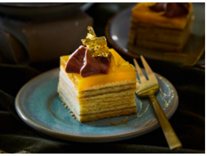

**Ingrediënten voor:** 16 stuks
**Bereidingstijd:** ca. 2 uur en 45 min.
**200 ml** slagroom
**100 g** pure chocolade
**6** eieren
**250 g** zachte boter
**250 g** + 1 tl suiker
**8 g** vanillesuiker
**100 g** marsepein
3 el amaretto (amandellikeur,
bij de slijter)
**150 g** bloem
**100 g** maizena
**16 g** bakpoeder
**3** gelatineblaadjes
**300 ml** sinaasappelsap
**1** bio-sinaasappel
(alleen de schil, geraspt)
evt. sinaasappelschil en
bladgoud, ter decoratie
bakpapier
spuitzak met stervormig
spuitmondje
1 VOOR DE GANACHE Verhit de slagroom in een pan.
Hak de chocolade grof en laat hem in de hete slagroom smelten. Laat de chocoladeroom afkoelen en
zet hem minimaal 2 uur in de koelkast.
2 VOOR DE SPEKKOEK Splits intussen de eieren.
Klop de boter, 250 g suiker, de vanillesuiker en de
eidooiers met een handmixer tot een wit en romig
beslag. Verwarm de marsepein en de amaretto licht,
roer glad en meng door het beslag. Meng de bloem,
de maizena en het bakpoeder, zeef het mengsel
boven het beslag en spatel voorzichtig erdoorheen.
Klop de eiwitten stijf en spatel ze door het beslag.
3 Verwarm de ovengrill voor. Strijk 3 el beslag uit
over de bodem van een met bakpapier beklede vierkante springvorm (ca. 24 x 24 cm). Bak ca. 2 minuten onder de grill in het midden van de oven tot het
laagje lichtbruin is. Neem de vorm direct uit de oven.
Strijk opnieuw 3 el beslag over de gebakken laag en
bak weer ca. 2 minuten. Herhaal dit proces tot al het
beslag op is. Laat de spekkoek volledig afkoelen en
neem hem dan voorzichtig uit de vorm.
4 VOOR DE SINAASAPPELGELEI Week de gelatine
in koud water. Meng het sinaasappelsap, de sinaasappelrasp en 1 tl suiker. Verwarm ca. 100 ml van het
sap. Knijp de gelatine uit en los hem op in het warme
sap. Roer de opgeloste gelatine door de rest van het
sap. Laat het sap afkoelen. Verdeel het over de spekkoek zodra het begint te geleren. Zet de spekkoek ca.
30minutenindekoelkast.
5 Snijd de spekkoek in blokjes van ca. 5 x 5 cm. Klop
de ganache kort op met een handmixer en doe hem
in een spuitzak met stervormig spuitmondje. Spuit
op elk blokje een grote toef. Versier de blokjes eventueel met sinaasappelschil en bladgoud.
**Per stuk:** ca. 380 kcal
**6 g** eiwit | 23 g vet | 34 g koolhydraten

## Speculoosvlechtbrood

**Ingrediënten voor:** 14 plakken
**Bereidingstijd:** ca. 2 uur en 30 min.
+ ca. 1 uur en 30 min. wachttijd
**25 g** gedroogde abrikozen
**25 g** gedroogde kersen
**7 el** rum (bij de slijter)
**300 g** bloem (+ bestuiven)
**40 g** + 1 el suiker
zout
**1** bio-citroen
(alleen schil, geraspt)
**21 g** verse gist (of 8 g droge gist)
**2** eieren
**70 g** zachte boter
**6 el** melk
**250 g** speculoospasta
**6** speculaasjes
**150 g** poedersuiker
**2 el** whisky-roomlikeur
(bijv. Baileys, bij de slijter)
bakpapier
1 VOOR DE VULLING Snijd de abrikozen en de
kersen fijn en week ze in de rum. Laat het fruit
trekken.
2 VOOR HET DEEG Meng de bloem, 40 g suiker, een
snufje zout en de citroenrasp met elkaar. Roer de
verse gist en 1 el suiker los tot een vloeibaar papje.
Voeg dit samen met de eieren, de boter en de melk
toe aan het bloemmengsel en kneed alles in ca.
5 minuten tot een soepel deeg. Laat het deeg afgedekt op een warme plek ca. 1 uur rijzen.
3 Laat de kersen en de abrikozen uitlekken.
Kneed het deeg kort door en rol het op een met
bloem bestoven werkblad uit tot een rechthoek
(ca. 25 x 35 cm). Bestrijk het deeg met de speculoospasta. Verkruimel de speculaasjes erboven.
Verdeel de kersen en de abrikozen erover. Rol
het deeg vanaf de korte kant op. Snijd de rol in
de lengte doormidden. Vlecht de twee strengen
in elkaar en leg ze in een met bakpapier bekleed
cakeblik (ca. 25 cm lang). Laat het deeg afgedekt
nog ca. 30 minuten rijzen.
4 VOOR HET GLAZUUR Verwarm de oven voor
(elektrisch: 180°C / hetelucht: 160°C). Bak het
vlechtbrood in ca. 30 minuten goudbruin en gaar.
Laat in het blik afkoelen. Roer de poedersuiker en de
likeur tot een glad glazuur. Neem het brood uit het
blik. Verdeel het glazuur erover en laat het drogen.
Per plak: ca. 290 kcal
**5 g** eiwit | 10 g vet | 41 g koolhydraten
Gebak

## Luxe redvelvettaart

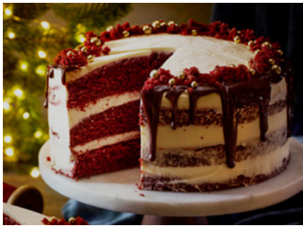

**Ingrediënten voor:** 16 stukken
**Bereidingstijd:** ca. 2 uur en 45 min.
+ ca. 2 uur en 30 min. wachttijd
**1** vanillestokje
**350 g** bloem (+ bestuiven)
**2 el** cacaopoeder
zout
**150 ml** zonnebloemolie
**300 g** zachte boter (+ invetten)
**300 g** suiker
**4** eieren
**3 tl** rode voedingskleurstof
**200 g** karnemelk
**2 tl** baksoda
**1 el** wittewijnazijn
**150 g** poedersuiker
**1 tl** vanille-extract
**600 g** roomkaas
**100 g** pure chocolade
**50 g** melkchocolade
**75 ml** slagroom
gouden en zilveren
suikerparels, ter versiering
1 VOOR DE CAKES Splijt het vanillestokje in de
lengte en schraap het merg eruit. Meng de bloem,
het cacaopoeder en een snufje zout. Klop de olie,
**150 g** boter, het vanillemerg en de suiker met een
handmixer in 3-4 minuten romig. Roer de eieren
één voor één erdoor. Voeg de voedingskleurstof
geleidelijk toe aan het beslag tot het een dieprode
kleur heeft. Roer afwisselend het bloemmengsel
en de karnemelk kort erdoor. Meng de baksoda
en de azijn glad en roer dit als laatste door het
beslag. Verdeel het beslag in drie gelijke delen.
2 Verwarm de oven voor (elektrisch: 180°C / hetelucht: 160°C). Vet een springvorm in en bestuif
hem met bloem. Schep ⅓ van het beslag in de
vorm en strijk glad. Bak de cake in 30-35 minuten
gaar. Neem de cake uit de oven en laat afkoelen
op een rooster. Neem de cake uit de vorm. Bak op
dezelfde manier nog twee cakes van de rest van
het beslag. Snijd de cakes eventueel recht bij en
verkruimel de afsnijdsels.
3 VOOR DE FROSTING Klop 150 g boter, de poedersuiker en het vanille-extract met een handmixer in ca. 5 minuten tot een luchtige, witte
crème. Roer de roomkaas glad en meng hem lepel
voor lepel door de botercrème. Klop de botercrème nog ca. 2 minuten door.
4 Leg een cake op een taartplateau. Bestrijk hem
met ¼ van de frosting. Leg een tweede cakeop en
bestrijk deze ook met ¼ van de frosting. Sluit af
met de laatste cake. Smeer de rest van de frosting
rondom de taart, waarbij je de zijkant zo dun
besmeert dat de lagen licht doorschemeren. Zet
de taart minimaal 1 uur in de koelkast.
5 Hak alle chocolade in stukjes. Verhit de slagroom. Voeg de chocolade toe en laat deze al
roerend smelten. Laat het chocolademengsel
2-3 minuten afkoelen. Verdeel de chocolade met
een lepel langs de rand van de taart, zodat deze er
een beetje afloopt. Laat de chocolade opdrogen.
Versier de taart met de overgebleven kruimels en
de suikerparels.
**Per stuk:** ca. 630 kcal
**10 g** eiwit | 44 g vet | 52 g koolhydraten
Gebak

## Marsepeinen kerstballetjes

**Ingrediënten voor:** 8-10 stuks
**Bereidingstijd:** ca. 10 min.
Kneed 100 g marsepein en 2 druppels vanille-extract glad. Vorm er 8-10 kleine balletjes van.
Doe verschillende eetbare kleur- of glitterpoeders (bij de bakwinkel) apart in kleine kommetjes en rol de balletjes naar wens erdoorheen,
tot ze volledig bedekt zijn met kleur.

## Appel-marsepeintaart

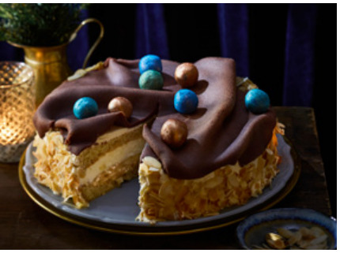

**Ingrediënten voor:** 16 stukken
**Bereidingstijd:** ca. 2 uur + ca. 2 uur wachttijd
**6** eieren
**175 g** + 5 el suiker
**24 g** vanillesuiker
**250 g** amandelmeel
**65 g** maizena
**3** zure appels
(ca. 600 g, bijv. goudreinet)
**2 el** citroensap
**2 el** boter
**2 el** gehakte amandelen
**150 ml** + 5 el appelsap
**35 g** custardpoeder
**500 g** volle kwark
**1** bio-citroen
(alleen de schil, geraspt)
**400 ml** slagroom
**8 g** slagroomversteviger
(bijv. Dr. Oetker Klop-Fix)
**300 g** marsepein
**2 el** cacaopoeder
**75 g** amandelschaafsel
bakpapier
1 VOOR DE CAKE Verwarm de oven voor (elektrisch: 180°C / hetelucht: 160°C). Klop de eieren,
**175 g** suiker en 16 g vanillesuiker schuimig. Meng
het amandelmeel en de maizena en roer dit erdoor. Strijk het beslag uit in een met bakpapier
beklede springvorm (ca. 26 cm Ø). Bak in 35-40
minuten gaar in de oven. Neem de vorm uit de
oven en laat ca. 10 minuten afkoelen. Neem de
cake uit de vorm en laat volledig afkoelen.
2 VOOR DE APPELCOMPOTE Schil de appels, snijd
ze in vieren, verwijder de klokhuizen en snijd
het vruchtvlees in kleine blokjes. Meng met het
citroensap. Verhit de boter in een pan. Bak de
appelblokjes en de gehakte amandelen hierin
kort op hoog vuur. Schenk 150 ml appelsap erbij
en breng aan de kook. Roer het custardpoeder,
**2 el** suiker en 5 el appelsap glad, schenk dit al
roerend bij de appels en laat ca. 1 minuut zachtjes
koken. Laat iets afkoelen.
3 VOOR DE CRÈME Roer de kwark, 3 el suiker en
de citroenschil glad. Klop 200 ml slagroom stijf
en voeg tijdens het kloppen 8 g vanillesuiker en
de slagroomversteviger toe. Spatel de slagroom
voorzichtig door de kwark. Snijd de cake horizontaal doormidden. Plaats een taartring om de
onderste helft. Verdeel de compote erover. Schep
de kwarkcrème erop en strijk glad. Leg de tweede
helft van de bodem erop. Klop 200 ml slagroom
stijf en bestrijk de taart rondom hiermee. Zet de
taart minimaal 30 minuten in de koelkast.
4 VOOR DE GARNERING Kneed de marsepein en
het cacaopoeder door elkaar. Rol dit tussen twee
vellen bakpapier uit tot een ovale lap (ca. 40 cm
lang) en leg deze golvend als een deken op de
taart. Verdeel de marsepeinballetjes (zie recept
op p. 61) erover. Rooster het amandelschaafsel
zonder vet in een droge koekenpan en laat
afkoelen. Versier de rand van de taart ermee.
**Per stuk:** ca. 530 kcal
**16 g** eiwit | 29 g vet | 49 g koolhydraten

## Voor- en bijgerechten

Aardappelbolletjes 18
Aardappelkroketjes 16
Linzensalade met savooiekool
en granaatappel 34
Malse filetlapjes met spinazie en roomsaus 36
Ahornspruitjes 16
Pistachepavlovaatjes 55
Sinaasappel-chocoladespekkoek 76
Speculaasbrokken 56
Speculaasmarmertulband 39
Speculoosvlechtbrood 77
Tiramisu met marsepein en sinaasappel 23
Tobleronemousse 23
Tulbandcake met stroopwafel 11
Carpacciobonbon 7
Crème brûlée van geitenkaas 69
Franse gegratineerde aardappel
Paté Hawaï op boerenbrood 36
Ravioli met paddenstoelenvulling 70
Snelle broccoli-kaaspasta 33
met lente-ui en ham 51
Gouden bloemkoolsoep met granaatappel 46
Italiaanse gegratineerde aardappel
Truffelrisotto met paddenstoelen 8
Varkenshaas met spek en whiskysaus 15
Zalmtaart met verse kruiden 42
met gorgonzola 50
Zwartebessenscones met jam en clotted cream 73
Kaas-cranberryflapjes 18
Krokante sterren en manen 43

## Zoet en desserts

Amandel-meringuetaart met rumkersen 58
Kruidenmayonaise 29
Laagjessalade met garnalen 22
Appel-marsepeintaart 80
Mediterraanse gegratineerde aardappel

## In het

Chaiparfait met rumvruchten 48
Chocoladepudding met room 11
met courgette en tomaat 50
Chocoladespritsen met wittechocoladevulling 61
Pittige champignon-pepersaus 28
Citroentulband met basilicum 53

# januari

Romige pompoenzuurkool 16
Cranberryschmarrn met sinaasappel 35

## nummer

Rundercarpaccio met parmezaancrème 22
Sandwiches met appel-kerriesalade 73
Scandinavische gegratineerde aardappel
Croissantpudding met frambozen 55
Feestelijke kaneelstertaart 75
Florentinekoekjes 62
met zalm en spinazie 51
Sinaasappelrodekool 21
Gepofte appel met marshmallows en vanillesaus 24
Glutenvrij kerstbrood 71
Sinaasappel-sjalotsaus 28
Kaneeltaart met sinaasappel 59
Walnotensoep met truffelolie 21
Zwitserse kaassaus 29
Kersen-kokosdessert 24

## Hoofdgerechten

Kerstcake met wittechocoladeroom
en cranberrycompote 64
Kerststolkoekjes met walnootvulling 63
Koek-kerstboompjes 61
Kokos-tequilacocktail met Cointreau 42
Boereneend met knödels 17
Filodeeg-groentetaart met kastanje 20
Gevulde kip met gehakt 9
Gnocchi-ovenschotel caprese 33

## Snel snel snel

Kabeljauw met mascarponepuree
Extra veel recepten die binnen
en chorizotomaatjes 19
een halfuurtje op tafel staan
= Zonder vlees en vis
Kabeljauwfilet met amandelkorst 69
Kip uit de oven met saliegnocchi
= Snel klaar (max. 30 min.)
en bietensalade 47
Klassiek zuurgebraad met rodewijnsaus 27
Het volgende nummer valt rond 17 december 2025 bij abonnees
Krokante roodbaars met romige zuurkool 35
op de mat en ligt rond 23 december 2025 in de winkels.
De verschijningsdata in België wijken af van de verschijningsdata in Nederland.
Luxe redvelvettaart 79
Mis geen nummer meer!
Marsepeinen kerstballetjes 79
Neem nu een abonnement en krijg voortaan elke uitgave van koken &
genieten automatisch in je brievenbus. Ga naar www.kokengenieten.nl/abo
of bel gratis naar +31 (0)24-2027829.

## Wie het kleine niet eert

Zoete cakes, maar dan in het
klein: we bakken muffins!

## 180 jaar vakmanschap – Van onze thuisbasis naar jouw keuken

In 2025 viert Fissler zijn 180-jarig jubileum, een mijlpaal in Duits vakmanschap en culinaire innovatie.
Sinds de oprichting in 1845 door Carl Philipp Fissler staat het merk synoniem voor kwaliteit, precisie en vooruitgang. Van de revolutionaire
snelkookpan uit 1953 tot de iconische Original-Profi Collection® uit 1974: Fissler heeft keer op keer de standaard gezet voor professionele
kookgerei.
Met de duurzame innovaties, tijdloos design en producten die in Duitsland worden vervaardigd, inspireert het merk nieuwe generaties
kookliefhebbers wereldwijd. Ter ere van dit jubileum introduceert Fissler exclusieve limited editions van de Original-ProfiCollection®; een
eerbetoon aan 180 jaar vol passie, precisie en perfectie.
Original-Profi Collection®
De Original-Profi Collection® is de belichaming
van chef-kwaliteit kookgerei, ontworpen
voor veeleisende koks die niets aan kwaliteit
willen inleveren. Deze collectie bestaat uit
roestvrijstalen pannen van 18/10, vervaardigd
in Duitsland (Made in Germany) en duurzaam:
opgebouwd uit tot wel 90% gerecycled
materiaal én volledig recyclebaar.
Dankzij de exclusieve Fissler CookStar® bodem wordt warmte gelijkmatig en efficiënt
verspreid, gemaakt voor alle warmtebronnen,
ook inductie. De pannen zijn ovenvast,
vaatwasbestendig en voorzien van een
15-jarige garantie op roestvrijstalen delen.
Original-Profi Collection®
ShadowLine
Kenmerken in één oogopslag:
Condensate-Plus-functie: stoom
wordt als druppels teruggeleid, voor
sappige en smaakvolle gerechten
Extra brede schenkrand: zonder
druppels te kunnen schenken
Stay-Cool metalen grepen: vormen
ergonomisch in de hand en blijven
koeler tijdens gebruik
Geïntegreerde maat markeringen: handig
meten zonder extra maatbeker
Extreem robuust & lang houdbaar
(limited edition)
Speciaal voor dit jubileum presenteert Fissler
de Original-Profi® ShadowLine, een beperkte
oplage met een elegante, donkere afwerking
die luxe en karakter toevoegen aan je keuken.
Deze limited edition deelt alle technische
hoogstandjes van de Original-Profi® -serie,
maar voegt een verfijnde twist toe: een matte,
donkere buitenzijde die in contrast staat met
het glanzende interieur. Perfect voor wie het
iconische design wil combineren met moderne
esthetiek.
Let op: beperkt aantal beschikbaar!

## Fissler ProCut Collection

Ontworpen voor gepassioneerde thuiskoks en
ambitieuze fijnproevers die streven naar professionele
precisie, combineert deze collectie hoogwaardige Duitse
kwaliteit met een modern, functioneel design.
Elk mes is vervaardigd in Solingen, het hart van de Duitse
messenindustrie, en geslepen volgens de traditionele
“Solinger Dünnschliff”-techniek voor uitzonderlijke
scherpte en langdurige snij prestaties. Het lemmet
van zuurbestendig roestvrij staal (12C27M) garandeert
duurzaamheid, terwijl de ergonomische greep van
glasvezelversterkt kunststof optimale grip, balans en
controle biedt, zelfs bij intensief gebruik.
De Fissler ProCut Collection biedt voor elke snij taak het
perfecte gereedschap; van chef’s knife tot Santoku, van
broodmes tot utility knife. Een betrouwbare, stijlvolle
partner in elke keuken, die koken verheft tot pure
ambacht.

## Fissler PrimeCut Collection by

## Alexander Herrmann

Elke culinaire creatie begint met één precieze snede. De
Fissler PrimeCut Collection, ontwikkeld in samenwerking met
sterrenchef Alexander Herrmann, belichaamt deze essentie van
koken: precisie, controle en perfectie.
De messen worden vervaardigd in Solingen, Duitsland, de
wereldberoemde stad van de messenmakers. Elk mes is
gemaakt van hoogwaardig 14C28N staal (Rockwell 60+) en met
de hand geslepen volgens de traditionele “Solinger Dünnschliff”techniek, voor uitzonderlijke scherpte, langdurige snijkracht en
een perfecte balans.
De ergonomische handgreep van gerookt eikenhout zorgt voor
een warme grip en natuurlijke elegantie, terwijl het moderne
design direct de kwaliteit en verfijning van het vakmanschap
uitstraalt.
De PrimeCut Collection is er voor ambitieuze koks die alleen
genoegen nemen met het beste: messen die prestaties,
schoonheid en traditie verenigen in elk detail.

# MULTICOOKER

# met 8x kookfuncties

scan voor
meer info

# 20%

korting*
met code

## KOKEN20

Met deze 6,5 liter multicooker heb je altijd de juiste functie binnen handbereik.
Of je nu pasta kookt, rijst stoomt, langzaam gaart of sous-vide bereidt:
alles is mogelijk!
Kies uit 8 handige kookfuncties: Pasta, Rijst, Stomen, Slowcooken, Braden,
Sous-vide, Koken of Warmhouden
Klaar met eten? De pan kan zó de vaatwasser in!

## Profiteer tijdelijk van 20% korting met de code KOKEN20!

www.russellhobbs.nl | @russellhobbs.benelux
scan voor
meer info
scan voor
meer info
scan voor
